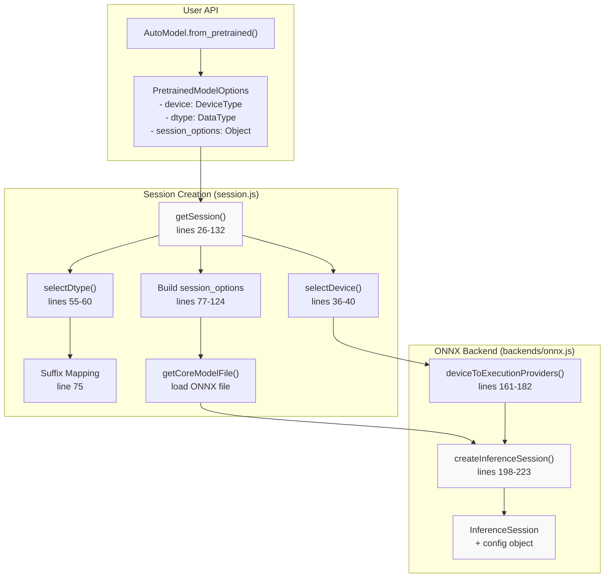
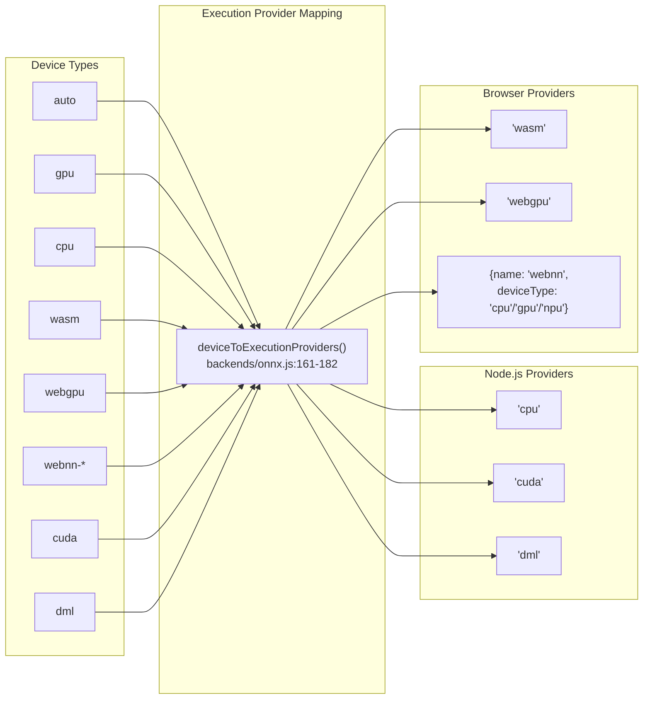
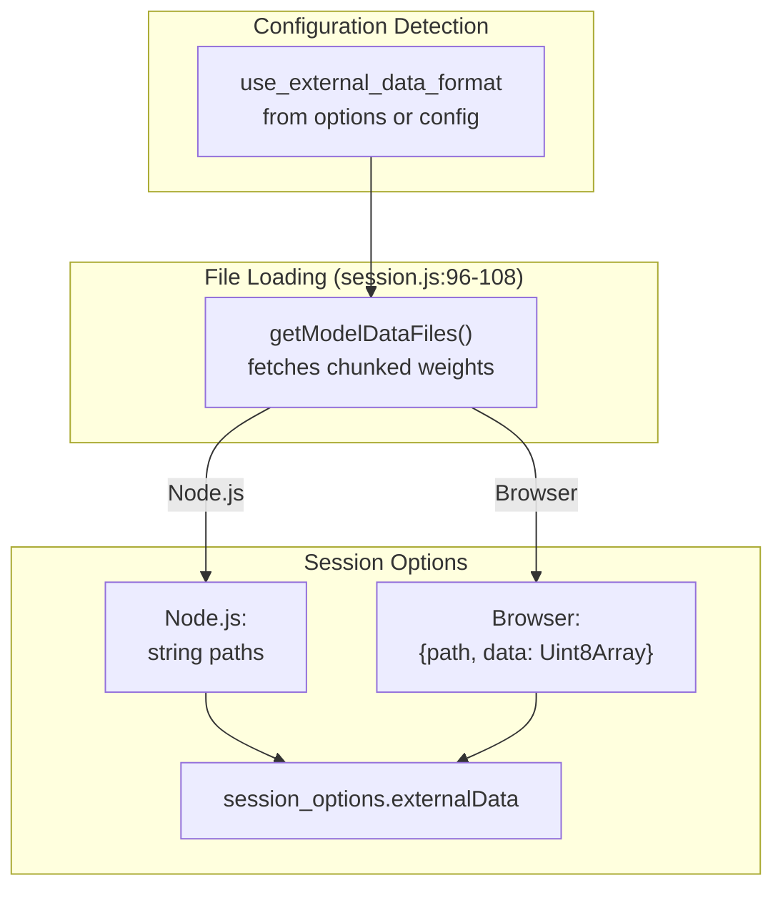

<!-- source: DeepWiki mcp.deepwiki.com · repo huggingface/transformers.js · page 8.3 Session Configuration · fetched 2026-10-26 -->

# Session Configuration

Relevant source files

The following files were used as context for generating this wiki page:

- [packages/transformers/scripts/build/plugins/ignoreModulesPlugin.mjs](packages/transformers/scripts/build/plugins/ignoreModulesPlugin.mjs)
- [packages/transformers/src/backends/onnx.js](packages/transformers/src/backends/onnx.js)
- [packages/transformers/src/backends/utils/cacheWasm.js](packages/transformers/src/backends/utils/cacheWasm.js)
- [packages/transformers/src/image_processors_utils.js](packages/transformers/src/image_processors_utils.js)
- [packages/transformers/src/models/session.js](packages/transformers/src/models/session.js)
- [packages/transformers/src/models/session_config.js](packages/transformers/src/models/session_config.js)
- [packages/transformers/src/utils/hub/utils.js](packages/transformers/src/utils/hub/utils.js)
- [packages/transformers/src/utils/image.js](packages/transformers/src/utils/image.js)
- [packages/transformers/src/utils/model_registry/get_available_dtypes.js](packages/transformers/src/utils/model_registry/get_available_dtypes.js)
- [packages/transformers/src/utils/model_registry/resolve_model_type.js](packages/transformers/src/utils/model_registry/resolve_model_type.js)
- [packages/transformers/tests/models/cohere_asr/test_feature_extraction_cohere_asr.js](packages/transformers/tests/models/cohere_asr/test_feature_extraction_cohere_asr.js)
- [packages/transformers/tests/pipelines/test_pipelines_automatic_speech_recognition.js](packages/transformers/tests/pipelines/test_pipelines_automatic_speech_recognition.js)
- [packages/transformers/tests/utils/custom_cache.test.js](packages/transformers/tests/utils/custom_cache.test.js)

Session configuration controls how ONNX Runtime inference sessions are created and executed in Transformers.js. This includes selecting execution providers (device backends), setting session options for memory management and threading, and handling external data for large models. The configuration process bridges user-specified preferences (device, dtype) with the low-level ONNX Runtime session options required for optimal performance across different environments.

For information about device and dtype selection logic, see [8.1 Device and Dtype Selection](). For details about the ONNX Runtime backend itself, see [8.2 Backend Architecture]().

## Session Creation Flow

When a model is loaded using `AutoModel.from_pretrained()`, the system creates one or more ONNX inference sessions through a multi-step configuration process. The `getSession()` function orchestrates this process, transforming user options into concrete session configurations.

**Session Creation Flow Diagram**: Shows how user options flow through the configuration pipeline to create ONNX inference sessions.

Sources: [packages/transformers/src/models/session.js:26-132](), [packages/transformers/src/backends/onnx.js:198-223]()

## Session Options Object

The `session_options` object passed to `InferenceSession.create()` contains ONNX Runtime-specific configuration. Transformers.js builds this object by merging user-provided options with defaults derived from the model configuration.

| Option | Type | Description | Set By |
|--------|------|-------------|--------|
| `executionProviders` | `ExecutionProviderConfig[]` | Backend providers (e.g., `['webgpu']`, `['cpu']`) | `getSession()` via `deviceToExecutionProviders()` |
| `freeDimensionOverrides` | `Object` | Fixed dimensions for dynamic shapes | Model config or user override |
| `externalData` | `Array` | External data file references | `getSession()` for large models |
| `preferredOutputLocation` | `Object` | Output tensor locations (e.g., `'gpu-buffer'`) | `getSession()` for WebGPU |

**Session Options Configuration Table**

Sources: [packages/transformers/src/models/session.js:77-124]()

### Execution Provider Configuration

Execution providers determine which hardware backend ONNX Runtime uses. The mapping from device types to execution providers is environment-specific and handled by `DEVICE_TO_EXECUTION_PROVIDER_MAPPING`.

**Execution Provider Mapping Diagram**: Maps device types to ONNX Runtime execution providers.

The function `deviceToExecutionProviders()` implements this mapping:
- Returns `defaultDevices` (`['cpu']` for Node.js, `['wasm']` for browser) if no device specified `[packages/transformers/src/backends/onnx.js:163-165]()`.
- For `"auto"`, returns `supportedDevices` array, which is prioritized based on the platform (e.g., `dml` on Windows, `cuda` on Linux x64) `[packages/transformers/src/backends/onnx.js:120-151]()`.
- For specific devices, returns the corresponding execution provider defined in `DEVICE_TO_EXECUTION_PROVIDER_MAPPING` `[packages/transformers/src/backends/onnx.js:35-49]()`.

Sources: [packages/transformers/src/backends/onnx.js:35-49](), [packages/transformers/src/backends/onnx.js:161-182]()

### Free Dimension Overrides

Some execution providers (notably WebNN) do not currently support dynamic shapes and require fixed dimensions. The `freeDimensionOverrides` option addresses this by mapping symbolic dimension names to concrete values.

The configuration is resolved in this order:
1. Check `config['transformers.js_config'].free_dimension_overrides` `[packages/transformers/src/models/session.js:83-85]()`.
2. Check `config['transformers.js_config'].device_config[selectedDevice].free_dimension_overrides` `[packages/transformers/src/models/session.js:45-51]()`.
3. If a WebNN device is used and no overrides are found, a warning is logged regarding performance degradation `[packages/transformers/src/models/session.js:86-91]()`.

Sources: [packages/transformers/src/models/session.js:82-91]()

## External Data Handling

Models larger than 2GB must split their weights across multiple files. Transformers.js supports loading these external data files automatically via `getModelDataFiles`.

**External Data Loading Flow**: Shows how external data files are discovered and loaded.

The external data format is handled differently depending on the environment:
- **Node.js**: External data can be provided as file paths (strings) if they are locally available `[packages/transformers/src/models/session.js:106-108]()`.
- **Browser/Non-Node**: External data is loaded as a buffer and passed to the session options `[packages/transformers/src/models/session.js:107]()`.

Sources: [packages/transformers/src/models/session.js:96-108](), [packages/transformers/src/utils/model-loader.js:12]()

## WebGPU-Specific Configuration

When using WebGPU as the execution provider, Transformers.js applies additional optimizations for tensor management. Specifically, it configures output tensors to remain on the GPU to avoid expensive CPU↔GPU transfers.

The `preferredOutputLocation` option tells ONNX Runtime to keep specified outputs in GPU buffers rather than copying them to CPU memory. This is particularly beneficial for KV caches (`present.*`) which are reused across generation steps `[packages/transformers/src/models/session.js:110-124]()`.

The configuration is only applied when:
1. Device is `'webgpu'` `[packages/transformers/src/models/session.js:110]()`.
2. Model has cache names (computed via `getCacheNames`) `[packages/transformers/src/models/session.js:111-115]()`.
3. ONNX is not proxied (when `isONNXProxy()` is false) `[packages/transformers/src/models/session.js:115]()`.

Sources: [packages/transformers/src/models/session.js:110-124](), [packages/transformers/src/configs.js:8]()

## Multi-Session Construction

Some models require multiple ONNX sessions (e.g., encoder and decoder for sequence-to-sequence models). The `constructSessions()` function creates all required sessions in parallel `[packages/transformers/src/models/session.js:145-162]()`.

Each session goes through the `getSession()` pipeline independently. The `cache_sessions` parameter allows users to specify which sessions should have GPU-pinned KV cache outputs `[packages/transformers/src/models/session.js:149-156]()`.

Sources: [packages/transformers/src/models/session.js:145-162]()

## WASM Path and Factory Configuration

For the Web/WASM backend, Transformers.js manages the loading of the ONNX Runtime WASM binary and the JS factory.

- **WASM Binary**: Loaded via `loadWasmBinary()`, which uses the `getCache()` utility to store the binary in the browser's Cache API for faster subsequent loads `[packages/transformers/src/backends/utils/cacheWasm.js:54-64]()`.
- **WASM Factory**: Loaded via `loadWasmFactory()`. In Deno environments, the library patches the factory code to disable incorrect Node.js detection (e.g., `process.versions.node`) that would otherwise trigger incompatible code paths `[packages/transformers/src/backends/utils/cacheWasm.js:72-101]()`.

Sources: [packages/transformers/src/backends/utils/cacheWasm.js:10-101](), [packages/transformers/src/backends/onnx.js:25]()

## Code Entities Reference

| Entity | Location | Purpose |
|--------|----------|---------|
| `getSession()` | [packages/transformers/src/models/session.js:26]() | Main session configuration function |
| `createInferenceSession()` | [packages/transformers/src/backends/onnx.js:198]() | ONNX Runtime session creation wrapper |
| `constructSessions()` | [packages/transformers/src/models/session.js:145]() | Creates multiple sessions in parallel |
| `deviceToExecutionProviders()` | [packages/transformers/src/backends/onnx.js:161]() | Maps device types to execution providers |
| `loadWasmBinary()` | [packages/transformers/src/backends/utils/cacheWasm.js:54]() | Fetches and caches the ORT WASM binary |
| `loadWasmFactory()` | [packages/transformers/src/backends/utils/cacheWasm.js:72]() | Fetches and patches the ORT WASM factory |
| `DEVICE_TO_EXECUTION_PROVIDER_MAPPING` | [packages/transformers/src/backends/onnx.js:35]() | Device to provider lookup table |
| `getOnnxLogSeverityLevel()` | [packages/transformers/src/backends/onnx.js:58]() | Maps library log levels to ORT severity |

**Key Code Entities Table**

---

