<!-- source: DeepWiki mcp.deepwiki.com · repo huggingface/transformers.js · page 9 Tensor Operations · fetched 2026-10-26 -->

# Tensor Operations

<details>
<summary>Relevant source files</summary>

The following files were used as context for generating this wiki page:

- [packages/transformers/src/models/chatterbox/modeling_chatterbox.js](packages/transformers/src/models/chatterbox/modeling_chatterbox.js)
- [packages/transformers/src/models/florence2/modeling_florence2.js](packages/transformers/src/models/florence2/modeling_florence2.js)
- [packages/transformers/src/models/multi_modality/modeling_multi_modality.js](packages/transformers/src/models/multi_modality/modeling_multi_modality.js)
- [packages/transformers/src/models/phi3_v/modeling_phi3_v.js](packages/transformers/src/models/phi3_v/modeling_phi3_v.js)
- [packages/transformers/src/utils/tensor.js](packages/transformers/src/utils/tensor.js)
- [packages/transformers/tests/utils/tensor.test.js](packages/transformers/tests/utils/tensor.test.js)

</details>


## Purpose and Scope

This document covers the `Tensor` class and tensor manipulation utilities used internally throughout transformers.js. The `Tensor` class wraps ONNX Runtime tensors with a JavaScript-friendly API for numerical computations, shape manipulation, and mathematical operations. All model inputs and outputs flow through this tensor abstraction, which provides both Python-like convenience methods and hardware-accelerated operations via ONNX Runtime.

**Related Documentation**:
- For detailed tensor method signatures and usage, see [Tensor Methods](#9.1)
- For the ONNX Runtime execution backend, see [ONNX Runtime Backend](#8)
- For tensor usage in model pipelines, see [Pipeline API](#2)

---

## Tensor Class Architecture

The `Tensor` class wraps ONNX Runtime's native tensor implementation, providing a Python-like API for JavaScript environments. It serves as the primary data structure for all numerical computations in the library.

**Tensor Class Architecture Diagram**

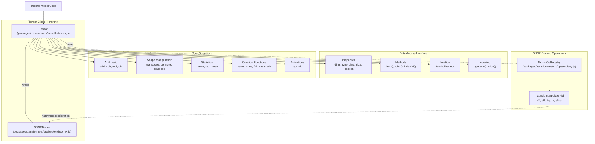

**Sources**: [packages/transformers/src/utils/tensor.js:25-72](), [packages/transformers/src/ops/registry.js:33-88]()

---

## Construction and Properties

### Tensor Constructor

The `Tensor` class can be constructed in two ways: by wrapping an existing ONNX tensor or by creating a new tensor from data.

**Tensor Construction Paths**

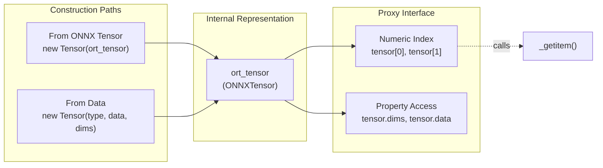

The constructor uses a JavaScript Proxy to enable array-like indexing: accessing `tensor[0]` internally calls `tensor._getitem(0)`, returning a view or subarray of the tensor data [packages/transformers/src/utils/tensor.js:91-109]().

**Sources**: [packages/transformers/src/utils/tensor.js:78-110]()

### Core Properties

| Property | Type | Description |
|----------|------|-------------|
| `dims` | `number[]` | Shape of the tensor (e.g., `[2, 3, 4]` for 2×3×4 tensor) |
| `type` | `DataType` | Data type string (e.g., `'float32'`, `'int64'`) |
| `data` | `DataArray` | Underlying typed array containing tensor values |
| `size` | `number` | Total number of elements in the tensor |
| `location` | `string` | Memory location (`'cpu'` or `'gpu-buffer'`) |

**Sources**: [packages/transformers/src/utils/tensor.js:30-70]()

---

## Data Type System

The library supports a comprehensive set of data types through the `DataTypeMap`, which maps type strings to JavaScript typed array constructors.

**Data Type Mapping**

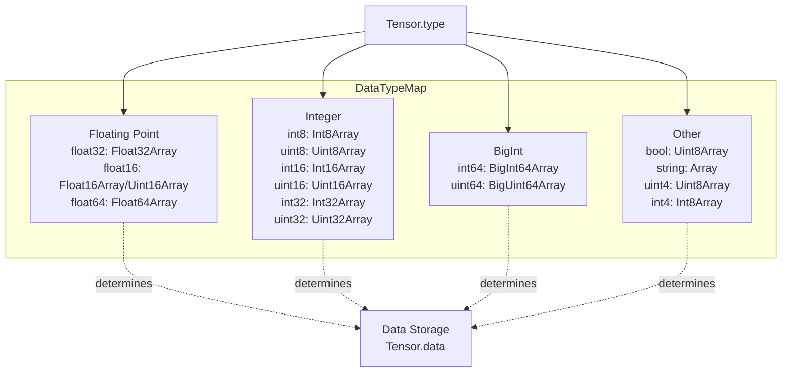

**Note**: `float16` uses native `Float16Array` where available (limited browser support), falling back to `Uint16Array` for compatibility [packages/transformers/src/utils/dtypes.js:13-17]().

**Sources**: [packages/transformers/src/utils/tensor.js:21-23](), [packages/transformers/src/utils/dtypes.js:1-35]()

---

## Tensor Creation Functions

These factory functions create new tensors with specific initialization patterns.

### Basic Creation

**Tensor Creation Functions**

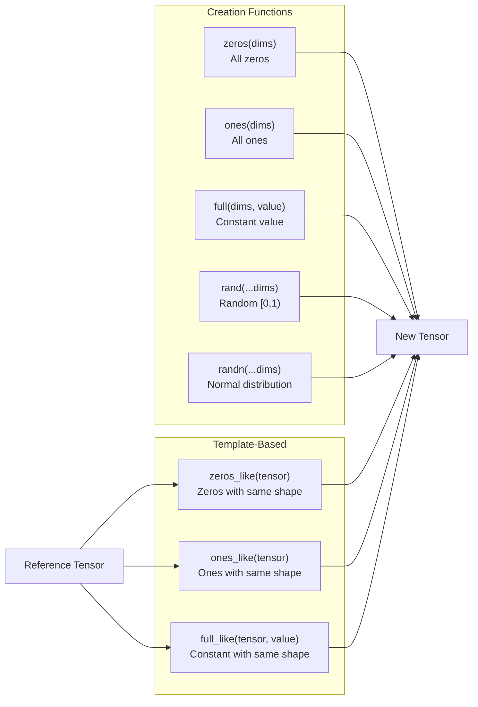

**Sources**: [packages/transformers/src/utils/tensor.js:986-1088]()

### Concatenation and Stacking

| Function | Description | Example |
|----------|-------------|---------|
| `cat(tensors, dim)` | Concatenate tensors along dimension | `cat([t1, t2], 0)` joins along first dimension |
| `stack(tensors, dim)` | Stack tensors to create new dimension | `stack([t1, t2], 0)` creates batch dimension |

**Sources**: [packages/transformers/src/utils/tensor.js:1090-1227]()

---

## Shape Manipulation Operations

### Slicing

The `slice()` method extracts subarrays from tensors using Python-like indexing syntax.

**Tensor Slicing Operations**

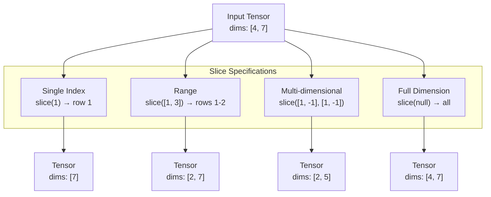

**Slice Index Types**:
- **Number**: Select single element (e.g., `1` for second row)
- **Array `[start, end]`**: Select range `[start, end)` (end exclusive)
- **`null`**: Select entire dimension
- **Negative indices**: Count from end (e.g., `-1` is last element)

**Sources**: [packages/transformers/src/utils/tensor.js:387-610]()

### Dimension Manipulation

| Method | Description | Example |
|--------|-------------|---------|
| `unsqueeze(dim)` | Add dimension of size 1 | `[3, 4]` → `[1, 3, 4]` with `dim=0` |
| `squeeze(dim)` | Remove dimensions of size 1 | `[1, 3, 1, 4]` → `[3, 4]` |
| `transpose(...axes)` | Swap two dimensions | `[2, 3, 4]` → `[2, 4, 3]` with `transpose(-1, -2)` |
| `permute(...axes)` | Reorder all dimensions | `[2, 3, 4]` → `[4, 2, 3]` with `permute(2, 0, 1)` |
| `view(...dims)` | Reshape without copying data | `[6]` → `[2, 3]` |

**Sources**: [packages/transformers/src/utils/tensor.js:612-750]()

---

## Arithmetic Operations

All arithmetic operations come in two variants:
- **Immutable** (`add`, `mul`, etc.): Create new tensor with result
- **In-place** (`add_`, `mul_`, etc.): Modify tensor in place, return `this`

**Arithmetic Operation Variants**

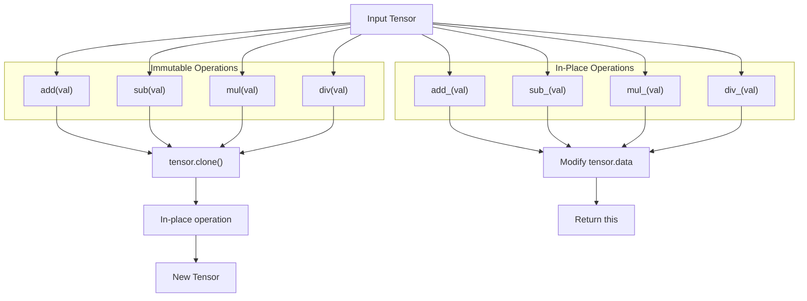

**Implementation Pattern**:
```javascript
// Immutable version creates new tensor
mul(val) {
    return this.clone().mul_(val);
}

// In-place version modifies data directly
mul_(val) {
    const this_data = this.data;
    for (let i = 0; i < this_data.length; ++i) {
        this_data[i] *= val;
    }
    return this;
}
```

**Sources**: [packages/transformers/src/utils/tensor.js:267-348]()

---

## Statistical Operations

### Core Statistical Functions

**Statistical Functions Overview**

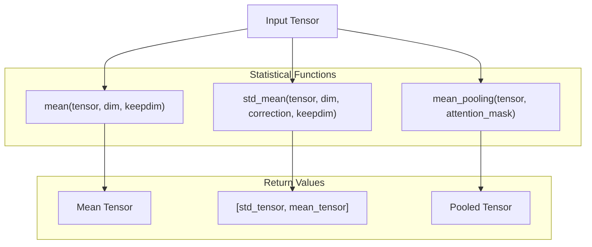

**Function Signatures**:
- `mean(tensor, dim=-1, keepdim=false)`: Compute mean along dimension [packages/transformers/src/utils/tensor.js:764-793]()
- `std_mean(tensor, dim=-1, correction=1, keepdim=false)`: Compute standard deviation and mean [packages/transformers/src/utils/tensor.js:795-837]()
- `mean_pooling(tensor, attention_mask)`: Apply attention-masked pooling for embeddings [packages/transformers/src/utils/tensor.js:839-871]()

**Sources**: [packages/transformers/src/utils/tensor.js:764-871]()

---

## Matrix Operations

Matrix operations are hardware-accelerated through ONNX Runtime via the `TensorOpRegistry`.

**Matrix Operation Execution Flow**

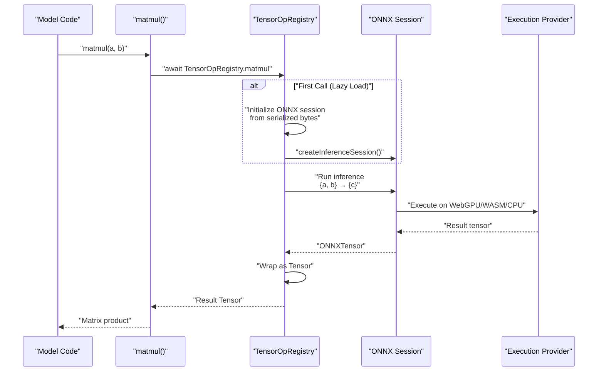

**Key Matrix Operations**:
- `matmul(a, b)`: Matrix multiplication with broadcasting [packages/transformers/src/utils/tensor.js:752-762]()
- `transpose(tensor, axes)`: Transpose dimensions [packages/transformers/src/utils/tensor.js:633-653]()
- `permute_data(array, dims, axes)`: Low-level permutation for typed arrays [packages/transformers/src/utils/maths.js:332-386]()

**Sources**: [packages/transformers/src/utils/tensor.js:752-762](), [packages/transformers/src/ops/registry.js:71-80]()

---

## Activation Functions

### Sigmoid Activation

The sigmoid function `σ(x) = 1 / (1 + e^(-x))` is commonly used in model inference.

**Sigmoid Function Variants**

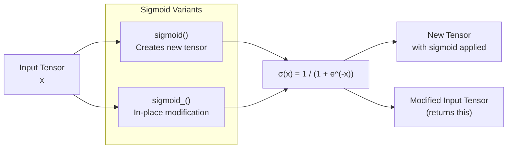

**Sources**: [packages/transformers/src/utils/tensor.js:209-223]()

---

## ONNX-Backed Operations

The `TensorOpRegistry` provides hardware-accelerated operations through pre-compiled ONNX models. These operations are lazily initialized on first use.

### Registry Architecture

**TensorOpRegistry Lazy Initialization**

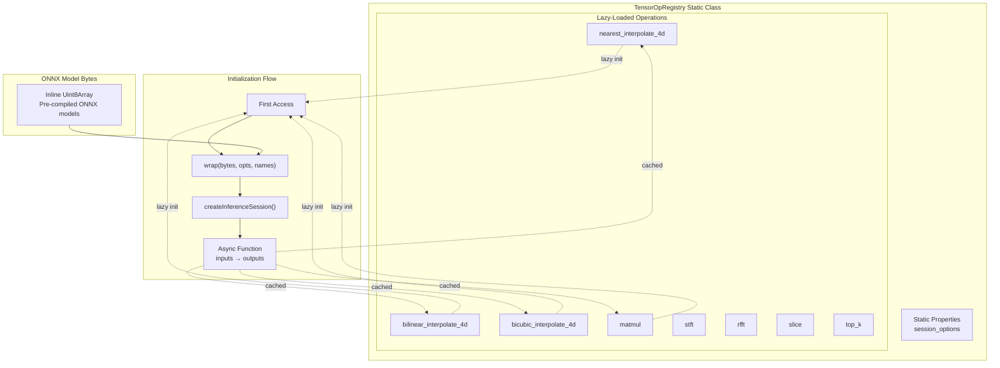

**Sources**: [packages/transformers/src/ops/registry.js:14-88]()

### Available Operations

| Operation | Purpose | Input/Output |
|-----------|---------|--------------|
| `nearest_interpolate_4d` | Nearest-neighbor interpolation for 4D tensors | `{x, s}` → `{y}` |
| `bilinear_interpolate_4d` | Bilinear interpolation for images | `{x, s}` → `{y}` |
| `bicubic_interpolate_4d` | Bicubic interpolation for high-quality resize | `{x, s}` → `{y}` |
| `matmul` | Matrix multiplication | `{a, b}` → `{c}` |
| `stft` | Short-Time Fourier Transform | `{s, j, w, l}` → `{o}` |
| `rfft` | Real FFT (1D) | `{input}` → `{output}` |
| `slice` | Generic tensor slicing | `{data, starts, ends, axes, steps}` → `{output}` |
| `top_k` | Top K elements with indices | `{x, k}` → `{values, indices}` |

**Sources**: [packages/transformers/src/ops/registry.js:39-88]()

### Interpolation Operations

The interpolation functions resize 4D tensors (batch, channel, height, width) using different algorithms:

**Interpolation Modes**

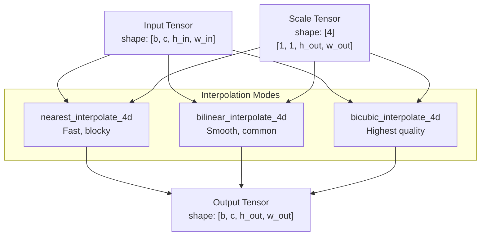

The high-level `interpolate_4d()` function selects the appropriate ONNX operation based on the mode parameter [packages/transformers/src/utils/tensor.js:1229-1277]().

**Sources**: [packages/transformers/src/ops/registry.js:39-69](), [packages/transformers/src/utils/tensor.js:1229-1277]()

---

## Advanced Operations

### Quantization

The library provides quantization functions for embedding compression:

**Quantization Process**

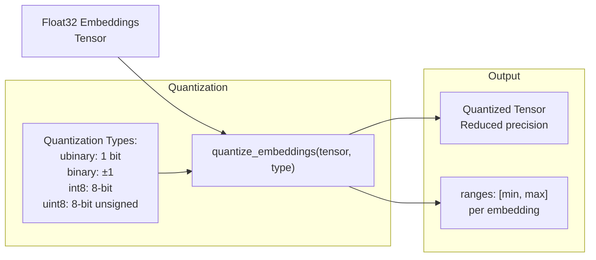

**Supported Types**:
- `'ubinary'`: Ultra-compact binary (1 bit per value)
- `'binary'`: Signed binary (-1 or +1)
- `'int8'`: 8-bit signed integers
- `'uint8'`: 8-bit unsigned integers

**Sources**: [packages/transformers/src/utils/tensor.js:873-984]()

### Top-K Selection

The `topk()` function finds the K largest elements and their indices [packages/transformers/src/utils/tensor.js:1303-1318]():

```javascript
const tensor = new Tensor('float32', [3.0, 1.0, 4.0, 1.0, 5.0], [5]);
const [values, indices] = await topk(tensor, 3);
// values: Tensor([5.0, 4.0, 3.0], [3])
// indices: Tensor([4, 2, 0], [3])
```

This operation uses the ONNX-backed `TensorOpRegistry.top_k` for hardware acceleration.

**Sources**: [packages/transformers/src/utils/tensor.js:1303-1318]()

### Layer Normalization

Layer normalization stabilizes training and inference by normalizing activations [packages/transformers/src/utils/tensor.js:1320-1384]:

**Layer Normalization Process**

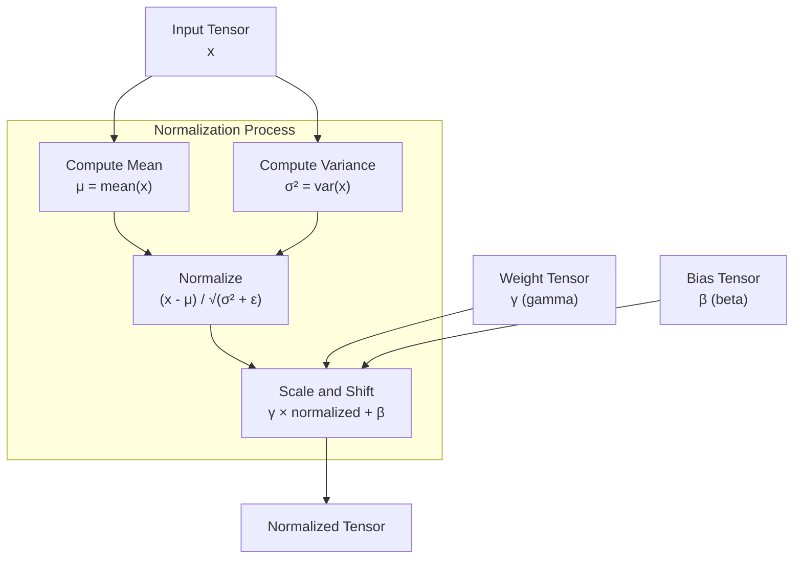

**Function Signature**: `layer_norm(x, normalized_shape, {weight, bias, eps=1e-5})`

**Sources**: [packages/transformers/src/utils/tensor.js:1320-1384]()

---

## Memory Management

### Tensor Disposal

Tensors backed by GPU memory should be explicitly disposed to prevent memory leaks [packages/transformers/src/utils/tensor.js:112-115]():

```javascript
const tensor = new Tensor('float32', data, dims);
// ... use tensor ...
tensor.dispose(); // Frees ONNX tensor resources
```

The `dispose()` method releases the underlying ONNX tensor. For CPU tensors, JavaScript garbage collection handles cleanup automatically.

**Sources**: [packages/transformers/src/utils/tensor.js:112-115]()

### Location Awareness

The `location` property indicates where tensor data resides:
- `'cpu'`: Data in system memory (accessible via `.data`)
- `'gpu-buffer'`: Data in GPU memory (`.data` unavailable)

When tensors are on GPU, operations like `tolist()` and direct data access may trigger expensive device-to-host transfers.

**Sources**: [packages/transformers/src/utils/tensor.js:68-70]()

---

## Integration with Model Inference

Tensors serve as the primary data structure throughout the model inference pipeline. All inputs and outputs are represented as named Tensor dictionaries.

**Tensor Flow Through Inference Pipeline**

```mermaid
graph LR
    subgraph InputProcessing["Input Processing"]
        Raw["Raw Input<br/>text/image/audio"]
        Processor["Processor/Tokenizer"]
        InputTensor["Input Tensors<br/>input_ids, pixel_values"]
    end
    
    subgraph ModelExecution["Model Execution"]
        Validate["validateInputs()<br/>(src/models.js)"]
        ToONNX["Convert to<br/>ort_tensor"]
        RunModel["ONNX Session<br/>runInferenceSession()"]
        FromONNX["Wrap as Tensor<br/>replaceTensors()"]
    end
    
    subgraph OutputProcessing["Output Processing"]
        OutputTensor["Output Tensors<br/>logits, embeddings"]
        PostProcess["Post-processing"]
        Result["Final Result"]
    end
    
    Raw --> Processor
    Processor --> InputTensor
    InputTensor --> Validate
    Validate --> ToONNX
    ToONNX --> RunModel
    RunModel --> FromONNX
    FromONNX --> OutputTensor
    OutputTensor --> PostProcess
    PostProcess --> Result
```

**Key Integration Points**:
- Models receive and return dictionaries of named Tensors.
- Architectural classes like `ChatterboxModel` use `cat`, `ones`, and `full` for input preparation [packages/transformers/src/models/chatterbox/modeling_chatterbox.js:73-111]().
- Multi-modal models like `MultiModalityCausalLM` utilize `Tensor` slicing and `cat` for guided generation and image token handling [packages/transformers/src/models/multi_modality/modeling_multi_modality.js:78-115]().

**Sources**: [packages/transformers/src/models/chatterbox/modeling_chatterbox.js:3-111](), [packages/transformers/src/models/multi_modality/modeling_multi_modality.js:5-156]()

---

## Usage Examples

### Creating and Manipulating Tensors

```javascript
// Create from data
const t1 = new Tensor('float32', [1, 2, 3, 4], [2, 2]);

// Create with factory functions
const zeros_tensor = zeros([3, 4]);
const ones_tensor = ones_like(t1);

// Arithmetic operations
const t2 = t1.mul(2).add(1);  // (t1 * 2) + 1

// Shape manipulation
const reshaped = t1.view(1, 4);  // [2, 2] → [1, 4]
const sliced = t1.slice([0, 1], null);  // First row

// Concatenation
const combined = cat([t1, t2], 0);  // Stack vertically
```

### Matrix Operations

```javascript
const a = new Tensor('float32', [1, 2, 3, 4], [2, 2]);
const b = new Tensor('float32', [5, 6, 7, 8], [2, 2]);

// Matrix multiplication (hardware-accelerated)
const c = await matmul(a, b);

// Transpose
const transposed = a.transpose(-1, -2);
```

### Image Interpolation

```javascript
const image = new Tensor('float32', pixels, [1, 3, 224, 224]);
const size = [1, 3, 384, 384];

// Bilinear interpolation for resizing
const resized = await interpolate_4d(image, {
    mode: 'bilinear',
    size: size,
});
```

**Sources**: [packages/transformers/tests/utils/tensor.test.js:8-141](), [packages/transformers/src/utils/tensor.js:1229-1277]()

---

