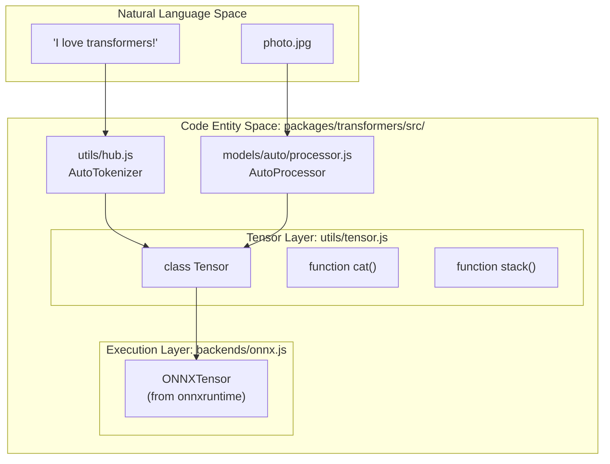
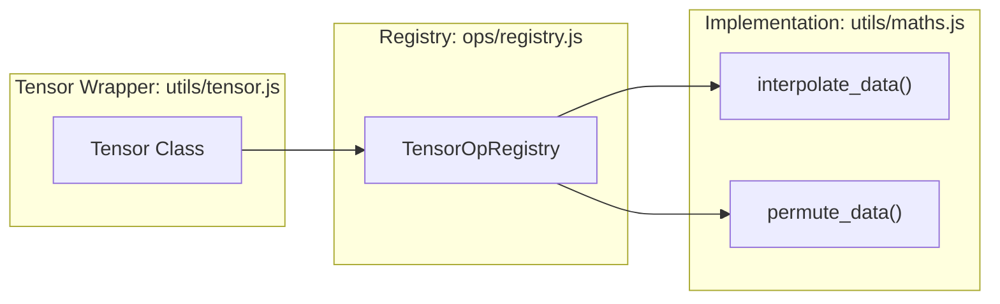

<!-- source: DeepWiki mcp.deepwiki.com · repo huggingface/transformers.js · page 9.1 Tensor Methods · fetched 2026-10-26 -->

# Tensor Methods

<details>
<summary>Relevant source files</summary>

The following files were used as context for generating this wiki page:

- [packages/transformers/src/models/chatterbox/modeling_chatterbox.js](packages/transformers/src/models/chatterbox/modeling_chatterbox.js)
- [packages/transformers/src/models/florence2/modeling_florence2.js](packages/transformers/src/models/florence2/modeling_florence2.js)
- [packages/transformers/src/models/multi_modality/modeling_multi_modality.js](packages/transformers/src/models/multi_modality/modeling_multi_modality.js)
- [packages/transformers/src/models/phi3_v/modeling_phi3_v.js](packages/transformers/src/models/phi3_v/modeling_phi3_v.js)
- [packages/transformers/src/utils/tensor.js](packages/transformers/src/utils/tensor.js)
- [packages/transformers/tests/utils/tensor.test.js](packages/transformers/tests/utils/tensor.test.js)

</details>


This page documents the tensor data structures and operations used internally throughout the transformers.js library. Tensors serve as the fundamental data representation for model inputs, outputs, and intermediate computations during inference.

## Purpose and Scope

Tensors in transformers.js are multi-dimensional arrays that represent numerical data flowing through the inference pipeline. While the library uses ONNX Runtime (`onnxruntime-web` or `onnxruntime-node`) as its backend, it provides a custom `Tensor` wrapper to simplify common operations like slicing, concatenation, and mathematical transformations.

This page covers:
- The internal `Tensor` class and its relationship to `ONNXTensor`.
- Data structure handling and JavaScript type mapping.
- The `TensorOpRegistry` for custom operators.
- Common tensor manipulation methods used in model implementations.

## Tensor Flow in the Pipeline

The following diagram bridges the gap between natural language processing tasks and the underlying code entities that handle tensor data.

**Natural Language Space to Code Entity Space**



**Sources:** [packages/transformers/src/utils/tensor.js:1-12](), [packages/transformers/src/models/chatterbox/modeling_chatterbox.js:1-3]()

## The Tensor Class

The `Tensor` class in `packages/transformers/src/utils/tensor.js` acts as a proxy-wrapped interface around the base `ONNXTensor`.

### Implementation Details
The class uses a JavaScript `Proxy` in its constructor to allow for Python-like indexing (e.g., `tensor[0]` calls `_getitem(0)` internally) [packages/transformers/src/utils/tensor.js:91-109]().

| Property | Type | Description |
|-----------|------|-------------|
| `dims` | `number[]` | The shape of the tensor [packages/transformers/src/utils/tensor.js:30-33](). |
| `type` | `DataType` | The data type (e.g., 'float32', 'int64') [packages/transformers/src/utils/tensor.js:44-46](). |
| `data` | `DataArray` | The underlying `TypedArray` containing the numerical values [packages/transformers/src/utils/tensor.js:52-54](). |
| `ort_tensor`| `ONNXTensor`| The underlying ONNX Runtime tensor object [packages/transformers/src/utils/tensor.js:72-72](). |

### Tensor Creation and Conversion
Tensors can be initialized either from an existing `ONNXTensor` or by providing type, data, and dimensions [packages/transformers/src/utils/tensor.js:78-89]().

**Sources:** [packages/transformers/src/utils/tensor.js:25-110]()

## Core Tensor Operations

The library provides several standalone functions for manipulating tensors, which are heavily used in model forward passes (e.g., `Florence2`, `Chatterbox`, `Phi3V`).

### Manipulation Methods

| Function | File Location | Purpose |
|----------|---------------|---------|
| `cat(tensors, dim)` | `utils/tensor.js` | Concatenates a list of tensors along a specified dimension [packages/transformers/src/utils/tensor.js:521-521](). Used for merging text and image features [packages/transformers/src/models/florence2/modeling_florence2.js:25-31](). |
| `stack(tensors, dim)` | `utils/tensor.js` | Joins a sequence of tensors along a new dimension [packages/transformers/tests/utils/tensor.test.js:143-184](). |
| `slice(starts, ends)` | `utils/tensor.js` | Extracts a sub-region of the tensor [packages/transformers/src/utils/tensor.js:301-301](). |
| `full(dims, value)` | `utils/tensor.js` | Creates a tensor of specified shape filled with a constant value [packages/transformers/src/models/chatterbox/modeling_chatterbox.js:76-76](). |
| `ones(dims)` | `utils/tensor.js` | Creates a tensor filled with ones [packages/transformers/src/models/florence2/modeling_florence2.js:34-34](). |

### Model-Specific Usage Patterns
In multimodal models like `ChatterboxModel`, tensors are concatenated to form the input for the LLM decoder:
```javascript
// Update LLM inputs by concatenating audio and text embeddings
inputs_embeds = cat([speech_encoder_outputs.audio_features, inputs_embeds], 1);
```
**Sources:** [packages/transformers/src/models/chatterbox/modeling_chatterbox.js:102-102](), [packages/transformers/src/models/florence2/modeling_florence2.js:25-31]()

## TensorOpRegistry and Interpolation

For operations not natively supported or optimized in standard ONNX environments (like specific resizing/interpolation), transformers.js utilizes a `TensorOpRegistry`.

### Data Flow for Custom Ops



The `Tensor` class imports these low-level mathematical operations to provide high-level methods:
- **Interpolation**: Used for resizing image tensors during preprocessing or generation [packages/transformers/src/utils/tensor.js:10-14]().
- **Permutation**: Used to reorder dimensions (e.g., HWC to CHW for vision models) [packages/transformers/src/utils/tensor.js:10-10]().

**Sources:** [packages/transformers/src/utils/tensor.js:10-14](), [packages/transformers/src/utils/maths.js:1-10]()

## Memory Management and Disposal

Because tensors wrap ONNX Runtime objects that may hold resources in WASM memory or WebGPU buffers, explicit disposal is supported.

- `dispose()`: Calls the underlying `ort_tensor.dispose()` to free backend memory [packages/transformers/src/utils/tensor.js:112-115]().
- `clone()`: Creates a deep copy of the tensor data to avoid side effects during in-place operations like `sigmoid_()` [packages/transformers/src/utils/tensor.js:209-211]().

## Data Type Mapping

The library maps JavaScript types to ONNX-compatible data types via `DataTypeMap`.

| JS Type | Tensor Type | Usage |
|---------|-------------|-------|
| `Float32Array` | `float32` | Embeddings, logits, pixel values [packages/transformers/src/models/phi3_v/modeling_phi3_v.js:51-51](). |
| `BigInt64Array`| `int64` | Input IDs, position IDs [packages/transformers/src/models/chatterbox/modeling_chatterbox.js:142-142](). |
| `Uint8Array` | `uint8` | Quantized data, image pixels [packages/transformers/src/models/multi_modality/modeling_multi_modality.js:147-147](). |
| `Uint16Array` | `float16` | Half-precision weights (via `uint16_to_float32`) [packages/transformers/src/utils/tensor.js:10-10](). |

**Sources:** [packages/transformers/src/utils/tensor.js:16-23](), [packages/transformers/src/utils/dtypes.js:1-10]()

## Output Processing

After model execution, outputs are typically converted back to standard JavaScript structures for the end-user.

- `tolist()`: Recursively converts the tensor into a nested JavaScript array [packages/transformers/src/utils/tensor.js:201-203]().
- `item()`: Extracts a single scalar value from a 1-element tensor [packages/transformers/src/utils/tensor.js:189-195]().

**Sources:** [packages/transformers/src/utils/tensor.js:189-203]()

---

