# Page: Overview

# Overview

<details>
<summary>Relevant source files</summary>

The following files were used as context for generating this wiki page:

- [README.md](README.md)
- [package.json](package.json)
- [packages/transformers/docs/snippets/2_installation.snippet](packages/transformers/docs/snippets/2_installation.snippet)
- [packages/transformers/docs/snippets/3_custom-usage.snippet](packages/transformers/docs/snippets/3_custom-usage.snippet)
- [packages/transformers/package.json](packages/transformers/package.json)
- [packages/transformers/src/env.js](packages/transformers/src/env.js)
- [pnpm-lock.yaml](pnpm-lock.yaml)
- [pnpm-workspace.yaml](pnpm-workspace.yaml)

</details>


## What is Transformers.js?

Transformers.js (`@huggingface/transformers` on npm) is a JavaScript library that enables running state-of-the-art machine learning models directly in web browsers and Node.js environments without requiring a server. It is designed to be functionally equivalent to Hugging Face's Python library, allowing developers to run the same pretrained models using a very similar API [README.md:26-28]().

The library provides:
- **Zero-server ML inference**: Models run entirely client-side in the browser or in Node.js [README.md:26]().
- **100+ supported architectures**: Including BERT, GPT-2, T5, Whisper, CLIP, and Llama [README.md:28-32]().
- **Multiple execution backends**: WebAssembly (WASM), WebGPU, WebNN, CUDA, and DirectML [packages/transformers/src/backends/onnx.js:33-46]().
- **Model quantization support**: fp32, fp16, q8 (8-bit), and q4 (4-bit) quantization [README.md:117-121]().
- **Cross-platform compatibility**: Browser, Node.js, Deno, Bun, and web workers [packages/transformers/src/env.js:37-53]().
- **Pipeline API**: High-level task-based interface compatible with Hugging Face's Python API [README.md:58-93]().

This document provides a high-level architectural overview of the library. For specific implementation details, refer to the subsystem-specific pages: Repository Structure ([Repository Structure](#1.1)), Installation and Setup ([Installation and Setup](#1.2)), and Public API Surface ([Public API Surface](#1.3)).

**Sources:** [README.md:26-36](), [packages/transformers/package.json:2-4](), [packages/transformers/src/env.js:29]()

## Repository Structure

The repository is organized as a pnpm monorepo with the main `@huggingface/transformers` package located in the `packages/transformers/` directory [pnpm-workspace.yaml:1-2](). The monorepo structure allows for potential framework integrations and shared tooling.

For details, see [Repository Structure](#1.1).

**Diagram: Repository Structure**

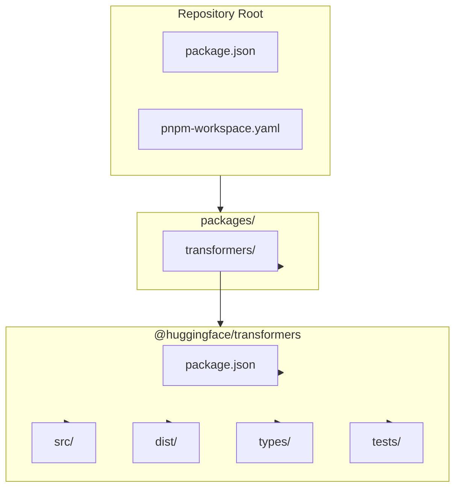

**Sources:** [package.json:1-63](), [pnpm-workspace.yaml:1-13](), [packages/transformers/package.json:1-87]()

## Architecture Overview

Transformers.js uses [ONNX Runtime](https://onnxruntime.ai/) as its execution engine [README.md:34](). The library is organized into distinct layers that handle everything from environment detection to high-level task execution.

**Diagram: Core Library Architecture**

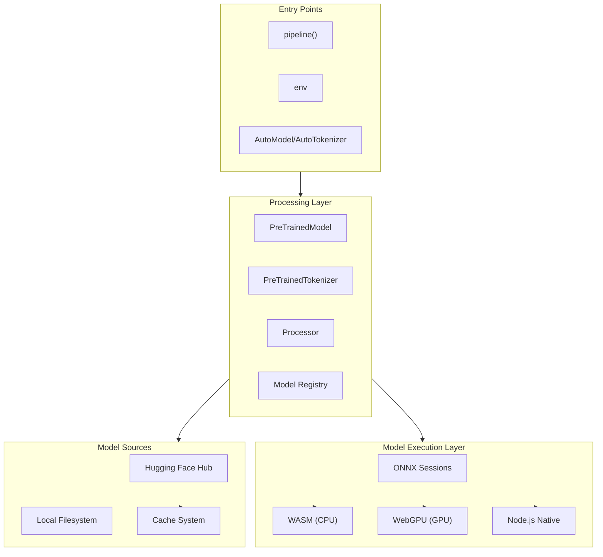

The library adapts to different environments through the `env` object [packages/transformers/src/env.js:1-23](). It detects runtime capabilities such as WebGPU availability, filesystem access, and the presence of the Browser Cache API [packages/transformers/src/env.js:31-65]().

**Sources:** [README.md:34-36](), [packages/transformers/src/env.js:31-144](), [packages/transformers/package.json:57-63]()

## Core Components

### Pipeline System
The `pipeline()` function is the primary high-level interface. It groups together a pretrained model with preprocessing (tokenization/image processing) and postprocessing [README.md:58-59](). It supports over 30 tasks including sentiment analysis, object detection, and speech recognition [README.md:28-32]().

### Model Registry and Auto Classes
The library uses "Auto Classes" (e.g., `AutoModel`, `AutoTokenizer`) to automatically resolve and load the correct class for a given model ID [README.md:142-167](). This system relies on a registry that maps model types (like `bert` or `gpt2`) to their corresponding JavaScript implementations.

### Hub Integration and Caching
Transformers.js integrates with the Hugging Face Hub to fetch models on demand. It features a sophisticated caching system that can use the Browser Cache API, the local filesystem (in Node.js), or a custom user-defined cache [packages/transformers/src/env.js:146-167]().

For details, see [Public API Surface](#1.3).

**Sources:** [README.md:55-109](), [packages/transformers/src/env.js:146-190](), [packages/transformers/package.json:8-23]()

## Installation and Setup

The library can be installed via NPM for use in bundled applications or imported directly via CDN for vanilla JavaScript environments [packages/transformers/docs/snippets/2_installation.snippet:2-12]().

```bash
npm i @huggingface/transformers
```

Configuration is handled globally via the `env` object, allowing users to specify custom model paths, disable remote loading, or configure WASM binary locations [packages/transformers/docs/snippets/3_custom-usage.snippet:8-18]().

For details, see [Installation and Setup](#1.2).

**Sources:** [README.md:39-52](), [packages/transformers/docs/snippets/2_installation.snippet:1-13](), [packages/transformers/docs/snippets/3_custom-usage.snippet:1-25]()

---

# Page: Repository Structure

# Repository Structure

<details>
<summary>Relevant source files</summary>

The following files were used as context for generating this wiki page:

- [.gitignore](.gitignore)
- [README.md](README.md)
- [package.json](package.json)
- [packages/transformers/docs/snippets/2_installation.snippet](packages/transformers/docs/snippets/2_installation.snippet)
- [packages/transformers/docs/snippets/3_custom-usage.snippet](packages/transformers/docs/snippets/3_custom-usage.snippet)
- [packages/transformers/package.json](packages/transformers/package.json)
- [packages/transformers/src/env.js](packages/transformers/src/env.js)
- [pnpm-lock.yaml](pnpm-lock.yaml)
- [pnpm-workspace.yaml](pnpm-workspace.yaml)

</details>


This document explains the physical organization of the transformers.js repository, including its monorepo structure using pnpm workspaces, the layout of the core `@huggingface/transformers` package, and the development infrastructure. For information about the public API surface that users interact with, see [Public API Surface](#1.3). For build and distribution details, see [Build and Distribution](#13).

---

## Monorepo Organization

The repository is structured as a **pnpm monorepo** with a single workspace package. This architecture allows for potential future expansion while maintaining a simple structure for the core library.

### Workspace Root

The root directory contains the workspace configuration and shared development dependencies:

Title: Monorepo Root Structure
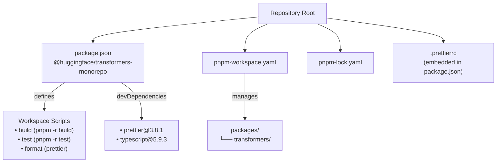

**Sources:** [package.json:1-63](), [pnpm-lock.yaml:1-60](), [pnpm-workspace.yaml:1-13]()

The root `package.json` at [package.json:2]() defines the monorepo name as `@huggingface/transformers-monorepo` with version `0.0.1` and is marked as `private: true`. The `packageManager` field at [package.json:7]() specifies `pnpm@10.28.1`. The workspace is configured to include all directories under `packages/` via `pnpm-workspace.yaml` [pnpm-workspace.yaml:1-2]().

### Workspace Scripts

| Script | Command | Purpose |
|--------|---------|---------|
| `build` | `pnpm -r build` | Recursively builds all packages in the workspace |
| `test` | `pnpm -r test` | Recursively runs tests in all packages |
| `format` | `prettier --write .` | Formats all files using Prettier |
| `format:check` | `prettier --check .` | Checks formatting without modifying files |
| `dev` | `node scripts/dev.mjs` | Development server script |

**Sources:** [package.json:8-14]()

### Prettier Configuration

The monorepo uses embedded Prettier configuration with environment-specific overrides:

| File Pattern | Tab Width | Print Width | Options |
|--------------|-----------|-------------|---------|
| `packages/*/src/**/*.{js,ts}` | 4 | 120 | `singleQuote: true` |
| `packages/*/tests/**/*.{js,ts}` | 2 | 10000000 | Long lines allowed |
| `scripts/**/*.{js,ts}` | 2 | 160 | - |

**Sources:** [package.json:29-62]()

---

## Core Package Structure

The `@huggingface/transformers` package located at `packages/transformers/` contains the entire library implementation.

Title: Core Package File Organization
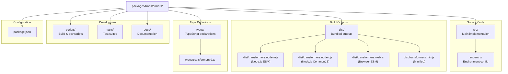

**Sources:** [packages/transformers/package.json:1-87]()

### Package Metadata

The core package is published as `@huggingface/transformers` at version `4.2.0`:

- **Main Entry Point**: `./dist/transformers.node.cjs` ([packages/transformers/package.json:5]())
- **Type Definitions**: `./types/transformers.d.ts` ([packages/transformers/package.json:6]())
- **Module Type**: `"module"` (ESM by default) ([packages/transformers/package.json:7]())

**Sources:** [packages/transformers/package.json:2-7]()

### Conditional Exports

The package uses Node.js conditional exports to provide different bundles for different environments:

```javascript
{
  "exports": {
    "node": {
      "import": "./dist/transformers.node.mjs",  // Node.js ESM
      "require": "./dist/transformers.node.cjs"  // Node.js CommonJS
    },
    "default": "./dist/transformers.web.js"      // Browser/Other
  }
}
```

**Sources:** [packages/transformers/package.json:8-23]()

### CDN Distribution

For vanilla JavaScript usage via CDN, the package specifies minified entry points:

- **jsdelivr**: `./dist/transformers.min.js` ([packages/transformers/package.json:85]())
- **unpkg**: `./dist/transformers.min.js` ([packages/transformers/package.json:86]())

**Sources:** [packages/transformers/package.json:85-86](), [packages/transformers/docs/snippets/2_installation.snippet:7-12]()

---

## Environment Configuration

The `env.js` module defines runtime environment detection and global configuration. This module is critical for determining which APIs (filesystem, cache, WebGPU) are available to the library.

### Runtime Detection Flags

| Constant | Purpose | Detection Logic |
|----------|---------|-----------------|
| `IS_BROWSER_ENV` | Browser detection | `typeof window !== 'undefined' && typeof window.document !== 'undefined'` [packages/transformers/src/env.js:47]() |
| `IS_WEBWORKER_ENV` | Web worker detection | Checks `self.constructor.name` against worker scope names [packages/transformers/src/env.js:48-52]() |
| `IS_NODE_ENV` | Node.js detection | `process?.release?.name === 'node'` [packages/transformers/src/env.js:44]() |
| `IS_FS_AVAILABLE` | File system API | `!isEmpty(fs)` [packages/transformers/src/env.js:33]() |
| `IS_WEB_CACHE_AVAILABLE` | Cache API | `'caches' in self` [packages/transformers/src/env.js:35]() |
| `IS_WEBGPU_AVAILABLE` | WebGPU support | `'gpu' in navigator` [packages/transformers/src/env.js:55]() |

**Sources:** [packages/transformers/src/env.js:31-65]()

### Path Resolution Logic

The library dynamically computes file system paths for caching and local model loading when running in environments with file system access.

Title: Environment Path Resolution
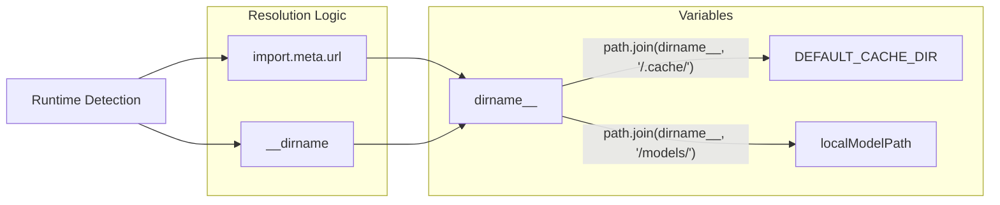

**Sources:** [packages/transformers/src/env.js:146-168]()

---

## Build Output Targets

The build system produces distinct distribution bundles optimized for different runtime environments using `esbuild` [packages/transformers/package.json:68]().

Title: Build and Distribution Mapping
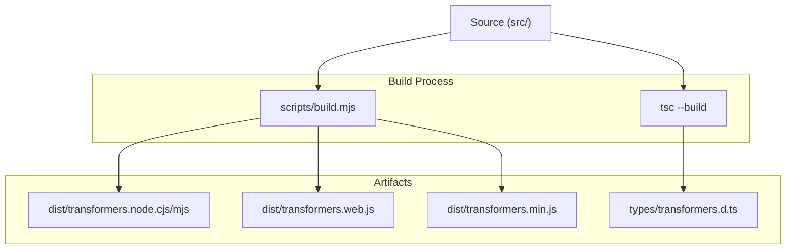

**Sources:** [packages/transformers/package.json:24-35]()

### Build Scripts

| Script | Command | Purpose |
|--------|---------|---------|
| `build` | `node scripts/build.mjs && pnpm typegen` | Full build with type generation [packages/transformers/package.json:29]() |
| `typegen` | `tsc --build` | Generate TypeScript definitions [packages/transformers/package.json:27]() |
| `test` | `node --experimental-vm-modules ... jest.js` | Run tests with ESM support [packages/transformers/package.json:30]() |

---

## Dependency Management

The repository manages dependencies at two levels: workspace-wide and package-specific.

### Package Dependencies

The `@huggingface/transformers` package has several categories of dependencies:

#### Runtime Dependencies

| Package | Version | Purpose |
|---------|---------|---------|
| `@huggingface/jinja` | ^0.5.6 | Chat template rendering [packages/transformers/package.json:58]() |
| `@huggingface/tokenizers` | ^0.1.3 | Fast tokenization (WASM) [packages/transformers/package.json:59]() |
| `onnxruntime-node` | 1.24.3 | ONNX execution for Node.js [packages/transformers/package.json:60]() |
| `onnxruntime-web` | 1.26.0-dev.* | ONNX execution for browsers [packages/transformers/package.json:61]() |
| `sharp` | ^0.34.5 | Image processing (Node.js) [packages/transformers/package.json:62]() |

**Sources:** [packages/transformers/package.json:57-63](), [pnpm-lock.yaml:19-34]()

#### Development Dependencies

| Package | Purpose |
|---------|---------|
| `esbuild` | Bundler for build process [packages/transformers/package.json:68]() |
| `jest` | Test framework [packages/transformers/package.json:69]() |
| `typescript` | Type checking and generation [packages/transformers/package.json:72]() |

**Sources:** [packages/transformers/package.json:64-73](), [pnpm-lock.yaml:35-59]()

---

## Published Package Contents

The `files` field in `package.json` specifies what gets published to npm:

```javascript
{
  "files": [
    "src",           // Source code (for source maps)
    "dist",          // Build outputs
    "types",         // Type definitions
    "README.md",     // Documentation
    "LICENSE",       // Apache-2.0 license
    "!**/*.tsbuildinfo"  // Exclude TypeScript build info
  ]
}
```

**Sources:** [packages/transformers/package.json:74-81]()

This ensures that users can access source maps for debugging while all build targets and type definitions are available for different module systems.

---

# Page: Installation and Setup

# Installation and Setup

<details>
<summary>Relevant source files</summary>

The following files were used as context for generating this wiki page:

- [README.md](README.md)
- [package.json](package.json)
- [packages/transformers/docs/snippets/2_installation.snippet](packages/transformers/docs/snippets/2_installation.snippet)
- [packages/transformers/docs/snippets/3_custom-usage.snippet](packages/transformers/docs/snippets/3_custom-usage.snippet)
- [packages/transformers/package.json](packages/transformers/package.json)
- [packages/transformers/src/env.js](packages/transformers/src/env.js)
- [pnpm-lock.yaml](pnpm-lock.yaml)

</details>


This document covers the installation methods for Transformers.js and basic environment configuration. The library can be installed via npm, loaded from a CDN, or built from source. It automatically detects the JavaScript runtime environment (browser, Node.js, web worker, Deno, Bun) and configures appropriate backends and caching strategies.

For information about the pipeline API usage after installation, see [Pipeline API](#2). For advanced runtime configuration options, see [Environment Configuration](#11).

## Installation Methods

### NPM Installation

The library is published as `@huggingface/transformers` on npm. Install it using:

```bash
npm i @huggingface/transformers
```

The package version 4.2.0 includes the following runtime dependencies:
- `@huggingface/jinja@^0.5.6` - Template engine for chat templates [packages/transformers/package.json:58]()
- `@huggingface/tokenizers@^0.1.3` - Tokenization backend [packages/transformers/package.json:59]()
- `onnxruntime-node@1.24.3` - ONNX Runtime for Node.js environments [packages/transformers/package.json:60]()
- `onnxruntime-web@1.26.0-dev.20260416-b7804b056c` - ONNX Runtime for browser environments [packages/transformers/package.json:61]()
- `sharp@^0.34.5` - High-performance image processing (Node.js only) [packages/transformers/package.json:62]()

The package supports both ES modules and CommonJS, with different entry points for Node.js and browser environments as defined in the `exports` field.

**Package Entry Points**
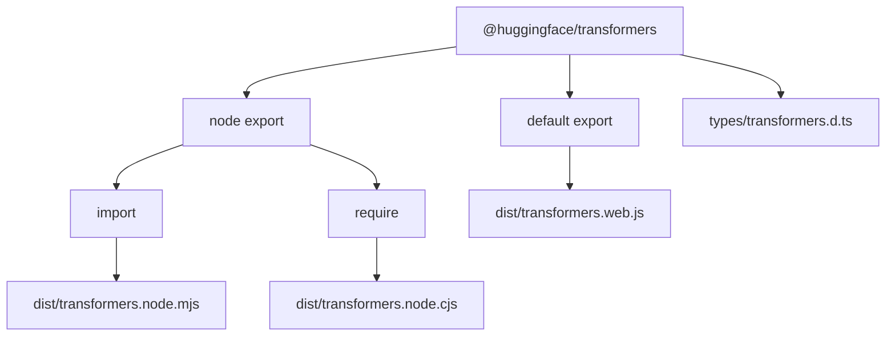

Sources: [packages/transformers/package.json:1-23](), [packages/transformers/package.json:57-63]()

### CDN Installation

For browser usage without bundlers, import directly from a CDN using ES modules:

```html
<script type="module">
    import { pipeline } from 'https://cdn.jsdelivr.net/npm/@huggingface/transformers@4.2.0';
</script>
```

The package specifies CDN entry points through the `jsdelivr` and `unpkg` fields, both pointing to `./dist/transformers.min.js`.

**CDN Asset Loading**
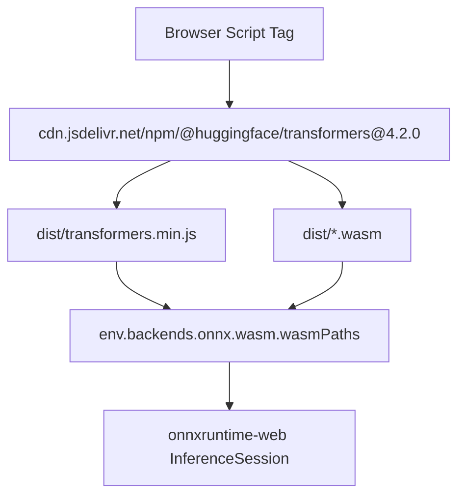

Sources: [packages/transformers/package.json:85-86](), [packages/transformers/docs/snippets/2_installation.snippet:7-12]()

### Installation from Source

The repository is managed as a monorepo using `pnpm` workspaces [package.json:7](). To build and use the library from source:

```bash
# Clone the repository
git clone https://github.com/huggingface/transformers.js.git
cd transformers.js

# Install dependencies using pnpm
pnpm install

# Build the library
pnpm build
```

The build process uses `esbuild` [packages/transformers/package.json:68]() and generates TypeScript declarations via `tsc` [packages/transformers/package.json:27]().

**Build Output Structure**
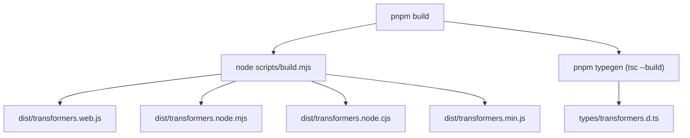

Sources: [package.json:7-13](), [packages/transformers/package.json:24-29]()

## Environment Detection and Configuration

The library automatically detects the JavaScript runtime environment and configures itself accordingly. This detection happens through the `env.js` module, which exports the `apis` object containing environment flags and the `env` object for runtime configuration.

**Environment Detection System**
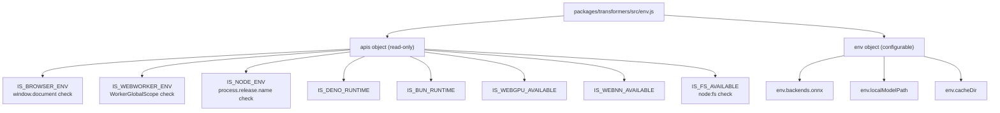

Sources: [packages/transformers/src/env.js:31-65](), [packages/transformers/src/env.js:99-144]()

### The env Configuration Object

The global `env` object provides runtime configuration for model loading, caching strategies, and backend settings.

| Property | Default Value | Description |
|----------|---------------|-------------|
| `allowRemoteModels` | `true` | Allow downloading models from Hugging Face Hub |
| `localModelPath` | `"/models/"` | Local path for model files [packages/transformers/src/env.js:167]() |
| `cacheDir` | `"./.cache/"` | Directory for filesystem cache (Node.js/Deno/Bun) [packages/transformers/src/env.js:163]() |
| `useBrowserCache` | `true` | Use browser Cache API when available [packages/transformers/src/env.js:35]() |
| `logLevel` | `LogLevel.INFO` | Controls output verbosity [packages/transformers/src/env.js:191]() |

**env Configuration Flow**
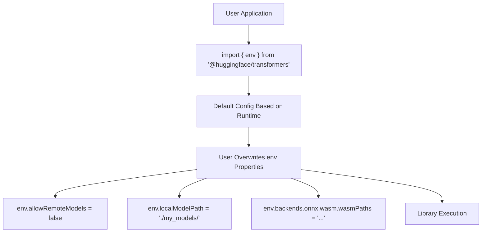

Sources: [packages/transformers/src/env.js:1-23](), [packages/transformers/src/env.js:146-170](), [packages/transformers/docs/snippets/3_custom-usage.snippet:7-18]()

## Basic Setup Examples

### Browser Environment Setup

```javascript
import { pipeline, env } from '@huggingface/transformers';

// Configure for browser usage
env.allowRemoteModels = true;
env.useBrowserCache = true;

const classifier = await pipeline('sentiment-analysis');
```

### Node.js Environment Setup

```javascript
import { pipeline, env } from '@huggingface/transformers';

// Configure for Node.js usage
env.localModelPath = './models/';
env.cacheDir = './.cache/';

const classifier = await pipeline('sentiment-analysis');
```

### Custom WASM Backend Configuration

The ONNX Runtime WASM backend paths can be customized to point to local assets instead of the default CDN.

```javascript
import { env } from '@huggingface/transformers';

// Set location of .wasm files
env.backends.onnx.wasm.wasmPaths = '/path/to/files/';
```

Sources: [packages/transformers/docs/snippets/3_custom-usage.snippet:10-18](), [packages/transformers/src/env.js:12-20]()

## Build System and Distribution

The library uses a dual-module system to support both modern and legacy JavaScript environments. The `package.json` defines conditional exports to route different environments to their optimized entry points.

| Build Target | File | Usage |
|-------------|------|-------|
| Node.js ESM | `dist/transformers.node.mjs` | Node.js with `import` |
| Node.js CJS | `dist/transformers.node.cjs` | Node.js with `require` |
| Web Bundle | `dist/transformers.web.js` | Browser environments |
| Minified | `dist/transformers.min.js` | CDN distribution (jsdelivr/unpkg) |

Sources: [packages/transformers/package.json:8-23](), [packages/transformers/package.json:85-86]()

---

# Page: Public API Surface

# Public API Surface

<details>
<summary>Relevant source files</summary>

The following files were used as context for generating this wiki page:

- [README.md](README.md)
- [package.json](package.json)
- [packages/transformers/src/generation/streamers.js](packages/transformers/src/generation/streamers.js)
- [packages/transformers/src/transformers.js](packages/transformers/src/transformers.js)
- [packages/transformers/tests/exports.test.js](packages/transformers/tests/exports.test.js)
- [packages/transformers/tests/utils/generation.test.js](packages/transformers/tests/utils/generation.test.js)

</details>


The Public API Surface defines the complete set of classes, functions, and objects that are exported from the main entry point and available to end users. This document catalogs these exports and explains how they are organized into functional categories.

## Scope and Purpose

The public API is defined by `packages/transformers/src/transformers.js`, which serves as the sole entry point for the library [packages/transformers/src/transformers.js:1-13](). All user-facing functionality must be explicitly exported through this file. The API surface is organized into seven main categories:

1.  **Environment Variables** - Global configuration via the `env` object [packages/transformers/src/transformers.js:16]().
2.  **Pipelines** - High-level task-based inference functions [packages/transformers/src/transformers.js:19]().
3.  **Models** - Model classes and `AutoModel` loaders [packages/transformers/src/transformers.js:22-23]().
4.  **Tokenizers** - Text tokenization classes and `AutoTokenizer` [packages/transformers/src/transformers.js:26-27]().
5.  **Processors** - Multimodal input preprocessing (image, audio, multimodal) [packages/transformers/src/transformers.js:30-39]().
6.  **Configs** - Model and environment configuration classes [packages/transformers/src/transformers.js:42]().
7.  **Cache & File Management** - Utilities for managing downloaded models and caching [packages/transformers/src/transformers.js:56-59]().

**Sources:** [packages/transformers/src/transformers.js:1-71]()

## Key Exports

### Pipelines
The `pipeline` function provides the highest-level API for running inference tasks. It is exported from `packages/transformers/src/pipelines.js` and automatically selects the appropriate model, tokenizer, and processor for a given task [packages/transformers/src/transformers.js:19]().

```javascript
import { pipeline } from '@huggingface/transformers';
const pipe = await pipeline('sentiment-analysis');
```

**Sources:** [packages/transformers/src/transformers.js:19](), [README.md:82-89]()

### Auto Classes
The library uses "Auto" classes to automatically instantiate the correct class based on the model configuration. These are exported from the `auto/` subdirectories [packages/transformers/src/transformers.js:23, 27, 31, 35, 39]().

*   **Modeling:** `AutoModel`, `AutoModelForCausalLM`, `AutoModelForSeq2SeqLM`, etc. [packages/transformers/src/transformers.js:23]().
*   **Tokenization:** `AutoTokenizer` [packages/transformers/src/transformers.js:27]().
*   **Processing:** `AutoProcessor`, `AutoImageProcessor`, `AutoFeatureExtractor` [packages/transformers/src/transformers.js:31-39]().

**Sources:** [packages/transformers/src/transformers.js:21-40](), [packages/transformers/tests/utils/generation.test.js:1-16]()

### ModelRegistry
The `ModelRegistry` class provides methods for managing the local cache, checking available data types (quantizations), and handling model files [packages/transformers/src/transformers.js:59]().

**Sources:** [packages/transformers/src/transformers.js:59]()

### Environment Configuration
The `env` object provides global runtime configuration, such as local model paths and remote loading toggles [packages/transformers/src/transformers.js:16]().

```javascript
import { env } from '@huggingface/transformers';
env.localModelPath = '/path/to/models/';
env.allowRemoteModels = false;
```

**Sources:** [packages/transformers/src/transformers.js:16](), [README.md:142-147]()

## Data Flow and API Structure

The following diagram maps the high-level system names to the specific code entities exported in the API surface.

### Natural Language Space to Code Entity Space: Inference Flow
Title: "Inference Flow: Text to Prediction"
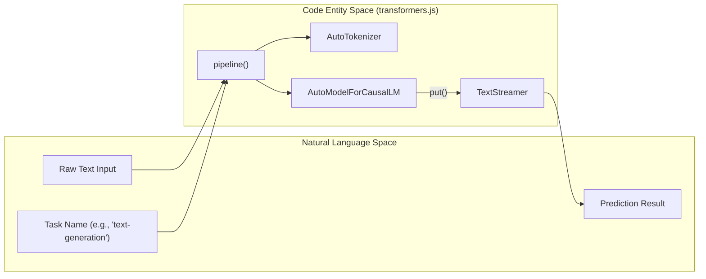
**Sources:** [packages/transformers/src/transformers.js:19, 23, 27, 45](), [packages/transformers/src/generation/streamers.js:40-168](), [README.md:82-89]()

### API Organization and Module Re-exports
Title: "Public API Surface Architecture"
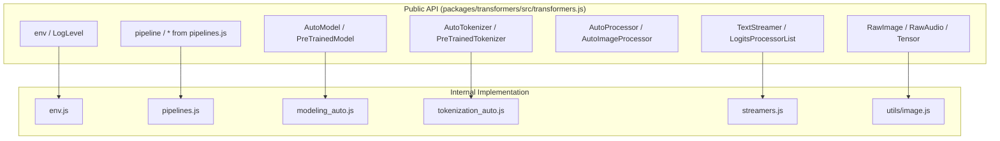
**Sources:** [packages/transformers/src/transformers.js:1-60]()

## Export Mapping Table

| Export Category | Key Symbols | Source File(s) |
| :--- | :--- | :--- |
| **Environment** | `env`, `LogLevel` | [packages/transformers/src/env.js]() |
| **Pipelines** | `pipeline`, `TextClassificationPipeline`, etc. | [packages/transformers/src/pipelines.js]() |
| **Models** | `AutoModel`, `PreTrainedModel`, `AutoModelForCausalLM` | [packages/transformers/src/models/models.js](), [packages/transformers/src/models/auto/modeling_auto.js]() |
| **Tokenizers** | `AutoTokenizer`, `PreTrainedTokenizer` | [packages/transformers/src/models/tokenizers.js](), [packages/transformers/src/models/auto/tokenization_auto.js]() |
| **Processors** | `AutoProcessor`, `AutoImageProcessor`, `AutoFeatureExtractor` | [packages/transformers/src/models/auto/processing_auto.js](), [packages/transformers/src/models/auto/image_processing_auto.js]() |
| **Generation** | `TextStreamer`, `StoppingCriteriaList`, `LogitsProcessorList` | [packages/transformers/src/generation/streamers.js](), [packages/transformers/src/generation/stopping_criteria.js](), [packages/transformers/src/generation/logits_process.js]() |
| **Utilities** | `Tensor`, `RawImage`, `RawAudio`, `RawVideo`, `softmax` | [packages/transformers/src/utils/tensor.js](), [packages/transformers/src/utils/image.js](), [packages/transformers/src/utils/audio.js](), [packages/transformers/src/utils/maths.js]() |
| **Management** | `ModelRegistry`, `DynamicCache` | [packages/transformers/src/utils/model_registry/ModelRegistry.js](), [packages/transformers/src/cache_utils.js]() |

**Sources:** [packages/transformers/src/transformers.js:14-60]()

## Common Type Exports
The entry point also exposes several TypeScript types via JSDoc for developers to access [packages/transformers/src/transformers.js:62-71]():
*   `PretrainedModelOptions`: Options for loading models.
*   `DataType`: Model precision/quantization types (e.g., `'fp32'`, `'q8'`).
*   `DeviceType`: Execution backends (e.g., `'cpu'`, `'webgpu'`).
*   `ProgressCallback`: Function signature for tracking download progress.

**Sources:** [packages/transformers/src/transformers.js:62-71]()

---

# Page: Pipeline API

# Pipeline API

<details>
<summary>Relevant source files</summary>

The following files were used as context for generating this wiki page:

- [README.md](README.md)
- [package.json](package.json)
- [packages/transformers/src/pipelines.js](packages/transformers/src/pipelines.js)
- [packages/transformers/src/utils/model_registry/get_pipeline_files.js](packages/transformers/src/utils/model_registry/get_pipeline_files.js)

</details>


## Purpose and Scope

The Pipeline API is the primary high-level interface for running machine learning models in Transformers.js. It provides a simple, unified way to perform inference across 30+ tasks spanning Natural Language Processing, Computer Vision, Audio, and Multimodal domains. The `pipeline()` function abstracts away the complexity of model loading, preprocessing, inference, and postprocessing, making it the easiest way to use the library.

This document covers the pipeline function itself, its instantiation patterns, and high-level architecture. For details on specific tasks, see [Supported Tasks](#2.1). For advanced configuration options, see [Pipeline Configuration](#2.2). For internal execution flow, see [Pipeline Execution Flow](#2.3).

**Sources:** [README.md:55-129](), [packages/transformers/src/pipelines.js:1-14]()

---

## Overview

The Pipeline API serves as a task-oriented abstraction layer that automatically:
- Routes tasks to appropriate model architectures using `SUPPORTED_TASKS` [packages/transformers/src/pipelines.js:24-51]()
- Loads and initializes models from the Hugging Face Hub or local storage via `AutoModel` classes [packages/transformers/src/pipelines.js:154-180]()
- Applies task-specific preprocessing to inputs using `AutoTokenizer` or `AutoProcessor` [packages/transformers/src/pipelines.js:19-20]()
- Executes model inference using ONNX Runtime [README.md:34]()
- Postprocesses outputs into human-readable formats [README.md:58-93]()

This design mirrors the Python transformers library's pipeline API, enabling straightforward code translation between JavaScript and Python implementations.

**Sources:** [README.md:58-93](), [packages/transformers/src/pipelines.js:118-131]()

---

## Basic Usage

### Simple Task Invocation

```javascript
import { pipeline } from '@huggingface/transformers';

// Instantiate a pipeline for sentiment analysis
const classifier = await pipeline('sentiment-analysis');

// Run inference
const result = await classifier('I love transformers!');
// [{ label: 'POSITIVE', score: 0.999817686 }]
```

### Specifying a Model

```javascript
// Use a specific model by providing model ID
const classifier = await pipeline(
  'sentiment-analysis',
  'Xenova/bert-base-multilingual-uncased-sentiment'
);
```

### Device Selection

```javascript
// Run on WebGPU for GPU acceleration
const classifier = await pipeline(
  'sentiment-analysis',
  'Xenova/distilbert-base-uncased-finetuned-sst-2-english',
  { device: 'webgpu' }
);
```

### Quantization

```javascript
// Use 4-bit quantization for reduced model size
const classifier = await pipeline(
  'sentiment-analysis',
  'Xenova/distilbert-base-uncased-finetuned-sst-2-english',
  { dtype: 'q4' }
);
```

**Sources:** [README.md:81-127](), [packages/transformers/src/pipelines.js:4-11]()

---

## Pipeline Function Signature

The `pipeline` function is the main entry point defined in `packages/transformers/src/pipelines.js`.

```typescript
async function pipeline(
    task: PipelineType,
    model?: string,
    options?: PipelineOptions
): Promise<Pipeline>
```

### Parameters

| Parameter | Type | Description |
|-----------|------|-------------|
| `task` | `string` | Task identifier (e.g., `'sentiment-analysis'`, `'text-generation'`). Supports aliases via `TASK_ALIASES` [packages/transformers/src/pipelines.js:116](). |
| `model` | `string` (optional) | Model ID from Hub or local path. Defaults to task-specific model in `SUPPORTED_TASKS` [packages/transformers/src/pipelines.js:125-131](). |
| `options` | `Object` (optional) | Configuration object for device, dtype, and session options [packages/transformers/src/pipelines.js:100-112](). |

### Common Options

| Option | Type | Default | Description |
|--------|------|---------|-------------|
| `device` | `DeviceType` | `null` | Target device (e.g., `'cpu'`, `'webgpu'`, `'cuda'`) [packages/transformers/src/pipelines.js:106](). |
| `dtype` | `DataType` | `null` | Data type/quantization level (e.g., `'fp32'`, `'q8'`, `'q4'`) [packages/transformers/src/pipelines.js:107](). |
| `progress_callback` | `function` | `null` | Callback for tracking download progress [packages/transformers/src/pipelines.js:101](). |
| `session_options` | `Object` | `{}` | Direct configuration for the ONNX Runtime session [packages/transformers/src/pipelines.js:111](). |

**Sources:** [packages/transformers/src/pipelines.js:97-113](), [README.md:96-127]()

---

## Task-Based Architecture

### Task Routing System

The pipeline function uses a task identifier to determine which pipeline class to instantiate. Each task has a corresponding pipeline implementation in `packages/transformers/src/pipelines/index.js`.

**Task Routing Logic (Natural Language to Code):**
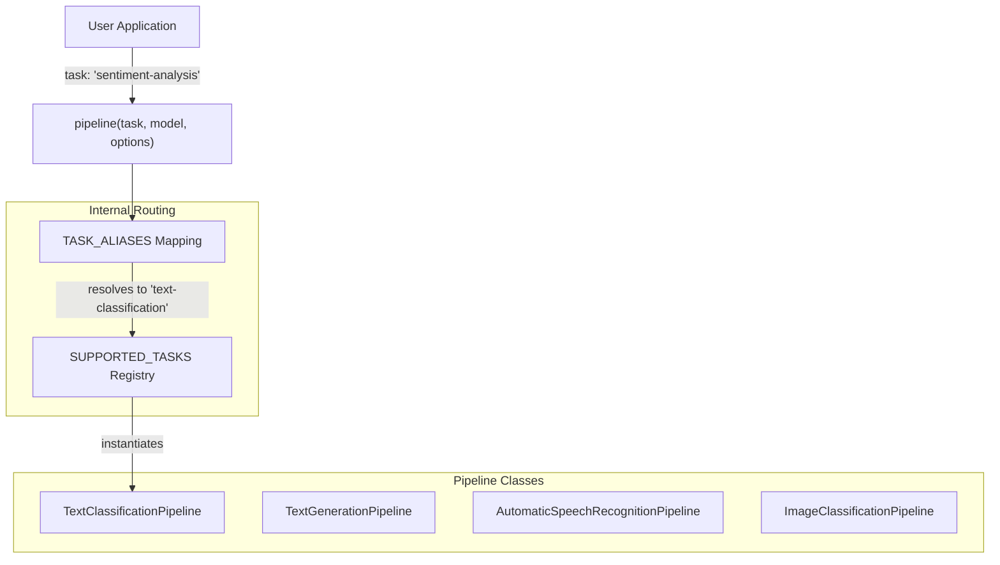

**Sources:** [packages/transformers/src/pipelines.js:114-122](), [packages/transformers/src/pipelines.js:23-51]()

### Component Initialization

The pipeline initialization process involves resolving the necessary files and components (Tokenizer vs. Processor) based on the task type.

**Component Resolution (Natural Language to Code):**
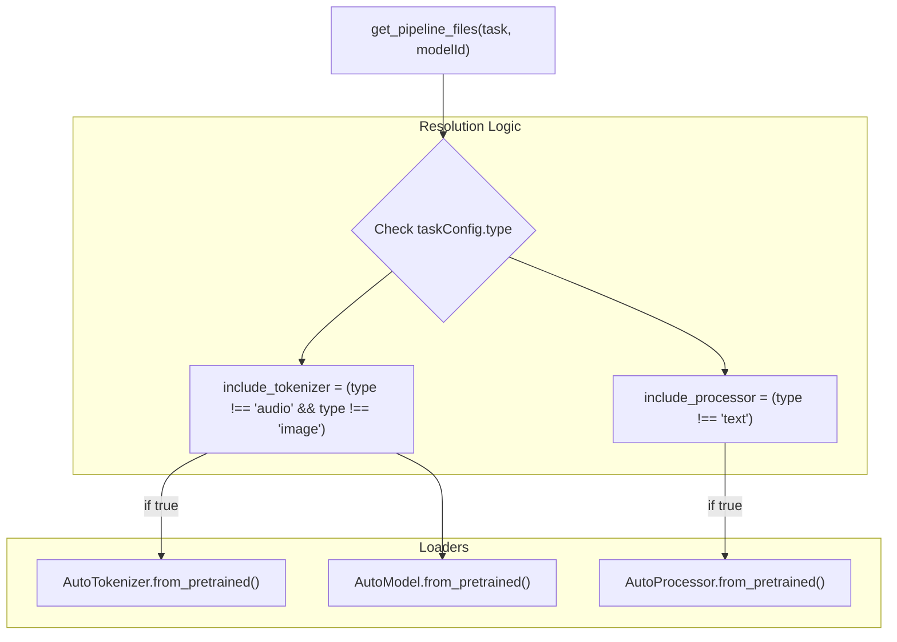

**Sources:** [packages/transformers/src/utils/model_registry/get_pipeline_files.js:34-46](), [packages/transformers/src/pipelines.js:171-180]()

---

## Pipeline Lifecycle

### Initialization Sequence

1.  **Task Resolution**: The input task is mapped to a canonical task name using `TASK_ALIASES` [packages/transformers/src/pipelines.js:116]().
2.  **File Discovery**: `get_pipeline_files` determines which ONNX, tokenizer, and processor files are required [packages/transformers/src/utils/model_registry/get_pipeline_files.js:22-62]().
3.  **Metadata Retrieval**: File sizes are fetched via `get_file_metadata` to initialize progress tracking [packages/transformers/src/pipelines.js:141-152]().
4.  **Component Loading**: `AutoTokenizer`, `AutoProcessor`, and `AutoModel` (or task-specific variants) load their respective configurations and binaries [packages/transformers/src/pipelines.js:171-205]().
5.  **Instantiation**: The specific pipeline class (e.g., `TextGenerationPipeline`) is instantiated with the loaded components [packages/transformers/src/pipelines.js:208]().

**Sources:** [packages/transformers/src/pipelines.js:114-209](), [packages/transformers/src/utils/model_registry/get_pipeline_files.js:8-21]()

### Model Selection Logic

If the `model` parameter is `null`, the library selects a default model and `dtype` defined in the `SUPPORTED_TASKS` registry [packages/transformers/src/pipelines.js:125-131]().

**Sources:** [packages/transformers/src/pipelines.js:124-131]()

---

## Return Values and Output Formats

The `pipeline()` function returns a Promise resolving to a task-specific instance of a `Pipeline` subclass. These instances are callable (via their `_call` method implementation).

| Task Category | Example Output Format |
|---------------|----------------------|
| **Text Classification** | Array of `{label: string, score: number}` [README.md:88]() |
| **Text Generation** | Array of `{generated_text: string}` [README.md:29]() |
| **Object Detection** | Array of `{score: number, label: string, box: {xmin, ymin, xmax, ymax}}` [README.md:30]() |

**Sources:** [README.md:28-32](), [packages/transformers/src/pipelines.js:55-62]()

---

## Relationship to Other Systems

- **Environment Configuration**: Pipelines respect global settings in the `env` object for local paths and remote model access [README.md:139-152]().
- **Auto Classes**: Pipelines use `AutoTokenizer`, `AutoProcessor`, and `AutoConfig` to dynamically load the correct classes for a given model ID [packages/transformers/src/pipelines.js:19-21]().
- **Model Registry**: The `get_pipeline_files` utility interacts with the model registry to identify required assets for different backends and quantizations [packages/transformers/src/utils/model_registry/get_pipeline_files.js:1-6]().

**Sources:** [packages/transformers/src/pipelines.js:19-21](), [packages/transformers/src/utils/model_registry/get_pipeline_files.js:8-21]()

---

# Page: Supported Tasks

# Supported Tasks

<details>
<summary>Relevant source files</summary>

The following files were used as context for generating this wiki page:

- [packages/transformers/docs/plugins/preprocess.js](packages/transformers/docs/plugins/preprocess.js)
- [packages/transformers/src/models/speecht5/modeling_speecht5.js](packages/transformers/src/models/speecht5/modeling_speecht5.js)
- [packages/transformers/src/models/whisper/modeling_whisper.js](packages/transformers/src/models/whisper/modeling_whisper.js)
- [packages/transformers/src/pipelines.js](packages/transformers/src/pipelines.js)
- [packages/transformers/src/pipelines/audio-classification.js](packages/transformers/src/pipelines/audio-classification.js)
- [packages/transformers/src/pipelines/automatic-speech-recognition.js](packages/transformers/src/pipelines/automatic-speech-recognition.js)
- [packages/transformers/src/pipelines/background-removal.js](packages/transformers/src/pipelines/background-removal.js)
- [packages/transformers/src/pipelines/depth-estimation.js](packages/transformers/src/pipelines/depth-estimation.js)
- [packages/transformers/src/pipelines/document-question-answering.js](packages/transformers/src/pipelines/document-question-answering.js)
- [packages/transformers/src/pipelines/fill-mask.js](packages/transformers/src/pipelines/fill-mask.js)
- [packages/transformers/src/pipelines/image-classification.js](packages/transformers/src/pipelines/image-classification.js)
- [packages/transformers/src/pipelines/image-to-image.js](packages/transformers/src/pipelines/image-to-image.js)
- [packages/transformers/src/pipelines/image-to-text.js](packages/transformers/src/pipelines/image-to-text.js)
- [packages/transformers/src/pipelines/object-detection.js](packages/transformers/src/pipelines/object-detection.js)
- [packages/transformers/src/pipelines/question-answering.js](packages/transformers/src/pipelines/question-answering.js)
- [packages/transformers/src/pipelines/summarization.js](packages/transformers/src/pipelines/summarization.js)
- [packages/transformers/src/pipelines/text-classification.js](packages/transformers/src/pipelines/text-classification.js)
- [packages/transformers/src/pipelines/text-generation.js](packages/transformers/src/pipelines/text-generation.js)
- [packages/transformers/src/pipelines/text-to-audio.js](packages/transformers/src/pipelines/text-to-audio.js)
- [packages/transformers/src/pipelines/text2text-generation.js](packages/transformers/src/pipelines/text2text-generation.js)
- [packages/transformers/src/pipelines/translation.js](packages/transformers/src/pipelines/translation.js)
- [packages/transformers/src/pipelines/zero-shot-audio-classification.js](packages/transformers/src/pipelines/zero-shot-audio-classification.js)
- [packages/transformers/src/pipelines/zero-shot-classification.js](packages/transformers/src/pipelines/zero-shot-classification.js)
- [packages/transformers/src/pipelines/zero-shot-image-classification.js](packages/transformers/src/pipelines/zero-shot-image-classification.js)
- [packages/transformers/src/pipelines/zero-shot-object-detection.js](packages/transformers/src/pipelines/zero-shot-object-detection.js)
- [packages/transformers/src/tokenization_utils.js](packages/transformers/src/tokenization_utils.js)
- [packages/transformers/src/utils/audio.js](packages/transformers/src/utils/audio.js)
- [packages/transformers/src/utils/model_registry/get_pipeline_files.js](packages/transformers/src/utils/model_registry/get_pipeline_files.js)
- [packages/transformers/src/utils/video.js](packages/transformers/src/utils/video.js)
- [packages/transformers/tests/pipelines/test_pipelines_document_question_answering.js](packages/transformers/tests/pipelines/test_pipelines_document_question_answering.js)

</details>


This page catalogs the 30+ machine learning tasks supported by Transformers.js through the pipeline API. Each task represents a specific type of problem that can be solved using pre-trained models, such as text classification, image recognition, or speech transcription.

**Scope**: This document focuses on the available task types, their identifiers, and how they map to pipeline classes. For detailed information about the pipeline API itself and how to configure pipelines, see [Pipeline API](#2). For information on which model architectures support which tasks, see [Supported Model Architectures](#3.4).

## Task System Overview

In Transformers.js, a **task** is a high-level abstraction that defines a specific machine learning problem. Each task is identified by a unique string (task ID) that you pass to the `pipeline()` function. The task ID determines which pipeline class will be instantiated and how inputs and outputs will be processed [packages/transformers/src/pipelines.js:68-91]().

```javascript
// Task ID determines the pipeline class and processing logic
const classifier = await pipeline('text-classification', 'onnx-community/bert-base-uncased');
const generator = await pipeline('text-generation', 'onnx-community/Qwen2.5-0.5B-Instruct');
```

The `pipeline()` factory function resolves the task string using `TASK_ALIASES` and `SUPPORTED_TASKS` maps [packages/transformers/src/pipelines.js:114-122](). It then determines the necessary components (tokenizer, processor, or both) based on the task category [packages/transformers/src/utils/model_registry/get_pipeline_files.js:34-40]().

### Natural Language Space to Code Entity Mapping

The following diagram bridges the high-level task concepts to the specific JavaScript classes and registry keys used in the implementation.

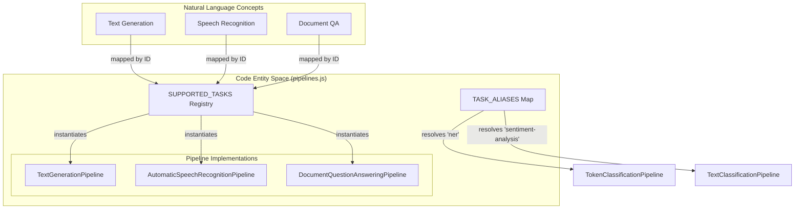

**Sources**: [packages/transformers/src/pipelines.js:23-51](), [packages/transformers/src/pipelines.js:114-122](), [packages/transformers/src/utils/model_registry/get_pipeline_files.js:23-32]()

## Natural Language Processing Tasks

NLP tasks operate on text inputs and produce text or structured outputs. These tasks leverage encoder-only, decoder-only, or encoder-decoder models.

| Task | Task ID | Description | Pipeline Class |
|------|---------|-------------|----------------|
| Fill-Mask | `fill-mask` | Predict masked words in a sentence | `FillMaskPipeline` |
| Question Answering | `question-answering` | Extract answers from context text | `QuestionAnsweringPipeline` |
| Summarization | `summarization` | Generate shorter versions of documents | `SummarizationPipeline` |
| Text Classification | `text-classification` | Assign labels to text (e.g., sentiment) | `TextClassificationPipeline` |
| Text Generation | `text-generation` | Predict following words/tokens | `TextGenerationPipeline` |
| Text-to-Text Generation | `text2text-generation` | General sequence-to-sequence mapping | `Text2TextGenerationPipeline` |
| Token Classification | `token-classification` | Label individual tokens (e.g., NER) | `TokenClassificationPipeline` |
| Translation | `translation` | Translate between languages | `TranslationPipeline` |
| Zero-Shot Classification | `zero-shot-classification` | Classify into unseen classes | `ZeroShotClassificationPipeline` |

### Deep Dive: Text Generation
The `TextGenerationPipeline` supports both standard string prompts and Chat-based inputs [packages/transformers/src/pipelines/text-generation.js:101-140](). If the input is a `Chat` (array of message objects), the pipeline automatically applies the model's chat template [packages/transformers/src/pipelines/text-generation.js:142-161]().

```javascript
import { pipeline } from '@huggingface/transformers';
const generator = await pipeline('text-generation', 'onnx-community/SmolLM2-135M-ONNX');
const output = await generator('Once upon a time,', { max_new_tokens: 8 });
// [{ generated_text: 'Once upon a time, there was a little girl named Lily.' }]
```

**Sources**: [packages/transformers/src/pipelines/text-generation.js:91-161](), [packages/transformers/src/pipelines/summarization.js:43-50](), [packages/transformers/src/pipelines/translation.js:72-79]()

## Computer Vision Tasks

Vision tasks process images using `AutoProcessor` to handle resizing and normalization before passing tensors to models like ViT or DETR.

| Task | Task ID | Description | Pipeline Class |
|------|---------|-------------|----------------|
| Background Removal | `background-removal` | Isolate foreground from background | `BackgroundRemovalPipeline` |
| Depth Estimation | `depth-estimation` | Predict depth from 2D images | `DepthEstimationPipeline` |
| Image Classification | `image-classification` | Categorize entire images | `ImageClassificationPipeline` |
| Image Segmentation | `image-segmentation` | Segment images into regions | `ImageSegmentationPipeline` |
| Object Detection | `object-detection` | Detect and locate objects | `ObjectDetectionPipeline` |
| Image-to-Image | `image-to-image` | Transform images (e.g., upscaling) | `ImageToImagePipeline` |

**Sources**: [packages/transformers/src/pipelines.js:39-50](), [packages/transformers/src/utils/model_registry/get_pipeline_files.js:39-40]()

## Audio Tasks

Audio tasks process waveforms. The `AutomaticSpeechRecognitionPipeline` is the primary entry point for speech processing, supporting models like Whisper and Wav2Vec2 [packages/transformers/src/pipelines/automatic-speech-recognition.js:127-152]().

### Audio Processing Flow
Audio pipelines typically require a `processor` to convert raw audio into features (like mel-spectrograms) [packages/transformers/src/utils/audio.js:176-181]().

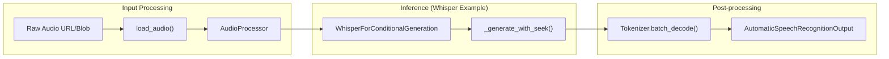

**Sources**: [packages/transformers/src/utils/audio.js:23-75](), [packages/transformers/src/pipelines/automatic-speech-recognition.js:142-165](), [packages/transformers/src/models/whisper/modeling_whisper.js:157-165]()

## Multimodal Tasks

Multimodal tasks combine multiple input types. A prominent example is `DocumentQuestionAnsweringPipeline`, which processes both an image of a document and a text question [packages/transformers/src/pipelines/document-question-answering.js:41-49]().

```javascript
const qa = await pipeline('document-question-answering', 'Xenova/donut-base-finetuned-docvqa');
const result = await qa(image, 'What is the invoice number?');
// [{ answer: 'us-001' }]
```

The pipeline prepares the image, constructs a task-specific prompt (e.g., `<s_docvqa><s_question>...`), and uses the model's `generate` method to produce an answer [packages/transformers/src/pipelines/document-question-answering.js:58-78]().

| Task | Task ID | Pipeline Class |
|------|---------|----------------|
| Image-to-Text | `image-to-text` | `ImageToTextPipeline` |
| Zero-Shot Image Classification | `zero-shot-image-classification` | `ZeroShotImageClassificationPipeline` |
| Zero-Shot Object Detection | `zero-shot-object-detection` | `ZeroShotObjectDetectionPipeline` |
| Document QA | `document-question-answering` | `DocumentQuestionAnsweringPipeline` |

**Sources**: [packages/transformers/src/pipelines/document-question-answering.js:41-91](), [packages/transformers/src/pipelines.js:43-46]()

## Summary of Task Aliases

To improve developer experience, common task names are aliased to their formal pipeline identifiers [packages/transformers/src/pipelines.js:116]().

| Alias | Resolved Task ID |
|-------|------------------|
| `sentiment-analysis` | `text-classification` |
| `ner` | `token-classification` |
| `vqa` | `visual-question-answering` |
| `text-to-speech` | `text-to-audio` |

**Sources**: [packages/transformers/src/pipelines.js:24-25](), [packages/transformers/src/pipelines.js:83-89]()

---

# Page: Pipeline Configuration

# Pipeline Configuration

<details>
<summary>Relevant source files</summary>

The following files were used as context for generating this wiki page:

- [packages/transformers/src/models/session_config.js](packages/transformers/src/models/session_config.js)
- [packages/transformers/src/pipelines.js](packages/transformers/src/pipelines.js)
- [packages/transformers/src/utils/dtypes.js](packages/transformers/src/utils/dtypes.js)
- [packages/transformers/src/utils/model_registry/get_available_dtypes.js](packages/transformers/src/utils/model_registry/get_available_dtypes.js)
- [packages/transformers/src/utils/model_registry/get_pipeline_files.js](packages/transformers/src/utils/model_registry/get_pipeline_files.js)
- [packages/transformers/src/utils/model_registry/resolve_model_type.js](packages/transformers/src/utils/model_registry/resolve_model_type.js)
- [packages/transformers/tests/models/cohere_asr/test_feature_extraction_cohere_asr.js](packages/transformers/tests/models/cohere_asr/test_feature_extraction_cohere_asr.js)
- [packages/transformers/tests/pipelines/test_pipelines_automatic_speech_recognition.js](packages/transformers/tests/pipelines/test_pipelines_automatic_speech_recognition.js)

</details>


This page details the configuration options available when creating and using pipelines in Transformers.js. Pipeline configuration controls execution behavior including device selection, data type precision, quantization, and task-specific parameters.

## Pipeline Function and Options

The `pipeline()` function is the primary entry point for creating pipelines. It accepts a task name, model identifier, and an options object [packages/transformers/src/pipelines.js:97-113]().

```javascript
const pipe = await pipeline(task, model, options);
```

**Pipeline Function Signature**
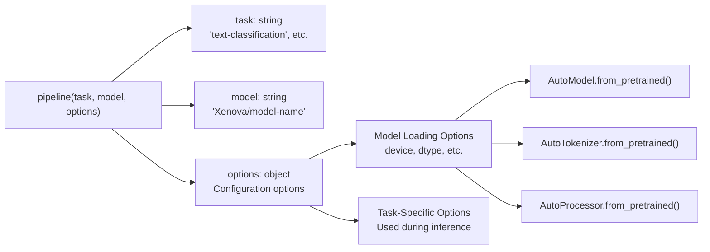

**Sources:** [packages/transformers/src/pipelines.js:1-113]()

## Configuration Hierarchy

Pipeline configuration occurs at three levels: environment defaults, pipeline instantiation options, and runtime task-specific parameters. During initialization, the library determines which files to fetch based on the task type and requested precision [packages/transformers/src/utils/model_registry/get_pipeline_files.js:22-62]().

**Configuration Resolution Flow**
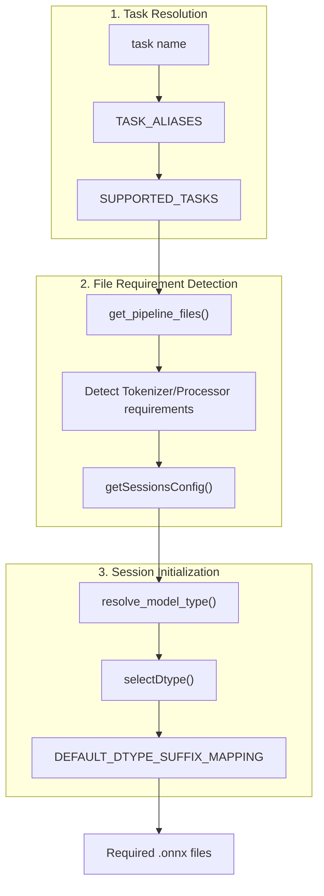

**Sources:** [packages/transformers/src/pipelines.js:114-137](), [packages/transformers/src/utils/model_registry/get_pipeline_files.js:7-62](), [packages/transformers/src/utils/model_registry/resolve_model_type.js:26-67]()

## Model Loading Configuration

### Device Selection

The `device` option controls which execution provider ONNX Runtime uses. It can be a single string or a mapping for multi-session models [packages/transformers/src/pipelines.js:106]().

**Available device types:**
- `'wasm'`: WebAssembly (CPU, default in browser).
- `'cpu'`: CPU execution (default in Node.js).
- `'webgpu'`: WebGPU acceleration (requires `shader-f16` for fp16) [packages/transformers/src/utils/dtypes.js:14-33]().
- `'cuda'`: NVIDIA GPU (Node.js).
- `'dml'`: DirectML (Windows).

**Sources:** [packages/transformers/src/utils/devices.js](), [packages/transformers/src/utils/dtypes.js:5-9]()

### Data Type and Quantization

The `dtype` option determines which quantized version of the model is loaded. If not specified, the library probes for available versions or uses device defaults [packages/transformers/src/utils/model_registry/get_available_dtypes.js:34-68]().

| dtype | Description | File Suffix |
|-------|-------------|-------------|
| `'fp32'` | 32-bit floating point | `` (none) |
| `'fp16'` | 16-bit floating point | `_fp16` |
| `'q8'` | 8-bit quantization | `_quantized` |
| `'q4'` | 4-bit quantization | `_q4` |
| `'q4f16'` | 4-bit weights, 16-bit acts | `_q4f16` |

**Sources:** [packages/transformers/src/utils/dtypes.js:35-72](), [packages/transformers/src/utils/model_registry/get_available_dtypes.js:15]()

### Quantization Selection Logic

The `selectDtype` function resolves the concrete data type based on the requested `dtype`, the specific file name, and the selected device [packages/transformers/src/utils/dtypes.js:85-126]().

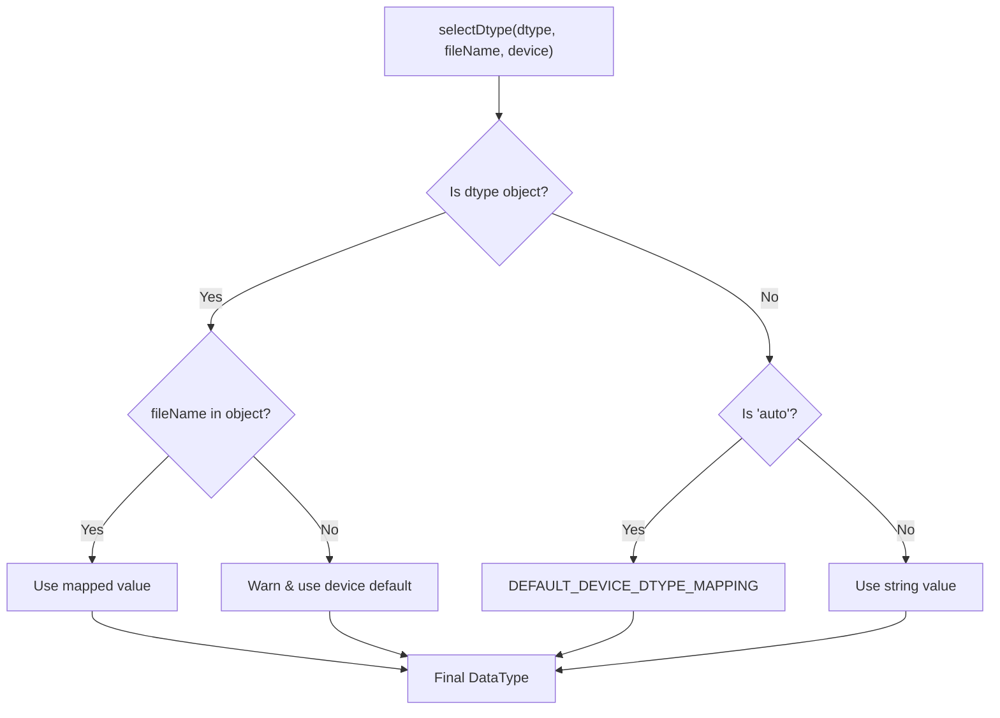

**Sources:** [packages/transformers/src/utils/dtypes.js:85-126]()

## Session Configuration

For complex models, the library maps the model architecture to a set of required ONNX sessions. This is governed by `MODEL_SESSION_CONFIG` [packages/transformers/src/models/session_config.js:21-143]().

### Model Type Mappings
The system resolves the architectural category (e.g., `Seq2Seq`, `DecoderOnly`) using `resolve_model_type` to determine which ONNX files are mandatory [packages/transformers/src/utils/model_registry/resolve_model_type.js:26-67]().

| Model Type Enum | Category | Required Sessions (Examples) |
|-----------------|----------|-----------------------------|
| `0` | `EncoderOnly` | `model` |
| `2` | `Seq2Seq` | `encoder_model`, `decoder_model_merged` |
| `4` | `DecoderOnly` | `model` |
| `7` | `ImageTextToText` | `vision_encoder`, `decoder_model_merged` |

**Sources:** [packages/transformers/src/models/session_config.js:1-19](), [packages/transformers/src/models/session_config.js:30-34](), [packages/transformers/src/models/session_config.js:56-66]()

### Text-Only Execution
For multimodal models (like Llava or Whisper), the pipeline can be optimized to load only text-generation components if visual/audio inputs are not required for the specific task [packages/transformers/src/utils/model_registry/get_pipeline_files.js:48-61]().

**Sources:** [packages/transformers/src/utils/model_registry/get_pipeline_files.js:50-60](), [packages/transformers/src/models/session_config.js:151-154]()

## Advanced Options Reference

| Option | Type | Default | Description |
|--------|------|---------|-------------|
| `session_options` | `object` | `{}` | Direct configuration for the ONNX Runtime session. |
| `local_files_only` | `boolean` | `false` | If true, prevents fetching from the Hugging Face Hub. |
| `use_external_data_format` | `boolean` | `null` | Required for models > 2GB where weights are in separate files. |
| `model_file_name` | `string` | `null` | Overrides the default `model.onnx` base name. |
| `revision` | `string` | `'main'` | Specific git branch/commit on the Hub. |

**Sources:** [packages/transformers/src/pipelines.js:100-112](), [packages/transformers/src/utils/model_registry/get_available_dtypes.js:34-37]()

---

# Page: Pipeline Execution Flow

# Pipeline Execution Flow

<details>
<summary>Relevant source files</summary>

The following files were used as context for generating this wiki page:

- [packages/transformers/src/image_processors_utils.js](packages/transformers/src/image_processors_utils.js)
- [packages/transformers/src/models/session.js](packages/transformers/src/models/session.js)
- [packages/transformers/src/pipelines.js](packages/transformers/src/pipelines.js)
- [packages/transformers/src/utils/model_registry/get_pipeline_files.js](packages/transformers/src/utils/model_registry/get_pipeline_files.js)
- [packages/transformers/tests/utils/custom_cache.test.js](packages/transformers/tests/utils/custom_cache.test.js)

</details>


## Purpose and Scope

This page details the internal execution workflow of pipelines from initialization through inference. It covers the complete lifecycle: how `pipeline()` instantiates components, how pipeline invocations are processed through preprocessing → inference → postprocessing stages, and the execution paths for different model architectures.

For information about supported tasks and pipeline configuration options, see [Supported Tasks](#2.1) and [Pipeline Configuration](#2.2). For details on model loading and the registry system, see [Model Registry and Auto Classes](#3).

---

## Overview of Pipeline Execution

The pipeline execution flow consists of two major phases: **initialization** (when `pipeline()` is called) and **invocation** (when the pipeline instance is called with inputs).

```mermaid
graph TB
    User["User Code"]
    PipelineCall["pipeline(task, model, options)"]
    PipelineInstance["Pipeline Instance"]
    InvokeCall["pipe(inputs)"]
    Results["Formatted Results"]
    
    User -->|"calls"| PipelineCall
    PipelineCall -->|"returns"| PipelineInstance
    User -->|"calls"| InvokeCall
    InvokeCall -->|"returns"| Results
    
    subgraph "Initialization Phase"
        PipelineCall
        TaskResolution["Task Resolution"]
        ModelLoading["Model Loading"]
        ComponentInit["Component Initialization"]
        
        PipelineCall --> TaskResolution
        TaskResolution --> ModelLoading
        ModelLoading --> ComponentInit
        ComponentInit --> PipelineInstance
    end
    
    subgraph "Invocation Phase"
        InvokeCall
        Preprocess["Preprocessing"]
        Inference["Model Inference"]
        Postprocess["Postprocessing"]
        
        InvokeCall --> Preprocess
        Preprocess --> Inference
        Inference --> Postprocess
        Postprocess --> Results
    end
```

**Pipeline Initialization Phase**

Sources: [packages/transformers/src/pipelines.js:97-113](), [packages/transformers/src/pipelines.js:116-176]()

---

## Pipeline Initialization Phase

### Task and Model Resolution

When `pipeline()` is called, the system must resolve the task type and determine which model class to instantiate. This involves mapping task names to model mappings and selecting appropriate preprocessing/postprocessing components.

```mermaid
graph TB
    PipelineFunc["pipeline(task, model, options)"]
    TaskMap["SUPPORTED_TASKS Mapping"]
    PipelineClass["Pipeline Class Selection"]
    GetFiles["get_pipeline_files()"]
    
    PipelineFunc --> TaskMap
    TaskMap --> PipelineClass
    TaskMap --> GetFiles
    
    TaskMap -.->|"e.g. 'sentiment-analysis'"| TC_PIPE["TextClassificationPipeline"]
    TaskMap -.->|"e.g. 'text-generation'"| TG_PIPE["TextGenerationPipeline"]
    TaskMap -.->|"e.g. 'image-classification'"| IC_PIPE["ImageClassificationPipeline"]
    
    GetFiles -->|"resolves"| FileList["[config.json, model.onnx, ...]"]
```

**Task Resolution Process**

The task name is used to select from `SUPPORTED_TASKS` defined in the pipeline index. The system then calls `get_pipeline_files` to determine which model components (tokenizer, processor, or both) are required based on the task type (text, audio, image, or multimodal).

Sources: [packages/transformers/src/pipelines.js:116-137](), [packages/transformers/src/utils/model_registry/get_pipeline_files.js:22-62]()

### Model Loading and Session Construction

The model loading process varies by model architecture type. The system determines the model type from the configuration and constructs the appropriate ONNX sessions using `getSession` and `constructSessions`.

```mermaid
graph TB
    FromPretrained["PreTrainedModel.from_pretrained()"]
    GetSession["getSession()"]
    CreateInfSession["createInferenceSession()"]
    
    FromPretrained --> GetSession
    GetSession -->|"determines device/dtype"| CreateInfSession
    
    subgraph "Backend Interaction"
        CreateInfSession --> ONNX_RT["onnxruntime-common"]
    end
    
    subgraph "Session Configuration"
        GetSession -->|"check"| WebGPU_FP16["isWebGpuFp16Supported()"]
        GetSession -->|"select"| EP["deviceToExecutionProviders()"]
    end
```

**Session Construction by Model Type**

The model type determines which ONNX sessions are loaded. The `getSession` function handles device selection, dtype selection (e.g., fp16 for WebGPU), and external data format handling.

| Model Component | Session Utility | Example Models |
|------------|----------------|----------------|
| DecoderOnly | `model` | GPT-2, LLaMA |
| Seq2Seq | `encoder_model`, `decoder_model_merged` | T5, Whisper |
| Multimodal | `vision_encoder`, `decoder_model_merged` | LLaVA, Florence2 |

Sources: [packages/transformers/src/models/session.js:26-132](), [packages/transformers/src/models/session.js:145-162](), [packages/transformers/src/utils/model_registry/get_pipeline_files.js:48-61]()

### Component Initialization

After determining the required files, the pipeline initializes tokenizers and processors.

```mermaid
graph LR
    FilesReady["Files List Resolved"]
    CheckComponents["Check hasTokenizer / hasProcessor"]
    
    FilesReady --> CheckComponents
    
    CheckComponents -->|"hasTokenizer=true"| LoadTokenizer["AutoTokenizer.from_pretrained()"]
    CheckComponents -->|"hasProcessor=true"| LoadProcessor["AutoProcessor.from_pretrained()"]
    
    LoadTokenizer --> PipelineReady["Pipeline Instance Ready"]
    LoadProcessor --> PipelineReady
```

Sources: [packages/transformers/src/pipelines.js:170-200]()

---

## Pipeline Invocation Phase

### Preprocessing Stage

The preprocessing stage transforms raw inputs into model-compatible tensors.

**Preprocessing Outputs by Modality**

| Modality | Preprocessor | Output Keys |
|----------|-------------|-------------|
| Text | `AutoTokenizer` | `input_ids`, `attention_mask` |
| Image | `AutoProcessor` | `pixel_values` |
| Audio | `AutoProcessor` | `input_features` |

Sources: [packages/transformers/src/image_processors_utils.js:17-21](), [packages/transformers/src/pipelines.js:202-235]()

### Model Inference Stage

The inference stage executes the model's forward pass through ONNX Runtime sessions.

```mermaid
graph TB
    ModelInputs["Model Inputs (Tensors)"]
    RunInf["runInferenceSession()"]
    
    ModelInputs --> RunInf
    
    subgraph "Session Management"
        RunInf --> Proxy["isONNXProxy() check"]
        RunInf --> Feed["Prepare Feed Dictionary"]
    end
```

Sources: [packages/transformers/src/models/session.js:1-7](), [packages/transformers/src/models/session.js:110-124]()

### Postprocessing Stage

The postprocessing stage transforms raw model outputs into user-friendly results. For vision tasks, this often involves coordinate transformation or mask interpolation.

```mermaid
graph TB
    ModelOutputs["Raw Model Outputs"]
    PostProcess["post_process_object_detection()"]
    
    ModelOutputs --> PostProcess
    
    subgraph "Image Postprocessing Logic"
        PostProcess --> Corners["center_to_corners_format()"]
        PostProcess --> Scale["Scale to target_sizes"]
        PostProcess --> Threshold["Filter by score threshold"]
    end
```

Sources: [packages/transformers/src/image_processors_utils.js:79-147](), [packages/transformers/src/image_processors_utils.js:156-180]()

---

## Key-Value Cache Management

For autoregressive models, efficient key-value (KV) cache management is critical. The system uses `getCacheNames` to identify GPU-pinned outputs.

```mermaid
graph LR
    Config["Model Config"]
    GetCacheNames["getCacheNames()"]
    PreferredLoc["preferredOutputLocation: 'gpu-buffer'"]
    
    Config --> GetCacheNames
    GetCacheNames --> PreferredLoc
```

**Cache Initialization**
If `cache_config` is enabled and the device is `webgpu`, the pipeline attempts to pin KV cache outputs to the GPU to avoid CPU-GPU synchronization overhead.

Sources: [packages/transformers/src/models/session.js:110-124](), [packages/transformers/src/models/session.js:149-156]()

---

## Summary

The pipeline execution flow consists of two distinct phases:

**Initialization Phase**
1. Task resolution to a specific Pipeline class (e.g., `TextClassificationPipeline`).
2. File resolution via `get_pipeline_files`.
3. ONNX session construction via `getSession`, handling device-specific logic like WebGPU FP16 support.
4. Auto-loading of Tokenizers or Processors.

**Invocation Phase**
1. Preprocessing raw data into `Tensor` objects.
2. Inference execution via `runInferenceSession`.
3. Postprocessing (e.g., `post_process_object_detection`) to convert logits/boxes into final user results.

Sources: [packages/transformers/src/pipelines.js:97-240](), [packages/transformers/src/models/session.js:26-132]()

---

# Page: Model Registry and Auto Classes

# Model Registry and Auto Classes

<details>
<summary>Relevant source files</summary>

The following files were used as context for generating this wiki page:

- [packages/transformers/src/models/modeling_utils.js](packages/transformers/src/models/modeling_utils.js)
- [packages/transformers/src/models/models.js](packages/transformers/src/models/models.js)
- [packages/transformers/src/models/qwen2_vl/modeling_qwen2_vl.js](packages/transformers/src/models/qwen2_vl/modeling_qwen2_vl.js)
- [packages/transformers/src/models/registry.js](packages/transformers/src/models/registry.js)

</details>


The Model Registry and Auto Classes system enables automatic loading of models, tokenizers, processors, and configurations without requiring users to know the specific model architecture in advance. The system consists of two main components:

1.  **Model Registry** ([packages/transformers/src/models/registry.js]()): Central registration system that maps model types to their implementations.
2.  **Auto Classes** ([packages/transformers/src/models.js](), [packages/transformers/src/configs.js]()): Factory interfaces that use the registry to instantiate appropriate classes.

The system works by maintaining internal mappings populated at module initialization time. When a user calls `AutoModel.from_pretrained('model-name')`, the library downloads and parses the model's `config.json`, identifies the `model_type` field (e.g., `'bert'`, `'gpt2'`, `'t5'`), looks up the model type in the registry mappings, and instantiates the appropriate concrete class.

## Overview

**Architecture: Auto Classes and Registry System**

```mermaid
graph TB
    User["User Code"]
    
    subgraph "Auto Classes API"
        AutoConfig["AutoConfig"]
        AutoTokenizer["AutoTokenizer"]
        AutoProcessor["AutoProcessor"]
        AutoModel["AutoModel"]
    end
    
    subgraph "Model Registry<br/>packages/transformers/src/models/registry.js"
        MAPPING_NAMES["MODEL_MAPPING_NAMES_*<br/>EncoderOnly, DecoderOnly,<br/>EncoderDecoder, etc."]
        CLASS_TYPE_MAP["MODEL_CLASS_TYPE_MAPPING"]
        TYPE_MAP["MODEL_TYPE_MAPPING"]
        NAME_TO_CLASS["MODEL_NAME_TO_CLASS_MAPPING"]
        CLASS_TO_NAME["MODEL_CLASS_TO_NAME_MAPPING"]
    end
    
    subgraph "Hub Integration"
        getModelJSON["getModelJSON()"]
        loadTokenizer["loadTokenizer()"]
    end
    
    subgraph "Configuration Files"
        ConfigJSON["config.json"]
        TokenizerJSON["tokenizer.json"]
        TokenizerConfigJSON["tokenizer_config.json"]
    end
    
    subgraph "Concrete Classes"
        PretrainedConfig["PretrainedConfig"]
        TokenizerModel["TokenizerModel"]
        Processor["Processor"]
        PreTrainedModel["PreTrainedModel<br/>BertModel, GPT2LMHeadModel, etc."]
    end
    
    User --> AutoConfig
    User --> AutoTokenizer
    User --> AutoProcessor
    User --> AutoModel
    
    AutoConfig --> getModelJSON
    AutoTokenizer --> loadTokenizer
    AutoProcessor --> getModelJSON
    AutoModel --> getModelJSON
    
    getModelJSON --> ConfigJSON
    loadTokenizer --> TokenizerJSON
    loadTokenizer --> TokenizerConfigJSON
    
    AutoModel --> TYPE_MAP
    AutoModel --> NAME_TO_CLASS
    TYPE_MAP --> PreTrainedModel
    NAME_TO_CLASS --> PreTrainedModel
    
    MAPPING_NAMES --> CLASS_TYPE_MAP
    CLASS_TYPE_MAP --> TYPE_MAP
    CLASS_TYPE_MAP --> NAME_TO_CLASS
    CLASS_TYPE_MAP --> CLASS_TO_NAME
    
    AutoConfig --> PretrainedConfig
    AutoTokenizer --> TokenizerModel
    AutoProcessor --> Processor
```

**Sources:** [packages/transformers/src/models/registry.js:1-631](), [packages/transformers/src/models/modeling_utils.js:1-169](), [packages/transformers/src/configs.js:1-514]()

## Model Type System

The `MODEL_TYPES` enum defines architectural categories for models, such as `EncoderOnly`, `DecoderOnly`, and `Seq2Seq` [packages/transformers/src/models/session_config.js:1-25](). These categories determine the internal execution logic, including which forward function is used and whether the model supports text generation [packages/transformers/src/models/modeling_utils.js:96-162]().

For details, see [Model Type System](#3.1).

**Sources:** [packages/transformers/src/models/session_config.js:1-25](), [packages/transformers/src/models/modeling_utils.js:96-162]()

## Model Registry Mappings

The registry ([packages/transformers/src/models/registry.js]()) maintains extensive maps linking model identifiers (e.g., `'bert'`) to their corresponding class names (e.g., `'BertModel'`). These mappings are categorized by architecture:
*   **Encoder Only**: `MODEL_MAPPING_NAMES_ENCODER_ONLY` [packages/transformers/src/models/registry.js:12-101]()
*   **Decoder Only**: `MODEL_MAPPING_NAMES_DECODER_ONLY` [packages/transformers/src/models/registry.js:123-186]()
*   **Encoder-Decoder**: `MODEL_MAPPING_NAMES_ENCODER_DECODER` [packages/transformers/src/models/registry.js:103-115]()

It also handles task-specific mappings, such as `MODEL_FOR_CAUSAL_LM_MAPPING_NAMES` [packages/transformers/src/models/registry.js:255-329](), which allow `AutoModelForCausalLM` to select the correct class for a given model type.

For details, see [Model Registry Mappings](#3.2).

**Sources:** [packages/transformers/src/models/registry.js:12-329]()

## Model Loading Process

The `PreTrainedModel.from_pretrained()` method is the core engine for loading models. It resolves the model type from the configuration, fetches the necessary ONNX files from the Hub or local cache, and initializes the inference sessions [packages/transformers/src/models/modeling_utils.js:237-515](). The process includes handling external data formats and resolving specific execution configurations based on the `MODEL_TYPES` resolved from the registry [packages/transformers/src/models/modeling_utils.js:170-210]().

For details, see [Model Loading Process](#3.3).

**Sources:** [packages/transformers/src/models/modeling_utils.js:237-515](), [packages/transformers/src/models/modeling_utils.js:170-210]()

## Supported Model Architectures

Transformers.js supports over 100 model architectures across multiple domains. The registry exports a massive list of implementations via `ALL_MODEL_FILES` [packages/transformers/src/models/registry.js:10](), which aggregates exports from individual modeling files [packages/transformers/src/models/models.js:1-160](). This includes popular architectures like Llama, BERT, Whisper, and ViT, as well as specialized multimodal models like Qwen2-VL [packages/transformers/src/models/qwen2_vl/modeling_qwen2_vl.js:11-24]().

For details, see [Supported Model Architectures](#3.4).

**Sources:** [packages/transformers/src/models/registry.js:10](), [packages/transformers/src/models/models.js:1-160](), [packages/transformers/src/models/qwen2_vl/modeling_qwen2_vl.js:11-24]()

---

# Page: Model Type System

# Model Type System

<details>
<summary>Relevant source files</summary>

The following files were used as context for generating this wiki page:

- [packages/transformers/src/models/models.js](packages/transformers/src/models/models.js)
- [packages/transformers/src/models/registry.js](packages/transformers/src/models/registry.js)

</details>


The model type system provides a taxonomy of neural network architectures based on their structural characteristics and input/output patterns. This system enables the library to handle 50+ different model architectures through a unified interface by categorizing them into architectural types and associating each type with appropriate execution strategies.

For information about how models are registered and mapped to their types, see [Model Registry Mappings](#3.2). For details on the actual model loading process, see [Model Loading Process](#3.3).

## MODEL_TYPES Enum

The `MODEL_TYPES` enum defines all supported architectural categories as integer constants. This enumeration is the foundation of the type system, providing a closed set of architectural patterns that the library can handle.

Title: MODEL_TYPES Architecture Hierarchy
```mermaid
graph TB
    subgraph "MODEL_TYPES Enum Definition"
        EnumDef["MODEL_TYPES<br/>packages/transformers/src/models/modeling_utils.js:83-100"]
    end
    
    subgraph "Core Text Architectures"
        EncoderOnly["EncoderOnly: 0<br/>BERT, RoBERTa, DistilBERT"]
        DecoderOnly["DecoderOnly: 4<br/>GPT-2, LLaMA, Mistral<br/>can_generate=true"]
        DecoderOnlyNoHead["DecoderOnlyWithoutHead: 5<br/>Base models without LM head<br/>can_generate=false"]
        EncoderDecoder["EncoderDecoder: 1<br/>Generic encoder-decoder<br/>can_generate=false"]
        Seq2Seq["Seq2Seq: 2<br/>T5, BART, mBART<br/>can_generate=true"]
    end
    
    subgraph "Multimodal Architectures"
        Vision2Seq["Vision2Seq: 3<br/>VisionEncoderDecoder, Idefics3<br/>can_generate=true"]
        ImageTextToText["ImageTextToText: 7<br/>LLaVA, Florence2, Qwen2-VL<br/>can_generate=true"]
        AudioTextToText["AudioTextToText: 11<br/>Ultravox, Voxtral<br/>can_generate=true"]
        ImageAudioTextToText["ImageAudioTextToText: 13<br/>Gemma3n<br/>can_generate=true"]
        Phi3V["Phi3V: 10<br/>Phi3-Vision<br/>can_generate=true"]
    end
    
    subgraph "Specialized Architectures"
        MaskGeneration["MaskGeneration: 6<br/>SAM, SAM2, EdgeTAM<br/>can_generate=false"]
        AutoEncoder["AutoEncoder: 12<br/>Mimi, DAC, SNAC<br/>can_generate=false"]
        Musicgen["Musicgen: 8<br/>MusicGen<br/>can_generate=true"]
        MultiModality["MultiModality: 9<br/>Multi-modality models<br/>can_generate=true"]
        Supertonic["Supertonic: 14<br/>Supertonic TTS<br/>can_generate=false"]
        Chatterbox["Chatterbox: 15<br/>Chatterbox speech<br/>can_generate=true"]
    end
    
    EnumDef --> EncoderOnly
    EnumDef --> DecoderOnly
    EnumDef --> DecoderOnlyNoHead
    EnumDef --> EncoderDecoder
    EnumDef --> Seq2Seq
    EnumDef --> Vision2Seq
    EnumDef --> ImageTextToText
    EnumDef --> AudioTextToText
    EnumDef --> ImageAudioTextToText
    EnumDef --> Phi3V
    EnumDef --> MaskGeneration
    EnumDef --> AutoEncoder
    EnumDef --> Musicgen
    EnumDef --> MultiModality
    EnumDef --> Supertonic
    EnumDef --> Chatterbox
```

**Sources:** [packages/transformers/src/models/modeling_utils.js:83-100]()

## Architecture Categories

The type system groups models into five primary categories based on their fundamental architectural patterns:

| Category | Types | Characteristics | Example Models |
|----------|-------|-----------------|----------------|
| **Text-only** | `EncoderOnly`, `DecoderOnly`, `DecoderOnlyWithoutHead`, `EncoderDecoder`, `Seq2Seq` | Process text inputs, output text or embeddings | BERT, GPT-2, T5, BART |
| **Vision-to-Text** | `Vision2Seq` | Encode images, decode to text | VisionEncoderDecoder, Idefics3 |
| **Multimodal-to-Text** | `ImageTextToText`, `AudioTextToText`, `ImageAudioTextToText`, `Phi3V` | Process multiple modalities, generate text | LLaVA, Ultravox, Gemma3n, Phi3-Vision |
| **Vision Tasks** | `MaskGeneration` | Generate segmentation masks | SAM, SAM2, EdgeTAM |
| **Audio/Special** | `AutoEncoder`, `Musicgen`, `Supertonic`, `Chatterbox`, `MultiModality` | Audio encoding/decoding, music generation, TTS | Mimi, DAC, MusicGen, Supertonic |

**Sources:** [packages/transformers/src/models/modeling_utils.js:83-100](), [packages/transformers/src/models/registry.js:497-537]()

## Model Type Configuration System

Each model type has an associated configuration in `MODEL_TYPE_CONFIG` that determines its runtime behavior. This configuration specifies three critical properties:

Title: Model Type Behavior Configuration
```mermaid
graph LR
    subgraph "MODEL_TYPE_CONFIG Object"
        Config["MODEL_TYPE_CONFIG<br/>modeling_utils.js:102-164"]
    end
    
    subgraph "Configuration Properties"
        CanGenerate["can_generate: boolean<br/>Determines if model supports .generate()"]
        ForwardFn["forward: function<br/>Specifies forward pass implementation"]
        PrepareInputs["prepare_inputs: function<br/>Prepares inputs for generation loop"]
    end
    
    subgraph "Forward Function Implementations"
        EncoderFwd["encoder_forward<br/>For EncoderOnly models"]
        DecoderFwd["decoder_forward<br/>For DecoderOnly models"]
        Seq2SeqFwd["seq2seq_forward<br/>For Seq2Seq models"]
        ImageTextFwd["image_text_to_text_forward<br/>For ImageTextToText models"]
        AudioTextFwd["audio_text_to_text_forward<br/>For AudioTextToText models"]
        AutoEncoderFwd["auto_encoder_forward<br/>For AutoEncoder models"]
    end
    
    subgraph "Input Preparation Functions"
        DecoderPrep["decoder_prepare_inputs_for_generation<br/>For decoder-only models"]
        EncDecPrep["encoder_decoder_prepare_inputs_for_generation<br/>For encoder-decoder models"]
        MultimodalPrep["multimodal_text_to_text_prepare_inputs_for_generation<br/>For multimodal models"]
    end
    
    Config --> CanGenerate
    Config --> ForwardFn
    Config --> PrepareInputs
    
    ForwardFn --> EncoderFwd
    ForwardFn --> DecoderFwd
    ForwardFn --> Seq2SeqFwd
    ForwardFn --> ImageTextFwd
    ForwardFn --> AudioTextFwd
    ForwardFn --> AutoEncoderFwd
    
    PrepareInputs --> DecoderPrep
    PrepareInputs --> EncDecPrep
    PrepareInputs --> MultimodalPrep
```

**Sources:** [packages/transformers/src/models/modeling_utils.js:102-164](), [packages/transformers/src/models/modeling_utils.js:173-207]()

### Generation Capability

The `can_generate` property determines whether a model class can invoke the `.generate()` method for autoregressive text generation:

| Type | can_generate | Reason |
|------|--------------|--------|
| `DecoderOnly` | `true` | Has language model head for token prediction |
| `DecoderOnlyWithoutHead` | `false` | Base model without prediction head |
| `Seq2Seq` | `true` | Decoder can generate tokens autoregressively |
| `Vision2Seq` | `true` | Decoder generates text from vision encodings |
| `ImageTextToText` | `true` | Multimodal decoder generates text |
| `EncoderOnly` | `false` | No autoregressive decoding capability |
| `EncoderDecoder` | `false` | Generic base without generation support |
| `MaskGeneration` | `false` | Outputs masks, not tokens |

**Sources:** [packages/transformers/src/models/modeling_utils.js:103-163]()

## Registration System Architecture

The registration system establishes the mapping between model class names and their types through three interconnected global maps. This system is initialized during module load by `packages/transformers/src/models/registry.js`.

Title: Model Registration Mapping Flow
```mermaid
graph TB
    subgraph "Architecture Mappings<br/>registry.js:12-186"
        EncoderOnlyMap["MODEL_MAPPING_NAMES_ENCODER_ONLY<br/>Map: model_type → class_name<br/>bert → BertModel<br/>roberta → RobertaModel<br/>vit → ViTModel<br/>...90+ entries"]
        
        DecoderOnlyMap["MODEL_MAPPING_NAMES_DECODER_ONLY<br/>Map: model_type → class_name<br/>gpt2 → GPT2Model<br/>llama → LlamaModel<br/>mistral → MistralModel<br/>...50+ entries"]
        
        EncoderDecoderMap["MODEL_MAPPING_NAMES_ENCODER_DECODER<br/>Map: model_type → class_name<br/>t5 → T5Model<br/>bart → BartModel<br/>whisper → WhisperModel<br/>...10+ entries"]
        
        AutoEncoderMap["MODEL_MAPPING_NAMES_AUTO_ENCODER<br/>Map: model_type → class_name<br/>mimi → MimiModel<br/>dac → DacModel<br/>snac → SnacModel"]
    end
    
    subgraph "Task Mappings<br/>registry.js:188-2400"
        CausalLM["MODEL_FOR_CAUSAL_LM_MAPPING_NAMES<br/>For text generation tasks"]
        Seq2SeqLM["MODEL_FOR_SEQ_TO_SEQ_CAUSAL_LM_MAPPING_NAMES<br/>For translation/summarization"]
        SequenceClass["MODEL_FOR_SEQUENCE_CLASSIFICATION_MAPPING_NAMES<br/>For classification tasks"]
        ImageClass["MODEL_FOR_IMAGE_CLASSIFICATION_MAPPING_NAMES<br/>For vision classification"]
        ImageTextToText["MODEL_FOR_IMAGE_TEXT_TO_TEXT_MAPPING_NAMES<br/>For VLMs"]
        More["...25+ additional task mappings"]
    end
    
    subgraph "Type Association<br/>registry.js:2400-2450"
        ClassTypeMapping["MODEL_CLASS_TYPE_MAPPING<br/>Array of [mapping, MODEL_TYPE] pairs<br/>Associates each task mapping with its type"]
    end
    
    subgraph "Global Registries<br/>modeling_utils.js:166-168"
        TypeMapping["MODEL_TYPE_MAPPING<br/>Map: class_name → MODEL_TYPE<br/>BertModel → EncoderOnly<br/>GPT2LMHeadModel → DecoderOnly"]
        
        NameToClass["MODEL_NAME_TO_CLASS_MAPPING<br/>Map: class_name → constructor<br/>BertModel → BertModel class"]
        
        ClassToName["MODEL_CLASS_TO_NAME_MAPPING<br/>Map: constructor → class_name<br/>BertModel class → BertModel"]
    end
    
    EncoderOnlyMap --> ClassTypeMapping
    DecoderOnlyMap --> ClassTypeMapping
    EncoderDecoderMap --> ClassTypeMapping
    AutoEncoderMap --> ClassTypeMapping
    
    CausalLM --> ClassTypeMapping
    Seq2SeqLM --> ClassTypeMapping
    SequenceClass --> ClassTypeMapping
    ImageClass --> ClassTypeMapping
    ImageTextToText --> ClassTypeMapping
    More --> ClassTypeMapping
    
    ClassTypeMapping --> TypeMapping
    ClassTypeMapping --> NameToClass
    ClassTypeMapping --> ClassToName
```

**Sources:** [packages/transformers/src/models/registry.js:12-186](), [packages/transformers/src/models/registry.js:188-2400](), [packages/transformers/src/models/modeling_utils.js:166-168]()

## Type Resolution Process

When a model is instantiated, the system resolves its type through a deterministic lookup chain:

Title: Model Type Resolution Sequence
```mermaid
sequenceDiagram
    participant User
    participant PreTrainedModel
    participant TypeMapping as MODEL_TYPE_MAPPING
    participant ClassMapping as MODEL_CLASS_TO_NAME_MAPPING
    participant TypeConfig as MODEL_TYPE_CONFIG
    
    User->>PreTrainedModel: new BertModel(config, sessions, configs)
    Note over PreTrainedModel: constructor() called
    
    PreTrainedModel->>ClassMapping: get(this.constructor)
    Note over ClassMapping: Lookup: BertModel class → "BertModel"
    ClassMapping-->>PreTrainedModel: "BertModel"
    
    PreTrainedModel->>TypeMapping: get("BertModel")
    Note over TypeMapping: Lookup: "BertModel" → MODEL_TYPES.EncoderOnly
    TypeMapping-->>PreTrainedModel: MODEL_TYPES.EncoderOnly (0)
    
    PreTrainedModel->>TypeConfig: MODEL_TYPE_CONFIG[0]
    Note over TypeConfig: Get config for EncoderOnly
    TypeConfig-->>PreTrainedModel: {<br/>can_generate: false,<br/>forward: encoder_forward,<br/>prepare_inputs: undefined<br/>}
    
    Note over PreTrainedModel: Assign properties:<br/>this.can_generate = false<br/>this._forward = encoder_forward<br/>this._prepare_inputs_for_generation = undefined
    
    PreTrainedModel-->>User: Initialized model instance
```

**Sources:** [packages/transformers/src/models/modeling_utils.js:184-207]()

The lookup chain:
1. **Class → Name**: `MODEL_CLASS_TO_NAME_MAPPING.get(this.constructor)` retrieves the string name (e.g., `"BertModel"`) [packages/transformers/src/models/modeling_utils.js:191-191]()
2. **Name → Type**: `MODEL_TYPE_MAPPING.get(modelName)` retrieves the numeric type constant (e.g., `MODEL_TYPES.EncoderOnly`) [packages/transformers/src/models/modeling_utils.js:192-192]()
3. **Type → Config**: `MODEL_TYPE_CONFIG[modelType]` retrieves the type configuration object [packages/transformers/src/models/modeling_utils.js:194-194]()
4. **Config → Behavior**: Properties from the config are assigned to the model instance [packages/transformers/src/models/modeling_utils.js:196-199]()

## Encoder-Decoder Type Distinction

The system distinguishes between three encoder-decoder variants based on their capabilities:

Title: Encoder-Decoder Variants
```mermaid
graph TB
    subgraph "Encoder-Decoder Types"
        EncoderDecoder["EncoderDecoder: 1<br/>can_generate=false<br/>Generic base models<br/>Example: Used for feature extraction"]
        
        Seq2Seq["Seq2Seq: 2<br/>can_generate=true<br/>Text-to-text models<br/>Examples: T5, BART, mBART"]
        
        Vision2Seq["Vision2Seq: 3<br/>can_generate=true<br/>Vision-to-text models<br/>Examples: VisionEncoderDecoder, Idefics3"]
    end
    
    subgraph "Common Characteristics"
        Structure["Structure:<br/>• Encoder processes input<br/>• Decoder generates output<br/>• Cross-attention between encoder/decoder"]
    end
    
    subgraph "Differentiation"
        InputType["Input Modality:<br/>• Seq2Seq: Text<br/>• Vision2Seq: Images<br/>• EncoderDecoder: Generic"]
        
        Generation["Generation Support:<br/>• Seq2Seq: Yes<br/>• Vision2Seq: Yes<br/>• EncoderDecoder: No"]
        
        ForwardImpl["Forward Implementation:<br/>• All three use seq2seq_forward<br/>• Encoder-decoder structure is shared"]
    end
    
    EncoderDecoder --> Structure
    Seq2Seq --> Structure
    Vision2Seq --> Structure
    
    Structure --> InputType
    Structure --> Generation
    Structure --> ForwardImpl
```

**Sources:** [packages/transformers/src/models/modeling_utils.js:113-130]()

## Decoder-Only Type Distinction

The `DecoderOnly` and `DecoderOnlyWithoutHead` types differ only in their generation capability:

| Property | DecoderOnly | DecoderOnlyWithoutHead |
|----------|-------------|------------------------|
| Type constant | `4` | `5` |
| `can_generate` | `true` | `false` |
| `forward` | `decoder_forward` | `decoder_forward` |
| `prepare_inputs` | `decoder_prepare_inputs_for_generation` | `decoder_prepare_inputs_for_generation` |
| Example models | `GPT2LMHeadModel`, `LlamaForCausalLM` | `GPT2Model`, `LlamaModel` |
| Use case | Text generation | Embedding extraction, feature extraction |

The distinction exists because base models (e.g., `GPT2Model`) lack a language modeling head and cannot perform token prediction, while their `ForCausalLM` variants (e.g., `GPT2LMHeadModel`) include this head.

**Sources:** [packages/transformers/src/models/modeling_utils.js:103-112](), [packages/transformers/src/models/registry.js:123-186](), [packages/transformers/src/models/registry.js:239-294]()

## Type-Specific ONNX Session Structure

Different model types load different sets of ONNX sessions. The session structure is determined in `PreTrainedModel.from_pretrained()` based on the model type:

Title: Session Structure by Model Type
```mermaid
graph TB
    subgraph "DecoderOnly (Type 4)"
        DO_Sessions["Sessions:<br/>• model"]
        DO_Config["Optional Configs:<br/>• generation_config.json"]
    end
    
    subgraph "Seq2Seq / Vision2Seq (Types 2, 3)"
        S2S_Sessions["Sessions:<br/>• model (encoder_model)<br/>• decoder_model_merged"]
        S2S_Config["Optional Configs:<br/>• generation_config.json"]
    end
    
    subgraph "ImageTextToText (Type 7)"
        ITT_Sessions["Sessions:<br/>• embed_tokens<br/>• vision_encoder<br/>• decoder_model_merged<br/>• model (encoder_model, if is_encoder_decoder)"]
        ITT_Config["Optional Configs:<br/>• generation_config.json"]
    end
    
    subgraph "AudioTextToText (Type 11)"
        ATT_Sessions["Sessions:<br/>• embed_tokens<br/>• audio_encoder<br/>• decoder_model_merged"]
        ATT_Config["Optional Configs:<br/>• generation_config.json"]
    end
    
    subgraph "MaskGeneration (Type 6)"
        MG_Sessions["Sessions:<br/>• model (vision_encoder)<br/>• prompt_encoder_mask_decoder"]
    end
    
    subgraph "AutoEncoder (Type 12)"
        AE_Sessions["Sessions:<br/>• encoder_model<br/>• decoder_model"]
    end
    
    subgraph "Musicgen (Type 8)"
        MUS_Sessions["Sessions:<br/>• model (text_encoder)<br/>• decoder_model_merged<br/>• encodec_decode"]
        MUS_Config["Optional Configs:<br/>• generation_config.json"]
    end
    
    subgraph "MultiModality (Type 9)"
        MM_Sessions["Sessions:<br/>• prepare_inputs_embeds<br/>• model (language_model)<br/>• lm_head<br/>• gen_head<br/>• gen_img_embeds<br/>• image_decode"]
        MM_Config["Optional Configs:<br/>• generation_config.json"]
    end
```

**Sources:** [packages/transformers/src/models/modeling_utils.js:273-511]()

## Custom Model Type Handling

Some models require special handling beyond the standard type mappings defined in `MODEL_CLASS_TYPE_MAPPING` [packages/transformers/src/models/registry.js:2400-2450]():

Title: Custom Registration Overrides
```mermaid
graph TB
    subgraph "Custom Mappings"
        Override["CUSTOM_MAPPING array<br/>Overrides for specific models"]
        
        Examples["Examples:<br/>• MusicgenForConditionalGeneration → Musicgen<br/>• Phi3VForCausalLM → Phi3V<br/>• CLIPTextModelWithProjection → EncoderOnly<br/>• DacEncoderModel → EncoderOnly<br/>• Gemma3nForConditionalGeneration → ImageAudioTextToText"]
    end
    
    subgraph "Custom Architectures"
        CustomArch["CUSTOM_ARCHITECTURES Map<br/>Models without explicit class definitions"]
        
        ArchExamples["Examples:<br/>modnet → PreTrainedModel<br/>birefnet → PreTrainedModel<br/>isnet → PreTrainedModel<br/>ben → PreTrainedModel"]
    end
    
    subgraph "Registration Process"
        Loop["for ([name, model, type] of CUSTOM_MAPPING):<br/>MODEL_TYPE_MAPPING.set(name, type)<br/>MODEL_CLASS_TO_NAME_MAPPING.set(model, name)<br/>MODEL_NAME_TO_CLASS_MAPPING.set(name, model)"]
        
        ArchLoop["for ([name, mapping] of CUSTOM_ARCHITECTURES):<br/>mapping.set(name, 'PreTrainedModel')<br/>MODEL_TYPE_MAPPING.set(name, EncoderOnly)<br/>MODEL_NAME_TO_CLASS_MAPPING.set(name, PreTrainedModel)"]
    end
    
    Override --> Loop
    CustomArch --> ArchLoop
```

**Sources:** [packages/transformers/src/models/registry.js:2452-2500]()

Custom mappings exist for:
1. **Modality-specific components**: `CLIPTextModelWithProjection`, `CLIPVisionModelWithProjection`, `SiglipTextModel` - Separated text/vision encoders from multimodal models.
2. **Codec models**: `DacEncoderModel`, `DacDecoderModel`, `MimiEncoderModel`, etc. - Separate encoder/decoder for audio codecs.
3. **Special architectures**: `MusicgenForConditionalGeneration`, `Phi3VForCausalLM`, `Gemma3nForConditionalGeneration` - Unique generation patterns.
4. **Generic fallback models**: `modnet`, `birefnet`, `isnet`, `ben` - Use base `PreTrainedModel` class directly.

**Sources:** [packages/transformers/src/models/registry.js:2452-2500]()

---

# Page: Model Registry Mappings

# Model Registry Mappings

<details>
<summary>Relevant source files</summary>

The following files were used as context for generating this wiki page:

- [packages/transformers/docs/source/guides/dtypes.md](packages/transformers/docs/source/guides/dtypes.md)
- [packages/transformers/src/models/models.js](packages/transformers/src/models/models.js)
- [packages/transformers/src/models/registry.js](packages/transformers/src/models/registry.js)
- [packages/transformers/src/utils/model_registry/ModelRegistry.js](packages/transformers/src/utils/model_registry/ModelRegistry.js)
- [packages/transformers/src/utils/model_registry/get_model_files.js](packages/transformers/src/utils/model_registry/get_model_files.js)
- [packages/transformers/src/utils/model_registry/is_cached.js](packages/transformers/src/utils/model_registry/is_cached.js)
- [packages/transformers/tests/progress_callbacks.test.js](packages/transformers/tests/progress_callbacks.test.js)
- [packages/transformers/tests/utils/cache.test.js](packages/transformers/tests/utils/cache.test.js)
- [packages/transformers/tests/utils/model_registry.test.js](packages/transformers/tests/utils/model_registry.test.js)

</details>


This document explains the registry mapping system that connects model architecture identifiers to their implementation classes and categorizes them by architectural patterns and task capabilities. It also documents the `ModelRegistry` utility class, which provides the public API for file discovery, cache management, and quantization detection.

## Overview

The model registry maintains three interconnected mapping systems that enable automatic model class resolution:

1.  **Core Registry Maps**: Bidirectional mappings between model class names, constructor classes, and architectural types.
2.  **Architecture Category Mappings**: Collections of models grouped by architectural pattern (encoder-only, decoder-only, etc.).
3.  **Task-Specific Mappings**: Collections of models grouped by task capability (sequence classification, causal LM, etc.).

These mappings are defined in `packages/transformers/src/models/registry.js` and are used by Auto classes to automatically instantiate the correct model class based on configuration metadata.

**Sources**: [packages/transformers/src/models/registry.js:1-631]()

## Core Registry Maps

```mermaid
graph TB
    subgraph "Global Registry Maps"
        MTM["MODEL_TYPE_MAPPING<br/>Map&lt;string, MODEL_TYPES&gt;<br/>Class name → Architecture type"]
        MNTC["MODEL_NAME_TO_CLASS_MAPPING<br/>Map&lt;string, Constructor&gt;<br/>Class name → Class constructor"]
        MCTN["MODEL_CLASS_TO_NAME_MAPPING<br/>Map&lt;Constructor, string&gt;<br/>Class constructor → Class name"]
    end
    
    subgraph "Example Entries"
        E1["'BertModel' → MODEL_TYPES.EncoderOnly"]
        E2["'GPT2LMHeadModel' → MODEL_TYPES.DecoderOnly"]
        E3["'T5ForConditionalGeneration' → MODEL_TYPES.Seq2Seq"]
    end
    
    subgraph "Bidirectional Resolution"
        Class["BertForSequenceClassification<br/>(constructor)"]
        Name["'BertForSequenceClassification'<br/>(string)"]
        Type["MODEL_TYPES.EncoderOnly<br/>(enum)"]
    end
    
    MTM --> E1
    MTM --> E2
    MTM --> E3
    
    MNTC -.->|forward lookup| Class
    MCTN -.->|reverse lookup| Name
    MTM -.->|type resolution| Type
    
    Class -->|MCTN| Name
    Name -->|MNTC| Class
    Name -->|MTM| Type
```

### MODEL_TYPE_MAPPING
Maps model class name strings to `MODEL_TYPES` enum values, enabling architecture type resolution based on class names extracted from model configurations.

**Sources**: [packages/transformers/src/models/modeling_utils.js:166](), [packages/transformers/src/models/registry.js:497-547]()

### MODEL_NAME_TO_CLASS_MAPPING
Maps model class name strings to their actual constructor classes, enabling dynamic instantiation from string identifiers.

**Sources**: [packages/transformers/src/models/modeling_utils.js:167](), [packages/transformers/src/models/registry.js:539-547]()

### MODEL_CLASS_TO_NAME_MAPPING
Maps model constructor classes to their string names, enabling reverse lookups during model configuration and validation.

**Sources**: [packages/transformers/src/models/modeling_utils.js:168](), [packages/transformers/src/models/registry.js:539-547]()

## Architecture Category Mappings

Architecture category mappings are `Map` objects where keys are model type identifiers (matching `model_type` in `config.json`) and values are model class names.

### MODEL_MAPPING_NAMES_ENCODER_ONLY
Contains models that process inputs without autoregressive generation. Includes text encoders (BERT), vision models (ViT), and multimodal encoders (CLIP).

| Model Type | Class Name | Primary Use Case |
|------------|------------|------------------|
| `bert` | `BertModel` | Text encoding |
| `vit` | `ViTModel` | Image encoding |
| `clip` | `CLIPModel` | Vision-language encoding |
| `detr` | `DetrModel` | Object detection |

**Sources**: [packages/transformers/src/models/registry.js:12-101]()

### MODEL_MAPPING_NAMES_DECODER_ONLY
Contains models designed for autoregressive text generation.

| Model Type | Class Name | Architecture Family |
|------------|------------|---------------------|
| `gpt2` | `GPT2Model` | GPT family |
| `llama` | `LlamaModel` | LLaMA family |
| `mistral` | `MistralModel` | Mistral family |
| `qwen2` | `Qwen2Model` | Qwen family |

**Sources**: [packages/transformers/src/models/registry.js:123-186]()

### MODEL_MAPPING_NAMES_ENCODER_DECODER
Contains models for sequence-to-sequence tasks like translation and summarization.

| Model Type | Class Name | Primary Use Case |
|------------|------------|------------------|
| `t5` | `T5Model` | Text-to-text |
| `whisper` | `WhisperModel` | Speech recognition |

**Sources**: [packages/transformers/src/models/registry.js:103-115]()

## ModelRegistry Utility Class

The `ModelRegistry` class provides a high-level static API for interacting with the model system without necessarily loading a full model into memory. It is primarily used for cache management and pre-flight file checks.

### Key Methods

| Method | Purpose |
|--------|---------|
| `get_files(modelId, options)` | Returns all files (model, tokenizer, processor) needed for a model. |
| `get_model_files(modelId, options)` | Returns only the model-specific files (e.g., `.onnx`, `config.json`). |
| `get_pipeline_files(task, modelId, options)` | Resolves files needed for a specific pipeline task. |
| `get_available_dtypes(modelId, options)` | Probes the Hub to detect which quantization levels (e.g., `q4`, `fp16`) are available. |
| `is_cached(modelId, options)` | Checks if all required files for a model are in the local cache. |
| `clear_cache(modelId, options)` | Deletes cached files for a specific model and dtype. |

**Sources**: [packages/transformers/src/utils/model_registry/ModelRegistry.js:118-270]()

### File Discovery Logic

The registry uses `get_model_files` to determine which ONNX sessions are required based on the model's architecture. It relies on `getSessionsConfig` to map architectural types to specific file names (e.g., `encoder_model.onnx` vs `model.onnx`).

```mermaid
graph TD
    MR["ModelRegistry.get_files()"]
    GMF["get_model_files()"]
    GTF["get_tokenizer_files()"]
    GPF["get_processor_files()"]
    
    MR --> GMF
    MR --> GTF
    MR --> GPF
    
    GMF --> SESS["getSessionsConfig(modelType, config)"]
    SESS --> ONNX["onnx/model.onnx<br/>onnx/decoder_model_merged.onnx"]
    
    GMF --> EXT["resolveExternalDataFormat()"]
    EXT --> CHUNKS["model.onnx_data"]
```

**Sources**: [packages/transformers/src/utils/model_registry/get_model_files.js:60-115](), [packages/transformers/src/utils/model_registry/ModelRegistry.js:136-138]()

### Quantization Detection

`ModelRegistry.get_available_dtypes` performs HEAD requests to the Hugging Face Hub to verify the existence of specific ONNX files. For multi-session models (like Whisper), a `dtype` is only considered available if **all** required session files (encoder and decoder) exist for that quantization level.

```javascript
// Example: Detecting available quantizations
const dtypes = await ModelRegistry.get_available_dtypes("onnx-community/all-MiniLM-L6-v2-ONNX");
// Result: [ 'fp32', 'fp16', 'int8', 'uint8', 'q8', 'q4' ]
```

**Sources**: [packages/transformers/tests/utils/model_registry.test.js:58-109](), [packages/transformers/src/utils/model_registry/ModelRegistry.js:256-258]()

### Cache Operations

The registry interacts with the `getCache` utility to manage the Browser Cache API or File System cache. `is_cached` performs a fast early-exit by checking `config.json` before verifying the larger ONNX weights.

**Sources**: [packages/transformers/src/utils/model_registry/is_cached.js:75-88](), [packages/transformers/tests/utils/cache.test.js:16-113]()

## Task-Specific Mappings

These mappings connect model type identifiers to specialized subclasses.

| Mapping Constant | Example Entries |
|------------------|-----------------|
| `MODEL_FOR_SEQUENCE_CLASSIFICATION_MAPPING_NAMES` | `bert → BertForSequenceClassification` |
| `MODEL_FOR_CAUSAL_LM_MAPPING_NAMES` | `llama → LlamaForCausalLM` |
| `MODEL_FOR_IMAGE_CLASSIFICATION_MAPPING_NAMES` | `vit → ViTForImageClassification` |
| `MODEL_FOR_SPEECH_SEQ_2_SEQ_MAPPING_NAMES` | `whisper → WhisperForConditionalGeneration` |

**Sources**: [packages/transformers/src/models/registry.js:188-483]()

---

# Page: Model Loading Process

# Model Loading Process

<details>
<summary>Relevant source files</summary>

The following files were used as context for generating this wiki page:

- [packages/transformers/src/models/modeling_utils.js](packages/transformers/src/models/modeling_utils.js)
- [packages/transformers/src/models/qwen2_vl/modeling_qwen2_vl.js](packages/transformers/src/models/qwen2_vl/modeling_qwen2_vl.js)
- [packages/transformers/src/utils/lru_cache.js](packages/transformers/src/utils/lru_cache.js)
- [packages/transformers/src/utils/memoize_promise.js](packages/transformers/src/utils/memoize_promise.js)
- [packages/transformers/src/utils/model_registry/get_file_metadata.js](packages/transformers/src/utils/model_registry/get_file_metadata.js)
- [packages/transformers/src/utils/model_registry/get_model_files.js](packages/transformers/src/utils/model_registry/get_model_files.js)
- [packages/transformers/tests/progress_callbacks.test.js](packages/transformers/tests/progress_callbacks.test.js)
- [packages/transformers/tests/utils/lru_cache.test.js](packages/transformers/tests/utils/lru_cache.test.js)

</details>


## Purpose and Scope

This document details the technical process by which pretrained models are resolved, loaded, and initialized in Transformers.js. It covers the complete flow from calling `PreTrainedModel.from_pretrained()` through configuration loading, file resolution via the model registry, ONNX session creation, and device/dtype selection. For details about the Hub integration and file caching mechanisms, see [Hub Integration and Caching](#7).

## Loading Flow Overview

The model loading process transforms a model identifier (e.g., `onnx-community/gpt2`) or local path into a ready-to-use model instance with configured ONNX inference sessions.

```mermaid
flowchart TD
    Start["User calls<br/>AutoModel.from_pretrained(model_id)"]
    LoadConfig["Load config.json<br/>(AutoConfig.from_pretrained)"]
    DetermineClass["Determine model class<br/>from MODEL_TYPE_MAPPING"]
    CallSpecific["Call specific model's<br/>from_pretrained()"]
    
    LoadConfigAgain["Load config in<br/>PreTrainedModel.from_pretrained"]
    ResolveType["resolve_model_type(config)"]
    GetFiles["get_model_files(modelId, options)"]
    
    subgraph "File Resolution & Metadata"
        GetSessionConfig["getSessionsConfig(modelType, config)"]
        DtypeSelect["selectDtype & selectDevice"]
        Metadata["get_file_metadata(path, filename)"]
        ExternalData["resolveExternalDataFormat"]
    end
    
    CreateSessions["constructSessions()<br/>Create ONNX InferenceSessions"]
    AssignForward["Assign forward method<br/>based on MODEL_RUNTIME_CONFIG"]
    Return["Return model instance"]
    
    Start --> LoadConfig
    LoadConfig --> DetermineClass
    DetermineClass --> CallSpecific
    CallSpecific --> LoadConfigAgain
    LoadConfigAgain --> ResolveType
    ResolveType --> GetFiles
    GetFiles --> GetSessionConfig
    GetSessionConfig --> DtypeSelect
    DtypeSelect --> Metadata
    Metadata --> ExternalData
    ExternalData --> CreateSessions
    CreateSessions --> AssignForward
    AssignForward --> Return
```

**Sources:** [packages/transformers/src/models/modeling_utils.js:1450-1700](), [packages/transformers/src/utils/model_registry/get_model_files.js:60-115]()

## Entry Point: from_pretrained

The primary entry point is the `from_pretrained` static method. `AutoModel.from_pretrained()` first loads the `config.json` to identify the architecture before delegating to the specific class implementation.

```mermaid
flowchart LR
    User["User Code"]
    AutoModel["AutoModel.from_pretrained()"]
    AutoConfig["AutoConfig.from_pretrained()"]
    GetModelJSON["getModelJSON('config.json')"]
    Mapping["MODEL_NAME_TO_CLASS_MAPPING"]
    SpecificModel["BertModel.from_pretrained()"]
    
    User --> AutoModel
    AutoModel --> AutoConfig
    AutoConfig --> GetModelJSON
    AutoModel --> Mapping
    Mapping --> SpecificModel
```

The system uses `memoizePromise` to ensure that `config.json` is only fetched once, even if multiple components (like a tokenizer and a model) request it simultaneously [packages/transformers/src/utils/model_registry/get_model_files.js:30-43]().

**Sources:** [packages/transformers/src/models/modeling_utils.js:1600-1650](), [packages/transformers/src/utils/memoize_promise.js:31-45]()

## Model File Resolution

The function `get_model_files` is the core utility for determining which `.onnx` and data files are required for a specific model configuration.

| Component | Function / Entity | Role |
|-----------|-------------------|------|
| **Model Type** | `resolve_model_type(config)` | Maps architecture strings to internal `MODEL_TYPES` enum [packages/transformers/src/utils/model_registry/get_model_files.js:79]() |
| **Sessions** | `getSessionsConfig(...)` | Returns the required ONNX sessions (e.g., `encoder_model`, `decoder_model_merged`) based on model type [packages/transformers/src/utils/model_registry/get_model_files.js:100]() |
| **Dtype** | `selectDtype(...)` | Determines the file suffix (e.g., `_q4`, `_quantized`) based on device and user preference [packages/transformers/src/utils/model_registry/get_model_files.js:84]() |
| **External Data** | `resolveExternalDataFormat` | Detects if weights are stored in separate `_data` chunks for models >2GB [packages/transformers/src/utils/model_registry/get_model_files.js:92]() |

**Sources:** [packages/transformers/src/utils/model_registry/get_model_files.js:60-115](), [packages/transformers/src/models/session_config.js:1-100]()

## Metadata and Range Requests

To optimize loading, `get_file_metadata` performs lightweight checks to see if files exist and to determine their uncompressed size for progress tracking.

For remote files, the library uses a **Range Request** (`bytes=0-0`) rather than a `HEAD` request. This is because `HEAD` requests often return the compressed size (if gzip/brotli is active), whereas the library needs the uncompressed size to provide accurate progress bars as the Fetch API decompresses data transparently [packages/transformers/src/utils/model_registry/get_file_metadata.js:19-24]().

**Sources:** [packages/transformers/src/utils/model_registry/get_file_metadata.js:30-39](), [packages/transformers/src/utils/model_registry/get_file_metadata.js:108-120]()

## Session Construction and Runtime Configuration

Once files are resolved, `constructSessions` creates the actual ONNX `InferenceSession` instances. The library then assigns runtime behavior via `MODEL_RUNTIME_CONFIG`.

```mermaid
flowchart TD
    subgraph "packages/transformers/src/models/modeling_utils.js"
        Resolve["resolveTypeConfig(modelName, config)"]
        Runtime["MODEL_RUNTIME_CONFIG"]
        Forward["forward method assignment"]
    end
    
    subgraph "Execution Flow"
        DecoderOnly["MODEL_TYPES.DecoderOnly"]
        Seq2Seq["MODEL_TYPES.Seq2Seq"]
        
        DecoderOnly --> D_F["decoder_forward"]
        Seq2Seq --> S_F["seq2seq_forward"]
    end
    
    Resolve --> Runtime
    Runtime --> Forward
    Forward --> DecoderOnly
    Forward --> Seq2Seq
```

The `MODEL_RUNTIME_CONFIG` maps model types to their specific execution logic:
- **DecoderOnly**: Uses `decoder_forward` and `decoder_prepare_inputs_for_generation` [packages/transformers/src/models/modeling_utils.js:97-101]().
- **Seq2Seq**: Uses `seq2seq_forward` and `encoder_decoder_prepare_inputs_for_generation` [packages/transformers/src/models/modeling_utils.js:107-111]().
- **Vision2Seq**: Shared logic with Seq2Seq but specialized for vision inputs [packages/transformers/src/models/modeling_utils.js:112-116]().

**Sources:** [packages/transformers/src/models/modeling_utils.js:96-162](), [packages/transformers/src/models/modeling_utils.js:170-200]()

## External Data Handling

For large models (e.g., LLMs over 2GB), weights are split into chunks. The library uses `getExternalDataChunkNames` to generate the sequence of required files:
1. `model.onnx_data` (first chunk)
2. `model.onnx_data_1`
3. `model.onnx_data_2` ... and so on.

These chunks are resolved and added to the file list in `get_model_files` [packages/transformers/src/utils/model_registry/get_model_files.js:91-97]().

**Sources:** [packages/transformers/src/utils/model_registry/get_model_files.js:91-97](), [packages/transformers/src/utils/model-loader.js:1-50]()

## Caching and Memoization

Loading is backed by a simple LRU (Least Recently Used) cache to manage memory and avoid redundant processing. The `LRUCache` implementation manages a bounded set of entries, evicting the oldest items when capacity is reached [packages/transformers/src/utils/lru_cache.js:6-50]().

`memoizePromise` wraps this cache to ensure that async operations (like fetching a model config) are deduplicated. If a promise is currently pending for a specific key, all subsequent callers receive the same promise [packages/transformers/src/utils/memoize_promise.js:31-45]().

**Sources:** [packages/transformers/src/utils/lru_cache.js:1-68](), [packages/transformers/src/utils/memoize_promise.js:1-45]()

---

# Page: Supported Model Architectures

# Supported Model Architectures

<details>
<summary>Relevant source files</summary>

The following files were used as context for generating this wiki page:

- [packages/transformers/docs/snippets/5_supported-models.snippet](packages/transformers/docs/snippets/5_supported-models.snippet)
- [packages/transformers/src/models/deepseek_v4/modeling_deepseek_v4.js](packages/transformers/src/models/deepseek_v4/modeling_deepseek_v4.js)
- [packages/transformers/src/models/gemma3/image_processing_gemma3.js](packages/transformers/src/models/gemma3/image_processing_gemma3.js)
- [packages/transformers/src/models/gemma3/modeling_gemma3.js](packages/transformers/src/models/gemma3/modeling_gemma3.js)
- [packages/transformers/src/models/gemma3/processing_gemma3.js](packages/transformers/src/models/gemma3/processing_gemma3.js)
- [packages/transformers/src/models/gemma4/feature_extraction_gemma4.js](packages/transformers/src/models/gemma4/feature_extraction_gemma4.js)
- [packages/transformers/src/models/gemma4/image_processing_gemma4.js](packages/transformers/src/models/gemma4/image_processing_gemma4.js)
- [packages/transformers/src/models/gemma4/modeling_gemma4.js](packages/transformers/src/models/gemma4/modeling_gemma4.js)
- [packages/transformers/src/models/gemma4/processing_gemma4.js](packages/transformers/src/models/gemma4/processing_gemma4.js)
- [packages/transformers/src/models/ministral/modeling_ministral.js](packages/transformers/src/models/ministral/modeling_ministral.js)
- [packages/transformers/src/models/ministral3/modeling_ministral3.js](packages/transformers/src/models/ministral3/modeling_ministral3.js)
- [packages/transformers/src/models/mistral3/modeling_mistral3.js](packages/transformers/src/models/mistral3/modeling_mistral3.js)
- [packages/transformers/src/models/models.js](packages/transformers/src/models/models.js)
- [packages/transformers/src/models/olmo_hybrid/modeling_olmo_hybrid.js](packages/transformers/src/models/olmo_hybrid/modeling_olmo_hybrid.js)
- [packages/transformers/src/models/pixtral/image_processing_pixtral.js](packages/transformers/src/models/pixtral/image_processing_pixtral.js)
- [packages/transformers/src/models/pixtral/processing_pixtral.js](packages/transformers/src/models/pixtral/processing_pixtral.js)
- [packages/transformers/src/models/qwen2_moe/modeling_qwen2_moe.js](packages/transformers/src/models/qwen2_moe/modeling_qwen2_moe.js)
- [packages/transformers/src/models/qwen3_moe/modeling_qwen3_moe.js](packages/transformers/src/models/qwen3_moe/modeling_qwen3_moe.js)
- [packages/transformers/src/models/qwen3_next/modeling_qwen3_next.js](packages/transformers/src/models/qwen3_next/modeling_qwen3_next.js)
- [packages/transformers/src/models/qwen3_vl_moe/modeling_qwen3_vl_moe.js](packages/transformers/src/models/qwen3_vl_moe/modeling_qwen3_vl_moe.js)
- [packages/transformers/src/models/registry.js](packages/transformers/src/models/registry.js)
- [packages/transformers/src/models/voxtral_realtime/modeling_voxtral_realtime.js](packages/transformers/src/models/voxtral_realtime/modeling_voxtral_realtime.js)
- [packages/transformers/tests/models/deepseek_v4/test_modeling_deepseek_v4.js](packages/transformers/tests/models/deepseek_v4/test_modeling_deepseek_v4.js)
- [packages/transformers/tests/models/gemma3/test_modeling_gemma3.js](packages/transformers/tests/models/gemma3/test_modeling_gemma3.js)

</details>


This page catalogs all 150+ model architectures supported by Transformers.js, organized by architectural type and capability. Each model architecture is mapped to its implementation class and supported tasks. For information about how these architectures are registered and instantiated, see [Model Registry Mappings](#3.2). For details on the model type system and architectural categories, see [Model Type System](#3.1).

## Architecture Classification System

Transformers.js classifies model architectures into distinct types based on their structural characteristics and generation capabilities. This classification determines how models process inputs, manage key-value caches, and perform inference.

**Model Type Taxonomy**

```mermaid
graph TB
    subgraph "Base Types"
        EncoderOnly["EncoderOnly<br/>(TYPE 0)<br/>BERT-style"]
        DecoderOnly["DecoderOnly<br/>(TYPE 4)<br/>GPT-style"]
        EncoderDecoder["EncoderDecoder<br/>(TYPE 1)<br/>Basic seq2seq"]
    end
    
    subgraph "Specialized Encoder-Decoder Types"
        Seq2Seq["Seq2Seq<br/>(TYPE 2)<br/>T5, BART"]
        Vision2Seq["Vision2Seq<br/>(TYPE 3)<br/>Donut, TrOCR"]
    end
    
    subgraph "Multimodal Types"
        ImageTextToText["ImageTextToText<br/>(TYPE 7)<br/>LLaVA, Florence2"]
        AudioTextToText["AudioTextToText<br/>(TYPE 11)<br/>Ultravox, Voxtral"]
        ImageAudioTextToText["ImageAudioTextToText<br/>(TYPE 13)<br/>Gemma3n"]
        MultiModality["MultiModality<br/>(TYPE 9)<br/>Janus-style"]
        Phi3V["Phi3V<br/>(TYPE 10)<br/>Phi3-Vision"]
    end
    
    subgraph "Specialized Types"
        MaskGeneration["MaskGeneration<br/>(TYPE 6)<br/>SAM, SAM2"]
        Musicgen["Musicgen<br/>(TYPE 8)<br/>Audio generation"]
        AutoEncoder["AutoEncoder<br/>(TYPE 12)<br/>DAC, Mimi, SNAC"]
        Supertonic["Supertonic<br/>(TYPE 14)<br/>Text-to-speech"]
        Chatterbox["Chatterbox<br/>(TYPE 15)<br/>Speech dialogue"]
    end
    
    EncoderOnly -.->|"can_generate=false"| Tasks1["Text classification<br/>Token classification<br/>Question answering"]
    DecoderOnly -.->|"can_generate=true"| Tasks2["Text generation<br/>Causal LM"]
    Seq2Seq -.->|"can_generate=true"| Tasks3["Translation<br/>Summarization<br/>Seq2seq LM"]
    Vision2Seq -.->|"can_generate=true"| Tasks4["Image captioning<br/>OCR<br/>Document QA"]
    ImageTextToText -.->|"can_generate=true"| Tasks5["Visual question answering<br/>Image-text generation"]
    MaskGeneration -.->|"can_generate=false"| Tasks6["Segmentation<br/>Object masks"]
```

Sources: [packages/transformers/src/models/modeling_utils.js:83-100](), [packages/transformers/src/models/modeling_utils.js:102-164]()

**Type Configuration and Capabilities**

The `MODEL_TYPE_CONFIG` mapping defines behavior for each type:

| Model Type | Can Generate | Forward Function | Prepare Inputs Function |
|------------|--------------|------------------|------------------------|
| `EncoderOnly` | ❌ | `encoder_forward` | N/A |
| `DecoderOnly` | ✅ | `decoder_forward` | `decoder_prepare_inputs_for_generation` |
| `DecoderOnlyWithoutHead` | ❌ | `decoder_forward` | `decoder_prepare_inputs_for_generation` |
| `Seq2Seq` | ✅ | `seq2seq_forward` | `encoder_decoder_prepare_inputs_for_generation` |
| `Vision2Seq` | ✅ | `seq2seq_forward` | `encoder_decoder_prepare_inputs_for_generation` |
| `ImageTextToText` | ✅ | `image_text_to_text_forward` | `multimodal_text_to_text_prepare_inputs_for_generation` |
| `AudioTextToText` | ✅ | `audio_text_to_text_forward` | `multimodal_text_to_text_prepare_inputs_for_generation` |
| `MaskGeneration` | ❌ | Default | N/A |
| `AutoEncoder` | ❌ | `auto_encoder_forward` | N/A |

Sources: [packages/transformers/src/models/modeling_utils.js:102-164]()

## Encoder-Only Architectures

Encoder-only models process inputs bidirectionally and produce contextualized representations. They do not support text generation but excel at classification and feature extraction tasks.

**Architecture Mapping to Implementation Classes**

```mermaid
graph LR
    subgraph "Text Encoders"
        bert["bert"]
        roberta["roberta"]
        distilbert["distilbert"]
        albert["albert"]
        electra["electra"]
        deberta["deberta"]
        deberta_v2["deberta-v2"]
        camembert["camembert"]
        xlm["xlm"]
        xlm_roberta["xlm-roberta"]
        mpnet["mpnet"]
        convbert["convbert"]
        squeezebert["squeezebert"]
        mobilebert["mobilebert"]
        neobert["neobert"]
        modernbert["modernbert"]
        nomic_bert["nomic_bert"]
        roformer["roformer"]
    end
    
    subgraph "Vision Encoders"
        vit["vit"]
        deit["deit"]
        beit["beit"]
        convnext["convnext"]
        convnextv2["convnextv2"]
        resnet["resnet"]
        swin["swin"]
        dinov2["dinov2"]
        dinov3_vit["dinov3_vit"]
        dinov3_convnext["dinov3_convnext"]
        efficientnet["efficientnet"]
        mobilevit["mobilevit"]
        mobilenet_v4["mobilenet_v4"]
        hiera["hiera"]
        fastvit["fastvit"]
    end
    
    subgraph "Audio Encoders"
        wav2vec2["wav2vec2"]
        wav2vec2_bert["wav2vec2-bert"]
        hubert["hubert"]
        wavlm["wavlm"]
        unispeech["unispeech"]
        ast["audio-spectrogram-transformer"]
    end
    
    subgraph "Multimodal Encoders"
        clip["clip"]
        clipseg["clipseg"]
        siglip["siglip"]
        chinese_clip["chinese_clip"]
        jina_clip["jina_clip"]
        clap["clap"]
        groupvit["groupvit"]
    end
    
    bert --> BertModel["BertModel"]
    roberta --> RobertaModel["RobertaModel"]
    vit --> ViTModel["ViTModel"]
    clip --> CLIPModel["CLIPModel"]
    wav2vec2 --> Wav2Vec2Model["Wav2Vec2Model"]
```

Sources: [packages/transformers/src/models/registry.js:12-99]()

### Text Encoder Models

| Model Type | Implementation Class | Primary Use Cases | Notable Features |
|------------|---------------------|-------------------|------------------|
| `bert` | `BertModel` | Text classification, NER, QA | Bidirectional encoding, masked LM |
| `roberta` | `RobertaModel` | Robust text understanding | Improved BERT pre-training |
| `distilbert` | `DistilBertModel` | Lightweight inference | 40% smaller, 60% faster than BERT |
| `albert` | `AlbertModel` | Parameter-efficient encoding | Factorized embeddings, cross-layer sharing |
| `electra` | `ElectraModel` | Sample-efficient training | Discriminator-based pre-training |
| `deberta` | `DebertaModel` | Enhanced understanding | Disentangled attention mechanism |
| `deberta-v2` | `DebertaV2Model` | Improved DeBERTa | Enhanced position encoding |
| `camembert` | `CamembertModel` | French language tasks | French RoBERTa variant |
| `xlm` | `XLMModel` | Cross-lingual tasks | Multilingual pre-training |
| `xlm-roberta` | `XLMRobertaModel` | Multilingual understanding | 100 languages |
| `mpnet` | `MPNetModel` | Masked + permuted training | Combines BERT and XLNet |
| `convbert` | `ConvBertModel` | Span-based convolution | Efficient local context modeling |
| `squeezebert` | `SqueezeBertModel` | Mobile deployment | Grouped convolutions |
| `mobilebert` | `MobileBertModel` | Resource-constrained devices | Inverted bottleneck structure |
| `esm` | `EsmModel` | Protein sequence analysis | Biological structure prediction |
| `neobert` | `NeoBertModel` | Modern BERT architecture | Recent improvements |
| `modernbert` | `ModernBertModel` | State-of-the-art encoding | Latest architectural innovations |
| `nomic_bert` | `NomicBertModel` | Nomic AI variant | Specialized pre-training |
| `roformer` | `RoFormerModel` | Rotary position embedding | Enhanced position encoding |

Sources: [packages/transformers/src/models/registry.js:12-47](), [packages/transformers/docs/snippets/5_supported-models.snippet:5-26]()

### Vision Encoder Models

| Model Type | Implementation Class | Primary Use Cases | Notable Features |
|------------|---------------------|-------------------|------------------|
| `vit` | `ViTModel` | Image classification | Pure transformer for vision |
| `deit` | `DeiTModel` | Data-efficient training | Distillation token |
| `beit` | `BeitModel` | Self-supervised vision | Masked image modeling |
| `convnext` | `ConvNextModel` | Modern CNN architecture | Competitive with transformers |
| `convnextv2` | `ConvNextV2Model` | Improved ConvNeXT | Masked autoencoders |
| `resnet` | `ResNetModel` | Classic vision backbone | Residual connections |
| `swin` | `SwinModel` | Hierarchical vision | Shifted windows attention |
| `swin2sr` | `Swin2SRModel` | Image super-resolution | Swin for SR tasks |
| `dinov2` | `Dinov2Model` | Self-supervised features | No supervision needed |
| `dinov2_with_registers` | `Dinov2WithRegistersModel` | Enhanced DINOv2 | Register tokens |
| `dinov3_vit` | `DINOv3ViTModel` | Latest DINO variant | ViT backbone |
| `dinov3_convnext` | `DINOv3ConvNextModel` | Latest DINO variant | ConvNeXT backbone |
| `efficientnet` | `EfficientNetModel` | Efficient scaling | Compound scaling method |
| `mobilevit` | `MobileViTModel` | Mobile-friendly vision | Light-weight transformers |
| `mobilevitv2` | `MobileViTV2Model` | Improved MobileViT | Separable self-attention |
| `mobilenet_v1` | `MobileNetV1Model` | Mobile vision | Depthwise separable convolutions |
| `mobilenet_v2` | `MobileNetV2Model` | Inverted residuals | Linear bottlenecks |
| `mobilenet_v3` | `MobileNetV3Model` | Neural architecture search | Optimized for mobile |
| `mobilenet_v4` | `MobileNetV4Model` | Latest MobileNet | Hybrid architecture |
| `hiera` | `HieraModel` | Hierarchical vision | Without bells and whistles |
| `fastvit` | `FastViTModel` | Fast hybrid vision | Structural reparameterization |
| `pvt` | `PvtModel` | Pyramid vision transformer | Multi-scale features |
| `ijepa` | `IJepaModel` | Joint-embedding prediction | Self-supervised learning |
| `vit_msn` | `ViTMSNModel` | Masked Siamese Networks | Self-supervised ViT |
| `vit_mae` | `ViTMAEModel` | Masked autoencoders | Pre-training for ViT |

Sources: [packages/transformers/src/models/registry.js:54-81](), [packages/transformers/docs/snippets/5_supported-models.snippet:9-15]()

### Audio Encoder Models

| Model Type | Implementation Class | Primary Use Cases | Notable Features |
|------------|---------------------|-------------------|------------------|
| `wav2vec2` | `Wav2Vec2Model` | Speech recognition | Self-supervised audio pre-training |
| `wav2vec2-bert` | `Wav2Vec2BertModel` | Enhanced speech recognition | BERT-style architecture |
| `hubert` | `HubertModel` | Speech representation | Hidden unit BERT |
| `wavlm` | `WavLMModel` | Large-scale speech modeling | Multi-task learning |
| `unispeech` | `UniSpeechModel` | Unified speech representation | Cross-lingual speech |
| `unispeech-sat` | `UniSpeechSatModel` | Speaker-aware training | Speaker adaptation |
| `audio-spectrogram-transformer` | `ASTModel` | Audio classification | Transformer on spectrograms |
| `pyannote` | `PyAnnoteModel` | Speaker diarization | Audio frame classification |
| `wespeaker-resnet` | `WeSpeakerResNetModel` | Speaker verification | ResNet for speaker tasks |

Sources: [packages/transformers/src/models/registry.js:38-47](), [packages/transformers/docs/snippets/5_supported-models.snippet:7-18]()

### Multimodal Encoder Models

| Model Type | Implementation Class | Primary Use Cases | Notable Features |
|------------|---------------------|-------------------|------------------|
| `clip` | `CLIPModel` | Vision-language alignment | Contrastive learning |
| `clipseg` | `CLIPSegModel` | Text-prompted segmentation | CLIP for segmentation |
| `siglip` | `SiglipModel` | Sigmoid loss CLIP | Improved training |
| `chinese_clip` | `ChineseCLIPModel` | Chinese vision-language | CLIP for Chinese |
| `jina_clip` | `JinaCLIPModel` | Text retrieval | CLIP as text retriever |
| `clap` | `ClapModel` | Audio-language alignment | Contrastive audio-text |
| `groupvit` | `GroupViTModel` | Semantic segmentation | Grouping from text supervision |
| `owlvit` | `OwlViTModel` | Zero-shot object detection | Open-vocabulary detection |
| `owlv2` | `Owlv2Model` | Improved OWL-ViT | Enhanced detection |
| `grounding-dino` | `GroundingDinoModel` | Grounded object detection | DINO with grounding |

Sources: [packages/transformers/src/models/registry.js:30-37](), [packages/transformers/src/models/registry.js:64-65](), [packages/transformers/src/models/registry.js:402-406]()

## Decoder-Only Architectures

Decoder-only models generate text autoregressively and support causal language modeling.

**Decoder Architecture Families**

```mermaid
graph TB
    subgraph "GPT Family"
        gpt2["gpt2<br/>GPT2LMHeadModel"]
        gpt_neo["gpt_neo<br/>GPTNeoForCausalLM"]
        gpt_neox["gpt_neox<br/>GPTNeoXForCausalLM"]
        gptj["gptj<br/>GPTJForCausalLM"]
        gpt_bigcode["gpt_bigcode<br/>GPTBigCodeForCausalLM"]
        gpt_oss["gpt_oss<br/>GptOssForCausalLM"]
    end
    
    subgraph "LLaMA Family"
        llama["llama<br/>LlamaForCausalLM"]
        llama4["llama4_text<br/>Llama4ForCausalLM"]
        arcee["arcee<br/>ArceeForCausalLM"]
        nanochat["nanochat<br/>NanoChatForCausalLM"]
        apertus["apertus<br/>ApertusForCausalLM"]
    end
    
    subgraph "Gemma Family"
        gemma["gemma<br/>GemmaForCausalLM"]
        gemma2["gemma2<br/>Gemma2ForCausalLM"]
        gemma3["gemma3_text<br/>Gemma3ForCausalLM"]
        vaultgemma["vaultgemma<br/>VaultGemmaForCausalLM"]
    end
    
    subgraph "Qwen Family"
        qwen2["qwen2<br/>Qwen2ForCausalLM"]
        qwen3["qwen3<br/>Qwen3ForCausalLM"]
    end
    
    subgraph "Mistral Family"
        mistral["mistral<br/>MistralForCausalLM"]
        ministral["ministral<br/>MinistralForCausalLM"]
        ministral3["ministral3<br/>Ministral3ForCausalLM"]
    end
    
    subgraph "Phi Family"
        phi["phi<br/>PhiForCausalLM"]
        phi3["phi3<br/>Phi3ForCausalLM"]
    end
    
    subgraph "Other Families"
        bloom["bloom<br/>BloomForCausalLM"]
        falcon["falcon<br/>FalconForCausalLM"]
        mpt["mpt<br/>MptForCausalLM"]
        opt["opt<br/>OPTForCausalLM"]
        cohere["cohere<br/>CohereForCausalLM"]
    end
```

Sources: [packages/transformers/src/models/registry.js:120-169](), [packages/transformers/src/models/registry.js:239-294]()

### Large Language Models

| Model Type | Implementation Class | Primary Use Cases | Notable Features |
|------------|---------------------|-------------------|------------------|
| `llama` | `LlamaForCausalLM` | General LLM tasks | RoPE, SwiGLU |
| `llama4_text` | `Llama4ForCausalLM` | Latest LLaMA | Version 4 updates |
| `deepseek_v3` | `DeepseekV3Model` | Large-scale MoE | DeepSeek architecture |
| `deepseek_v4` | `DeepseekV4ForCausalLM` | Multi-head latent attention | Past compressor/indexer cache |
| `gemma3_text` | `Gemma3Model` | Google Gemini tech | Multi-modal text variant |
| `qwen3` | `Qwen3Model` | Alibaba Cloud LLM | Latest Qwen series |
| `smollm3` | `SmolLM3Model` | Small language models | Efficient small-scale |
| `afmoe` | `AfmoeModel` | Mixture of experts | Arcee Trinity architecture |
| `olmo_hybrid` | `OlmoHybridModel` | Hybrid attention | Multi-scale OLMo |

Sources: [packages/transformers/src/models/registry.js:123-186](), [packages/transformers/src/models/deepseek_v4/modeling_deepseek_v4.js:3-5](), [packages/transformers/tests/models/deepseek_v4/test_modeling_deepseek_v4.js:61-64]()

## Multimodal Architectures

Multimodal models process and generate across multiple modalities (vision, audio, text).

**Multimodal Architecture Types**

```mermaid
graph TB
    subgraph "Image-Text-to-Text"
        llava["llava<br/>LlavaForConditionalGeneration"]
        llava_onevision["llava_onevision<br/>LlavaOnevisionForConditionalGeneration"]
        florence2["florence2<br/>Florence2ForConditionalGeneration"]
        qwen2_vl["qwen2-vl<br/>Qwen2VLForConditionalGeneration"]
        paligemma["paligemma<br/>PaliGemmaForConditionalGeneration"]
        pixtral["pixtral<br/>PixtralProcessor"]
    end
    
    subgraph "Audio-Text-to-Text"
        ultravox["ultravox<br/>UltravoxModel"]
        voxtral["voxtral<br/>VoxtralForConditionalGeneration"]
    end
    
    subgraph "Image-Audio-Text-to-Text"
        gemma3n["gemma3n<br/>Gemma3nForConditionalGeneration"]
        mistral3["mistral3<br/>Mistral3ForConditionalGeneration"]
    end
    
    llava -.->|"Vision encoder<br/>+ LLM"| Components1["CLIP vision<br/>LLaMA decoder"]
    voxtral -.->|"Audio encoder<br/>+ LLM"| Components2["Streaming audio features<br/>Text generation"]
    pixtral -.->|"Dynamic patching"| Components3["Aspect-ratio resize<br/>Image break tokens"]
```

Sources: [packages/transformers/src/models/registry.js:344-361](), [packages/transformers/src/models/voxtral_realtime/modeling_voxtral_realtime.js:30-81](), [packages/transformers/src/models/pixtral/processing_pixtral.js:15-45]()

### Real-time Multimodal Support

The library includes specialized support for streaming multimodal inference, notably in the `Voxtral` architecture which utilizes a `WeakMap` to manage encoder streaming states.

| Class | Key Functions | Role |
|-------|---------------|------|
| `VoxtralRealtimeForConditionalGeneration` | `createEncoderState` | Initializes encoder KV cache and padding buffers |
| `VoxtralRealtimeForConditionalGeneration` | `encodeChunk` | Processes Mel spectrogram chunks into audio embeddings |
| `AudioExhaustedCriteria` | `_call` | Stopping criterion for exhausted audio streams |

Sources: [packages/transformers/src/models/voxtral_realtime/modeling_voxtral_realtime.js:19-81](), [packages/transformers/src/models/voxtral_realtime/modeling_voxtral_realtime.js:190-194]()

### Multimodal Processing Logic

Architectures like `Pixtral` and `Gemma4` implement sophisticated image preprocessing:
- **Pixtral**: Uses `PixtralImageProcessor` to calculate `num_width_tokens` and `num_height_tokens` based on `longest_edge` and `spatial_merge_size`.
- **Gemma4**: Implements `patchify` to convert HWC image data into patches and position IDs with zero-padding for the transformer.

Sources: [packages/transformers/src/models/pixtral/image_processing_pixtral.js:5-34](), [packages/transformers/src/models/gemma4/image_processing_gemma4.js:60-98]()

## Task-to-Architecture Mapping

The `ModelRegistry` maintains extensive mappings between high-level tasks and specific architectural implementations.

**Registry Entity Mapping**

```mermaid
graph TB
    subgraph "Code Entity Space"
        REGISTRY["packages/transformers/src/models/registry.js"]
        MODELS_JS["packages/transformers/src/models/models.js"]
        MAPPING_CONST["MODEL_FOR_CAUSAL_LM_MAPPING_NAMES"]
        AUTO_CLASS["AutoModelForCausalLM"]
    end
    
    subgraph "Natural Language Space"
        TASK["Text Generation"]
        ARCH["Decoder-Only Transformer"]
        MODEL_ID["gpt2"]
    end
    
    TASK -->|resolved by| AUTO_CLASS
    AUTO_CLASS -->|looks up| MAPPING_CONST
    MAPPING_CONST -->|in| REGISTRY
    REGISTRY -->|imports from| MODELS_JS
    MODEL_ID -->|mapped to| ARCH
```

Sources: [packages/transformers/src/models/registry.js:1-10](), [packages/transformers/src/models/modeling_utils.js:166-168]()

### Task Mappings (Extended)

| Task | Mapping Variable | Supported Architectures (Recent) |
|------|------------------|-----------------------------------|
| Causal LM | `MODEL_FOR_CAUSAL_LM_MAPPING_NAMES` | `deepseek_v4`, `llama4`, `qwen3`, `smollm3` |
| Image-Text-to-Text | `MODEL_FOR_IMAGE_TEXT_TO_TEXT_MAPPING_NAMES` | `llava_onevision`, `gemma3n`, `mistral3` |
| Audio-Text-to-Text | `MODEL_FOR_AUDIO_TEXT_TO_TEXT_MAPPING_NAMES` | `ultravox`, `voxtral` |
| Auto-Encoder | `MODEL_MAPPING_NAMES_AUTO_ENCODER` | `mimi`, `dac`, `snac` |

Sources: [packages/transformers/src/models/registry.js:117-121](), [packages/transformers/src/models/registry.js:239-294](), [packages/transformers/src/models/registry.js:344-361]()

## Model Implementation Files

All model implementations are exported from [packages/transformers/src/models/models.js:1-171]().

**Implementation Structure**

- **Base Utilities**: `PreTrainedModel` provides the standard interface for `from_pretrained`.
- **Modality-Specific**: 
    - `ImageProcessor` in [packages/transformers/src/models/pixtral/image_processing_pixtral.js:3]()
    - `Processor` in [packages/transformers/src/models/pixtral/processing_pixtral.js:5]()
- **Caching**: `DynamicCache` and `resolveCacheShape` are used for efficient autoregressive generation in models like `Voxtral`.

Sources: [packages/transformers/src/models/modeling_utils.js:6](), [packages/transformers/src/models/voxtral_realtime/modeling_voxtral_realtime.js:1-7]()

---

# Page: Configuration System

# Configuration System

<details>
<summary>Relevant source files</summary>

The following files were used as context for generating this wiki page:

- [packages/transformers/src/configs.js](packages/transformers/src/configs.js)

</details>


The Configuration System provides a unified interface for loading, normalizing, and managing model configurations across the 50+ supported architectures in transformers.js. It handles the diversity of model architectures by extracting and normalizing architectural parameters into a consistent format, enabling the rest of the codebase to work with models uniformly.

For information about how configurations are used during model instantiation, see [Model Loading Process](#3.3). For details on model type classifications, see [Model Type System](#3.1).

---

## Overview

The configuration system serves three primary functions:

1. **Configuration Loading**: Fetching and parsing `config.json` files from the Hugging Face Hub or local paths via `loadConfig` [packages/transformers/src/configs.js:50-52]().
2. **Configuration Normalization**: Extracting architectural parameters (layer counts, attention heads, hidden sizes) into a consistent schema via `getNormalizedConfig` [packages/transformers/src/configs.js:59-278]().
3. **Cache Shape Computation**: Calculating tensor dimensions for key-value caches used during text generation via `getCacheShapes` [packages/transformers/src/configs.js:285-348]().

### Natural Language to Code Entity Mapping

```mermaid
graph TB
    subgraph "Natural Language Space"
        NL_Load["Load Config from Hub"]
        NL_Normalize["Normalize Parameters"]
        NL_Cache["Compute KV Cache Shapes"]
    end

    subgraph "Code Entity Space"
        CE_AutoConfig["AutoConfig<br/>configs.js:490"]
        CE_LoadConfig["loadConfig()<br/>configs.js:50"]
        CE_GetModelJSON["getModelJSON()<br/>hub.js"]
        CE_PretrainedConfig["PretrainedConfig<br/>configs.js:430"]
        CE_GetNormalized["getNormalizedConfig()<br/>configs.js:59"]
        CE_GetCacheShapes["getCacheShapes()<br/>configs.js:285"]
    end

    NL_Load --> CE_AutoConfig
    CE_AutoConfig --> CE_LoadConfig
    CE_LoadConfig --> CE_GetModelJSON
    CE_GetModelJSON --> CE_PretrainedConfig
    
    NL_Normalize --> CE_GetNormalized
    CE_PretrainedConfig --> CE_GetNormalized
    
    NL_Cache --> CE_GetCacheShapes
    CE_PretrainedConfig --> CE_GetCacheShapes
```
**Configuration Workflow: System Names to Code Entities**

Sources: [packages/transformers/src/configs.js:50-495]()

---

## PretrainedConfig Class

The `PretrainedConfig` class is the base configuration class that all model-specific configurations inherit from. It stores the raw configuration JSON and creates a normalized version for consistent access to architectural parameters [packages/transformers/src/configs.js:430-482]().

### Class Structure

| Property | Type | Description |
|----------|------|-------------|
| `model_type` | `string\|null` | Model architecture identifier (e.g., "bert", "gpt2", "llama") |
| `is_encoder_decoder` | `boolean` | Whether the model uses encoder-decoder architecture |
| `max_position_embeddings` | `number` | Maximum sequence length the model supports |
| `normalized_config` | `Object` | Normalized architectural parameters created during construction |
| `transformers.js_config` | `TransformersJSConfig` | Custom transformers.js-specific configuration [packages/transformers/src/configs.js:498-513]() |

### Static Method: from_pretrained()

The primary way to instantiate a configuration is through the static `from_pretrained()` method [packages/transformers/src/configs.js:463-481](), which loads a configuration from a model identifier or local path.

Sources: [packages/transformers/src/configs.js:430-482]()

---

## AutoConfig

`AutoConfig` is a helper class that delegates to `PretrainedConfig.from_pretrained()`. It provides a consistent API pattern matching other Auto classes in the library (AutoModel, AutoTokenizer, etc.) [packages/transformers/src/configs.js:490-495]().

Sources: [packages/transformers/src/configs.js:490-495]()

---

## Configuration Loading Process

The configuration loading process follows a multi-step workflow to retrieve and parse configuration files from remote or local sources using `getModelJSON` [packages/transformers/src/configs.js:51]().

```mermaid
sequenceDiagram
    participant User
    participant AutoConfig
    participant loadConfig
    participant getModelJSON
    participant Hub as "Hugging Face Hub"
    participant PretrainedConfig
    
    User->>AutoConfig: from_pretrained()
    AutoConfig->>loadConfig: loadConfig()
    loadConfig->>getModelJSON: getModelJSON(..., 'config.json', ...)
    
    alt Remote Fetch
        getModelJSON->>Hub: Fetch config.json
        Hub-->>getModelJSON: JSON data
    end
    
    getModelJSON-->>loadConfig: Parsed Object
    loadConfig-->>AutoConfig: Config object
    AutoConfig->>PretrainedConfig: new PretrainedConfig(config)
    PretrainedConfig-->>User: Config instance
```
**Configuration Loading Sequence**

Sources: [packages/transformers/src/configs.js:45-52](), [packages/transformers/src/configs.js:463-481]()

---

## Config Normalization

Configuration normalization is the process of extracting architectural parameters from diverse model configurations into a unified schema. Different model families use different parameter names for the same concepts (e.g., `n_head` vs `num_attention_heads` vs `num_heads`), making it difficult to write generic code that works across all models.

The `getNormalizedConfig` function implements a large switch statement that maps model-type-specific parameter names to normalized keys [packages/transformers/src/configs.js:59-278]().

For details, see [Config Normalization](#4.1).

Sources: [packages/transformers/src/configs.js:59-278]()

---

## Cache Shape Computation

The cache shape computation system calculates the exact tensor dimensions needed for storing past key-values during autoregressive text generation. This is critical for performance, as it pre-allocates the correct tensor sizes before inference begins.

The `getCacheShapes` function handles special cases for models with hybrid architectures (combining attention and convolution layers), then delegates to `getKeyValueShapes` for standard attention-only models [packages/transformers/src/configs.js:285-425]().

For details, see [Cache Shape Computation](#4.2).

Sources: [packages/transformers/src/configs.js:285-425]()

---

## TransformersJS-Specific Configuration

The `transformers.js_config` field allows users to specify runtime behavior and optimizations specific to the transformers.js library. This configuration is optional and stored under the `"transformers.js_config"` key in `config.json` [packages/transformers/src/configs.js:498-513]().

### Configuration Options

| Option | Type | Description |
|--------|------|-------------|
| `kv_cache_dtype` | `DataType \| Record \| boolean` | Data type for key-value cache tensors (e.g., "float16") |
| `use_external_data_format` | `boolean \| Record<string, boolean>` | Whether to use external data format for large models (>2GB) |

Sources: [packages/transformers/src/configs.js:498-513]()

---

# Page: Config Normalization

# Config Normalization

<details>
<summary>Relevant source files</summary>

The following files were used as context for generating this wiki page:

- [packages/transformers/src/configs.js](packages/transformers/src/configs.js)

</details>


## Purpose and Scope

This document explains the configuration normalization system in Transformers.js, specifically the `getNormalizedConfig` function and how it standardizes model configuration properties across diverse architectures. Config normalization ensures that different model architectures expose their parameters through a consistent interface, enabling generic code to work across 50+ model types without architecture-specific conditionals.

For information about loading and using model configurations, see [Configuration System](#4). For details on cache shape computation that depends on normalized configs, see [Cache Shape Computation](#4.2).

Sources: [packages/transformers/src/configs.js:1-27](), [packages/transformers/src/configs.js:59-278]()

## Overview

Different model architectures use different property names for similar parameters. For example, GPT-2 uses `n_head` for the number of attention heads, while BERT uses `num_attention_heads`, and LLaMA uses `num_key_value_heads`. The normalization system maps these architecture-specific names to a consistent set of canonical names.

The normalization occurs in the `PretrainedConfig` constructor, where `this.normalized_config` is assigned by calling `getNormalizedConfig(this)`. This normalized configuration is then available to all model execution code that needs to access architectural parameters in a uniform way.

Sources: [packages/transformers/src/configs.js:449-451]()

## Canonical Property Names

The normalized config exposes standardized properties grouped by model type:

### Decoder-Only Models

| Canonical Name | Description |
|----------------|-------------|
| `num_heads` | Number of key-value heads for attention |
| `num_layers` | Number of transformer layers |
| `hidden_size` | Hidden state dimensionality |
| `num_attention_heads` | Total number of query attention heads (may differ from `num_heads` for grouped query attention) |
| `dim_kv` | Dimension of each key/value head |

### Encoder-Decoder Models

| Canonical Name | Description |
|----------------|-------------|
| `num_encoder_layers` | Number of encoder layers |
| `num_encoder_heads` | Number of encoder attention heads |
| `encoder_hidden_size` | Encoder hidden state size |
| `encoder_dim_kv` | Encoder key/value head dimension |
| `num_decoder_layers` | Number of decoder layers |
| `num_decoder_heads` | Number of decoder attention heads |
| `decoder_hidden_size` | Decoder hidden state size |
| `decoder_dim_kv` | Decoder key/value head dimension |

### Common Properties

All normalized configs include:
- `model_type`: The original model type string
- `is_encoder_decoder`: Whether the model has encoder-decoder architecture
- `multi_query`: Whether the model uses multi-query attention (optional)

Sources: [packages/transformers/src/configs.js:59-278]()

## Normalization Flow

```mermaid
graph TB
    subgraph "Input: Architecture-Specific Configs"
        GPT2Config["GPT-2 Config<br/>{n_head: 12,<br/>n_layer: 12,<br/>n_embd: 768}"]
        LlamaConfig["LLaMA Config<br/>{num_key_value_heads: 8,<br/>num_hidden_layers: 32,<br/>head_dim: 128}"]
        T5Config["T5 Config<br/>{num_heads: 12,<br/>num_layers: 12,<br/>num_decoder_layers: 12}"]
    end
    
    subgraph "getNormalizedConfig Function"
        SwitchModelType["switch(config.model_type)"]
        BuildMapping["Build property mapping<br/>canonical_name → original_name"]
        ApplyMapping["Apply mapping to create<br/>normalized_config object"]
    end
    
    subgraph "Output: Normalized Config"
        UniformDecoder["Decoder-Only<br/>{num_heads,<br/>num_layers,<br/>hidden_size}"]
        UniformEncDec["Encoder-Decoder<br/>{num_encoder_heads,<br/>num_decoder_heads,<br/>num_encoder_layers,<br/>num_decoder_layers}"]
    end
    
    GPT2Config --> SwitchModelType
    LlamaConfig --> SwitchModelType
    T5Config --> SwitchModelType
    
    SwitchModelType --> BuildMapping
    BuildMapping --> ApplyMapping
    
    ApplyMapping --> UniformDecoder
    ApplyMapping --> UniformEncDec
```

**Diagram: Configuration Normalization Flow**

Sources: [packages/transformers/src/configs.js:59-278]()

## The getNormalizedConfig Function

```mermaid
graph TD
    Input["config parameter"] --> CheckSubConfig{"Is sub-config model?<br/>llava, paligemma,<br/>musicgen, etc."}
    
    CheckSubConfig -->|Yes| RecurseSubConfig["Recursively normalize<br/>config.text_config or<br/>config.decoder or<br/>config.language_config"]
    CheckSubConfig -->|No| SwitchModel{"Switch on<br/>config.model_type"}
    
    SwitchModel -->|"gpt2, gptj"| MapGPT2["mapping['num_heads'] = 'n_head'<br/>mapping['num_layers'] = 'n_layer'<br/>mapping['hidden_size'] = 'n_embd'"]
    SwitchModel -->|"llama, mistral"| MapLlama["mapping['num_heads'] = 'num_key_value_heads'<br/>mapping['num_attention_heads'] = 'num_attention_heads'<br/>mapping['dim_kv'] = 'head_dim'"]
    SwitchModel -->|"t5, mt5"| MapT5["mapping['num_encoder_layers'] = 'num_layers'<br/>mapping['num_decoder_layers'] = 'num_decoder_layers'<br/>mapping['encoder_dim_kv'] = 'd_kv'"]
    SwitchModel -->|"vision-encoder-decoder"| SpecialVED["Special handling:<br/>Recursively normalize decoder<br/>Determine if encoder-decoder"]
    
    RecurseSubConfig --> BuildFinal["Build normalized_config:<br/>{...init_config,<br/>...pick(config, common_props),<br/>...apply_mapping}"]
    MapGPT2 --> BuildFinal
    MapLlama --> BuildFinal
    MapT5 --> BuildFinal
    SpecialVED --> BuildFinal
    
    BuildFinal --> Return["return normalized_config"]
```

**Diagram: getNormalizedConfig Implementation Logic**

Sources: [packages/transformers/src/configs.js:59-278]()

## Sub-Configuration Handling

Some multimodal models have nested configurations where the text/language component defines the generation architecture. The normalization system handles these by recursively normalizing the relevant sub-config:

| Model Type | Sub-Config Property | Line Reference |
|------------|---------------------|----------------|
| `llava`, `paligemma`, `gemma3`, `florence2`, `llava_onevision`, `idefics3`, `granite_speech`, `ultravox`, `voxtral`, `voxtral_realtime`, `smolvlm`, `gemma3n`, `gemma4`, `lfm2_vl`, `chatterbox`, `lighton_ocr`, `glm_ocr`, `mistral3`, `qwen2_5_vl`, `qwen3_vl`, `qwen3_vl_moe` | `text_config` | [packages/transformers/src/configs.js:65-88]() |
| `moondream1` | `phi_config` | [packages/transformers/src/configs.js:89-92]() |
| `musicgen` | `decoder` | [packages/transformers/src/configs.js:93-96]() |
| `multi_modality` | `language_config` | [packages/transformers/src/configs.js:97-100]() |

For example, when normalizing a LLaVa config:
1. `getNormalizedConfig` detects `model_type === 'llava'`
2. Recursively calls `getNormalizedConfig(config.text_config)` at [packages/transformers/src/configs.js:87]()
3. Returns the normalized text model's configuration.

Sources: [packages/transformers/src/configs.js:65-100]()

## Model Family Examples

### GPT-2 Family (Simple Property Renaming)

```mermaid
graph LR
    OrigGPT2["Original GPT-2 Config<br/>n_head: 12<br/>n_layer: 12<br/>n_embd: 768"] --> Mapping["mapping object:<br/>num_heads → n_head<br/>num_layers → n_layer<br/>hidden_size → n_embd"]
    Mapping --> NormGPT2["Normalized Config<br/>num_heads: 12<br/>num_layers: 12<br/>hidden_size: 768"]
```

**Diagram: GPT-2 Family Normalization**

The GPT-2 family (`gpt2`, `gptj`, `jais`, `codegen`, `gpt_bigcode`) uses simple property renaming at [packages/transformers/src/configs.js:103-111]():

```javascript
mapping['num_heads'] = 'n_head';
mapping['num_layers'] = 'n_layer';
mapping['hidden_size'] = 'n_embd';
```

Sources: [packages/transformers/src/configs.js:103-111]()

### LLaMA Family (Grouped Query Attention)

```mermaid
graph LR
    OrigLlama["Original LLaMA Config<br/>num_key_value_heads: 8<br/>num_attention_heads: 32<br/>num_hidden_layers: 32<br/>head_dim: 128"] --> MappingLlama["mapping object:<br/>num_heads → num_key_value_heads<br/>num_attention_heads → num_attention_heads<br/>num_layers → num_hidden_layers<br/>dim_kv → head_dim"]
    MappingLlama --> NormLlama["Normalized Config<br/>num_heads: 8<br/>num_attention_heads: 32<br/>num_layers: 32<br/>dim_kv: 128"]
```

**Diagram: LLaMA Family Normalization (GQA Models)**

Models with grouped query attention (`llama`, `mistral`, `qwen2`, `phi3`, etc.) distinguish between query heads and key-value heads at [packages/transformers/src/configs.js:122-160]():

```javascript
mapping['num_heads'] = 'num_key_value_heads';
mapping['num_layers'] = 'num_hidden_layers';
mapping['hidden_size'] = 'hidden_size';
mapping['num_attention_heads'] = 'num_attention_heads';
mapping['dim_kv'] = 'head_dim';
```

Sources: [packages/transformers/src/configs.js:122-160]()

### T5 Family (Encoder-Decoder)

```mermaid
graph LR
    OrigT5["Original T5 Config<br/>num_heads: 12<br/>num_layers: 12<br/>num_decoder_layers: 12<br/>d_kv: 64"] --> MappingT5["Separate encoder/decoder mapping:<br/>num_encoder_heads → num_heads<br/>num_encoder_layers → num_layers<br/>num_decoder_heads → num_heads<br/>num_decoder_layers → num_decoder_layers<br/>encoder_dim_kv → d_kv<br/>decoder_dim_kv → d_kv"]
    MappingT5 --> NormT5["Normalized Config<br/>num_encoder_heads: 12<br/>num_encoder_layers: 12<br/>num_decoder_heads: 12<br/>num_decoder_layers: 12<br/>encoder_dim_kv: 64<br/>decoder_dim_kv: 64"]
```

**Diagram: T5 Family Normalization (Encoder-Decoder)**

T5 models (`t5`, `mt5`, `longt5`) use the same property names (`num_heads`, `d_kv`) for both encoder and decoder in the original config. The normalization at [packages/transformers/src/configs.js:228-237]() separates them:

```javascript
mapping['num_decoder_layers'] = 'num_decoder_layers';
mapping['num_decoder_heads'] = 'num_heads';
mapping['decoder_dim_kv'] = 'd_kv';
mapping['num_encoder_layers'] = 'num_layers';
mapping['num_encoder_heads'] = 'num_heads';
mapping['encoder_dim_kv'] = 'd_kv';
```

Sources: [packages/transformers/src/configs.js:228-237]()

### BART Family (Alternative Encoder-Decoder)

BART-style models (`bart`, `mbart`, `marian`, `whisper`, `m2m_100`) use different property names but normalize to the same canonical form as T5 at [packages/transformers/src/configs.js:238-253]():

```javascript
mapping['num_decoder_layers'] = 'decoder_layers';
mapping['num_decoder_heads'] = 'decoder_attention_heads';
mapping['decoder_hidden_size'] = 'd_model';
mapping['num_encoder_layers'] = 'encoder_layers';
mapping['num_encoder_heads'] = 'encoder_attention_heads';
mapping['encoder_hidden_size'] = 'd_model';
```

Sources: [packages/transformers/src/configs.js:238-253]()

## Vision-Encoder-Decoder Special Case

```mermaid
graph TB
    VEDConfig["vision-encoder-decoder config"] --> GetDecoderConfig["Recursively normalize<br/>config.decoder"]
    GetDecoderConfig --> CheckDecoder{"Check if decoderConfig<br/>has num_decoder_layers"}
    
    CheckDecoder -->|"Yes: decoder is<br/>encoder-decoder"| UseEncDec["result.num_decoder_layers = decoderConfig.num_decoder_layers<br/>result.num_encoder_layers = decoderConfig.num_encoder_layers<br/>result.decoder_hidden_size = decoderConfig.decoder_hidden_size<br/>result.encoder_hidden_size = decoderConfig.encoder_hidden_size"]
    
    CheckDecoder -->|"No: decoder is<br/>decoder-only"| UseDecOnly["result.num_layers = decoderConfig.num_layers<br/>result.num_heads = decoderConfig.num_heads<br/>result.hidden_size = decoderConfig.hidden_size"]
    
    UseEncDec --> Return["return result"]
    UseDecOnly --> Return
```

**Diagram: Vision-Encoder-Decoder Adaptive Normalization**

The `vision-encoder-decoder` model type requires special handling at [packages/transformers/src/configs.js:279-300]() because its decoder can be:
1. An encoder-decoder model (e.g., BART) → produces `num_decoder_layers`, `num_encoder_layers`
2. A decoder-only model (e.g., GPT-2) → produces `num_layers`, `num_heads`

Sources: [packages/transformers/src/configs.js:279-300]()

## Integration with PretrainedConfig

```mermaid
graph TB
    Constructor["PretrainedConfig constructor<br/>receives configJSON"] --> AssignAll["Object.assign(this, configJSON)<br/>Copy all original properties"]
    
    AssignAll --> CallNormalize["this.normalized_config =<br/>getNormalizedConfig(this)"]
    
    CallNormalize --> StoreNorm["Store normalized_config<br/>as instance property"]
    
    StoreNorm --> UsageCache["getCacheShapes accesses<br/>config.normalized_config.num_heads<br/>config.normalized_config.num_layers"]
    
    StoreNorm --> UsageModel["PreTrainedModel uses<br/>normalized properties for<br/>cache initialization"]
```

**Diagram: PretrainedConfig Integration Flow**

The `PretrainedConfig` constructor integrates normalization at [packages/transformers/src/configs.js:483-485](). All original properties are preserved, and the normalized config is added as `this.normalized_config`.

Sources: [packages/transformers/src/configs.js:483-485]()

## Usage in Cache Shape Computation

The primary consumer of normalized configs is the `getCacheShapes` function, which needs to know the number of layers, heads, and dimensions to allocate past key value tensors:

```mermaid
graph LR
    GetCacheShapes["getCacheShapes(config, options)"] --> AccessNorm["Access<br/>config.normalized_config"]
    
    AccessNorm --> CheckType{"is_encoder_decoder?"}
    
    CheckType -->|Yes| UseEncDec["Use num_encoder_heads,<br/>num_decoder_heads,<br/>num_encoder_layers,<br/>num_decoder_layers"]
    
    CheckType -->|No| UseDecOnly["Use num_heads,<br/>num_layers,<br/>dim_kv"]
    
    UseEncDec --> ComputeShapes["Compute tensor shapes:<br/>[batch_size, num_heads, 0, dim_kv]"]
    UseDecOnly --> ComputeShapes
    
    ComputeShapes --> ReturnShapes["Return cache shape dictionary"]
```

**Diagram: Normalized Config Usage in Cache Computation**

At [packages/transformers/src/configs.js:388](), `getCacheShapes` accesses `config.normalized_config` to get standardized property names. For example, at lines 412-416:

```javascript
const num_heads = normalized_config.num_heads;
const num_layers = normalized_config.num_layers;
const dim_kv =
    normalized_config.dim_kv ??
    normalized_config.hidden_size / (normalized_config.num_attention_heads ?? num_heads);
```

Sources: [packages/transformers/src/configs.js:319-459](), [packages/transformers/src/configs.js:384-459]()

## Handling Missing Dimensions

The normalization system handles optional dimension values gracefully through fallback computation. In `getCacheShapes` at [packages/transformers/src/configs.js:414-416](), the code computes `dim_kv` from other parameters if not explicitly mapped:

```javascript
const dim_kv =
    normalized_config.dim_kv ??
    normalized_config.hidden_size / (normalized_config.num_attention_heads ?? num_heads);
```

Similarly for encoder-decoder models at [packages/transformers/src/configs.js:395-400]():

```javascript
const encoder_dim_kv =
    normalized_config.encoder_dim_kv ??
    normalized_config.encoder_hidden_size / normalized_config.num_encoder_heads;
const decoder_dim_kv =
    normalized_config.decoder_dim_kv ??
    normalized_config.decoder_hidden_size / normalized_config.num_decoder_heads;
```

Sources: [packages/transformers/src/configs.js:395-400](), [packages/transformers/src/configs.js:414-416]()

## Final Normalization Algorithm

```mermaid
graph TB
    Start["getNormalizedConfig(config)"] --> InitMapping["mapping = {}<br/>init_normalized_config = {}"]
    
    InitMapping --> SwitchType["switch(config.model_type)"]
    
    SwitchType --> PopulateMapping["Populate mapping object<br/>based on model type"]
    
    PopulateMapping --> BuildNorm["normalized_config = {<br/>...init_normalized_config,<br/>...pick(config, common_props)<br/>}"]
    
    BuildNorm --> ApplyMap["for (key in mapping) {<br/>normalized_config[key] = config[mapping[key]]<br/>}"]
    
    ApplyMap --> ReturnNorm["return normalized_config"]
```

**Diagram: Final Normalization Algorithm**

The normalization algorithm at [packages/transformers/src/configs.js:304-311]() constructs the final object:

1. Start with `init_normalized_config` (from sub-config recursion, if applicable).
2. Add common properties (`model_type`, `multi_query`, `is_encoder_decoder`) via `pick()`.
3. Apply the mapping to add architecture-specific canonical properties.
4. Return the complete normalized config.

Sources: [packages/transformers/src/configs.js:304-311]()

---

# Page: Cache Shape Computation

# Cache Shape Computation

<details>
<summary>Relevant source files</summary>

The following files were used as context for generating this wiki page:

- [packages/transformers/src/cache_utils.js](packages/transformers/src/cache_utils.js)
- [packages/transformers/src/configs.js](packages/transformers/src/configs.js)
- [packages/transformers/tests/types/_base.ts](packages/transformers/tests/types/_base.ts)
- [packages/transformers/tests/types/cache.ts](packages/transformers/tests/types/cache.ts)

</details>


## Purpose and Scope

This document describes how Transformers.js computes cache shapes for key-value (KV) caching during model inference, particularly for autoregressive text generation. Cache shape computation determines the tensor dimensions needed to store past attention states, which vary significantly across model architectures. This is essential for memory allocation, ONNX session configuration, and efficient GPU buffer management via the `DynamicCache` class.

For information about the broader configuration system that provides the model parameters used in cache shape computation, see [Configuration System](4). For details on how normalized configurations are created from raw model configs, see [Config Normalization](4.1).

## Cache Shape Role in Model Execution

Cache shapes define the dimensions of tensors that store past key-value attention states. When a model generates text token-by-token, it needs to remember previous attention computations to avoid redundant calculations. The `DynamicCache` class acts as the primary container for these named tensors [packages/transformers/src/cache_utils.js:6-74]().

The computation must account for:
- **Model architecture type**: Encoder-decoder models require separate encoder and decoder caches, while decoder-only models need a single cache structure.
- **Attention mechanism**: Multi-query attention (MQA), grouped-query attention (GQA), and standard multi-head attention (MHA) each require different cache dimensions.
- **Hybrid Architectures**: Models like LFM2 mix attention layers with convolutional layers, requiring heterogeneous cache entries [packages/transformers/src/configs.js:277-300]().

```mermaid
graph TB
    subgraph "Logic Flow"
        ConfigLoad["AutoConfig.from_pretrained()"]
        NormalizeConfig["getNormalizedConfig()"]
        NormalizedConfig["normalized_config object"]
        GetCacheShapes["getCacheShapes()"]
        CacheShapes["cache shape dictionary"]
        DynamicCacheInit["new DynamicCache()"]
        
        ConfigLoad --> NormalizeConfig
        NormalizeConfig --> NormalizedConfig
        NormalizedConfig --> GetCacheShapes
        GetCacheShapes --> CacheShapes
        CacheShapes --> DynamicCacheInit
    end

    subgraph "Code Entities"
        PretrainedConfig["PretrainedConfig class"]
        NormFunc["getNormalizedConfig() in configs.js"]
        CacheFunc["getCacheShapes() in configs.js"]
        CacheClass["_DynamicCache in cache_utils.js"]
    end

    ConfigLoad -.-> PretrainedConfig
    NormalizeConfig -.-> NormFunc
    GetCacheShapes -.-> CacheFunc
    DynamicCacheInit -.-> CacheClass
```

**Sources:** [packages/transformers/src/configs.js:59-302](), [packages/transformers/src/cache_utils.js:6-23]()

## Core Functions

### getCacheShapes

The `getCacheShapes` function is the entry point for cache shape computation. It handles special cases like hybrid models and delegates to architecture-specific implementations.

**Function signature:**
`getCacheShapes(config, options)` [packages/transformers/src/configs.js:276]()

**Parameters:**
- `config`: `PretrainedConfig` object.
- `options.prefix`: String prefix for cache tensor names (default: `"past_key_values"`, can be `"present"` for outputs).
- `options.batch_size`: Batch size for cache dimensions (default: `1`).

**Returns:** A dictionary mapping cache tensor names to shape arrays.

**Sources:** [packages/transformers/src/configs.js:276-302]()

### getKeyValueShapes

The `getKeyValueShapes` function implements the standard cache shape computation. It examines the `normalized_config` to determine the dimensions based on whether the model is encoder-decoder or decoder-only [packages/transformers/src/configs.js:304-378]().

```mermaid
graph TB
    Input["normalized_config"]
    CheckType{"is_encoder_decoder?"}
    
    EncoderDecoder["Compute encoder + decoder caches"]
    EncoderDims["encoder_dims = [batch, enc_heads, 0, enc_dim_kv]"]
    DecoderDims["decoder_dims = [batch, dec_heads, 0, dec_dim_kv]"]
    
    DecoderOnly["Compute decoder-only caches"]
    CheckSpecial{"Special architecture?"}
    FalconPath["Falcon: [batch*heads, 0, dim_kv]"]
    MultiQueryPath["Multi-query: [batch*heads, 0, 2*dim_kv]"]
    BloomPath["Bloom: key=[batch*heads, dim_kv, 0]"]
    StandardPath["Standard: [batch, heads, 0, dim_kv]"]
    
    Output["cache shapes dictionary"]
    
    Input --> CheckType
    CheckType -->|Yes| EncoderDecoder
    CheckType -->|No| DecoderOnly
    
    EncoderDecoder --> EncoderDims
    EncoderDims --> DecoderDims --> Output
    
    DecoderOnly --> CheckSpecial
    CheckSpecial -->|falcon| FalconPath
    CheckSpecial -->|multi_query| MultiQueryPath
    CheckSpecial -->|bloom| BloomPath
    CheckSpecial -->|standard| StandardPath
    
    FalconPath --> Output
    MultiQueryPath --> Output
    BloomPath --> Output
    StandardPath --> Output
```

**Sources:** [packages/transformers/src/configs.js:304-378]()

## Architecture-Specific Cache Patterns

Different model architectures require different cache tensor layouts. The following table summarizes the major patterns identified in `getKeyValueShapes`:

| Architecture Type | Cache Tensor Pattern | Dimensions | Example Models |
|------------------|---------------------|------------|----------------|
| **Standard Decoder** | Separate key/value per layer | `[batch, num_heads, 0, dim_kv]` | LLaMA, Mistral, Qwen2 |
| **Encoder-Decoder** | Separate encoder/decoder caches | Encoder: `[batch, enc_heads, 0, enc_dim_kv]`<br/>Decoder: `[batch, dec_heads, 0, dec_dim_kv]` | T5, BART, Whisper |
| **Multi-Query** | Combined key-value tensor | `[batch * num_heads, 0, 2 * dim_kv]` | GPT-BigCode |
| **Falcon** | Reshaped dimensions | `[batch * num_heads, 0, dim_kv]` | Falcon |
| **Bloom** | Transposed key cache | Key: `[batch * num_heads, dim_kv, 0]` | BLOOM |
| **OpenELM** | Variable heads per layer | `[batch, num_heads[i], 0, dim_kv]` | OpenELM |

**Sources:** [packages/transformers/src/configs.js:304-378]()

## Special Case: LFM2 Hybrid Caching

The LFM2 architecture uses a hybrid caching mechanism that combines attention layers and convolutional layers. The `getCacheShapes` function contains specific logic to handle this [packages/transformers/src/configs.js:277-300]().

- **Attention Layers**: Use standard KV cache naming (`past_key_values.i.key`).
- **Convolutional Layers**: Use specific convolution cache naming (`past_conv.i` or `present_conv.i`) with dimensions `[batch, hidden_size, conv_L_cache]` [packages/transformers/src/configs.js:292-294]().

**Sources:** [packages/transformers/src/configs.js:277-300]()

## DynamicCache Management

The `DynamicCache` class [packages/transformers/src/cache_utils.js:6-83]() manages these computed shapes during inference. It provides several critical utilities:

1.  **Sequence Length Tracking**: `get_seq_length()` determines the current progress by looking at the second-to-last dimension of the stored tensors [packages/transformers/src/cache_utils.js:29-43]().
2.  **In-place Updates**: The `update()` method replaces old tensors with new ones, automatically disposing of GPU buffers if the data resides in `gpu-buffer` location [packages/transformers/src/cache_utils.js:49-58]().
3.  **Memory Cleanup**: The `dispose()` method asynchronously clears all GPU-resident tensors to prevent memory leaks [packages/transformers/src/cache_utils.js:65-73]().

```mermaid
graph LR
    subgraph "DynamicCache API"
        DC["DynamicCache Instance"]
        Update["update(newEntries)"]
        SeqLen["get_seq_length()"]
        Dispose["dispose()"]
    end

    subgraph "Internal State"
        Tensors["Record<string, Tensor>"]
    end

    DC --> Tensors
    Update --> Tensors
    SeqLen --> Tensors
    Dispose --> Tensors
```

**Sources:** [packages/transformers/src/cache_utils.js:6-74](), [packages/transformers/tests/types/cache.ts:10-22]()

## Configuration Mapping for Cache Computation

The `getNormalizedConfig` function maps architectural parameters from various model types to a standard set of keys used for shape computation [packages/transformers/src/configs.js:59-269]().

| Model Type | `num_heads` Mapping | `num_layers` Mapping | `hidden_size` Mapping |
|------------|---------------------|----------------------|-----------------------|
| **GPT-2** | `n_head` | `n_layer` | `n_embd` |
| **LLaMA** | `num_key_value_heads` | `num_hidden_layers` | `hidden_size` |
| **OpenELM** | `num_kv_heads` | `num_transformer_layers` | N/A |
| **MPT** | `n_heads` | `n_layers` | `d_model` |

**Sources:** [packages/transformers/src/configs.js:103-212]()

---

# Page: Tokenizers

# Tokenizers

<details>
<summary>Relevant source files</summary>

The following files were used as context for generating this wiki page:

- [packages/transformers/docs/plugins/preprocess.js](packages/transformers/docs/plugins/preprocess.js)
- [packages/transformers/src/models/tokenizers.js](packages/transformers/src/models/tokenizers.js)
- [packages/transformers/src/models/whisper/modeling_whisper.js](packages/transformers/src/models/whisper/modeling_whisper.js)
- [packages/transformers/src/pipelines/text-generation.js](packages/transformers/src/pipelines/text-generation.js)
- [packages/transformers/src/tokenization_utils.js](packages/transformers/src/tokenization_utils.js)

</details>


This document describes the tokenization system in Transformers.js, which handles the conversion of raw text inputs into numerical representations (tensors) that models can process. Tokenizers are a critical component of the text preprocessing pipeline, responsible for splitting text into tokens, converting tokens to IDs, and managing special tokens.

For information about processors that handle non-text modalities (images, audio), see [Processors and Feature Extraction](#6). For details on how tokenizers integrate with the pipeline API, see [Pipeline Execution Flow](#2.3).

## Overview and Architecture

The tokenization system in Transformers.js leverages the `@huggingface/tokenizers` library to provide fast, accurate tokenization compatible with models from the Hugging Face Hub [packages/transformers/src/tokenization_utils.js:7-8](). The `AutoTokenizer` class serves as the primary interface, automatically selecting and instantiating the appropriate tokenizer based on model configuration [packages/transformers/src/models/tokenizers.js:2]().

### Tokenizer Integration in the System

```mermaid
graph TB
    subgraph "User Layer"
        UserText["User Input Text<br/>'I love transformers!'"]
    end
    
    subgraph "Pipeline Layer"
        Pipeline["Pipeline Instance<br/>(e.g., TextGenerationPipeline)"]
        Preprocessing["Preprocessing Stage"]
    end
    
    subgraph "Tokenizer Layer"
        AutoTokenizer["AutoTokenizer<br/>from_pretrained()"]
        TokenizerInstance["Tokenizer Instance<br/>(e.g., BertTokenizer)"]
        HFTokenizers["@huggingface/tokenizers<br/>Native bindings"]
    end
    
    subgraph "Model Layer"
        PreTrainedModel["PreTrainedModel<br/>forward()"]
    end
    
    subgraph "Output Data"
        TokenizerOutput["Tokenizer Output<br/>BatchEncoding"]
        ModelInput["Model Input Tensors"]
    end
    
    UserText --> Pipeline
    Pipeline --> Preprocessing
    Preprocessing --> AutoTokenizer
    AutoTokenizer --> TokenizerInstance
    TokenizerInstance --> HFTokenizers
    
    HFTokenizers --> TokenizerOutput
    TokenizerOutput --> ModelInput
    ModelInput --> PreTrainedModel
    
    style AutoTokenizer fill:#e1f5ff
    style TokenizerInstance fill:#ffe1e1
    style TokenizerOutput fill:#fff4e1
```

**Sources:** [packages/transformers/src/pipelines/text-generation.js:91-173](), [packages/transformers/src/tokenization_utils.js:7-16]()

### Tokenizer Loading and Selection

The `AutoTokenizer` class uses model configuration to determine which tokenizer implementation to load. The `loadTokenizer` utility handles fetching necessary JSON files from the Hub or local paths [packages/transformers/src/tokenization_utils.js:28-33]().

```mermaid
graph TB
    subgraph "Loading Process"
        FromPretrained["AutoTokenizer.from_pretrained()"]
        
        GetFiles["get_tokenizer_files()"]
        
        JSONLoad["getModelJSON()<br/>tokenizer.json<br/>tokenizer_config.json"]
        
        Instantiate["Instantiate Tokenizer<br/>via Tokenizer.fromJSON()"]
    end
    
    subgraph "External Dependencies"
        HFHub["Hugging Face Hub"]
        LocalPath["Local Model Path"]
        Cache["Cache System"]
    end
    
    subgraph "Tokenizer Instance"
        Instance["PreTrainedTokenizer<br/>(TokenizersBackend)"]
        Methods["Methods:<br/>• encode()<br/>• decode()<br/>• apply_chat_template()"]
    end
    
    FromPretrained --> GetFiles
    GetFiles --> JSONLoad
    JSONLoad --> Instantiate
    Instantiate --> Instance
    Instance --> Methods
    
    HFHub -.->|download| JSONLoad
    LocalLoad["env.localModelPath"] -.->|load| JSONLoad
    JSONLoad -.->|cache| Cache
    
    style FromPretrained fill:#e1f5ff
    style Instance fill:#ffe1e1
```

**Sources:** [packages/transformers/src/tokenization_utils.js:28-33](), [packages/transformers/src/tokenization_utils.js:48]()

## Tokenization Process

The tokenization process transforms raw text through several stages to produce numerical inputs suitable for model inference. For details, see [Tokenization Pipeline](#5.1).

### Tokenization Pipeline Stages

```mermaid
graph LR
    subgraph "Input"
        RawText["Raw Text"]
    end
    
    subgraph "Normalization"
        Normalize["Normalization<br/>Unicode/Case"]
    end
    
    subgraph "Tokenization"
        Tokenize["Tokenization<br/>BPE/WordPiece"]
    end
    
    subgraph "Post-processing"
        PostProcess["Post-processing<br/>Special Tokens/Padding"]
    end
    
    subgraph "Encoding"
        Encode["BatchEncoding<br/>IDs/Masks"]
    end
    
    RawText --> Normalize
    Normalize --> Tokenize
    Tokenize --> PostProcess
    PostProcess --> Encode
    
    style Tokenize fill:#e1f5ff
    style Encode fill:#ffe1e1
```

**Sources:** [packages/transformers/src/tokenization_utils.js:190-210](), [packages/transformers/src/pipelines/text-generation.js:119-123]()

### Tokenizer Methods and Usage

The `PreTrainedTokenizer` class (exported as `TokenizersBackend`) provides several key methods [packages/transformers/src/tokenization_utils.js:48]():

| Method | Purpose | Source |
|--------|---------|--------|
| `encode()` | Convert text to token IDs | [packages/transformers/src/tokenization_utils.js:190]() |
| `decode()` | Convert token IDs back to text | [packages/transformers/src/tokenization_utils.js:40]() |
| `apply_chat_template()` | Format conversational inputs using Jinja | [packages/transformers/src/pipelines/text-generation.js:154]() |
| `batch_decode()` | Decode multiple sequences of IDs | [packages/transformers/src/tokenization_utils.js:48]() |

## Chat Template Support

Transformers.js includes support for chat templates using the `@huggingface/jinja` library, enabling proper formatting of conversational inputs for instruction-tuned and chat models [packages/transformers/src/tokenization_utils.js:8](). For details, see [Chat Templates](#5.2).

### Chat Template Architecture

```mermaid
graph TB
    subgraph "Input Format"
        Messages["Message[]<br/>{role, content}"]
    end
    
    subgraph "Template Processing"
        ChatTemplate["apply_chat_template()"]
        JinjaEngine["@huggingface/jinja"]
        TemplateFile["chat_template string"]
    end
    
    subgraph "Output"
        FormattedText["Formatted String"]
        TokenizedOutput["BatchEncoding"]
    end
    
    Messages --> ChatTemplate
    ChatTemplate --> JinjaEngine
    JinjaEngine --> TemplateFile
    TemplateFile --> FormattedText
    FormattedText --> TokenizedOutput
    
    style ChatTemplate fill:#e1f5ff
    style JinjaEngine fill:#ffe1e1
```

**Sources:** [packages/transformers/src/tokenization_utils.js:8-9](), [packages/transformers/src/pipelines/text-generation.js:143-157]()

## Tokenizer Output Data Structures

Tokenizers produce structured output containing multiple fields that provide different types of information about the tokenized text. For details, see [Tokenization Data Structures](#5.3).

### Standard Tokenizer Output Fields

| Field | Type | Purpose | Source |
|-------|------|---------|--------|
| `input_ids` | `Tensor` | Token vocabulary indices | [packages/transformers/src/tokenization_utils.js:184]() |
| `attention_mask` | `Tensor` | Binary mask for real tokens vs padding | [packages/transformers/src/tokenization_utils.js:185]() |
| `token_type_ids` | `Tensor` | Segment IDs for sentence pairs | [packages/transformers/src/tokenization_utils.js:186]() |

## Special Token Handling

Tokenizers manage special tokens that have specific meanings in model architectures. These are often retrieved from the tokenizer configuration [packages/transformers/src/tokenization_utils.js:137-154]().

### Common Special Token Attributes
The library tracks standard attributes such as `bos_token`, `eos_token`, `unk_token`, `sep_token`, `pad_token`, `cls_token`, and `mask_token` [packages/transformers/src/tokenization_utils.js:57-66]().

## Integration with Pipeline System

Tokenizers integrate seamlessly with the pipeline API, handling text preprocessing automatically before model inference. For example, the `TextGenerationPipeline` uses the tokenizer to handle both raw strings and `Chat` message arrays [packages/transformers/src/pipelines/text-generation.js:104-161]().

### Pipeline-Tokenizer Integration Flow

```mermaid
sequenceDiagram
    participant Pipeline
    participant Tokenizer
    participant Model
    
    Pipeline->>Tokenizer: apply_chat_template(messages)
    Tokenizer-->>Pipeline: formatted_text
    Pipeline->>Tokenizer: tokenize(formatted_text)
    Tokenizer-->>Pipeline: {input_ids, attention_mask}
    Pipeline->>Model: generate(input_ids)
    Model-->>Pipeline: generated_ids
    Pipeline->>Tokenizer: decode(generated_ids)
    Tokenizer-->>Pipeline: final_text
```

**Sources:** [packages/transformers/src/pipelines/text-generation.js:143-173](), [packages/transformers/src/models/whisper/modeling_whisper.js:120-173]()

## Summary

The tokenization system in Transformers.js provides:
1. **AutoTokenizer**: Automatic tokenizer selection and loading [packages/transformers/src/models/tokenizers.js:2]().
2. **Fast Performance**: Native Rust implementation via `@huggingface/tokenizers` [packages/transformers/src/tokenization_utils.js:7]().
3. **Chat Templates**: Jinja-based template system for conversational models [packages/transformers/src/tokenization_utils.js:8]().
4. **Data Structures**: Standardized `BatchEncoding` outputs for model consumption [packages/transformers/src/tokenization_utils.js:183-187]().

---

# Page: Tokenization Pipeline

# Tokenization Pipeline

<details>
<summary>Relevant source files</summary>

The following files were used as context for generating this wiki page:

- [packages/transformers/docs/plugins/preprocess.js](packages/transformers/docs/plugins/preprocess.js)
- [packages/transformers/src/models/tokenizers.js](packages/transformers/src/models/tokenizers.js)
- [packages/transformers/src/models/whisper/modeling_whisper.js](packages/transformers/src/models/whisper/modeling_whisper.js)
- [packages/transformers/src/pipelines/text-generation.js](packages/transformers/src/pipelines/text-generation.js)
- [packages/transformers/src/tokenization_utils.js](packages/transformers/src/tokenization_utils.js)

</details>


The tokenization pipeline transforms raw text into numerical token IDs that can be processed by transformer models. This multi-stage architecture processes text through four sequential stages: normalization, pre-tokenization, model-based tokenization, and post-processing.

For chat template formatting, see page 5.2. For supporting data structures like `CharTrie` and `TokenLattice`, see page 5.3.

## Pipeline Stages

The tokenization pipeline consists of four sequential stages implemented as modular components:

| Stage | Purpose | Key Classes | Output |
|-------|---------|-------------|--------|
| **Normalization** | Standardizes text (case, unicode, accents) | `Normalizer`, `NormalizerSequence` | Normalized text |
| **Pre-tokenization** | Splits text into preliminary segments | `PreTokenizer`, `PreTokenizerSequence` | Token segments |
| **Tokenizer Model** | Applies algorithm-specific tokenization | `WordPieceTokenizer`, `BPE`, `Unigram` | Subword tokens |
| **Post-processing** | Adds special tokens and creates model inputs | `PostProcessor`, `TemplateProcessing` | Token IDs with masks |

**Sources**: [packages/transformers/src/tokenization_utils.js:1-187]()

---

## Pipeline Architecture

**High-level tokenization flow through PreTrainedTokenizer**

```mermaid
graph TB
    Input["Raw Text Input"]
    
    Call["PreTrainedTokenizer._call()"]
    
    subgraph Stage1["Stage 1: Normalization"]
        NormCall["this.normalizer.normalize(text)"]
        NormImpl["Normalizer implementations:<br/>ReplaceNormalizer, NFCNormalizer,<br/>LowercaseNormalizer, etc."]
    end
    
    subgraph Stage2["Stage 2: Pre-tokenization"]
        PreCall["this.pre_tokenizer.pre_tokenize_text(text)"]
        PreImpl["PreTokenizer implementations:<br/>WhitespacePreTokenizer, ByteLevelPreTokenizer,<br/>MetaspacePreTokenizer, etc."]
    end
    
    subgraph Stage3["Stage 3: Tokenizer Model"]
        ModelCall["this.model._call(tokens)"]
        ModelEncode["this.model.encode(tokens)"]
        ModelConvert["this.model.convert_tokens_to_ids(tokens)"]
        ModelImpl["TokenizerModel implementations:<br/>WordPieceTokenizer, BPE, Unigram"]
    end
    
    subgraph Stage4["Stage 4: Post-processing"]
        PostCall["this.post_processor.post_process(tokens, tokens_pair)"]
        PostImpl["PostProcessor implementations:<br/>BertProcessing, TemplateProcessing,<br/>RobertaProcessing, etc."]
    end
    
    Output["BatchEncoding:<br/>{input_ids, attention_mask, token_type_ids}"]
    
    Input --> Call
    Call --> NormCall
    NormCall --> NormImpl
    NormImpl --> PreCall
    PreCall --> PreImpl
    PreImpl --> ModelCall
    ModelCall --> ModelEncode
    ModelEncode --> ModelConvert
    ModelConvert --> ModelImpl
    ModelImpl --> PostCall
    PostCall --> PostImpl
    PostImpl --> Output
```

**Sources**: [packages/transformers/src/tokenization_utils.js:2729-2885]()

**Pipeline Execution Flow**

The `PreTrainedTokenizer._call()` method at [packages/transformers/src/tokenization_utils.js:2729-2885]() orchestrates the complete pipeline by invoking each stage sequentially:

1. **Text Normalization**: Calls `this.normalizer.normalize(text)` at [packages/transformers/src/tokenization_utils.js:2770-2772]()
2. **Pre-tokenization**: Calls `this.pre_tokenizer.pre_tokenize_text(normalized)` at [packages/transformers/src/tokenization_utils.js:2775-2777]()
3. **Model Tokenization**: Calls `this.model._call(tokens)` at [packages/transformers/src/tokenization_utils.js:2780]()
4. **Token ID Conversion**: Calls `this.model.convert_tokens_to_ids(tokens)` at [packages/transformers/src/tokenization_utils.js:2783]()
5. **Post-processing**: Calls `this.post_processor.post_process(encodings, encodings_pair)` at [packages/transformers/src/tokenization_utils.js:2793-2812]()
6. **Padding/Truncation**: Applies `_padTruncate()` if requested at [packages/transformers/src/tokenization_utils.js:2858-2867]()
7. **Tensor Conversion**: Converts arrays to `Tensor` objects at [packages/transformers/src/tokenization_utils.js:2869-2883]()

**Sources**: [packages/transformers/src/tokenization_utils.js:2729-2885]()

---

## Stage 1: Normalization

Normalizers transform raw text into a standardized form before tokenization. The `Normalizer` base class at [packages/transformers/src/tokenization_utils.js:1428-1449]() defines the interface, and specific normalizers implement various transformations.

### Normalizer Class Hierarchy

**Normalizer class structure and factory method**

```mermaid
graph TB
    Base["Normalizer<br/>extends Callable"]
    
    Factory["Normalizer.fromConfig(config)"]
    
    Replace["ReplaceNormalizer<br/>normalize(): pattern.replace()"]
    NFC["NFCNormalizer<br/>normalize(): text.normalize('NFC')"]
    NFKC["NFKCNormalizer<br/>normalize(): text.normalize('NFKC')"]
    NFKD["NFKDNormalizer<br/>normalize(): text.normalize('NFKD')"]
    Strip["StripNormalizer<br/>normalize(): trim whitespace"]
    Lower["LowercaseNormalizer<br/>normalize(): text.toLowerCase()"]
    Prepend["PrependNormalizer<br/>normalize(): prepend + text"]
    StripAccents["StripAccentsNormalizer<br/>normalize(): remove_accents(text)"]
    Sequence["NormalizerSequence<br/>normalize(): chain normalizers"]
    
    Base --> Factory
    Factory -->|"config.type==='Replace'"| Replace
    Factory -->|"config.type==='NFC'"| NFC
    Factory -->|"config.type==='NFKC'"| NFKC
    Factory -->|"config.type==='NFKD'"| NFKD
    Factory -->|"config.type==='Strip'"| Strip
    Factory -->|"config.type==='Lowercase'"| Lower
    Factory -->|"config.type==='Prepend'"| Prepend
    Factory -->|"config.type==='StripAccents'"| StripAccents
    Factory -->|"config.type==='Sequence'"| Sequence
    
    Sequence -->|"normalizers[i].normalize()"| Replace
    Sequence -->|"normalizers[i].normalize()"| NFC
    Sequence -->|"normalizers[i].normalize()"| Lower
```

**Sources**: [packages/transformers/src/tokenization_utils.js:1428-1685]()

### Normalizer Types

| Class | Purpose | Configuration | Code Reference |
|-------|---------|---------------|----------------|
| `ReplaceNormalizer` | Regex find-replace | `pattern: Regex/String` | [packages/transformers/src/tokenization_utils.js:1457-1471]() |
| `NFCNormalizer` | Unicode canonical composition | None | [packages/transformers/src/tokenization_utils.js:1473-1479]() |
| `NFKCNormalizer` | Unicode compatibility composition | None | [packages/transformers/src/tokenization_utils.js:1481-1487]() |
| `NFKDNormalizer` | Unicode compatibility decomposition | None | [packages/transformers/src/tokenization_utils.js:1489-1495]() |
| `LowercaseNormalizer` | Convert to lowercase | None | [packages/transformers/src/tokenization_utils.js:1497-1503]() |
| `StripNormalizer` | Remove leading/trailing whitespace | `strip_left`, `strip_right` | [packages/transformers/src/tokenization_utils.js:1505-1522]() |
| `PrependNormalizer` | Add prefix to text | `prepend: string` | [packages/transformers/src/tokenization_utils.js:1524-1530]() |
| `StripAccentsNormalizer` | Remove diacritics | None | [packages/transformers/src/tokenization_utils.js:1540-1546]() |
| `NormalizerSequence` | Chain multiple normalizers | `normalizers: Array` | [packages/transformers/src/tokenization_utils.js:1555-1565]() |

### Normalization Examples

The normalization process transforms text through multiple steps:

```javascript
// Example: BERT-style normalization
// 1. NFD decomposition
"café" → "café" (e + ́)

// 2. StripAccents
"café" → "cafe"

// 3. Lowercase
"Hello World" → "hello world"
```

The `remove_accents()` helper at [packages/transformers/src/tokenization_utils.js:198-200]() uses the regex `/\p{M}/gu` to strip all Unicode Mark characters (diacritics).

**Sources**: [packages/transformers/src/tokenization_utils.js:1428-1685](), [packages/transformers/src/tokenization_utils.js:198-200]()

---

## Stage 2: Pre-tokenization

Pre-tokenizers split normalized text into preliminary segments that will be further processed by the tokenizer model. The `PreTokenizer` base class at [packages/transformers/src/tokenization_utils.js:1020-1054]() defines the interface.

### PreTokenizer Class Hierarchy

**PreTokenizer class structure and factory method**

```mermaid
graph TB
    Base["PreTokenizer<br/>extends Callable"]
    
    Factory["PreTokenizer.fromConfig(config)"]
    
    Byte["ByteLevelPreTokenizer<br/>pre_tokenize_text(): apply BYTES_TO_UNICODE"]
    White["WhitespacePreTokenizer<br/>pre_tokenize_text(): whitespace_split()"]
    Meta["MetaspacePreTokenizer<br/>pre_tokenize_text(): replace spaces"]
    Punct["PunctuationPreTokenizer<br/>pre_tokenize_text(): split on PUNCTUATION_REGEX"]
    Digits["DigitsPreTokenizer<br/>pre_tokenize_text(): isolate digits"]
    Split["SplitPreTokenizer<br/>pre_tokenize_text(): pattern.split()"]
    Bert["BertPreTokenizer<br/>pre_tokenize_text(): CJK + punctuation + whitespace"]
    Sequence["PreTokenizerSequence<br/>pre_tokenize_text(): chain pre-tokenizers"]
    
    Base --> Factory
    Factory -->|"config.type==='ByteLevel'"| Byte
    Factory -->|"config.type==='Whitespace'"| White
    Factory -->|"config.type==='Metaspace'"| Meta
    Factory -->|"config.type==='Punctuation'"| Punct
    Factory -->|"config.type==='Digits'"| Digits
    Factory -->|"config.type==='Split'"| Split
    Factory -->|"config.type==='BertPreTokenizer'"| Bert
    Factory -->|"config.type==='Sequence'"| Sequence
    
    Byte --> BYTES["BYTES_TO_UNICODE<br/>constant at line 652"]
    Bert --> CJK["is_chinese_char(cp)<br/>function at line 226"]
    White --> Helper["whitespace_split(text)<br/>function at line 271"]
```

**Sources**: [packages/transformers/src/tokenization_utils.js:1020-1424](), [packages/transformers/src/tokenization_utils.js:226-237](), [packages/transformers/src/tokenization_utils.js:652-675]()

### Pre-tokenizer Types

| Class | Purpose | Key Logic | Code Reference |
|-------|---------|-----------|----------------|
| `ByteLevelPreTokenizer` | Byte-level encoding for UTF-8 | `BYTES_TO_UNICODE` mapping | [packages/transformers/src/tokenization_utils.js:1129-1158]() |
| `WhitespacePreTokenizer` | Split on whitespace | `text.match(/\S+/g)` | [packages/transformers/src/tokenization_utils.js:1072-1086]() |
| `MetaspacePreTokenizer` | Replace spaces with special char | Space → `replacement`, handle `prepend_scheme` | [packages/transformers/src/tokenization_utils.js:1160-1220]() |
| `PunctuationPreTokenizer` | Split on punctuation | `PUNCTUATION_REGEX` pattern | [packages/transformers/src/tokenization_utils.js:1222-1239]() |
| `DigitsPreTokenizer` | Isolate individual digits | `individual_digits` option | [packages/transformers/src/tokenization_utils.js:1241-1276]() |
| `SplitPreTokenizer` | Custom pattern splitting | `pattern`, `behavior`, `invert` | [packages/transformers/src/tokenization_utils.js:1278-1349]() |
| `BertPreTokenizer` | BERT-style splitting | CJK chars + punctuation + whitespace | [packages/transformers/src/tokenization_utils.js:1056-1070]() |
| `PreTokenizerSequence` | Chain multiple pre-tokenizers | Sequential application | [packages/transformers/src/tokenization_utils.js:1398-1424]() |

### Special Character Handling

**CJK Character Detection**

The `is_chinese_char(cp)` function at [packages/transformers/src/tokenization_utils.js:226-237]() identifies Chinese, Japanese, and Korean characters by checking if the codepoint falls within specific Unicode blocks:

| Unicode Block | Range | Purpose |
|---------------|-------|---------|
| CJK Unified Ideographs | `0x4E00 - 0x9FFF` | Common CJK characters |
| CJK Extension A | `0x3400 - 0x4DBF` | Rare CJK characters |
| CJK Extension B | `0x20000 - 0x2A6DF` | Historic characters |
| CJK Extension C | `0x2A700 - 0x2B73F` | Additional characters |
| CJK Extension D | `0x2B740 - 0x2B81F` | Additional characters |
| CJK Extension E | `0x2B820 - 0x2CEAF` | Additional characters |
| CJK Compatibility Ideographs | `0xF900 - 0xFAFF` | Duplicate characters |
| CJK Supplement | `0x2F800 - 0x2FA1F` | Radical characters |

**Byte-Level Encoding**

The `BYTES_TO_UNICODE` constant at [packages/transformers/src/tokenization_utils.js:652-673]() creates a bijective mapping from all 256 byte values to printable Unicode characters. This mapping avoids whitespace and control characters that would interfere with BPE tokenization. The inverse mapping `UNICODE_TO_BYTES` at [packages/transformers/src/tokenization_utils.js:675]() is created using `reverseDictionary()`.

**Sources**: [packages/transformers/src/tokenization_utils.js:226-237](), [packages/transformers/src/tokenization_utils.js:652-675]()

---

## Stage 3: Tokenizer Models

Tokenizer models apply specific algorithms to split pre-tokenized segments into final tokens. The `TokenizerModel` base class at [packages/transformers/src/tokenization_utils.js:330-437]() provides the common interface.

### Model Selection and Instantiation

**TokenizerModel.fromConfig() decision tree**

```mermaid
graph TB
    Factory["TokenizerModel.fromConfig(config)"]
    
    CheckType{"config.type?"}
    
    WP["new WordPieceTokenizer(config)"]
    BPE["new BPE(config)"]
    Uni["new Unigram(config, moreConfig)"]
    Legacy["new LegacyTokenizerModel(config, moreConfig)"]
    
    CheckVocab{"config.vocab exists?"}
    CheckArray{"Array.isArray(config.vocab)?"}
    CheckSubword{"has continuing_subword_prefix<br/>and unk_token?"}
    CheckMerges{"has merges?"}
    
    Factory --> CheckType
    
    CheckType -->|"type==='WordPiece'"| WP
    CheckType -->|"type==='BPE'"| BPE
    CheckType -->|"type==='Unigram'"| Uni
    CheckType -->|"undefined"| CheckVocab
    
    CheckVocab -->|"yes"| CheckArray
    CheckVocab -->|"no"| Error["throw Error"]
    
    CheckArray -->|"yes"| Uni
    CheckArray -->|"no"| CheckSubword
    
    CheckSubword -->|"yes"| CheckMerges
    CheckSubword -->|"no"| Legacy
    
    CheckMerges -->|"yes"| BPE
    CheckMerges -->|"no"| WP
```

**Sources**: [packages/transformers/src/tokenization_utils.js:330-437](), [packages/transformers/src/tokenization_utils.js:363-394]()

The factory method at [packages/transformers/src/tokenization_utils.js:363-394]() uses a combination of explicit `type` field and heuristic detection based on configuration structure. Each tokenizer model implements the `encode(tokens)` method at different locations:
- `WordPieceTokenizer.encode()`: [packages/transformers/src/tokenization_utils.js:492-536]()
- `BPE.encode()`: [packages/transformers/src/tokenization_utils.js:915-946]()
- `Unigram.encode()`: [packages/transformers/src/tokenization_utils.js:636-643]()

**Sources**: [packages/transformers/src/tokenization_utils.js:330-437](), [packages/transformers/src/tokenization_utils.js:363-394]()

---

### WordPiece Tokenizer

WordPiece uses a **greedy longest-match** algorithm to segment tokens into subword units. The implementation at [packages/transformers/src/tokenization_utils.js:443-537]() applies the following logic:

**Greedy Longest-Match Algorithm**

For each pre-tokenized word, `WordPieceTokenizer.encode()` at [packages/transformers/src/tokenization_utils.js:492-536]() applies:

1. Convert token to character array: `chars = [...token]`
2. Check length limit: if `chars.length > max_input_chars_per_word`, return `[unk_token]`
3. Initialize position: `start = 0`
4. While `start < chars.length`:
   - Set `end = chars.length`
   - While `start < end`:
     - Extract substring: `substr = chars.slice(start, end).join('')`
     - If `start > 0`, prepend prefix: `substr = continuing_subword_prefix + substr`
     - If `substr` in `tokens_to_ids`, add to `subTokens` and set `start = end`, break
     - Otherwise, decrement `end--`
   - If no match found at any length, set `isUnknown = true` and break
5. Return `isUnknown ? [unk_token] : subTokens`

```mermaid
graph TB
    Start["WordPieceTokenizer.encode(tokens)"]
    
    LoopToken["For each token"]
    CheckLen["token.length > max_input_chars_per_word?"]
    AddUnk1["Add unk_token"]
    
    InitStart["start = 0"]
    InitEnd["end = chars.length"]
    
    TryMatch["substr = chars[start:end]"]
    AddPrefix["If start > 0:<br/>substr = continuing_subword_prefix + substr"]
    CheckVocab["substr in tokens_to_ids?"]
    
    MatchFound["Add substr to subTokens<br/>start = end"]
    DecreaseEnd["end--"]
    CheckEnd["start < end?"]
    
    NoMatch["isUnknown = true<br/>break"]
    AddUnk2["Add unk_token"]
    AddSubtokens["Add subTokens"]
    
    Return["Return outputTokens"]
    
    Start --> LoopToken
    LoopToken --> CheckLen
    CheckLen -->|"yes"| AddUnk1
    CheckLen -->|"no"| InitStart
    AddUnk1 --> LoopToken
    
    InitStart --> InitEnd
    InitEnd --> TryMatch
    TryMatch --> AddPrefix
    AddPrefix --> CheckVocab
    
    CheckVocab -->|"yes"| MatchFound
    CheckVocab -->|"no"| DecreaseEnd
    
    MatchFound --> CheckEnd
    DecreaseEnd --> CheckEnd
    
    CheckEnd -->|"yes"| TryMatch
    CheckEnd -->|"no"| NoMatch
    
    NoMatch --> AddUnk2
    AddUnk2 --> LoopToken
    MatchFound -->|"start == chars.length"| AddSubtokens
    AddSubtokens --> LoopToken
    
    LoopToken -->|"done"| Return
```

**Sources**: [packages/transformers/src/tokenization_utils.js:443-537]()

**Configuration Parameters**:
- `vocab`: Token to ID mapping (Object → Map)
- `unk_token`: Unknown token string (e.g., `[UNK]`)
- `continuing_subword_prefix`: Prefix for continuation tokens (e.g., `##`)
- `max_input_chars_per_word`: Maximum characters per word (default: 100)

**Sources**: [packages/transformers/src/tokenization_utils.js:443-537]()

---

### Byte Pair Encoding (BPE)

BPE constructs vocabulary through iterative merging of frequent byte pairs. The implementation at [packages/transformers/src/tokenization_utils.js:691-1018]() supports multiple variants.

**BPE Algorithm Variants and Execution Flow**

```mermaid
graph TB
    Encode["BPE.encode(tokens)"]
    
    LoopToken["for token in tokens"]
    
    CheckIgnore{"ignore_merges &&<br/>token in vocab?"}
    CallBPE["bpe_token_list = this.bpe(token)"]
    
    LoopSubtoken["for t in bpe_token_list"]
    
    CheckVocab{"t in tokens_to_ids?"}
    CheckByteFallback{"byte_fallback?"}
    
    AddToken["outputTokens.push(t)"]
    EncodeBytes["byteTokens = text_encoder.encode(t)<br/>.map(x => '<0x' + hex(x) + '>')"]
    CheckBytesValid{"all byteTokens in vocab?"}
    AddBytes["outputTokens.push(...byteTokens)"]
    AddUnk["outputTokens.push(unk_token)"]
    
    Encode --> LoopToken
    LoopToken --> CheckIgnore
    CheckIgnore -->|"yes"| AddToken
    CheckIgnore -->|"no"| CallBPE
    
    CallBPE --> LoopSubtoken
    LoopSubtoken --> CheckVocab
    
    CheckVocab -->|"yes"| AddToken
    CheckVocab -->|"no"| CheckByteFallback
    
    CheckByteFallback -->|"yes"| EncodeBytes
    CheckByteFallback -->|"no"| AddUnk
    
    EncodeBytes --> CheckBytesValid
    CheckBytesValid -->|"yes"| AddBytes
    CheckBytesValid -->|"no"| AddUnk
    
    AddToken --> LoopSubtoken
    AddBytes --> LoopSubtoken
    AddUnk --> LoopSubtoken
    
    LoopSubtoken --> LoopToken
    LoopToken --> Return["return outputTokens"]
```

**Sources**: [packages/transformers/src/tokenization_utils.js:691-1018](), [packages/transformers/src/tokenization_utils.js:915-946]()

**Core Data Structure: BPENode**

BPE uses a doubly-linked list of `BPENode` objects during the merge process. While not explicitly defined as a class, the node structure at [packages/transformers/src/tokenization_utils.js:790-795]() contains:

```typescript
interface BPENode {
  token: string;        // Current token text
  bias: number;         // Positional bias: i / word.length (for tie-breaking)
  score?: number;       // Merge priority from bpe_ranks (lower = higher priority)
  prev: BPENode | null; // Previous node in linked list
  next: BPENode | null; // Next node in linked list
  deleted?: boolean;    // Marks node as deleted after merge
}
```

The linked list is constructed at [packages/transformers/src/tokenization_utils.js:790-808]() and modified during merging at [packages/transformers/src/tokenization_utils.js:812-866]().

**Merge Process**

The `bpe(token)` method at [packages/transformers/src/tokenization_utils.js:766-890]() implements the core merge algorithm:

1. **Check Cache**: Return cached result if `token` in `this.cache` (LRU cache)
2. **Initialize Word**: Convert `token` to array `word = Array.from(token)`, append `end_of_word_suffix` if configured
3. **Build Linked List**: Create `BPENode` for each character at [packages/transformers/src/tokenization_utils.js:790-808]()
4. **Populate Priority Queue**: Call `_add_node(queue, node)` for each adjacent pair at [packages/transformers/src/tokenization_utils.js:806]()
5. **Merge Loop**: While `!queue.isEmpty()`:
   - Pop highest-priority node pair from queue
   - Check if merge still valid (nodes not deleted)
   - Mark both nodes as deleted
   - Create new merged node
   - Update linked list pointers
   - Add new adjacent pairs to queue
6. **Extract Result**: Traverse linked list from `startingNode` to collect tokens
7. **Apply Suffix**: If `continuing_subword_suffix` configured, append to all tokens except last
8. **Cache Result**: Store in `this.cache` if `token.length < max_length_to_cache`

**Byte Fallback Encoding**

When `byte_fallback=true`, the encoder at [packages/transformers/src/tokenization_utils.js:928-938]() converts unknown tokens byte-by-byte:
1. Encode token to UTF-8 bytes using `text_encoder.encode(t)`
2. Map each byte to format: `<0x${byte.toString(16).toUpperCase().padStart(2, '0')}>`
3. Check all byte tokens exist in vocabulary
4. If all exist, add byte tokens; otherwise, add `unk_token`

**Sources**: [packages/transformers/src/tokenization_utils.js:691-1018](), [packages/transformers/src/tokenization_utils.js:777-834](), [packages/transformers/src/tokenization_utils.js:836-935]()

---

### Unigram Tokenizer

Unigram uses a **probabilistic language model** with Viterbi decoding to find the most likely tokenization. The implementation at [packages/transformers/src/tokenization_utils.js:544-645]() uses dynamic programming.

**Unigram Algorithm Architecture**

```mermaid
graph TB
    Encode["Unigram.encode(tokens)"]
    
    LoopToken["for token in tokens"]
    Tokenize["tokenized = this.tokenize(token)"]
    Append["toReturn.push(...tokenized)"]
    
    InitLattice["lattice = new TokenLattice(normalized, bos_token_id, eos_token_id)"]
    Populate["this.populateNodes(lattice)"]
    
    LoopPos["for pos in 0..chars.length"]
    TrieSearch["prefixedTokens = this.trie.commonPrefixSearch(chars[pos:])"]
    
    LoopPrefix["for token in prefixedTokens"]
    GetID["tokenId = this.tokens_to_ids.get(token)"]
    GetScore["tokenScore = this.scores[tokenId]"]
    Insert["lattice.insert(beginPos, n, tokenScore, tokenId)"]
    
    CheckSingle{"hasSingleNode?"}
    InsertUnk["lattice.insert(beginPos, mblen, unk_score, unk_token_id)"]
    
    Viterbi["tokens = lattice.tokens()"]
    
    Encode --> LoopToken
    LoopToken --> Tokenize
    
    Tokenize --> InitLattice
    InitLattice --> Populate
    
    Populate --> LoopPos
    LoopPos --> TrieSearch
    
    TrieSearch --> LoopPrefix
    LoopPrefix --> GetID
    GetID --> GetScore
    GetScore --> Insert
    
    Insert --> LoopPrefix
    LoopPrefix --> CheckSingle
    CheckSingle -->|"no"| InsertUnk
    CheckSingle -->|"yes"| LoopPos
    InsertUnk --> LoopPos
    
    LoopPos --> Viterbi
    Viterbi --> Append
    Append --> LoopToken
    LoopToken --> Return["return toReturn"]
```

**Sources**: [packages/transformers/src/tokenization_utils.js:544-645]()

**Unigram Scoring and Configuration**

Each token has a log-probability score used for computing the best tokenization:
- **Vocabulary tokens**: Pre-computed scores from `config.vocab` array of `[token, score]` pairs
- **Unknown tokens**: `unk_score = minScore - 10.0` (computed at [packages/transformers/src/tokenization_utils.js:575-578]())
- **Transition costs**: BOS and EOS transitions handled by `TokenLattice` initialization

The `fuse_unk` flag is hardcoded to `true` for Unigram models at [packages/transformers/src/tokenization_utils.js:583-585](). This causes the `TokenizerModel._call()` method at [packages/transformers/src/tokenization_utils.js:401-408]() to merge consecutive unknown tokens via the `fuse_unk()` function at [packages/transformers/src/tokenization_utils.js:246-264]().

**Sources**: [packages/transformers/src/tokenization_utils.js:544-645]()

---

## Stage 4: Post-processing

Post-processors add special tokens (CLS, SEP, etc.), create attention masks, and generate token type IDs. The `PostProcessor` base class at [packages/transformers/src/tokenization_utils.js:1687-1707]() defines the interface.

### PostProcessor Class Hierarchy

**PostProcessor class structure and factory method**

```mermaid
graph TB
    Base["PostProcessor<br/>extends Callable"]
    
    Factory["PostProcessor.fromConfig(config)"]
    
    Bert["BertProcessing<br/>post_process(): add [CLS] and [SEP]"]
    Template["TemplateProcessing<br/>post_process(): apply template"]
    ByteLevel["ByteLevelPostProcessor<br/>post_process(): trim leading space"]
    Roberta["RobertaProcessing<br/>post_process(): add <s> and </s>"]
    
    Base --> Factory
    Factory -->|"config.type==='BertProcessing'"| Bert
    Factory -->|"config.type==='TemplateProcessing'"| Template
    Factory -->|"config.type==='ByteLevel'"| ByteLevel
    Factory -->|"config.type==='RobertaProcessing'"| Roberta
    
    Template --> ParseTemplate["parseTemplate(template)"]
    ParseTemplate --> Sequence["returns: Sequence($A or $B)"]
    ParseTemplate --> SpecialToken["returns: SpecialToken(id, type_id)"]
    
    Bert --> BuildTokens["Build: [cls_token_id] + tokens + [sep_token_id]"]
    Roberta --> BuildTokensR["Build: [bos_token_id] + tokens + [eos_token_id]"]
```

**Sources**: [packages/transformers/src/tokenization_utils.js:1687-1967]()

### Post-processor Types

| Class | Special Token Pattern | Token Type IDs | Code Reference |
|-------|----------------------|----------------|----------------|
| `BertProcessing` | `[CLS] A [SEP]` or `[CLS] A [SEP] B [SEP]` | 0 for A, 1 for B | [packages/transformers/src/tokenization_utils.js:1717-1767]() |
| `TemplateProcessing` | Custom template with `$A`, `$B` placeholders | Configured per template | [packages/transformers/src/tokenization_utils.js:1769-1881]() |
| `ByteLevelPostProcessor` | Trim leading space | None | [packages/transformers/src/tokenization_utils.js:1883-1914]() |
| `RobertaProcessing` | `<s> A </s>` or `<s> A </s> <s> B </s>` | 0 for all | [packages/transformers/src/tokenization_utils.js:1916-1967]() |

**Sources**: [packages/transformers/src/tokenization_utils.js:1687-1967](), [packages/transformers/src/tokenization_utils.js:1769-1881]()

---

## Decoding

Decoders reverse the tokenization process, converting token IDs back to text. The `Decoder` base class at [packages/transformers/src/tokenization_utils.js:1971-2002]() defines the interface.

### Decoder Class Hierarchy

**Decoder class structure and factory method**

```mermaid
graph TB
    Base["Decoder<br/>extends Callable"]
    
    Factory["Decoder.fromConfig(config)"]
    
    WP["WordPieceDecoder<br/>decode_chain(): remove ## prefix"]
    Meta["MetaspaceDecoder<br/>decode_chain(): replacement → space"]
    Byte["ByteLevelDecoder<br/>decode_chain(): UNICODE_TO_BYTES"]
    CTC["CTCDecoder<br/>decode_chain(): remove duplicates"]
    BPE["BPEDecoder<br/>decode_chain(): remove suffix"]
    Sequence["DecoderSequence<br/>decode_chain(): chain decoders"]
    Replace["ReplaceDecoder<br/>decode_chain(): pattern.replace()"]
    Fuse["FuseDecoder<br/>decode_chain(): no-op"]
    Strip["StripDecoder<br/>decode_chain(): strip chars"]
    
    Base --> Factory
    Factory -->|"config.type==='WordPiece'"| WP
    Factory -->|"config.type==='Metaspace'"| Meta
    Factory -->|"config.type==='ByteLevel'"| Byte
    Factory -->|"config.type==='CTC'"| CTC
    Factory -->|"config.type==='BPEDecoder'"| BPE
    Factory -->|"config.type==='Sequence'"| Sequence
    Factory -->|"config.type==='Replace'"| Replace
    Factory -->|"config.type==='Fuse'"| Fuse
    Factory -->|"config.type==='Strip'"| Strip
    
    Byte --> Mapping["Uses UNICODE_TO_BYTES<br/>at line 675"]
    CTC --> Logic["Remove consecutive duplicates<br/>and pad_token"]
    
    Sequence -->|"decoders[i].decode_chain()"| WP
    Sequence -->|"decoders[i].decode_chain()"| Meta
    Sequence -->|"decoders[i].decode_chain()"| Byte
```

**Sources**: [packages/transformers/src/tokenization_utils.js:1971-2326]()

### Decoding Process

The `PreTrainedTokenizer.decode()` method at [packages/transformers/src/tokenization_utils.js:3428-3485]() reverses tokenization:

1. **Prepare Token IDs** (at [packages/transformers/src/tokenization_utils.js:3430-3438]()):
   - Convert input to array if needed: `prepareTensorForDecode(token_ids)`
   - Filter special tokens if `skip_special_tokens=true`

2. **Convert IDs to Tokens** (at [packages/transformers/src/tokenization_utils.js:3446-3448]()):
   - Call `this.model.convert_ids_to_tokens(filtered)`

3. **Apply Decoder Chain** (at [packages/transformers/src/tokenization_utils.js:3452-3454]()):
   - If decoder exists, call `this.decoder.decode_chain(tokens)`

4. **Join Tokens** (at [packages/transformers/src/tokenization_utils.js:3458-3467]()):
   - Concatenate tokens into string

5. **Clean Up Tokenization** (at [packages/transformers/src/tokenization_utils.js:3470-3472]()):
   - If `clean_up_tokenization_spaces=true`, call `clean_up_tokenization()`

**Sources**: [packages/transformers/src/tokenization_utils.js:1971-2326](), [packages/transformers/src/tokenization_utils.js:3428-3485](), [packages/transformers/src/tokenization_utils.js:178-191]()

---

## Complete Execution Flow

**Detailed sequence diagram for tokenizer("Hello world!", {padding: true})**

```mermaid
sequenceDiagram
    participant User
    participant PreTrainedTokenizer
    participant Normalizer
    participant PreTokenizer
    participant TokenizerModel
    participant PostProcessor
    
    User->>PreTrainedTokenizer: tokenizer("Hello world!", {padding: true})
    
    PreTrainedTokenizer->>PreTrainedTokenizer: _call(texts, options)<br/>[line 2729]
    
    PreTrainedTokenizer->>PreTrainedTokenizer: _encode_plus(text, text_pair, options)<br/>[line 3001]
    
    PreTrainedTokenizer->>Normalizer: this.normalizer.normalize("Hello world!")<br/>[line 2770]
    Note over Normalizer: Apply normalization chain:<br/>Lowercase, strip accents, etc.
    Normalizer-->>PreTrainedTokenizer: "hello world!"
    
    PreTrainedTokenizer->>PreTokenizer: this.pre_tokenizer.pre_tokenize_text("hello world!")<br/>[line 2775]
    Note over PreTokenizer: Split on whitespace<br/>or other patterns
    PreTokenizer-->>PreTrainedTokenizer: [["hello", [0, 5]], ["world!", [6, 12]]]
    
    loop For each pre-token
        PreTrainedTokenizer->>TokenizerModel: this.model._call(["hello"])<br/>[line 2780]
        Note over TokenizerModel: Apply WordPiece/BPE/Unigram
        TokenizerModel-->>PreTrainedTokenizer: ["hello"] or ["hel", "##lo"]
        
        PreTrainedTokenizer->>TokenizerModel: this.model.convert_tokens_to_ids(tokens)<br/>[line 2783]
        TokenizerModel-->>PreTrainedTokenizer: [7592] or [7592, 2135]
    end
    
    PreTrainedTokenizer->>PreTrainedTokenizer: Flatten and collect all IDs
    
    PreTrainedTokenizer->>PostProcessor: this.post_processor.post_process(encodings)<br/>[line 2793]
    Note over PostProcessor: Add special tokens [CLS], [SEP]<br/>Create attention_mask, token_type_ids
    PostProcessor-->>PreTrainedTokenizer: BatchEncoding object
    
    PreTrainedTokenizer->>PreTrainedTokenizer: _padTruncate(items, options)<br/>[line 2858]
    Note over PreTrainedTokenizer: Apply padding and/or truncation
    
    PreTrainedTokenizer->>PreTrainedTokenizer: Convert arrays to Tensors<br/>[line 2869]
    Note over PreTrainedTokenizer: Create Tensor objects with dims
    
    PreTrainedTokenizer-->>User: {input_ids: Tensor,<br/>attention_mask: Tensor,<br/>token_type_ids: Tensor}
```

**Sources**: [packages/transformers/src/tokenization_utils.js:2729-2885](), [packages/transformers/src/tokenization_utils.js:3001-3113](), [packages/transformers/src/tokenization_utils.js:2766-2784]()

---

## Configuration Loading

### Configuration Loading Process

**Loading sequence for tokenizer configuration files**

```mermaid
graph TB
    FromPretrained["PreTrainedTokenizer.from_pretrained(model_id, options)"]
    
    LoadTokenizer["loadTokenizer(model_id, options)"]
    GetJSON1["getModelJSON(model_id, 'tokenizer.json')"]
    GetJSON2["getModelJSON(model_id, 'tokenizer_config.json')"]
    
    ParseConfig["Parse configuration objects"]
    
    CreateComponents["Create tokenizer components"]
    
    Norm["Normalizer.fromConfig(config.normalizer)"]
    PreTok["PreTokenizer.fromConfig(config.pre_tokenizer)"]
    Model["TokenizerModel.fromConfig(config.model, tokenizerConfig)"]
    Post["PostProcessor.fromConfig(config.post_processor)"]
    Dec["Decoder.fromConfig(config.decoder)"]
    
    ProcessTokens["Process added_tokens"]
    SetProperties["Set special tokens and properties"]
    
    ReturnTokenizer["return new PreTrainedTokenizer(...)"]
    
    FromPretrained --> LoadTokenizer
    LoadTokenizer --> GetJSON1
    LoadTokenizer --> GetJSON2
    GetJSON1 --> ParseConfig
    GetJSON2 --> ParseConfig
    
    ParseConfig --> CreateComponents
    CreateComponents --> Norm
    CreateComponents --> PreTok
    CreateComponents --> Model
    CreateComponents --> Post
    CreateComponents --> Dec
    
    CreateComponents --> ProcessTokens
    CreateComponents --> SetProperties
    
    Norm --> ReturnTokenizer
    PreTok --> ReturnTokenizer
    Model --> ReturnTokenizer
    Post --> ReturnTokenizer
    Dec --> ReturnTokenizer
    ProcessTokens --> ReturnTokenizer
    SetProperties --> ReturnTokenizer
```

**Sources**: [packages/transformers/src/tokenization_utils.js:28-33](), [packages/transformers/src/tokenization_utils.js:2547-2667]()

The loading process is coordinated by:

1. **`loadTokenizer()`** at [packages/transformers/src/tokenization_utils.js:28-33]():
   - Loads both `tokenizer.json` and `tokenizer_config.json`
   - Returns array `[tokenizerJSON, tokenizerConfig]`

2. **`PreTrainedTokenizer.from_pretrained()`** at [packages/transformers/src/tokenization_utils.js:2547-2667]():
   - Calls `loadTokenizer()` to fetch configuration files
   - Creates component instances at [packages/transformers/src/tokenization_utils.js:2582-2587]():
     - `Normalizer.fromConfig(config.normalizer)`
     - `PreTokenizer.fromConfig(config.pre_tokenizer)`
     - `TokenizerModel.fromConfig(config.model, tokenizerConfig)`
     - `PostProcessor.fromConfig(config.post_processor)`
     - `Decoder.fromConfig(config.decoder)`
   - Processes `added_tokens` at [packages/transformers/src/tokenization_utils.js:2596-2624]()
   - Sets special token properties at [packages/transformers/src/tokenization_utils.js:2626-2653]()
   - Returns constructed `PreTrainedTokenizer` instance

**Sources**: [packages/transformers/src/tokenization_utils.js:28-33](), [packages/transformers/src/tokenization_utils.js:2547-2667]()

---

# Page: Chat Templates

# Chat Templates

<details>
<summary>Relevant source files</summary>

The following files were used as context for generating this wiki page:

- [packages/transformers/docs/plugins/preprocess.js](packages/transformers/docs/plugins/preprocess.js)
- [packages/transformers/jest.config.mjs](packages/transformers/jest.config.mjs)
- [packages/transformers/src/models/auto/modeling_auto.js](packages/transformers/src/models/auto/modeling_auto.js)
- [packages/transformers/src/models/whisper/modeling_whisper.js](packages/transformers/src/models/whisper/modeling_whisper.js)
- [packages/transformers/src/pipelines/index.js](packages/transformers/src/pipelines/index.js)
- [packages/transformers/src/pipelines/text-generation.js](packages/transformers/src/pipelines/text-generation.js)
- [packages/transformers/src/tokenization_utils.js](packages/transformers/src/tokenization_utils.js)
- [packages/transformers/tests/init.js](packages/transformers/tests/init.js)
- [packages/transformers/tests/pipelines/test_pipelines_text_generation.js](packages/transformers/tests/pipelines/test_pipelines_text_generation.js)

</details>


This document describes the chat template system in Transformers.js, which enables proper formatting of conversational input for chat-based language models. Chat templates use Jinja templating to convert structured conversation messages into the specific text format expected by each model.

For information about the general tokenization process and how text is converted to input IDs, see [Tokenization Pipeline](#5.1). For details about tokenizer output structures, see [Tokenization Data Structures](#5.3).

## Overview

Chat templates are Jinja-based templates that transform structured conversation messages into model-specific formatted strings. Different conversational models expect different input formats (e.g., special tokens, role markers, instruction wrappers), and chat templates abstract away these differences by providing a unified message interface.

The chat template system consists of:
- A message data structure with roles and content [packages/transformers/src/tokenization_utils.js:89-92]().
- Jinja template strings stored in tokenizer configurations.
- Template rendering logic via `@huggingface/jinja` [packages/transformers/src/tokenization_utils.js:8]().
- Integration with the tokenizer's encoding pipeline and `TextGenerationPipeline` [packages/transformers/src/pipelines/text-generation.js:143-161]().

Sources: [packages/transformers/src/tokenization_utils.js:8-92](), [packages/transformers/src/pipelines/text-generation.js:143-161]()

## Message Structure

Conversational inputs are represented as arrays of message objects. Each message contains a role identifier and content, which can be a simple string or an array of content objects for multimodal models [packages/transformers/src/tokenization_utils.js:89-92]().

### Standard Message Roles

| Role | Purpose | Typical Usage |
|------|---------|---------------|
| `system` | System-level instructions or context | Model behavior guidelines, task instructions |
| `user` | User's input or query | Questions, requests, prompts from the user |
| `assistant` | Model's previous responses | Chat history, multi-turn conversations |

### Message Object Format

```javascript
/**
 * @typedef {Object} Message
 * @property {'user' | 'assistant' | 'system' | (string & {})} role The role of the message.
 * @property {string | MessageContent[]} content The content of the message.
 */
```
[packages/transformers/src/tokenization_utils.js:89-92]()

For multimodal models (like SmolVLM), the content can be an array of `MessageContent` objects containing text or image data [packages/transformers/src/tokenization_utils.js:69-86]().

Sources: [packages/transformers/src/tokenization_utils.js:69-92]()

## Template Application Process

The following diagram illustrates how structured messages are transformed into tokenized input through the chat template system, associating natural language concepts with code entities:

```mermaid
graph TB
    Messages["Message Array<br/>(Chat type)"]
    TextGenPipeline["TextGenerationPipeline._call()<br/>[text-generation.js]"]
    ApplyChatTemplate["tokenizer.apply_chat_template()<br/>[tokenization_utils.js]"]
    JinjaTemplate["@huggingface/jinja<br/>Template.render()"]
    FormattedText["Formatted String<br/>(prompt)"]
    TokenizerCall["tokenizer()<br/>(Encoding step)"]
    InputIDs["BatchEncoding<br/>{input_ids, attention_mask}"]
    
    Messages --> TextGenPipeline
    TextGenPipeline -- "isChat(texts)" --> ApplyChatTemplate
    ApplyChatTemplate --> JinjaTemplate
    JinjaTemplate --> FormattedText
    FormattedText --> TokenizerCall
    TokenizerCall --> InputIDs
```

**Diagram 1: Chat Template Code Execution Flow**

The process follows these steps:
1. **Input Normalization**: `TextGenerationPipeline` detects if input is a `Chat` or `Chat[]` using `isChat` [packages/transformers/src/pipelines/text-generation.js:12-14, 133-140]().
2. **Template Application**: If it is a chat, the pipeline calls `this.tokenizer.apply_chat_template` [packages/transformers/src/pipelines/text-generation.js:154]().
3. **Jinja Rendering**: The tokenizer uses the Jinja engine to render the template with variables like `messages`, `add_generation_prompt`, `tools`, and `documents` [packages/transformers/src/pipelines/text-generation.js:143-157]().
4. **Tokenization**: The resulting formatted string is then tokenized to produce the final model inputs [packages/transformers/src/pipelines/text-generation.js:167]().

Sources: [packages/transformers/src/pipelines/text-generation.js:12-167](), [packages/transformers/src/tokenization_utils.js:8-14]()

## Tokenizer Integration

### Template Loading
Chat templates are typically retrieved from the `tokenizer_config.json`. The `loadTokenizer` utility fetches these configuration files during initialization [packages/transformers/src/tokenization_utils.js:28-33]().

### Template Variables
During rendering, the template has access to:
- `messages`: The array of `Message` objects.
- `add_generation_prompt`: Boolean indicating if the assistant prefix should be added [packages/transformers/src/pipelines/text-generation.js:145]().
- `tools`: A list of tools for models supporting tool use [packages/transformers/src/pipelines/text-generation.js:31, 108]().
- `documents`: A list of documents for RAG-based templates [packages/transformers/src/pipelines/text-generation.js:32, 109]().

### Special Token Handling
When applying a chat template, `add_special_tokens` is typically set to `false` because the template itself is responsible for inserting the necessary BOS, EOS, and separator tokens [packages/transformers/src/pipelines/text-generation.js:159]().

Sources: [packages/transformers/src/tokenization_utils.js:28-33](), [packages/transformers/src/pipelines/text-generation.js:31-159]()

## Usage Examples

### Chat Completion with Pipeline
The `TextGenerationPipeline` supports passing an array of messages directly.

```javascript
import { pipeline } from '@huggingface/transformers';

const generator = await pipeline('text-generation', 'onnx-community/Qwen3-0.6B-ONNX');

const messages = [
  { role: 'system', content: 'You are a helpful assistant.' },
  { role: 'user', content: 'Write me a poem about Machine Learning.' },
];

const output = await generator(messages, {
  max_new_tokens: 512,
  do_sample: false,
});
console.log(output[0].generated_text.at(-1)?.content);
```
[packages/transformers/src/pipelines/text-generation.js:65-89]()

### Tool Use in Chat Templates
Some templates support structured tool definitions passed via the `tools` parameter.

```javascript
const tools = [
  {
    name: "get_weather",
    description: "Get the weather in a city",
    parameter_definitions: {
      location: { type: "str", required: true },
    },
  },
];

await pipe(chat_input, {
  max_new_tokens: 3,
  tools,
});
```
[packages/transformers/tests/pipelines/test_pipelines_text_generation.js:96-115]()

Sources: [packages/transformers/src/pipelines/text-generation.js:65-89](), [packages/transformers/tests/pipelines/test_pipelines_text_generation.js:96-115]()

## Advanced Model Logic

### Multimodal Chat Templates
Models like `Whisper` or `Qwen3_5 VL` have specific requirements for handling non-text inputs or specialized tokens. For instance, `WhisperForConditionalGeneration` retrieves initial tokens based on language and task, which are then used to seed the generation process [packages/transformers/src/models/whisper/modeling_whisper.js:47-98]().

### Code Mapping Diagram
This diagram maps the high-level task to the specific classes and files involved in the conversational flow:

```mermaid
graph LR
    subgraph "Natural Language Space"
        Conversation["Conversation / Chat"]
        SystemPrompt["System Instructions"]
        Tools["Function Calling / Tools"]
    end

    subgraph "Code Entity Space"
        Pipeline["TextGenerationPipeline<br/>(text-generation.js)"]
        Tokenizer["AutoTokenizer<br/>(tokenization_utils.js)"]
        Whisper["WhisperForConditionalGeneration<br/>(modeling_whisper.js)"]
        LogitsProc["LogitsProcessorList<br/>(logits_process.js)"]
    end

    Conversation -- "handled by" --> Pipeline
    SystemPrompt -- "rendered by" --> Tokenizer
    Tools -- "passed to" --> Pipeline
    Whisper -- "uses" --> LogitsProc
```

**Diagram 2: Relationship between Conversation concepts and Code Entities**

Sources: [packages/transformers/src/pipelines/text-generation.js:91-92](), [packages/transformers/src/tokenization_utils.js:7-8](), [packages/transformers/src/models/whisper/modeling_whisper.js:36-47]()

## Implementation Details

### TextGenerationPipeline Specifics
The pipeline handles the logic of whether to return the full text or just the assistant's response. For chat inputs, `return_full_text` defaults to `false` [packages/transformers/src/pipelines/text-generation.js:164](). It also ensures the tokenizer uses `padding_side = 'left'` for efficient causal generation [packages/transformers/src/pipelines/text-generation.js:166]().

### Special Token Attributes
The library tracks common special tokens like `bos_token`, `eos_token`, `unk_token`, `sep_token`, `pad_token`, `cls_token`, and `mask_token` to be injected into templates or used for post-processing [packages/transformers/src/tokenization_utils.js:57-66]().

Sources: [packages/transformers/src/pipelines/text-generation.js:164-166](), [packages/transformers/src/tokenization_utils.js:57-66]()

---

# Page: Tokenization Data Structures

# Tokenization Data Structures

<details>
<summary>Relevant source files</summary>

The following files were used as context for generating this wiki page:

- [packages/transformers/src/generation/parameters.js](packages/transformers/src/generation/parameters.js)
- [packages/transformers/src/models/openai_privacy_filter/modeling_openai_privacy_filter.js](packages/transformers/src/models/openai_privacy_filter/modeling_openai_privacy_filter.js)
- [packages/transformers/src/pipelines/token-classification.js](packages/transformers/src/pipelines/token-classification.js)
- [packages/transformers/tests/pipelines/test_pipelines_token_classification.js](packages/transformers/tests/pipelines/test_pipelines_token_classification.js)
- [packages/transformers/tests/types.test.js](packages/transformers/tests/types.test.js)
- [packages/transformers/tests/types/pipelines.ts](packages/transformers/tests/types/pipelines.ts)
- [packages/transformers/tests/types/tokenizers.ts](packages/transformers/tests/types/tokenizers.ts)

</details>


This page details the structure of tokenizer outputs and the specialized data structures used internally by the tokenization system in `transformers.js`. The tokenization system bridges the gap between natural language text and the numerical tensors required by models.

---

## Tokenizer Output Structures

When a tokenizer is called (either via the `AutoTokenizer` class or through a pipeline), it returns a `BatchEncoding` object. This object encapsulates the numerical representations of the input text.

### BatchEncoding

The `BatchEncoding` class is the primary container for tokenizer outputs. Its contents vary depending on the model architecture and the arguments passed during tokenization.

| Property | Type | Description |
|----------|------|-------------|
| `input_ids` | `Tensor` \| `number[]` \| `number[][]` | The sequence of token indices mapped from the vocabulary. |
| `attention_mask` | `Tensor` \| `number[]` \| `number[][]` | Mask indicating which tokens the model should attend to (1 for real tokens, 0 for padding). |
| `token_type_ids` | `Tensor` \| `number[]` \| `number[][]` | (Optional) Segment IDs to distinguish multiple sequences (e.g., in Question Answering). |
| `pixel_values` | `Tensor` | (Multimodal) Extracted pixel data if using a processor/tokenizer combination. |

**Type Definitions and Inference**
The library uses TypeScript to provide strong typing for these outputs. The return type is dynamically inferred based on whether a single string or an array of strings is provided, and whether `return_tensor` is set.

[packages/transformers/tests/types/tokenizers.ts:15-38]()

```typescript
// Single text input defaults to Tensor output
const output = tokenizer("hello");
// type: BatchEncoding<Tensor>

// Single text with return_tensor: false
const outputArr = tokenizer("hello", { return_tensor: false });
// type: BatchEncoding<number[]>

// Batch input with return_tensor: false
const batchOutput = tokenizer(["hello", "world"], { return_tensor: false });
// type: BatchEncoding<number[][]>
```

**Sources:** [packages/transformers/tests/types/tokenizers.ts:1-52](), [packages/transformers/src/tokenization_utils.js:1-50]()

---

## Internal Data Structures

The tokenization module provides five core classes in `src/utils/data-structures.js` to support various algorithms like BPE, WordPiece, and Unigram.

### Data Structure Mapping

The following diagram maps high-level tokenization tasks to the specific code entities that implement them.

**Natural Language Space to Code Entity Space**

```mermaid
graph TB
    subgraph "Tokenization Task"
        Task1["Find best segmentation<br/>(Unigram)"]
        Task2["Greedy prefix matching<br/>(Special Tokens)"]
        Task3["Maintain top-k paths<br/>(Beam Search)"]
        Task4["Word boundary detection"]
    end
    
    subgraph "Code Entity Space (src/utils/data-structures.js)"
        TL["TokenLattice<br/>Line 301"]
        CT["CharTrie<br/>Line 222"]
        PQ["PriorityQueue<br/>Line 21"]
        DS["DictionarySplitter<br/>Line 455"]
    end
    
    Task1 --> TL
    Task2 --> CT
    Task3 --> PQ
    Task4 --> DS
    
    TL --> TLNode["TokenLatticeNode<br/>Line 418"]
    CT --> CTNode["CharTrieNode<br/>Line 288"]
```

**Sources:** [src/utils/data-structures.js:1-575]()

### TokenLattice and Viterbi

For Unigram-based tokenizers (like T5 or SentencePiece), the `TokenLattice` represents all possible segmentations. It uses a Viterbi algorithm to find the path with the highest probability.

**TokenLattice Implementation Flow**

```mermaid
graph LR
    subgraph "Lattice Construction"
        Insert["insert(pos, len, score, id)<br/>src/utils/data-structures.js:333"]
    end
    
    subgraph "Path Optimization"
        Viterbi["viterbi()<br/>src/utils/data-structures.js:347"]
        Backtrace["tokenIds()<br/>src/utils/data-structures.js:397"]
    end
    
    Insert --> Viterbi
    Viterbi --> Backtrace
```

- **TokenLatticeNode**: Stores `tokenId`, `score`, and `backtraceScore`. [src/utils/data-structures.js:418-447]()
- **Viterbi Algorithm**: Iterates through `endNodes` to calculate the cumulative `backtraceScore` for each potential token. [src/utils/data-structures.js:347-392]()

**Sources:** [src/utils/data-structures.js:301-447]()

---

## Pipeline Data Flow

Tokenization structures are heavily utilized within specific pipelines, such as `TokenClassificationPipeline` (used for NER).

**Token Classification Data Flow**

```mermaid
sequenceDiagram
    participant User
    participant Pipe as TokenClassificationPipeline
    participant Tok as PreTrainedTokenizer
    participant Model as PreTrainedModel
    
    User->>Pipe: _call("Sarah lives in London")
    Pipe->>Tok: tokenizer(texts, {padding, truncation})
    Note right of Tok: Returns BatchEncoding
    Tok-->>Pipe: model_inputs
    Pipe->>Model: _call(model_inputs)
    Model-->>Pipe: { logits }
    Note over Pipe: Maps logits to labels via id2label
    Pipe-->>User: TokenClassificationOutput
```

In the `TokenClassificationPipeline`, the output structure can be either `_Raw` (per-token labels) or `_Grouped` (merged entity spans) depending on the `aggregation_strategy`.

[packages/transformers/src/pipelines/token-classification.js:24-57]()

```javascript
// Example Raw Output Structure
{
  word: 'London',
  score: 0.99,
  entity: 'B-LOC',
  index: 9
}

// Example Grouped Output Structure (aggregation_strategy: "simple")
{
  word: 'United States',
  score: 0.99,
  entity_group: 'LOC'
}
```

**Sources:** [packages/transformers/src/pipelines/token-classification.js:110-166](), [packages/transformers/tests/pipelines/test_pipelines_token_classification.js:176-190]()

---

## Performance Utilities

### PriorityQueue
Used primarily for beam search in generation and tokenization. It implements a binary heap with an optional `maxSize` to keep only the top-N elements.
- `push(...values)`: Adds elements to the heap. [src/utils/data-structures.js:58-68]()
- `replace(value)`: Replaces the root and sifts down. [src/utils/data-structures.js:111-118]()

### LRUCache
A Least Recently Used cache implemented using a `Map` to store tokenization results.
- `put(key, value)`: Inserts a value and evicts the oldest if capacity is exceeded. [src/utils/data-structures.js:555-566]()
- `get(key)`: Retrieves a value and moves it to the "most recently used" position. [src/utils/data-structures.js:540-548]()

**Sources:** [src/utils/data-structures.js:21-217](), [src/utils/data-structures.js:528-574]()

---

# Page: Processors and Feature Extraction

# Processors and Feature Extraction

<details>
<summary>Relevant source files</summary>

The following files were used as context for generating this wiki page:

- [packages/transformers/src/models/feature_extractors.js](packages/transformers/src/models/feature_extractors.js)
- [packages/transformers/src/models/gemma3n/modeling_gemma3n.js](packages/transformers/src/models/gemma3n/modeling_gemma3n.js)
- [packages/transformers/src/models/image_processors.js](packages/transformers/src/models/image_processors.js)
- [packages/transformers/src/models/processors.js](packages/transformers/src/models/processors.js)

</details>


**Purpose**: This document covers the processor system in Transformers.js, which handles preprocessing for non-text modalities (images, audio) and multimodal inputs. Processors convert raw inputs like images or audio into numerical tensors that models can process.

**Scope**: This page focuses on the processor architecture, `AutoProcessor`, and the base `Processor` and `ImageProcessor` classes. For text preprocessing, see [Tokenizers](#5). For specific image processing details, see [Image Processing](#6.1). For audio preprocessing, see [Audio Processing](#6.2).

## Overview

Processors are responsible for converting raw inputs (images, audio files, or combinations of modalities) into the tensor format required by models. Unlike tokenizers which handle only text, processors handle:

- **Image inputs**: Resizing, normalization, pixel value extraction.
- **Audio inputs**: Waveform resampling, mel-spectrogram computation, feature extraction.
- **Multimodal inputs**: Coordinating text, image, and audio preprocessing for vision-language and speech-language models.

The processor system follows the same "Auto" pattern as tokenizers and models, with `AutoProcessor` automatically selecting the correct processor implementation based on the model configuration.

### Processing Pipeline Architecture

```mermaid
graph TB
    subgraph "User Space"
        RawInputs["Raw Inputs<br/>• Images (PNG, JPEG)<br/>• Audio (WAV, MP3)<br/>• Text strings"]
    end
    
    subgraph "Processor Layer"
        AutoProcessor["AutoProcessor.from_pretrained()"]
        
        ProcessorImpl["Specific Processor<br/>• PixtralProcessor<br/>• WhisperProcessor<br/>• Gemma3Processor"]
        
        ImageProc["ImageProcessor<br/>• CLIPImageProcessor<br/>• ViTImageProcessor"]
        
        AudioProc["Audio Feature Extractor<br/>• WhisperFeatureExtractor<br/>• Wav2Vec2FeatureExtractor"]
        
        TokenizerRef["Tokenizer<br/>(if multimodal)"]
    end
    
    subgraph "Model Input Space"
        Tensors["Model Inputs<br/>• pixel_values<br/>• input_features<br/>• input_ids"]
    end
    
    RawInputs --> AutoProcessor
    AutoProcessor --> ProcessorImpl
    
    ProcessorImpl --> ImageProc
    ProcessorImpl --> AudioProc
    ProcessorImpl --> TokenizerRef
    
    ImageProc --> Tensors
    AudioProc --> Tensors
    TokenizerRef --> Tensors
```

**Sources**: [packages/transformers/src/models/processors.js:36](), [packages/transformers/src/models/image_processors.js:52](), [packages/transformers/src/models/feature_extractors.js:21]()

## Processor Base Classes

The processor system is built on three primary base classes that define the processing interface:

### Processor Class
The `Processor` class is the base for all processors that combine multiple preprocessing components. It typically coordinates a tokenizer and an image/audio processor for multimodal models like `Llava` or `Pixtral`.

**Key characteristics**:
- Combines multiple preprocessors (e.g., tokenizer + image processor).
- Implements the `_call()` method to process inputs.
- Loads processor configuration from `preprocessor_config.json`.

**Sources**: [packages/transformers/src/models/processors.js:36]()

### ImageProcessor Class
The `ImageProcessor` class handles image transformations. It manages tasks like resizing, normalization, and pixel extraction. For legacy support, `ImageFeatureExtractor` is an alias for this class.

**Sources**: [packages/transformers/src/models/image_processors.js:52]()

### FeatureExtractor Class
The `FeatureExtractor` class is primarily used for audio-specific preprocessing, such as computing mel-spectrograms from raw audio waveforms.

**Sources**: [packages/transformers/src/models/feature_extractors.js:21]()

## AutoProcessor

`AutoProcessor` provides automatic processor instantiation. It examines the model's configuration to determine which processor implementation to load from the registry.

**Usage pattern**:
```javascript
// Automatic processor loading
const processor = await AutoProcessor.from_pretrained('model-name');

// Use with multimodal inputs (image + text)
const inputs = await processor(images, text);
```

The `AutoProcessor` class maps processor names to their implementations through a registry system defined in model-specific files.

**Sources**: [packages/transformers/src/models/processors.js:1-34]()

## Processor vs Feature Extractor

While the terms are often used interchangeably, the codebase maintains a distinction:

| Concept | Purpose | Typical Use |
|---------|---------|-------------|
| **Processor** | High-level component combining multiple preprocessors | Multimodal models (e.g., `Pixtral`, `Gemma3`) |
| **Feature Extractor** | Single-modality preprocessing component | Audio processing (e.g., `Whisper`, `Wav2Vec2`) |
| **Image Processor** | Specific type of feature extractor for images | Vision models (e.g., `ViT`, `CLIP`) |

**Sources**: [packages/transformers/src/models/image_processors.js:52](), [packages/transformers/src/models/feature_extractors.js:21]()

## Multimodal Processing Patterns

Multimodal processors coordinate different input types. A common pattern involves encoding vision and audio separately and then merging them with text embeddings.

### Data Flow in Multimodal Models
In models like `Gemma3n`, the `forward` method demonstrates how processed features are merged:

```mermaid
graph TD
    InputIDS["input_ids"] --> TextEmbed["sessionRun(embed_tokens)"]
    PixelValues["pixel_values"] --> VisionEnc["_encode_vision()"]
    InputFeat["input_features"] --> AudioEnc["audio_encoder session"]
    
    VisionEnc --> MergeVision["_merge_input_ids_with_image_features"]
    AudioEnc --> MergeAudio["_merge_input_ids_with_audio_features"]
    TextEmbed --> MergeVision
    MergeVision --> MergeAudio
    MergeAudio --> Decoder["decoder_forward()"]
```

**Sources**: [packages/transformers/src/models/gemma3n/modeling_gemma3n.js:46-93]()

## Registry and Implementations

The library includes dozens of specialized implementations for various architectures. These are organized into central registries:

### Image Processors
The `image_processors.js` registry exports implementations for vision models including `ViT`, `DINOv3`, `SAM2`, and `SigLIP`.
**Sources**: [packages/transformers/src/models/image_processors.js:1-49]()

### Audio Feature Extractors
The `feature_extractors.js` registry exports implementations for audio models including `Whisper`, `Wav2Vec2`, `Moonshine`, and `SpeechT5`.
**Sources**: [packages/transformers/src/models/feature_extractors.js:1-19]()

### Multimodal Processors
The `processors.js` registry exports combined processors for vision-language and speech-language models such as `Llava`, `Idefics3`, `Qwen2_VL`, and `Gemma3`.
**Sources**: [packages/transformers/src/models/processors.js:1-34]()

## Summary

The processor system provides a unified interface for handling non-text data:

- **Image Processing** handles resizing, normalization, and the `RawImage` utility. For details, see [Image Processing](#6.1).
- **Audio Processing** handles feature extraction and spectrogram computation. For details, see [Audio Processing](#6.2).
- **Processor Patterns** coordinate multiple modalities for advanced models. For details, see [Processor Patterns](#6.3).

---

# Page: Image Processing

# Image Processing

<details>
<summary>Relevant source files</summary>

The following files were used as context for generating this wiki page:

- [packages/transformers/scripts/build/plugins/ignoreModulesPlugin.mjs](packages/transformers/scripts/build/plugins/ignoreModulesPlugin.mjs)
- [packages/transformers/src/backends/onnx.js](packages/transformers/src/backends/onnx.js)
- [packages/transformers/src/backends/utils/cacheWasm.js](packages/transformers/src/backends/utils/cacheWasm.js)
- [packages/transformers/src/image_processors_utils.js](packages/transformers/src/image_processors_utils.js)
- [packages/transformers/src/models/feature_extractors.js](packages/transformers/src/models/feature_extractors.js)
- [packages/transformers/src/models/gemma3n/modeling_gemma3n.js](packages/transformers/src/models/gemma3n/modeling_gemma3n.js)
- [packages/transformers/src/models/image_processors.js](packages/transformers/src/models/image_processors.js)
- [packages/transformers/src/models/session.js](packages/transformers/src/models/session.js)
- [packages/transformers/src/utils/hub/utils.js](packages/transformers/src/utils/hub/utils.js)
- [packages/transformers/src/utils/image.js](packages/transformers/src/utils/image.js)
- [packages/transformers/tests/utils/custom_cache.test.js](packages/transformers/tests/utils/custom_cache.test.js)

</details>


## Purpose and Scope

This document covers the image preprocessing system in Transformers.js, which transforms raw images into tensors suitable for vision model input. Image processing includes operations like resizing, normalization, pixel value extraction, and format conversions. For information about combining image inputs with text in multimodal scenarios, see [Processor Patterns](#6.3). For audio feature extraction, see [Audio Processing](#6.2).

## Overview

Image processing in Transformers.js follows a configuration-driven architecture where each image processor is tailored to specific model requirements. The system handles various input formats (URLs, file paths, `RawImage` objects) and produces standardized tensor outputs with consistent shapes and value ranges.

```mermaid
graph TB
    subgraph "Input Layer"
        RawImage["RawImage<br/>(utils/image.js)"]
        ImageURL["Image URL"]
        ImagePath["Image File Path"]
        ImageArray["Image Array"]
    end
    
    subgraph "Processing Layer"
        AutoImageProcessor["AutoImageProcessor<br/>(auto/image_processing_auto.js)"]
        ImageProcessorBase["ImageProcessor base class<br/>(image_processors_utils.js)"]
        
        CLIPProcessor["CLIPImageProcessor"]
        ViTProcessor["ViTImageProcessor"]
        DeiTProcessor["DeiTImageProcessor"]
        PixtralProcessor["PixtralImageProcessor"]
        OtherProcessors["40+ other processors"]
    end
    
    subgraph "Operations"
        Resize["Resize<br/>interpolate()"]
        Normalize["Normalize<br/>image_mean, image_std"]
        Pad["Pad<br/>size_divisibility"]
        ToTensor["To Tensor<br/>pixel_values"]
    end
    
    subgraph "Output Layer"
        PixelValues["pixel_values<br/>(Tensor)"]
        ImageSizes["original_sizes<br/>(height, width)"]
        ReshapedSizes["reshaped_input_sizes"]
    end
    
    RawImage --> AutoImageProcessor
    ImageURL --> RawImage
    ImagePath --> RawImage
    ImageArray --> RawImage
    
    AutoImageProcessor --> ImageProcessorBase
    ImageProcessorBase --> CLIPProcessor
    ImageProcessorBase --> ViTProcessor
    ImageProcessorBase --> DeiTProcessor
    ImageProcessorBase --> PixtralProcessor
    ImageProcessorBase --> OtherProcessors
    
    CLIPProcessor --> Resize
    CLIPProcessor --> Normalize
    CLIPProcessor --> Pad
    CLIPProcessor --> ToTensor
    
    Resize --> PixelValues
    Normalize --> PixelValues
    Pad --> PixelValues
    ToTensor --> PixelValues
    
    ToTensor --> ImageSizes
    ToTensor --> ReshapedSizes
```

**Sources:** [packages/transformers/src/models/image_processors.js:1-52](), [packages/transformers/src/image_processors_utils.js:10-21]()

## Core Classes

### RawImage Utility

The `RawImage` class is the primary internal representation for image data before it is converted into a `Tensor`. It supports loading from various sources and handles environment-specific logic (Browser vs. Node.js).

| Feature | Browser Implementation | Node.js Implementation |
|---------|------------------------|------------------------|
| **Loading** | `createImageBitmap` | `sharp` |
| **Canvas** | `OffscreenCanvas` | Not supported |
| **Data Type** | `Uint8ClampedArray` | `Uint8ClampedArray` |

**Key Methods:**
- `RawImage.read(input)`: Static helper to read from URL, Blob, Canvas, or path [packages/transformers/src/utils/image.js:113-128]().
- `RawImage.fromURL(url)`: Fetches and processes an image from a remote or local URL [packages/transformers/src/utils/image.js:152-159]().
- `RawImage.fromTensor(tensor)`: Converts a `Tensor` back into a `RawImage` for visualization or saving [packages/transformers/src/utils/image.js:189-218]().

**Sources:** [packages/transformers/src/utils/image.js:23-52](), [packages/transformers/src/utils/image.js:74-87]()

### ImageProcessor Base Class

The `ImageProcessor` class (aliased as `ImageFeatureExtractor` for legacy support) provides the foundation for all vision preprocessing. It is defined in `image_processors_utils.js` [packages/transformers/src/image_processors_utils.js:52]().

The base class provides:
- Configuration loading from `preprocessor_config.json` via `getModelJSON` [packages/transformers/src/image_processors_utils.js:6-7]().
- Standardized `ImageProcessorResult` structure containing `pixel_values`, `original_sizes`, and `reshaped_input_sizes` [packages/transformers/src/image_processors_utils.js:17-21]().
- Utility functions like `interpolate` for resizing and `stack` for batching [packages/transformers/src/image_processors_utils.js:2]().

**Sources:** [packages/transformers/src/models/image_processors.js:51-52](), [packages/transformers/src/image_processors_utils.js:1-21]()

## Image Preprocessing Operations

### Resizing and Interpolation

Resizing adapts input images to dimensions expected by the model. The library uses the `interpolate` utility to perform these operations [packages/transformers/src/image_processors_utils.js:2]().

Specific processors like `PixtralImageProcessor` implement custom logic for patch-based models:
1. **Longest Edge Scaling**: Resizes so the longest dimension matches `longest_edge` [packages/transformers/src/models/pixtral/image_processing_pixtral.js:7-13]().
2. **Patch Alignment**: Ensures dimensions are multiples of `patch_size * spatial_merge_size` [packages/transformers/src/models/pixtral/image_processing_pixtral.js:16-20]().

**Sources:** [packages/transformers/src/models/pixtral/image_processing_pixtral.js:4-34]()

### Normalization and Rescaling

Normalization standardizes pixel values to match training distributions.
- **Rescaling**: Typically multiplies raw pixel values (0-255) by a `rescale_factor` (usually 1/255) to bring them to a 0-1 range.
- **Normalization**: Subtracts `image_mean` and divides by `image_std` per channel.

**Sources:** [packages/transformers/src/image_processors_utils.js:3-4]()

### Size Divisibility

Some architectures (like SegFormer or ConvNeXt) require input dimensions to be divisible by a specific factor (e.g., 32) to satisfy downsampling requirements. The `enforce_size_divisibility` helper handles this calculation [packages/transformers/src/image_processors_utils.js:53-55]().

## Image Processor Registry

Transformers.js includes 40+ image processor implementations. The `models/image_processors.js` file serves as the central export point for these classes.

| Processor Category | Examples | File Reference |
|-------------------|----------|----------------|
| **Vision Transformers** | `ViTImageProcessor`, `DeiTImageProcessor` | [packages/transformers/src/models/image_processors.js:46,7]() |
| **Multimodal** | `PixtralImageProcessor`, `Gemma3ImageProcessor` | [packages/transformers/src/models/image_processors.js:34,13]() |
| **Detection** | `DetrImageProcessor`, `YolosImageProcessor` | [packages/transformers/src/models/image_processors.js:8,49]() |
| **Segmentation** | `SegformerImageProcessor`, `Mask2FormerImageProcessor` | [packages/transformers/src/models/image_processors.js:42,23]() |
| **Specialized** | `SAMImageProcessor` (Segment Anything), `DonutImageProcessor` | [packages/transformers/src/models/image_processors.js:38,10]() |

**Sources:** [packages/transformers/src/models/image_processors.js:1-49]()

## Post-Processing Utilities

Image processors also provide utilities to convert model outputs back into human-readable formats or coordinate spaces.

### Object Detection Post-Processing
The `post_process_object_detection` function transforms raw model logits and bounding box predictions into scores, class labels, and pixel-coordinate boxes [packages/transformers/src/image_processors_utils.js:79-147]().
- **Format Conversion**: Uses `center_to_corners_format` to convert `[cx, cy, w, h]` to `[x0, y0, x1, y1]` [packages/transformers/src/image_processors_utils.js:65-67]().
- **Scaling**: Maps normalized boxes back to `target_sizes` [packages/transformers/src/image_processors_utils.js:135-137]().

### Semantic Segmentation Post-Processing
The `post_process_semantic_segmentation` function processes class logits into segmentation maps [packages/transformers/src/image_processors_utils.js:156-184]().
- **Interpolation**: Resizes masks to the original `target_sizes` using bilinear interpolation [packages/transformers/src/image_processors_utils.js:171-174]().
- **Argmax**: Computes the most likely class per pixel to generate the final segmentation map.

**Sources:** [packages/transformers/src/image_processors_utils.js:59-184]()

## Integration with Modeling

Image processors produce `pixel_values` which are passed directly to the model's `forward` pass. In multimodal models like `Gemma3nForConditionalGeneration`, these values are used to generate `image_features` via a `vision_encoder` before being merged with text embeddings [packages/transformers/src/models/gemma3n/modeling_gemma3n.js:52-60]().

```mermaid
graph LR
    Input["Input Images"]
    Processor["ImageProcessor"]
    Model["PreTrainedModel"]
    
    subgraph "Preprocessing"
        Input --> Processor
        Processor --> Pixels["pixel_values (Tensor)"]
    end
    
    subgraph "Inference"
        Pixels --> VisionEnc["vision_encoder (Session)"]
        VisionEnc --> Features["image_features"]
        Features --> Merge["_merge_input_ids_with_image_features"]
        Merge --> Decoder["decoder_forward"]
    end
```

**Sources:** [packages/transformers/src/models/gemma3n/modeling_gemma3n.js:23-60](), [packages/transformers/src/models/gemma3n/modeling_gemma3n.js:95-108]()

---

# Page: Audio Processing

# Audio Processing

<details>
<summary>Relevant source files</summary>

The following files were used as context for generating this wiki page:

- [packages/transformers/src/models/whisper/feature_extraction_whisper.js](packages/transformers/src/models/whisper/feature_extraction_whisper.js)
- [packages/transformers/src/pipelines/automatic-speech-recognition.js](packages/transformers/src/pipelines/automatic-speech-recognition.js)
- [packages/transformers/src/utils/audio.js](packages/transformers/src/utils/audio.js)

</details>


This document covers the audio processing subsystem of transformers.js, which prepares audio inputs for machine learning models. It describes the signal processing pipeline from raw audio to model-ready features, including time-frequency transforms, mel-scale conversion, and feature extraction.

---

## Audio Input Handling

Transformers.js provides utilities for loading and representing audio data across different environments.

### Reading Audio Files

The `load_audio` function (aliased as `read_audio`) loads audio from URLs or paths and decodes it using the Web Audio API (browser) or equivalent functionality (Node.js):

[packages/transformers/src/utils/audio.js:23-75]()

Key behaviors:
- Uses `AudioContext.decodeAudioData` for decoding [packages/transformers/src/utils/audio.js:38-38]().
- Resamples to the specified `sampling_rate` [packages/transformers/src/utils/audio.js:34-34]().
- Downmixes stereo to mono using FFmpeg-compatible √2 scaling factor (`Math.sqrt(2)`) to prevent clipping [packages/transformers/src/utils/audio.js:60-68]().
- Returns a `Float32Array` of mono audio samples [packages/transformers/src/utils/audio.js:74-74]().
- Throws an error in environments without `AudioContext` (like Node.js without polyfills), directing users to pass audio data directly [packages/transformers/src/utils/audio.js:24-31]().

**Sources:** [packages/transformers/src/utils/audio.js:23-80]()

---

## Signal Processing Pipeline

Audio processing converts time-domain waveforms into frequency-domain features through a multi-stage pipeline implemented primarily in the `spectrogram` function.

### Core Pipeline: spectrogram() Function

```mermaid
graph TB
    subgraph "Input"
        Waveform["waveform: Float32Array/Float64Array"]
        Window["window: Float64Array<br/>from window_function()"]
    end
    
    subgraph "spectrogram() - packages/transformers/src/utils/audio.js"
        Center{center=true?}
        PadReflect["padReflect()<br/>audio.js:315-333"]
        
        FrameLoop["Frame Extraction Loop<br/>stride=hop_length"]
        
        DCOffset{remove_dc_offset?}
        SubtractMean["Subtract frame mean"]
        
        PreempOpt{preemphasis?}
        PreempFilter["Apply preemphasis:<br/>x[j] -= α*x[j-1]"]
        
        ApplyWindow["Element-wise multiply:<br/>frame *= window"]
        
        FFTCall["FFT.realTransform()<br/>maths.js:384-389"]
        
        MagCompute["Compute magnitude:<br/>|X|^power"]
        
        MelOpt{mel_filters?}
        MatMulCall["matmul(mel_filters, spectrogram)<br/>tensor.js"]
        
        LogOpt{log_mel?}
        LogConvert["amplitude_to_db() or power_to_db()<br/>audio.js:393-420"]
        
        Output["Return Tensor<br/>[num_mel_filters, num_frames]"]
    end
    
    subgraph "FFT Implementation - packages/transformers/src/utils/maths.js"
        FFTClass["new FFT(fft_length)"]
        IsPow2{isPowerOfTwo?}
        P2FFTClass["P2FFT<br/>Radix-4 algorithm"]
        NP2FFTClass["NP2FFT<br/>Chirp-Z transform"]
    end
    
    Waveform --> Center
    Window --> ApplyWindow
    
    Center -->|Yes| PadReflect
    Center -->|No| FrameLoop
    PadReflect --> FrameLoop
    
    FrameLoop --> DCOffset
    DCOffset -->|Yes| SubtractMean
    DCOffset -->|No| PreempOpt
    SubtractMean --> PreempOpt
    
    PreempOpt -->|Yes| PreempFilter
    PreempOpt -->|No| ApplyWindow
    PreempFilter --> ApplyWindow
    
    ApplyWindow --> FFTCall
    FFTCall --> MagCompute
    
    MagCompute --> MelOpt
    MelOpt -->|No| LogOpt
    MelOpt -->|Yes| MatMulCall
    MatMulCall --> LogOpt
    
    LogOpt -->|null| Output
    LogOpt -->|"log/log10/dB"| LogConvert
    LogConvert --> Output
    
    FFTCall -.uses.-> FFTClass
    FFTClass --> IsPow2
    IsPow2 -->|Yes| P2FFTClass
    IsPow2 -->|No| NP2FFTClass
```

**Key Parameters:**
- `frame_length`: FFT frame size in samples.
- `hop_length`: Stride between successive frames.
- `power`: 1.0 for amplitude, 2.0 for power, null for complex.
- `center`: Whether to pad waveform for centered frames [packages/transformers/src/utils/audio.js:529-541]().
- `mel_filters`: Matrix for mel-scale projection (from `mel_filter_bank()`).
- `log_mel`: Conversion mode: `"log"`, `"log10"`, or `"dB"`.

**Sources:** [packages/transformers/src/utils/audio.js:476-690]()

---

## Window Functions

Window functions reduce spectral leakage in the FFT by tapering frame boundaries. The `window_function()` at [packages/transformers/src/utils/audio.js:703-738]() creates windowing arrays for spectral analysis.

### Supported Windows

| Window Type | Implementation | Use Case |
|------------|----------------|----------|
| `boxcar` | `new Float64Array(length).fill(1.0)` | No windowing (rectangular) |
| `hann` / `hann_window` | `hanning(length)` | General-purpose, good frequency resolution |
| `hamming` | `hamming(length)` | Similar to Hann, slightly better sidelobe rejection |
| `povey` | `hanning(length).map(x => x^0.85)` | Kaldi-compatible, used in speech recognition |

Both `hanning()` and `hamming()` use the `generalized_cosine_window` formula at [packages/transformers/src/utils/audio.js:89-105]():
```
window[i] = a_0 - a_1 * cos(2πi / (M-1))
```
where `a_0 = 0.5` for Hann [packages/transformers/src/utils/audio.js:115-115]() and `a_0 = 0.54` for Hamming [packages/transformers/src/utils/audio.js:127-127]().

**Sources:** [packages/transformers/src/utils/audio.js:89-128](), [packages/transformers/src/utils/audio.js:703-738]()

---

## Fast Fourier Transform (FFT)

The FFT implementation automatically selects between two algorithms based on input length.

### Algorithm Selection

```mermaid
graph LR
    Input["FFT Input<br/>fft_length"]
    Check{Is power-of-2?}
    P2["P2FFT<br/>Radix-4 Algorithm"]
    NP2["NP2FFT<br/>Chirp-Z Transform"]
    
    Input --> Check
    Check -->|Yes| P2
    Check -->|No| NP2
```

**P2FFT (Power-of-Two):** Implements Radix-4 FFT for lengths that are powers of two. It uses bit-reversal permutation and pre-computed twiddle factors.

**NP2FFT (Non-Power-of-Two):** Implements the Chirp-Z transform for arbitrary FFT lengths. It converts the non-power-of-two FFT into a convolution that can be solved using power-of-two FFTs.

**Sources:** [packages/transformers/src/utils/maths.js:279-909]()

---

## Mel-Scale Processing

Mel-scale processing converts linear frequency representations to the mel scale, which approximates human auditory perception.

### Frequency-to-Mel Conversions

Three mel-scale mappings are supported via `HERTZ_TO_MEL_MAPPING` [packages/transformers/src/utils/audio.js:129-134]():

| Scale | Forward Mapping | Usage |
|-------|----------------|--------|
| **HTK** | `2595 * log10(1 + f/700)` | HTK toolkit compatibility |
| **Kaldi** | `1127 * log(1 + f/700)` | Kaldi speech toolkit |
| **Slaney** | Piecewise linear/log | Librosa/torchaudio default |

**Sources:** [packages/transformers/src/utils/audio.js:129-178]()

### Mel Filter Bank Construction

The `mel_filter_bank()` function [packages/transformers/src/utils/audio.js:250-304]() creates triangular filters for mel-scale projection.

```mermaid
graph TB
    Params["mel_filter_bank() parameters"]
    
    FreqConv["hertz_to_mel(min_freq, max_freq)"]
    
    Linspace["linspace(mel_min, mel_max, num_mel_filters+2)"]
    
    MelConv["mel_to_hertz(mel_freqs)"]
    
    TriOpt{triangularize_in_mel_space?}
    
    FFTFreqs1["fft_freqs = linspace(0, fs/2, num_freq_bins)"]
    FFTFreqs2["fft_freqs = hertz_to_mel(linear_freqs)"]
    
    TriBank["_create_triangular_filter_bank(fft_freqs, filter_freqs)"]
    
    NormOpt{norm='slaney'?}
    
    SlaNorm["Apply Slaney normalization"]
    
    Output["Return number[][] matrix"]
    
    Params --> FreqConv
    FreqConv --> Linspace
    Linspace --> MelConv
    MelConv --> TriOpt
    
    TriOpt -->|No| FFTFreqs1
    TriOpt -->|Yes| FFTFreqs2
    
    FFTFreqs1 --> TriBank
    FFTFreqs2 --> TriBank
    
    TriBank --> NormOpt
    NormOpt -->|No| Output
    NormOpt -->|Yes| SlaNorm
    SlaNorm --> Output
```

**Sources:** [packages/transformers/src/utils/audio.js:189-304]()

---

## Feature Extractors

Feature extractors orchestrate the signal processing pipeline to produce model-ready inputs. They inherit from the `FeatureExtractor` base class [packages/transformers/src/feature_extraction_utils.js:6]().

### Example: WhisperFeatureExtractor

The `WhisperFeatureExtractor` [packages/transformers/src/models/whisper/feature_extraction_whisper.js:6]() is used for Whisper models.

1.  **Initialization**: It computes or loads `mel_filters` and initializes a Hann window [packages/transformers/src/models/whisper/feature_extraction_whisper.js:11-21]().
2.  **Feature Extraction**: The `_extract_fbank_features` method calls `spectrogram` with `power: 2.0` and `log_mel: 'log10_max_norm'` [packages/transformers/src/models/whisper/feature_extraction_whisper.js:30-46]().
3.  **Padding/Clipping**: Waveforms are padded or sliced to a fixed length (e.g., 30 seconds) before processing [packages/transformers/src/models/whisper/feature_extraction_whisper.js:58-72]().

**Sources:** [packages/transformers/src/models/whisper/feature_extraction_whisper.js:1-80]()

---

## Integration with Pipelines

Audio feature extractors are typically used within the `AutomaticSpeechRecognitionPipeline`.

### ASR Pipeline Execution

The `AutomaticSpeechRecognitionPipeline` handles audio input and delegates to model-specific logic (e.g., Whisper or Wav2Vec2) [packages/transformers/src/pipelines/automatic-speech-recognition.js:137-152]().

```mermaid
graph TB
    UserAudio["Audio Input (URL or Float32Array)"]
    
    Prepare["prepareAudios()<br/>pipelines/_base.js"]
    
    ReadAudio["load_audio()<br/>utils/audio.js"]
    
    PipeCall["AutomaticSpeechRecognitionPipeline._call()"]
    
    ModelLogic{Model Type?}
    
    WhisperLogic["_call_whisper()"]
    Wav2VecLogic["_call_wav2vec2()"]
    
    FeatExtract["WhisperFeatureExtractor._call()"]
    
    Inference["Model Inference (ONNX)"]
    
    UserAudio --> Prepare
    Prepare --> ReadAudio
    ReadAudio --> PipeCall
    PipeCall --> ModelLogic
    ModelLogic -->|whisper| WhisperLogic
    ModelLogic -->|wav2vec2| Wav2VecLogic
    WhisperLogic --> FeatExtract
    FeatExtract --> Inference
```

**Key Features:**
- **Chunking**: Supports long audio by splitting into chunks with overlaps (`chunk_length_s` and `stride_length_s`) [packages/transformers/src/pipelines/automatic-speech-recognition.js:27-28]().
- **Timestamps**: Can return word-level or segment-level timestamps [packages/transformers/src/pipelines/automatic-speech-recognition.js:26]().
- **Task Selection**: Supports both `transcribe` and `translate` tasks for models like Whisper [packages/transformers/src/pipelines/automatic-speech-recognition.js:31]().

**Sources:** [packages/transformers/src/pipelines/automatic-speech-recognition.js:1-152](), [packages/transformers/src/models/whisper/feature_extraction_whisper.js:1-80]()

---

# Page: Processor Patterns

# Processor Patterns

<details>
<summary>Relevant source files</summary>

The following files were used as context for generating this wiki page:

- [packages/transformers/src/models/cohere_asr/feature_extraction_cohere_asr.js](packages/transformers/src/models/cohere_asr/feature_extraction_cohere_asr.js)
- [packages/transformers/src/models/cohere_asr/modeling_cohere_asr.js](packages/transformers/src/models/cohere_asr/modeling_cohere_asr.js)
- [packages/transformers/src/models/cohere_asr/processing_cohere_asr.js](packages/transformers/src/models/cohere_asr/processing_cohere_asr.js)
- [packages/transformers/src/models/cohere_asr/tokenization_cohere_asr.js](packages/transformers/src/models/cohere_asr/tokenization_cohere_asr.js)
- [packages/transformers/src/models/gemma3/image_processing_gemma3.js](packages/transformers/src/models/gemma3/image_processing_gemma3.js)
- [packages/transformers/src/models/gemma3/modeling_gemma3.js](packages/transformers/src/models/gemma3/modeling_gemma3.js)
- [packages/transformers/src/models/gemma3/processing_gemma3.js](packages/transformers/src/models/gemma3/processing_gemma3.js)
- [packages/transformers/src/models/gemma4/feature_extraction_gemma4.js](packages/transformers/src/models/gemma4/feature_extraction_gemma4.js)
- [packages/transformers/src/models/gemma4/image_processing_gemma4.js](packages/transformers/src/models/gemma4/image_processing_gemma4.js)
- [packages/transformers/src/models/gemma4/modeling_gemma4.js](packages/transformers/src/models/gemma4/modeling_gemma4.js)
- [packages/transformers/src/models/gemma4/processing_gemma4.js](packages/transformers/src/models/gemma4/processing_gemma4.js)
- [packages/transformers/src/models/processors.js](packages/transformers/src/models/processors.js)
- [packages/transformers/tests/models/gemma3/test_modeling_gemma3.js](packages/transformers/tests/models/gemma3/test_modeling_gemma3.js)

</details>


Processors in transformers.js orchestrate multiple preprocessing components (tokenizers, image processors, feature extractors) to prepare inputs for multimodal models. This page documents the common patterns used when implementing processors, including component composition, the standard `_call` interface, and task-specific extensions. For details on underlying operations, see [Image Processing](#6.1) and [Audio Processing](#6.2). For the base classes, see [Processors and Feature Extraction](#6).

## Core Concepts

Processors implement several key patterns:

- **Component Composition**: Processors aggregate multiple preprocessing components (tokenizer, image_processor, feature_extractor) that are automatically loaded via static class properties or manual instantiation.
- **Standard Interface**: The `_call` method provides a unified preprocessing entry point that coordinates component execution.
- **Task-Specific Extensions**: Processors add domain logic like prompt construction (`Florence2Processor`), token replacement (`Gemma4Processor`), and output post-processing.
- **Configuration Management**: Processors load and merge configuration from multiple sources (processor_config.json, component configs).

## Processor Class Hierarchy

Task-specific processors extend the base `Processor` class from [packages/transformers/src/processing_utils.js:36]() and declare component dependencies via static properties. The base class provides the `from_pretrained` factory method that automatically loads components based on these declarations.

**Diagram: Processor Class Hierarchy with Key Methods**

```mermaid
classDiagram
    class Processor {
        +Object config
        +Object components
        +string chat_template
        +PreTrainedTokenizer tokenizer
        +ImageProcessor image_processor
        +FeatureExtractor feature_extractor
        +from_pretrained(pretrained_model_name_or_path, options)$ Promise~Processor~
        +_call(inputs, text, kwargs)* Promise~Object~
    }
    
    class Florence2Processor {
        +AutoTokenizer tokenizer_class$
        +AutoImageProcessor image_processor_class$
        +Map tasks_answer_post_processing_type
        +construct_prompts(text) Array~string~
        +post_process_generation(text, task, image_size) Object
        +_call(images, text, kwargs) Promise~Object~
    }
    
    class Gemma4Processor {
        +static uses_processor_config = true
        +static uses_chat_template_file = true
        +number audio_ms_per_token
        +number audio_seq_length
        +number image_seq_length
        +_compute_audio_num_tokens(num_samples, sampling_rate) number
        +_call(text, images, audio, options) Promise~Object~
    }
    
    class CohereAsrProcessor {
        +static tokenizer_class = AutoTokenizer
        +static feature_extractor_class = AutoFeatureExtractor
        +get_decoder_prompt_ids(language) number[]
        +join_chunks(texts, language) string$
        +_call(audio) Promise~Object~
    }
    
    Processor <|-- Florence2Processor
    Processor <|-- Gemma4Processor
    Processor <|-- CohereAsrProcessor
```

**Sources**: [packages/transformers/src/models/processors.js:36](), [packages/transformers/src/models/florence2/processing_florence2.js:5-132](), [packages/transformers/src/models/gemma4/processing_gemma4.js:8-108](), [packages/transformers/src/models/cohere_asr/processing_cohere_asr.js:7-55]()

## Component Composition and Initialization

The `Processor.from_pretrained` static method coordinates component loading. While many processors use the base implementation, some like `Gemma4Processor` override it to manually manage multimodal components like `Gemma4ImageProcessor` and `Gemma4AudioFeatureExtractor` [packages/transformers/src/models/gemma4/processing_gemma4.js:28-44]().

**Diagram: Gemma4Processor Initialization Flow**

```mermaid
graph TB
    subgraph "Entry Point"
        A["Gemma4Processor.from_pretrained(model_id, options)"]
    end
    
    subgraph "Parallel Hub Fetching"
        B["getModelJSON(model_id, 'processor_config.json')"]
        C["AutoTokenizer.from_pretrained(model_id)"]
        D["getModelText(model_id, 'chat_template.json')"]
    end
    
    subgraph "Component Instantiation"
        E["new Gemma4ImageProcessor(config.image_processor)"]
        F["new Gemma4AudioFeatureExtractor(config.feature_extractor)"]
    end
    
    subgraph "Processor Construction"
        G["new Gemma4Processor(config, {tokenizer, image_processor, feature_extractor}, chat_template)"]
    end
    
    A --> B
    A --> C
    A --> D
    B --> E
    B --> F
    C --> G
    D --> G
    E --> G
    F --> G
```

**Sources**: [packages/transformers/src/models/gemma4/processing_gemma4.js:28-44](), [packages/transformers/src/models/gemma4/image_processing_gemma4.js:100-178](), [packages/transformers/src/models/gemma4/feature_extraction_gemma4.js:6-74]()

## Standard Interface: The `_call` Method

The `_call` method is the primary preprocessing interface. It coordinates between the different modalities (text, image, audio) and prepares them for the model's `forward` method.

### Multimodal Token Replacement (Gemma 4 Pattern)

A common pattern in recent vision-language models is replacing a single placeholder token (like `<image>` or `<audio>`) with a sequence of tokens representing the encoded features. `Gemma4Processor` implements this by calculating the number of "soft tokens" for both images and audio [packages/transformers/src/models/gemma4/processing_gemma4.js:68-107]().

**Diagram: Gemma4 Multimodal Token Expansion**

```mermaid
graph TD
    subgraph "Inputs"
        Text["'Describe &lt;image&gt; and &lt;audio&gt;'"]
        Img["RawImage"]
        Aud["Audio Waveform"]
    end

    subgraph "Processing"
        IP["Gemma4ImageProcessor(Img)"]
        FE["Gemma4AudioFeatureExtractor(Aud)"]
        CalcAud["_compute_audio_num_tokens(Aud.length)"]
    end

    subgraph "Token Expansion"
        RepImg["text.replaceAll('&lt;image&gt;', '&lt;boi&gt;' + '&lt;image&gt;'.repeat(N) + '&lt;eoi&gt;')"]
        RepAud["text.replaceAll('&lt;audio&gt;', '&lt;boa&gt;' + '&lt;audio&gt;'.repeat(M) + '&lt;eoa&gt;')"]
    end

    subgraph "Final Output"
        Final["tokenizer(expanded_text) + pixel_values + input_features"]
    end

    Text --> RepImg
    Img --> IP
    IP --> RepImg
    Aud --> FE
    FE --> CalcAud
    CalcAud --> RepAud
    RepImg --> RepAud
    RepAud --> Final
```

**Sources**: [packages/transformers/src/models/gemma4/processing_gemma4.js:68-107](), [packages/transformers/src/models/gemma4/processing_gemma4.js:54-66]()

### Audio-Specific Patterns (Cohere ASR)

Processors for ASR models like `CohereAsrProcessor` often include logic for handling long audio by splitting it into manageable chunks based on energy levels to find quiet points for splitting [packages/transformers/src/models/cohere_asr/feature_extraction_cohere_asr.js:27-66]().

**Key Cohere ASR Patterns:**
1.  **Dithering**: Applying deterministic Gaussian noise to the waveform to improve robustness [packages/transformers/src/models/cohere_asr/feature_extraction_cohere_asr.js:11-20]().
2.  **Energy-based Splitting**: The `_find_split_point_energy` function identifies the quietest point in an audio segment to perform a clean split [packages/transformers/src/models/cohere_asr/feature_extraction_cohere_asr.js:76-101]().
3.  **Decoder Prompts**: The `get_decoder_prompt_ids` method constructs the initial sequence of special tokens (language, task, timestamps) for the decoder [packages/transformers/src/models/cohere_asr/processing_cohere_asr.js:17-31]().

**Sources**: [packages/transformers/src/models/cohere_asr/feature_extraction_cohere_asr.js:11-101](), [packages/transformers/src/models/cohere_asr/processing_cohere_asr.js:17-31]()

## Task-Specific Extension Patterns

### Image Patchification (Gemma 4)

For models like Gemma 4, the image processor doesn't just resize; it converts images into patches and generates spatial position IDs. The `patchify` function replicates the Python layout by reading HWC data directly into a flattened patch format `(num_patches, patch_dim)` [packages/transformers/src/models/gemma4/image_processing_gemma4.js:60-98]().

**Sources**: [packages/transformers/src/models/gemma4/image_processing_gemma4.js:60-98]()

### Feature-Aware Masking (Gemma 4 Audio)

`Gemma4AudioFeatureExtractor` overrides the base `_call` to implement "frame-aware masking". It creates a boolean `input_features_mask` where a frame is marked as valid only if all samples within that frame's temporal window were part of the original audio (not padding) [packages/transformers/src/models/gemma4/feature_extraction_gemma4.js:41-73]().

**Sources**: [packages/transformers/src/models/gemma4/feature_extraction_gemma4.js:41-73]()

## Processor Registry and Auto Classes

The library provides `AutoProcessor` as the primary entry point for users to load the correct processor implementation for a given model.

| Class | Source | Purpose |
|---|---|---|
| `AutoProcessor` | [packages/transformers/src/models/auto/processing_auto.js]() | Dynamic loading of model-specific processors |
| `AutoTokenizer` | [packages/transformers/src/models/auto/tokenization_auto.js]() | Loading tokenizers |
| `AutoImageProcessor` | [packages/transformers/src/models/auto/image_processing_auto.js]() | Loading image processors |
| `AutoFeatureExtractor` | [packages/transformers/src/models/auto/feature_extraction_auto.js]() | Loading audio/feature extractors |

**Sources**: [packages/transformers/src/models/gemma4/processing_gemma4.js:31](), [packages/transformers/src/models/cohere_asr/processing_cohere_asr.js:1-3](), [packages/transformers/src/models/gemma3/processing_gemma3.js:1-7]()

## Summary of Processor Mappings

The `packages/transformers/src/models/processors.js` file serves as the central export point for all processor implementations, mapping internal model names to their respective processing logic.

**Example Mappings:**
- `Florence2Processor`: [packages/transformers/src/models/florence2/processing_florence2.js]()
- `Gemma4Processor`: [packages/transformers/src/models/gemma4/processing_gemma4.js]()
- `CohereAsrProcessor`: [packages/transformers/src/models/cohere_asr/processing_cohere_asr.js]()
- `WhisperProcessor`: [packages/transformers/src/models/whisper/processing_whisper.js]()

**Sources**: [packages/transformers/src/models/processors.js:1-36]()

---

# Page: Hub Integration and Caching

# Hub Integration and Caching

<details>
<summary>Relevant source files</summary>

The following files were used as context for generating this wiki page:

- [packages/transformers/src/utils/core.js](packages/transformers/src/utils/core.js)
- [packages/transformers/src/utils/hub.js](packages/transformers/src/utils/hub.js)

</details>


This page documents how Transformers.js interacts with the Hugging Face Hub to fetch model assets and manage them via a multi-tier caching system. The integration ensures that models, configurations, and tokenizers are retrieved efficiently across different environments (Browser, Node.js, Deno, etc.) while providing progress tracking and request deduplication.

For deep technical details on specific subsystems, see the following child pages:
- **[File Loading System](#7.1)** — Details the low-level file fetching mechanism, environment-specific request headers, and progress tracking.
- **[Caching Architecture](#7.2)** — Explains the three caching strategies (Browser Cache API, File System, and Custom) and how the library resolves cache keys.

## Overview

The Hub Integration system acts as the gateway between the high-level `AutoModel` or `pipeline` calls and the physical files stored remotely or locally. It abstracts the complexity of environment detection, authentication, and storage persistence.

### High-Level Flow

The following diagram illustrates how a request for a model file (e.g., `config.json`) flows through the resolution logic to the underlying storage or network.

**Diagram: Hub Resolution and Code Entities**
```mermaid
flowchart TD
    subgraph "Public API Surface"
        A["PreTrainedModel.from_pretrained()"]
        B["pipeline()"]
    end
    
    subgraph "Resolution Layer [utils/hub.js]"
        C["buildResourcePaths()"]
        D["getModelFile()"]
        E["getFile()"]
    end
    
    subgraph "Caching Layer [utils/cache.js]"
        F["tryCache()"]
        G["FileCache (Node.js)"]
        H["Browser Cache API"]
    end

    subgraph "Network/FS [utils/hub/FileResponse.js]"
        I["env.fetch()"]
        J["FileResponse (FS Wrapper)"]
    end

    A & B --> D
    D --> C
    D --> F
    F --> G & H
    D --> E
    E --> I & J
```
Sources: [packages/transformers/src/utils/hub.js:67-81](), [packages/transformers/src/utils/hub.js:132-150](), [packages/transformers/src/utils/hub.js:404-450]()

## Core Components

### 1. Resource Resolution
Before fetching, the library must resolve the location of a file. The `buildResourcePaths` function takes a model ID (e.g., `onnx-community/all-MiniLM-L6-v2`) and a filename to generate the `localPath`, `remoteURL`, and a `proposedCacheKey` [packages/transformers/src/utils/hub.js:132-150]().

### 2. File Loading System
The library adapts its fetching strategy based on `env.useFS`. In Node.js, it uses `FileResponse` to read from the disk; in browsers, it defaults to the `fetch` API [packages/transformers/src/utils/hub.js:67-81]().
- **Authentication**: In Node.js, the system automatically attaches `Authorization: Bearer <token>` headers if `HF_TOKEN` or `HF_ACCESS_TOKEN` is found in environment variables [packages/transformers/src/utils/hub.js:95-109]().
- **Progress Tracking**: All downloads are wrapped in a `DefaultProgressCallback` that aggregates progress across multiple files (e.g., weights, tokenizer, and config) to provide a unified percentage to the user [packages/transformers/src/utils/core.js:104-142]().

For details, see **[File Loading System](#7.1)**.

### 3. Caching Architecture
Transformers.js implements a flexible caching layer to avoid redundant network requests. It supports:
- **Browser Cache**: Uses the `CacheStorage` API for persistent web storage.
- **File System Cache**: Uses `FileCache` in Node.js to store models in a local directory (defaulting to `./.cache/huggingface/hub`) [packages/transformers/src/utils/hub.js:10-10]().
- **Custom Cache**: Allows developers to inject their own `CacheInterface` implementation via `env.customCache`.

For details, see **[Caching Architecture](#7.2)**.

## Data Flow: Remote to Local

The following diagram bridges the "Natural Language" concept of downloading a model to the specific "Code Entities" that handle the stream and persistence.

**Diagram: Remote Fetch to Cache Persistence**
```mermaid
sequenceDiagram
    participant U as User Code
    participant H as getModelFile()
    participant R as readResponse()
    participant C as FileCache / BrowserCache
    participant F as env.fetch()

    U->>H: getModelFile("model.onnx")
    H->>C: match(cacheKey)
    alt Cache Miss
        H->>F: fetch(remoteURL)
        F-->>H: Response (Stream)
        H->>R: readResponse(response, progress_callback)
        loop Chunk Processing
            R->>R: Update Progress
            R->>U: dispatchCallback(ProgressInfo)
        end
        R-->>H: Uint8Array (Buffer)
        H->>C: put(cacheKey, Response)
    end
    H-->>U: Model Data
```
Sources: [packages/transformers/src/utils/hub.js:404-560](), [packages/transformers/src/utils/hub.js:726-769](), [packages/transformers/src/utils/core.js:91-93]()

## Summary Table of Hub Options

When calling `from_pretrained` or `pipeline`, the following `PretrainedOptions` control the Hub and Cache behavior:

| Option | Type | Description |
| :--- | :--- | :--- |
| `progress_callback` | `Function` | Receives `ProgressInfo` objects for UI updates [packages/transformers/src/utils/core.js:78-81](). |
| `local_files_only` | `boolean` | If `true`, skips network requests and only checks local cache/path [packages/transformers/src/utils/hub.js:40-40](). |
| `revision` | `string` | The git branch, tag, or commit ID to fetch from (default: `"main"`) [packages/transformers/src/utils/hub.js:41-42](). |
| `cache_dir` | `string` | Overrides the default directory for `FileCache` [packages/transformers/src/utils/hub.js:39-39](). |

Sources: [packages/transformers/src/utils/hub.js:34-44]()

---

# Page: File Loading System

# File Loading System

<details>
<summary>Relevant source files</summary>

The following files were used as context for generating this wiki page:

- [packages/transformers/src/utils/core.js](packages/transformers/src/utils/core.js)
- [packages/transformers/src/utils/hub.js](packages/transformers/src/utils/hub.js)
- [packages/transformers/src/utils/lru_cache.js](packages/transformers/src/utils/lru_cache.js)
- [packages/transformers/src/utils/memoize_promise.js](packages/transformers/src/utils/memoize_promise.js)
- [packages/transformers/src/utils/model_registry/get_file_metadata.js](packages/transformers/src/utils/model_registry/get_file_metadata.js)
- [packages/transformers/src/utils/model_registry/get_model_files.js](packages/transformers/src/utils/model_registry/get_model_files.js)
- [packages/transformers/tests/progress_callbacks.test.js](packages/transformers/tests/progress_callbacks.test.js)
- [packages/transformers/tests/utils/lru_cache.test.js](packages/transformers/tests/utils/lru_cache.test.js)

</details>


The file loading system in `transformers.js` provides a unified interface for retrieving model weights, configurations, and tokenizer data from the Hugging Face Hub, local file systems, or arbitrary URLs. It features built-in request deduplication via promise memoization, multi-tier caching, and granular progress tracking.

## Architecture Overview

The system is centered around `packages/transformers/src/utils/hub.js` and `packages/transformers/src/utils/model_registry/get_file_metadata.js`. It abstracts environment-specific APIs (Fetch for browsers, `fs` for Node.js) into a consistent interface.

### Data Flow and Code Entities

The following diagram maps high-level loading concepts to the specific functions and classes in the codebase.

```mermaid
graph TD
    subgraph "Natural Language Space"
        UserReq["Load Model File"]
        Dedup["Deduplicate Requests"]
        Meta["Check Metadata"]
        Fetch["Fetch Data"]
        Progress["Track Progress"]
    end

    subgraph "Code Entity Space"
        UserReq --> getModelFile["getModelFile()<br/>hub.js"]
        getModelFile --> memoizePromise["memoizePromise()<br/>memoize_promise.js"]
        memoizePromise --> get_file_metadata["get_file_metadata()<br/>get_file_metadata.js"]
        get_file_metadata --> fetch_file_head["fetch_file_head()<br/>get_file_metadata.js"]
        getModelFile --> getFile["getFile()<br/>hub.js"]
        getFile --> FileResponse["FileResponse<br/>hub.js"]
        Progress --> DefaultProgressCallback["DefaultProgressCallback<br/>core.js"]
    end
    
    getFile -.-> env_fetch["env.fetch()"]
    FileResponse -.-> fs_read["fs.createReadStream()"]
```
**Sources:** [packages/transformers/src/utils/hub.js:67-81](), [packages/transformers/src/utils/model_registry/get_file_metadata.js:53-56](), [packages/transformers/src/utils/memoize_promise.js:31-45]()

## Request Deduplication

To prevent redundant network requests when multiple components (e.g., a tokenizer and a model) require the same file simultaneously, `transformers.js` uses a promise-based memoization layer.

### Memoization Mechanism
The `memoizePromise` utility ensures that an async operation is only initiated once per unique key. If a second request arrives while the first is in-flight, it receives the same pending promise.

- **Key Generation:** `makePretrainedOptionsKey` generates a stable string based on `modelId`, `revision`, and `cache_dir` [packages/transformers/src/utils/hub/utils.js:16-18]().
- **LRU Cache:** The system maintains an `LRUCache` with a capacity of 100 entries [packages/transformers/src/utils/memoize_promise.js:14-17]().
- **Error Handling:** If a promise rejects, it is evicted from the cache to allow for retries [packages/transformers/src/utils/memoize_promise.js:38-41]().

**Sources:** [packages/transformers/src/utils/memoize_promise.js:1-46](), [packages/transformers/src/utils/lru_cache.js:6-67]()

## Metadata and Progress Tracking

Accurate progress tracking for large model files requires knowing the total file size before the download starts.

### Metadata Resolution (`get_file_metadata`)
The system uses `get_file_metadata` to determine file size and existence without downloading the full content [packages/transformers/src/utils/model_registry/get_file_metadata.js:53-56]().

1. **Cache Check:** It first checks if the file exists in the configured cache [packages/transformers/src/utils/model_registry/get_file_metadata.js:68-79]().
2. **Local FS Check:** If `env.allowLocalModels` is true, it checks the local filesystem [packages/transformers/src/utils/model_registry/get_file_metadata.js:82-102]().
3. **Range Request:** For remote files, it performs a `Range: bytes=0-0` request. This is preferred over `HEAD` because it reliably returns the uncompressed file size in the `content-range` header, avoiding inconsistencies caused by transparent decompression [packages/transformers/src/utils/model_registry/get_file_metadata.js:17-27](), [packages/transformers/src/utils/model_registry/get_file_metadata.js:108-124]().

### Aggregate Progress Tracking
The `DefaultProgressCallback` class wraps individual file progress events to provide a global view of the loading process.

- **`FilesLoadingMap`:** A mutable map tracking `loaded` and `total` bytes for every file involved in a `pipeline()` or `from_pretrained()` call [packages/transformers/src/utils/core.js:43-46]().
- **`progress_total`:** An event emitted whenever any file updates, providing the aggregate percentage across all files [packages/transformers/src/utils/core.js:127-139]().

**Sources:** [packages/transformers/src/utils/model_registry/get_file_metadata.js:1-156](), [packages/transformers/src/utils/core.js:104-142]()

## Implementation Detail: `getFile` and `FileResponse`

The system selects the retrieval method based on the URL scheme and environment settings.

| Logic Path | Condition | Implementation |
| :--- | :--- | :--- |
| **Local File** | `env.useFS` is true and not a remote URL | Returns `FileResponse` wrapping `fs` [packages/transformers/src/utils/hub.js:68-75]() |
| **Remote Fetch** | Otherwise | Returns `env.fetch()` with Hub headers [packages/transformers/src/utils/hub.js:77-80]() |

### Hub Authentication
When running in Node.js, `getFetchHeaders` automatically attaches the Hugging Face token from environment variables (`HF_TOKEN` or `HF_ACCESS_TOKEN`) for requests to `huggingface.co` or `hf.co` [packages/transformers/src/utils/hub.js:100-109]().

### FileResponse Class
`FileResponse` implements the Web `Response` interface for local files, allowing the rest of the library to use standard methods like `.json()`, `.arrayBuffer()`, and `.body.getReader()` regardless of the source [packages/transformers/src/utils/hub/FileResponse.js]().

**Sources:** [packages/transformers/src/utils/hub.js:67-117](), [packages/transformers/src/utils/hub/FileResponse.js:1-120]()

## Model File Discovery

The `get_model_files` function determines exactly which files need to be loaded for a specific model architecture by inspecting its `config.json`.

```mermaid
graph LR
    subgraph "File Discovery Flow"
        Config["get_config()"] --> Sessions["getSessionsConfig()"]
        Sessions --> AddFiles["add_model_file()"]
        AddFiles --> External["resolveExternalDataFormat()"]
    end
    
    subgraph "Entities"
        direction TB
        M1["config.json"]
        M2["onnx/model.onnx"]
        M3["onnx/model.onnx_data"]
    end
    
    Config --> M1
    AddFiles --> M2
    External --> M3
```

- **Session Configuration:** It uses `getSessionsConfig` to map model types (e.g., `EncoderDecoder`) to their required ONNX components (e.g., `encoder_model.onnx`, `decoder_model_merged.onnx`) [packages/transformers/src/utils/model_registry/get_model_files.js:99-105]().
- **Dtype Suffixing:** It applies appropriate suffixes (e.g., `_q8`, `_fp16`) based on the selected quantization level [packages/transformers/src/utils/model_registry/get_model_files.js:86-87]().
- **External Data:** It detects if a model uses the ONNX external data format (common for models >2GB) and adds the necessary `.onnx_data` chunks to the download list [packages/transformers/src/utils/model_registry/get_model_files.js:91-96]().

**Sources:** [packages/transformers/src/utils/model_registry/get_model_files.js:60-115](), [packages/transformers/src/utils/model-loader.js:1-100]()

---

# Page: Caching Architecture

# Caching Architecture

<details>
<summary>Relevant source files</summary>

The following files were used as context for generating this wiki page:

- [packages/transformers/docs/source/guides/dtypes.md](packages/transformers/docs/source/guides/dtypes.md)
- [packages/transformers/src/utils/cache.js](packages/transformers/src/utils/cache.js)
- [packages/transformers/src/utils/cache/CrossOriginStorageCache.js](packages/transformers/src/utils/cache/CrossOriginStorageCache.js)
- [packages/transformers/src/utils/cache/FileCache.js](packages/transformers/src/utils/cache/FileCache.js)
- [packages/transformers/src/utils/cache/cross-origin-storage.d.ts](packages/transformers/src/utils/cache/cross-origin-storage.d.ts)
- [packages/transformers/src/utils/hub/FileResponse.js](packages/transformers/src/utils/hub/FileResponse.js)
- [packages/transformers/src/utils/model_registry/ModelRegistry.js](packages/transformers/src/utils/model_registry/ModelRegistry.js)
- [packages/transformers/src/utils/model_registry/is_cached.js](packages/transformers/src/utils/model_registry/is_cached.js)
- [packages/transformers/tests/utils/cache.test.js](packages/transformers/tests/utils/cache.test.js)
- [packages/transformers/tests/utils/model_registry.test.js](packages/transformers/tests/utils/model_registry.test.js)

</details>


This page documents the multi-tier caching system that enables `transformers.js` to avoid redundant downloads of model files and assets. The architecture supports multiple storage backends, including the Browser Cache API, local filesystem, and a content-addressable Cross-Origin Storage, with automatic selection based on environment capabilities.

---

## Overview

The caching architecture implements a strategy with the following priority order:

1.  **Custom Cache**: User-defined cache implementing the `CacheInterface` [packages/transformers/src/utils/cache.js:7-14]().
2.  **Cross-Origin Storage (Experimental)**: Shared cache identifying files by content hash across origins [packages/transformers/src/utils/cache/CrossOriginStorageCache.js:26-88]().
3.  **Browser Cache**: Uses the Web Cache API (`caches.open(env.cacheKey)`) in browser environments [packages/transformers/src/utils/cache.js:46-60]().
4.  **Filesystem Cache**: File-based caching in Node.js environments using the `FileCache` class [packages/transformers/src/utils/cache/FileCache.js:15-128]().

The system automatically selects available caches via `getCache()` [packages/transformers/src/utils/cache.js:22-72]().

**Sources:** [packages/transformers/src/utils/cache.js:1-91](), [packages/transformers/src/utils/cache/FileCache.js:15-128]()

---

## Cache Interface and Entities

The system bridges natural language caching concepts to code entities through a standardized interface.

### Code Entity Mapping

```mermaid
flowchart LR
    subgraph "Natural Language Space"
        A["Browser Cache"]
        B["Node.js File Cache"]
        C["Cross-Origin Cache"]
        D["User Custom Cache"]
    end

    subgraph "Code Entity Space"
        A --- E["caches.open() / Web Cache API"]
        B --- F["FileCache class"]
        C --- G["CrossOriginStorage class"]
        D --- H["env.customCache object"]
    end

    E & F & G & H --> I["CacheInterface"]

    subgraph "Interface Methods"
        I --- J["match(request)"]
        I --- K["put(request, response)"]
        I --- L["delete(request)"]
    end
```

**Sources:** [packages/transformers/src/utils/cache.js:7-14](), [packages/transformers/src/utils/cache/FileCache.js:15-128](), [packages/transformers/src/utils/cache/CrossOriginStorageCache.js:26-200]()

---

## Caching Strategies

### 1. Browser Cache API
In browser environments, the library uses the standard Web Cache API. It opens a bucket defined by `env.cacheKey` (defaulting to `'transformers-cache'`) [packages/transformers/src/env.js:154](). This is the preferred method for web applications as it provides persistent storage across sessions.

### 2. File System Cache (`FileCache`)
For Node.js, the `FileCache` class implements the `CacheInterface` by mapping cache keys to the local filesystem.

- **Atomic Writes**: To prevent corruption during concurrent writes, `put()` writes to a temporary file (including PID and random suffix) before performing an atomic `fs.promises.rename()` [packages/transformers/src/utils/cache/FileCache.js:51-96]().
- **Response Emulation**: `match()` returns a `FileResponse` object [packages/transformers/src/utils/hub/FileResponse.js:18-53](), which mimics the Web `Response` API by providing `arrayBuffer()`, `blob()`, `text()`, and `json()` methods [packages/transformers/src/utils/hub/FileResponse.js:85-120]().

### 3. Cross-Origin Storage (Experimental)
The `CrossOriginStorage` class utilizes the `navigator.crossOriginStorage` API to share model files across different domains based on their SHA-256 hash [packages/transformers/src/utils/cache/CrossOriginStorageCache.js:26-70]().

- **LFS Integration**: For Hugging Face Hub files, the hash is often resolved via Git LFS pointers to avoid full-body hashing [packages/transformers/src/utils/cache/CrossOriginStorageCache.js:91-96]().
- **Hash Mapping**: A secondary internal cache (`experimental_transformers-hash-cache`) persists the mapping between URLs and content hashes [packages/transformers/src/utils/cache/CrossOriginStorageCache.js:8-37]().

**Sources:** [packages/transformers/src/utils/cache/FileCache.js:48-104](), [packages/transformers/src/utils/hub/FileResponse.js:18-121](), [packages/transformers/src/utils/cache/CrossOriginStorageCache.js:90-156]()

---

## ModelRegistry: Cache Management API

The `ModelRegistry` class provides a high-level public API for users to manage the cache without interacting with the internal `CacheInterface` directly.

### Cache Inspection and Management Flow

```mermaid
flowchart TD
    subgraph "ModelRegistry API"
        is_cached["is_cached(modelId, options)"]
        is_cached_files["is_cached_files(modelId, options)"]
        clear_cache["clear_cache(modelId, options)"]
    end

    subgraph "Internal Logic"
        get_files["get_files(modelId, options)"]
        check_files_cache["check_files_cache(modelId, files)"]
        getCache["getCache(cache_dir)"]
    end

    is_cached --> get_files
    is_cached_files --> get_files
    get_files --> check_files_cache
    check_files_cache --> getCache
    clear_cache --> getCache
    
    getCache --> Storage[("Cache Backend<br/>(File/Browser/Custom)")]
```

### Key Registry Methods
- **`is_cached(modelId, options)`**: Performs a fast early-exit check for `config.json` before verifying all other required files [packages/transformers/src/utils/model_registry/is_cached.js:75-88]().
- **`is_cached_files(modelId, options)`**: Returns a detailed `CacheCheckResult` containing a boolean `allCached` and a per-file status array [packages/transformers/src/utils/model_registry/is_cached.js:103-110]().
- **`clear_cache(modelId, options)`**: Identifies all files associated with a model (including specific `dtype` variants) and removes them from the active cache backend [packages/transformers/src/utils/model_registry/ModelRegistry.js:220-222]().
- **`get_available_dtypes(modelId, options)`**: Probes the cache or remote Hub to detect which quantization levels (e.g., `fp32`, `q4`, `q8`) are available for the model [packages/transformers/src/utils/model_registry/ModelRegistry.js:239-241]().

**Sources:** [packages/transformers/src/utils/model_registry/ModelRegistry.js:118-242](), [packages/transformers/src/utils/model_registry/is_cached.js:1-110](), [packages/transformers/src/utils/model_registry/clear_cache.js:1-10]()

---

## Data Flow: Model Loading & Caching

When a model is loaded via `from_pretrained()`, the system interacts with the cache layer to resolve files.

| Step | Entity | Action | Citation |
| :--- | :--- | :--- | :--- |
| 1 | `getCache` | Resolves the appropriate `CacheInterface` implementation based on `env` settings. | [packages/transformers/src/utils/cache.js:22-72]() |
| 2 | `tryCache` | Attempts to match the `localPath` or `proposedCacheKey` in the selected cache. | [packages/transformers/src/utils/cache.js:80-90]() |
| 3 | `hub.getFile` | If cache miss, fetches the file from the remote source (Hugging Face Hub). | [packages/transformers/src/utils/hub.js:497-503]() |
| 4 | `Cache.put` | If successfully downloaded, the response is stored in the cache for future use. | [packages/transformers/src/utils/cache/FileCache.js:48-57]() |

**Sources:** [packages/transformers/src/utils/cache.js:22-90](), [packages/transformers/src/utils/cache/FileCache.js:48-104]()

---

# Page: ONNX Runtime Backend

# ONNX Runtime Backend

<details>
<summary>Relevant source files</summary>

The following files were used as context for generating this wiki page:

- [packages/transformers/scripts/build/plugins/ignoreModulesPlugin.mjs](packages/transformers/scripts/build/plugins/ignoreModulesPlugin.mjs)
- [packages/transformers/src/backends/onnx.js](packages/transformers/src/backends/onnx.js)
- [packages/transformers/src/backends/utils/cacheWasm.js](packages/transformers/src/backends/utils/cacheWasm.js)
- [packages/transformers/src/utils/hub/utils.js](packages/transformers/src/utils/hub/utils.js)
- [packages/transformers/src/utils/image.js](packages/transformers/src/utils/image.js)

</details>


## Purpose and Scope

This document describes the ONNX Runtime integration that powers model execution in Transformers.js. ONNX Runtime serves as the inference engine that runs ONNX-format models across multiple execution backends: WebAssembly (WASM) for CPU execution in browsers, WebGPU for GPU acceleration, and native bindings for Node.js environments. The system dynamically selects the appropriate runtime based on the environment and available hardware capabilities [packages/transformers/src/backends/onnx.js:105-151]().

For details about the device and quantization configuration options exposed to users, see [Device and Dtype Selection](#8.1). For details on how the different backends are architected and serialized, see [Backend Architecture](#8.2). For session lifecycle and configuration, see [Session Configuration](#8.3).

**Sources:** [packages/transformers/src/backends/onnx.js:1-28](), [packages/transformers/src/env.js:138-172]()

---

## ONNX Runtime Dependencies

Transformers.js integrates two separate ONNX Runtime packages depending on the execution environment. The library attempts to load the JS runtime's own ONNX implementation if available via `globalThis[Symbol.for('onnxruntime')]` [packages/transformers/src/backends/onnx.js:103-107](). Otherwise, it defaults to environment-specific packages:

| Package | Environment | Purpose |
|---------|-------------|---------|
| `onnxruntime-web` | Browser, Web Workers | Provides WASM and WebGPU backends [packages/transformers/src/backends/onnx.js:24]() |
| `onnxruntime-node` | Node.js | Provides native CPU bindings optimized for server environments [packages/transformers/src/backends/onnx.js:23]() |

The appropriate package is loaded based on runtime detection performed by the environment module. In Node.js environments, the library automatically determines supported hardware accelerators like CUDA (Linux x64), DirectML (Windows), or CoreML (macOS) [packages/transformers/src/backends/onnx.js:120-132]().

**Sources:** [packages/transformers/src/backends/onnx.js:21-28](), [packages/transformers/src/backends/onnx.js:103-151]()

---

## Backend Architecture

```mermaid
graph TB
    subgraph "ONNX Runtime Integration [onnx.js]"
        ONNX_NODE["onnxruntime-node"]
        ONNX_WEB["onnxruntime-web/webgpu"]
        ONNX_SELECTOR["ONNX Runtime Selector"]
    end
    
    subgraph "Backend Selection Logic [deviceToExecutionProviders]"
        RuntimeDetection["apis.IS_NODE_ENV / apis.IS_WEB_ENV"]
        DeviceMapping["DEVICE_TO_EXECUTION_PROVIDER_MAPPING"]
    end
    
    subgraph "Execution Providers"
        WASM["'wasm' (CPU)"]
        WebGPU["'webgpu' (GPU)"]
        WebNN["'webnn' (NPU/GPU/CPU)"]
        Native["'cpu' / 'cuda' / 'dml' / 'coreml'"]
    end
    
    ONNX_SELECTOR --> ONNX_NODE
    ONNX_SELECTOR --> ONNX_WEB
    
    RuntimeDetection --> DeviceMapping
    DeviceMapping --> WASM
    DeviceMapping --> WebGPU
    DeviceMapping --> WebNN
    DeviceMapping --> Native
```

**Backend Selection Logic**

The system maps abstract device types to specific ONNX Execution Providers (EPs) using `DEVICE_TO_EXECUTION_PROVIDER_MAPPING` [packages/transformers/src/backends/onnx.js:35-49]().

1. **Environment Type**: Detected via `apis` flags to determine if running in browser, web worker, or Node.js [packages/transformers/src/backends/onnx.js:108-151]().
2. **Device Parameter**: User-specified `device` option in pipeline configuration (e.g., `'webgpu'`, `'wasm'`, `'cuda'`).
3. **Hardware Acceleration**: Automatic detection of WebNN (NPU/GPU/CPU) and WebGPU availability in browsers [packages/transformers/src/backends/onnx.js:140-147]().

**Sources:** [packages/transformers/src/backends/onnx.js:35-49](), [packages/transformers/src/backends/onnx.js:105-151](), [packages/transformers/src/env.js:31-49]()

---

## Backend Configuration System

```mermaid
graph LR
    subgraph "env Configuration [env.js]"
        env["env object"]
        backends["env.backends"]
        onnx_env["env.backends.onnx"]
    end
    
    subgraph "ONNX Config Entities"
        wasm_cfg["wasm (WASM Settings)"]
        wasm_paths["wasmPaths (CDN/Local URLs)"]
        log_level["logLevel (Severity Mapping)"]
    end
    
    subgraph "Logic [onnx.js]"
        getSeverity["getOnnxLogSeverityLevel"]
    end
    
    env --> backends
    backends --> onnx_env
    onnx_env --> wasm_cfg
    wasm_cfg --> wasm_paths
    onnx_env --> log_level
    log_level --> getSeverity
```

**Configuration Interface**

The ONNX Runtime backend is configured through the `env.backends.onnx` object. A key feature is the mapping of library log levels to ONNX Runtime severity levels (0-4) via `getOnnxLogSeverityLevel` [packages/transformers/src/backends/onnx.js:58-80]().

**Key Configuration Properties:**

| Property | Description |
|----------|-------------|
| `wasmPaths` | Configures the location of WASM binaries and factories [packages/transformers/src/backends/onnx.js:25]() |
| `logLevel` | Controls ONNX Runtime verbosity (mapped to `ONNX_LOG_LEVEL_NAMES`) [packages/transformers/src/backends/onnx.js:86-92]() |
| `executionProviders` | The list of supported devices, sorted by priority/performance [packages/transformers/src/backends/onnx.js:98-101]() |

**Sources:** [packages/transformers/src/backends/onnx.js:51-92](), [packages/transformers/src/env.js:138-172]()

---

## WASM Backend: Loading and Caching

The library provides specialized utilities for loading and caching WebAssembly components to optimize startup performance in browser environments.

**WASM Loading Components:**

1. **Binary Loading**: `loadWasmBinary` fetches and caches the `.wasm` engine [packages/transformers/src/backends/utils/cacheWasm.js:54-64]().
2. **Factory Loading**: `loadWasmFactory` fetches the `.mjs` factory file. In specific environments like Chrome Extensions or Service Workers, it bypasses caching to avoid security restrictions on blob URLs [packages/transformers/src/backends/utils/cacheWasm.js:72-101]().
3. **Deno Compatibility**: The factory loader includes a patch to disable Node.js detection when running bundled web versions in Deno [packages/transformers/src/backends/utils/cacheWasm.js:94]().

**Caching Mechanism:**

The `loadAndCacheFile` utility attempts to retrieve files from the Browser Cache API first [packages/transformers/src/backends/utils/cacheWasm.js:10-46](). It uses `URL.createObjectURL` to bridge the Cache API with dynamic imports used by ONNX Runtime [packages/transformers/src/backends/utils/cacheWasm.js:68-96]().

**Sources:** [packages/transformers/src/backends/utils/cacheWasm.js:1-101](), [packages/transformers/src/utils/hub/utils.js:163-189]()

---

## Data Types and Tensor Integration

Transformers.js integrates tightly with `onnxruntime-common` for tensor representation.

- **Tensor Class**: The library exports and uses the native `Tensor` class from `onnxruntime-common` [packages/transformers/src/backends/onnx.js:28]().
- **Image Conversion**: The `RawImage` utility provides `fromTensor` and `toTensor` methods to bridge image data with ONNX-compatible formats (supporting `CHW` and `HWC` layouts) [packages/transformers/src/utils/image.js:189-216]().
- **Quantization**: While the backend supports various dtypes, the `RawImage` processing often outputs `Uint8ClampedArray` for pixel data before normalization into float tensors [packages/transformers/src/utils/image.js:74-87]().

For detailed information on supported quantization levels (fp32, fp16, q8, q4), see [Device and Dtype Selection](#8.1).

**Sources:** [packages/transformers/src/backends/onnx.js:28](), [packages/transformers/src/utils/image.js:189-216]()

---

# Page: Device and Dtype Selection

# Device and Dtype Selection

<details>
<summary>Relevant source files</summary>

The following files were used as context for generating this wiki page:

- [packages/transformers/scripts/build/plugins/ignoreModulesPlugin.mjs](packages/transformers/scripts/build/plugins/ignoreModulesPlugin.mjs)
- [packages/transformers/src/backends/onnx.js](packages/transformers/src/backends/onnx.js)
- [packages/transformers/src/backends/utils/cacheWasm.js](packages/transformers/src/backends/utils/cacheWasm.js)
- [packages/transformers/src/models/session_config.js](packages/transformers/src/models/session_config.js)
- [packages/transformers/src/utils/dtypes.js](packages/transformers/src/utils/dtypes.js)
- [packages/transformers/src/utils/hub/utils.js](packages/transformers/src/utils/hub/utils.js)
- [packages/transformers/src/utils/image.js](packages/transformers/src/utils/image.js)
- [packages/transformers/src/utils/model_registry/get_available_dtypes.js](packages/transformers/src/utils/model_registry/get_available_dtypes.js)
- [packages/transformers/src/utils/model_registry/resolve_model_type.js](packages/transformers/src/utils/model_registry/resolve_model_type.js)
- [packages/transformers/tests/models/cohere_asr/test_feature_extraction_cohere_asr.js](packages/transformers/tests/models/cohere_asr/test_feature_extraction_cohere_asr.js)
- [packages/transformers/tests/pipelines/test_pipelines_automatic_speech_recognition.js](packages/transformers/tests/pipelines/test_pipelines_automatic_speech_recognition.js)

</details>


This document explains how to configure the device (execution backend) and data type (dtype) for model inference in Transformers.js. Device selection determines whether models run on CPU (via WebAssembly or native bindings), GPU (via WebGPU, CUDA, or DirectML), or NPU (via WebNN). Dtype selection controls the numerical precision and quantization level of model weights.

For information about the underlying backend architecture and how these options are implemented, see [Backend Architecture](#8.2). For session-level configuration details, see [Session Configuration](#8.3).

## Overview

Transformers.js supports two primary axes of configuration for model execution:

| Configuration Axis | Purpose | Default Behavior |
|-------------------|---------|------------------|
| **Device** | Selects execution backend (CPU vs GPU vs NPU) | `'wasm'` (browser), `'cpu'` (Node.js) |
| **Dtype** | Controls numerical precision and quantization | `'q8'` (WASM), `'fp32'` (WebGPU) |

Sources: [packages/transformers/src/backends/onnx.js:35-49](), [packages/transformers/src/utils/dtypes.js:52-56]()

## Device Selection

### Available Devices

Transformers.js maps high-level device strings to specific ONNX Runtime Execution Providers (EPs). The available devices depend on the environment (Browser vs. Node.js).

**Device Resolution Flow**

```mermaid
graph TB
    [DeviceInput] -- "device string" --> [Mapping]
    subgraph "DEVICE_TO_EXECUTION_PROVIDER_MAPPING"
        [Mapping] --> CPU["'cpu' -> 'cpu'"]
        [Mapping] --> WASM["'wasm' -> 'wasm'"]
        [Mapping] --> WebGPU["'webgpu' -> 'webgpu'"]
        [Mapping] --> CUDA["'cuda' -> 'cuda'"]
        [Mapping] --> DML["'dml' -> 'dml'"]
        [Mapping] --> CoreML["'coreml' -> 'coreml'"]
        [Mapping] --> WebNN["'webnn' -> {name: 'webnn', deviceType: 'cpu'|'gpu'|'npu'}"]
    end
    
    CPU --> NodeORT["onnxruntime-node"]
    WASM --> WebORT["onnxruntime-web (WASM)"]
    WebGPU --> WebORTGPU["onnxruntime-web (WebGPU)"]
    CUDA --> NodeORT
    DML --> NodeORT
    CoreML --> NodeORT
    WebNN --> WebORT
```
Sources: [packages/transformers/src/backends/onnx.js:35-49](), [packages/transformers/src/backends/onnx.js:108-151]()

#### Environment-Specific Availability

The library automatically detects the platform and restricts available devices to those supported by the runtime:

| Environment | Supported Devices | Native Backend |
|--------------|-------------------|---------|
| **Browser** | `wasm`, `webgpu`, `webnn`, `webnn-gpu`, `webnn-npu` | `onnxruntime-web` |
| **Node.js (Linux x64)** | `cpu`, `cuda`, `webgpu` | `onnxruntime-node` |
| **Node.js (Windows)** | `cpu`, `dml`, `webgpu` | `onnxruntime-node` |
| **Node.js (macOS)** | `cpu`, `coreml`, `webgpu` | `onnxruntime-node` |

Sources: [packages/transformers/src/backends/onnx.js:120-151]()

### Specifying Device

Device is specified as an option when creating a pipeline or loading a model via `from_pretrained`. Internally, the `deviceToExecutionProviders` function resolves the requested string into an array of ONNX execution provider configurations.

```javascript
import { pipeline } from '@huggingface/transformers';

// Explicitly request WebGPU
const pipe = await pipeline('sentiment-analysis', 'Xenova/distilbert-base-uncased-finetuned-sst-2-english', {
  device: 'webgpu',
});
```
Sources: [packages/transformers/src/backends/onnx.js:161-163]()

## Dtype and Quantization

### Available Dtypes

Dtypes control the precision of the model weights. Transformers.js uses a suffix-based file resolution system to load the appropriate ONNX file from the Hub.

| Dtype String | Precision | File Suffix | Rationale |
|--------------|-----------|-------------|-----------|
| `'fp32'` | 32-bit float | (none) | Full precision, baseline |
| `'fp16'` | 16-bit float | `_fp16` | GPU-friendly, half memory |
| `'q8'` | 8-bit quantized | `_quantized` | Default for CPU, 4x smaller than fp32 |
| `'q4'` | 4-bit quantized | `_q4` | Maximum compression |
| `'q4f16'` | 4-bit weights, fp16 acts | `_q4f16` | Optimized for modern GPUs |

Sources: [packages/transformers/src/utils/dtypes.js:35-49](), [packages/transformers/src/utils/dtypes.js:59-72]()

### Dtype Resolution Logic

The `selectDtype` function resolves the final dtype based on the requested `dtype`, the specific `fileName` (e.g., `encoder_model.onnx`), and the `selectedDevice`.

**Dtype Selection Decision Tree**

```mermaid
graph TD
    Start["selectDtype(dtype, fileName, device)"] --> IsAuto{"Is dtype 'auto'?"}
    IsAuto -- Yes --> DeviceDefault["Return DEFAULT_DEVICE_DTYPE_MAPPING[device]"]
    IsAuto -- No --> IsObject{"Is dtype an Object?"}
    IsObject -- Yes --> MapLookup["Return dtype[fileName]"]
    IsObject -- No --> ValidDtype{"Is valid DataType?"}
    ValidDtype -- Yes --> ReturnValue["Return dtype"]
    ValidDtype -- No --> Fallback["Return fp32"]
```
Sources: [packages/transformers/src/utils/dtypes.js:85-126]()

### Default Dtype Behavior

If no dtype is specified (or `dtype: 'auto'` is used), the library selects a default based on the device:
- **WASM**: Defaults to `'q8'` to minimize browser download size.
- **WebGPU/CPU**: Defaults to `'fp32'` for maximum compatibility.

Sources: [packages/transformers/src/utils/dtypes.js:52-56]()

## Dtype Discovery

The `get_available_dtypes` utility allows developers to programmatically check which quantization levels are available for a specific model on the Hugging Face Hub.

**Dtype Discovery Process**

```mermaid
graph LR
    [get_available_dtypes] --> [getSessionsConfig]
    [getSessionsConfig] --> [Resolve File Names]
    [Resolve File Names] --> [Probe Hub/Cache]
    [Probe Hub/Cache] --> [Check Existence for All Sessions]
    [Check Existence for All Sessions] --> [Return Valid Dtypes]
```

This function ensures that for multi-file models (like Seq2Seq models with separate encoder and decoder files), a dtype is only reported as available if **all** required files exist for that specific quantization level.

Sources: [packages/transformers/src/utils/model_registry/get_available_dtypes.js:34-67]()

## Implementation Details

### WASM Backend Specifics
When using the `wasm` device, the library manages the loading of the ONNX Runtime WASM binary and its factory `.mjs` file. The `loadWasmFactory` function handles environment-specific constraints, such as patching Node.js detection for Deno environments and bypassing blob URL creation in Chrome Extensions or Service Workers where security policies might block them.

Sources: [packages/transformers/src/backends/utils/cacheWasm.js:72-101]()

### Device-Dtype Compatibility
While most combinations work, performance varies:
1. **WebGPU + fp16**: The library provides `isWebGpuFp16Supported()` to check if the `shader-f16` feature is available on the GPU adapter before requesting `fp16`.
2. **WASM + q8**: Highly optimized via ONNX Runtime's quantized kernels for CPU.
3. **WebGPU + Quantization**: Modern WebGPU backends support `q4f16` and similar hybrid formats for reduced VRAM usage without the full performance penalty of CPU-style quantization.

Sources: [packages/transformers/src/utils/dtypes.js:14-33](), [packages/transformers/src/utils/dtypes.js:68-70]()

---

# Page: Backend Architecture

# Backend Architecture

<details>
<summary>Relevant source files</summary>

The following files were used as context for generating this wiki page:

- [packages/transformers/docs/source/guides/webgpu.md](packages/transformers/docs/source/guides/webgpu.md)
- [packages/transformers/scripts/build/plugins/ignoreModulesPlugin.mjs](packages/transformers/scripts/build/plugins/ignoreModulesPlugin.mjs)
- [packages/transformers/src/backends/onnx.js](packages/transformers/src/backends/onnx.js)
- [packages/transformers/src/backends/utils/cacheWasm.js](packages/transformers/src/backends/utils/cacheWasm.js)
- [packages/transformers/src/utils/hub/utils.js](packages/transformers/src/utils/hub/utils.js)
- [packages/transformers/src/utils/image.js](packages/transformers/src/utils/image.js)

</details>


This document details the technical architecture of the execution backends in Transformers.js. The library leverages [ONNX Runtime](https://onnxruntime.ai/) to provide high-performance inference across three primary environments: WebAssembly (WASM) for CPU-based browser execution, WebGPU for hardware-accelerated browser execution, and Node.js native bindings for server-side performance.

**Sources:** [README.md:34-34](), [packages/transformers/src/backends/onnx.js:1-17]()

## Architecture Overview

Transformers.js acts as a high-level wrapper around environment-specific ONNX Runtime (ORT) distributions. The selection of the backend is determined at runtime based on the detected environment and user configuration.

| Environment | Backend Implementation | Execution Provider (EP) |
| :--- | :--- | :--- |
| **Browser / Web Worker** | `onnxruntime-web` | `wasm`, `webgpu`, `webnn` |
| **Node.js / Deno / Bun** | `onnxruntime-node` | `cpu`, `cuda`, `dml`, `coreml` |

### Code Entity Mapping: Environment to Backend

The following diagram illustrates how the `onnx.js` module resolves the environment to a specific ORT package and available execution providers.

**Diagram: Backend Resolution Logic**
```mermaid
graph TD
    subgraph "Environment Detection (env.js)"
        ENV_DET["apis.IS_NODE_ENV"]
        WEBGPU_DET["apis.IS_WEBGPU_AVAILABLE"]
        WEBNN_DET["apis.IS_WEBNN_AVAILABLE"]
    end

    subgraph "Backend Selection (onnx.js)"
        ONNX_VAR["ONNX Variable"]
        NODE_BIND["onnxruntime-node"]
        WEB_BIND["onnxruntime-web/webgpu"]
        
        ENV_DET -- "true" --> NODE_BIND
        ENV_DET -- "false" --> WEB_BIND
        
        NODE_BIND --> ONNX_VAR
        WEB_BIND --> ONNX_VAR
    end

    subgraph "Execution Provider Mapping"
        EP_MAP["DEVICE_TO_EXECUTION_PROVIDER_MAPPING"]
        
        ONNX_VAR --> EP_MAP
        
        EP_MAP -- "webgpu" --> WEBGPU_EP["webgpu"]
        EP_MAP -- "wasm" --> WASM_EP["wasm"]
        EP_MAP -- "cuda" --> CUDA_EP["cuda"]
        EP_MAP -- "dml" --> DML_EP["dml"]
    end

    WEBGPU_DET -- "Capability Check" --> WEBGPU_EP
    WEBNN_DET -- "Capability Check" --> WEBNN_EP["webnn"]

    Sources["Sources: packages/transformers/src/backends/onnx.js:35-49, 105-151"]
```
**Sources:** [packages/transformers/src/backends/onnx.js:35-49](), [packages/transformers/src/backends/onnx.js:105-151]()

---

## 1. WebAssembly (WASM) Backend

The WASM backend is the default fallback for browser environments. It executes models on the CPU by compiling C++ kernels into WebAssembly.

### Serialization and Loading
WASM execution requires two external assets: the WASM binary (`.wasm`) and the WASM factory/glue code (`.mjs`). Transformers.js manages these via `cacheWasm.js` to ensure efficient loading and caching using the Browser Cache API.

- **WASM Binary**: Loaded as an `ArrayBuffer` via `loadWasmBinary` [packages/transformers/src/backends/utils/cacheWasm.js:54-64]().
- **WASM Factory**: Loaded via `loadWasmFactory`. In most environments, it creates a **Blob URL** from the cached script to bridge the Cache API with ORT's dynamic imports [packages/transformers/src/backends/utils/cacheWasm.js:72-101]().
- **Deno Patching**: When running the web-bundled version in Deno, the library automatically patches the WASM factory to disable Node.js detection, preventing Deno from attempting to use non-existent Node.js APIs like `worker_threads` [packages/transformers/src/backends/utils/cacheWasm.js:87-94]().

**Sources:** [packages/transformers/src/backends/utils/cacheWasm.js:10-46](), [packages/transformers/src/backends/utils/cacheWasm.js:72-101]()

---

## 2. WebGPU Backend

WebGPU is the high-performance backend for browsers, allowing direct access to the system's GPU for compute shaders.

### Key Characteristics
- **Activation**: Enabled by setting `{ device: 'webgpu' }` in the pipeline or model constructor [packages/transformers/docs/source/guides/webgpu.md:20-28]().
- **Data Flow**: Tensors are uploaded to GPU buffers. ONNX Runtime Web handles the orchestration of compute shaders for model operations.
- **Compatibility**: The library checks `apis.IS_WEBGPU_AVAILABLE` before attempting to use this backend [packages/transformers/src/backends/onnx.js:145-147]().

**Sources:** [packages/transformers/docs/source/guides/webgpu.md:1-16](), [packages/transformers/src/backends/onnx.js:40-40]()

---

## 3. Node.js Native Backend

In server-side environments (Node.js, Bun, Deno), the library uses `onnxruntime-node`, which links to pre-compiled native binaries.

### Platform-Specific Device Support
The backend automatically detects the operating system to prioritize high-performance Execution Providers (EPs):

| Platform | Supported Native Devices | Code Reference |
| :--- | :--- | :--- |
| **Windows** | DirectML (`dml`) | [packages/transformers/src/backends/onnx.js:121-123]() |
| **Linux** | CUDA (`cuda`) (x64 only) | [packages/transformers/src/backends/onnx.js:124-128]() |
| **macOS** | CoreML (`coreml`) | [packages/transformers/src/backends/onnx.js:129-131]() |
| **Universal** | WebGPU, CPU | [packages/transformers/src/backends/onnx.js:134-135]() |

**Sources:** [packages/transformers/src/backends/onnx.js:108-136]()

---

## Implementation Details

### Device to Execution Provider Mapping
The `deviceToExecutionProviders` function converts user-friendly device strings into ORT-compatible configuration objects.

**Diagram: Data Flow from User API to ORT Session**
```mermaid
graph LR
    subgraph "User Space"
        API_CALL["pipeline(..., {device: 'webgpu'})"]
    end

    subgraph "Backend Logic (onnx.js)"
        D2EP["deviceToExecutionProviders(device)"]
        MAP["DEVICE_TO_EXECUTION_PROVIDER_MAPPING"]
    end

    subgraph "ORT Internal"
        SESS_CREATE["InferenceSession.create(model, {executionProviders: [...]})"]
    end

    API_CALL --> D2EP
    D2EP --> MAP
    MAP --> SESS_CREATE
    
    Sources["Sources: packages/transformers/src/backends/onnx.js:154-161"]
```

### Logging and Severity
The library synchronizes its internal `LogLevel` with ONNX Runtime's severity levels (0-4) via `getOnnxLogSeverityLevel` [packages/transformers/src/backends/onnx.js:58-80](). This prevents verbose session creation logs from overwhelming the console unless `LogLevel.DEBUG` is explicitly set.

**Sources:** [packages/transformers/src/backends/onnx.js:58-92]()

### Image Processing Backend Integration
The `RawImage` class abstracts environment differences for vision tasks. In browsers, it uses `OffscreenCanvas` and `createImageBitmap`. In Node.js, it falls back to the `sharp` library for high-performance native image manipulation [packages/transformers/src/utils/image.js:23-52]().

**Sources:** [packages/transformers/src/utils/image.js:74-112](), [packages/transformers/src/utils/image.js:166-183]()

---

# Page: Session Configuration

# Session Configuration

<details>
<summary>Relevant source files</summary>

The following files were used as context for generating this wiki page:

- [packages/transformers/scripts/build/plugins/ignoreModulesPlugin.mjs](packages/transformers/scripts/build/plugins/ignoreModulesPlugin.mjs)
- [packages/transformers/src/backends/onnx.js](packages/transformers/src/backends/onnx.js)
- [packages/transformers/src/backends/utils/cacheWasm.js](packages/transformers/src/backends/utils/cacheWasm.js)
- [packages/transformers/src/image_processors_utils.js](packages/transformers/src/image_processors_utils.js)
- [packages/transformers/src/models/session.js](packages/transformers/src/models/session.js)
- [packages/transformers/src/models/session_config.js](packages/transformers/src/models/session_config.js)
- [packages/transformers/src/utils/hub/utils.js](packages/transformers/src/utils/hub/utils.js)
- [packages/transformers/src/utils/image.js](packages/transformers/src/utils/image.js)
- [packages/transformers/src/utils/model_registry/get_available_dtypes.js](packages/transformers/src/utils/model_registry/get_available_dtypes.js)
- [packages/transformers/src/utils/model_registry/resolve_model_type.js](packages/transformers/src/utils/model_registry/resolve_model_type.js)
- [packages/transformers/tests/models/cohere_asr/test_feature_extraction_cohere_asr.js](packages/transformers/tests/models/cohere_asr/test_feature_extraction_cohere_asr.js)
- [packages/transformers/tests/pipelines/test_pipelines_automatic_speech_recognition.js](packages/transformers/tests/pipelines/test_pipelines_automatic_speech_recognition.js)
- [packages/transformers/tests/utils/custom_cache.test.js](packages/transformers/tests/utils/custom_cache.test.js)

</details>


Session configuration controls how ONNX Runtime inference sessions are created and executed in Transformers.js. This includes selecting execution providers (device backends), setting session options for memory management and threading, and handling external data for large models. The configuration process bridges user-specified preferences (device, dtype) with the low-level ONNX Runtime session options required for optimal performance across different environments.

For information about device and dtype selection logic, see [8.1 Device and Dtype Selection](). For details about the ONNX Runtime backend itself, see [8.2 Backend Architecture]().

## Session Creation Flow

When a model is loaded using `AutoModel.from_pretrained()`, the system creates one or more ONNX inference sessions through a multi-step configuration process. The `getSession()` function orchestrates this process, transforming user options into concrete session configurations.

```mermaid
graph TB
    subgraph "User API"
        USER["AutoModel.from_pretrained()"]
        OPTIONS["PretrainedModelOptions<br/>- device: DeviceType<br/>- dtype: DataType<br/>- session_options: Object"]
    end
    
    subgraph "Session Creation (session.js)"
        GETSESSION["getSession()<br/>lines 26-132"]
        DEVICE_SELECT["selectDevice()<br/>lines 36-40"]
        DTYPE_SELECT["selectDtype()<br/>lines 55-60"]
        SUFFIX["Suffix Mapping<br/>line 75"]
        SESSION_OPTS["Build session_options<br/>lines 77-124"]
        BUFFER["getCoreModelFile()<br/>load ONNX file"]
    end
    
    subgraph "ONNX Backend (backends/onnx.js)"
        EXEC_PROV["deviceToExecutionProviders()<br/>lines 161-182"]
        CREATE["createInferenceSession()<br/>lines 198-223"]
        INFERENCE_SESSION["InferenceSession<br/>+ config object"]
    end
    
    USER --> OPTIONS
    OPTIONS --> GETSESSION
    GETSESSION --> DEVICE_SELECT
    DEVICE_SELECT --> EXEC_PROV
    GETSESSION --> DTYPE_SELECT
    DTYPE_SELECT --> SUFFIX
    GETSESSION --> SESSION_OPTS
    SESSION_OPTS --> BUFFER
    BUFFER --> CREATE
    EXEC_PROV --> CREATE
    CREATE --> INFERENCE_SESSION
    
    style GETSESSION fill:#f9f9f9
    style CREATE fill:#f9f9f9
    style INFERENCE_SESSION fill:#f9f9f9
```

**Session Creation Flow Diagram**: Shows how user options flow through the configuration pipeline to create ONNX inference sessions.

Sources: [packages/transformers/src/models/session.js:26-132](), [packages/transformers/src/backends/onnx.js:198-223]()

## Session Options Object

The `session_options` object passed to `InferenceSession.create()` contains ONNX Runtime-specific configuration. Transformers.js builds this object by merging user-provided options with defaults derived from the model configuration.

| Option | Type | Description | Set By |
|--------|------|-------------|--------|
| `executionProviders` | `ExecutionProviderConfig[]` | Backend providers (e.g., `['webgpu']`, `['cpu']`) | `getSession()` via `deviceToExecutionProviders()` |
| `freeDimensionOverrides` | `Object` | Fixed dimensions for dynamic shapes | Model config or user override |
| `externalData` | `Array` | External data file references | `getSession()` for large models |
| `preferredOutputLocation` | `Object` | Output tensor locations (e.g., `'gpu-buffer'`) | `getSession()` for WebGPU |

**Session Options Configuration Table**

Sources: [packages/transformers/src/models/session.js:77-124]()

### Execution Provider Configuration

Execution providers determine which hardware backend ONNX Runtime uses. The mapping from device types to execution providers is environment-specific and handled by `DEVICE_TO_EXECUTION_PROVIDER_MAPPING`.

```mermaid
graph LR
    subgraph "Device Types"
        AUTO["auto"]
        GPU["gpu"]
        CPU["cpu"]
        WASM["wasm"]
        WEBGPU["webgpu"]
        WEBNN["webnn-*"]
        CUDA["cuda"]
        DML["dml"]
    end
    
    subgraph "Execution Provider Mapping"
        MAP["deviceToExecutionProviders()<br/>backends/onnx.js:161-182"]
    end
    
    subgraph "Node.js Providers"
        NODE_CPU["'cpu'"]
        NODE_CUDA["'cuda'"]
        NODE_DML["'dml'"]
    end
    
    subgraph "Browser Providers"
        WEB_WASM["'wasm'"]
        WEB_WEBGPU["'webgpu'"]
        WEB_WEBNN["{name: 'webnn',<br/>deviceType: 'cpu'/'gpu'/'npu'}"]
    end
    
    AUTO --> MAP
    GPU --> MAP
    CPU --> MAP
    WASM --> MAP
    WEBGPU --> MAP
    WEBNN --> MAP
    CUDA --> MAP
    DML --> MAP
    
    MAP --> NODE_CPU
    MAP --> NODE_CUDA
    MAP --> NODE_DML
    MAP --> WEB_WASM
    MAP --> WEB_WEBGPU
    MAP --> WEB_WEBNN
```

**Execution Provider Mapping Diagram**: Maps device types to ONNX Runtime execution providers.

The function `deviceToExecutionProviders()` implements this mapping:
- Returns `defaultDevices` (`['cpu']` for Node.js, `['wasm']` for browser) if no device specified `[packages/transformers/src/backends/onnx.js:163-165]()`.
- For `"auto"`, returns `supportedDevices` array, which is prioritized based on the platform (e.g., `dml` on Windows, `cuda` on Linux x64) `[packages/transformers/src/backends/onnx.js:120-151]()`.
- For specific devices, returns the corresponding execution provider defined in `DEVICE_TO_EXECUTION_PROVIDER_MAPPING` `[packages/transformers/src/backends/onnx.js:35-49]()`.

Sources: [packages/transformers/src/backends/onnx.js:35-49](), [packages/transformers/src/backends/onnx.js:161-182]()

### Free Dimension Overrides

Some execution providers (notably WebNN) do not currently support dynamic shapes and require fixed dimensions. The `freeDimensionOverrides` option addresses this by mapping symbolic dimension names to concrete values.

The configuration is resolved in this order:
1. Check `config['transformers.js_config'].free_dimension_overrides` `[packages/transformers/src/models/session.js:83-85]()`.
2. Check `config['transformers.js_config'].device_config[selectedDevice].free_dimension_overrides` `[packages/transformers/src/models/session.js:45-51]()`.
3. If a WebNN device is used and no overrides are found, a warning is logged regarding performance degradation `[packages/transformers/src/models/session.js:86-91]()`.

Sources: [packages/transformers/src/models/session.js:82-91]()

## External Data Handling

Models larger than 2GB must split their weights across multiple files. Transformers.js supports loading these external data files automatically via `getModelDataFiles`.

```mermaid
graph TB
    subgraph "Configuration Detection"
        CHECK_EXT["use_external_data_format<br/>from options or config"]
    end
    
    subgraph "File Loading (session.js:96-108)"
        EXT_FILES["getModelDataFiles()<br/>fetches chunked weights"]
    end
    
    subgraph "Session Options"
        NODE_PATH["Node.js:<br/>string paths"]
        BROWSER_DATA["Browser:<br/>{path, data: Uint8Array}"]
        SESSION_EXT["session_options.externalData"]
    end
    
    CHECK_EXT --> EXT_FILES
    EXT_FILES -->|Node.js| NODE_PATH
    EXT_FILES -->|Browser| BROWSER_DATA
    
    NODE_PATH --> SESSION_EXT
    BROWSER_DATA --> SESSION_EXT
```

**External Data Loading Flow**: Shows how external data files are discovered and loaded.

The external data format is handled differently depending on the environment:
- **Node.js**: External data can be provided as file paths (strings) if they are locally available `[packages/transformers/src/models/session.js:106-108]()`.
- **Browser/Non-Node**: External data is loaded as a buffer and passed to the session options `[packages/transformers/src/models/session.js:107]()`.

Sources: [packages/transformers/src/models/session.js:96-108](), [packages/transformers/src/utils/model-loader.js:12]()

## WebGPU-Specific Configuration

When using WebGPU as the execution provider, Transformers.js applies additional optimizations for tensor management. Specifically, it configures output tensors to remain on the GPU to avoid expensive CPU↔GPU transfers.

The `preferredOutputLocation` option tells ONNX Runtime to keep specified outputs in GPU buffers rather than copying them to CPU memory. This is particularly beneficial for KV caches (`present.*`) which are reused across generation steps `[packages/transformers/src/models/session.js:110-124]()`.

The configuration is only applied when:
1. Device is `'webgpu'` `[packages/transformers/src/models/session.js:110]()`.
2. Model has cache names (computed via `getCacheNames`) `[packages/transformers/src/models/session.js:111-115]()`.
3. ONNX is not proxied (when `isONNXProxy()` is false) `[packages/transformers/src/models/session.js:115]()`.

Sources: [packages/transformers/src/models/session.js:110-124](), [packages/transformers/src/configs.js:8]()

## Multi-Session Construction

Some models require multiple ONNX sessions (e.g., encoder and decoder for sequence-to-sequence models). The `constructSessions()` function creates all required sessions in parallel `[packages/transformers/src/models/session.js:145-162]()`.

Each session goes through the `getSession()` pipeline independently. The `cache_sessions` parameter allows users to specify which sessions should have GPU-pinned KV cache outputs `[packages/transformers/src/models/session.js:149-156]()`.

Sources: [packages/transformers/src/models/session.js:145-162]()

## WASM Path and Factory Configuration

For the Web/WASM backend, Transformers.js manages the loading of the ONNX Runtime WASM binary and the JS factory.

- **WASM Binary**: Loaded via `loadWasmBinary()`, which uses the `getCache()` utility to store the binary in the browser's Cache API for faster subsequent loads `[packages/transformers/src/backends/utils/cacheWasm.js:54-64]()`.
- **WASM Factory**: Loaded via `loadWasmFactory()`. In Deno environments, the library patches the factory code to disable incorrect Node.js detection (e.g., `process.versions.node`) that would otherwise trigger incompatible code paths `[packages/transformers/src/backends/utils/cacheWasm.js:72-101]()`.

Sources: [packages/transformers/src/backends/utils/cacheWasm.js:10-101](), [packages/transformers/src/backends/onnx.js:25]()

## Code Entities Reference

| Entity | Location | Purpose |
|--------|----------|---------|
| `getSession()` | [packages/transformers/src/models/session.js:26]() | Main session configuration function |
| `createInferenceSession()` | [packages/transformers/src/backends/onnx.js:198]() | ONNX Runtime session creation wrapper |
| `constructSessions()` | [packages/transformers/src/models/session.js:145]() | Creates multiple sessions in parallel |
| `deviceToExecutionProviders()` | [packages/transformers/src/backends/onnx.js:161]() | Maps device types to execution providers |
| `loadWasmBinary()` | [packages/transformers/src/backends/utils/cacheWasm.js:54]() | Fetches and caches the ORT WASM binary |
| `loadWasmFactory()` | [packages/transformers/src/backends/utils/cacheWasm.js:72]() | Fetches and patches the ORT WASM factory |
| `DEVICE_TO_EXECUTION_PROVIDER_MAPPING` | [packages/transformers/src/backends/onnx.js:35]() | Device to provider lookup table |
| `getOnnxLogSeverityLevel()` | [packages/transformers/src/backends/onnx.js:58]() | Maps library log levels to ORT severity |

**Key Code Entities Table**

---

# Page: Tensor Operations

# Tensor Operations

<details>
<summary>Relevant source files</summary>

The following files were used as context for generating this wiki page:

- [packages/transformers/src/models/chatterbox/modeling_chatterbox.js](packages/transformers/src/models/chatterbox/modeling_chatterbox.js)
- [packages/transformers/src/models/florence2/modeling_florence2.js](packages/transformers/src/models/florence2/modeling_florence2.js)
- [packages/transformers/src/models/multi_modality/modeling_multi_modality.js](packages/transformers/src/models/multi_modality/modeling_multi_modality.js)
- [packages/transformers/src/models/phi3_v/modeling_phi3_v.js](packages/transformers/src/models/phi3_v/modeling_phi3_v.js)
- [packages/transformers/src/utils/tensor.js](packages/transformers/src/utils/tensor.js)
- [packages/transformers/tests/utils/tensor.test.js](packages/transformers/tests/utils/tensor.test.js)

</details>


## Purpose and Scope

This document covers the `Tensor` class and tensor manipulation utilities used internally throughout transformers.js. The `Tensor` class wraps ONNX Runtime tensors with a JavaScript-friendly API for numerical computations, shape manipulation, and mathematical operations. All model inputs and outputs flow through this tensor abstraction, which provides both Python-like convenience methods and hardware-accelerated operations via ONNX Runtime.

**Related Documentation**:
- For detailed tensor method signatures and usage, see [Tensor Methods](#9.1)
- For the ONNX Runtime execution backend, see [ONNX Runtime Backend](#8)
- For tensor usage in model pipelines, see [Pipeline API](#2)

---

## Tensor Class Architecture

The `Tensor` class wraps ONNX Runtime's native tensor implementation, providing a Python-like API for JavaScript environments. It serves as the primary data structure for all numerical computations in the library.

**Tensor Class Architecture Diagram**

```mermaid
graph TB
    subgraph TensorHierarchy["Tensor Class Hierarchy"]
        Tensor["Tensor<br/>(packages/transformers/src/utils/tensor.js)"]
        ONNXTensor["ONNXTensor<br/>(packages/transformers/src/backends/onnx.js)"]
        Tensor -->|"wraps"| ONNXTensor
    end
    
    subgraph DataAccess["Data Access Interface"]
        Props["Properties<br/>dims, type, data, size, location"]
        Methods["Methods<br/>item(), tolist(), indexOf()"]
        Iteration["Iteration<br/>Symbol.iterator"]
        Indexing["Indexing<br/>_getitem(), slice()"]
    end
    
    subgraph Operations["Core Operations"]
        Arithmetic["Arithmetic<br/>add, sub, mul, div"]
        Shape["Shape Manipulation<br/>transpose, permute, squeeze"]
        Stats["Statistical<br/>mean, std_mean"]
        Creation["Creation Functions<br/>zeros, ones, full, cat, stack"]
        Activations["Activations<br/>sigmoid"]
    end
    
    subgraph ONNXBacked["ONNX-Backed Operations"]
        Registry["TensorOpRegistry<br/>(packages/transformers/src/ops/registry.js)"]
        ONNXOps["matmul, interpolate_4d<br/>rfft, stft, top_k, slice"]
    end
    
    Tensor --> Props
    Tensor --> Methods
    Tensor --> Iteration
    Tensor --> Indexing
    
    Tensor --> Arithmetic
    Tensor --> Shape
    Tensor --> Stats
    Tensor --> Creation
    Tensor --> Activations
    
    Tensor -.->|"uses"| Registry
    Registry --> ONNXOps
    ONNXOps -.->|"hardware acceleration"| ONNXTensor
    
    User["Internal Model Code"] --> Tensor
```

**Sources**: [packages/transformers/src/utils/tensor.js:25-72](), [packages/transformers/src/ops/registry.js:33-88]()

---

## Construction and Properties

### Tensor Constructor

The `Tensor` class can be constructed in two ways: by wrapping an existing ONNX tensor or by creating a new tensor from data.

**Tensor Construction Paths**

```mermaid
graph LR
    subgraph ConstructionPaths["Construction Paths"]
        Path1["From ONNX Tensor<br/>new Tensor(ort_tensor)"]
        Path2["From Data<br/>new Tensor(type, data, dims)"]
    end
    
    subgraph InternalRep["Internal Representation"]
        OrtTensor["ort_tensor<br/>(ONNXTensor)"]
    end
    
    subgraph ProxyInterface["Proxy Interface"]
        NumericIndex["Numeric Index<br/>tensor[0], tensor[1]"]
        Properties["Property Access<br/>tensor.dims, tensor.data"]
    end
    
    Path1 --> OrtTensor
    Path2 --> OrtTensor
    
    OrtTensor --> NumericIndex
    OrtTensor --> Properties
    
    NumericIndex -.->|"calls"| Getitem["_getitem()"]
```

The constructor uses a JavaScript Proxy to enable array-like indexing: accessing `tensor[0]` internally calls `tensor._getitem(0)`, returning a view or subarray of the tensor data [packages/transformers/src/utils/tensor.js:91-109]().

**Sources**: [packages/transformers/src/utils/tensor.js:78-110]()

### Core Properties

| Property | Type | Description |
|----------|------|-------------|
| `dims` | `number[]` | Shape of the tensor (e.g., `[2, 3, 4]` for 2×3×4 tensor) |
| `type` | `DataType` | Data type string (e.g., `'float32'`, `'int64'`) |
| `data` | `DataArray` | Underlying typed array containing tensor values |
| `size` | `number` | Total number of elements in the tensor |
| `location` | `string` | Memory location (`'cpu'` or `'gpu-buffer'`) |

**Sources**: [packages/transformers/src/utils/tensor.js:30-70]()

---

## Data Type System

The library supports a comprehensive set of data types through the `DataTypeMap`, which maps type strings to JavaScript typed array constructors.

**Data Type Mapping**

```mermaid
graph TB
    subgraph DataTypeMap["DataTypeMap"]
        Float["Floating Point<br/>float32: Float32Array<br/>float16: Float16Array/Uint16Array<br/>float64: Float64Array"]
        Integer["Integer<br/>int8: Int8Array<br/>uint8: Uint8Array<br/>int16: Int16Array<br/>uint16: Uint16Array<br/>int32: Int32Array<br/>uint32: Uint32Array"]
        BigInt["BigInt<br/>int64: BigInt64Array<br/>uint64: BigUint64Array"]
        Other["Other<br/>bool: Uint8Array<br/>string: Array<br/>uint4: Uint8Array<br/>int4: Int8Array"]
    end
    
    TensorType["Tensor.type"] --> Float
    TensorType --> Integer
    TensorType --> BigInt
    TensorType --> Other
    
    Float -.->|"determines"| Storage["Data Storage<br/>Tensor.data"]
    Integer -.->|"determines"| Storage
    BigInt -.->|"determines"| Storage
    Other -.->|"determines"| Storage
```

**Note**: `float16` uses native `Float16Array` where available (limited browser support), falling back to `Uint16Array` for compatibility [packages/transformers/src/utils/dtypes.js:13-17]().

**Sources**: [packages/transformers/src/utils/tensor.js:21-23](), [packages/transformers/src/utils/dtypes.js:1-35]()

---

## Tensor Creation Functions

These factory functions create new tensors with specific initialization patterns.

### Basic Creation

**Tensor Creation Functions**

```mermaid
graph LR
    subgraph CreationFuncs["Creation Functions"]
        zeros["zeros(dims)<br/>All zeros"]
        ones["ones(dims)<br/>All ones"]
        full["full(dims, value)<br/>Constant value"]
        rand["rand(...dims)<br/>Random [0,1)"]
        randn["randn(...dims)<br/>Normal distribution"]
    end
    
    subgraph TemplateBased["Template-Based"]
        zeros_like["zeros_like(tensor)<br/>Zeros with same shape"]
        ones_like["ones_like(tensor)<br/>Ones with same shape"]
        full_like["full_like(tensor, value)<br/>Constant with same shape"]
    end
    
    Template["Reference Tensor"] --> zeros_like
    Template --> ones_like
    Template --> full_like
    
    zeros --> Output["New Tensor"]
    ones --> Output
    full --> Output
    rand --> Output
    randn --> Output
    zeros_like --> Output
    ones_like --> Output
    full_like --> Output
```

**Sources**: [packages/transformers/src/utils/tensor.js:986-1088]()

### Concatenation and Stacking

| Function | Description | Example |
|----------|-------------|---------|
| `cat(tensors, dim)` | Concatenate tensors along dimension | `cat([t1, t2], 0)` joins along first dimension |
| `stack(tensors, dim)` | Stack tensors to create new dimension | `stack([t1, t2], 0)` creates batch dimension |

**Sources**: [packages/transformers/src/utils/tensor.js:1090-1227]()

---

## Shape Manipulation Operations

### Slicing

The `slice()` method extracts subarrays from tensors using Python-like indexing syntax.

**Tensor Slicing Operations**

```mermaid
graph TB
    Input["Input Tensor<br/>dims: [4, 7]"]
    
    subgraph SliceSpecs["Slice Specifications"]
        Single["Single Index<br/>slice(1) → row 1"]
        Range["Range<br/>slice([1, 3]) → rows 1-2"]
        MultiDim["Multi-dimensional<br/>slice([1, -1], [1, -1])"]
        Null["Full Dimension<br/>slice(null) → all"]
    end
    
    Input --> Single
    Input --> Range
    Input --> MultiDim
    Input --> Null
    
    Single --> Output1["Tensor<br/>dims: [7]"]
    Range --> Output2["Tensor<br/>dims: [2, 7]"]
    MultiDim --> Output3["Tensor<br/>dims: [2, 5]"]
    Null --> Output4["Tensor<br/>dims: [4, 7]"]
```

**Slice Index Types**:
- **Number**: Select single element (e.g., `1` for second row)
- **Array `[start, end]`**: Select range `[start, end)` (end exclusive)
- **`null`**: Select entire dimension
- **Negative indices**: Count from end (e.g., `-1` is last element)

**Sources**: [packages/transformers/src/utils/tensor.js:387-610]()

### Dimension Manipulation

| Method | Description | Example |
|--------|-------------|---------|
| `unsqueeze(dim)` | Add dimension of size 1 | `[3, 4]` → `[1, 3, 4]` with `dim=0` |
| `squeeze(dim)` | Remove dimensions of size 1 | `[1, 3, 1, 4]` → `[3, 4]` |
| `transpose(...axes)` | Swap two dimensions | `[2, 3, 4]` → `[2, 4, 3]` with `transpose(-1, -2)` |
| `permute(...axes)` | Reorder all dimensions | `[2, 3, 4]` → `[4, 2, 3]` with `permute(2, 0, 1)` |
| `view(...dims)` | Reshape without copying data | `[6]` → `[2, 3]` |

**Sources**: [packages/transformers/src/utils/tensor.js:612-750]()

---

## Arithmetic Operations

All arithmetic operations come in two variants:
- **Immutable** (`add`, `mul`, etc.): Create new tensor with result
- **In-place** (`add_`, `mul_`, etc.): Modify tensor in place, return `this`

**Arithmetic Operation Variants**

```mermaid
graph TB
    subgraph ImmutableOps["Immutable Operations"]
        add["add(val)"]
        sub["sub(val)"]
        mul["mul(val)"]
        div["div(val)"]
    end
    
    subgraph InPlaceOps["In-Place Operations"]
        add_["add_(val)"]
        sub_["sub_(val)"]
        mul_["mul_(val)"]
        div_["div_(val)"]
    end
    
    InputTensor["Input Tensor"] --> add
    InputTensor --> sub
    InputTensor --> mul
    InputTensor --> div
    
    InputTensor --> add_
    InputTensor --> sub_
    InputTensor --> mul_
    InputTensor --> div_
    
    add --> Clone["tensor.clone()"] --> InPlace["In-place operation"] --> NewTensor["New Tensor"]
    sub --> Clone
    mul --> Clone
    div --> Clone
    
    add_ --> Modify["Modify tensor.data"] --> Same["Return this"]
    sub_ --> Modify
    mul_ --> Modify
    div_ --> Modify
```

**Implementation Pattern**:
```javascript
// Immutable version creates new tensor
mul(val) {
    return this.clone().mul_(val);
}

// In-place version modifies data directly
mul_(val) {
    const this_data = this.data;
    for (let i = 0; i < this_data.length; ++i) {
        this_data[i] *= val;
    }
    return this;
}
```

**Sources**: [packages/transformers/src/utils/tensor.js:267-348]()

---

## Statistical Operations

### Core Statistical Functions

**Statistical Functions Overview**

```mermaid
graph TB
    Input["Input Tensor"]
    
    subgraph StatFunctions["Statistical Functions"]
        mean["mean(tensor, dim, keepdim)"]
        std_mean["std_mean(tensor, dim, correction, keepdim)"]
        mean_pooling["mean_pooling(tensor, attention_mask)"]
    end
    
    subgraph ReturnValues["Return Values"]
        MeanOut["Mean Tensor"]
        StdMeanOut["[std_tensor, mean_tensor]"]
        PoolOut["Pooled Tensor"]
    end
    
    Input --> mean
    Input --> std_mean
    Input --> mean_pooling
    
    mean --> MeanOut
    std_mean --> StdMeanOut
    mean_pooling --> PoolOut
```

**Function Signatures**:
- `mean(tensor, dim=-1, keepdim=false)`: Compute mean along dimension [packages/transformers/src/utils/tensor.js:764-793]()
- `std_mean(tensor, dim=-1, correction=1, keepdim=false)`: Compute standard deviation and mean [packages/transformers/src/utils/tensor.js:795-837]()
- `mean_pooling(tensor, attention_mask)`: Apply attention-masked pooling for embeddings [packages/transformers/src/utils/tensor.js:839-871]()

**Sources**: [packages/transformers/src/utils/tensor.js:764-871]()

---

## Matrix Operations

Matrix operations are hardware-accelerated through ONNX Runtime via the `TensorOpRegistry`.

**Matrix Operation Execution Flow**

```mermaid
sequenceDiagram
    participant UserCode as "Model Code"
    participant matmul as "matmul()"
    participant Registry as "TensorOpRegistry"
    participant ONNX as "ONNX Session"
    participant Backend as "Execution Provider"
    
    UserCode->>matmul: "matmul(a, b)"
    matmul->>Registry: "await TensorOpRegistry.matmul"
    
    alt "First Call (Lazy Load)"
        Registry->>Registry: "Initialize ONNX session<br/>from serialized bytes"
        Registry->>ONNX: "createInferenceSession()"
    end
    
    Registry->>ONNX: "Run inference<br/>{a, b} → {c}"
    ONNX->>Backend: "Execute on WebGPU/WASM/CPU"
    Backend-->>ONNX: "Result tensor"
    ONNX-->>Registry: "ONNXTensor"
    Registry->>Registry: "Wrap as Tensor"
    Registry-->>matmul: "Result Tensor"
    matmul-->>UserCode: "Matrix product"
```

**Key Matrix Operations**:
- `matmul(a, b)`: Matrix multiplication with broadcasting [packages/transformers/src/utils/tensor.js:752-762]()
- `transpose(tensor, axes)`: Transpose dimensions [packages/transformers/src/utils/tensor.js:633-653]()
- `permute_data(array, dims, axes)`: Low-level permutation for typed arrays [packages/transformers/src/utils/maths.js:332-386]()

**Sources**: [packages/transformers/src/utils/tensor.js:752-762](), [packages/transformers/src/ops/registry.js:71-80]()

---

## Activation Functions

### Sigmoid Activation

The sigmoid function `σ(x) = 1 / (1 + e^(-x))` is commonly used in model inference.

**Sigmoid Function Variants**

```mermaid
graph LR
    Input["Input Tensor<br/>x"]
    
    subgraph SigmoidVariants["Sigmoid Variants"]
        sigmoid["sigmoid()<br/>Creates new tensor"]
        sigmoid_["sigmoid_()<br/>In-place modification"]
    end
    
    Formula["σ(x) = 1 / (1 + e^(-x))"]
    
    Input --> sigmoid
    Input --> sigmoid_
    
    sigmoid --> Formula --> NewTensor["New Tensor<br/>with sigmoid applied"]
    sigmoid_ --> Formula --> SameTensor["Modified Input Tensor<br/>(returns this)"]
```

**Sources**: [packages/transformers/src/utils/tensor.js:209-223]()

---

## ONNX-Backed Operations

The `TensorOpRegistry` provides hardware-accelerated operations through pre-compiled ONNX models. These operations are lazily initialized on first use.

### Registry Architecture

**TensorOpRegistry Lazy Initialization**

```mermaid
graph TB
    subgraph TensorOpRegistry["TensorOpRegistry Static Class"]
        Props["Static Properties<br/>session_options"]
        
        subgraph LazyLoaded["Lazy-Loaded Operations"]
            nearest["nearest_interpolate_4d"]
            bilinear["bilinear_interpolate_4d"]
            bicubic["bicubic_interpolate_4d"]
            matmul_op["matmul"]
            stft_op["stft"]
            rfft_op["rfft"]
            slice_op["slice"]
            topk_op["top_k"]
        end
    end
    
    subgraph InitFlow["Initialization Flow"]
        FirstCall["First Access"] --> wrap["wrap(bytes, opts, names)"]
        wrap --> CreateSession["createInferenceSession()"]
        CreateSession --> Wrapper["Async Function<br/>inputs → outputs"]
    end
    
    subgraph ONNXModelBytes["ONNX Model Bytes"]
        SerializedModels["Inline Uint8Array<br/>Pre-compiled ONNX models"]
    end
    
    nearest -.->|"lazy init"| FirstCall
    bilinear -.->|"lazy init"| FirstCall
    bicubic -.->|"lazy init"| FirstCall
    matmul_op -.->|"lazy init"| FirstCall
    
    SerializedModels --> wrap
    
    Wrapper -.->|"cached"| nearest
    Wrapper -.->|"cached"| bilinear
    Wrapper -.->|"cached"| bicubic
    Wrapper -.->|"cached"| matmul_op
```

**Sources**: [packages/transformers/src/ops/registry.js:14-88]()

### Available Operations

| Operation | Purpose | Input/Output |
|-----------|---------|--------------|
| `nearest_interpolate_4d` | Nearest-neighbor interpolation for 4D tensors | `{x, s}` → `{y}` |
| `bilinear_interpolate_4d` | Bilinear interpolation for images | `{x, s}` → `{y}` |
| `bicubic_interpolate_4d` | Bicubic interpolation for high-quality resize | `{x, s}` → `{y}` |
| `matmul` | Matrix multiplication | `{a, b}` → `{c}` |
| `stft` | Short-Time Fourier Transform | `{s, j, w, l}` → `{o}` |
| `rfft` | Real FFT (1D) | `{input}` → `{output}` |
| `slice` | Generic tensor slicing | `{data, starts, ends, axes, steps}` → `{output}` |
| `top_k` | Top K elements with indices | `{x, k}` → `{values, indices}` |

**Sources**: [packages/transformers/src/ops/registry.js:39-88]()

### Interpolation Operations

The interpolation functions resize 4D tensors (batch, channel, height, width) using different algorithms:

**Interpolation Modes**

```mermaid
graph TB
    Input["Input Tensor<br/>shape: [b, c, h_in, w_in]"]
    Scale["Scale Tensor<br/>shape: [4]<br/>[1, 1, h_out, w_out]"]
    
    subgraph InterpolationModes["Interpolation Modes"]
        Nearest["nearest_interpolate_4d<br/>Fast, blocky"]
        Bilinear["bilinear_interpolate_4d<br/>Smooth, common"]
        Bicubic["bicubic_interpolate_4d<br/>Highest quality"]
    end
    
    Input --> Nearest
    Scale --> Nearest
    Input --> Bilinear
    Scale --> Bilinear
    Input --> Bicubic
    Scale --> Bicubic
    
    Nearest --> Output["Output Tensor<br/>shape: [b, c, h_out, w_out]"]
    Bilinear --> Output
    Bicubic --> Output
```

The high-level `interpolate_4d()` function selects the appropriate ONNX operation based on the mode parameter [packages/transformers/src/utils/tensor.js:1229-1277]().

**Sources**: [packages/transformers/src/ops/registry.js:39-69](), [packages/transformers/src/utils/tensor.js:1229-1277]()

---

## Advanced Operations

### Quantization

The library provides quantization functions for embedding compression:

**Quantization Process**

```mermaid
graph LR
    Input["Float32 Embeddings<br/>Tensor"]
    
    subgraph Quantization["Quantization"]
        quantize["quantize_embeddings(tensor, type)"]
        
        Types["Quantization Types:<br/>ubinary: 1 bit<br/>binary: ±1<br/>int8: 8-bit<br/>uint8: 8-bit unsigned"]
    end
    
    subgraph OutputData["Output"]
        Quantized["Quantized Tensor<br/>Reduced precision"]
        Metadata["ranges: [min, max]<br/>per embedding"]
    end
    
    Input --> quantize
    Types --> quantize
    quantize --> Quantized
    quantize --> Metadata
```

**Supported Types**:
- `'ubinary'`: Ultra-compact binary (1 bit per value)
- `'binary'`: Signed binary (-1 or +1)
- `'int8'`: 8-bit signed integers
- `'uint8'`: 8-bit unsigned integers

**Sources**: [packages/transformers/src/utils/tensor.js:873-984]()

### Top-K Selection

The `topk()` function finds the K largest elements and their indices [packages/transformers/src/utils/tensor.js:1303-1318]():

```javascript
const tensor = new Tensor('float32', [3.0, 1.0, 4.0, 1.0, 5.0], [5]);
const [values, indices] = await topk(tensor, 3);
// values: Tensor([5.0, 4.0, 3.0], [3])
// indices: Tensor([4, 2, 0], [3])
```

This operation uses the ONNX-backed `TensorOpRegistry.top_k` for hardware acceleration.

**Sources**: [packages/transformers/src/utils/tensor.js:1303-1318]()

### Layer Normalization

Layer normalization stabilizes training and inference by normalizing activations [packages/transformers/src/utils/tensor.js:1320-1384]:

**Layer Normalization Process**

```mermaid
graph TB
    Input["Input Tensor<br/>x"]
    Weight["Weight Tensor<br/>γ (gamma)"]
    Bias["Bias Tensor<br/>β (beta)"]
    
    subgraph NormProcess["Normalization Process"]
        Mean["Compute Mean<br/>μ = mean(x)"]
        Variance["Compute Variance<br/>σ² = var(x)"]
        Normalize["Normalize<br/>(x - μ) / √(σ² + ε)"]
        Scale["Scale and Shift<br/>γ × normalized + β"]
    end
    
    Input --> Mean
    Input --> Variance
    Mean --> Normalize
    Variance --> Normalize
    Normalize --> Scale
    Weight --> Scale
    Bias --> Scale
    
    Scale --> Output["Normalized Tensor"]
```

**Function Signature**: `layer_norm(x, normalized_shape, {weight, bias, eps=1e-5})`

**Sources**: [packages/transformers/src/utils/tensor.js:1320-1384]()

---

## Memory Management

### Tensor Disposal

Tensors backed by GPU memory should be explicitly disposed to prevent memory leaks [packages/transformers/src/utils/tensor.js:112-115]():

```javascript
const tensor = new Tensor('float32', data, dims);
// ... use tensor ...
tensor.dispose(); // Frees ONNX tensor resources
```

The `dispose()` method releases the underlying ONNX tensor. For CPU tensors, JavaScript garbage collection handles cleanup automatically.

**Sources**: [packages/transformers/src/utils/tensor.js:112-115]()

### Location Awareness

The `location` property indicates where tensor data resides:
- `'cpu'`: Data in system memory (accessible via `.data`)
- `'gpu-buffer'`: Data in GPU memory (`.data` unavailable)

When tensors are on GPU, operations like `tolist()` and direct data access may trigger expensive device-to-host transfers.

**Sources**: [packages/transformers/src/utils/tensor.js:68-70]()

---

## Integration with Model Inference

Tensors serve as the primary data structure throughout the model inference pipeline. All inputs and outputs are represented as named Tensor dictionaries.

**Tensor Flow Through Inference Pipeline**

```mermaid
graph LR
    subgraph InputProcessing["Input Processing"]
        Raw["Raw Input<br/>text/image/audio"]
        Processor["Processor/Tokenizer"]
        InputTensor["Input Tensors<br/>input_ids, pixel_values"]
    end
    
    subgraph ModelExecution["Model Execution"]
        Validate["validateInputs()<br/>(src/models.js)"]
        ToONNX["Convert to<br/>ort_tensor"]
        RunModel["ONNX Session<br/>runInferenceSession()"]
        FromONNX["Wrap as Tensor<br/>replaceTensors()"]
    end
    
    subgraph OutputProcessing["Output Processing"]
        OutputTensor["Output Tensors<br/>logits, embeddings"]
        PostProcess["Post-processing"]
        Result["Final Result"]
    end
    
    Raw --> Processor
    Processor --> InputTensor
    InputTensor --> Validate
    Validate --> ToONNX
    ToONNX --> RunModel
    RunModel --> FromONNX
    FromONNX --> OutputTensor
    OutputTensor --> PostProcess
    PostProcess --> Result
```

**Key Integration Points**:
- Models receive and return dictionaries of named Tensors.
- Architectural classes like `ChatterboxModel` use `cat`, `ones`, and `full` for input preparation [packages/transformers/src/models/chatterbox/modeling_chatterbox.js:73-111]().
- Multi-modal models like `MultiModalityCausalLM` utilize `Tensor` slicing and `cat` for guided generation and image token handling [packages/transformers/src/models/multi_modality/modeling_multi_modality.js:78-115]().

**Sources**: [packages/transformers/src/models/chatterbox/modeling_chatterbox.js:3-111](), [packages/transformers/src/models/multi_modality/modeling_multi_modality.js:5-156]()

---

## Usage Examples

### Creating and Manipulating Tensors

```javascript
// Create from data
const t1 = new Tensor('float32', [1, 2, 3, 4], [2, 2]);

// Create with factory functions
const zeros_tensor = zeros([3, 4]);
const ones_tensor = ones_like(t1);

// Arithmetic operations
const t2 = t1.mul(2).add(1);  // (t1 * 2) + 1

// Shape manipulation
const reshaped = t1.view(1, 4);  // [2, 2] → [1, 4]
const sliced = t1.slice([0, 1], null);  // First row

// Concatenation
const combined = cat([t1, t2], 0);  // Stack vertically
```

### Matrix Operations

```javascript
const a = new Tensor('float32', [1, 2, 3, 4], [2, 2]);
const b = new Tensor('float32', [5, 6, 7, 8], [2, 2]);

// Matrix multiplication (hardware-accelerated)
const c = await matmul(a, b);

// Transpose
const transposed = a.transpose(-1, -2);
```

### Image Interpolation

```javascript
const image = new Tensor('float32', pixels, [1, 3, 224, 224]);
const size = [1, 3, 384, 384];

// Bilinear interpolation for resizing
const resized = await interpolate_4d(image, {
    mode: 'bilinear',
    size: size,
});
```

**Sources**: [packages/transformers/tests/utils/tensor.test.js:8-141](), [packages/transformers/src/utils/tensor.js:1229-1277]()

---

# Page: Tensor Methods

# Tensor Methods

<details>
<summary>Relevant source files</summary>

The following files were used as context for generating this wiki page:

- [packages/transformers/src/models/chatterbox/modeling_chatterbox.js](packages/transformers/src/models/chatterbox/modeling_chatterbox.js)
- [packages/transformers/src/models/florence2/modeling_florence2.js](packages/transformers/src/models/florence2/modeling_florence2.js)
- [packages/transformers/src/models/multi_modality/modeling_multi_modality.js](packages/transformers/src/models/multi_modality/modeling_multi_modality.js)
- [packages/transformers/src/models/phi3_v/modeling_phi3_v.js](packages/transformers/src/models/phi3_v/modeling_phi3_v.js)
- [packages/transformers/src/utils/tensor.js](packages/transformers/src/utils/tensor.js)
- [packages/transformers/tests/utils/tensor.test.js](packages/transformers/tests/utils/tensor.test.js)

</details>


This page documents the tensor data structures and operations used internally throughout the transformers.js library. Tensors serve as the fundamental data representation for model inputs, outputs, and intermediate computations during inference.

## Purpose and Scope

Tensors in transformers.js are multi-dimensional arrays that represent numerical data flowing through the inference pipeline. While the library uses ONNX Runtime (`onnxruntime-web` or `onnxruntime-node`) as its backend, it provides a custom `Tensor` wrapper to simplify common operations like slicing, concatenation, and mathematical transformations.

This page covers:
- The internal `Tensor` class and its relationship to `ONNXTensor`.
- Data structure handling and JavaScript type mapping.
- The `TensorOpRegistry` for custom operators.
- Common tensor manipulation methods used in model implementations.

## Tensor Flow in the Pipeline

The following diagram bridges the gap between natural language processing tasks and the underlying code entities that handle tensor data.

**Natural Language Space to Code Entity Space**

```mermaid
graph TB
    subgraph "Natural Language Space"
        Text["'I love transformers!'"]
        Image["photo.jpg"]
    end
    
    subgraph "Code Entity Space: packages/transformers/src/"
        Tokenizer["utils/hub.js<br/>AutoTokenizer"]
        Processor["models/auto/processor.js<br/>AutoProcessor"]
        
        subgraph "Tensor Layer: utils/tensor.js"
            TensorClass["class Tensor"]
            CatOp["function cat()"]
            StackOp["function stack()"]
        end
        
        subgraph "Execution Layer: backends/onnx.js"
            ONNX["ONNXTensor<br/>(from onnxruntime)"]
        end
    end
    
    Text --> Tokenizer
    Image --> Processor
    Tokenizer --> TensorClass
    Processor --> TensorClass
    TensorClass --> ONNX
```

**Sources:** [packages/transformers/src/utils/tensor.js:1-12](), [packages/transformers/src/models/chatterbox/modeling_chatterbox.js:1-3]()

## The Tensor Class

The `Tensor` class in `packages/transformers/src/utils/tensor.js` acts as a proxy-wrapped interface around the base `ONNXTensor`.

### Implementation Details
The class uses a JavaScript `Proxy` in its constructor to allow for Python-like indexing (e.g., `tensor[0]` calls `_getitem(0)` internally) [packages/transformers/src/utils/tensor.js:91-109]().

| Property | Type | Description |
|-----------|------|-------------|
| `dims` | `number[]` | The shape of the tensor [packages/transformers/src/utils/tensor.js:30-33](). |
| `type` | `DataType` | The data type (e.g., 'float32', 'int64') [packages/transformers/src/utils/tensor.js:44-46](). |
| `data` | `DataArray` | The underlying `TypedArray` containing the numerical values [packages/transformers/src/utils/tensor.js:52-54](). |
| `ort_tensor`| `ONNXTensor`| The underlying ONNX Runtime tensor object [packages/transformers/src/utils/tensor.js:72-72](). |

### Tensor Creation and Conversion
Tensors can be initialized either from an existing `ONNXTensor` or by providing type, data, and dimensions [packages/transformers/src/utils/tensor.js:78-89]().

**Sources:** [packages/transformers/src/utils/tensor.js:25-110]()

## Core Tensor Operations

The library provides several standalone functions for manipulating tensors, which are heavily used in model forward passes (e.g., `Florence2`, `Chatterbox`, `Phi3V`).

### Manipulation Methods

| Function | File Location | Purpose |
|----------|---------------|---------|
| `cat(tensors, dim)` | `utils/tensor.js` | Concatenates a list of tensors along a specified dimension [packages/transformers/src/utils/tensor.js:521-521](). Used for merging text and image features [packages/transformers/src/models/florence2/modeling_florence2.js:25-31](). |
| `stack(tensors, dim)` | `utils/tensor.js` | Joins a sequence of tensors along a new dimension [packages/transformers/tests/utils/tensor.test.js:143-184](). |
| `slice(starts, ends)` | `utils/tensor.js` | Extracts a sub-region of the tensor [packages/transformers/src/utils/tensor.js:301-301](). |
| `full(dims, value)` | `utils/tensor.js` | Creates a tensor of specified shape filled with a constant value [packages/transformers/src/models/chatterbox/modeling_chatterbox.js:76-76](). |
| `ones(dims)` | `utils/tensor.js` | Creates a tensor filled with ones [packages/transformers/src/models/florence2/modeling_florence2.js:34-34](). |

### Model-Specific Usage Patterns
In multimodal models like `ChatterboxModel`, tensors are concatenated to form the input for the LLM decoder:
```javascript
// Update LLM inputs by concatenating audio and text embeddings
inputs_embeds = cat([speech_encoder_outputs.audio_features, inputs_embeds], 1);
```
**Sources:** [packages/transformers/src/models/chatterbox/modeling_chatterbox.js:102-102](), [packages/transformers/src/models/florence2/modeling_florence2.js:25-31]()

## TensorOpRegistry and Interpolation

For operations not natively supported or optimized in standard ONNX environments (like specific resizing/interpolation), transformers.js utilizes a `TensorOpRegistry`.

### Data Flow for Custom Ops

```mermaid
graph LR
    subgraph "Registry: ops/registry.js"
        Reg["TensorOpRegistry"]
    end
    
    subgraph "Implementation: utils/maths.js"
        Interp["interpolate_data()"]
        Permute["permute_data()"]
    end
    
    subgraph "Tensor Wrapper: utils/tensor.js"
        TClass["Tensor Class"]
    end
    
    TClass --> Reg
    Reg --> Interp
    Reg --> Permute
```

The `Tensor` class imports these low-level mathematical operations to provide high-level methods:
- **Interpolation**: Used for resizing image tensors during preprocessing or generation [packages/transformers/src/utils/tensor.js:10-14]().
- **Permutation**: Used to reorder dimensions (e.g., HWC to CHW for vision models) [packages/transformers/src/utils/tensor.js:10-10]().

**Sources:** [packages/transformers/src/utils/tensor.js:10-14](), [packages/transformers/src/utils/maths.js:1-10]()

## Memory Management and Disposal

Because tensors wrap ONNX Runtime objects that may hold resources in WASM memory or WebGPU buffers, explicit disposal is supported.

- `dispose()`: Calls the underlying `ort_tensor.dispose()` to free backend memory [packages/transformers/src/utils/tensor.js:112-115]().
- `clone()`: Creates a deep copy of the tensor data to avoid side effects during in-place operations like `sigmoid_()` [packages/transformers/src/utils/tensor.js:209-211]().

## Data Type Mapping

The library maps JavaScript types to ONNX-compatible data types via `DataTypeMap`.

| JS Type | Tensor Type | Usage |
|---------|-------------|-------|
| `Float32Array` | `float32` | Embeddings, logits, pixel values [packages/transformers/src/models/phi3_v/modeling_phi3_v.js:51-51](). |
| `BigInt64Array`| `int64` | Input IDs, position IDs [packages/transformers/src/models/chatterbox/modeling_chatterbox.js:142-142](). |
| `Uint8Array` | `uint8` | Quantized data, image pixels [packages/transformers/src/models/multi_modality/modeling_multi_modality.js:147-147](). |
| `Uint16Array` | `float16` | Half-precision weights (via `uint16_to_float32`) [packages/transformers/src/utils/tensor.js:10-10](). |

**Sources:** [packages/transformers/src/utils/tensor.js:16-23](), [packages/transformers/src/utils/dtypes.js:1-10]()

## Output Processing

After model execution, outputs are typically converted back to standard JavaScript structures for the end-user.

- `tolist()`: Recursively converts the tensor into a nested JavaScript array [packages/transformers/src/utils/tensor.js:201-203]().
- `item()`: Extracts a single scalar value from a 1-element tensor [packages/transformers/src/utils/tensor.js:189-195]().

**Sources:** [packages/transformers/src/utils/tensor.js:189-203]()

---

# Page: Text Generation

# Text Generation

<details>
<summary>Relevant source files</summary>

The following files were used as context for generating this wiki page:

- [packages/transformers/src/generation/streamers.js](packages/transformers/src/generation/streamers.js)
- [packages/transformers/src/models/modeling_utils.js](packages/transformers/src/models/modeling_utils.js)
- [packages/transformers/src/models/qwen2_vl/modeling_qwen2_vl.js](packages/transformers/src/models/qwen2_vl/modeling_qwen2_vl.js)
- [packages/transformers/src/transformers.js](packages/transformers/src/transformers.js)
- [packages/transformers/tests/utils/generation.test.js](packages/transformers/tests/utils/generation.test.js)

</details>


This document provides a comprehensive guide to text generation capabilities in Transformers.js, including the `generate()` method and its associated configuration, processing, and sampling mechanisms. For information about the pipeline API that wraps text generation, see [Pipeline API](#2). For details about specific generation parameters and configuration options, see [Generation Configuration](#10.1).

## Purpose and Scope

Text generation in Transformers.js enables autoregressive generation of text sequences from language models. This functionality is implemented through the `PreTrainedModel.generate()` method and supports decoder-only models (e.g., GPT-2, LLaMA), encoder-decoder models (e.g., T5, BART), and multimodal models that generate text from images or audio. The generation system handles token sampling, applies constraints through logits processors, manages key-value caching, and provides streaming output capabilities.

## Generation-Capable Models

Not all model types support text generation. The system categorizes models by their architectural type and determines generation capability accordingly via the `MODEL_RUNTIME_CONFIG` mapping.

```mermaid
graph TB
    subgraph "Generation-Capable Model Types"
        DecoderOnly["MODEL_TYPES.DecoderOnly<br/>can_generate: true<br/>forward: decoder_forward"]
        Seq2Seq["MODEL_TYPES.Seq2Seq<br/>can_generate: true<br/>forward: seq2seq_forward"]
        Vision2Seq["MODEL_TYPES.Vision2Seq<br/>can_generate: true<br/>forward: seq2seq_forward"]
        ImageTextToText["MODEL_TYPES.ImageTextToText<br/>can_generate: true<br/>forward: image_text_to_text_forward"]
        AudioTextToText["MODEL_TYPES.AudioTextToText<br/>can_generate: true<br/>forward: audio_text_to_text_forward"]
        Musicgen["MODEL_TYPES.Musicgen<br/>can_generate: true<br/>forward: seq2seq_forward"]
        Phi3V["MODEL_TYPES.Phi3V<br/>can_generate: true<br/>prepare_inputs: multimodal_text_to_text_prepare_inputs_for_generation"]
        MultiModality["MODEL_TYPES.MultiModality<br/>can_generate: true"]
        Chatterbox["MODEL_TYPES.Chatterbox<br/>can_generate: true<br/>forward: encoder_forward"]
    end
    
    subgraph "Non-Generation Model Types"
        EncoderOnly["MODEL_TYPES.EncoderOnly<br/>can_generate: false<br/>forward: encoder_forward"]
        EncoderDecoder["MODEL_TYPES.EncoderDecoder<br/>can_generate: false<br/>forward: seq2seq_forward"]
        AutoEncoder["MODEL_TYPES.AutoEncoder<br/>can_generate: false<br/>forward: auto_encoder_forward"]
    end
```

Sources: [packages/transformers/src/models/modeling_utils.js:96-162]()

### Model Architecture Mappings

The library uses mapping objects to associate model classes with their generation capabilities. For example, `Qwen2VLForConditionalGeneration` supports multimodal text generation, while standard causal LMs use the `DecoderOnly` runtime config.

| Model Category | Base Class / Mapping | Example Architectures |
|------------|------------|-------|
| **Causal LM** | `AutoModelForCausalLM` | `GPT2LMHeadModel`, `LlamaForCausalLM`, `Qwen2ForCausalLM` |
| **Seq2Seq** | `AutoModelForSeq2SeqLM` | `T5ForConditionalGeneration`, `BartForConditionalGeneration` |
| **Multimodal** | `AutoModelForVision2Seq` | `Qwen2VLForConditionalGeneration`, `Idefics3ForConditionalGeneration` |

Sources: [packages/transformers/src/models/modeling_utils.js:96-162](), [packages/transformers/src/models/qwen2_vl/modeling_qwen2_vl.js:24-28]()

## The generate() Method

The `generate()` method in `PreTrainedModel` is the primary interface for text generation. It orchestrates the entire generation process including initialization, iterative decoding, logits processing, sampling, and stopping criteria evaluation.

### Method Signature

```mermaid
graph LR
    GenerateMethod["PreTrainedModel.generate(options)"]
    
    subgraph "Input Parameters"
        inputs["inputs: Tensor|null"]
        generation_config["generation_config: GenerationConfig"]
        logits_processor["logits_processor: LogitsProcessorList"]
        stopping_criteria["stopping_criteria: StoppingCriteriaList"]
        streamer["streamer: BaseStreamer"]
        kwargs["...kwargs"]
    end
    
    subgraph "Returns"
        output["ModelOutput | Tensor<br/>Contains generated token IDs"]
    end
    
    inputs --> GenerateMethod
    generation_config --> GenerateMethod
    logits_processor --> GenerateMethod
    stopping_criteria --> GenerateMethod
    streamer --> GenerateMethod
    kwargs --> GenerateMethod
    GenerateMethod --> output
```

Sources: [packages/transformers/src/models/modeling_utils.js:989-1069]()

### Generation Workflow

The generation process follows a multi-stage pipeline:

1.  **Validation**: `_validate_model_class()` ensures the model supports generation [packages/transformers/src/models/modeling_utils.js:776-803]().
2.  **Config Preparation**: `_prepare_generation_config()` merges user overrides with model defaults [packages/transformers/src/models/modeling_utils.js:715-744]().
3.  **Input Preparation**: `_prepare_model_inputs()` extracts necessary tensors for the forward pass [packages/transformers/src/models/modeling_utils.js:805-819]().
4.  **Logits & Stopping**: `_get_logits_processor()` and `_get_stopping_criteria()` initialize the constraints for the loop [packages/transformers/src/models/modeling_utils.js:548-706](), [packages/transformers/src/models/modeling_utils.js:751-770]().
5.  **Iteration Loop**: The model iteratively runs `forward()`, samples a token, and updates the `past_key_values` cache via `_update_model_kwargs_for_generation()` [packages/transformers/src/models/modeling_utils.js:821-842]().

## Key Generation Components

### Logits Processor Pipeline

Logits processors modify the raw logits before sampling to enforce constraints. These are collected in a `LogitsProcessorList`.

| Processor Class | Purpose |
|----------------|---------|
| `RepetitionPenaltyLogitsProcessor` | Penalize repeated tokens to avoid loops |
| `TemperatureLogitsWarper` | Scale logits to control randomness |
| `MinLengthLogitsProcessor` | Suppress EOS token until minimum length is reached |
| `NoRepeatNGramLogitsProcessor` | Prevent specific n-grams from appearing twice |

Sources: [packages/transformers/src/models/modeling_utils.js:20-33](), [packages/transformers/src/models/modeling_utils.js:548-706]()

### Streaming Output

Transformers.js provides `BaseStreamer` and `TextStreamer` classes to handle real-time output. The `TextStreamer` decodes tokens as they are produced and handles incomplete UTF-8 characters or CJK characters by caching tokens until a full word/character is formed.

```javascript
import { AutoModelForCausalLM, AutoTokenizer, TextStreamer } from '@huggingface/transformers';

const tokenizer = await AutoTokenizer.from_pretrained('Xenova/gpt2');
const model = await AutoModelForCausalLM.from_pretrained('Xenova/gpt2');

const streamer = new TextStreamer(tokenizer, {
    skip_prompt: true,
    callback_function: (text) => console.log(text)
});

const inputs = await tokenizer('Once upon a time');
await model.generate({ ...inputs, streamer });
```

Sources: [packages/transformers/src/generation/streamers.js:40-168](), [packages/transformers/tests/utils/generation.test.js:217-225]()

## Multimodal Generation

For models like `Qwen2VL`, the generation process involves complex input preparation to merge text and vision features. The `_get_multimodal_rope_positions` method calculates 3D Rotary Positional Embeddings (RoPE) for interleaved image and text data.

```mermaid
graph TD
    inputs["Raw Inputs (Text + Images)"]
    text_ids["input_ids"]
    pixel_vals["pixel_values"]
    
    subgraph "Qwen2VL Processing"
        rope["_get_multimodal_rope_positions()"]
        merge["default_merge_input_ids_with_image_features()"]
    end
    
    text_ids --> rope
    pixel_vals --> merge
    rope --> merge
    merge --> forward["Model Forward Pass"]
```

Sources: [packages/transformers/src/models/qwen2_vl/modeling_qwen2_vl.js:108-168](), [packages/transformers/src/models/qwen2_vl/modeling_qwen2_vl.js:1-6]()

## Related Documentation

- For details on generation parameters like `max_length`, `temperature`, `top_k`, see [Generation Configuration](#10.1)
- For information about logits processors and their effects, see [Logits Processing](#10.2)
- For sampling strategies (greedy, multinomial, beam search), see [Sampling Strategies](#10.3)
- For stopping criteria and early termination, see [Stopping Criteria](#10.4)
- For real-time output generation, see [Streaming Output](#10.5)

---

# Page: Generation Configuration

# Generation Configuration

<details>
<summary>Relevant source files</summary>

The following files were used as context for generating this wiki page:

- [packages/transformers/jest.config.mjs](packages/transformers/jest.config.mjs)
- [packages/transformers/src/generation/parameters.js](packages/transformers/src/generation/parameters.js)
- [packages/transformers/src/models/auto/modeling_auto.js](packages/transformers/src/models/auto/modeling_auto.js)
- [packages/transformers/src/pipelines/index.js](packages/transformers/src/pipelines/index.js)
- [packages/transformers/tests/init.js](packages/transformers/tests/init.js)
- [packages/transformers/tests/pipelines/test_pipelines_text_generation.js](packages/transformers/tests/pipelines/test_pipelines_text_generation.js)
- [packages/transformers/tests/types/tokenizers.ts](packages/transformers/tests/types/tokenizers.ts)

</details>


The `GenerationConfig` class defines parameters that control text generation behavior in transformer models. This page documents the configuration options available for customizing generation output, including length constraints, sampling strategies, and output control. For details on how these configurations are applied during generation, see [Logits Processing](#10.2), [Sampling Strategies](#10.3), [Stopping Criteria](#10.4), and [Streaming Output](#10.5).

**Sources:** [packages/transformers/src/generation/configuration_utils.js](), [packages/transformers/src/generation/parameters.js]()

---

## Overview and Usage

The `GenerationConfig` class is defined in [packages/transformers/src/generation/configuration_utils.js]() and holds all parameters that influence text generation. The class is instantiated through three primary sources, merged in priority order:

1.  **Model defaults**: From `generation_config.json` loaded via `PreTrainedModel.from_pretrained()`
2.  **Config inheritance**: From `PretrainedConfig` properties (especially `eos_token_id`, `bos_token_id`)
3.  **User overrides**: Parameters passed directly to `model.generate()` or pipeline calls

The configuration is prepared in `PreTrainedModel._prepare_generation_config()` ([packages/transformers/src/models/modeling_utils.js:715-744]()) before being passed to the generation loop.

```javascript
// Example: Using GenerationConfig through pipeline
const generator = await pipeline('text-generation', 'model-id');
const result = await generator('Once upon a time', {
    max_new_tokens: 50,
    temperature: 0.7,
    top_k: 40,
    top_p: 0.9,
    repetition_penalty: 1.2,
    no_repeat_ngram_size: 3,
});
```

**Sources:** [packages/transformers/src/generation/configuration_utils.js](), [packages/transformers/src/models/modeling_utils.js:715-744](), [packages/transformers/tests/pipelines/test_pipelines_text_generation.js:45-46]()

---

## Configuration Architecture

The following diagram illustrates how `GenerationConfig` integrates with the generation pipeline:

**Generation Configuration Flow**

```mermaid
graph TB
    User["User Configuration<br/>{max_new_tokens, temperature, ...}"]
    GenConfigFile["generation_config.json<br/>from Hub"]
    ModelConfig["PretrainedConfig<br/>eos_token_id, bos_token_id"]
    
    GenConfigFile -->|"Priority 1"| PrepGen["_prepare_generation_config()<br/>modeling_utils.js:715-744"]
    ModelConfig -->|"Priority 2"| PrepGen
    User -->|"Priority 3<br/>(overrides)"| PrepGen
    
    PrepGen -->|"Creates"| GC["GenerationConfig instance<br/>configuration_utils.js"]
    
    GC -->|"max_length,<br/>max_new_tokens"| GetStop["_get_stopping_criteria()<br/>modeling_utils.js:751-770"]
    GC -->|"temperature,<br/>top_k, top_p,<br/>repetition_penalty"| GetLogits["_get_logits_processor()<br/>modeling_utils.js:551-706"]
    GC -->|"do_sample,<br/>num_beams"| GetSampler["LogitsSampler.getSampler()<br/>logits_sampler.js"]
    
    GetStop -->|"MaxLengthCriteria<br/>EosTokenCriteria"| Generate["generate() loop<br/>modeling_utils.js:989-1211"]
    GetLogits -->|"LogitsProcessorList:<br/>RepetitionPenaltyLogitsProcessor<br/>TemperatureLogitsWarper<br/>NoRepeatNGramLogitsProcessor"| Generate
    GetSampler -->|"GreedySampler or<br/>MultinomialSampler or<br/>BeamSearchSampler"| Generate
    
    GC -->|"streamer"| Streamer["TextStreamer.put()<br/>streamers.js"]
    Streamer -.->|"Real-time output"| Generate
    
    Generate -->|"sequences"| Output["Tensor or ModelOutput"]
```

**Sources:** [packages/transformers/src/models/modeling_utils.js:551-770](), [packages/transformers/src/models/modeling_utils.js:989-1211](), [packages/transformers/src/generation/configuration_utils.js]()

---

## Parameter Categories

The `GenerationConfig` class organizes parameters into functional categories. The `GenerationFunctionParameters` typedef in [packages/transformers/src/generation/parameters.js:39-40]() combines these base parameters with dynamic keys.

**Parameter Category Mapping**

```mermaid
graph LR
    GC["GenerationConfig"]
    
    subgraph "Length Control"
        L1["max_length<br/>max_new_tokens"]
        L2["min_length<br/>min_new_tokens"]
        L3["early_stopping<br/>max_time"]
    end
    
    subgraph "Strategy Selection"
        S1["do_sample<br/>num_beams"]
        S2["num_beam_groups<br/>penalty_alpha"]
        S3["use_cache"]
    end
    
    subgraph "Logits Manipulation"
        LM1["temperature<br/>top_k<br/>top_p"]
        LM2["repetition_penalty<br/>no_repeat_ngram_size"]
        LM3["forced_bos_token_id<br/>forced_eos_token_id"]
    end
    
    subgraph "Output Control"
        O1["num_return_sequences"]
        O2["output_attentions<br/>output_hidden_states"]
        O3["output_scores"]
    end
    
    subgraph "Special Tokens"
        T1["pad_token_id<br/>bos_token_id"]
        T2["eos_token_id"]
    end
    
    subgraph "Encoder-Decoder"
        ED1["encoder_no_repeat_ngram_size"]
        ED2["decoder_start_token_id"]
    end
    
    GC --> L1 & L2 & L3
    GC --> S1 & S2 & S3
    GC --> LM1 & LM2 & LM3
    GC --> O1 & O2 & O3
    GC --> T1 & T2
    GC --> ED1 & ED2
```

**Sources:** [packages/transformers/src/generation/configuration_utils.js](), [packages/transformers/src/generation/parameters.js:6-36]()

---

## Length Control Parameters

These parameters control the length of generated sequences:

| Parameter | Type | Default | Description |
| :--- | :--- | :--- | :--- |
| `max_length` | `number` | `20` | Maximum total length (prompt + generated tokens) |
| `max_new_tokens` | `number` | `null` | Maximum number of new tokens (excludes prompt). Overrides `max_length` if set |
| `min_length` | `number` | `0` | Minimum total length |
| `min_new_tokens` | `number` | `null` | Minimum number of new tokens. Overrides `min_length` if set |
| `early_stopping` | `boolean\|"never"` | `false` | Controls beam search stopping |
| `max_time` | `number` | `null` | Maximum time in seconds for generation |

**Usage Pattern:**

```javascript
// Generate exactly 3 new tokens (used in tiny-random model tests)
const output = await pipe(text_input, { max_new_tokens: 3 });
```

**Sources:** [packages/transformers/src/generation/configuration_utils.js](), [packages/transformers/src/models/modeling_utils.js:753-757](), [packages/transformers/tests/pipelines/test_pipelines_text_generation.js:45]()

---

## Generation Strategy Parameters

These parameters determine which generation algorithm is used:

| Parameter | Type | Default | Description |
| :--- | :--- | :--- | :--- |
| `do_sample` | `boolean` | `false` | Whether to use sampling (`true`) or greedy/beam search (`false`) |
| `num_beams` | `number` | `1` | Number of beams for beam search. `1` means no beam search |
| `num_beam_groups` | `number` | `1` | Number of groups for diverse beam search |
| `penalty_alpha` | `number` | `null` | Penalty for contrastive search decoding |
| `use_cache` | `boolean` | `true` | Whether to use past key/values (`DynamicCache`) to speed up decoding |

**Strategy Selection Logic:**

```mermaid
graph TD
    Start["GenerationConfig"]
    
    Sample{"do_sample?"}
    Beams{"num_beams > 1?"}
    Groups{"num_beam_groups > 1?"}
    
    Start --> Sample
    
    Sample -->|"true"| BeamsSample{"num_beams > 1?"}
    Sample -->|"false"| Beams
    
    BeamsSample -->|"true"| BSMS["Beam-search<br/>multinomial sampling"]
    BeamsSample -->|"false"| MS["Multinomial<br/>sampling"]
    
    Beams -->|"true"| Groups
    Beams -->|"false"| Greedy["Greedy decoding"]
    
    Groups -->|"true"| DBS["Diverse<br/>beam-search"]
    Groups -->|"false"| BS["Beam-search<br/>decoding"]
```

**Sources:** [packages/transformers/src/generation/configuration_utils.js](), [packages/transformers/src/generation/logits_sampler.js](), [packages/transformers/src/generation/parameters.js:33-35]()

---

## Logits Manipulation Parameters

These parameters modify the logits (pre-softmax scores) before sampling:

### Temperature and Probability Filtering

| Parameter | Type | Default | Description |
| :--- | :--- | :--- | :--- |
| `temperature` | `number` | `1.0` | Sampling temperature. < 1 decreases randomness |
| `top_k` | `number` | `50` | Number of highest probability tokens to keep |
| `top_p` | `number` | `1.0` | Cumulative probability threshold for nucleus sampling |
| `typical_p` | `number` | `1.0` | Local typicality threshold |
| `epsilon_cutoff` | `number` | `0.0` | Epsilon cutoff for truncation sampling |

**Sources:** [packages/transformers/src/generation/configuration_utils.js](), [packages/transformers/src/generation/logits_process.js](), [packages/transformers/src/models/modeling_utils.js:676-686]()

### Repetition Control

| Parameter | Type | Default | Description |
| :--- | :--- | :--- | :--- |
| `repetition_penalty` | `number` | `1.0` | Penalty for token repetition |
| `no_repeat_ngram_size` | `number` | `0` | Size of n-grams that can only occur once |
| `bad_words_ids` | `number[][]` | `null` | Sequences that should not be generated |

**Sources:** [packages/transformers/src/generation/configuration_utils.js](), [packages/transformers/src/generation/logits_process.js](), [packages/transformers/src/models/modeling_utils.js:575-598]()

---

## Output Control Parameters

These parameters define what the `generate()` method returns:

| Parameter | Type | Default | Description |
| :--- | :--- | :--- | :--- |
| `num_return_sequences` | `number` | `1` | Sequences to return per batch element |
| `output_attentions` | `boolean` | `false` | Return attention tensors |
| `output_hidden_states` | `boolean` | `false` | Return hidden states |
| `return_full_text` | `boolean` | `true` | If false, only returns generated text (excluding prompt) |

**Sources:** [packages/transformers/src/generation/configuration_utils.js](), [packages/transformers/tests/pipelines/test_pipelines_text_generation.js:62]()

---

## Special Token Parameters

| Parameter | Type | Default | Description |
| :--- | :--- | :--- | :--- |
| `pad_token_id` | `number` | `null` | ID of the padding token |
| `bos_token_id` | `number` | `null` | ID of the beginning-of-sequence token |
| `eos_token_id` | `number\|number[]` | `null` | ID(s) of the end-of-sequence token |

**Sources:** [packages/transformers/src/generation/configuration_utils.js](), [packages/transformers/src/generation/parameters.js:9]()

---

## Streaming Parameter

| Parameter | Type | Default | Description |
| :--- | :--- | :--- | :--- |
| `streamer` | `BaseStreamer` | `null` | Streamer object to stream generated tokens |

**Sources:** [packages/transformers/src/generation/parameters.js:28-30](), [packages/transformers/src/generation/configuration_utils.js]()

---

## Type Definitions and Function Parameters

The `GenerationFunctionParameters` type extends `GenerationConfig` for use in the `generate()` method:

**Key Properties ([packages/transformers/src/generation/parameters.js:6-36]()):**

*   `inputs`: Input tensor (e.g., `input_ids`, `pixel_values`).
*   `generation_config`: Base `GenerationConfig` to merge with overrides.
*   `logits_processor`: Custom `LogitsProcessorList` for advanced users.
*   `stopping_criteria`: Custom `StoppingCriteriaList` for advanced users.
*   `streamer`: `BaseStreamer` instance for real-time output.
*   `past_key_values`: A `DynamicCache` object for efficient sequential generation.

**Sources:** [packages/transformers/src/generation/parameters.js]()

---

# Page: Logits Processing

# Logits Processing

<details>
<summary>Relevant source files</summary>

The following files were used as context for generating this wiki page:

- [packages/transformers/src/generation/logits_process.js](packages/transformers/src/generation/logits_process.js)
- [packages/transformers/src/generation/logits_sampler.js](packages/transformers/src/generation/logits_sampler.js)
- [packages/transformers/src/models/clap/feature_extraction_clap.js](packages/transformers/src/models/clap/feature_extraction_clap.js)
- [packages/transformers/src/models/whisper/tokenization_whisper.js](packages/transformers/src/models/whisper/tokenization_whisper.js)
- [packages/transformers/src/utils/random.js](packages/transformers/src/utils/random.js)
- [packages/transformers/tests/asset_cache.js](packages/transformers/tests/asset_cache.js)
- [packages/transformers/tests/models/clap/test_feature_extraction_clap.js](packages/transformers/tests/models/clap/test_feature_extraction_clap.js)
- [packages/transformers/tests/models/whisper/test_modeling_whisper.js](packages/transformers/tests/models/whisper/test_modeling_whisper.js)
- [packages/transformers/tests/models/whisper/test_tokenization_whisper.js](packages/transformers/tests/models/whisper/test_tokenization_whisper.js)
- [packages/transformers/tests/utils/audio.test.js](packages/transformers/tests/utils/audio.test.js)
- [packages/transformers/tests/utils/random.test.js](packages/transformers/tests/utils/random.test.js)

</details>


## Purpose and Scope

Logits processing is the system that modifies raw model logits before token sampling occurs during text generation. This document covers the `LogitsProcessorList` container, built-in processor implementations like `RepetitionPenaltyLogitsProcessor` and `WhisperTimeStampLogitsProcessor`, and how these modifiers are integrated into the generation pipeline. For information about the sampling strategies that operate on processed logits, see [Sampling Strategies](#10.3). For generation configuration parameters, see [Generation Configuration](#10.1).

## Overview

During text generation, models output raw logits representing unnormalized probabilities for each token in the vocabulary. Logits processing transforms these raw outputs to enforce constraints, apply penalties, or adjust distributions before sampling. The system operates as a pipeline where each processor applies a specific transformation to the logits tensor.

The logits processing pipeline is invoked during the generation loop after the model's forward pass but before token sampling. Each processor modifies logits based on the previously generated `input_ids` and the current `logits` tensor [packages/transformers/src/generation/logits_process.js:82-89]().

**Logits Processing Data Flow**

```mermaid
flowchart TD
    Model["Model Forward Pass<br/>(outputs.logits)"]
    Extract["Extract Last Token Logits<br/>(logits.slice(null, -1, null))"]
    LPList["LogitsProcessorList<br/>(_call)"]
    P1["RepetitionPenaltyLogitsProcessor"]
    P2["WhisperTimeStampLogitsProcessor"]
    Pn["...Other Processors"]
    Sampler["LogitsSampler<br/>(sample)"]
    
    Model --> Extract
    Extract --> LPList
    LPList --> P1
    P1 --> P2
    P2 --> Pn
    Pn --> Sampler
```

Sources: [packages/transformers/src/generation/logits_process.js:82-89](), [packages/transformers/src/generation/logits_sampler.js:30-34]()

## LogitsProcessorList

The `LogitsProcessorList` class serves as a container for managing multiple logits processors and applying them sequentially [packages/transformers/src/generation/logits_process.js:49-56](). It extends `Callable` and maintains an internal array of processors.

**Key Methods:**
- `push(item)`: Adds a single `LogitsProcessor` to the list [packages/transformers/src/generation/logits_process.js:63-65]().
- `extend(items)`: Adds multiple processors to the list [packages/transformers/src/generation/logits_process.js:72-74]().
- `_call(input_ids, logits)`: Applies all processors in the list to the logits, typically modifying them in-place [packages/transformers/src/generation/logits_process.js:82-89]().

**Class Hierarchy**

```mermaid
classDiagram
    class Callable {
        +_call()
    }
    class LogitsProcessor {
        <<abstract>>
        +_call(input_ids, logits)
    }
    class LogitsWarper {
        <<abstract>>
        +_call(input_ids, logits)
    }
    class LogitsProcessorList {
        +processors: LogitsProcessor[]
        +push(item)
        +extend(items)
        +_call(input_ids, logits)
    }
    
    Callable <|-- LogitsProcessor
    Callable <|-- LogitsWarper
    Callable <|-- LogitsProcessorList
    LogitsProcessor <|-- RepetitionPenaltyLogitsProcessor
    LogitsProcessor <|-- WhisperTimeStampLogitsProcessor
    LogitsProcessorList o-- LogitsProcessor
```

Sources: [packages/transformers/src/generation/logits_process.js:13-94]()

## Built-in Logits Processors

The library provides several specialized processors to handle common generation tasks and model-specific constraints.

### RepetitionPenaltyLogitsProcessor
Penalizes tokens that have already appeared in the generated sequence to reduce repetition [packages/transformers/src/generation/logits_process.js:231-238]().
- **Parameter**: `penalty` (number). A value > 1.0 penalizes tokens, while < 1.0 encourages them.
- **Logic**: For each token already in `input_ids`, if the logit is positive, it is divided by the penalty; if negative, it is multiplied by the penalty [packages/transformers/src/generation/logits_process.js:255-263]().

### WhisperTimeStampLogitsProcessor
A specialized processor for OpenAI's Whisper model that handles timestamp token generation [packages/transformers/src/generation/logits_process.js:463-475]().
- **Logic**: 
    - Suppresses the `<|notimestamps|>` token if `return_timestamps` is true [packages/transformers/src/generation/logits_process.js:496-501]().
    - Enforces timestamp rules: timestamps must appear in pairs, and the second timestamp in a pair must be greater than the first [packages/transformers/src/generation/logits_process.js:512-550]().
    - Handles the transition between text tokens and timestamp tokens based on the `max_initial_timestamp_index` [packages/transformers/src/generation/logits_process.js:503-510]().

### ForcedBOSTokenLogitsProcessor
Forces a Beginning-of-Sequence (BOS) token at the very start of generation (when `input_ids.length === 1`) by setting all other logits to `-Infinity` [packages/transformers/src/generation/logits_process.js:137-163]().

### ForcedEOSTokenLogitsProcessor
Forces an End-of-Sequence (EOS) token when the `max_length` is reached by setting all other logits to `-Infinity` [packages/transformers/src/generation/logits_process.js:168-198]().

### SuppressTokensLogitsProcessor
Suppresses a specific list of tokens throughout the entire generation process by setting their log probabilities to `-Infinity` [packages/transformers/src/generation/logits_process.js:204-226]().

### LogitsWarper (e.g., TemperatureLogitsWarper)
`LogitsWarper` is a specialized base class for processors applied during multinomial sampling [packages/transformers/src/generation/logits_process.js:30-42]().
- **TemperatureLogitsWarper**: Divides logits by a `temperature` value. Lower temperatures (< 1.0) make the distribution sharper (more greedy), while higher temperatures (> 1.0) make it flatter (more random) [packages/transformers/src/generation/logits_process.js:358-378]().

| Processor | Primary Config Parameter | Effect on Logits |
| :--- | :--- | :--- |
| `RepetitionPenaltyLogitsProcessor` | `repetition_penalty` | Scales down logits of tokens already present in `input_ids`. |
| `WhisperTimeStampLogitsProcessor` | `return_timestamps` | Masks timestamps or text based on Whisper's grammar rules. |
| `ForcedBOSTokenLogitsProcessor` | `forced_bos_token_id` | Sets all but BOS to `-inf` at step 0. |
| `SuppressTokensLogitsProcessor` | `suppress_tokens` | Sets specified token IDs to `-inf` at every step. |
| `TemperatureLogitsWarper` | `temperature` | Divides all logits by `temperature`. |

Sources: [packages/transformers/src/generation/logits_process.js:137-550]()

## Implementation Details

### Data Flow within Processors
Most processors modify the `logits.data` (usually a `Float32Array`) in-place for performance. The `input_ids` are passed as `bigint[][]` representing the batch and sequence dimensions.

**Logic Flow in Repetition Penalty**
```mermaid
flowchart TD
    Start["RepetitionPenaltyLogitsProcessor._call(input_ids, logits)"]
    LoopBatch["For each batch i in logits"]
    GetInput["Get unique tokens from input_ids[i]"]
    LoopTokens["For each token_id in unique_tokens"]
    CheckLogit{"logit[token_id] > 0?"}
    Div["logit /= penalty"]
    Mul["logit *= penalty"]
    Return["Return modified logits"]

    Start --> LoopBatch
    LoopBatch --> GetInput
    GetInput --> LoopTokens
    LoopTokens --> CheckLogit
    CheckLogit -- Yes --> Div
    CheckLogit -- No --> Mul
    Div --> LoopTokens
    Mul --> LoopTokens
    LoopTokens -- Done --> LoopBatch
    LoopBatch -- Done --> Return
```
Sources: [packages/transformers/src/generation/logits_process.js:250-267]()

### Whisper Tokenizer Integration
The `WhisperTokenizer` provides the necessary metadata for the `WhisperTimeStampLogitsProcessor`, such as the `timestamp_begin` ID [packages/transformers/src/models/whisper/tokenization_whisper.js:19-21](). This ID is used to differentiate between text tokens and timestamp tokens (which start after `<|notimestamps|>`).

Sources: [packages/transformers/src/models/whisper/tokenization_whisper.js:19-21](), [packages/transformers/src/generation/logits_process.js:478-485]()

## Usage in Text Generation

Logits processors are typically not instantiated by the user directly. Instead, the `generate()` method in `modeling_utils.js` (referenced conceptually) uses the `GenerationConfig` to populate a `LogitsProcessorList`.

1.  **Configuration**: Parameters like `repetition_penalty` or `temperature` are read from the `GenerationConfig` [packages/transformers/src/generation/logits_sampler.js:80-102]().
2.  **Execution**: At each step of the autoregressive loop, the model produces logits for the entire sequence. The generator slices the last token's logits and passes them through the `LogitsProcessorList` [packages/transformers/src/generation/logits_process.js:82-89]().
3.  **Sampling**: The resulting "scores" (processed logits) are then passed to a `LogitsSampler` (Greedy, Multinomial, or BeamSearch) to select the next token [packages/transformers/src/generation/logits_sampler.js:30-34]().

Sources: [packages/transformers/src/generation/logits_process.js:82-89](), [packages/transformers/src/generation/logits_sampler.js:15-34]()

---

# Page: Sampling Strategies

# Sampling Strategies

<details>
<summary>Relevant source files</summary>

The following files were used as context for generating this wiki page:

- [packages/transformers/src/generation/logits_sampler.js](packages/transformers/src/generation/logits_sampler.js)
- [packages/transformers/src/models/clap/feature_extraction_clap.js](packages/transformers/src/models/clap/feature_extraction_clap.js)
- [packages/transformers/src/utils/random.js](packages/transformers/src/utils/random.js)
- [packages/transformers/tests/models/clap/test_feature_extraction_clap.js](packages/transformers/tests/models/clap/test_feature_extraction_clap.js)
- [packages/transformers/tests/utils/random.test.js](packages/transformers/tests/utils/random.test.js)

</details>


This page documents the sampling strategies used during text generation to select the next token from the model's output probability distribution. Sampling strategies determine how the model chooses tokens during generation, ranging from deterministic greedy selection to stochastic multinomial sampling with various constraints.

For information about how logits are modified before sampling, see [Logits Processing](packages/transformers/src/generation/logits_process.js). For information about when generation should stop, see [Stopping Criteria](packages/transformers/src/generation/stopping_criteria.js). For the overall generation configuration, see [Generation Configuration](packages/transformers/src/generation/configuration_utils.js).

## Purpose and Scope

Sampling strategies control the token selection mechanism during autoregressive generation. After the model produces logits for each token in the vocabulary and logits processors modify these scores, a sampling strategy determines which token(s) to select as the next generated token. This page covers:

- The `LogitsSampler` class and its role in the generation pipeline.
- Different sampling methods: greedy search, multinomial sampling, and beam search.
- The use of the `Random` class for reproducible stochastic sampling.
- How generation configuration parameters control sampling behavior.

## Sampling in the Generation Pipeline

The sampling strategy is determined by the `GenerationConfig` and operates as a function that maps processed logits to selected token IDs. The sampler is created via a factory method and called at each decoding step.

### Natural Language Space to Code Entity Space

```mermaid
graph LR
    subgraph "Natural Language Concept"
        A["Greedy Search"]
        B["Random Sampling"]
        C["Top-K Filtering"]
        D["Reproducibility"]
    end

    subgraph "Code Entity Space"
        A1["GreedySampler"]
        B1["MultinomialSampler"]
        C1["topk() function"]
        D1["Random class (MT19937)"]
    end

    A -.-> A1
    B -.-> B1
    C -.-> C1
    D -.-> D1

    A1 -- "defined in" --> F1["logits_sampler.js"]
    B1 -- "defined in" --> F1
    C1 -- "defined in" --> F2["tensor.js"]
    D1 -- "defined in" --> F3["random.js"]
```
**Sources:** [packages/transformers/src/generation/logits_sampler.js:15-183](), [packages/transformers/src/utils/random.js:44-192](), [packages/transformers/src/utils/tensor.js]()

### Sampling Flow Diagram

```mermaid
graph TB
    GenConfig["GenerationConfig"]
    GetSampler["LogitsSampler.getSampler(generation_config)"]
    SamplerFunc["LogitsSampler instance"]
    
    ModelOutput["Model Forward Pass<br/>(logits)"]
    ProcessLogits["LogitsProcessorList<br/>(temperature, penalty, etc.)"]
    ProcessedLogits["next_tokens_scores"]
    
    SampleCall["sampler.sample(logits)"]
    SampledTokens["[[tokenId, score]]"]
    
    GenConfig --> GetSampler
    GetSampler --> SamplerFunc
    
    ModelOutput --> ProcessLogits
    ProcessLogits --> ProcessedLogits
    ProcessedLogits --> SampleCall
    SamplerFunc -.->|"executes"| SampleCall
    SampleCall --> SampledTokens
```

**Sources:** [packages/transformers/src/generation/logits_sampler.js:80-102](), [packages/transformers/src/generation/logits_sampler.js:30-34]()

## LogitsSampler Class

The `LogitsSampler` class is a `Callable` base class for all sampling methods. It provides a static factory method `getSampler()` to instantiate the correct strategy based on `GenerationConfig`.

### Sampler Selection Logic

The library chooses a sampler based on the following priority:
1. **Multinomial Sampling**: If `do_sample` is `true` [packages/transformers/src/generation/logits_sampler.js:90-91]().
2. **Beam Search**: If `num_beams > 1` and `do_sample` is `false` [packages/transformers/src/generation/logits_sampler.js:92-93]().
3. **Greedy Search**: Default when `num_beams=1` and `do_sample=false` [packages/transformers/src/generation/logits_sampler.js:100]().

**Sources:** [packages/transformers/src/generation/logits_sampler.js:80-102]()

## Greedy Search

Implemented by the `GreedySampler` class, this strategy deterministically selects the token with the highest logit value.

- **Implementation**: Uses the `max` utility to find the argmax of the logits [packages/transformers/src/generation/logits_sampler.js:116]().
- **Score**: The returned score is `0` (log probability of 1) since the choice is deterministic [packages/transformers/src/generation/logits_sampler.js:120]().

**Sources:** [packages/transformers/src/generation/logits_sampler.js:108-122]()

## Multinomial Sampling

Implemented by the `MultinomialSampler` class, this strategy introduces randomness by sampling from the probability distribution.

### The Sampling Process
1. **Top-K Extraction**: If `top_k > 0`, the library uses the `topk` utility to restrict the vocabulary to the top `k` candidates [packages/transformers/src/generation/logits_sampler.js:135-140]().
2. **Probability Computation**: A `softmax` is applied to the top-k logits to produce a valid probability distribution [packages/transformers/src/generation/logits_sampler.js:143]().
3. **Weighted Selection**: The `randomSelect` method uses `_weightedIndex` from the random utility to pick a token based on the computed probabilities [packages/transformers/src/generation/logits_sampler.js:71-73](), [packages/transformers/src/generation/logits_sampler.js:146]().

**Sources:** [packages/transformers/src/generation/logits_sampler.js:127-153](), [packages/transformers/src/utils/random.js:195-207]()

## Reproducibility and the Random Class

To ensure generation is reproducible (matching Python's Hugging Face Transformers exactly), the library implements a custom Mersenne Twister 19937 PRNG in `packages/transformers/src/utils/random.js`.

### Key Features of the Random Class
- **Python Compatibility**: Matches Python's `random` module behavior, including `seed`, `random`, and `gauss` [packages/transformers/src/utils/random.js:4-10]().
- **Independent State**: Each `Random` instance maintains its own state buffer (`Uint32Array(624)`) [packages/transformers/src/utils/random.js:44-51]().
- **Entropy Seeding**: If no seed is provided, it uses `crypto.getRandomValues` if available, or falls back to `Date.now()` [packages/transformers/src/utils/random.js:63-71]().

### Use in Other Components
The `random` utility is also used in feature extraction, such as `ClapFeatureExtractor`, for random truncation of audio waveforms [packages/transformers/src/models/clap/feature_extraction_clap.js:62]().

**Sources:** [packages/transformers/src/utils/random.js:44-192](), [packages/transformers/src/models/clap/feature_extraction_clap.js:4-63]()

## Beam Search Sampling

The `BeamSearchSampler` is used when `num_beams > 1`.

- **Implementation**: Similar to multinomial sampling, it retrieves the top-k tokens and their probabilities [packages/transformers/src/generation/logits_sampler.js:166-174]().
- **Output**: Unlike the other samplers, it returns an array of `num_beams` candidates, where each candidate represents a path in the beam search [packages/transformers/src/generation/logits_sampler.js:176-182]().

**Sources:** [packages/transformers/src/generation/logits_sampler.js:158-183]()

## Summary of Sampler Properties

| Sampler | Class Name | `do_sample` | `num_beams` | Deterministic |
| :--- | :--- | :--- | :--- | :--- |
| **Greedy** | `GreedySampler` | `false` | `1` | Yes |
| **Multinomial** | `MultinomialSampler` | `true` | `1` | No |
| **Beam Search** | `BeamSearchSampler` | `false` | `> 1` | Yes |

**Sources:** [packages/transformers/src/generation/logits_sampler.js:80-102]()

---

# Page: Stopping Criteria

# Stopping Criteria

<details>
<summary>Relevant source files</summary>

The following files were used as context for generating this wiki page:

- [packages/transformers/src/generation/parameters.js](packages/transformers/src/generation/parameters.js)
- [packages/transformers/src/models/modeling_utils.js](packages/transformers/src/models/modeling_utils.js)
- [packages/transformers/src/models/qwen2_vl/modeling_qwen2_vl.js](packages/transformers/src/models/qwen2_vl/modeling_qwen2_vl.js)
- [packages/transformers/tests/types/tokenizers.ts](packages/transformers/tests/types/tokenizers.ts)

</details>


## Purpose and Scope

This document explains the stopping criteria system that controls when text generation terminates in `transformers.js`. Stopping criteria are predicates evaluated during each generation step to determine whether sequences in a batch should stop producing new tokens. The system provides extensible abstract base classes and several built-in implementations for common stopping conditions like maximum length and end-of-sequence tokens.

For information about generation configuration parameters, see [Generation Configuration](#10.1). For details on the generation process itself, see [Text Generation](#10).

**Sources:** [packages/transformers/src/generation/stopping_criteria.js:1-157](), [packages/transformers/src/generation/parameters.js:1-36]()

## System Architecture

The stopping criteria system follows a processor pattern similar to logits processors, with a base class for individual criteria and a list class for combining multiple criteria.

```mermaid
classDiagram
    class Callable {
        <<abstract>>
        +_call()
    }
    
    class StoppingCriteria {
        <<abstract>>
        +_call(input_ids, scores) boolean[]
    }
    
    class StoppingCriteriaList {
        -criteria StoppingCriteria[]
        +push(item)
        +extend(items)
        +_call(input_ids, scores) boolean[]
    }
    
    class MaxLengthCriteria {
        -max_length number
        -max_position_embeddings number
        +_call(input_ids) boolean[]
    }
    
    class EosTokenCriteria {
        -eos_token_id number[]
        +_call(input_ids, scores) boolean[]
    }
    
    class InterruptableStoppingCriteria {
        -interrupted boolean
        +interrupt()
        +reset()
        +_call(input_ids, scores) boolean[]
    }
    
    Callable <|-- StoppingCriteria
    Callable <|-- StoppingCriteriaList
    StoppingCriteria <|-- MaxLengthCriteria
    StoppingCriteria <|-- EosTokenCriteria
    StoppingCriteria <|-- InterruptableStoppingCriteria
    
    StoppingCriteriaList o-- "0..*" StoppingCriteria
```

**Sources:** [packages/transformers/src/generation/stopping_criteria.js:8-76]()

## Base Classes

### StoppingCriteria

The abstract base class for all stopping criteria. Each criterion must implement the `_call` method which receives the current generation state and returns a boolean array indicating which sequences should stop.

| Parameter | Type | Description |
|-----------|------|-------------|
| `input_ids` | `number[][]` | Token IDs for each sequence in the batch, shape `(batch_size, sequence_length)` |
| `scores` | `number[][]` | Optional prediction scores, shape `(batch_size, vocab_size)` |
| **Returns** | `boolean[]` | Array of `batch_size` booleans indicating whether each sequence should stop |

**Sources:** [packages/transformers/src/generation/stopping_criteria.js:14-27]()

### StoppingCriteriaList

A container class that aggregates multiple `StoppingCriteria` instances and applies them sequentially. A sequence is marked for stopping if **any** criterion returns `true` for that sequence (logical OR).

```mermaid
graph LR
    InputIDs["input_ids<br/>(batch)"]
    Scores["scores<br/>(batch)"]
    
    InputIDs --> List["StoppingCriteriaList"]
    Scores --> List
    
    List --> C1["Criterion 1"]
    List --> C2["Criterion 2"]
    List --> C3["Criterion N"]
    
    C1 --> OR["Logical OR<br/>per sequence"]
    C2 --> OR
    C3 --> OR
    
    OR --> Result["is_done[]<br/>(boolean array)"]
```

The `_call` method implementation uses logical OR assignment (`||=`) to combine results:

```javascript
const is_done = new Array(input_ids.length).fill(false);
for (const criterion of this.criteria) {
    const criterion_done = criterion(input_ids, scores);
    for (let i = 0; i < is_done.length; ++i) {
        is_done[i] ||= criterion_done[i];
    }
}
```

Methods:
- `push(item)`: Adds a single `StoppingCriteria` to the list.
- `extend(items)`: Adds multiple criteria (accepts `StoppingCriteria`, `StoppingCriteriaList`, or array).

**Sources:** [packages/transformers/src/generation/stopping_criteria.js:30-76]()

## Built-in Stopping Criteria

### MaxLengthCriteria

Stops generation when sequences reach a specified maximum length. This is automatically instantiated during `generate()` based on `max_length` or `max_new_tokens`.

**Constructor Parameters:**

| Parameter | Type | Description |
|-----------|------|-------------|
| `max_length` | `number` | Maximum total sequence length (prompt + generated tokens) |
| `max_position_embeddings` | `number` (optional) | Model's maximum positional embedding length |

**Implementation:**

The criterion checks if each sequence has reached the maximum length:

```javascript
_call(input_ids) {
    return input_ids.map(ids => ids.length >= this.max_length);
}
```

**Sources:** [packages/transformers/src/generation/stopping_criteria.js:78-98]()

### EosTokenCriteria

Stops generation when an end-of-sequence token is produced. Supports multiple EOS tokens to handle models with different termination tokens.

**Constructor Parameters:**

| Parameter | Type | Description |
|-----------|------|-------------|
| `eos_token_id` | `number\|number[]` | Single EOS token ID or array of valid EOS token IDs |

**Implementation:**

The criterion checks if the last generated token matches any of the specified EOS tokens. It uses loose equality (`==`) to support comparisons between `bigint` (internal representation) and `number` (configuration representation).

```javascript
_call(input_ids, scores) {
    return input_ids.map(ids => {
        const last = ids.at(-1);
        return this.eos_token_id.some(eos_id => last == eos_id);
    });
}
```

**Sources:** [packages/transformers/src/generation/stopping_criteria.js:102-134]()

### InterruptableStoppingCriteria

Allows programmatic interruption of generation. This is useful for interactive applications where a user might want to cancel a long-running generation task.

**Methods:**

| Method | Description |
|--------|-------------|
| `interrupt()` | Sets the interrupted flag, causing all sequences to stop on the next check |
| `reset()` | Clears the interrupted flag, allowing the instance to be reused |

**Sources:** [packages/transformers/src/generation/stopping_criteria.js:136-156]()

## Integration with Generation Pipeline

Stopping criteria are integrated into the `generate()` method of `PreTrainedModel`. The `StoppingCriteriaList` is typically populated during the initialization phase of the generation loop.

```mermaid
sequenceDiagram
    participant Model as PreTrainedModel
    participant StopList as StoppingCriteriaList
    participant MaxLen as MaxLengthCriteria
    participant EOS as EosTokenCriteria
    
    Model->>StopList: new StoppingCriteriaList()
    Model->>MaxLen: new MaxLengthCriteria(max_length)
    Model->>StopList: push(MaxLen)
    Model->>EOS: new EosTokenCriteria(eos_token_id)
    Model->>StopList: push(EOS)
    
    loop Generation Steps
        Model->>StopList: _call(input_ids)
        StopList-->>Model: boolean[] (is_done)
        Note over Model: Break loop if all is_done are true
    end
```

**Sources:** [packages/transformers/src/models/modeling_utils.js:35](), [packages/transformers/src/generation/stopping_criteria.js:30-76]()

## Minimum Length Enforcement

While not technically "Stopping Criteria" (which return true to stop), the library uses `LogitsProcessor` implementations to prevent early stopping by masking EOS tokens until a minimum length is reached.

### MinLengthLogitsProcessor
Ensures the total sequence length reaches a minimum threshold.

### MinNewTokensLengthLogitsProcessor
Ensures a minimum number of *new* tokens are generated, accounting for the prompt length.

```javascript
// Internal logic for MinNewTokensLengthLogitsProcessor
const new_tokens_length = input_ids[i].length - this.prompt_length_to_skip;
if (new_tokens_length < this.min_new_tokens) {
    const batch_logits_data = logits[i].data;
    for (const eos_token of this.eos_token_id) {
        batch_logits_data[eos_token] = -Infinity;
    }
}
```

**Sources:** [packages/transformers/src/models/modeling_utils.js:29-30](), [packages/transformers/src/generation/logits_process.js:454-526]()

## Implementation Notes

- **BigInt Compatibility**: The `EosTokenCriteria` explicitly uses `==` instead of `===` to allow for comparison between `number` and `bigint` types, which is critical when handling token IDs in JavaScript environments where large integers may be represented as `bigint` [packages/transformers/src/generation/stopping_criteria.js:126]().
- **TODOs**: The codebase contains a placeholder for `MaxTimeCriteria`, which is not yet implemented [packages/transformers/src/generation/stopping_criteria.js:100]().
- **Parameters**: Custom stopping criteria can be passed to the `generate()` function via the `stopping_criteria` property in the parameters object [packages/transformers/src/generation/parameters.js:24-27]().

---

# Page: Streaming Output

# Streaming Output

<details>
<summary>Relevant source files</summary>

The following files were used as context for generating this wiki page:

- [packages/transformers/jest.config.mjs](packages/transformers/jest.config.mjs)
- [packages/transformers/src/generation/streamers.js](packages/transformers/src/generation/streamers.js)
- [packages/transformers/src/models/auto/modeling_auto.js](packages/transformers/src/models/auto/modeling_auto.js)
- [packages/transformers/src/pipelines/index.js](packages/transformers/src/pipelines/index.js)
- [packages/transformers/src/transformers.js](packages/transformers/src/transformers.js)
- [packages/transformers/tests/init.js](packages/transformers/tests/init.js)
- [packages/transformers/tests/pipelines/test_pipelines_text_generation.js](packages/transformers/tests/pipelines/test_pipelines_text_generation.js)
- [packages/transformers/tests/utils/generation.test.js](packages/transformers/tests/utils/generation.test.js)

</details>


## Purpose and Scope

This document describes the streaming output capabilities in Transformers.js, which enable real-time token-by-token output during model inference. Streaming allows applications to display generated text progressively as it is produced, rather than waiting for the entire generation to complete. This is particularly critical for Large Language Models (LLMs) where total generation time can be several seconds.

The implementation relies on the `BaseStreamer` and `TextStreamer` classes located in `packages/transformers/src/generation/streamers.js`.

---

## Streaming Architecture

Streaming output is implemented through a callback mechanism integrated into the generation loop. The system invokes user-provided callbacks at specific points during generation, allowing real-time access to generated tokens without blocking the generation process.

### Natural Language to Code Entity Mapping

The following diagram bridges high-level streaming concepts to the specific classes and methods implemented in the codebase.

```mermaid
graph TD
    subgraph "Natural Language Space"
        Stream["Streaming Generation"]
        RealTime["Real-time Text"]
        EndSignal["End of Stream"]
    end

    subgraph "Code Entity Space"
        BaseStreamer["class BaseStreamer"]
        TextStreamer["class TextStreamer"]
        PutMethod["put(value)"]
        EndMethod["end()"]
        CallbackFn["callback_function"]
        TokenCallbackFn["token_callback_function"]
    end

    Stream -.-> BaseStreamer
    RealTime -.-> TextStreamer
    RealTime -.-> PutMethod
    EndSignal -.-> EndMethod

    BaseStreamer --- TextStreamer
    TextStreamer --> PutMethod
    TextStreamer --> EndMethod
    PutMethod --> CallbackFn
    PutMethod --> TokenCallbackFn
```

**Diagram: Streaming Entity Mapping**  
Associates streaming concepts with the `BaseStreamer` and `TextStreamer` classes and their operational methods.

Sources: [packages/transformers/src/generation/streamers.js:18-40]()

---

## The Streamer Classes

Transformers.js provides a base interface and specialized implementations for handling token streams.

### BaseStreamer
The `BaseStreamer` class defines the contract for all streamers. It requires implementation of two primary methods:
- `put(value)`: Called by `.generate()` to push new tokens into the streamer [packages/transformers/src/generation/streamers.js:23-25]().
- `end()`: Called by `.generate()` to signal that generation is complete [packages/transformers/src/generation/streamers.js:30-32]().

### TextStreamer
The `TextStreamer` is the standard implementation for text-based models. It handles the complexity of decoding token IDs into strings and managing a cache to ensure that multi-token characters (like UTF-8 sequences or CJK characters) are displayed correctly.

| Property | Description | Source |
|----------|-------------|--------|
| `tokenizer` | The tokenizer used to decode token IDs. | [packages/transformers/src/generation/streamers.js:63-63]() |
| `token_cache` | Temporary storage for tokens before they form a printable string. | [packages/transformers/src/generation/streamers.js:70-70]() |
| `print_len` | Tracks the length of text already sent to the callback to avoid re-printing. | [packages/transformers/src/generation/streamers.js:71-71]() |
| `callback_function` | Function called when a new piece of text is ready. Defaults to `stdout` in Node.js. | [packages/transformers/src/generation/streamers.js:65-65]() |

Sources: [packages/transformers/src/generation/streamers.js:40-76]()

---

## Data Flow and Decoding Logic

The `TextStreamer.put()` method implements sophisticated logic to determine when text is "safe" to print.

```mermaid
sequenceDiagram
    participant G as generate()
    participant S as TextStreamer
    participant T as Tokenizer
    participant C as Callback

    G->>S: put([[token_id]])
    S->>S: Add to token_cache
    S->>T: decode(token_cache)
    T-->>S: decoded_text
    
    alt is CJK Character
        S->>C: on_finalized_text(new_char)
    else ends with Newline
        S->>C: on_finalized_text(line)
        S->>S: Reset cache & print_len
    else contains Space
        S->>C: on_finalized_text(until_last_space)
        S->>S: Increment print_len
    end
    
    G->>S: end()
    S->>T: decode(remaining_cache)
    S->>C: on_finalized_text(remaining)
```

**Diagram: TextStreamer Data Flow**  
Illustrates how tokens are cached and conditionally decoded to prevent flickering or broken characters during streaming.

### Special Handling Logic
- **CJK Characters**: If the last decoded character is a CJK character (detected via `is_chinese_char`), it is printed immediately [packages/transformers/src/generation/streamers.js:124-127]().
- **Incomplete Words**: For Western languages, the streamer typically waits until a space character is found to print, ensuring incomplete words are not flickered [packages/transformers/src/generation/streamers.js:131-132]().
- **Special Tokens**: The streamer can be configured to skip special tokens via `skip_special_tokens`. If a special token is encountered and not skipped, the cache is flushed before printing the special token [packages/transformers/src/generation/streamers.js:97-112]().

Sources: [packages/transformers/src/generation/streamers.js:8-16](), [packages/transformers/src/generation/streamers.js:82-136]()

---

## Specialized Streamers

### WhisperTextStreamer
A specialized version of `TextStreamer` designed for Whisper speech-to-text models. It includes additional hooks for chunk management:
- `on_chunk_start`: Triggered when a new audio chunk begins.
- `on_chunk_end`: Triggered when a chunk is finished.
- `on_finalize`: Triggered when the entire transcription is done.

Sources: [packages/transformers/src/generation/streamers.js:178-185]()

---

## Implementation in Pipelines

Streaming is most commonly used via the `TextGenerationPipeline` (task: `text-generation`). When calling a pipeline, the `streamer` instance is passed within the options object.

### Integration with `generate()`
The `PreTrainedModel.generate()` method accepts the streamer and calls `streamer.put()` after each iteration of the generation loop.

```javascript
import { pipeline, TextStreamer, AutoTokenizer } from '@huggingface/transformers';

const tokenizer = await AutoTokenizer.from_pretrained('model_id');
const streamer = new TextStreamer(tokenizer, {
    callback_function: (text) => console.log(text)
});

const pipe = await pipeline('text-generation', 'model_id');
await pipe('Hello, how are you?', { streamer });
```

Sources: [packages/transformers/src/transformers.js:45-45](), [packages/transformers/tests/utils/generation.test.js:12-16](), [packages/transformers/src/pipelines/index.js:118-126]()

---

## Summary of Configuration Options

When instantiating a `TextStreamer`, the following options are available [packages/transformers/src/generation/streamers.js:51-61]():

| Option | Type | Default | Description |
|--------|------|---------|-------------|
| `skip_prompt` | `boolean` | `false` | If true, tokens belonging to the input prompt are not streamed. |
| `skip_special_tokens` | `boolean` | `true` | Whether to filter out tokens like `<|endoftext|>` from the stream. |
| `callback_function` | `function` | `stdout` | The primary callback for finalized text chunks. |
| `token_callback_function` | `function` | `null` | Optional callback triggered for every raw token ID. |
| `decode_kwargs` | `Object` | `{}` | Additional arguments passed to `tokenizer.decode()`. |

Sources: [packages/transformers/src/generation/streamers.js:51-67]()

---

# Page: Environment Configuration

# Environment Configuration

<details>
<summary>Relevant source files</summary>

The following files were used as context for generating this wiki page:

- [packages/transformers/docs/snippets/2_installation.snippet](packages/transformers/docs/snippets/2_installation.snippet)
- [packages/transformers/docs/snippets/3_custom-usage.snippet](packages/transformers/docs/snippets/3_custom-usage.snippet)
- [packages/transformers/package.json](packages/transformers/package.json)
- [packages/transformers/src/env.js](packages/transformers/src/env.js)
- [pnpm-lock.yaml](pnpm-lock.yaml)

</details>


The environment configuration system provides global runtime settings that control model loading, caching strategies, and backend execution in Transformers.js. The `env` object automatically detects the runtime environment (browser, web worker, Node.js, Deno, Bun) and sets sensible defaults, while allowing users to override any setting for custom deployments.

For details on runtime detection and capability flags, see [Environment Detection](#11.1). For documentation on specific properties like `allowRemoteModels` and `backends.onnx.wasm`, see [Runtime Configuration](#11.2).

## Overview

The environment system serves three primary functions:

1.  **Runtime Detection**: Identifies the execution environment and available APIs [packages/transformers/src/env.js:31-66]().
2.  **Default Configuration**: Sets appropriate defaults based on detected capabilities [packages/transformers/src/env.js:146-170]().
3.  **User Customization**: Provides a simple API for overriding defaults via the `env` object [packages/transformers/src/env.js:1-23]().

All configuration is centralized in the `env` object exported from [packages/transformers/src/env.js](), which is initialized at module load time and can be modified before loading models.

**Sources**: [packages/transformers/src/env.js:1-204]()

## Architecture Overview

```mermaid
graph TB
    EnvInit["env.js initialization"]
    
    subgraph "Detection Logic"
        RuntimeDet["Runtime Detection<br/>(Node, Browser, Deno, Bun)"]
        APIDet["API Detection<br/>(FS, WebGPU, WebNN, Cache)"]
    end
    
    subgraph "Config Object (env)"
        LoadSettings["Model Loading<br/>(allowRemoteModels, localModelPath)"]
        CacheSettings["Caching<br/>(useBrowserCache, cacheDir)"]
        BackendSettings["Backends<br/>(onnx.wasm.wasmPaths)"]
        LogSettings["Logging<br/>(logLevel)"]
    end
    
    EnvInit --> RuntimeDet
    EnvInit --> APIDet
    RuntimeDet --> LoadSettings
    APIDet --> CacheSettings
    LoadSettings --> Pipeline["Pipeline / AutoModel Load"]
    CacheSettings --> Pipeline
    BackendSettings --> Pipeline
```

**Diagram: Environment Configuration Flow**

**Sources**: [packages/transformers/src/env.js:31-204]()

## Runtime and API Detection

The library performs feature detection to determine available capabilities without relying solely on user-agent strings. It identifies environments such as:
*   **Node.js**: Detected via `process.release.name === 'node'` [packages/transformers/src/env.js:44]().
*   **Deno/Bun**: Detected via `globalThis.Deno` or `globalThis.Bun` [packages/transformers/src/env.js:38-39]().
*   **Web Workers**: Detected by checking `self.constructor.name` for worker global scopes [packages/transformers/src/env.js:48-52]().

It also identifies hardware acceleration capabilities like **WebGPU** [packages/transformers/src/env.js:55]() and **WebNN** [packages/transformers/src/env.js:56]().

For a full list of detection flags and their logic, see [Environment Detection](#11.1).

**Sources**: [packages/transformers/src/env.js:31-144]()

## Configuration Properties

The `env` object allows global control over how the library behaves. Key areas include:

### Model Loading and Fetching
Users can disable remote fetching to enforce local-only environments or inject a custom `fetch` implementation for proxy support or specialized headers [packages/transformers/src/env.js:174-181]().

### Caching Strategy
The library supports multiple caching layers:
*   **Browser Cache API**: Default for web environments [packages/transformers/src/env.js:183]().
*   **Filesystem Cache**: Default for Node.js environments [packages/transformers/src/env.js:184]().
*   **Custom Cache**: Allows providing a custom object that implements the `match` and `put` interface [packages/transformers/src/env.js:187-188]().

### Logging
The `logLevel` property controls the verbosity of the library's internal logging, using the `LogLevel` enum (DEBUG, INFO, WARN, ERROR, NONE) [packages/transformers/src/env.js:191-203]().

For detailed descriptions of every property and its default value, see [Runtime Configuration](#11.2).

**Sources**: [packages/transformers/src/env.js:138-204](), [packages/transformers/docs/snippets/3_custom-usage.snippet:7-18]()

## Usage Pattern

Configuration must be modified **before** calling high-level APIs like `pipeline()` or `AutoModel.from_pretrained()`.

```javascript
import { env, pipeline } from '@huggingface/transformers';

// 1. Configure the environment
env.allowRemoteModels = false;
env.localModelPath = './my_models/';
env.backends.onnx.wasm.wasmPaths = 'https://my-cdn.com/wasm/';

// 2. Use the library
const classifier = await pipeline('sentiment-analysis');
```

**Sources**: [packages/transformers/src/env.js:1-20](), [packages/transformers/docs/snippets/3_custom-usage.snippet:7-18]()

## Summary of Configuration Targets

| Feature | Child Page | Primary Symbols |
| :--- | :--- | :--- |
| **Detection** | [Environment Detection](#11.1) | `apis`, `IS_BROWSER_ENV`, `IS_WEBGPU_AVAILABLE` |
| **Configuration** | [Runtime Configuration](#11.2) | `env`, `allowRemoteModels`, `localModelPath`, `LogLevel` |

**Sources**: [packages/transformers/src/env.js:99-144](), [packages/transformers/src/env.js:138-204]()

---

# Page: Environment Detection

# Environment Detection

<details>
<summary>Relevant source files</summary>

The following files were used as context for generating this wiki page:

- [packages/transformers/docs/snippets/2_installation.snippet](packages/transformers/docs/snippets/2_installation.snippet)
- [packages/transformers/docs/snippets/3_custom-usage.snippet](packages/transformers/docs/snippets/3_custom-usage.snippet)
- [packages/transformers/package.json](packages/transformers/package.json)
- [packages/transformers/src/env.js](packages/transformers/src/env.js)
- [pnpm-lock.yaml](pnpm-lock.yaml)

</details>


This document describes how Transformers.js detects the JavaScript runtime environment and available hardware capabilities. Environment detection is essential for the library to automatically select the appropriate ONNX Runtime backend and configure device-specific execution providers.

For configuration of the detected environment after initialization, see [11.2 Runtime Configuration](). For backend selection and execution provider mapping, see [8.1 Device and Dtype Selection]().

## Purpose and Scope

Transformers.js runs in multiple JavaScript environments (browsers, Node.js, web workers, Deno, Bun) and must adapt its behavior based on the available APIs and hardware. The environment detection system:

1.  Identifies the execution context (browser, Node.js, web worker, service worker).
2.  Detects available Web APIs (Cache API, WebGPU, WebNN, Crypto).
3.  Identifies the JavaScript runtime (Node.js, Deno, Bun).
4.  Determining available filesystem and path APIs.
5.  Detects browser-specific limitations (e.g., Safari versions).

All detection logic executes during module initialization in `packages/transformers/src/env.js` and produces immutable flags that influence backend selection, caching strategies, and model loading behavior.

Sources: [packages/transformers/src/env.js:1-66]()

## Environment Type Detection

Transformers.js distinguishes between primary execution contexts using global object introspection and constructor name checks.

### Detection Logic

The following diagram illustrates the flow of environment identification within `env.js`.

**Runtime Detection Flow**
```mermaid
graph TD
    START["Module Initialization"]
    
    CHECK_WINDOW["window & window.document defined?"]
    CHECK_SELF["self defined?"]
    CHECK_WORKER["self.constructor.name in ['DedicatedWorkerGlobalScope', ...]?"]
    CHECK_PROCESS["process defined?"]
    CHECK_NODE["process.release.name === 'node'?"]
    CHECK_DENO["globalThis.Deno defined?"]
    CHECK_BUN["globalThis.Bun defined?"]
    
    SET_BROWSER["IS_BROWSER_ENV = true"]
    SET_WEBWORKER["IS_WEBWORKER_ENV = true"]
    SET_NODE["IS_NODE_ENV = true"]
    SET_DENO["IS_DENO_RUNTIME = true"]
    SET_BUN["IS_BUN_RUNTIME = true"]
    
    START --> CHECK_WINDOW
    CHECK_WINDOW -->|Yes| SET_BROWSER
    CHECK_WINDOW -->|No| CHECK_SELF
    
    CHECK_SELF -->|Yes| CHECK_WORKER
    CHECK_WORKER -->|Yes| SET_WEBWORKER
    CHECK_WORKER -->|No| CHECK_PROCESS
    
    CHECK_PROCESS -->|Yes| CHECK_NODE
    CHECK_NODE -->|Yes| SET_NODE
    CHECK_NODE -->|No| CHECK_DENO
    
    CHECK_DENO -->|Yes| SET_DENO
    CHECK_DENO -->|No| CHECK_BUN
    CHECK_BUN -->|Yes| SET_BUN
```

**Environment Detection Constants**

| Constant | Detection Logic | Purpose |
|----------|----------------|---------|
| `IS_BROWSER_ENV` | `window` and `window.document` exist | Identifies standard browser context with DOM access [packages/transformers/src/env.js:47-47]() |
| `IS_WEBWORKER_ENV` | `self` exists with worker constructor name | Identifies web worker, service worker, or shared worker contexts [packages/transformers/src/env.js:48-52]() |
| `IS_NODE_ENV` | `process.release.name === 'node'` | Identifies Node.js runtime environment [packages/transformers/src/env.js:44-44]() |
| `IS_SERVICE_WORKER_ENV`| `self instanceof ServiceWorkerGlobalScope` | Identifies Service Worker context [packages/transformers/src/env.js:63-65]() |
| `IS_DENO_WEB_RUNTIME` | `IS_DENO_RUNTIME && IS_WEB_CACHE_AVAILABLE && !IS_FS_AVAILABLE` | Identifies Deno running in a web-like restricted mode [packages/transformers/src/env.js:41-41]() |

Sources: [packages/transformers/src/env.js:31-66]()

## API Availability Detection

The environment detection system checks for specific Web APIs that influence caching and execution strategies.

### API Detection Table

| API | Detection Logic | Flag | Impact |
|-----|----------------|------|--------|
| Cache API | `HAS_SELF && 'caches' in self` | `IS_WEB_CACHE_AVAILABLE` | Enables browser-based model caching [packages/transformers/src/env.js:35-35]() |
| WebGPU | `IS_NODE_ENV \|\| 'gpu' in navigator` | `IS_WEBGPU_AVAILABLE` | Enables GPU acceleration [packages/transformers/src/env.js:55-55]() |
| WebNN | `'ml' in navigator` | `IS_WEBNN_AVAILABLE` | Enables Web Neural Network API [packages/transformers/src/env.js:56-56]() |
| FileSystem | `!isEmpty(fs)` | `IS_FS_AVAILABLE` | Enables filesystem-based caching [packages/transformers/src/env.js:33-33]() |
| Path | `!isEmpty(path)` | `IS_PATH_AVAILABLE` | Enables local path manipulation [packages/transformers/src/env.js:34-34]() |
| Crypto | `crypto.getRandomValues` available | `IS_CRYPTO_AVAILABLE` | Used for UUID generation/security [packages/transformers/src/env.js:57-57]() |
| Chrome | `chrome.runtime` available | `IS_CHROME_AVAILABLE` | Detects Chrome extension environments [packages/transformers/src/env.js:59-61]() |

Sources: [packages/transformers/src/env.js:33-61]()

## The `apis` Object

All detection flags are exposed through the frozen `apis` object, providing read-only access to environment capabilities.

**Capability Association Diagram**
```mermaid
graph LR
    subgraph "apis Object"
        A["IS_BROWSER_ENV"]
        B["IS_WEBWORKER_ENV"]
        C["IS_WEB_ENV"]
        D["IS_WEBGPU_AVAILABLE"]
        E["IS_WEBNN_AVAILABLE"]
        F["IS_NODE_ENV"]
        G["IS_FS_AVAILABLE"]
    end
    
    subgraph "System Consumers"
        EP["Device Selection (EP)"]
        CA["Caching Architecture"]
        FS["Local Model Loading"]
    end
    
    D --> EP
    E --> EP
    F --> EP
    
    G --> CA
    A --> CA
    
    G --> FS
```

**Usage Example:**
```javascript
import { apis } from '@huggingface/transformers';

if (apis.IS_WEBGPU_AVAILABLE) {
    // Enable WebGPU-specific features
}
```

Sources: [packages/transformers/src/env.js:99-144]()

## Path and Directory Resolution

When filesystem APIs are available (`IS_FS_AVAILABLE` and `IS_PATH_AVAILABLE`), the library resolves its own installation directory to establish default cache and model paths.

### Resolution Logic

1.  **ESM Resolution**: If `import.meta.url` is available, it uses `url.fileURLToPath` to find the directory [packages/transformers/src/env.js:153-157]().
2.  **CommonJS Resolution**: Falls back to `__dirname` if available [packages/transformers/src/env.js:157-159]().
3.  **Defaulting**: If no filesystem is available, paths default to standard web-style strings (e.g., `/models/`) [packages/transformers/src/env.js:166-167]().

**Computed Path Constants:**
*   `RUNNING_LOCALLY`: `true` if both `fs` and `path` are available [packages/transformers/src/env.js:146-146]().
*   `DEFAULT_CACHE_DIR`: Set to `<library_root>/.cache/` when running locally [packages/transformers/src/env.js:163-163]().
*   `DEFAULT_LOCAL_MODEL_PATH`: Set to `<library_root>/models/` when running locally [packages/transformers/src/env.js:167-167]().

Sources: [packages/transformers/src/env.js:146-167]()

## Safari Compatibility
The system includes a specific check for Safari versions below 26, as WebGPU support and behavior changed significantly in that version [packages/transformers/src/env.js:71-94](). This is exposed via `apis.IS_SAFARI_BELOW_26` [packages/transformers/src/env.js:125-125]().

Sources: [packages/transformers/src/env.js:71-94](), [packages/transformers/src/env.js:125-125]()

---

# Page: Runtime Configuration

# Runtime Configuration

<details>
<summary>Relevant source files</summary>

The following files were used as context for generating this wiki page:

- [packages/transformers/docs/snippets/2_installation.snippet](packages/transformers/docs/snippets/2_installation.snippet)
- [packages/transformers/docs/snippets/3_custom-usage.snippet](packages/transformers/docs/snippets/3_custom-usage.snippet)
- [packages/transformers/package.json](packages/transformers/package.json)
- [packages/transformers/src/env.js](packages/transformers/src/env.js)
- [pnpm-lock.yaml](pnpm-lock.yaml)

</details>


## Purpose and Scope

This document describes the configurable properties of the `env` object that control the runtime behavior of Transformers.js. These settings allow users to customize model loading sources, caching strategies, backend configurations, logging verbosity, and network request handling.

The `env` object is the central configuration hub for the library, allowing developers to adapt the library's behavior to specific environments like browser extensions, server-side Node.js applications, or restricted network environments.

---

## Configuration Object Structure

The `env` object provides a centralized interface for controlling library behavior at runtime. All configuration properties can be modified after importing the library but before loading models.

**Configuration Object Hierarchy**

```mermaid
graph TB
    env["env Object<br/>(TransformersEnvironment)"]
    
    subgraph "Version and Logging"
        version["version: string<br/>'4.2.0'"]
        logLevel["logLevel: string<br/>'info' | 'debug' | ..."]
    end
    
    subgraph "Model Loading Settings"
        allowRemoteModels["allowRemoteModels: boolean"]
        remoteHost["remoteHost: string"]
        remotePathTemplate["remotePathTemplate: string"]
        allowLocalModels["allowLocalModels: boolean"]
        localModelPath["localModelPath: string"]
        useFS["useFS: boolean"]
        fetch["fetch: function (Custom Injection)"]
    end
    
    subgraph "Cache Settings"
        useBrowserCache["useBrowserCache: boolean"]
        useFSCache["useFSCache: boolean"]
        cacheDir["cacheDir: string | null"]
        useCustomCache["useCustomCache: boolean"]
        customCache["customCache: CacheInterface | null"]
    end
    
    subgraph "Backend Settings"
        backends["backends: object"]
        onnx["onnx: object"]
        wasm["wasm: object"]
    end
    
    env --> version
    env --> logLevel
    env --> allowRemoteModels
    env --> remoteHost
    env --> remotePathTemplate
    env --> allowLocalModels
    env --> localModelPath
    env --> useFS
    env --> fetch
    env --> useBrowserCache
    env --> useFSCache
    env --> cacheDir
    env --> useCustomCache
    env --> customCache
    env --> backends
    backends --> onnx
    onnx --> wasm
```

**Sources:** [packages/transformers/src/env.js:203-288](), [packages/transformers/src/env.js:29-29]()

---

## Model Loading and Network Configuration

These properties control where and how models are loaded, including the ability to intercept network requests.

### Configuration Properties Table

| Property | Type | Default | Description |
|----------|------|---------|-------------|
| `allowRemoteModels` | `boolean` | `true` | Whether to allow loading models from remote URLs (Hugging Face Hub). [packages/transformers/src/env.js:246-246]() |
| `remoteHost` | `string` | `'https://huggingface.co/'` | Base URL for loading remote models. [packages/transformers/src/env.js:252-252]() |
| `remotePathTemplate` | `string` | `'{model}/resolve/{revision}/'` | Path template for constructing model URLs. [packages/transformers/src/env.js:258-258]() |
| `allowLocalModels` | `boolean` | `false` (Web) / `true` (Node) | Whether to check for models in the local file system. [packages/transformers/src/env.js:240-240]() |
| `localModelPath` | `string` | `'/models/'` | Directory path to search for local models. [packages/transformers/src/env.js:234-234]() |
| `fetch` | `Function` | `globalThis.fetch` | Custom fetch implementation for injecting headers or proxies. [packages/transformers/src/env.js:295-295]() |

### Custom Fetch Injection

Users can inject a custom `fetch` function to handle authentication headers, proxies, or custom logging for every network request made by the library.

```javascript
import { env } from '@huggingface/transformers';

env.fetch = (url, options) => {
    return fetch(url, {
        ...options,
        headers: {
            ...options?.headers,
            'Authorization': 'Bearer YOUR_TOKEN',
        },
    });
};
```
**Sources:** [packages/transformers/src/env.js:170-170](), [packages/transformers/src/env.js:295-295]()

---

## Logging Configuration

The `logLevel` property controls the verbosity of the library's internal logging.

| Level | Value | Description |
|-------|-------|-------------|
| `LogLevel.DEBUG` | `10` | All messages including debug output. |
| `LogLevel.INFO` | `20` | Errors, warnings, and info messages. |
| `LogLevel.WARN` | `30` | Errors and warnings only. |
| `LogLevel.ERROR` | `40` | Errors only. |
| `LogLevel.NONE` | `50` | Disable all logging. |

**Sources:** [packages/transformers/src/env.js:191-201](), [packages/transformers/src/env.js:299-299]()

---

## Cache Configuration

Transformers.js supports multiple caching layers to minimize redundant downloads.

### Cache Strategy Properties

| Property | Type | Default | Description |
|----------|------|---------|-------------|
| `useBrowserCache` | `boolean` | `true` | Uses the Web Cache API (`caches.open`). [packages/transformers/src/env.js:264-264]() |
| `useFSCache` | `boolean` | `true` (Node) | Uses the local file system for caching. [packages/transformers/src/env.js:270-270]() |
| `cacheDir` | `string` | `'./.cache/'` | The directory where files are stored when `useFSCache` is true. [packages/transformers/src/env.js:276-276]() |
| `useCustomCache` | `boolean` | `false` | Enables the use of the `customCache` object. [packages/transformers/src/env.js:282-282]() |
| `customCache` | `Object` | `null` | A user-provided object implementing the Web Cache API. [packages/transformers/src/env.js:288-288]() |

**Sources:** [packages/transformers/src/env.js:115-117](), [packages/transformers/src/env.js:163-163]()

---

## Backend and WASM Configuration

The `backends` object configures the execution environments for ONNX Runtime.

### WASM Path Configuration

When running in a browser without a bundler, you may need to specify where the ONNX Runtime WASM binaries are located.

```javascript
import { env } from '@huggingface/transformers';

// Specify custom path for WASM binaries
env.backends.onnx.wasm.wasmPaths = 'https://cdn.jsdelivr.net/npm/onnxruntime-web@1.26.0-dev.20260416-b7804b056c/dist/';
```
**Sources:** [packages/transformers/src/env.js:220-220](), [packages/transformers/docs/snippets/3_custom-usage.snippet:17-17]()

### Implementation Flow: WASM Loading

```mermaid
sequenceDiagram
    participant User as User Code
    participant Env as env.js
    participant ORT as ONNX Runtime
    
    User->>Env: Set env.backends.onnx.wasm.wasmPaths
    User->>User: Call pipeline(...)
    User->>ORT: Initialize Session
    ORT->>Env: Query wasmPaths
    Env-->>ORT: Return configured path
    ORT->>Network: Fetch .wasm binary
```

**Sources:** [packages/transformers/src/env.js:215-223](), [packages/transformers/docs/snippets/3_custom-usage.snippet:16-18]()

---

## Default Environment Initialization

The library automatically detects the runtime environment (Node.js, Browser, Deno, Bun) and sets appropriate defaults.

| Variable | Source | Logic |
|----------|--------|-------|
| `IS_NODE_ENV` | [env.js:44]() | `process?.release?.name === 'node'` |
| `IS_WEB_ENV` | [env.js:53]() | Browser or WebWorker or Deno Web |
| `IS_FS_AVAILABLE` | [env.js:33]() | Checks if `node:fs` is not empty |
| `RUNNING_LOCALLY` | [env.js:146]() | `IS_FS_AVAILABLE && IS_PATH_AVAILABLE` |

### Path Resolution
In local environments (Node.js), `env` attempts to resolve `__dirname` or `import.meta.url` to set a default `localModelPath` relative to the library installation.

**Sources:** [packages/transformers/src/env.js:148-160](), [packages/transformers/src/env.js:167-167]()

---

## Complete Usage Example

```javascript
import { env, LogLevel } from '@huggingface/transformers';

// 1. Configure Logging
env.logLevel = LogLevel.DEBUG;

// 2. Configure Paths
env.localModelPath = './my_models/';
env.allowRemoteModels = false; // Air-gapped mode

// 3. Configure Cache
env.cacheDir = './custom_cache_folder/';

// 4. Configure Backend
env.backends.onnx.wasm.numThreads = 4;
env.backends.onnx.wasm.proxy = true;
```

**Sources:** [packages/transformers/src/env.js:4-20](), [packages/transformers/docs/snippets/3_custom-usage.snippet:7-18]()

---

# Page: Model Quantization

# Model Quantization

<details>
<summary>Relevant source files</summary>

The following files were used as context for generating this wiki page:

- [packages/transformers/src/models/session_config.js](packages/transformers/src/models/session_config.js)
- [packages/transformers/src/utils/dtypes.js](packages/transformers/src/utils/dtypes.js)
- [packages/transformers/src/utils/model_registry/get_available_dtypes.js](packages/transformers/src/utils/model_registry/get_available_dtypes.js)
- [packages/transformers/src/utils/model_registry/resolve_model_type.js](packages/transformers/src/utils/model_registry/resolve_model_type.js)
- [packages/transformers/tests/models/cohere_asr/test_feature_extraction_cohere_asr.js](packages/transformers/tests/models/cohere_asr/test_feature_extraction_cohere_asr.js)
- [packages/transformers/tests/pipelines/test_pipelines_automatic_speech_recognition.js](packages/transformers/tests/pipelines/test_pipelines_automatic_speech_recognition.js)

</details>


## Purpose and Scope

Model quantization is the process of reducing the numerical precision of model weights and activations to decrease model size and improve inference performance. In Transformers.js, quantization is essential for deploying large models in resource-constrained browser environments where bandwidth, memory, and computational resources are limited.

This document covers the quantization options available in Transformers.js and how to specify them when loading models. For information about the ONNX runtime backends that execute quantized models, see [ONNX Runtime Backend](#8). For details on converting PyTorch models to quantized ONNX format, see [Conversion Scripts](#12.2).

**Sources:** [packages/transformers/src/utils/dtypes.js:35-49](), [packages/transformers/src/utils/model_registry/get_available_dtypes.js:18-32]()

---

## Quantization Levels

Transformers.js supports a wide range of quantization levels, specified via the `dtype` parameter. The `DATA_TYPES` object defines these constants [packages/transformers/src/utils/dtypes.js:35-49]().

### Supported Data Types

| Data Type | Suffix | Description |
|-----------|--------|-------------|
| `fp32` | (none) | 32-bit floating point (Full precision) |
| `fp16` | `_fp16` | 16-bit floating point |
| `q8` | `_quantized` | 8-bit integer quantization (Default for WASM) |
| `q4` | `_q4` | 4-bit integer quantization |
| `q4f16` | `_q4f16` | 16-bit model with 4-bit block weight quantization |
| `bnb4` | `_bnb4` | BitsAndBytes 4-bit quantization |

The `selectDtype` function resolves the requested `dtype` string to a concrete type based on the selected device and model file [packages/transformers/src/utils/dtypes.js:85-126]().

**Sources:** [packages/transformers/src/utils/dtypes.js:35-72](), [packages/transformers/src/utils/dtypes.js:85-126]()

---

## Quantization Architecture

The following diagram bridges the high-level `dtype` selection to the internal `DEFAULT_DTYPE_SUFFIX_MAPPING` used by the model loading system.

```mermaid
graph TB
    subgraph "User Interface Space"
        UserDtype["dtype: 'q4'"]
        AutoDtype["dtype: 'auto'"]
    end
    
    subgraph "Code Entity Space: packages/transformers/src/utils/dtypes.js"
        SelectDtype["selectDtype() function"]
        DataTypeMap["DATA_TYPES enum"]
        SuffixMap["DEFAULT_DTYPE_SUFFIX_MAPPING"]
    end
    
    subgraph "Model Registry Space"
        GetAvail["get_available_dtypes()"]
        GetSess["getSessionsConfig()"]
        FileMeta["get_file_metadata()"]
    end
    
    UserDtype --> SelectDtype
    AutoDtype --> SelectDtype
    SelectDtype --> DataTypeMap
    DataTypeMap --> SuffixMap
    
    SuffixMap -->|"_q4"| GetAvail
    GetAvail --> GetSess
    GetAvail --> FileMeta
    FileMeta -.->|"Check Hub/Local"| Hub["onnx/model_q4.onnx"]
```

**Quantization Discovery and Resolution**

The `get_available_dtypes` function probes for available quantizations by checking for files on the Hub or local cache using `DEFAULT_DTYPE_SUFFIX_MAPPING` [packages/transformers/src/utils/model_registry/get_available_dtypes.js:53-65](). For multi-file models (e.g., Seq2Seq), it ensures all required components (encoder and decoder) exist for a specific `dtype` before listing it as available [packages/transformers/src/utils/model_registry/get_available_dtypes.js:21-24]().

**Sources:** [packages/transformers/src/utils/model_registry/get_available_dtypes.js:34-68](), [packages/transformers/src/utils/dtypes.js:59-72]()

---

## Model Session Mapping

Different model architectures require different session configurations, which influences how quantization suffixes are applied. The `MODEL_SESSION_CONFIG` object in `session_config.js` defines which files constitute a model [packages/transformers/src/models/session_config.js:21-143]().

```mermaid
graph LR
    subgraph "Architecture Resolution"
        Config["PretrainedConfig"]
        Resolve["resolve_model_type()"]
    end

    subgraph "Session Config: packages/transformers/src/models/session_config.js"
        Types["MODEL_TYPES enum"]
        SessMap["MODEL_SESSION_CONFIG"]
    end

    Config --> Resolve
    Resolve --> Types
    Types --> SessMap
    
    SessMap -->|"DecoderOnly"| D1["model.onnx"]
    SessMap -->|"Seq2Seq"| D2["encoder_model.onnx +<br/>decoder_model_merged.onnx"]
    SessMap -->|"Vision2Seq"| D3["encoder_model.onnx +<br/>decoder_model_merged.onnx"]
```

**Resolution Order**

The `resolve_model_type` function determines the model category (e.g., `EncoderOnly`, `Seq2Seq`) by checking `config.architectures` and `config.model_type` against `MODEL_TYPE_MAPPING` [packages/transformers/src/utils/model_registry/resolve_model_type.js:15-25](). This categorization is critical because it tells the loader whether to look for a single `model.onnx` or multiple files like `encoder_model.onnx` and `decoder_model_merged.onnx` [packages/transformers/src/models/session_config.js:30-34]().

**Sources:** [packages/transformers/src/utils/model_registry/resolve_model_type.js:26-67](), [packages/transformers/src/models/session_config.js:1-19](), [packages/transformers/src/models/session_config.js:21-143]()

---

## Specifying Quantization in Code

### Pipeline API

The `dtype` parameter is specified as an option to the `pipeline()` function:

```javascript
// Use 4-bit quantization for maximum compression
const pipe = await pipeline('sentiment-analysis', 'onnx-community/distilbert-base-uncased-finetuned-sst-2-english', {
  dtype: 'q4',
});
```

### Device and Dtype Interaction

The default `dtype` is determined by the `selectedDevice`. For example, `DEVICE_TYPES.wasm` (CPU) defaults to `DATA_TYPES.q8` [packages/transformers/src/utils/dtypes.js:53-56]().

```javascript
// GPU inference with 16-bit precision
const gpuPipe = await pipeline('sentiment-analysis', 'model-id', {
  device: 'webgpu',
  dtype: 'fp16',
});
```

WebGPU `fp16` support can be checked programmatically using `isWebGpuFp16Supported`, which probes the adapter for the `shader-f16` feature [packages/transformers/src/utils/dtypes.js:14-33]().

**Sources:** [packages/transformers/src/utils/dtypes.js:14-33](), [packages/transformers/src/utils/dtypes.js:53-56](), [packages/transformers/src/utils/dtypes.js:85-126]()

---

## Quantization Tradeoffs

For detailed information on the tradeoffs between memory, speed, and accuracy for each level, see [Quantization Methods](#12.1).

| Level | Size Reduction | Target Device | Tradeoff |
|-------|----------------|---------------|----------|
| `fp32` | 1x | WebGPU / CPU | Best accuracy, largest size |
| `fp16` | 2x | WebGPU | Excellent accuracy, requires `shader-f16` support |
| `q8` | 4x | WASM | Good balance, default for CPU |
| `q4` | 8x | WASM | Fastest download, higher accuracy drop |

**Sources:** [packages/transformers/src/utils/dtypes.js:35-49](), [packages/transformers/src/utils/dtypes.js:59-72]()

---

## Discovery API

Developers can programmatically discover which quantizations are available for a specific model using `get_available_dtypes`. This is useful for dynamic UI elements or fallback logic.

```javascript
import { get_available_dtypes } from '@huggingface/transformers';

const available = await get_available_dtypes('onnx-community/whisper-tiny');
console.log(available); // ['fp32', 'fp16', 'q8', 'q4']
```

This function performs parallel probing of the Hub to verify the existence of all required ONNX files for each concrete dtype [packages/transformers/src/utils/model_registry/get_available_dtypes.js:53-65]().

**Sources:** [packages/transformers/src/utils/model_registry/get_available_dtypes.js:34-68]()

---

# Page: Quantization Methods

# Quantization Methods

<details>
<summary>Relevant source files</summary>

The following files were used as context for generating this wiki page:

- [packages/transformers/docs/source/guides/dtypes.md](packages/transformers/docs/source/guides/dtypes.md)
- [packages/transformers/src/utils/dtypes.js](packages/transformers/src/utils/dtypes.js)
- [packages/transformers/src/utils/model_registry/ModelRegistry.js](packages/transformers/src/utils/model_registry/ModelRegistry.js)
- [packages/transformers/src/utils/model_registry/is_cached.js](packages/transformers/src/utils/model_registry/is_cached.js)
- [packages/transformers/tests/utils/cache.test.js](packages/transformers/tests/utils/cache.test.js)
- [packages/transformers/tests/utils/model_registry.test.js](packages/transformers/tests/utils/model_registry.test.js)

</details>


This page documents the quantization levels supported by Transformers.js, their implementation via the `quantize.py` script, and how the library handles these formats during inference. Quantization reduces model size and improves inference speed, which is critical for browser-based environments where memory and bandwidth are constrained.

## Overview

Transformers.js supports a wide range of quantization modes (dtypes), ranging from 16-bit floating point to 4-bit integer formats. The library uses the `dtype` parameter in the `pipeline` API or `from_pretrained` methods to select these variants.

### Quantization Modes and Tradeoffs

The `DATA_TYPES` object defines the supported precision levels:

| Mode | Enum Value | Suffix | Description | Tradeoffs |
|------|-----------|--------|-------------|-----------|
| **FP32** | `fp32` | (none) | Full precision 32-bit float | Highest accuracy, largest memory footprint. |
| **FP16** | `fp16` | `_fp16` | Half precision 16-bit float | 2x compression. Ideal for WebGPU; minimal accuracy loss. |
| **Q8** | `q8` | `_quantized` | 8-bit integer (dynamic) | 4x compression. Standard for WASM/CPU inference. |
| **INT8** | `int8` | `_int8` | Signed 8-bit integer | Explicit signed weights. |
| **UINT8** | `uint8` | `_uint8` | Unsigned 8-bit integer | Required for certain ops like Conv on some backends. |
| **Q4** | `q4` | `_q4` | 4-bit blocked integer | ~8x compression. Best for large LLMs in-browser. |
| **Q4F16** | `q4f16` | `_q4f16` | Mixed 4-bit/FP16 | 4-bit weights with FP16 activations. |
| **BNB4** | `bnb4` | `_bnb4` | BitsAndBytes 4-bit | NF4/FP4 formats for LLMs. |

Sources: [packages/transformers/src/utils/dtypes.js:35-49](), [packages/transformers/src/utils/dtypes.js:59-72](), [packages/transformers/docs/source/guides/dtypes.md:3-6]()

## Code Entity Space: Quantization Registry

The following diagram maps the high-level quantization concepts to the specific code entities in the library that manage them.

```mermaid
graph TD
    subgraph "DType Management"
        DT[DATA_TYPES]
        SM[DEFAULT_DTYPE_SUFFIX_MAPPING]
        SD[selectDtype]
    end

    subgraph "Registry Logic"
        MR[ModelRegistry]
        GAD[get_available_dtypes]
        GF[get_files]
    end

    subgraph "Conversion (Python)"
        QS[quantize.py]
        QM[QuantMode]
    end

    MR -- calls --> GAD
    GAD -- uses --> DT
    GF -- calls --> SD
    SD -- uses --> SM
    QS -- defines --> QM
    QM -- maps to --> DT
```

**Entity Mapping**: The `ModelRegistry` uses `get_available_dtypes` to probe the Hub for files matching the `DEFAULT_DTYPE_SUFFIX_MAPPING`. During session initialization, `selectDtype` resolves the user's requested `dtype` to a specific file suffix.

Sources: [packages/transformers/src/utils/dtypes.js:35-72](), [packages/transformers/src/utils/model_registry/ModelRegistry.js:112-118](), [packages/transformers/src/utils/model_registry/get_available_dtypes.js:13-15]()

## Detection and Selection

### Available DType Discovery
The `ModelRegistry.get_available_dtypes()` method allows developers to programmatically discover which quantization levels are available for a specific model on the Hugging Face Hub.

```javascript
import { ModelRegistry } from "@huggingface/transformers";

const dtypes = await ModelRegistry.get_available_dtypes("onnx-community/all-MiniLM-L6-v2-ONNX");
// Result: [ 'fp32', 'fp16', 'int8', 'uint8', 'q8', 'q4' ]
```

For multi-component models (e.g., Seq2Seq models with an encoder and decoder), a `dtype` is only considered "available" if all required session files exist for that precision level.

Sources: [packages/transformers/src/utils/model_registry/ModelRegistry.js:39-47](), [packages/transformers/tests/utils/model_registry.test.js:97-109]()

### Resolution Logic
The `selectDtype` function determines which file to load based on the environment and user input.

```mermaid
graph TD
    Input["dtype ('auto', 'q4', etc.)"] --> CheckType{Is 'auto'?}
    CheckType -- Yes --> DeviceDefault["DEFAULT_DEVICE_DTYPE_MAPPING[device]"]
    CheckType -- No --> UserValue["User Specified Value"]
    
    DeviceDefault --> Final["Resolved DataType"]
    UserValue --> Final
    
    Final --> Suffix["Look up suffix in<br/>DEFAULT_DTYPE_SUFFIX_MAPPING"]
```

**DType Resolution Flow**: If `dtype` is set to `'auto'`, the library defaults to `q8` for WASM (CPU) and `fp32` for other devices.

Sources: [packages/transformers/src/utils/dtypes.js:53-56](), [packages/transformers/src/utils/dtypes.js:85-126]()

## Quantization Pipeline (quantize.py)

The `scripts/quantize.py` utility handles the conversion of FP32 ONNX models into these optimized formats using ONNX Runtime's quantization tools.

### 8-bit Quantization (Q8/INT8/UINT8)
8-bit quantization uses dynamic integer quantization. The `Q8` mode automatically selects between signed and unsigned weights based on the presence of specific operators like `Conv` or `Attention`, ensuring compatibility with `onnxruntime-web`.

Sources: [scripts/quantize.py:38-58](), [scripts/quantize.py:344-351]()

### 4-bit Quantization (Q4/Q4F16)
4-bit quantization targets `MatMul` weights using block-wise quantization.

| Parameter | Default | Role |
|-----------|---------|------|
| `block_size` | 32 | Size of blocks for quantization. |
| `is_symmetric` | True | Whether to center quantization at zero. |
| `accuracy_level` | None | Controls MatMulNBits accuracy (0-4). |

Sources: [scripts/quantize.py:103-122](), [scripts/quantize.py:226-246]()

### Mixed Precision (Q4F16)
`Q4F16` is a sequential process where `MatMul` weights are first quantized to 4-bit, and then all remaining floating-point tensors are converted to FP16.

Sources: [scripts/quantize.py:315-330]()

## Implementation: File Handling

When a quantized model is requested, the `ModelRegistry` builds the necessary file paths by appending the appropriate suffix to the base model name.

```mermaid
graph LR
    ModelID["onnx-community/gpt2"] --> Registry["ModelRegistry.get_files"]
    DType["dtype: 'q4'"] --> Registry
    
    Registry --> Suffix["Suffix: '_q4'"]
    Suffix --> Path["onnx/model_q4.onnx"]
    
    Path --> CacheCheck["is_cached_files()"]
    CacheCheck --> Download["Hub.getFile"]
```

**File Retrieval Flow**: The registry combines the `modelId` and the resolved `dtype` suffix to locate the correct `.onnx` and `.onnx_data` files.

Sources: [packages/transformers/src/utils/model_registry/ModelRegistry.js:12-17](), [packages/transformers/src/utils/model_registry/is_cached.js:35-41]()

### Large Model Support (External Data)
For quantized models exceeding 2GB (common for 4-bit LLMs), the weights are stored in a separate `.onnx_data` file. The `ModelRegistry` automatically includes these data files in its file list when the `dtype` requires it.

Sources: [packages/transformers/src/utils/model_registry/ModelRegistry.js:31-37](), [scripts/utils.py:48-68]()

---

# Page: Conversion Scripts

# Conversion Scripts

<details>
<summary>Relevant source files</summary>

The following files were used as context for generating this wiki page:

- [README.md](README.md)
- [package.json](package.json)
- [packages/transformers/src/models/session_config.js](packages/transformers/src/models/session_config.js)
- [packages/transformers/src/utils/model_registry/get_available_dtypes.js](packages/transformers/src/utils/model_registry/get_available_dtypes.js)
- [packages/transformers/src/utils/model_registry/resolve_model_type.js](packages/transformers/src/utils/model_registry/resolve_model_type.js)
- [packages/transformers/tests/models/cohere_asr/test_feature_extraction_cohere_asr.js](packages/transformers/tests/models/cohere_asr/test_feature_extraction_cohere_asr.js)
- [packages/transformers/tests/pipelines/test_pipelines_automatic_speech_recognition.js](packages/transformers/tests/pipelines/test_pipelines_automatic_speech_recognition.js)

</details>


This page documents the Python scripts used to convert and quantize models for use with Transformers.js. These scripts bridge the gap between Python-based training frameworks (PyTorch, TensorFlow, JAX) and the ONNX Runtime execution environment used in JavaScript.

## Purpose and Scope

The conversion workflow transforms pre-trained models into optimized ONNX formats. While the JavaScript library handles inference, these Python scripts are responsible for:

1.  **Framework Export**: Converting models from their native Python formats to ONNX FP32 baselines using `optimum.exporters.onnx`.
2.  **Quantization**: Applying various compression schemes (FP16, Q8, Q4, BNB4) to reduce model size and improve performance in resource-constrained environments like web browsers.
3.  **Discovery API**: Providing the `ModelRegistry.get_available_dtypes` JavaScript API to programmatically discover which of these formats are available for a given model.

**Sources**: [README.md:34-36](), [packages/transformers/src/utils/model_registry/get_available_dtypes.js:34-68]()

## Conversion Pipeline Architecture

```mermaid
graph TB
    subgraph "Input Models"
        PyTorch["PyTorch Model<br/>.pt/.bin"]
        TF["TensorFlow Model<br/>.h5/.pb"]
        JAX["JAX Model<br/>.msgpack"]
    end
    
    subgraph "Export Stage (Optimum)"
        Optimum["optimum.exporters.onnx"]
        CustomConfig["Custom Configs<br/>scripts/extra/whisper.py"]
        Export["Export to ONNX<br/>FP32 baseline"]
    end
    
    subgraph "Quantization Stage (quantize.py)"
        LoadModel["onnx.load_model()"]
        QuantMode{"Quantization Mode<br/>QuantMode enum"}
        
        FP16Quant["quantize_fp16()"]
        Q8Quant["quantize_q8()"]
        Q4Quant["quantize_q4()"]
        BNB4Quant["quantize_bnb4()"]
        
        QuantMode -->|"fp16"| FP16Quant
        QuantMode -->|"q8"| Q8Quant
        QuantMode -->|"q4"| Q4Quant
        QuantMode -->|"bnb4"| BNB4Quant
    end
    
    subgraph "Conversion Implementation"
        Float16Module["float16.py<br/>convert_float_to_float16()"]
        ONNXQuantizer["ONNXQuantizer<br/>onnxruntime.quantization"]
        MatMul4Bits["MatMul4BitsQuantizer"]
        MatMulBnb4["MatMulBnb4Quantizer"]
        
        FP16Quant --> Float16Module
        Q8Quant --> ONNXQuantizer
        Q4Quant --> MatMul4Bits
        BNB4Quant --> MatMulBnb4
    end
    
    subgraph "Output & Metadata"
        OutputFiles["Output ONNX Models<br/>model_quantized.onnx<br/>model_q4.onnx<br/>model_fp16.onnx"]
        Hub["Hugging Face Hub"]
    end
    
    PyTorch --> Optimum
    TF --> Optimum
    JAX --> Optimum
    CustomConfig --> Optimum
    Optimum --> Export
    Export --> LoadModel
    LoadModel --> QuantMode
    
    Float16Module --> OutputFiles
    ONNXQuantizer --> OutputFiles
    MatMul4Bits --> OutputFiles
    MatMulBnb4 --> OutputFiles
    
    OutputFiles --> Hub
```

**Sources**: [README.md:34-36](), [packages/transformers/src/utils/model_registry/get_available_dtypes.js:40-47]()

## Model Availability Discovery

The `ModelRegistry` provides the `get_available_dtypes` function to check which quantized versions of a model exist on the Hugging Face Hub or in a local cache.

### `get_available_dtypes` Implementation

This function probes for concrete dtypes by checking for the existence of required session files. For multi-file architectures (like Seq2Seq), a dtype is only considered "available" if all constituent files (e.g., encoder and decoder) exist with the corresponding suffix.

```javascript
// packages/transformers/src/utils/model_registry/get_available_dtypes.js:34-68

export async function get_available_dtypes(
    modelId,
    { config = null, model_file_name = null, revision = 'main', cache_dir = null, local_files_only = false } = {},
) {
    config = await get_config(modelId, { config, cache_dir, local_files_only, revision });
    const modelType = resolve_model_type(config);
    const { sessions } = getSessionsConfig(modelType, config, { model_file_name });
    const baseNames = Object.values(sessions);

    const probeResults = await Promise.all(
        CONCRETE_DTYPES.map(async (dtype) => {
            const suffix = DEFAULT_DTYPE_SUFFIX_MAPPING[dtype] ?? '';
            const allExist = await Promise.all(
                baseNames.map(async (baseName) => {
                    const filename = `onnx/${baseName}${suffix}.onnx`;
                    const metadata = await get_file_metadata(modelId, filename, metadataOptions);
                    return metadata.exists;
                }),
            );
            return { dtype, available: allExist.every(Boolean) };
        }),
    );

    return probeResults.filter((r) => r.available).map((r) => r.dtype);
}
```

**Sources**: [packages/transformers/src/utils/model_registry/get_available_dtypes.js:34-68](), [packages/transformers/src/utils/model_registry/resolve_model_type.js:26-67]()

## Model Resolution and Session Mapping

Before availability can be checked, the library must resolve the model's architecture to determine which files are required.

### Architecture Resolution Logic

The `resolve_model_type` function maps a model's configuration to a `MODEL_TYPES` enum value.

| Resolution Step | Logic | Code Pointer |
| :--- | :--- | :--- |
| **1. Architectures** | Check `config.architectures` against `MODEL_TYPE_MAPPING` | [resolve_model_type.js:31-36]() |
| **2. Model Type** | Check `config.model_type` against `MODEL_TYPE_MAPPING` | [resolve_model_type.js:39-43]() |
| **3. Mapping Names** | Check `MODEL_MAPPING_NAMES` for the model type | [resolve_model_type.js:46-53]() |
| **4. Fallback** | Default to `MODEL_TYPES.EncoderOnly` | [resolve_model_type.js:57-66]() |

**Sources**: [packages/transformers/src/utils/model_registry/resolve_model_type.js:1-67]()

### Session Configuration Mapping

The `MODEL_SESSION_CONFIG` object defines the file structure for each model type. The `get_available_dtypes` utility uses this to know which `.onnx` files to look for.

```mermaid
graph LR
    subgraph "MODEL_TYPES (session_config.js)"
        EO["EncoderOnly (0)"]
        ED["EncoderDecoder (1)"]
        S2S["Seq2Seq (2)"]
        DO["DecoderOnly (4)"]
    end

    subgraph "Required Files"
        EO_F["model.onnx"]
        S2S_F["encoder_model.onnx<br/>decoder_model_merged.onnx"]
        DO_F["model.onnx"]
    end

    EO --> EO_F
    S2S --> S2S_F
    DO --> DO_F
```

**Sources**: [packages/transformers/src/models/session_config.js:1-143]()

## Quantization Dtypes and Suffixes

The library uses a standardized mapping between `dtype` names and the file suffixes generated by the conversion scripts.

| Dtype | File Suffix | Description |
| :--- | :--- | :--- |
| `fp32` | (None) | Full precision baseline |
| `fp16` | `_fp16` | 16-bit floating point weights |
| `q8` | `_quantized` | 8-bit integer quantization |
| `q4` | `_q4` | 4-bit integer quantization |
| `int8` | `_int8` | Forced 8-bit integer weights |
| `uint8` | `_uint8` | Forced 8-bit unsigned integer weights |

**Sources**: [packages/transformers/src/utils/model_registry/get_available_dtypes.js:15-16](), [packages/transformers/src/utils/model_registry/get_available_dtypes.js:54-63]()

## Summary of Python Conversion Scripts

While the primary logic for discovering these models resides in the JavaScript `ModelRegistry`, the conversion itself is performed by the following Python modules in the repository root:

*   `scripts/quantize.py`: The main entry point for applying quantization to ONNX models.
*   `scripts/float16.py`: Custom graph rewrite logic for converting FP32 models to FP16 while preserving precision in sensitive layers.
*   `scripts/extra/whisper.py`: Specialized export configurations for Whisper models to support cross-attention and timestamp prediction.
*   `scripts/utils.py`: Utility functions for model validation and handling large models (>2GB) using external data format.

**Sources**: [README.md:34-36](), [packages/transformers/src/utils/model_registry/get_available_dtypes.js:3-5]()

---

# Page: Build and Distribution

# Build and Distribution

<details>
<summary>Relevant source files</summary>

The following files were used as context for generating this wiki page:

- [packages/transformers/docs/snippets/2_installation.snippet](packages/transformers/docs/snippets/2_installation.snippet)
- [packages/transformers/docs/snippets/3_custom-usage.snippet](packages/transformers/docs/snippets/3_custom-usage.snippet)
- [packages/transformers/package.json](packages/transformers/package.json)
- [packages/transformers/scripts/build/targets.mjs](packages/transformers/scripts/build/targets.mjs)
- [packages/transformers/src/env.js](packages/transformers/src/env.js)
- [pnpm-lock.yaml](pnpm-lock.yaml)

</details>


This document describes how Transformers.js is built, packaged, and distributed across different JavaScript environments. It covers the **esbuild-based** build system, multiple distribution targets, and packaging strategies for npm and CDNs.

## Purpose and Scope

The build system transforms source code into multiple output formats optimized for different environments (browser, Node.js, web workers). The system handles:

- **Multi-target compilation**: Producing separate bundles for web and Node.js environments [packages/transformers/scripts/build/targets.mjs:7-51]().
- **Module format support**: Generating both ESM and CommonJS outputs [packages/transformers/package.json:8-23]().
- **Dependency management**: Excluding or including backend-specific dependencies like `onnxruntime-web`, `onnxruntime-node`, and `sharp` [packages/transformers/package.json:57-63]().
- **Type generation**: Producing TypeScript declaration files using `tsc` [packages/transformers/package.json:27-29]().
- **Environment detection**: Providing runtime flags via the `env` module to adapt library behavior [packages/transformers/src/env.js:31-66]().

## Build Targets

Transformers.js defines four primary build targets to support the diverse JavaScript ecosystem. These targets differ in their module format (ESM vs CJS) and how they handle external dependencies.

| Target | Filename | Format | Environment | Bundled Deps |
|--------|----------|--------|-------------|--------------|
| **Bundle Build** | `transformers.js` | ESM | Web / CDN | `onnxruntime-web` |
| **Web Build** | `transformers.web.js` | ESM | Web / Bundlers | None (External) |
| **Node ESM** | `transformers.node.mjs` | ESM | Node.js | None (External) |
| **Node CJS** | `transformers.node.cjs` | CJS | Node.js | None (External) |

For details, see [Build Targets](#13.1).

**Sources:** [packages/transformers/scripts/build/targets.mjs:7-51](), [packages/transformers/package.json:5-23]()

## Build System and Plugins

The library uses **esbuild** for high-performance bundling. The build process is orchestrated via a script that applies custom logic for different environments.

```mermaid
graph TD
    subgraph "Build Orchestration [scripts/build.mjs]"
        START["Start Build"]
        TARGETS["Load BUILD_TARGETS"]
        PLUGINS["Initialize Plugins"]
    end

    subgraph "Custom Plugins"
        IGNORE["ignoreModulesPlugin<br/>(Exclude Node/Web specific code)"]
        REBUILD["rebuildPlugin<br/>(Logging & Dev support)"]
    end

    subgraph "esbuild Execution"
        ESB["esbuild.build()"]
        MIN["Minification & Sourcemaps"]
    end

    START --> TARGETS
    TARGETS --> PLUGINS
    PLUGINS --> ESB
    ESB --> IGNORE
    ESB --> REBUILD
    IGNORE --> MIN
    MIN --> END_BUILD["dist/ artifacts"]
```

For details, see [Build System and Plugins](#13.2).

**Sources:** [packages/transformers/scripts/build/targets.mjs:1-51](), [packages/transformers/package.json:29]()

## Package Distribution

Distribution is managed through `package.json` using conditional exports, allowing tools like Node.js, Vite, and Webpack to automatically select the correct build artifact.

- **NPM**: Published as `@huggingface/transformers` [packages/transformers/package.json:2]().
- **CDN**: Configured for `jsdelivr` and `unpkg` to point to the minified bundled build [packages/transformers/package.json:85-86]().
- **Conditional Exports**: Maps `node` and `default` conditions to their respective ESM/CJS files [packages/transformers/package.json:8-23]().

For details, see [Package Distribution](#13.3).

**Sources:** [packages/transformers/package.json:1-87](), [packages/transformers/docs/snippets/2_installation.snippet:7-12]()

## Code Quality and Formatting

The monorepo enforces consistent code style using **Prettier**. Formatting is checked during CI and can be applied locally via npm scripts.

- **Configuration**: Uses a root `.prettierignore` and package-level scripts [packages/transformers/package.json:25-26]().
- **TypeScript**: The `typegen` script ensures that type definitions are always in sync with the source code [packages/transformers/package.json:27]().

For details, see [Code Quality and Formatting](#13.4).

**Sources:** [packages/transformers/package.json:25-27](), [pnpm-lock.yaml:10-16]()

## Environment Detection Mapping

The library detects its environment at runtime to decide which APIs (like `fs` or `caches`) to use.

```mermaid
graph LR
    subgraph "Runtime Environment [env.js]"
        DETECTOR["Detection Logic"]
        IS_NODE["IS_NODE_ENV"]
        IS_WEB["IS_WEB_ENV"]
        IS_WORKER["IS_WEBWORKER_ENV"]
    end

    subgraph "Code Entities"
        FS["node:fs"]
        PATH["node:path"]
        CACHE_API["self.caches"]
        GPU["navigator.gpu"]
    end

    DETECTOR --> IS_NODE
    DETECTOR --> IS_WEB
    DETECTOR --> IS_WORKER

    IS_NODE -- "uses" --> FS
    IS_NODE -- "uses" --> PATH
    IS_WEB -- "uses" --> CACHE_API
    IS_WEB -- "checks" --> GPU
```

**Sources:** [packages/transformers/src/env.js:31-66](), [packages/transformers/src/env.js:99-144]()

---

# Page: Build Targets

# Build Targets

<details>
<summary>Relevant source files</summary>

The following files were used as context for generating this wiki page:

- [packages/transformers/docs/snippets/2_installation.snippet](packages/transformers/docs/snippets/2_installation.snippet)
- [packages/transformers/docs/snippets/3_custom-usage.snippet](packages/transformers/docs/snippets/3_custom-usage.snippet)
- [packages/transformers/package.json](packages/transformers/package.json)
- [packages/transformers/scripts/build/targets.mjs](packages/transformers/scripts/build/targets.mjs)
- [packages/transformers/src/env.js](packages/transformers/src/env.js)
- [pnpm-lock.yaml](pnpm-lock.yaml)

</details>


## Purpose and Scope

This document describes the different build outputs produced by Transformers.js and how they are configured to support multiple JavaScript environments and module systems. It covers the four primary build targets (web browser bundles, web external bundles, Node.js ES modules, and Node.js CommonJS modules), their configuration in `package.json`, and the build process that creates them.

For information about the build system and plugins, see [Build System and Plugins](#13.2). For details on how these builds are distributed via npm and CDN, see [Package Distribution](#13.3).

## Build Target Overview

Transformers.js produces multiple build artifacts to support different JavaScript runtime environments and module systems. Each target is optimized for its specific use case by including or excluding dependencies and configuring module resolution appropriately. The build process is orchestrated via `scripts/build.mjs` and defined in `scripts/build/targets.mjs`.

### Code to Entity Mapping: Build Pipeline
The following diagram maps the build configuration objects in the codebase to their final output artifacts and runtime environments.

```mermaid
graph TB
    subgraph "Source Code"
        SRC["packages/transformers/src/transformers.js<br/>Entry Point"]
    end
    
    subgraph "Build Configuration (BUILD_TARGETS)"
        ESBUILD["scripts/build.mjs<br/>Build Runner"]
        BUNDLE_BUILD["Bundle Build (ESM)<br/>config.name: ''"]
        WEB_BUILD["Web Build (ESM)<br/>config.name: '.web'"]
        NODE_ESM["Node Build (ESM)<br/>config.name: '.node'"]
        NODE_CJS["Node Build (CJS)<br/>config.name: '.node'"]
    end
    
    subgraph "Build Outputs (dist/)"
        BUNDLE_OUT["transformers.js<br/>transformers.min.js"]
        WEB_OUT["transformers.web.js"]
        NODE_MJS["transformers.node.mjs"]
        NODE_CJS_OUT["transformers.node.cjs"]
        TYPES["types/transformers.d.ts"]
    end
    
    subgraph "Runtime Targets"
        BROWSER["Browser<br/>script type=module"]
        CDN["CDN<br/>jsdelivr/unpkg"]
        NODE_IMPORT["Node.js<br/>import statement"]
        NODE_REQUIRE["Node.js<br/>require()"]
    end
    
    SRC --> ESBUILD
    ESBUILD --> BUNDLE_BUILD
    ESBUILD --> WEB_BUILD
    ESBUILD --> NODE_ESM
    ESBUILD --> NODE_CJS
    
    BUNDLE_BUILD --> BUNDLE_OUT
    WEB_BUILD --> WEB_OUT
    NODE_ESM --> NODE_MJS
    NODE_CJS --> NODE_CJS_OUT
    
    BUNDLE_OUT --> CDN
    WEB_OUT --> BROWSER
    NODE_MJS --> NODE_IMPORT
    NODE_CJS_OUT --> NODE_REQUIRE
    
    TYPES -.-> BROWSER
    TYPES -.-> NODE_IMPORT
    TYPES -.-> NODE_REQUIRE
```

**Sources:** [packages/transformers/scripts/build/targets.mjs:7-51](), [packages/transformers/package.json:8-23](), [packages/transformers/package.json:29]()

## Build Target Configurations

The build system defines distinct configurations for each target environment in `BUILD_TARGETS`, specifying which modules to ignore, which to treat as external, and the output format.

| Build Target | Output Files | Format | Ignored Modules | External Modules |
|-------------|--------------|--------|-----------------|------------------|
| **Bundle Build** | `transformers.js` | ESM | `WEB_IGNORE_MODULES` | None (all bundled) |
| **Web Build** | `transformers.web.js` | ESM | `WEB_IGNORE_MODULES` | `WEB_EXTERNAL_MODULES` |
| **Node.js ESM** | `transformers.node.mjs` | ESM | `NODE_IGNORE_MODULES` | `NODE_EXTERNAL_MODULES` |
| **Node.js CJS** | `transformers.node.cjs` | CJS | `NODE_IGNORE_MODULES` | `NODE_EXTERNAL_MODULES` |

**Sources:** [packages/transformers/scripts/build/targets.mjs:7-51](), [packages/transformers/scripts/build/constants.mjs:1-1]()

### Module Exclusion Strategies

The library uses environment detection in `src/env.js` to handle different runtime capabilities, but the build targets enforce these boundaries at the bundle level.

*   **WEB_IGNORE_MODULES**: Excludes Node.js-specific modules like `onnxruntime-node`, `sharp`, `node:fs`, `node:path`, and `node:url` [packages/transformers/scripts/build/targets.mjs:14]().
*   **NODE_IGNORE_MODULES**: Excludes browser-specific modules like `onnxruntime-web` [packages/transformers/scripts/build/targets.mjs:35]().

### Runtime Detection Logic
The `env.js` module determines the environment at runtime, which complements the build-time target selection.

```mermaid
graph TD
    subgraph "src/env.js Detection"
        IS_NODE["IS_NODE_ENV"]
        IS_WEB["IS_WEB_ENV"]
        IS_FS["IS_FS_AVAILABLE"]
    end

    subgraph "Node Target"
        NODE_MJS["transformers.node.mjs"]
        NODE_CJS["transformers.node.cjs"]
    end

    subgraph "Web Target"
        WEB_JS["transformers.web.js"]
        BUNDLE_JS["transformers.js"]
    end

    NODE_MJS --> IS_NODE
    NODE_CJS --> IS_NODE
    WEB_JS --> IS_WEB
    BUNDLE_JS --> IS_WEB
    
    IS_NODE --> IS_FS
    IS_WEB -->|Usually| NO_FS["No FS Access"]
```

**Sources:** [packages/transformers/src/env.js:33-53](), [packages/transformers/src/env.js:99-144]()

## Package.json Export Configuration

The `package.json` file uses conditional exports to route different environments to their respective build targets. This ensures that a single `import { pipeline } from '@huggingface/transformers'` works correctly across Node.js (both ESM and CJS) and browsers.

```json
"exports": {
  "node": {
    "import": {
      "types": "./types/transformers.d.ts",
      "default": "./dist/transformers.node.mjs"
    },
    "require": {
      "types": "./types/transformers.d.ts",
      "default": "./dist/transformers.node.cjs"
    }
  },
  "default": {
    "types": "./types/transformers.d.ts",
    "default": "./dist/transformers.web.js"
  }
}
```

**Sources:** [packages/transformers/package.json:8-23]()

*   **Node.js (import)**: Resolves to `dist/transformers.node.mjs` [packages/transformers/package.json:12]().
*   **Node.js (require)**: Resolves to `dist/transformers.node.cjs` [packages/transformers/package.json:16]().
*   **Default (Browser/Bundlers)**: Resolves to `dist/transformers.web.js` [packages/transformers/package.json:21]().

## CDN and Minification

For CDN distribution (via JSDelivr or Unpkg), the library provides a minified, fully bundled version.

*   **Minified Bundle**: `dist/transformers.min.js` is the entry point for CDNs [packages/transformers/package.json:85-86]().
*   **WASM Paths**: By default, the library fetches precompiled WASM binaries from a CDN, but this can be overridden via `env.backends.onnx.wasm.wasmPaths` [packages/transformers/docs/snippets/3_custom-usage.snippet:17]().

**Sources:** [packages/transformers/package.json:85-86](), [packages/transformers/docs/snippets/3_custom-usage.snippet:16-18]()

## TypeScript Declarations

TypeScript type declarations are generated as a separate build step using `tsc --build` [packages/transformers/package.json:27](). The resulting `types/transformers.d.ts` file is shared across all build targets to provide consistent type safety regardless of the module format used [packages/transformers/package.json:6]().

**Sources:** [packages/transformers/package.json:6](), [packages/transformers/package.json:27](), [packages/transformers/package.json:29]()

---

# Page: Build System and Plugins

# Build System and Plugins

<details>
<summary>Relevant source files</summary>

The following files were used as context for generating this wiki page:

- [packages/transformers/scripts/build/plugins/ignoreModulesPlugin.mjs](packages/transformers/scripts/build/plugins/ignoreModulesPlugin.mjs)
- [packages/transformers/scripts/build/targets.mjs](packages/transformers/scripts/build/targets.mjs)
- [packages/transformers/src/backends/onnx.js](packages/transformers/src/backends/onnx.js)
- [packages/transformers/src/backends/utils/cacheWasm.js](packages/transformers/src/backends/utils/cacheWasm.js)
- [packages/transformers/src/utils/hub/utils.js](packages/transformers/src/utils/hub/utils.js)
- [packages/transformers/src/utils/image.js](packages/transformers/src/utils/image.js)

</details>


## Purpose and Scope

This document explains the build system that transforms the TypeScript and JavaScript source code of `@huggingface/transformers` into multiple distribution formats optimized for different JavaScript runtime environments. The build system uses **esbuild** as its primary bundler and includes custom plugins to handle environment-specific requirements, such as module exclusion and dynamic path patching.

The build process produces four main outputs defined in `BUILD_TARGETS` [packages/transformers/scripts/build/targets.mjs:7-51]():
- **Bundle Build (ESM)**: A standalone ES module bundle (`dist/transformers.js`).
- **Web Build (ESM)**: A browser-optimized ES module (`dist/transformers.web.js`).
- **Node Build (ESM)**: A Node.js optimized ES module (`dist/transformers.node.mjs`).
- **Node Build (CJS)**: A Node.js optimized CommonJS module (`dist/transformers.node.cjs`).

**Sources:** [packages/transformers/scripts/build/targets.mjs:7-51](), [package.json:1-64]()

---

## Build System Architecture

The build system is designed to handle the complexity of producing multiple distribution targets from a single source codebase while maintaining optimal bundle sizes and runtime performance.

### Build Entity Mapping

This diagram maps the high-level build concepts to the specific code entities that implement them.

```mermaid
graph TD
    subgraph "Natural Language Concepts"
        Target["Build Target"]
        Plugin["Build Plugin"]
        ModuleExclusion["Module Exclusion"]
        EnvDetection["Environment Detection"]
    end

    subgraph "Code Entity Space"
        BUILD_TARGETS["BUILD_TARGETS (targets.mjs)"]
        ignoreModulesPlugin["ignoreModulesPlugin (ignoreModulesPlugin.mjs)"]
        WEB_IGNORE_MODULES["WEB_IGNORE_MODULES (constants.mjs)"]
        apis["apis (env.js)"]
    end

    Target -.-> BUILD_TARGETS
    Plugin -.-> ignoreModulesPlugin
    ModuleExclusion -.-> WEB_IGNORE_MODULES
    EnvDetection -.-> apis
```

**Sources:** [packages/transformers/scripts/build/targets.mjs:7](), [packages/transformers/scripts/build/plugins/ignoreModulesPlugin.mjs:5](), [packages/transformers/src/env.js:1-50]()

---

## Custom esbuild Plugins

The build system employs custom esbuild plugins to handle platform-specific requirements and optimize the final bundles. These plugins intercept the build process at specific points to modify behavior.

### ignoreModulesPlugin

The `ignoreModulesPlugin` is a critical component used to exclude Node.js-specific modules when building for the browser or to stub out heavy dependencies [packages/transformers/scripts/build/plugins/ignoreModulesPlugin.mjs:5-50]().

#### Implementation Details
- **Namespace**: It uses the `ignore-modules` namespace to intercept resolution [packages/transformers/scripts/build/plugins/ignoreModulesPlugin.mjs:17]().
- **Filter**: It dynamically creates a regex to match module names and their `node:` prefixed counterparts [packages/transformers/scripts/build/plugins/ignoreModulesPlugin.mjs:13-14]().
- **Stubbing**:
    - For `node:stream`, it provides a `noop` implementation and a `Readable.fromWeb` stub [packages/transformers/scripts/build/plugins/ignoreModulesPlugin.mjs:21-28]().
    - For `node:stream/promises`, it stubs the `pipeline` function [packages/transformers/scripts/build/plugins/ignoreModulesPlugin.mjs:29-36]().
    - For others like `node:fs`, `node:path`, `sharp`, and `onnxruntime-node`, it returns an empty default export [packages/transformers/scripts/build/plugins/ignoreModulesPlugin.mjs:37-45]().

### Build Configuration Flow

The build targets utilize different sets of ignored and external modules to ensure compatibility.

| Target | Format | Ignore Modules | External Modules |
|--------|--------|----------------|------------------|
| Bundle (ESM) | ESM | `WEB_IGNORE_MODULES` | None |
| Web (ESM) | ESM | `WEB_IGNORE_MODULES` | `WEB_EXTERNAL_MODULES` |
| Node (ESM) | ESM | `NODE_IGNORE_MODULES` | `NODE_EXTERNAL_MODULES` |
| Node (CJS) | CJS | `NODE_IGNORE_MODULES` | `NODE_EXTERNAL_MODULES` |

**Sources:** [packages/transformers/scripts/build/targets.mjs:7-51](), [packages/transformers/scripts/build/plugins/ignoreModulesPlugin.mjs:5-50]()

---

## Environment-Aware Backend Loading

The build system works in tandem with the `backends/onnx.js` handler to ensure the correct ONNX Runtime is used for the target environment.

### Backend Selection Logic

The library detects the environment at runtime and selects the appropriate ONNX provider [packages/transformers/src/backends/onnx.js:105-151]().

```mermaid
graph TD
    Start["Initialize ONNX Backend"]
    CheckGlobal["Check globalThis[Symbol.for('onnxruntime')]"]
    NodeEnv["apis.IS_NODE_ENV is true?"]
    
    Start --> CheckGlobal
    CheckGlobal -- "Exists" --> UseGlobal["Use globalThis provider"]
    CheckGlobal -- "Not Exists" --> NodeEnv
    
    NodeEnv -- "Yes" --> ImportNode["Import 'onnxruntime-node'"]
    NodeEnv -- "No" --> ImportWeb["Import 'onnxruntime-web/webgpu'"]
    
    ImportNode --> DetectPlatform["Detect OS (win32/linux/darwin)"]
    DetectPlatform --> PushEP["Push EP (dml/cuda/coreml)"]
    
    ImportWeb --> CheckWebNN["apis.IS_WEBNN_AVAILABLE?"]
    CheckWebNN -- "Yes" --> PushWebNN["Push webnn-npu/gpu/cpu"]
    CheckWebNN -- "No" --> CheckWebGPU["apis.IS_WEBGPU_AVAILABLE?"]
```

**Sources:** [packages/transformers/src/backends/onnx.js:105-151](), [packages/transformers/src/env.js:19]()

---

## WASM and Asset Handling

For browser environments, the build system must account for WASM loading. The `cacheWasm.js` utility manages the fetching and caching of these binaries [packages/transformers/src/backends/utils/cacheWasm.js:49-101]().

### WASM Factory Patching
A unique aspect of the build/load process is the `loadWasmFactory` function, which patches the ONNX Runtime WASM factory to work in environments like Deno [packages/transformers/src/backends/utils/cacheWasm.js:72-101]().

- **Dynamic Patching**: It replaces `globalThis.process?.versions?.node` with `false` in the factory code [packages/transformers/src/backends/utils/cacheWasm.js:94](). This prevents Deno from attempting to use Node.js-specific worker threads when using the bundled web version of the library.
- **Blob URLs**: The patched code is wrapped in a `Blob` and loaded via `URL.createObjectURL` [packages/transformers/src/backends/utils/cacheWasm.js:95-96]().

### URL Resolution
The `toAbsoluteURL` utility ensures that assets (like WASM files) are resolved correctly relative to the module location using `import.meta.url` or `location.href` [packages/transformers/src/utils/hub/utils.js:174-189]().

**Sources:** [packages/transformers/src/backends/utils/cacheWasm.js:72-101](), [packages/transformers/src/utils/hub/utils.js:174-189]()

---

## Image Processing Backends

The build system handles the split between browser-native `Canvas` APIs and the `sharp` library for Node.js [packages/transformers/src/utils/image.js:20-52]().

- **Web Environment**: Uses `self.OffscreenCanvas` and `self.createImageBitmap` [packages/transformers/src/utils/image.js:25-32]().
- **Node.js Environment**: Uses the `sharp` library, which is marked as an external module in Node build targets to prevent bundling [packages/transformers/src/utils/image.js:33-49](), [packages/transformers/scripts/build/targets.mjs:35]().

**Sources:** [packages/transformers/src/utils/image.js:20-52](), [packages/transformers/scripts/build/targets.mjs:35]()

---

## Code Quality and Formatting

The repository uses **Prettier** for consistent code formatting, with specific rules for different file types defined in the root `package.json` [package.json:29-62]().

### Formatting Profiles

| Profile | Indentation | Line Width | Target Files |
|---------|-------------|------------|--------------|
| **Source** | 4 spaces | 120 | `packages/*/src/**/*.{js,ts}` |
| **Scripts** | 2 spaces | 160 | `scripts/**/*.{js,ts}` |
| **Tests** | 2 spaces | Unlimited | `packages/*/tests/**/*.{js,ts}` |

The `.prettierignore` file ensures that build artifacts (`dist/`, `types/`), `node_modules`, and temporary caches are not modified by the formatter [ .prettierignore:1-17]().

**Sources:** [package.json:29-62](), [.prettierignore:1-17]()

---

# Page: Package Distribution

# Package Distribution

<details>
<summary>Relevant source files</summary>

The following files were used as context for generating this wiki page:

- [.github/workflows/documentation.yml](.github/workflows/documentation.yml)
- [.github/workflows/pr-documentation.yml](.github/workflows/pr-documentation.yml)
- [.github/workflows/publish.yml](.github/workflows/publish.yml)
- [.github/workflows/tests.yml](.github/workflows/tests.yml)
- [.github/workflows/upload-pr-documentation.yml](.github/workflows/upload-pr-documentation.yml)
- [packages/transformers/docs/snippets/2_installation.snippet](packages/transformers/docs/snippets/2_installation.snippet)
- [packages/transformers/docs/snippets/3_custom-usage.snippet](packages/transformers/docs/snippets/3_custom-usage.snippet)
- [packages/transformers/package.json](packages/transformers/package.json)
- [packages/transformers/src/env.js](packages/transformers/src/env.js)
- [pnpm-lock.yaml](pnpm-lock.yaml)

</details>


## Purpose and Scope

This document describes how the `@huggingface/transformers` package is distributed to end users through multiple channels. It covers the npm publishing process, CDN distribution configuration, package structure with conditional exports, and the automated publishing workflow. For information about the build process that creates distribution artifacts, see [Build Targets](13.1) and [Build System and Plugins](13.2).

---

## npm Registry Publishing

The library is published to the npm registry as `@huggingface/transformers`, enabling installation via package managers like npm, yarn, and pnpm.

### Package Metadata Configuration

The package metadata is defined in [packages/transformers/package.json:1-87]():

| Property | Value | Purpose |
|----------|-------|---------|
| `name` | `@huggingface/transformers` | Scoped package name under Hugging Face organization |
| `version` | `4.2.0` | Current stable version |
| `main` | `./dist/transformers.node.cjs` | Default CommonJS entry point |
| `types` | `./types/transformers.d.ts` | TypeScript type definitions |
| `type` | `module` | Declares package as ESM by default |

The `publishConfig` section [packages/transformers/package.json:82-84]() sets `access: public`, ensuring the scoped package is publicly accessible on npm.

### Published Files

The `files` array [packages/transformers/package.json:74-81]() specifies which directories are included in the published package:

```
src/        - Source code (for sourcemaps and debugging)
dist/       - Compiled distribution files
types/      - TypeScript type definitions
README.md   - Documentation
LICENSE     - Apache 2.0 license
```

Build artifacts like `*.tsbuildinfo` are explicitly excluded [packages/transformers/package.json:80]().

**Sources:** [packages/transformers/package.json:1-87]()

---

## Conditional Exports

The package uses conditional exports [packages/transformers/package.json:8-23]() to serve different builds based on the runtime environment. This allows Node.js and browser environments to receive optimized builds without manual configuration.

### Export Resolution Logic

The following diagram maps the `exports` configuration in `package.json` to the specific distribution files served to different environments.

**Package Export Mapping**
```mermaid
graph TB
    subgraph "Import Request"
        UserImport["import { pipeline } from '@huggingface/transformers'"]
    end
    
    subgraph "Export Resolution (package.json)"
        Exports["exports field"]
        
        NodeCondition["node condition"]
        DefaultCondition["default condition"]
        
        NodeImport["import subfield"]
        NodeRequire["require subfield"]
    end
    
    subgraph "Distribution Files"
        NodeMJS["dist/transformers.node.mjs<br/>Node.js ESM build"]
        NodeCJS["dist/transformers.node.cjs<br/>Node.js CommonJS build"]
        WebJS["dist/transformers.web.js<br/>Browser ESM build"]
        
        TypesDTS["types/transformers.d.ts<br/>TypeScript definitions"]
    end
    
    UserImport --> Exports
    
    Exports --> NodeCondition
    Exports --> DefaultCondition
    
    NodeCondition --> NodeImport
    NodeCondition --> NodeRequire
    
    NodeImport --> NodeMJS
    NodeImport --> TypesDTS
    
    NodeRequire --> NodeCJS
    NodeRequire --> TypesDTS
    
    DefaultCondition --> WebJS
    DefaultCondition --> TypesDTS
```

The exports structure in [packages/transformers/package.json:8-23]():

- **`node` condition**: Activated when running in Node.js.
  - `import`: Returns `./dist/transformers.node.mjs` (ESM) [packages/transformers/package.json:12]().
  - `require`: Returns `./dist/transformers.node.cjs` (CommonJS) [packages/transformers/package.json:16]().
  
- **`default` condition**: Activated in all other environments (browsers, Deno, etc.).
  - Returns `./dist/transformers.web.js` (browser-optimized ESM) [packages/transformers/package.json:21]().

**Sources:** [packages/transformers/package.json:8-23]()

---

## CDN Distribution

In addition to npm, the package is distributed via CDN networks for use in browsers without a build step.

### CDN Entry Points

Two CDN-specific fields are configured in [packages/transformers/package.json:85-86]():

```json
"jsdelivr": "./dist/transformers.min.js",
"unpkg": "./dist/transformers.min.js"
```

Both CDNs serve the minified browser build `transformers.min.js`, which is created during the build process.

### Usage from CDN

Users can import the library directly from CDN URLs using ES Modules [packages/transformers/docs/snippets/2_installation.snippet:7-12]():

```html
<script type="module">
    import { pipeline } from 'https://cdn.jsdelivr.net/npm/@huggingface/transformers@4.2.0';
</script>
```

### WASM Binary Distribution

The package references ONNX Runtime WASM binaries through CDN by default. The `env` configuration [packages/transformers/src/env.js:1-23]() allows for custom overrides:

```javascript
// Default: WASM files loaded from CDN
// Custom path can be set via:
env.backends.onnx.wasm.wasmPaths = '/path/to/files/';
```

As shown in [packages/transformers/docs/snippets/3_custom-usage.snippet:17](), this is useful for environments where external CDN access is restricted.

**Sources:** [packages/transformers/package.json:85-86](), [packages/transformers/docs/snippets/2_installation.snippet:7-12](), [packages/transformers/docs/snippets/3_custom-usage.snippet:16-18](), [packages/transformers/src/env.js:1-23]()

---

## Automated Publishing Workflow

Publishing to npm is automated via GitHub Actions when a new release is created.

### Publishing Workflow Execution

**Publishing Workflow Flow**
```mermaid
sequenceDiagram
    participant Dev as Developer
    participant GH as GitHub
    participant Actions as GitHub Actions
    participant npm as npm Registry
    
    Dev->>GH: Create and publish release
    GH->>Actions: Trigger publish.yml workflow
    
    Actions->>Actions: Checkout repository
    Actions->>Actions: Install pnpm
    Actions->>Actions: Setup Node.js 24.10.0
    Actions->>Actions: pnpm install --frozen-lockfile
    Actions->>Actions: pnpm build
    
    Actions->>npm: pnpm --filter @huggingface/transformers publish
    Note over Actions,npm: Uses NODE_AUTH_TOKEN secret
    
    npm-->>Dev: Package available at @huggingface/transformers
```

The workflow is defined in [.github/workflows/publish.yml:1-29]():

1. **Trigger:** The workflow runs when a GitHub release is published [.github/workflows/publish.yml:3-5]().
2. **Environment Variables:** `ONNXRUNTIME_NODE_INSTALL: skip` is set to avoid downloading native binaries during the build step [.github/workflows/publish.yml:8]().
3. **Setup:** Uses Node.js `24.10.0` [.github/workflows/publish.yml:20]().
4. **Build:** Executes `pnpm build` [.github/workflows/publish.yml:24](), which triggers `node scripts/build.mjs` and `pnpm typegen` as defined in [packages/transformers/package.json:29]().
5. **Publish:** Executes `pnpm --filter @huggingface/transformers publish --access public --no-git-checks` [.github/workflows/publish.yml:26]().

**Sources:** [.github/workflows/publish.yml:1-29](), [packages/transformers/package.json:29]()

---

## Version Management

### Current Version

The package version is defined in multiple locations that must be kept in sync:

1. **package.json** [packages/transformers/package.json:3](): `"version": "4.2.0"`
2. **env.js** [packages/transformers/src/env.js:29](): `const VERSION = '4.2.0';`

The version string in `env.js` is used for internal logging and environment detection.

**Sources:** [packages/transformers/package.json:3](), [packages/transformers/src/env.js:29]()

---

## Dependencies Distribution

The published package includes production dependencies that are automatically installed by the consumer's package manager.

### Production Dependencies

Runtime dependencies listed in [packages/transformers/package.json:57-63]():

| Dependency | Version | Purpose |
|------------|---------|---------|
| `@huggingface/jinja` | `^0.5.6` | Jinja2 template engine for Chat Templates |
| `@huggingface/tokenizers` | `^0.1.3` | Fast tokenization (Rust-backed WASM) |
| `onnxruntime-node` | `1.24.3` | ONNX Runtime for Node.js environments |
| `onnxruntime-web` | `1.26.0-dev...` | ONNX Runtime for Web (WebGPU/WASM) |
| `sharp` | `^0.34.5` | Image processing for Node.js |

### CI/CD Test Dependencies

The repository uses `jest` for unit tests [.github/workflows/tests.yml:45]() across Node.js versions 18, 20, and 22 [.github/workflows/tests.yml:27]().

**Sources:** [packages/transformers/package.json:57-63](), [.github/workflows/tests.yml:27-45]()

---

## Documentation Deployment

Documentation is automatically built and deployed when code is pushed to the `main` branch.

### Documentation Workflow

The workflow [.github/workflows/documentation.yml:1-20]() integrates with Hugging Face's documentation infrastructure:

1. **API Generation:** Runs `pnpm --filter @huggingface/transformers docs-api` [.github/workflows/documentation.yml:16](). This executes `node ./docs/scripts/generate.js` as defined in [packages/transformers/package.json:32]().
2. **Build:** Uses `doc-builder` to process source files in `transformers.js/packages/transformers/docs/source` [.github/workflows/documentation.yml:15]().
3. **PR Previews:** A separate workflow [.github/workflows/pr-documentation.yml:1-20]() generates documentation previews for Pull Requests.

**Sources:** [.github/workflows/documentation.yml:1-20](), [.github/workflows/pr-documentation.yml:1-20](), [packages/transformers/package.json:32-34]()

---

# Page: Code Quality and Formatting

# Code Quality and Formatting

<details>
<summary>Relevant source files</summary>

The following files were used as context for generating this wiki page:

- [.prettierignore](.prettierignore)
- [tsconfig.json](tsconfig.json)

</details>


## Purpose and Scope

This document describes the code formatting standards and quality tooling used across the Transformers.js monorepo. It covers the Prettier configuration, formatting rules for different file types, and the commands used to enforce consistent code style. It also outlines the TypeScript configuration that ensures type safety and consistency across the monorepo packages.

For information about the build system that produces formatted outputs, see [Build System and Plugins](#13.2). For details on how formatting checks are enforced in CI/CD, see [CI/CD Integration](#14.3).

## Prettier as the Formatting Tool

Transformers.js uses **Prettier** as its primary code formatting tool to maintain consistent code style across the entire monorepo. Prettier is an opinionated code formatter that supports JavaScript, TypeScript, JSON, and other file types.

The Prettier configuration is defined directly in the root [package.json:29-62](), allowing for centralized management of formatting rules across all packages in the workspace.

**Sources:** [package.json:29-62]()

## Configuration Architecture

The Prettier configuration uses an **override-based system** that applies different formatting rules to different categories of files. This allows source code, tests, and scripts to have distinct formatting characteristics optimized for their specific purposes.

### Natural Language to Code Entity Space: Formatting Rules
The following diagram maps the logical formatting requirements to the specific glob patterns and rule definitions in the root configuration.

```mermaid
graph TB
    subgraph "Natural Language Requirements"
        NL_Source["Standard Production Code"]
        NL_Test["Non-wrapping Test Assertions"]
        NL_Script["Wide-line Build Scripts"]
    end

    subgraph "Code Entity Space (package.json)"
        Config["prettier config object"]
        
        Override1["overrides[0]: src files"]
        Override2["overrides[1]: test files"]
        Override3["overrides[2]: script files"]
        
        Rules1["{ singleQuote: true, tabWidth: 4, printWidth: 120 }"]
        Rules2["{ tabWidth: 2, printWidth: 10000000 }"]
        Rules3["{ tabWidth: 2, printWidth: 160 }"]
    end

    NL_Source -.-> Override1
    NL_Test -.-> Override2
    NL_Script -.-> Override3

    Config --> Override1
    Config --> Override2
    Config --> Override3
    
    Override1 --> Rules1
    Override2 --> Rules2
    Override3 --> Rules3
```
**Diagram: Mapping Formatting Requirements to Configuration Entities**

**Sources:** [package.json:29-62]()

## Formatting Rules by File Type

The monorepo uses three distinct formatting profiles:

| File Category | Glob Pattern | singleQuote | tabWidth | printWidth | Rationale |
|--------------|--------------|-------------|----------|------------|-----------|
| **Source Code** | `./packages/*/src/**/*.{js,mjs,cjs,ts}` | `true` | `4` | `120` | Production code benefits from 4-space indentation for readability of nested model architectures [package.json:30-40]() |
| **Test Files** | `./packages/*/tests/**/*.{js,mjs,cjs,ts}` | default (false) | `2` | `10000000` | Prevents Prettier from breaking long test assertions or expected output objects [package.json:41-49]() |
| **Scripts & Documentation** | `./scripts/**/*.{js,mjs,cjs,ts}` | default (false) | `2` | `160` | Build scripts and documentation code allow wider lines for file paths [package.json:50-60]() |

## TypeScript Configuration

The project uses a root `tsconfig.json` to define the base compiler options for all packages. This ensures that the code quality is maintained not just in formatting, but in structural integrity.

### Natural Language to Code Entity Space: TypeScript Compiler Options
This diagram associates high-level quality goals with specific `compilerOptions` flags.

```mermaid
graph LR
    subgraph "Quality Goal"
        Goal_JS["Type-check JS files"]
        Goal_Type["Generate Declarations"]
        Goal_Scope["Source Directory Only"]
    end

    subgraph "tsconfig.json Properties"
        checkJs["compilerOptions.checkJs: true"]
        emitDecl["compilerOptions.emitDeclarationOnly: true"]
        includeDir["include: ['./packages/**/src/**/*']"]
    end

    Goal_JS --> checkJs
    Goal_Type --> emitDecl
    Goal_Scope --> includeDir
```
**Diagram: Quality Goals to TypeScript Settings**

**Sources:** [tsconfig.json:3-22]()

Key configurations include:
- **Scope**: The compiler only includes files within `src` directories across the monorepo [tsconfig.json:3-3]().
- **JS Checking**: `checkJs: true` is enabled to ensure type safety even in JavaScript source files [tsconfig.json:6-6]().
- **Declaration Generation**: The project is configured to emit only `.d.ts` declaration files into the `types` directory, with source maps enabled for debugging [tsconfig.json:11-17]().
- **Module Resolution**: Uses `bundler` resolution and `esnext` targets to support modern environments [tsconfig.json:7-9]().

## Formatting Commands

Two npm scripts are available in the root [package.json]() for code formatting:

- **pnpm format**: Runs `prettier --write .` to automatically fix formatting in all supported files [package.json:11-11]().
- **pnpm format:check**: Runs `prettier --check .` to verify formatting without modifying files, primarily used in CI [package.json:12-12]().

## Excluded Files and Directories

The [.prettierignore]() file specifies which files and directories should be excluded from formatting checks to prevent accidental modification of artifacts or incompatible file types.

| Category | Patterns | Reason |
|----------|----------|--------|
| **Non-JS/TS Source** | `.github/`, `*.py`, `*.md` | Managed by other tools or specific formatting needs [.prettierignore:2-4]() |
| **Build Artifacts** | `**/dist`, `**/types`, `**/docs/build` | Generated output from build processes [.prettierignore:7-12]() |
| **Caches & Coverage** | `**/coverage`, `**/.cache`, `*.tsbuildinfo` | Temporary files generated during testing or compilation [.prettierignore:10-13]() |
| **Dependencies** | `**/node_modules`, `pnpm-lock.yaml` | Third-party code and package manager lock files [.prettierignore:9-16]() |

**Sources:** [.prettierignore:1-18]()

## Integration with Development Workflow

1.  **Local Development**: Developers run `pnpm format` before committing. The configuration in [package.json]() ensures that source code uses 4-space tabs while tests remain unwrapped for easier diffing.
2.  **CI Enforcement**: GitHub Actions run `pnpm format:check` [package.json:12-12](). If a developer forgets to format, the build fails.
3.  **Type Safety**: The root `tsconfig.json` ensures that even as Prettier manages the "look" of the code, the TypeScript compiler manages the "correctness" by checking all files in `./packages/**/src/**/*` [tsconfig.json:3-3]().

**Sources:** [package.json:11-12](), [tsconfig.json:1-26]()

---

# Page: Testing Framework

# Testing Framework

<details>
<summary>Relevant source files</summary>

The following files were used as context for generating this wiki page:

- [.github/workflows/documentation.yml](.github/workflows/documentation.yml)
- [.github/workflows/pr-documentation.yml](.github/workflows/pr-documentation.yml)
- [.github/workflows/publish.yml](.github/workflows/publish.yml)
- [.github/workflows/tests.yml](.github/workflows/tests.yml)
- [.github/workflows/upload-pr-documentation.yml](.github/workflows/upload-pr-documentation.yml)
- [packages/transformers/jest.config.mjs](packages/transformers/jest.config.mjs)
- [packages/transformers/src/models/auto/modeling_auto.js](packages/transformers/src/models/auto/modeling_auto.js)
- [packages/transformers/src/pipelines/index.js](packages/transformers/src/pipelines/index.js)
- [packages/transformers/tests/init.js](packages/transformers/tests/init.js)
- [packages/transformers/tests/pipelines/test_pipelines_text_generation.js](packages/transformers/tests/pipelines/test_pipelines_text_generation.js)

</details>


The testing framework ensures the reliability and correctness of the Transformers.js library across different runtime environments and Node.js versions. The system uses **Jest** as its primary test runner and is integrated into the CI/CD pipeline to automatically validate code changes before deployment.

For information about the CI/CD workflows that execute tests, see [CI/CD Integration](#14.3). For details on the build system that tests validate, see [Build and Distribution](#13).

## Purpose and Scope

The testing framework serves several critical functions:

- **Correctness Validation**: Ensures model loading, inference, preprocessing, and postprocessing produce expected results.
- **Cross-Environment Testing**: Validates functionality across Node.js versions 18, 20, and 22 [.github/workflows/tests.yml:27]().
- **Regression Prevention**: Catches breaking changes through automated test suites triggered on pull requests and pushes to the main branch [.github/workflows/tests.yml:3-14]().
- **Code Coverage**: Tracks test coverage using the `v8` provider to identify untested code paths [packages/transformers/jest.config.mjs:18-30]().

## Test Infrastructure Architecture

The following diagram maps the high-level testing concepts to specific code entities and workflows within the repository.

### Natural Language to Code Entity Space: Infrastructure
```mermaid
graph TB
    subgraph "Test Configuration"
        JestConfig["jest.config.mjs<br/>(Jest Settings)"]
        InitJS["init.js<br/>(Environment Setup)"]
    end
    
    subgraph "Test Execution (CI/CD)"
        TestsYML[".github/workflows/tests.yml"]
        PublishYML[".github/workflows/publish.yml"]
    end
    
    subgraph "Core Test Suites"
        PipelineTests["tests/pipelines/*.js"]
        ModelTests["tests/models/*.js"]
    end

    TestsYML -->|runs| PipelineTests
    TestsYML -->|runs| ModelTests
    PipelineTests -->|uses| JestConfig
    ModelTests -->|uses| JestConfig
    JestConfig -->|imports| InitJS
    PublishYML -->|depends on| TestsYML
    
    style JestConfig fill:#f9f9f9
    style TestsYML fill:#f9f9f9
```
**Sources**: [.github/workflows/tests.yml:1-46](), [packages/transformers/jest.config.mjs:7-192](), [packages/transformers/tests/init.js:1-125]()

## Jest Configuration

The library uses a centralized Jest configuration for the `transformers` package. Key settings include:
- **Roots**: Tests are located in the `./tests/` directory [packages/transformers/jest.config.mjs:123]().
- **Coverage**: Coverage is collected from all source files, ignoring the `tests` and `node_modules` directories [packages/transformers/jest.config.mjs:27]().
- **Timeouts**: Default test timeout is set to 32,000ms to accommodate model loading and inference overhead [packages/transformers/jest.config.mjs:138]().

**Sources**: [packages/transformers/jest.config.mjs:7-192]()

## Test Organization

Tests are categorized by the functional area they validate, such as specific pipelines (e.g., `text-generation`) or model architectures. 

For details, see [Test Organization](#14.1).

### Pipeline Testing Example
A typical pipeline test (e.g., `test_pipelines_text_generation.js`) initializes a `pipeline` with a `tiny-random` model to ensure the logic works without requiring large downloads [packages/transformers/tests/pipelines/test_pipelines_text_generation.js:10-15](). It validates:
- Instance types (e.g., `TextGenerationPipeline`) [packages/transformers/tests/pipelines/test_pipelines_text_generation.js:18-20]().
- Output structure for single and list inputs [packages/transformers/tests/pipelines/test_pipelines_text_generation.js:42-57]().
- Specific generation parameters like `return_full_text` or `chat_input` [packages/transformers/tests/pipelines/test_pipelines_text_generation.js:60-91]().

**Sources**: [packages/transformers/tests/pipelines/test_pipelines_text_generation.js:1-124]()

## Test Utilities

The framework includes several utilities to handle the unique requirements of testing machine learning models in JavaScript, such as `onnxruntime` backend monkey-patching and custom matchers.

For details, see [Test Utilities](#14.2).

### Initialization and Global Matchers
The `init()` function in `tests/init.js` performs critical environment setup:
- **ONNX Backend Patching**: Fixes issues where `instanceof` checks fail in Jest for TypedArrays [packages/transformers/tests/init.js:15-55]().
- **Custom Matchers**: Provides `toBeCloseToNested` for comparing floating-point values in deeply nested objects/arrays [packages/transformers/tests/init.js:74-125]().
- **Constants**: Defines standard timeouts like `MAX_MODEL_LOAD_TIME` (15s) and `MAX_TEST_EXECUTION_TIME` (60s) [packages/transformers/tests/init.js:61-68]().

**Sources**: [packages/transformers/tests/init.js:1-125]()

## CI/CD Integration

Tests are automatically executed across multiple Node.js versions in GitHub Actions. The workflow also handles the cloning of internal testing models via Git LFS [.github/workflows/tests.yml:42]().

For details, see [CI/CD Integration](#14.3).

### Workflow Mapping
```mermaid
graph LR
    subgraph "GitHub Actions"
        UnitTests["Unit tests<br/>(tests.yml)"]
        BuildDocs["Build documentation<br/>(documentation.yml)"]
        PublishNPM["Publish Package<br/>(publish.yml)"]
    end

    UnitTests -->|Matrix: 18, 20, 22| NodeRun["pnpm test"]
    BuildDocs -->|Runs| DocsAPI["pnpm docs-api"]
    PublishNPM -->|Requires| Build["pnpm build"]
    
    style UnitTests fill:#f9f9f9
```
**Sources**: [.github/workflows/tests.yml:25-27](), [.github/workflows/documentation.yml:16](), [.github/workflows/publish.yml:24-26]()

## TypeScript Configuration

The framework uses TypeScript for type checking and generation, ensuring that the library's API remains consistent and well-documented.

For details, see [TypeScript Configuration](#14.4).

**Sources**: [tsconfig.json:1-26]()

---

# Page: Test Organization

# Test Organization

<details>
<summary>Relevant source files</summary>

The following files were used as context for generating this wiki page:

- [packages/transformers/docs/source/guides/dtypes.md](packages/transformers/docs/source/guides/dtypes.md)
- [packages/transformers/jest.config.mjs](packages/transformers/jest.config.mjs)
- [packages/transformers/src/generation/logits_process.js](packages/transformers/src/generation/logits_process.js)
- [packages/transformers/src/models/auto/modeling_auto.js](packages/transformers/src/models/auto/modeling_auto.js)
- [packages/transformers/src/models/whisper/tokenization_whisper.js](packages/transformers/src/models/whisper/tokenization_whisper.js)
- [packages/transformers/src/pipelines/index.js](packages/transformers/src/pipelines/index.js)
- [packages/transformers/src/utils/model_registry/ModelRegistry.js](packages/transformers/src/utils/model_registry/ModelRegistry.js)
- [packages/transformers/src/utils/model_registry/is_cached.js](packages/transformers/src/utils/model_registry/is_cached.js)
- [packages/transformers/tests/asset_cache.js](packages/transformers/tests/asset_cache.js)
- [packages/transformers/tests/init.js](packages/transformers/tests/init.js)
- [packages/transformers/tests/models/whisper/test_modeling_whisper.js](packages/transformers/tests/models/whisper/test_modeling_whisper.js)
- [packages/transformers/tests/models/whisper/test_tokenization_whisper.js](packages/transformers/tests/models/whisper/test_tokenization_whisper.js)
- [packages/transformers/tests/pipelines/test_pipelines_text_generation.js](packages/transformers/tests/pipelines/test_pipelines_text_generation.js)
- [packages/transformers/tests/utils/audio.test.js](packages/transformers/tests/utils/audio.test.js)
- [packages/transformers/tests/utils/cache.test.js](packages/transformers/tests/utils/cache.test.js)
- [packages/transformers/tests/utils/model_registry.test.js](packages/transformers/tests/utils/model_registry.test.js)

</details>


## Purpose and Scope

This document explains how tests are organized in the `transformers.js` repository, detailing the directory structure, file naming conventions, and testing patterns used to validate models, pipelines, and utilities. The test suite is designed to ensure cross-environment compatibility (Node.js, Browser) and architectural correctness across 50+ model implementations.

For information about specific test utilities and helper functions, see [Test Utilities](14.2). For CI/CD workflows and automated testing, see [CI/CD Integration](14.3).

**Sources:** [packages/transformers/jest.config.mjs:123-123](), [packages/transformers/tests/init.js:1-15]()

---

## Test Directory Structure

The test suite is located in the `packages/transformers/tests/` directory. It is organized into subdirectories that mirror the library's internal architecture, allowing for modular testing of models, tokenizers, and pipelines.

### Directory Layout

```mermaid
graph TB
    subgraph "transformers/tests/"
        Root["tests/"]
        Init["init.js (Shared Config)"]
        Assets["asset_cache.js (Media Loader)"]
        
        subgraph "Models"
            ModelsDir["models/"]
            WhisperMod["whisper/test_modeling_whisper.js"]
        end
        
        subgraph "Pipelines"
            PipesDir["pipelines/"]
            GenPipe["test_pipelines_text_generation.js"]
        end
        
        subgraph "Utils"
            UtilsDir["utils/"]
            CacheTest["cache.test.js"]
            AudioTest["audio.test.js"]
        end
    end
    
    Root --> Init
    Root --> Assets
    Root --> ModelsDir
    Root --> PipesDir
    Root --> UtilsDir
    
    ModelsDir --> WhisperMod
    PipesDir --> GenPipe
    UtilsDir --> CacheTest
    UtilsDir --> AudioTest
```

**Sources:** [packages/transformers/jest.config.mjs:123-123](), [packages/transformers/tests/pipelines/test_pipelines_text_generation.js:1-10]()

### Key Test Components

| Test Directory | Source Component | Purpose |
|---|---|---|
| `tests/models/` | `src/models/` | Architecture-specific tests (e.g., Whisper, Llama). |
| `tests/pipelines/` | `src/pipelines/` | Task-based integration tests (Text Generation, ASR). |
| `tests/utils/` | `src/utils/` | Tests for `ModelRegistry`, Hub integration, and math utilities. |
| `tests/init.js` | N/A | Global test setup, timeouts, and Jest extensions. |
| `tests/asset_cache.js` | N/A | Centralized loading for test images and audio files. |

**Sources:** [packages/transformers/tests/init.js:61-72](), [packages/transformers/tests/asset_cache.js:3-28]()

---

## Test Initialization and Environment

The testing environment uses a custom initialization script to handle cross-environment discrepancies, specifically for `onnxruntime` and TypedArrays.

### Runtime Workarounds
The `init()` function in `tests/init.js` performs several critical tasks:
1.  **WASM Threading**: Limits `ONNX_COMMON.env.wasm.numThreads` to `1` to prevent worker script path errors during concurrent CI runs [packages/transformers/tests/init.js:15-20]().
2.  **TypedArray Patching**: Monkey-patches `Symbol.hasInstance` for all TypedArrays (e.g., `Float32Array`, `Int32Array`) to ensure `instanceof` checks work correctly within the Jest VM context [packages/transformers/tests/init.js:25-55]().
3.  **Backend Registration**: Registers a high-priority "test" backend using `onnxruntime-node` [packages/transformers/tests/init.js:57-59]().

### Test Constants and Timeouts
Global timeouts are defined to accommodate model downloads and inference:
*   `MAX_MODEL_LOAD_TIME`: 15 seconds [packages/transformers/tests/init.js:64-64]().
*   `MAX_TEST_EXECUTION_TIME`: 60 seconds [packages/transformers/tests/init.js:65-65]().
*   `DEFAULT_MODEL_OPTIONS`: Sets default `dtype` to `"fp32"` [packages/transformers/tests/init.js:70-72]().

**Sources:** [packages/transformers/tests/init.js:15-72]()

---

## Testing Patterns

### Pipeline Integration Testing
Pipeline tests verify the high-level API by loading tiny random models from the Hub. They test various input formats (single strings, lists, chat messages) and configuration flags.

```mermaid
sequenceDiagram
    participant Test as Pipeline Test
    participant API as pipeline()
    participant Model as PreTrainedModel
    participant Assert as Expectation

    Test->>API: pipeline("text-generation", "tiny-random-Llama")
    API->>Model: from_pretrained()
    Model-->>API: Loaded Instance
    API-->>Test: pipe instance
    Test->>API: pipe("hello", { max_new_tokens: 3 })
    API-->>Test: { generated_text: "..." }
    Test->>Assert: toBeCloseToNested() / toEqual()
```

**Example (Text Generation):** Tests verify that `return_full_text: false` correctly strips the prompt and that chat templates are applied via a spy on `pipe.tokenizer.apply_chat_template` [packages/transformers/tests/pipelines/test_pipelines_text_generation.js:60-120]().

### Cache and Registry Testing
Tests for `ModelRegistry` ensure that the library correctly identifies required files for different model types (Encoder-only vs. Decoder-only) and quantization levels.

**Sources:** [packages/transformers/tests/utils/cache.test.js:16-46](), [packages/transformers/tests/utils/model_registry.test.js:53-109]()

### Asset Management
To avoid redundant network requests, `tests/asset_cache.js` provides a centralized `IMAGE_CACHE` and `AUDIO_CACHE`. Utilities like `load_cached_image` and `load_cached_audio` wrap `RawImage.fromURL` and `fetch` to provide reusable `Float32Array` or `RawImage` instances [packages/transformers/tests/asset_cache.js:37-74]().

---

## Custom Matchers

The test suite extends Jest's `expect` with `toBeCloseToNested`, a recursive matcher designed for comparing tensor-like structures (nested arrays of numbers) with a specified decimal tolerance.

```javascript
// Example usage in audio tests
const expected = [0.0, 0.0669, 0.9330, ...];
expect(Array.from(spec.data)).toBeCloseToNested(expected, 4);
```

**Implementation Logic:**
1.  If values are numbers, it checks absolute difference against $10^{-numDigits}$ [packages/transformers/tests/init.js:77-82]().
2.  If values are arrays, it recursively compares elements and lengths [packages/transformers/tests/init.js:83-93]().
3.  If values are objects, it verifies key symmetry and recursively compares values [packages/transformers/tests/init.js:94-112]().

**Sources:** [packages/transformers/tests/init.js:74-125](), [packages/transformers/tests/utils/audio.test.js:151-152]()

---

## Data-Driven Tokenization Tests
Tokenizer tests often use large configuration objects (e.g., `TEST_CONFIG`) mapping model IDs to specific test cases (e.g., `SIMPLE`, `NUMBERS`, `CHINES_ONLY`). Each case includes the raw `text`, expected `tokens`, expected `ids`, and the `decoded` string [packages/transformers/tests/models/whisper/test_tokenization_whisper.js:5-83]().

**Sources:** [packages/transformers/tests/models/whisper/test_tokenization_whisper.js:1-84]()

---

## Coverage and Configuration
The Jest configuration is defined in `jest.config.mjs`. It uses the `v8` coverage provider and ignores the `tests/` directory itself for coverage metrics [packages/transformers/jest.config.mjs:18-30]().

**Sources:** [packages/transformers/jest.config.mjs:7-30]()

---

# Page: Test Utilities

# Test Utilities

<details>
<summary>Relevant source files</summary>

The following files were used as context for generating this wiki page:

- [packages/transformers/src/generation/logits_process.js](packages/transformers/src/generation/logits_process.js)
- [packages/transformers/src/image_processors_utils.js](packages/transformers/src/image_processors_utils.js)
- [packages/transformers/src/models/session.js](packages/transformers/src/models/session.js)
- [packages/transformers/src/models/whisper/tokenization_whisper.js](packages/transformers/src/models/whisper/tokenization_whisper.js)
- [packages/transformers/src/utils/lru_cache.js](packages/transformers/src/utils/lru_cache.js)
- [packages/transformers/src/utils/memoize_promise.js](packages/transformers/src/utils/memoize_promise.js)
- [packages/transformers/src/utils/model_registry/get_file_metadata.js](packages/transformers/src/utils/model_registry/get_file_metadata.js)
- [packages/transformers/tests/asset_cache.js](packages/transformers/tests/asset_cache.js)
- [packages/transformers/tests/models/whisper/test_modeling_whisper.js](packages/transformers/tests/models/whisper/test_modeling_whisper.js)
- [packages/transformers/tests/models/whisper/test_tokenization_whisper.js](packages/transformers/tests/models/whisper/test_tokenization_whisper.js)
- [packages/transformers/tests/utils/audio.test.js](packages/transformers/tests/utils/audio.test.js)
- [packages/transformers/tests/utils/custom_cache.test.js](packages/transformers/tests/utils/custom_cache.test.js)
- [packages/transformers/tests/utils/lru_cache.test.js](packages/transformers/tests/utils/lru_cache.test.js)

</details>


## Purpose and Scope

This page documents the helper functions and test data utilities provided by Transformers.js to simplify test authoring and execution. These utilities handle common testing tasks such as loading audio/image assets, performing deep equality comparisons with floating-point tolerance, managing test string constants, and mocking cache interfaces.

For information about how tests are organized and structured, see [Test Organization](#14.1). For details on CI/CD workflows and GitHub Actions integration, see [CI/CD Integration](#14.3).

**Sources:** [packages/transformers/tests/asset_cache.js:1-75](), [packages/transformers/tests/utils/custom_cache.test.js:1-42]()

---

## Asset Caching and Loading

To avoid redundant network requests during test execution, the repository uses an asset caching system for images and audio files. These utilities are primarily defined in `packages/transformers/tests/asset_cache.js`.

### Image Loading (`load_cached_image`)

The `load_cached_image` utility [packages/transformers/tests/asset_cache.js:67]() uses an internal `Map` called `IMAGE_CACHE` [packages/transformers/tests/asset_cache.js:38]() to store `RawImage` objects.

1. **Check Cache:** If the URL exists in `IMAGE_CACHE`, it returns the cached `RawImage`.
2. **Fetch:** If not cached, it calls `RawImage.fromURL(url)` [packages/transformers/tests/asset_cache.js:44]().
3. **Store:** The result is stored in the map for subsequent tests.

### Audio Loading (`load_cached_audio`)

Similar to images, audio files are cached in `AUDIO_CACHE` [packages/transformers/tests/asset_cache.js:50]().

1. **NPY Handling:** If the URL ends in `.npy`, the data is loaded as a `Float64Array` and converted to `Float32Array` [packages/transformers/tests/asset_cache.js:57]().
2. **PCM Handling:** Otherwise, it is treated as raw PCM data and loaded directly into a `Float32Array`.

```mermaid
graph TD
    subgraph "Asset Cache System"
        direction TB
        IMG_CALL["load_cached_image(name)"]
        AUD_CALL["load_cached_audio(name)"]
        
        subgraph "Internal Logic"
            IMG_MAP["IMAGE_CACHE (Map)"]
            AUD_MAP["AUDIO_CACHE (Map)"]
            
            CHECK_IMG{"In Map?"}
            CHECK_AUD{"In Map?"}
            
            FETCH_IMG["RawImage.fromURL()"]
            FETCH_AUD["fetch() -> arrayBuffer()"]
        end
        
        IMG_CALL --> CHECK_IMG
        CHECK_IMG -- "Yes" --> RETURN_IMG["Return RawImage"]
        CHECK_IMG -- "No" --> FETCH_IMG
        FETCH_IMG --> SET_IMG["Update Map"]
        
        AUD_CALL --> CHECK_AUD
        CHECK_AUD -- "Yes" --> RETURN_AUD["Return Float32Array"]
        CHECK_AUD -- "No" --> FETCH_AUD
        FETCH_AUD --> SET_AUD["Update Map"]
    end
```
**Sources:** [packages/transformers/tests/asset_cache.js:37-75]()

---

## Cache Mocking and Testing

Transformers.js provides mechanisms to test custom cache implementations, ensuring compatibility with the library's internal file-loading logic.

### NaiveFetchCache

In `packages/transformers/tests/utils/custom_cache.test.js`, a `NaiveFetchCache` class is implemented to simulate a `CacheInterface` [packages/transformers/tests/utils/custom_cache.test.js:12-42](). This is used to verify that the library can interact with user-provided caching layers.

**Key Methods:**
- `match(request)`: Checks an internal `Map` for a cached `Response`. If missing, it performs a `fetch` and stores the result [packages/transformers/tests/utils/custom_cache.test.js:18-35]().
- `put(request, response)`: Manually adds a response to the internal map [packages/transformers/tests/utils/custom_cache.test.js:37-41]().

### Cache-Aware Metadata Utilities

The library includes utilities like `get_file_metadata` which are tested for their ability to distinguish between cached and remote resources [packages/transformers/src/utils/model_registry/get_file_metadata.js:53]().

```mermaid
graph LR
    subgraph "Metadata Flow (Code Entities)"
        GFM["get_file_metadata()"]
        MPK["makePretrainedOptionsKey()"]
        MP["memoizePromise()"]
        BRP["buildResourcePaths()"]
        CCR["checkCachedResource()"]
        FFH["fetch_file_head()"]
    end

    GFM --> MPK
    GFM --> MP
    MP --> BRP
    BRP --> CCR
    CCR -- "Cache Miss" --> FFH
    FFH -- "Range Request" --> HUB["HF Hub"]
```
**Sources:** [packages/transformers/src/utils/model_registry/get_file_metadata.js:53-156](), [packages/transformers/tests/utils/custom_cache.test.js:12-42]()

---

## Specialized Test Generators

For complex models like Whisper, the test suite uses data-driven testing patterns where tokenization and modeling behavior are validated against static configurations.

### Whisper Tokenization Testing

The Whisper tokenizer tests utilize a `TEST_CONFIG` object [packages/transformers/tests/models/whisper/test_tokenization_whisper.js:5]() that maps specific input strings to expected token IDs and decoded strings. This ensures that the state-machine logic in `_decode_asr` [packages/transformers/src/models/whisper/tokenization_whisper.js:29]() correctly handles:
- Language tokens
- Timestamp tokens (0.00s to 30.00s) [packages/transformers/src/models/whisper/tokenization_whisper.js:71]()
- Special tokens (BOS, EOS, Notimestamps)

### Audio Processing Testing

Audio utilities are tested using deterministic signal generation. Functions like `generateSineWave` [packages/transformers/tests/utils/audio.test.js:13]() and `generateDeterministicWaveform` [packages/transformers/tests/utils/audio.test.js:40]() provide stable inputs for testing:
- **Spectrogram computation:** Validating shapes and values against known impulses [packages/transformers/tests/utils/audio.test.js:133]().
- **Windowing functions:** Testing Hann windowing and zero-padding [packages/transformers/tests/utils/audio.test.js:155]().

```mermaid
graph TD
    subgraph "Natural Language: Audio Testing"
        SINE["Generate Sine Wave"]
        SPEC["Compute Spectrogram"]
        COMP["Compare with Expected"]
    end

    subgraph "Code Entity Space"
        GSW["generateSineWave()"]
        SP_FUNC["spectrogram()"]
        WF_FUNC["window_function()"]
        BCN["toBeCloseToNested()"]
    end

    SINE --> GSW
    SPEC --> SP_FUNC
    SPEC --> WF_FUNC
    COMP --> BCN
```
**Sources:** [packages/transformers/tests/utils/audio.test.js:13-52](), [packages/transformers/tests/models/whisper/test_tokenization_whisper.js:1-129]()

---

## Memoization and LRU Cache Utilities

The testing of internal performance utilities ensures that the `memoizePromise` and `LRUCache` classes function correctly under load.

### LRU Cache Implementation

The `LRUCache` [packages/transformers/src/utils/lru_cache.js:6]() is a simple Least Recently Used cache that evicts items when capacity is exceeded. It is used by `memoizePromise` to bound the number of cached async operations.

- **`get(key)`**: Moves the accessed key to the "most recent" position in the internal `Map` [packages/transformers/src/utils/lru_cache.js:27]().
- **`put(key, value)`**: Inserts the value and deletes the oldest entry if `size > capacity` [packages/transformers/src/utils/lru_cache.js:42]().

### Memoization Utility

The `memoizePromise` function [packages/transformers/src/utils/memoize_promise.js:31]() ensures that an async operation (like fetching a model file) is only initiated once per key.
- **Success:** The promise is stored in the LRU cache.
- **Failure:** The promise is evicted from the cache to allow for retries [packages/transformers/src/utils/memoize_promise.js:39]().

**Sources:** [packages/transformers/src/utils/lru_cache.js:6-67](), [packages/transformers/src/utils/memoize_promise.js:1-45]()

---

# Page: CI/CD Integration

# CI/CD Integration

<details>
<summary>Relevant source files</summary>

The following files were used as context for generating this wiki page:

- [.github/workflows/documentation.yml](.github/workflows/documentation.yml)
- [.github/workflows/pr-documentation.yml](.github/workflows/pr-documentation.yml)
- [.github/workflows/publish.yml](.github/workflows/publish.yml)
- [.github/workflows/tests.yml](.github/workflows/tests.yml)
- [.github/workflows/upload-pr-documentation.yml](.github/workflows/upload-pr-documentation.yml)

</details>


This page documents the Continuous Integration and Continuous Deployment (CI/CD) infrastructure for Transformers.js. It covers the GitHub Actions workflows that automate testing, documentation generation, and npm publishing.

## Workflow Architecture

The CI/CD system consists of multiple GitHub Actions workflows that handle different aspects of the development lifecycle:

```mermaid
graph TB
    subgraph "Triggers"
        PUSH["push to main"]
        PR["pull_request"]
        RELEASE["release published"]
        WF_DISPATCH["workflow_dispatch"]
        WF_RUN["workflow_run"]
    end
    
    subgraph "Workflows"
        TESTS[".github/workflows/tests.yml<br/>Unit tests"]
        PUBLISH[".github/workflows/publish.yml<br/>npm Publish"]
        DOCS_MAIN[".github/workflows/documentation.yml<br/>Main Docs"]
        DOCS_PR[".github/workflows/pr-documentation.yml<br/>PR Docs Build"]
        DOCS_UPLOAD[".github/workflows/upload-pr-documentation.yml<br/>PR Docs Upload"]
    end
    
    subgraph "Actions & Steps"
        PNPM_INSTALL["pnpm install"]
        PNPM_BUILD["pnpm build"]
        PNPM_TEST["pnpm test"]
        PNPM_PUBLISH["pnpm publish"]
        DOC_BUILDER["huggingface/doc-builder"]
        DOCS_API["pnpm docs-api"]
    end
    
    subgraph "Matrix Testing"
        NODE18["Node.js 18"]
        NODE20["Node.js 20"]
        NODE22["Node.js 22"]
    end
    
    subgraph "Distribution"
        NPM_REG["npm Registry"]
        HF_HUB["Hugging Face Hub<br/>(Documentation)"]
    end
    
    PUSH --> TESTS
    PR --> TESTS
    RELEASE --> PUBLISH
    PUSH --> DOCS_MAIN
    WF_DISPATCH --> DOCS_MAIN
    PR --> DOCS_PR
    DOCS_PR --> WF_RUN
    WF_RUN --> DOCS_UPLOAD
    
    TESTS --> PNPM_INSTALL
    TESTS --> PNPM_BUILD
    TESTS --> PNPM_TEST
    PNPM_INSTALL --> NODE18
    PNPM_INSTALL --> NODE20
    PNPM_INSTALL --> NODE22
    
    PUBLISH --> PNPM_BUILD
    PNPM_BUILD --> PNPM_PUBLISH
    PNPM_PUBLISH --> NPM_REG
    
    DOCS_MAIN --> DOCS_API
    DOCS_API --> DOC_BUILDER
    DOCS_PR --> DOCS_API
    DOCS_UPLOAD --> HF_HUB
```

**Sources:** [.github/workflows/tests.yml:1-14](), [.github/workflows/documentation.yml:1-8](), [.github/workflows/publish.yml:1-5](), [.github/workflows/upload-pr-documentation.yml:1-7]()

## Test Workflow

The primary CI workflow is defined in `.github/workflows/tests.yml` and runs on every push to `main` and on pull requests (opened, reopened, synchronized, or ready for review).

### Workflow Configuration

| Property | Value | Purpose |
|----------|-------|---------|
| Name | `Unit tests` | Displayed in GitHub Actions UI |
| Draft Check | `github.event.pull_request.draft == false` | Skips draft PRs to save resources [.github/workflows/tests.yml:22]() |
| Runner | `aws-general-8-plus` | High-performance runner group [.github/workflows/tests.yml:24]() |
| Matrix | Node.js 18, 20, 22 | Tests across current LTS versions [.github/workflows/tests.yml:27]() |

### Test Execution Flow

The workflow uses `pnpm` for fast dependency resolution and workspace management.

```mermaid
graph LR
    subgraph "Setup Phase"
        CHECKOUT["actions/checkout<br/>Clone repository"]
        PNPM_SETUP["pnpm/action-setup<br/>Install pnpm"]
        NODE_SETUP["actions/setup-node<br/>Node.js Matrix"]
        INSTALL["pnpm install --frozen-lockfile"]
    end
    
    subgraph "Build & Fixtures"
        BUILD["pnpm build<br/>Build packages"]
        LFS["git lfs install"]
        CLONE_FIXTURE["git clone tiny-random-T5"]
    end
    
    subgraph "Execution"
        TEST["pnpm test"]
    end
    
    CHECKOUT --> PNPM_SETUP
    PNPM_SETUP --> NODE_SETUP
    NODE_SETUP --> INSTALL
    INSTALL --> BUILD
    BUILD --> LFS
    LFS --> CLONE_FIXTURE
    CLONE_FIXTURE --> TEST
```

**Sources:** [.github/workflows/tests.yml:30-46]()

### Environment Variables
The test workflow sets specific environment variables to optimize CI execution:
- `TESTING_REMOTELY: true`: Signals the library it is running in a CI context [.github/workflows/tests.yml:17]().
- `ONNXRUNTIME_NODE_INSTALL: skip`: Prevents the post-install script of `onnxruntime-node` from running, as CI builds use the bundled versions or specific binaries [.github/workflows/tests.yml:18]().

## Documentation Workflows

Transformers.js uses the Hugging Face `doc-builder` tool to generate and host documentation.

### Main Documentation
The `.github/workflows/documentation.yml` workflow builds the production documentation when changes are pushed to `main` [.github/workflows/documentation.yml:5-7]().

1.  **API Generation**: Runs `pnpm --filter @huggingface/transformers docs-api` to generate API references from JSDoc/TypeScript [.github/workflows/documentation.yml:16]().
2.  **Doc-Builder**: Invokes the `build_main_documentation.yml` reusable workflow from the `huggingface/doc-builder` repository [.github/workflows/documentation.yml:11]().
3.  **Pathing**: Documentation source is located at `packages/transformers/docs/source` [.github/workflows/documentation.yml:15]().

### PR Documentation Previews
To allow reviewers to see documentation changes before merging, two workflows coordinate:
1.  **Build PR Documentation**: Triggers on every PR to build the documentation and upload artifacts [.github/workflows/pr-documentation.yml:4]().
2.  **Upload PR Documentation**: Triggers after the build completes (`workflow_run`) to securely upload the preview to the Hugging Face Hub and post a comment on the PR [.github/workflows/upload-pr-documentation.yml:4-7]().

**Sources:** [.github/workflows/pr-documentation.yml:1-20](), [.github/workflows/upload-pr-documentation.yml:1-17]()

## Publish Workflow

The `.github/workflows/publish.yml` workflow automates the release process to npmjs.org.

### Publishing Logic
- **Trigger**: Runs when a new release is published in the GitHub repository [.github/workflows/publish.yml:4-5]().
- **Registry**: Configured to use `https://registry.npmjs.org` [.github/workflows/publish.yml:21]().
- **Node Version**: Uses a specific version (`24.10.0`) for publishing consistency [.github/workflows/publish.yml:20]().
- **Execution**: 
    1.  `pnpm install --frozen-lockfile` [.github/workflows/publish.yml:23]()
    2.  `pnpm build` [.github/workflows/publish.yml:24]()
    3.  `pnpm --filter @huggingface/transformers publish --access public` [.github/workflows/publish.yml:26]()

The `NODE_AUTH_TOKEN` secret is used for authentication against the npm registry [.github/workflows/publish.yml:28]().

## Summary of CI Commands

| Command | Workflow | Purpose |
|---------|----------|---------|
| `pnpm install --frozen-lockfile` | All | Installs exact dependency versions from lockfile |
| `pnpm build` | Tests, Publish | Compiles the library and generates bundles |
| `pnpm test` | Tests | Executes Jest unit and integration tests |
| `pnpm --filter @huggingface/transformers docs-api` | Documentation | Generates API markdown from source code |
| `pnpm publish --access public` | Publish | Uploads the `@huggingface/transformers` package to npm |

**Sources:** [.github/workflows/tests.yml:38-45](), [.github/workflows/documentation.yml:16](), [.github/workflows/publish.yml:23-26]()

---

# Page: TypeScript Configuration

# TypeScript Configuration

<details>
<summary>Relevant source files</summary>

The following files were used as context for generating this wiki page:

- [packages/transformers/src/models/openai_privacy_filter/modeling_openai_privacy_filter.js](packages/transformers/src/models/openai_privacy_filter/modeling_openai_privacy_filter.js)
- [packages/transformers/src/pipelines/token-classification.js](packages/transformers/src/pipelines/token-classification.js)
- [packages/transformers/tests/pipelines/test_pipelines_token_classification.js](packages/transformers/tests/pipelines/test_pipelines_token_classification.js)
- [packages/transformers/tests/types.test.js](packages/transformers/tests/types.test.js)
- [packages/transformers/tests/types/pipelines.ts](packages/transformers/tests/types/pipelines.ts)
- [packages/transformers/tsconfig.json](packages/transformers/tsconfig.json)
- [tsconfig.json](tsconfig.json)

</details>


## Purpose and Scope

This document covers the TypeScript configuration used in the `transformers.js` repository for type generation and automated type testing. Although the library is implemented in JavaScript, TypeScript is utilized as a static analysis tool to generate type definitions (`.d.ts` files) from JSDoc and to verify the correctness of the public API surface through specialized type tests.

**Sources:** [tsconfig.json:1-27](), [packages/transformers/tsconfig.json:1-25](), [packages/transformers/tests/types.test.js:1-72]()

---

## Configuration Architecture

The repository employs a two-tier TypeScript configuration strategy. A root `tsconfig.json` manages global workspace settings, while package-specific configurations (e.g., in `packages/transformers/`) handle localized emission settings.

### Root Configuration (`tsconfig.json`)
The root configuration is primarily used for editor integration and global type acquisition. It includes all source files across the monorepo workspace. [tsconfig.json:3]()

| Option | Value | Purpose |
|:---|:---|:---|
| `checkJs` | `true` | Enables type checking on `.js` files via JSDoc. [tsconfig.json:6]() |
| `moduleResolution` | `"bundler"` | Optimized for modern bundlers like esbuild. [tsconfig.json:9]() |
| `emitDeclarationOnly` | `true` | Prevents JS emission; only produces `.d.ts` files. [tsconfig.json:17]() |
| `lib` | `["ES2020", "DOM"]` | Provides types for both Node.js and Browser environments. [tsconfig.json:10]() |

### Package Configuration (`packages/transformers/tsconfig.json`)
The package-level configuration overrides the root to specify the output directory for generated types.

*   **`outDir`**: Set to `"types"`. [packages/transformers/tsconfig.json:10]()
*   **`rootDir`**: Set to `"src"`. [packages/transformers/tsconfig.json:11]()
*   **`composite`**: Enabled for incremental builds. [packages/transformers/tsconfig.json:19]()

**Sources:** [tsconfig.json:1-27](), [packages/transformers/tsconfig.json:1-25]()

---

## Type Testing Infrastructure

The library uses a custom test runner, `packages/transformers/tests/types.test.js`, to verify that the TypeScript compiler correctly handles library usage and catches invalid code. Unlike standard unit tests, these tests are not executed; they are compiled by the TypeScript API to check for diagnostics. [packages/transformers/tests/types.test.js:64-71]()

### Data Flow for Type Tests

```mermaid
graph TD
    subgraph "Test Execution (Jest)"
        Runner["types.test.js"]
    end

    subgraph "TypeScript Compiler API"
        Host["ts.createCompilerHost"]
        Program["ts.createProgram"]
        Checker["ts.getPreEmitDiagnostics"]
    end

    subgraph "Test Sources"
        Static["tests/types/*.ts<br/>(pipelines.ts, cache.ts)"]
        Dynamic["Inline Source Strings<br/>(PIPELINE_CASES)"]
    end

    Runner -->|Load Config| TSConfig["tsconfig.json"]
    Runner -->|Compile| Static
    Runner -->|Virtual FS| Dynamic
    
    Static --> Host
    Dynamic --> Host
    Host --> Program
    Program --> Checker
    
    Checker -->|Diagnostics| Result["Assert: 0 errors or Expected Error Code"]
```

**Diagram: Type Testing Data Flow**

**Sources:** [packages/transformers/tests/types.test.js:9-33](), [packages/transformers/tests/types.test.js:48-59]()

### Compiler Option Overrides for Testing
The test runner dynamically modifies compiler options to ensure strictness during testing, even if the main library uses looser settings. It forces `strict: true` and `noEmit: true`. [packages/transformers/tests/types.test.js:16-23]()

---

## Pipeline Type Inference

A significant portion of the TypeScript configuration is dedicated to ensuring the `pipeline()` function correctly infers return types based on the task name and input format (single vs. batched).

### Pipeline Test Cases
The `tests/types/pipelines.ts` file contains static tests that use `Expect<Equal<...>>` utilities to verify inference. [packages/transformers/tests/types/pipelines.ts:45-48]()

| Task | Input Type | Expected Output Type |
|:---|:---|:---|
| `audio-classification` | `string` (URL) | `AudioClassificationOutput` [packages/transformers/tests/types/pipelines.ts:61-62]() |
| `audio-classification` | `string[]` | `AudioClassificationOutput[]` [packages/transformers/tests/types/pipelines.ts:69-70]() |
| `background-removal` | `string` | `RawImage` [packages/transformers/tests/types/pipelines.ts:103-104]() |
| `text-generation` | `string` | `TextGenerationStringOutput` [packages/transformers/tests/types/pipelines.ts:35]() |

### Complex Output Types
For tasks like `token-classification`, the output type is parameterized by the options passed to the pipeline. If `aggregation_strategy` is set to `"simple"`, the type system switches the output from raw tokens to grouped entities.

**Sources:** [packages/transformers/src/pipelines/token-classification.js:37-52](), [packages/transformers/tests/types/pipelines.ts:1-150]()

---

## Negative Type Testing

The library validates that TypeScript correctly rejects invalid parameters using the `PIPELINE_CASES` registry in the test runner.

```javascript
const PIPELINE_CASES = {
  "text-generation": [
    {
      name: "past_key_values rejects string",
      code: src("text-generation", `"hi", { past_key_values: "bad" }`),
      errors: [{ code: 2322, underline: "past_key_values", messageIncludes: "DynamicCache" }],
    }
  ]
};
```
**Sources:** [packages/transformers/tests/types.test.js:103-114]()

### System Mapping: Pipeline Types

The following diagram maps high-level pipeline tasks to their corresponding TypeScript definitions and validation logic.

```mermaid
classDiagram
    class pipeline {
        <<function>>
        +Task task
        +ModelID model
        +Pipeline return
    }
    
    class TokenClassificationPipeline {
        <<class>>
        +_call(texts, options)
    }
    
    class TokenClassificationOutput {
        <<typedef>>
        +_PickElement[]
    }

    class _PickElement {
        <<typedef>>
        +entity (if none)
        +entity_group (if simple)
    }

    pipeline ..> TokenClassificationPipeline : returns for "token-classification"
    TokenClassificationPipeline ..> TokenClassificationOutput : returns
    TokenClassificationOutput *-- _PickElement
```

**Diagram: Token Classification Type Hierarchy**

**Sources:** [packages/transformers/src/pipelines/token-classification.js:37-63](), [packages/transformers/tests/types/pipelines.ts:38]()

---

## Summary of Type Definitions

The following table summarizes key TypeScript entities and their source locations:

| Entity | Definition Source | Usage |
|:---|:---|:---|
| `TokenClassificationOutput` | `token-classification.js:37-39` | Result of NER tasks |
| `DynamicCache` | Referenced in `types.test.js:88` | KV-cache for generation |
| `RawImage` | `utils/image.js` | Image processing output |
| `InterruptableStoppingCriteria` | `transformers.js` | Generation control |

**Sources:** [packages/transformers/src/pipelines/token-classification.js:37-63](), [packages/transformers/tests/types/pipelines.ts:11-44](), [packages/transformers/tests/types.test.js:88]()

---

# Page: Documentation System

# Documentation System

<details>
<summary>Relevant source files</summary>

The following files were used as context for generating this wiki page:

- [.github/workflows/documentation.yml](.github/workflows/documentation.yml)
- [.github/workflows/pr-documentation.yml](.github/workflows/pr-documentation.yml)
- [.github/workflows/publish.yml](.github/workflows/publish.yml)
- [.github/workflows/tests.yml](.github/workflows/tests.yml)
- [.github/workflows/upload-pr-documentation.yml](.github/workflows/upload-pr-documentation.yml)
- [packages/transformers/docs/plugins/preprocess.js](packages/transformers/docs/plugins/preprocess.js)
- [packages/transformers/docs/source/_toctree.yml](packages/transformers/docs/source/_toctree.yml)
- [packages/transformers/docs/source/index.md](packages/transformers/docs/source/index.md)
- [packages/transformers/docs/source/integrations/vercel-ai-sdk.md](packages/transformers/docs/source/integrations/vercel-ai-sdk.md)
- [packages/transformers/docs/source/tutorials/next-ai-sdk.md](packages/transformers/docs/source/tutorials/next-ai-sdk.md)
- [packages/transformers/src/models/whisper/modeling_whisper.js](packages/transformers/src/models/whisper/modeling_whisper.js)
- [packages/transformers/src/pipelines/text-generation.js](packages/transformers/src/pipelines/text-generation.js)
- [packages/transformers/src/tokenization_utils.js](packages/transformers/src/tokenization_utils.js)

</details>


## Purpose and Scope

This document describes the automated documentation generation and publishing system for the Transformers.js library. It covers the GitHub Actions workflows that build and deploy documentation to the Hugging Face documentation site, the integration with Hugging Face's `doc-builder` tool, the `_toctree.yml` structure, and the JSDoc preprocessing plugin.

For details on how the `doc-builder` tool consumes source files, see [Doc-Builder Integration](#15.1).
For details on the JSDoc preprocessing plugin and type generation, see [API Reference Generation](#15.2).

---

## System Overview

The documentation system consists of three main components:

1.  **API Documentation Generator**: A build process that generates API reference documentation from source code using JSDoc comments.
2.  **Main Documentation Pipeline**: Automated workflow that builds and publishes documentation for the `main` branch.
3.  **PR Documentation Pipeline**: Automated workflow that builds preview documentation for pull requests.

The system leverages Hugging Face's `doc-builder` tool. All documentation source files are located in `packages/transformers/docs/source/` [ .github/workflows/documentation.yml:15 ](), and the generated documentation is published to `huggingface.co/docs/transformers.js`.

### Architecture: Natural Language to Code Entity Mapping

The following diagram maps high-level documentation concepts to the specific code entities and scripts that implement them.

**Documentation System Entity Mapping**
```mermaid
graph TD
    subgraph "Natural Language Space"
        DocSite["Official Documentation Site"]
        PRPreview["PR Preview Site"]
        APIRef["API Reference Pages"]
        Nav["Navigation Structure"]
    end

    subgraph "Code Entity Space"
        DocWF[".github/workflows/documentation.yml"]
        PRDocWF[".github/workflows/pr-documentation.yml"]
        Toctree["packages/transformers/docs/source/_toctree.yml"]
        PreprocessPlugin["packages/transformers/docs/plugins/preprocess.js"]
        DocsAPI["pnpm docs-api script"]
    end

    DocSite -.-> DocWF
    PRPreview -.-> PRDocWF
    APIRef -.-> DocsAPI
    APIRef -.-> PreprocessPlugin
    Nav -.-> Toctree
```
**Sources:** [.github/workflows/documentation.yml:1-20](), [.github/workflows/pr-documentation.yml:1-20](), [packages/transformers/docs/source/_toctree.yml:1-97](), [packages/transformers/docs/plugins/preprocess.js:1-130]()

---

## Workflow Integration

### Main Documentation Workflow
The main documentation workflow is defined in [.github/workflows/documentation.yml:1-20](). It is triggered on pushes to `main` [ .github/workflows/documentation.yml:5-7 ]() and delegates to the `huggingface/doc-builder` reusable workflow.

### PR Documentation Workflow
The PR system uses two workflows:
1.  **Build**: [.github/workflows/pr-documentation.yml:1-20]() triggers on `pull_request` events.
2.  **Upload**: [.github/workflows/upload-pr-documentation.yml:1-17]() triggers after the build completes to post a comment on the PR with a link to the preview.

### Pre-command Execution
Both workflows execute a `pre_command` that prepares the environment and generates the API docs:
```bash
cd transformers.js && corepack enable && ONNXRUNTIME_NODE_INSTALL=skip pnpm install --frozen-lockfile && pnpm --filter @huggingface/transformers docs-api
```
**Sources:** [.github/workflows/documentation.yml:16](), [.github/workflows/pr-documentation.yml:18]()

---

## Content Structure and Navigation

The navigation hierarchy of the documentation is defined in `packages/transformers/docs/source/_toctree.yml` [ packages/transformers/docs/source/_toctree.yml:1-97 ](). This file organizes the site into sections:

| Section | Content Description |
| :--- | :--- |
| **Get started** | Installation, Pipeline API, and Custom Usage [ packages/transformers/docs/source/_toctree.yml:3-10 ]() |
| **Tutorials** | Framework-specific guides (React, Next.js, Node.js, etc.) [ packages/transformers/docs/source/_toctree.yml:11-26 ]() |
| **Developer Guides** | Advanced topics like WebGPU, Quantization, and Private models [ packages/transformers/docs/source/_toctree.yml:27-36 ]() |
| **API Reference** | Detailed documentation for Pipelines, Models, Tokenizers, and Utilities [ packages/transformers/docs/source/_toctree.yml:41-97 ]() |

---

## API Documentation Preprocessing

To ensure compatibility between TypeScript-heavy source code and the `doc-builder` tool, the system uses a custom JSDoc plugin: `packages/transformers/docs/plugins/preprocess.js` [ packages/transformers/docs/plugins/preprocess.js:1-130 ]().

This plugin includes a `transformType` function [ packages/transformers/docs/plugins/preprocess.js:52 ]() that converts TypeScript syntax (like `Promise<T>`, `import()`, and conditional types) into JSDoc-compatible formats.

**Data Flow: Source Code to Documentation**
```mermaid
graph LR
    subgraph "Source Files"
        JSFiles["*.js files with JSDoc"]
    end

    subgraph "Preprocessing"
        Handler["handlers.beforeParse"]
        TType["transformType()"]
        TComm["transformComment()"]
    end

    subgraph "Doc Builder"
        DB["doc-builder CLI"]
        Toctree["_toctree.yml"]
    end

    JSFiles --> Handler
    Handler --> TComm
    TComm --> TType
    TType --> DB
    Toctree --> DB
    DB --> HTML["Generated HTML Docs"]
```
**Sources:** [packages/transformers/docs/plugins/preprocess.js:123-129](), [packages/transformers/docs/plugins/preprocess.js:102-121](), [packages/transformers/docs/plugins/preprocess.js:52-100]()

---

## Child Pages
- [Doc-Builder Integration](#15.1) — Detailed explanation of how the `doc-builder` tool consumes source files and generates the site.
- [API Reference Generation](#15.2) — Technical documentation of the JSDoc preprocessing plugin and the `docs-api` script.

---

# Page: Doc-Builder Integration

# Doc-Builder Integration

<details>
<summary>Relevant source files</summary>

The following files were used as context for generating this wiki page:

- [.github/workflows/documentation.yml](.github/workflows/documentation.yml)
- [.github/workflows/pr-documentation.yml](.github/workflows/pr-documentation.yml)
- [.github/workflows/publish.yml](.github/workflows/publish.yml)
- [.github/workflows/tests.yml](.github/workflows/tests.yml)
- [.github/workflows/upload-pr-documentation.yml](.github/workflows/upload-pr-documentation.yml)
- [packages/transformers/docs/source/_toctree.yml](packages/transformers/docs/source/_toctree.yml)
- [packages/transformers/docs/source/index.md](packages/transformers/docs/source/index.md)
- [packages/transformers/docs/source/integrations/vercel-ai-sdk.md](packages/transformers/docs/source/integrations/vercel-ai-sdk.md)
- [packages/transformers/docs/source/tutorials/next-ai-sdk.md](packages/transformers/docs/source/tutorials/next-ai-sdk.md)

</details>


The Transformers.js documentation system utilizes the Hugging Face `doc-builder` tool to generate a static documentation site from Markdown and TypeScript source files. This integration allows for a unified documentation style consistent with other Hugging Face libraries while handling the specific needs of a JavaScript/TypeScript codebase, such as JSDoc parsing and Web-specific tutorials.

## Overview of the Build Pipeline

The documentation generation process is automated via GitHub Actions and involves several stages: environment setup, API reference extraction, and the final build using `doc-builder`.

### Data Flow and Implementation

The source files reside in the `packages/transformers/docs/source` directory [.github/workflows/documentation.yml:15](). The integration follows this high-level flow:

1.  **Trigger**: The workflow is triggered on pushes to `main` or via manual `workflow_dispatch` [.github/workflows/documentation.yml:3-7]().
2.  **Pre-processing**: The `docs-api` script is executed to prepare the API reference from the TypeScript source code [.github/workflows/documentation.yml:16]().
3.  **Site Generation**: The `doc-builder` tool consumes the processed source files and the `_toctree.yml` configuration to generate the final HTML/Next.js site [.github/workflows/documentation.yml:11-17]().

### Process Flow Diagram

The following diagram illustrates how the GitHub Action `build_main_documentation.yml` interacts with the Transformers.js repository to produce the site.

**Documentation Generation Flow**
```mermaid
graph TD
    subgraph "GitHub Action: documentation.yml"
        A["workflow_dispatch / push main"] --> B["setup-node & pnpm install"]
        B --> C["pnpm docs-api"]
        C --> D["doc-builder build"]
    end

    subgraph "Source Space"
        E[".github/workflows/documentation.yml"]
        F["packages/transformers/docs/source/"]
        G["packages/transformers/docs/source/_toctree.yml"]
    end

    subgraph "Code Entity Space"
        C -- "runs" --> H["docs-api script"]
        H -- "extracts" --> I["JSDoc / TypeScript Types"]
        D -- "reads" --> F
        D -- "reads" --> G
    end

    D --> J["Static Doc Site"]
```
Sources: [.github/workflows/documentation.yml:1-20](), [packages/transformers/docs/source/_toctree.yml:1-97]()

## GitHub Actions Workflows

The repository uses three primary workflows to manage documentation:

| Workflow | Purpose | Trigger |
| :--- | :--- | :--- |
| `documentation.yml` | Builds and deploys the main documentation site. | Push to `main` [.github/workflows/documentation.yml:5-7]() |
| `pr-documentation.yml` | Builds a preview of the documentation for pull requests. | `pull_request` [.github/workflows/pr-documentation.yml:4]() |
| `upload-pr-documentation.yml` | Uploads the built PR preview to a staging area and posts a comment. | `workflow_run` completion [.github/workflows/upload-pr-documentation.yml:4-7]() |

### Technical Details of `build` Jobs

The documentation jobs utilize a shared workflow from `huggingface/doc-builder` [.github/workflows/documentation.yml:11](). Key parameters include:
*   **`path_to_docs`**: Set to `transformers.js/packages/transformers/docs/source` [.github/workflows/documentation.yml:15]().
*   **`pre_command`**: A critical step that enables `corepack`, installs dependencies with `ONNXRUNTIME_NODE_INSTALL=skip` (to speed up the build), and runs the `docs-api` command [.github/workflows/documentation.yml:16]().
*   **`additional_args`**: Uses `--not_python_module` since Transformers.js is a JavaScript library, signaling to `doc-builder` to skip Python-specific introspection [.github/workflows/documentation.yml:17]().

Sources: [.github/workflows/documentation.yml:11-20](), [.github/workflows/pr-documentation.yml:12-20](), [.github/workflows/upload-pr-documentation.yml:11-17]()

## Structure and Configuration

The organization of the documentation is governed by the `_toctree.yml` file. This file defines the navigation sidebar and the nesting of various sections.

### TOC Tree Mapping

The `_toctree.yml` maps local Markdown files to titles in the UI:
*   **Get Started**: Includes `installation.md`, `pipelines.md`, and `custom_usage.md` [packages/transformers/docs/source/_toctree.yml:3-10]().
*   **Tutorials**: Contains environment-specific guides like `vanilla-js`, `react`, `next`, and `node` [packages/transformers/docs/source/_toctree.yml:11-26]().
*   **API Reference**: A deep hierarchy covering `models`, `tokenizers`, `processors`, and internal utilities like `maths` or `tensor` [packages/transformers/docs/source/_toctree.yml:41-97]().

### File-to-Entity Mapping

This diagram bridges the physical file structure in `docs/source` to the conceptual sections defined in the Documentation System.

**Documentation Entity Mapping**
```mermaid
graph LR
    subgraph "Filesystem (docs/source/)"
        F1["index.md"]
        F2["api/pipelines.md"]
        F3["api/utils/tensor.md"]
        F4["_toctree.yml"]
    end

    subgraph "Doc-Builder Logic"
        TOC["_toctree.yml Configuration"]
        PROC["docs-api Preprocessor"]
    end

    subgraph "Website Sections"
        S1["Main Landing Page"]
        S2["API: Pipelines"]
        S3["API: Utilities > Tensor"]
    end

    F4 --> TOC
    TOC --> S1
    TOC --> S2
    TOC --> S3
    
    F1 -.-> S1
    F2 -.-> S2
    F3 -.-> S3
    
    PROC -- "generates content for" --> F2
```
Sources: [packages/transformers/docs/source/_toctree.yml:1-97](), [.github/workflows/documentation.yml:15-18]()

## Integration with Vercel AI SDK

The documentation also includes specialized integration guides. For instance, `vercel-ai-sdk.md` documents how to use `@browser-ai/transformers-js` as a provider for the Vercel AI SDK [packages/transformers/docs/source/integrations/vercel-ai-sdk.md:3-9](). This involves:
*   **Installation**: Instructions for `npm install @browser-ai/transformers-js` [packages/transformers/docs/source/integrations/vercel-ai-sdk.md:14-16]().
*   **Usage Patterns**: Examples for `streamText` and `generateText` using the `transformersJS` model provider [packages/transformers/docs/source/integrations/vercel-ai-sdk.md:28-52]().
*   **Web Worker Support**: Documentation for `TransformersJSWorkerHandler` to offload inference from the main thread [packages/transformers/docs/source/integrations/vercel-ai-sdk.md:118-146]().

Sources: [packages/transformers/docs/source/integrations/vercel-ai-sdk.md:1-203](), [packages/transformers/docs/source/tutorials/next-ai-sdk.md:1-185]()

---

# Page: API Reference Generation

# API Reference Generation

<details>
<summary>Relevant source files</summary>

The following files were used as context for generating this wiki page:

- [packages/transformers/docs/plugins/preprocess.js](packages/transformers/docs/plugins/preprocess.js)
- [packages/transformers/docs/snippets/2_installation.snippet](packages/transformers/docs/snippets/2_installation.snippet)
- [packages/transformers/docs/snippets/3_custom-usage.snippet](packages/transformers/docs/snippets/3_custom-usage.snippet)
- [packages/transformers/package.json](packages/transformers/package.json)
- [packages/transformers/src/env.js](packages/transformers/src/env.js)
- [packages/transformers/src/models/whisper/modeling_whisper.js](packages/transformers/src/models/whisper/modeling_whisper.js)
- [packages/transformers/src/pipelines/text-generation.js](packages/transformers/src/pipelines/text-generation.js)
- [packages/transformers/src/tokenization_utils.js](packages/transformers/src/tokenization_utils.js)
- [pnpm-lock.yaml](pnpm-lock.yaml)

</details>


The documentation system for Transformers.js utilizes a sophisticated pipeline to transform source code JSDoc comments into a format compatible with the Hugging Face `doc-builder` tool. This process involves a custom JSDoc preprocessing plugin and a type generation script to ensure that TypeScript-heavy syntax is correctly rendered in the final API reference.

## Documentation Workflow

The generation process follows a structured data flow from the source JavaScript files to the final rendered HTML documentation.

### Documentation Generation Flow

"Doc-Builder Pipeline"
```mermaid
graph TD
    subgraph "Natural Language Space"
        A["JSDoc Comments in .js files"]
        B["docs/source/*.mdx"]
    end

    subgraph "Code Entity Space"
        C["preprocess.js (JSDoc Plugin)"]
        D["typegen (tsc --build)"]
        E["doc-builder (CLI Tool)"]
    end

    A -->|"Source Code"| C
    C -->|"Cleaned JSDoc"| E
    D -->|"types/*.d.ts"| E
    B -->|"Static Content"| E
    E -->|"Build"| F["docs/build/ (HTML/CSS)"]

    style C fill:none,stroke-width:2px
    style D fill:none,stroke-width:2px
```
Sources: [packages/transformers/package.json:27-34](), [packages/transformers/docs/plugins/preprocess.js:1-3]()

## JSDoc Preprocessing Plugin

The library uses a custom JSDoc plugin located at `packages/transformers/docs/plugins/preprocess.js` to handle the mismatch between complex TypeScript type expressions used in JSDoc and the simpler syntax expected by standard JSDoc parsers and `doc-builder`.

### Key Transformation Logic

The plugin operates on the `beforeParse` event, intercepting the source code before the JSDoc parser processes it. The primary function `transformType` implements several regex-based rules to simplify TypeScript types:

| Transformation Target | Implementation | Result Example |
| :--- | :--- | :--- |
| **Generic Params** | `stripLeadingGenericParams` | `<T extends X>(...)` $\rightarrow$ `(...)` |
| **Imports** | `replace(/import\([^)]+\)((?:\.\w+)*)/g, ...)` | `import('./base').Type` $\rightarrow$ `Type` |
| **Conditionals** | `hasTopLevelConditional` | `T extends string ? A : B` $\rightarrow$ `any` |
| **Mapped Types** | `replace(/\{\s*\[\w+\s+in\s+[^\]]+\][^}]*\}/g, "Object")` | `{[K in T]: V}` $\rightarrow$ `Object` |
| **Arrays** | `replace(/(\w+)\[\]/g, "Array")` | `string[]` $\rightarrow$ `Array` |
| **Intersections** | `replace(/\s*&\s*/g, "\|")` | `A & B` $\rightarrow$ `A\|B` |

### Core Functions

*   **`transformType(expr)`**: The main engine for type simplification. It iteratively applies transformations until the string stabilizes `[packages/transformers/docs/plugins/preprocess.js:52-100]()`.
*   **`transformComment(comment)`**: Locates JSDoc tags (like `@param`, `@type`, `@returns`) and extracts the content within curly braces for transformation `[packages/transformers/docs/plugins/preprocess.js:102-121]()`.
*   **`extractBalancedBraces(text, start)`**: A utility to correctly identify the boundaries of type definitions, handling nested objects and arrays `[packages/transformers/docs/plugins/preprocess.js:5-15]()`.

Sources: [packages/transformers/docs/plugins/preprocess.js:5-129]()

## Type Generation and Build Scripts

The `package.json` defines the entry points for generating the documentation and the supporting type definitions.

"Build Scripts Mapping"
```mermaid
graph LR
    subgraph "package.json scripts"
        typegen["typegen: tsc --build"]
        docsapi["docs-api: node ./docs/scripts/generate.js"]
        docsbuild["docs-build: doc-builder build..."]
    end

    subgraph "Output Entities"
        dts["types/transformers.d.ts"]
        mdx["docs/source/api/*.mdx"]
        html["docs/build/index.html"]
    end

    typegen --> dts
    docsapi --> mdx
    docsbuild --> html
    dts -.->|"Referenced by"| docsbuild
```
Sources: [packages/transformers/package.json:24-35]()

### Execution Commands

1.  **Type Generation**: `pnpm typegen` runs the TypeScript compiler to generate `.d.ts` files in the `types/` directory `[packages/transformers/package.json:27]()`. These types are the source of truth for the library's public API surface `[packages/transformers/package.json:6]()`.
2.  **API Reference Generation**: `pnpm docs-api` triggers the internal generation script `[packages/transformers/package.json:32]()`.
3.  **Doc-Builder Build**: The command `doc-builder build transformers.js ./docs/source/ --not_python_module --build_dir ./docs/build/` compiles the Markdown/MDX files and JSDoc into the final static site `[packages/transformers/package.json:33]()`.

## Environment and Module Documentation

The documentation system specifically handles module-level documentation for global configurations like the `env` object. JSDoc comments in `src/env.js` provide examples for disabling remote models or setting local paths, which are then processed by the plugin to ensure the code snippets and type hints are correctly formatted for the web reference `[packages/transformers/src/env.js:1-23]()`.

Similarly, complex pipeline types, such as those in `text-generation.js`, utilize `@typedef` and `@template` extensively. The `preprocess.js` plugin ensures that complex definitions like `TextGenerationResult` (a conditional type) are simplified to `any` or base types so that `doc-builder` does not crash during the parsing phase `[packages/transformers/src/pipelines/text-generation.js:42-44]()`, `[packages/transformers/docs/plugins/preprocess.js:66-69]()`.

Sources: [packages/transformers/src/env.js:1-23](), [packages/transformers/src/pipelines/text-generation.js:42-48](), [packages/transformers/docs/plugins/preprocess.js:66-69]()

---

# Page: Examples and Use Cases

# Examples and Use Cases

<details>
<summary>Relevant source files</summary>

The following files were used as context for generating this wiki page:

- [README.md](README.md)
- [package.json](package.json)
- [packages/transformers/docs/source/tutorials/browser-extension.md](packages/transformers/docs/source/tutorials/browser-extension.md)
- [packages/transformers/docs/source/tutorials/electron.md](packages/transformers/docs/source/tutorials/electron.md)
- [packages/transformers/docs/source/tutorials/react.md](packages/transformers/docs/source/tutorials/react.md)
- [packages/transformers/docs/source/tutorials/vanilla-js.md](packages/transformers/docs/source/tutorials/vanilla-js.md)

</details>


This document provides an overview of common usage patterns and practical examples for Transformers.js. It demonstrates how to use the library's Pipeline API, configure the environment, and integrate models into applications across different JavaScript runtimes.

For basic getting-started examples, see [Quick Start Examples](#16.1). For environment-specific integration patterns (vanilla JS, Node.js, React, web workers), see [Environment-Specific Examples](#16.2). For advanced techniques like custom caching, quantization, and streaming, see [Advanced Usage Patterns](#16.3).

For detailed API documentation, see [Public API Surface](#1.3). For installation instructions, see [Installation and Setup](#1.2).

## Usage Pattern Overview

All examples in Transformers.js follow a common pattern centered around the `pipeline` function. The diagram below shows how user code interacts with the core API components:

```mermaid
graph TB
    UserCode["User Application Code"]
    
    subgraph "Core API Exports"
        PipelineFunc["pipeline()<br/>packages/transformers/src/pipelines.js"]
        EnvObj["env<br/>packages/transformers/src/env.js"]
        AutoClasses["Auto Classes<br/>• AutoModel<br/>• AutoTokenizer<br/>• AutoProcessor"]
    end
    
    subgraph "Usage Patterns"
        BasicUsage["Basic Usage<br/>await pipeline(task, model)"]
        ConfigUsage["Configuration<br/>env.allowRemoteModels = false"]
        DirectUsage["Direct Model Usage<br/>AutoModel.from_pretrained()"]
    end
    
    subgraph "Common Tasks"
        TextTasks["Text Tasks<br/>• sentiment-analysis<br/>• text-generation<br/>• fill-mask"]
        VisionTasks["Vision Tasks<br/>• image-classification<br/>• object-detection<br/>• depth-estimation"]
        AudioTasks["Audio Tasks<br/>• automatic-speech-recognition<br/>• audio-classification"]
        MultimodalTasks["Multimodal Tasks<br/>• image-to-text<br/>• zero-shot-image-classification"]
    end
    
    UserCode --> BasicUsage
    UserCode --> ConfigUsage
    UserCode --> DirectUsage
    
    BasicUsage --> PipelineFunc
    ConfigUsage --> EnvObj
    DirectUsage --> AutoClasses
    
    PipelineFunc --> TextTasks
    PipelineFunc --> VisionTasks
    PipelineFunc --> AudioTasks
    PipelineFunc --> MultimodalTasks
```

**Sources:** [README.md:55-93](), [packages/transformers/src/env.js:137-195]()

## Basic Pipeline Usage Pattern

The `pipeline` function provides the simplest interface for running inference. This example demonstrates the canonical usage pattern:

```javascript
import { pipeline } from '@huggingface/transformers';

// Allocate a pipeline for sentiment-analysis
const pipe = await pipeline('sentiment-analysis');

const out = await pipe('I love transformers!');
// [{'label': 'POSITIVE', 'score': 0.999817686}]
```

### Pipeline Instantiation Flow

```mermaid
sequenceDiagram
    participant App as "Application Code"
    participant PipelineFunc as "pipeline()<br/>packages/transformers/src/pipelines.js"
    participant Registry as "MODEL_TYPE_MAPPING<br/>packages/transformers/src/models.js"
    participant Model as "PreTrainedModel<br/>packages/transformers/src/models.js"
    participant Tokenizer as "AutoTokenizer<br/>packages/transformers/src/tokenizers.js"
    participant Cache as "Cache System<br/>packages/transformers/src/utils/hub.js"
    
    App->>PipelineFunc: await pipeline('sentiment-analysis')
    PipelineFunc->>Registry: Resolve task → model mapping
    Registry-->>PipelineFunc: Default model for task
    
    PipelineFunc->>Cache: Check cache for model files
    alt Model cached
        Cache-->>PipelineFunc: Return cached files
    else Model not cached
        PipelineFunc->>Cache: Download from Hub
        Cache-->>PipelineFunc: Cache and return files
    end
    
    PipelineFunc->>Model: from_pretrained(model_id)
    Model-->>PipelineFunc: Model instance
    
    PipelineFunc->>Tokenizer: from_pretrained(model_id)
    Tokenizer-->>PipelineFunc: Tokenizer instance
    
    PipelineFunc-->>App: Pipeline instance ready
    
    App->>PipelineFunc: pipe('I love transformers!')
    PipelineFunc->>Tokenizer: Preprocess text
    PipelineFunc->>Model: Run inference
    PipelineFunc-->>App: Formatted results
```

**Sources:** [README.md:81-89](), [packages/transformers/src/env.js:174-180]()

## Model Specification Patterns

The library supports multiple ways to specify which model to use:

### Default Task Models

```javascript
// Uses default model for the task
const pipe = await pipeline('sentiment-analysis');
```

### Explicit Model ID

```javascript
// Use a specific model from Hugging Face Hub
const pipe = await pipeline(
    'sentiment-analysis',
    'Xenova/bert-base-multilingual-uncased-sentiment'
);
```

### Custom Options

```javascript
// Configure device and quantization
const pipe = await pipeline(
    'sentiment-analysis',
    'Xenova/distilbert-base-uncased-finetuned-sst-2-english',
    {
        device: 'webgpu',  // Use GPU acceleration
        dtype: 'q4',        // 4-bit quantization
    }
);
```

**Sources:** [README.md:96-127]()

## Environment Configuration Patterns

The `env` object provides global configuration for model loading, caching, and backend settings:

### Environment Configuration Flow

```mermaid
graph TB
    subgraph "env Object Properties"
        AllowRemote["allowRemoteModels: boolean<br/>Default: true"]
        RemoteHost["remoteHost: string<br/>Default: 'https://huggingface.co/'"]
        AllowLocal["allowLocalModels: boolean<br/>Default: false (browser), true (node)"]
        LocalPath["localModelPath: string<br/>Default: '/models/'"]
        
        UseBrowserCache["useBrowserCache: boolean<br/>Default: IS_WEB_CACHE_AVAILABLE"]
        UseFSCache["useFSCache: boolean<br/>Default: IS_FS_AVAILABLE"]
        CacheDir["cacheDir: string<br/>Default: './.cache/'"]
        
        BackendsOnnx["backends.onnx.wasm<br/>WASM runtime configuration"]
    end
    
    subgraph "Common Configurations"
        LocalOnly["Local-Only Mode<br/>env.allowRemoteModels = false"]
        CustomPath["Custom Model Path<br/>env.localModelPath = '/path/'"]
        CustomWasm["Custom WASM Path<br/>env.backends.onnx.wasm.wasmPaths"]
        CustomCacheDir["Custom Cache Directory<br/>env.cacheDir = '/cache/'"]
    end
    
    AllowRemote --> LocalOnly
    LocalPath --> CustomPath
    BackendsOnnx --> CustomWasm
    CacheDir --> CustomCacheDir
```

**Sources:** [packages/transformers/src/env.js:137-195]()

### Configuration Examples

```javascript
import { env } from '@huggingface/transformers';

// Disable remote model loading
env.allowRemoteModels = false;

// Set custom local model path
env.localModelPath = '/path/to/models/';

// Set custom cache directory
env.cacheDir = '/path/to/cache/';

// Configure WASM paths
env.backends.onnx.wasm.wasmPaths = '/path/to/wasm/files/';
```

**Sources:** [packages/transformers/src/env.js:142-160]()

## Supported Tasks and Examples

The library supports 30+ tasks across different modalities. Below is a mapping of tasks to their corresponding pipeline types:

| Modality | Task ID | Example Use Case |
|----------|---------|------------------|
| **NLP** | `sentiment-analysis` | Analyze sentiment of reviews |
| | `text-generation` | Generate text completions |
| | `fill-mask` | Fill masked words in text |
| | `question-answering` | Answer questions from context |
| | `summarization` | Summarize long documents |
| | `translation` | Translate between languages |
| | `token-classification` | Named entity recognition |
| **Vision** | `image-classification` | Classify images into categories |
| | `object-detection` | Detect objects in images |
| | `image-segmentation` | Segment images by regions |
| | `depth-estimation` | Estimate depth maps |
| **Audio** | `automatic-speech-recognition` | Transcribe audio to text |
| | `audio-classification` | Classify audio clips |
| | `text-to-speech` | Generate speech from text |
| **Multimodal** | `image-to-text` | Generate captions for images |
| | `zero-shot-image-classification` | Classify images without training |

**Sources:** [README.md:28-32](), [packages/transformers/src/pipelines.js:77-105]()

## Runtime Environment Patterns

The library automatically detects the runtime environment and configures appropriate defaults:

```mermaid
graph TB
    subgraph "Runtime Detection<br/>packages/transformers/src/env.js"
        DetectRuntime["Runtime Detection Logic"]
        
        IsBrowser["IS_BROWSER_ENV<br/>window + document"]
        IsWorker["IS_WEBWORKER_ENV<br/>WorkerGlobalScope"]
        IsNode["IS_NODE_ENV<br/>process.release.name"]
    end
    
    subgraph "Environment Defaults"
        BrowserDefaults["Browser:<br/>• Remote models: true<br/>• Local models: false<br/>• Cache: Browser Cache API<br/>• Backend: WASM"]
        
        WorkerDefaults["Web Worker:<br/>• Remote models: true<br/>• Local models: false<br/>• Cache: Browser Cache API<br/>• Backend: WASM"]
        
        NodeDefaults["Node.js:<br/>• Remote models: true<br/>• Local models: true<br/>• Cache: File System<br/>• Backend: Native ONNX"]
    end
    
    DetectRuntime --> IsBrowser
    DetectRuntime --> IsWorker
    DetectRuntime --> IsNode
    
    IsBrowser --> BrowserDefaults
    IsWorker --> WorkerDefaults
    IsNode --> NodeDefaults
```

**Sources:** [packages/transformers/src/env.js:31-112](), [packages/transformers/src/env.js:179-186]()

## Installation Methods

The library supports multiple installation and import patterns:

### NPM Installation

```bash
npm i @huggingface/transformers
```

**Sources:** [README.md:44-45]()

### CDN Import

```html
<script type="module">
    import { pipeline } from 'https://cdn.jsdelivr.net/npm/@huggingface/transformers@4.2.0';
    
    const pipe = await pipeline('sentiment-analysis');
    const result = await pipe('I love transformers!');
    console.log(result);
</script>
```

**Sources:** [README.md:49-52]()

## Key Example Categories

Examples in the child pages are organized by complexity and use case:

### Quick Start Examples ([Quick Start Examples](#16.1))
For details, see [Quick Start Examples](#16.1). Covers basic sentiment analysis, text generation, and image classification using the pipeline API.

### Environment-Specific Examples ([Environment-Specific Examples](#16.2))
For details, see [Environment-Specific Examples](#16.2). Covers tutorials for Vanilla JS, React (using Web Workers), Electron, and Browser Extensions.
- **Vanilla JS**: Uses `FileReader` and `pipeline` in a single thread [packages/transformers/docs/source/tutorials/vanilla-js.md:148-185]().
- **React**: Implements a Singleton pattern for the pipeline within a Web Worker to avoid UI freezing [packages/transformers/docs/source/tutorials/react.md:58-73]().

### Advanced Usage Patterns ([Advanced Usage Patterns](#16.3))
For details, see [Advanced Usage Patterns](#16.3). Covers custom caching, quantization (`dtype: 'q4'`), streaming generation (`TextStreamer`), and WebGPU acceleration.

**Sources:** [README.md:106-127](), [packages/transformers/docs/source/tutorials/react.md:58-73]()

## Example Discovery Resources

Additional example resources are available in the ecosystem:

| Resource | Description | Link Reference |
|----------|-------------|----------------|
| Demo Applications | Wide variety of demo apps and templates | [README.md:129]() |
| Hugging Face Spaces | Official Transformers.js template | [README.md:129]() |
| GitHub Examples Repo | Community examples repository | [README.md:129]() |

**Sources:** [README.md:129-129]()

---

# Page: Quick Start Examples

# Quick Start Examples

<details>
<summary>Relevant source files</summary>

The following files were used as context for generating this wiki page:

- [README.md](README.md)
- [package.json](package.json)
- [packages/transformers/docs/source/tutorials/browser-extension.md](packages/transformers/docs/source/tutorials/browser-extension.md)
- [packages/transformers/docs/source/tutorials/electron.md](packages/transformers/docs/source/tutorials/electron.md)
- [packages/transformers/docs/source/tutorials/react.md](packages/transformers/docs/source/tutorials/react.md)
- [packages/transformers/docs/source/tutorials/vanilla-js.md](packages/transformers/docs/source/tutorials/vanilla-js.md)

</details>


This page provides technical examples for the most common tasks using the Transformers.js library. It focuses on the high-level `pipeline()` API, which abstracts the complexities of model loading, tokenization, inference, and post-processing.

Transformers.js is designed to be functionally equivalent to the Hugging Face Python library [README.md:28-29](), utilizing [ONNX Runtime](https://onnxruntime.ai/) to execute models across various environments [README.md:34-36]().

Sources: [README.md:28-36](), [src/pipelines.js:1386-1527]()

## Text Classification (Sentiment Analysis)

Text classification assigns categorical labels to input text. The `pipeline()` function with the `'sentiment-analysis'` task returns a `TextClassificationPipeline` instance [src/pipelines.js:1826-1914]().

### Implementation Detail

**1. Pipeline Allocation**
```javascript
import { pipeline } from '@huggingface/transformers';

// Allocate a pipeline for sentiment-analysis
const classifier = await pipeline('sentiment-analysis');
```
By default, this loads the `Xenova/distilbert-base-uncased-finetuned-sst-2-english` model [README.md:106-108](). The `pipeline` function internally calls `AutoTokenizer.from_pretrained` [src/tokenizers.js:2755-2948]() and `AutoModelForSequenceClassification.from_pretrained` [src/models.js:3268-3290]().

**2. Inference**
```javascript
const out = await classifier('I love transformers!');
// Output: [{'label': 'POSITIVE', 'score': 0.999817686}]
```
The input string is passed to the pipeline's `_call` method [src/pipelines.js:1872-1914](), which tokenizes the text, runs the ONNX session, and applies a softmax function [src/utils/maths.js:66-76]() to the resulting logits.

### Text Classification Data Flow

```mermaid
graph TD
    Input["'I love transformers!' (String)"] --> Pipe["pipeline('sentiment-analysis')"]
    Pipe --> Tokenizer["Tokenizer.encode()"]
    Tokenizer --> Tensors["input_ids / attention_mask Tensors"]
    Tensors --> ONNX["ONNX Runtime Session"]
    ONNX --> Logits["Logits Tensor"]
    Logits --> PostProcess["Softmax & Label Mapping"]
    PostProcess --> Output["[{label: 'POSITIVE', score: 0.9998}]"]
```

Sources: [README.md:81-89](), [src/pipelines.js:1826-1914](), [src/models.js:3268-3290]()

## Text Generation

Text generation involves predicting the next tokens in a sequence. For decoder-only models (like GPT-2), the `pipeline` uses `Text2TextGenerationPipeline` [src/pipelines.js:2183-2368]().

### Implementation Detail

**1. Model Selection**
```javascript
const generator = await pipeline('text-generation', 'Xenova/gpt2');
```
This initializes an `AutoModelForCausalLM` [src/models.js:3448-3470]().

**2. Generation Execution**
```javascript
const output = await generator('Once upon a time', {
  max_new_tokens: 50,
  temperature: 0.9,
  do_sample: true,
});
```
The pipeline invokes the `generate()` method [src/models.js:707-990](), which manages the autoregressive loop. It utilizes `LogitsProcessorList` [src/generation/logits_process.js:490-550]() to apply constraints and `LogitsSampler` [src/generation/logits_sampler.js:1-250]() for token selection.

### Text Generation Logic Space

```mermaid
graph LR
    subgraph "Natural Language Space"
        P["'Once upon a time'"]
        G["'...in a land far away'"]
    end

    subgraph "Code Entity Space"
        P --> T["Tokenizer.encode()"]
        T --> M["PreTrainedModel.generate()"]
        M --> LP["LogitsProcessorList"]
        LP --> S["LogitsSampler.sample()"]
        S --> D["Tokenizer.decode()"]
        D --> G
    end
```

Sources: [src/pipelines.js:2183-2368](), [src/models.js:707-990](), [src/generation/logits_process.js:490-550]()

## Image Classification

Image classification utilizes Computer Vision models to identify objects within an image. This task returns an `ImageClassificationPipeline` [src/pipelines.js:2564-2644]().

### Implementation Detail

**1. Pipeline Setup**
```javascript
const classifier = await pipeline('image-classification', 'Xenova/vit-base-patch16-224');
```
This loads an `AutoProcessor` [src/processors.js:1043-1184]() and `AutoModelForImageClassification` [src/models.js:3314-3336]().

**2. Image Processing**
```javascript
const url = 'https://huggingface.co/datasets/Xenova/transformers.js-docs/resolve/main/cats.jpg';
const output = await classifier(url);
```
The pipeline uses `RawImage.read(url)` [src/utils/image.js:357-494]() to fetch and decode the image. The `Processor` then performs resizing, center cropping [src/utils/image.js:802-851](), and normalization [src/utils/image.js:853-920]() to produce the `pixel_values` tensor required by the model.

### Image Classification Data Flow

```mermaid
graph TD
    URL["Image URL / Blob / File"] --> RawImage["RawImage.read()"]
    RawImage --> Processor["AutoProcessor (resize/normalize)"]
    Processor --> Tensor["pixel_values Tensor"]
    Tensor --> Model["ViT Model Inference"]
    Model --> Labels["Label Mapping (config.id2label)"]
    Labels --> Final["Top-K Classes"]
```

Sources: [src/pipelines.js:2564-2644](), [src/utils/image.js:357-920](), [src/processors.js:1043-1184]()

## Execution Configuration

All pipelines support environment and performance configurations through the `options` object [src/pipelines.js:1386-1527]().

### Hardware Acceleration (WebGPU)
To run models on the GPU in supported browsers, set the `device` to `'webgpu'` [README.md:106-109]():
```javascript
const pipe = await pipeline('sentiment-analysis', 'model-id', {
  device: 'webgpu',
});
```
This maps to `WebGPUDevice` logic in the backend [src/utils/devices.js:1-100]().

### Quantization (Dtypes)
To reduce memory footprint and increase speed in the browser, use quantized weights [README.md:122-127]():
```javascript
const pipe = await pipeline('sentiment-analysis', 'model-id', {
  dtype: 'q4', // 4-bit quantization
});
```
The library resolves the specific ONNX file (e.g., `model_q4.onnx`) using `DEFAULT_DTYPE_SUFFIX_MAPPING` [src/models.js:162-267]().

### Progress Monitoring
For large models, use the `progress_callback` to track download status [src/utils/hub.js:1-100]():
```javascript
const pipe = await pipeline('summarization', 'model-id', {
  progress_callback: (data) => console.log(data),
});
```

Sources: [README.md:106-127](), [src/pipelines.js:1386-1527](), [src/models.js:162-267](), [src/utils/hub.js:1-100]()

---

# Page: Environment-Specific Examples

# Environment-Specific Examples

<details>
<summary>Relevant source files</summary>

The following files were used as context for generating this wiki page:

- [packages/transformers/docs/source/_toctree.yml](packages/transformers/docs/source/_toctree.yml)
- [packages/transformers/docs/source/index.md](packages/transformers/docs/source/index.md)
- [packages/transformers/docs/source/integrations/vercel-ai-sdk.md](packages/transformers/docs/source/integrations/vercel-ai-sdk.md)
- [packages/transformers/docs/source/tutorials/browser-extension.md](packages/transformers/docs/source/tutorials/browser-extension.md)
- [packages/transformers/docs/source/tutorials/electron.md](packages/transformers/docs/source/tutorials/electron.md)
- [packages/transformers/docs/source/tutorials/next-ai-sdk.md](packages/transformers/docs/source/tutorials/next-ai-sdk.md)
- [packages/transformers/docs/source/tutorials/react.md](packages/transformers/docs/source/tutorials/react.md)
- [packages/transformers/docs/source/tutorials/vanilla-js.md](packages/transformers/docs/source/tutorials/vanilla-js.md)

</details>


This page provides practical examples for using Transformers.js in different JavaScript runtime environments. It demonstrates how the library's multi-target build system ([packages/transformers/package.json:8-23]()) adapts to various execution contexts including browsers, Node.js, web workers, React, Next.js, and the Vercel AI SDK.

---

## Build Target Selection by Environment

The library provides different build targets optimized for each runtime environment through conditional exports in the `package.json`:

| Environment | Build Target | Module System | Entry Point |
|------------|--------------|---------------|-------------|
| Node.js (ESM) | `transformers.node.mjs` | ES Module | `dist/transformers.node.mjs` |
| Node.js (CommonJS) | `transformers.node.cjs` | CommonJS | `dist/transformers.node.cjs` |
| Browser (Bundler) | `transformers.web.js` | ES Module | `dist/transformers.web.js` |
| Browser (CDN) | `transformers.min.js` | ES Module | `dist/transformers.min.js` |

**Build Target Resolution Diagram**

```mermaid
graph TB
    Import["import/require statement"]
    PackageJSON["package.json exports"]
    
    NodeCheck{"Runtime = node?"}
    ModuleCheck{"Module system?"}
    
    NodeESM["dist/transformers.node.mjs"]
    NodeCJS["dist/transformers.node.cjs"]
    WebBundle["dist/transformers.web.js"]
    
    Import --> PackageJSON
    PackageJSON --> NodeCheck
    
    NodeCheck -->|"Yes"| ModuleCheck
    NodeCheck -->|"No"| WebBundle
    
    ModuleCheck -->|"ESM import"| NodeESM
    ModuleCheck -->|"CJS require"| NodeCJS
    
    NodeESM --> ONNXNode["onnxruntime-node"]
    NodeCJS --> ONNXNode
    WebBundle --> ONNXWeb["onnxruntime-web"]
    
    NodeESM --> FSCache["File System Cache"]
    NodeCJS --> FSCache
    WebBundle --> BrowserCache["Browser Cache API"]
```

Sources: [packages/transformers/package.json:8-23]()

---

## Vanilla JavaScript (Browser via CDN)

The simplest way to use Transformers.js in a browser without a build system is via CDN. The library loads the minified web bundle which uses WASM-based ONNX Runtime.

### Implementation Example
In a vanilla JS setup, you can import `pipeline` directly from a CDN like `jsdelivr` [packages/transformers/docs/source/tutorials/vanilla-js.md:109-113]().

```html
<script type="module">
    import { pipeline, env } from 'https://cdn.jsdelivr.net/npm/@huggingface/transformers';
    
    // Skip local check when using CDN
    env.allowLocalModels = false;
    
    const detector = await pipeline("object-detection", "Xenova/detr-resnet-50");
    const output = await detector('https://huggingface.co/datasets/Xenova/transformers.js-docs/resolve/main/cats.jpg');
    console.log(output);
</script>
```

**Vanilla JS Inference Flow**

```mermaid
graph LR
    HTML["index.html"] --> JS["index.js (type=module)"]
    JS --> CDN["CDN (@huggingface/transformers)"]
    CDN --> Pipeline["pipeline()"]
    Pipeline --> Hub["Hugging Face Hub"]
    Hub --> Model["ONNX Model File"]
    Model --> Inference["WASM Inference (Main Thread)"]
```

Sources: [packages/transformers/docs/source/tutorials/vanilla-js.md:97-120](), [packages/transformers/docs/source/tutorials/vanilla-js.md:148-155]()

---

## Node.js Examples

### ES Module (MJS) Import
Modern Node.js applications import from the Node.js-specific build which includes native ONNX Runtime bindings [packages/transformers/package.json:9-17]().

```javascript
import { pipeline } from '@huggingface/transformers';

// Uses native onnxruntime-node
const classifier = await pipeline('sentiment-analysis');
const result = await classifier('Node.js native inference is fast!');
```

### Server-side Audio Processing
Node.js environments often require specific handling for audio buffers or local files [packages/transformers/docs/source/_toctree.yml:34-35]().

Sources: [packages/transformers/package.json:9-17](), [packages/transformers/docs/source/_toctree.yml:22-23]()

---

## React and Web Workers

For React applications, it is recommended to run inference in a **Web Worker** to avoid blocking the UI thread [packages/transformers/docs/source/tutorials/react.md:51-56]().

### Web Worker Implementation
The worker uses a singleton pattern to ensure the model is loaded only once [packages/transformers/docs/source/tutorials/react.md:58-73]().

```javascript
// worker.js
import { pipeline } from "@huggingface/transformers";

class MyTranslationPipeline {
    static task = "translation";
    static model = "Xenova/nllb-200-distilled-600M";
    static instance = null;

    static async getInstance(progress_callback = null) {
        this.instance ??= pipeline(this.task, this.model, { progress_callback });
        return this.instance;
    }
}

self.onmessage = async (event) => {
    const translator = await MyTranslationPipeline.getInstance();
    const output = await translator(event.data.text);
    self.postMessage(output);
};
```

### React Component Integration
The `useRef` hook stores the worker instance, and `useEffect` manages its lifecycle [packages/transformers/docs/source/tutorials/react.md:75-103]().

```jsx
import { useEffect, useRef } from 'react';

function App() {
    const worker = useRef(null);

    useEffect(() => {
        worker.current ??= new Worker(new URL('./worker.js', import.meta.url), {
            type: 'module'
        });
        
        const onMessage = (e) => console.log('Result:', e.data);
        worker.current.addEventListener('message', onMessage);
        return () => worker.current.removeEventListener('message', onMessage);
    }, []);
}
```

Sources: [packages/transformers/docs/source/tutorials/react.md:58-73](), [packages/transformers/docs/source/tutorials/react.md:83-103]()

---

## Next.js with Vercel AI SDK

The Vercel AI SDK allows using Transformers.js as a model provider for in-browser inference with streaming support [packages/transformers/docs/source/integrations/vercel-ai-sdk.md:1-9]().

### Configuration for Next.js
In `next.config.ts`, Node.js-specific packages like `onnxruntime-node` must be excluded from the browser bundle [packages/transformers/docs/source/tutorials/next-ai-sdk.md:33-52]().

```typescript
const nextConfig = {
  webpack: (config) => {
    config.resolve.alias = {
      ...config.resolve.alias,
      sharp$: false,
      "onnxruntime-node$": false,
    };
    return config;
  },
};
```

### Vercel AI SDK Provider
The `@browser-ai/transformers-js` package provides a `TransformersJSWorkerHandler` that simplifies worker communication [packages/transformers/docs/source/tutorials/next-ai-sdk.md:56-69]().

```typescript
// worker.ts
import { TransformersJSWorkerHandler } from "@browser-ai/transformers-js";
const handler = new TransformersJSWorkerHandler();
self.onmessage = (msg) => handler.onmessage(msg);
```

**Next.js AI SDK Architecture**

```mermaid
graph TB
    UI["React UI (useChat)"]
    Transport["TransformersChatTransport"]
    Provider["@browser-ai/transformers-js"]
    Worker["Web Worker (worker.ts)"]
    Handler["TransformersJSWorkerHandler"]
    Model["Hugging Face Model"]

    UI --> Transport
    Transport --> Provider
    Provider --> Worker
    Worker --> Handler
    Handler --> Model
    Model -->|"Streamed Tokens"| UI
```

Sources: [packages/transformers/docs/source/tutorials/next-ai-sdk.md:41-48](), [packages/transformers/docs/source/tutorials/next-ai-sdk.md:61-67](), [packages/transformers/docs/source/integrations/vercel-ai-sdk.md:120-127]()

---

## Browser Extensions and Electron

### Browser Extensions
Transformers.js can be used in content scripts or background service workers to perform on-device processing [packages/transformers/docs/source/tutorials/browser-extension.md:1-4]().

### Electron
In Electron, models can be run in the renderer process (using WASM/WebGPU) or the main process (using Node.js native bindings) [packages/transformers/docs/source/tutorials/electron.md:1-4]().

Sources: [packages/transformers/docs/source/tutorials/browser-extension.md:1-4](), [packages/transformers/docs/source/tutorials/electron.md:1-4]()

---

# Page: Advanced Usage Patterns

# Advanced Usage Patterns

<details>
<summary>Relevant source files</summary>

The following files were used as context for generating this wiki page:

- [packages/transformers/docs/snippets/2_installation.snippet](packages/transformers/docs/snippets/2_installation.snippet)
- [packages/transformers/docs/snippets/3_custom-usage.snippet](packages/transformers/docs/snippets/3_custom-usage.snippet)
- [packages/transformers/docs/source/guides/webgpu.md](packages/transformers/docs/source/guides/webgpu.md)
- [packages/transformers/package.json](packages/transformers/package.json)
- [packages/transformers/src/env.js](packages/transformers/src/env.js)
- [packages/transformers/src/utils/cache.js](packages/transformers/src/utils/cache.js)
- [packages/transformers/src/utils/cache/CrossOriginStorageCache.js](packages/transformers/src/utils/cache/CrossOriginStorageCache.js)
- [packages/transformers/src/utils/cache/cross-origin-storage.d.ts](packages/transformers/src/utils/cache/cross-origin-storage.d.ts)
- [pnpm-lock.yaml](pnpm-lock.yaml)

</details>


This page covers advanced usage patterns for `transformers.js`, including custom caching strategies, model quantization, streaming generation, WebGPU acceleration, and private model access. For basic usage with the pipeline API, see [Quick Start Examples](#16.1). For environment-specific setup, see [Environment-Specific Examples](#16.2).

## Environment Configuration

The `env` object is the primary mechanism for configuring global library behavior, such as model loading locations and backend settings.

```javascript
import { env } from '@huggingface/transformers';

// Specify a custom location for models (defaults to '/models/').
env.localModelPath = '/path/to/models/';

// Disable the loading of remote models from the Hugging Face Hub:
env.allowRemoteModels = false;

// Set location of .wasm files. Defaults to use a CDN.
env.backends.onnx.wasm.wasmPaths = '/path/to/files/';
```

**Sources**: [packages/transformers/src/env.js:1-23](), [packages/transformers/docs/snippets/3_custom-usage.snippet:5-18]()

### Runtime Detection and Capabilities
The library automatically detects the environment (Browser, Node.js, Deno, Bun) and exposes capability flags through `apis`.

| Flag | Description |
|------|-------------|
| `IS_WEBGPU_AVAILABLE` | Whether the environment supports WebGPU acceleration. |
| `IS_NODE_ENV` | True if running in Node.js, Deno, or Bun. |
| `IS_WEB_CACHE_AVAILABLE` | Whether the browser's Cache API is accessible. |

**Sources**: [packages/transformers/src/env.js:99-144]()

## Advanced Caching Strategies

Transformers.js provides multiple caching layers to optimize model loading. By default, it uses the Browser Cache API in browsers and a file system cache in Node.js.

### Custom Cache Implementation
You can provide a custom cache implementation by setting `env.customCache`. The object must implement the `match` and `put` methods of the Web Cache API.

```javascript
import { env } from '@huggingface/transformers';

env.useCustomCache = true;
env.customCache = {
    match: async (request) => { /* ... */ },
    put: async (request, response) => { /* ... */ }
};
```

**Sources**: [packages/transformers/src/utils/cache.js:26-40]()

### Cross-Origin Storage (Experimental)
The library includes an experimental `CrossOriginStorage` cache that uses the `navigator.crossOriginStorage` API to share cached model files across different origins using SHA-256 content hashes.

```mermaid
graph TD
    Request["Model Request (URL)"]
    HashCache["HASH_CACHE_NAME<br/>(Cache API)"]
    COS["navigator.crossOriginStorage"]
    
    Request -->|"1. Lookup Hash"| HashCache
    HashCache -->|"2. Hash Found"| COS
    COS -->|"3. Request File Handle"| Handle["FileSystemFileHandle"]
    Handle -->|"4. Return Blob"| Response["Response Object"]
    
    style HashCache fill:#f9f9f9
    style COS fill:#f9f9f9
```

**Sources**: [packages/transformers/src/utils/cache/CrossOriginStorageCache.js:26-70](), [packages/transformers/src/utils/cache.js:42-44]()

## WebGPU Acceleration

WebGPU provides high-performance general-purpose GPU compute in the browser. Enabling it is as simple as setting the `device` parameter to `'webgpu'`.

```javascript
import { pipeline } from "@huggingface/transformers";

const extractor = await pipeline(
  "feature-extraction",
  "mixedbread-ai/mxbai-embed-xsmall-v1",
  { device: "webgpu" },
);
```

**Sources**: [packages/transformers/docs/source/guides/webgpu.md:14-29]()

### Device and Dtype Mapping
When a device is selected, the library maps it to the appropriate ONNX Runtime execution provider and default data type.

| Device | Backend Provider | Default Dtype |
|--------|------------------|---------------|
| `webgpu` | `webgpu` | `fp32` |
| `wasm` | `wasm` | `q8` |
| `cpu` | `cpu` | `fp32` |

**Sources**: [packages/transformers/src/env.js:55-56](), [packages/transformers/docs/source/guides/webgpu.md:5-13]()

## Model Quantization

Quantization reduces model size and improves inference speed by using lower-precision weights (e.g., 8-bit or 4-bit integers instead of 32-bit floats).

### Supported Quantization Levels
- **fp32**: Full precision.
- **fp16**: Half precision (optimized for WebGPU).
- **q8**: 8-bit quantization (standard for CPU/WASM).
- **q4**: 4-bit quantization (maximum compression).

### Model Conversion
It is recommended to use [Hugging Face Optimum](https://huggingface.co/docs/optimum-onnx/onnx/overview) to convert and quantize models.

**Sources**: [packages/transformers/docs/snippets/3_custom-usage.snippet:22-25]()

## Streaming Generation

For text generation, streaming allows tokens to be processed and displayed as they are generated, improving perceived latency.

### Code-to-System Mapping: Streaming Architecture

```mermaid
graph LR
    subgraph "Natural Language Space"
        Prompt["'Once upon a time...'"]
        NextWord["'... there was'"]
    end

    subgraph "Code Entity Space"
        Model["PreTrainedModel.generate()"]
        Streamer["TextStreamer"]
        Tokenizer["AutoTokenizer.decode()"]
        Callback["callback_function"]
    end

    Prompt --> Model
    Model -->|"Token IDs"| Streamer
    Streamer --> Tokenizer
    Tokenizer -->|"Text Chunk"| Callback
    Callback --> NextWord

    style Streamer fill:#f9f9f9
    style Tokenizer fill:#f9f9f9
```

**Sources**: [packages/transformers/package.json:58-61]()

## Private Model Access

To access private models or models requiring authentication on the Hugging Face Hub, you can inject a custom fetch function into the environment that includes authorization headers.

```javascript
import { env } from '@huggingface/transformers';

env.fetch = (url, options) => {
    return fetch(url, {
        ...options,
        headers: {
            ...options?.headers,
            Authorization: `Bearer ${YOUR_HF_TOKEN}`,
        },
    });
};
```

**Sources**: [packages/transformers/src/env.js:170-171]()

---

# Page: Glossary

# Glossary

<details>
<summary>Relevant source files</summary>

The following files were used as context for generating this wiki page:

- [README.md](README.md)
- [package.json](package.json)
- [packages/transformers/docs/snippets/2_installation.snippet](packages/transformers/docs/snippets/2_installation.snippet)
- [packages/transformers/docs/snippets/3_custom-usage.snippet](packages/transformers/docs/snippets/3_custom-usage.snippet)
- [packages/transformers/package.json](packages/transformers/package.json)
- [packages/transformers/scripts/build/plugins/ignoreModulesPlugin.mjs](packages/transformers/scripts/build/plugins/ignoreModulesPlugin.mjs)
- [packages/transformers/src/backends/onnx.js](packages/transformers/src/backends/onnx.js)
- [packages/transformers/src/backends/utils/cacheWasm.js](packages/transformers/src/backends/utils/cacheWasm.js)
- [packages/transformers/src/configs.js](packages/transformers/src/configs.js)
- [packages/transformers/src/env.js](packages/transformers/src/env.js)
- [packages/transformers/src/models/chatterbox/modeling_chatterbox.js](packages/transformers/src/models/chatterbox/modeling_chatterbox.js)
- [packages/transformers/src/models/florence2/modeling_florence2.js](packages/transformers/src/models/florence2/modeling_florence2.js)
- [packages/transformers/src/models/modeling_utils.js](packages/transformers/src/models/modeling_utils.js)
- [packages/transformers/src/models/models.js](packages/transformers/src/models/models.js)
- [packages/transformers/src/models/multi_modality/modeling_multi_modality.js](packages/transformers/src/models/multi_modality/modeling_multi_modality.js)
- [packages/transformers/src/models/phi3_v/modeling_phi3_v.js](packages/transformers/src/models/phi3_v/modeling_phi3_v.js)
- [packages/transformers/src/models/qwen2_vl/modeling_qwen2_vl.js](packages/transformers/src/models/qwen2_vl/modeling_qwen2_vl.js)
- [packages/transformers/src/models/registry.js](packages/transformers/src/models/registry.js)
- [packages/transformers/src/utils/core.js](packages/transformers/src/utils/core.js)
- [packages/transformers/src/utils/dtypes.js](packages/transformers/src/utils/dtypes.js)
- [packages/transformers/src/utils/hub.js](packages/transformers/src/utils/hub.js)
- [packages/transformers/src/utils/hub/utils.js](packages/transformers/src/utils/hub/utils.js)
- [packages/transformers/src/utils/image.js](packages/transformers/src/utils/image.js)
- [packages/transformers/src/utils/tensor.js](packages/transformers/src/utils/tensor.js)
- [packages/transformers/tests/utils/tensor.test.js](packages/transformers/tests/utils/tensor.test.js)
- [pnpm-lock.yaml](pnpm-lock.yaml)

</details>


This glossary defines codebase-specific terms, jargon, and domain concepts used throughout Transformers.js. It serves as a technical reference for engineers onboarding to the repository.

## Core Architectural Terms

### Pipeline
The highest-level API in the library. A `pipeline` encapsulates the entire lifecycle of a machine learning task: from raw input (text, image, audio), through preprocessing (tokenization, feature extraction), model inference, and finally post-processing (decoding, label mapping).

*   **Implementation**: Defined in the main entry point as a factory function that instantiates task-specific classes.
*   **Execution Flow**: `Input` -> `Processor/Tokenizer` -> `PreTrainedModel` -> `Post-processor` -> `Output`.

**Sources**: [README.md:55-100](), [packages/transformers/src/models/modeling_utils.js:14-16]()

### Auto Classes
Classes designed to automatically infer the correct architecture or configuration based on a model's name or path. They mimic the Hugging Face Python API for seamless transitions.
*   `AutoConfig`: Loads and normalizes `config.json` [packages/transformers/src/configs.js:8-24]().
*   `AutoModel`: Resolves the model architecture and loads the underlying ONNX sessions [packages/transformers/src/models/registry.js:1-8]().
*   `AutoTokenizer`: Loads the appropriate tokenizer based on the model type.

### Model Registry
A centralized mapping system that links `model_type` strings (found in `config.json`) to specific JavaScript class implementations. It allows the library to support 50+ architectures by routing them to the correct logic.

*   **Mappings**: `MODEL_TYPE_MAPPING` maps class names to internal types [packages/transformers/src/models/registry.js:3-8]().
*   **Architecture Categories**: Models are categorized into `EncoderOnly`, `DecoderOnly`, `Seq2Seq`, etc., which determines their `forward` pass behavior [packages/transformers/src/models/modeling_utils.js:96-162]().

**Sources**: [packages/transformers/src/models/registry.js:1-186](), [packages/transformers/src/models/modeling_utils.js:96-162]()

---

## Domain & Code Mapping Diagrams

### Diagram 1: Natural Language to Code Entity Mapping
This diagram bridges user-facing concepts to the specific internal classes and functions that handle them.

"Natural Language Concept to Code Mapping"
```mermaid
graph TD
    subgraph "User Input Space"
        Input["'I love transformers!'"]
    end

    subgraph "Code Entity Space"
        Pipe["pipeline() factory"]
        Tokenizer["AutoTokenizer"]
        Model["PreTrainedModel"]
        Config["PretrainedConfig"]
        Registry["MODEL_TYPE_MAPPING"]
    end

    Input --> Pipe
    Pipe --> Config
    Config --> Registry
    Registry --> Model
    Pipe --> Tokenizer
    Tokenizer --> Model
    Model --> Output["Tensor Output"]
```
**Sources**: [packages/transformers/src/configs.js:5-24](), [packages/transformers/src/models/registry.js:1-8](), [packages/transformers/src/models/modeling_utils.js:170-190]()

### Diagram 2: Inference Backend Architecture
This diagram shows how high-level model calls translate into hardware-specific execution through ONNX Runtime.

"Inference Execution Flow"
```mermaid
graph LR
    subgraph "High Level"
        M["PreTrainedModel.forward()"]
        S["sessionRun()"]
    end

    subgraph "Backend Layer (env.js)"
        WASM["WASM Backend (CPU)"]
        WebGPU["WebGPU Backend (GPU)"]
        NodeNative["onnxruntime-node"]
    end

    M --> S
    S --> WASM
    S --> WebGPU
    S --> NodeNative

    subgraph "Configuration"
        Env["env.backends.onnx"]
    end
    Env -.-> WASM
    Env -.-> WebGPU
```
**Sources**: [packages/transformers/src/env.js:118-131](), [packages/transformers/src/models/modeling_utils.js:2-4](), [packages/transformers/src/models/session.js:1-10]()

---

## Technical Jargon & Abbreviations

| Term | Definition | Code Pointers |
| :--- | :--- | :--- |
| **Dtype** | Data type of the model weights (e.g., `fp32`, `fp16`, `q8`, `q4`). Affects memory and speed. | [packages/transformers/src/utils/dtypes.js:1-10](), [README.md:117-127]() |
| **External Data** | A format for ONNX models > 2GB where weights are stored in separate `.data` files. | [packages/transformers/src/utils/hub.js:25-31]() |
| **Logits** | The raw, unnormalized output scores from the model's last layer before softmax. | [packages/transformers/src/generation/logits_process.js:21-33]() |
| **KV Cache** | Key-Value cache used in decoder models to store past activations, speeding up generation. | [packages/transformers/src/cache_utils.js:40-40](), [packages/transformers/src/configs.js:59-100]() |
| **Revision** | A specific git branch, tag, or commit hash for a model on the Hugging Face Hub. | [packages/transformers/src/utils/hub.js:41-44]() |
| **WASM Path** | The URL or local path where `.wasm` binaries for ONNX Runtime are located. | [packages/transformers/src/env.js:17-20](), [packages/transformers/docs/snippets/3_custom-usage.snippet:16-18]() |

---

## Environment & Runtime Concepts

### `env` Object
A global configuration object used to control library behavior across different environments (Browser, Node.js, Deno, Bun).

*   **Detection**: Uses `apis` to check for `IS_BROWSER_ENV`, `IS_NODE_ENV`, etc. [packages/transformers/src/env.js:99-144]().
*   **Local vs Remote**: `env.allowRemoteModels` determines if the library can fetch from Hugging Face Hub [packages/transformers/src/env.js:5-8]().
*   **Caching**: `env.cacheDir` (Node.js) or `env.useBrowserCache` (Browser) controls where models are stored [packages/transformers/src/env.js:16-20]().

**Sources**: [packages/transformers/src/env.js:1-190]()

### Quantization
The process of reducing the precision of model weights to decrease file size and improve inference latency.
*   **q8/q4**: 8-bit and 4-bit quantization, typically the default for WASM environments to ensure performance on consumer hardware.
*   **fp16**: Half-precision floating point, often used with WebGPU for a balance of speed and accuracy.

**Sources**: [README.md:117-127](), [packages/transformers/src/utils/hub.js:52-53]()

---

## Model Types Reference

The library classifies models into several functional types in `modeling_utils.js` to determine the correct execution logic:

1.  **DecoderOnly**: Causal language models (e.g., GPT-2, Llama). Uses `decoder_forward` and `decoder_prepare_inputs_for_generation` [packages/transformers/src/models/modeling_utils.js:97-101]().
2.  **Seq2Seq**: Encoder-decoder models (e.g., T5, BART, Whisper). Uses `seq2seq_forward` [packages/transformers/src/models/modeling_utils.js:107-111]().
3.  **Vision2Seq**: Multimodal models that take images and produce text (e.g., ViT-GPT2) [packages/transformers/src/models/modeling_utils.js:112-116]().
4.  **EncoderOnly**: Models that produce embeddings or classifications (e.g., BERT, RoBERTa). Uses `encoder_forward` [packages/transformers/src/models/modeling_utils.js:158-161]().

**Sources**: [packages/transformers/src/models/modeling_utils.js:96-162](), [packages/transformers/src/models/registry.js:12-186]()