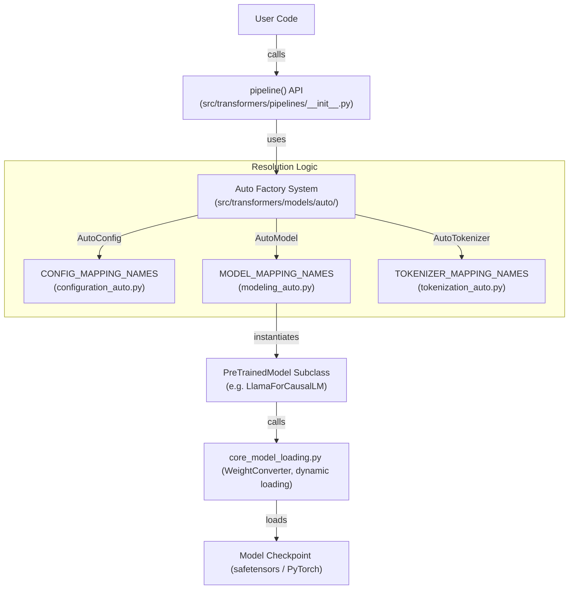
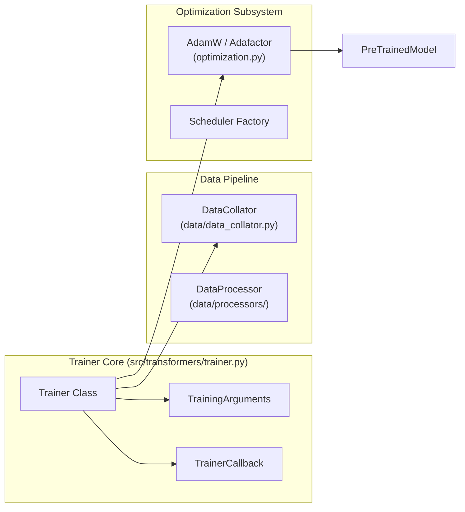

<!-- source: DeepWiki mcp.deepwiki.com · repo huggingface/transformers · page 1 Overview · fetched 2026-10-26 -->

# Overview

<details>
<summary>Relevant source files</summary>

The following files were used as context for generating this wiki page:

- [MIGRATION_GUIDE_V5.md](MIGRATION_GUIDE_V5.md)
- [README.md](README.md)
- [docs/source/ar/_toctree.yml](docs/source/ar/_toctree.yml)
- [docs/source/ar/tasks/language_modeling.md](docs/source/ar/tasks/language_modeling.md)
- [docs/source/ar/tasks/masked_language_modeling.md](docs/source/ar/tasks/masked_language_modeling.md)
- [docs/source/ar/tasks/multiple_choice.md](docs/source/ar/tasks/multiple_choice.md)
- [docs/source/ar/tasks/sequence_classification.md](docs/source/ar/tasks/sequence_classification.md)
- [docs/source/ar/tasks/summarization.md](docs/source/ar/tasks/summarization.md)
- [docs/source/ar/tasks/token_classification.md](docs/source/ar/tasks/token_classification.md)
- [docs/source/ar/tasks/translation.md](docs/source/ar/tasks/translation.md)
- [docs/source/en/_toctree.yml](docs/source/en/_toctree.yml)
- [docs/source/en/index.md](docs/source/en/index.md)
- [docs/source/en/main_classes/pipelines.md](docs/source/en/main_classes/pipelines.md)
- [docs/source/en/tasks/sequence_classification.md](docs/source/en/tasks/sequence_classification.md)
- [docs/source/ja/main_classes/pipelines.md](docs/source/ja/main_classes/pipelines.md)
- [docs/source/ko/main_classes/pipelines.md](docs/source/ko/main_classes/pipelines.md)
- [docs/source/ko/tasks/sequence_classification.md](docs/source/ko/tasks/sequence_classification.md)
- [docs/source/pt/tasks/sequence_classification.md](docs/source/pt/tasks/sequence_classification.md)
- [docs/source/ro/pipeline_tutorial.md](docs/source/ro/pipeline_tutorial.md)
- [docs/source/zh/main_classes/pipelines.md](docs/source/zh/main_classes/pipelines.md)
- [docs/source/zh/tasks/sequence_classification.md](docs/source/zh/tasks/sequence_classification.md)
- [src/transformers/__init__.py](src/transformers/__init__.py)
- [src/transformers/models/__init__.py](src/transformers/models/__init__.py)
- [src/transformers/models/auto/auto_mappings.py](src/transformers/models/auto/auto_mappings.py)
- [src/transformers/models/auto/configuration_auto.py](src/transformers/models/auto/configuration_auto.py)
- [src/transformers/models/auto/feature_extraction_auto.py](src/transformers/models/auto/feature_extraction_auto.py)
- [src/transformers/models/auto/image_processing_auto.py](src/transformers/models/auto/image_processing_auto.py)
- [src/transformers/models/auto/modeling_auto.py](src/transformers/models/auto/modeling_auto.py)
- [src/transformers/models/auto/processing_auto.py](src/transformers/models/auto/processing_auto.py)
- [src/transformers/models/auto/tokenization_auto.py](src/transformers/models/auto/tokenization_auto.py)
- [src/transformers/models/cohere/tokenization_cohere.py](src/transformers/models/cohere/tokenization_cohere.py)
- [src/transformers/utils/dummy_pt_objects.py](src/transformers/utils/dummy_pt_objects.py)
- [utils/check_auto.py](utils/check_auto.py)
- [utils/check_config_attributes.py](utils/check_config_attributes.py)
- [utils/check_repo.py](utils/check_repo.py)

</details>


The Hugging Face Transformers library provides thousands of pretrained models spanning modalities such as text, vision, audio, video, and multimodal tasks. Its primary purpose is to offer a unified, flexible, and extensible API for the entire model lifecycle: loading, training, fine-tuning, generation, and exporting state-of-the-art machine learning models. The library emphasizes modular code organization, readability, and performance through a "single-file-per-model" design philosophy that favors composition over complex inheritance or abstraction. This approach encourages ease of use, maintainability, and seamless integration with multiple frameworks and deployment targets [README.md:70-84]().

## Design Philosophy

The main design principles of the Transformers library are:

- **Ease of Use:** The library exposes high-level abstractions such as the `pipeline()` API, which simplifies performing common tasks such as text generation, classification, and object detection with minimal code, while allowing advanced users to customize all aspects of model configuration and execution [src/transformers/__init__.py:141-173]().

- **Performance and Scalability:** Transformers integrates deeply with optimized attention backends (e.g., Flash Attention, SDPA), quantization methods (BitsAndBytes, GPTQ, AWQ), and distributed training frameworks (DeepSpeed, FSDP, Accelerate) to maximize throughput and reduce resource usage during both training and inference [src/transformers/__init__.py:46-55]().

- **Hackability and Modularity:** Models are organized in isolated subdirectories under `src/transformers/models/`. Each model consists of configuration, model code, tokenizer, and processor files. This self-contained, compositional structure makes it simple to add new architectures or customize existing ones without impacting the global codebase [src/transformers/models/__init__.py:1-210]().

- **Ecosystem Integration:** Transformers acts as a central hub interoperable with related libraries such as PEFT (Parameter-Efficient Fine-Tuning) and Accelerate (device mapping and deployment), and supports multiple export formats (ONNX, ExecuTorch) for flexible deployment pipelines [README.md:73-76]().

For a detailed discussion of these design decisions, including the v5 migration rationale, single-file-per-model philosophy, and the dynamic weight loading API, see the child page **[Design Philosophy & V5 Migration Guide](#1.2)**.

## Key Subsystems Overview

The library is structured into core subsystems that encompass the full model lifecycle, from loading and preprocessing to generation, training, and deployment:

### 1. Model and Configuration

All models inherit from the `PreTrainedConfig` base class, standardizing the lifecycle of loading pretrained weights (`from_pretrained`) and saving models (`save_pretrained`). The paired `PreTrainedConfig` class defines hyperparameters and model architecture, supporting JSON serialization for reproducibility. This abstraction allows seamless swapping and interoperability among models and configurations across tasks and modalities [src/transformers/__init__.py:66-66](), [src/transformers/configuration_utils.py:23-23]().

### 2. Auto Factories and Lazy Loading

"Auto" classes like `AutoModel`, `AutoConfig`, `AutoTokenizer`, `AutoImageProcessor`, and `AutoProcessor` provide user-friendly factory-like APIs that resolve string model identifiers (e.g., `"bert-base-uncased"`) to concrete model, tokenizer, or processor classes. These employ lazy loading mechanics such as `_LazyAutoMapping` and `_LazyModule` to defer expensive imports until strictly necessary, optimizing startup time and resource footprint. The mappings are held in dictionaries like `MODEL_MAPPING_NAMES`, `CONFIG_MAPPING_NAMES`, and `TOKENIZER_MAPPING_NAMES`, defined in `modeling_auto.py`, `configuration_auto.py`, and `tokenization_auto.py` respectively [src/transformers/models/auto/modeling_auto.py:41-176](), [src/transformers/models/auto/configuration_auto.py:36-44](), [src/transformers/models/auto/tokenization_auto.py:64-135]().

### 3. Input Processing

Raw inputs—text, images, audio, and videos—are converted into model-ready tensors via tokenizers, feature extractors, image/audio processors, and processors. The system uses shared mixins such as `ProcessorMixin` to unify preprocessing, normalization, padding, and batching operations. This design supports multimodal pipelines and composite models (e.g., LLaVA, Qwen2-VL) effectively [src/transformers/__init__.py:178-181](), [src/transformers/models/auto/image_processing_auto.py:71-119]().

### 4. Text Generation

Models that support generation mix in `GenerationMixin`, which provides the flexible `generate()` method. This method implements a range of decoding algorithms including greedy search, beam search, contrastive search, speculative decoding, and supports streaming output. Behavior is controlled by `GenerationConfig` settings enabling fine-grained customization of the generation process [src/transformers/__init__.py:113-122]().

### 5. Training and Optimization

The `Trainer` class offers a comprehensive and extensible training loop with features like automatic mixed precision, gradient accumulation, checkpointing, evaluation, and distributed training across GPUs or clusters. It is configured via `TrainingArguments` and supports plugins via `TrainerCallback`. Optimization utilities include implementations of optimizers such as AdamW and Adafactor, as well as learning rate schedulers [docs/source/en/_toctree.yml:181-185](), [docs/source/en/_toctree.yml:187-200]().

## System Architecture: Bridging Concepts with Code Entities

### Pipeline to Model Loading Resolution Flow

This diagram illustrates how a user’s call to the high-level pipeline API resolves into concrete model class instantiation and checkpoint loading within the codebase:



### Trainer Subsystem Interaction

This diagram shows the `Trainer` class’s orchestration of training, linking training arguments, callbacks, data collation, and optimization components:



### Mapping Pipelines and Model Loading: Natural Language to Code Entities

```mermaid
graph TB
    PL[Pipeline API] --> AF[Auto Factory (AutoModel, AutoTokenizer, AutoConfig)]
    AF --> MM["MODEL_MAPPING_NAMES (models/auto/modeling_auto.py)"]
    AF --> TM["TOKENIZER_MAPPING_NAMES (models/auto/tokenization_auto.py)"]
    AF --> CM["CONFIG_MAPPING_NAMES (models/auto/configuration_auto.py)"]
    MM --> PTM[PreTrainedModel subclasses (modeling_utils.py)]
    PTM --> WC[WeightConverter (core_model_loading.py)]
    WC --> CKPT[Checkpoint files (safetensors, .bin)]
```

### Trainer and TrainingArgs Relationship: Natural Language to Code Entities

```mermaid
graph TB
    U["User Script"] --> TR[Trainer (trainer.py)]
    TR --> TA[TrainingArguments (training_args.py)]
    TR --> TC[TrainerCallback (trainer_callback.py)]
    TR --> DC[DataCollator (data/data_collator.py)]
    TR --> OPT[Optimizer classes (optimization.py)]
    TR --> MD[PreTrainedModel]
```

## Exploration Guide to Child Pages

For detailed technical guidance and usage instructions, please see the following child pages:

- **[Getting Started & Installation](#1.1)**: Installation instructions and dependency setup including optional extras (torch, vision, audio, quality). Demonstrates running your first inference with the `pipeline()` API. Covers `setup.py`, `pyproject.toml`, and the dependency version matrix.

- **[Design Philosophy & V5 Migration Guide](#1.2)**: Deep dive into the library’s core design rationales such as the single-file-per-model philosophy, composition-over-abstraction, the removal of TensorFlow/JAX in v5, and the dynamic loading of weights. Discusses `MIGRATION_GUIDE_V5.md` and `CONTRIBUTING.md`.

- **[Documentation Structure & Translations](#1.3)**: Explanation of the documentation tree layout using `_toctree.yml` per language, the `model_doc` documentation standard, internationalization (i18n) with translated READMEs, and doc-building workflows.

These child pages provide practical and conceptual details for onboarding, contributing, and advanced usage of the Transformers library.

---

**Sources:**
[README.md:70-84](), [src/transformers/__init__.py:141-173](), [src/transformers/__init__.py:46-55](), [src/transformers/models/__init__.py:1-210](), [README.md:73-76](), [src/transformers/__init__.py:66-66](), [src/transformers/configuration_utils.py:23-23](), [src/transformers/models/auto/modeling_auto.py:41-176](), [src/transformers/models/auto/configuration_auto.py:36-44](), [src/transformers/models/auto/tokenization_auto.py:64-135](), [src/transformers/__init__.py:178-181](), [src/transformers/models/auto/image_processing_auto.py:71-119](), [src/transformers/__init__.py:113-122](), [docs/source/en/_toctree.yml:181-185](), [docs/source/en/_toctree.yml:187-200]()

---

