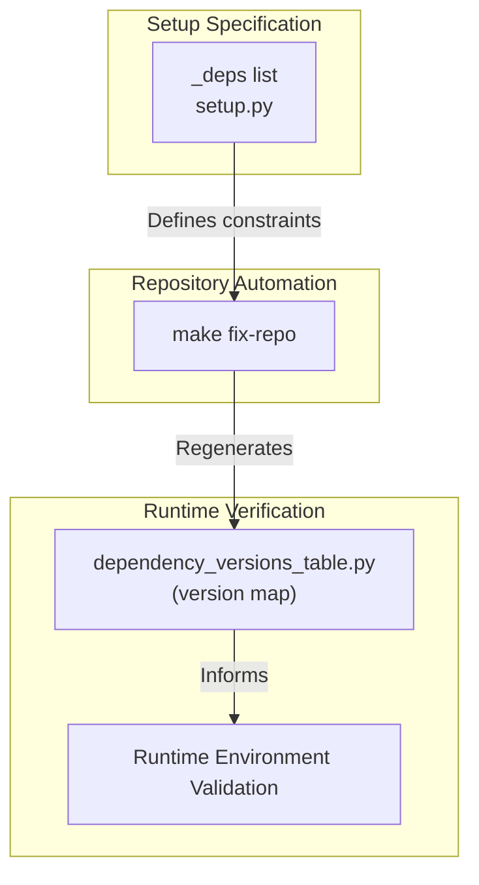
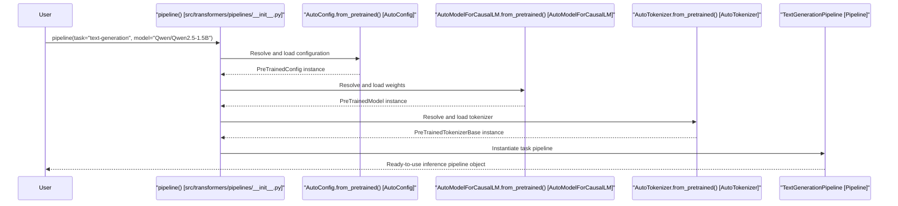

<!-- source: DeepWiki mcp.deepwiki.com · repo huggingface/transformers · page 1.1 Getting Started & Installation · fetched 2026-10-26 -->

# Getting Started & Installation

<details>
<summary>Relevant source files</summary>

The following files were used as context for generating this wiki page:

- [.circleci/config.yml](.circleci/config.yml)
- [.circleci/create_circleci_config.py](.circleci/create_circleci_config.py)
- [conftest.py](conftest.py)
- [docs/source/en/chat_templating.md](docs/source/en/chat_templating.md)
- [docs/source/en/conversations.md](docs/source/en/conversations.md)
- [docs/source/en/generation_strategies.md](docs/source/en/generation_strategies.md)
- [docs/source/en/llm_tutorial.md](docs/source/en/llm_tutorial.md)
- [docs/source/en/model_doc/pix2struct.md](docs/source/en/model_doc/pix2struct.md)
- [docs/source/en/quicktour.md](docs/source/en/quicktour.md)
- [docs/source/en/tasks/language_modeling.md](docs/source/en/tasks/language_modeling.md)
- [docs/source/en/tasks/masked_language_modeling.md](docs/source/en/tasks/masked_language_modeling.md)
- [docs/source/es/chat_templating.md](docs/source/es/chat_templating.md)
- [docs/source/es/tasks/language_modeling.md](docs/source/es/tasks/language_modeling.md)
- [docs/source/ja/chat_templating.md](docs/source/ja/chat_templating.md)
- [docs/source/ja/tasks/masked_language_modeling.md](docs/source/ja/tasks/masked_language_modeling.md)
- [docs/source/ko/tasks/masked_language_modeling.md](docs/source/ko/tasks/masked_language_modeling.md)
- [docs/source/zh/chat_templating.md](docs/source/zh/chat_templating.md)
- [pyproject.toml](pyproject.toml)
- [setup.py](setup.py)
- [src/transformers/dependency_versions_table.py](src/transformers/dependency_versions_table.py)
- [src/transformers/exporters/exporter_openvino.py](src/transformers/exporters/exporter_openvino.py)
- [src/transformers/models/neucodec/feature_extraction_neucodec.py](src/transformers/models/neucodec/feature_extraction_neucodec.py)
- [src/transformers/models/neucodec/modular_neucodec.py](src/transformers/models/neucodec/modular_neucodec.py)
- [src/transformers/models/pix2struct/__init__.py](src/transformers/models/pix2struct/__init__.py)
- [tests/conftest_tests/test_cache_fallback.py](tests/conftest_tests/test_cache_fallback.py)
- [tests/models/pix2struct/test_image_processing_pix2struct.py](tests/models/pix2struct/test_image_processing_pix2struct.py)
- [tests/repo_utils/test_check_noisy_comments.py](tests/repo_utils/test_check_noisy_comments.py)
- [tests/repo_utils/test_tests_fetcher.py](tests/repo_utils/test_tests_fetcher.py)
- [tests/utils/test_testing_utils.py](tests/utils/test_testing_utils.py)
- [utils/check_noisy_comments.py](utils/check_noisy_comments.py)
- [utils/get_pr_run_slow_jobs.py](utils/get_pr_run_slow_jobs.py)
- [utils/tests_fetcher.py](utils/tests_fetcher.py)

</details>


This page provides a technical overview of how to set up the Hugging Face Transformers library, manage its extensive dependency graph, configure optional extras for different modalities, and run your first inference using the high-level `pipeline` API. It covers the implementation details of `setup.py`, the `pyproject.toml` configuration, the dependency versioning scheme, and a walkthrough of the initial model inference flow.

---

## Environment Setup & Supported Python Versions

Transformers supports **Python 3.10 through 3.14**, with explicit range definitions enforced during package configuration in `setup.py` [setup.py:50-51](). At startup, the module checks `sys.version_info` [setup.py:53]() to determine minor versions and adapt optional features (such as audio backend dependencies). It is strongly recommended to use an isolated virtual environment (`venv` or `conda`) to manage dependencies due to the extensive third-party package requirements of the library.

Sources: `setup.py:50-54`

---

## Core Dependencies & Version Management

The core dependencies of the Transformers library are centrally declared in the `_deps` list inside `setup.py` [setup.py:69-164](). This list acts as the single source of truth for runtime and development requirements.

Key components from the core dependency list include:

| Dependency | Version Constraints | Purpose |
| --- | --- | --- |
| `python` | `>= 3.10.0` | Python runtime version range [setup.py:120]() |
| `torch` | `>= 2.5` | PyTorch deep learning backend [setup.py:150]() |
| `accelerate` | `>= 1.1.0` | Device dispatch and multi-GPU utilities [setup.py:74]() |
| `huggingface-hub` | `>= 1.31.0, < 3.0` | Hub integration, caching, and downloads [setup.py:90]() |
| `tokenizers` | `>= 0.23.1, < 0.24.0` | Fast Rust-based tokenization backend [setup.py:149]() |
| `datasets` | `>= 2.15.0` | Dataset loading and preprocessing [setup.py:79]() |
| `safetensors` | `>= 0.8.0` | Secure weight serialization format [setup.py:135]() |

When modifications are made to `_deps` in `setup.py`, running `make fix-repo` automatically synchronizes and regenerates the internal version lookup table located at `src/transformers/dependency_versions_table.py` [setup.py:69-72](). This autogenerated module maps package names to their version specification strings and is used at runtime for dependency validation [src/transformers/dependency_versions_table.py:1-91]().

### Dependency Versioning Flow



Sources: `setup.py:69-164`, `src/transformers/dependency_versions_table.py:1-91`

---

## Optional Extras Configuration

Transformers uses setuptools extras to organize optional dependencies into named groups. These groups allow users to selectively install modality-specific packages (such as vision, audio, or video tools) and development utilities.

The extras mapping is defined in the `extras` dictionary within `setup.py` [setup.py:175-192]() using the `deps_list()` helper [setup.py:171-173]().

| Extras Group | Included Packages & Dependencies | Description |
| --- | --- | --- |
| `torch` | `torch`, `accelerate` | Core PyTorch runtime and distribution support [setup.py:177]() |
| `vision` | `torchvision`, `Pillow` | Image loading and computer vision transformations [setup.py:178]() |
| `audio` | `torchaudio`, `librosa`, `pyctcdecode`, `phonemizer`, `kenlm` (if Python `< 13`) | Speech recognition and audio processing pipelines [setup.py:179-181]() |
| `video` | `av` | Video decoding and frame extraction utilities [setup.py:182]() |
| `quality` | `datasets`, `ruff`, `GitPython`, `urllib3`, `libcst`, `rich`, `ty`, `tomli`, `transformers-mlinter` | Code quality, linting, and static analysis suite [setup.py:184-186]() |
| `docs` | `hf-doc-builder` | Documentation generation and validation tools [setup.py:187]() |

### Example Installation Commands

Users can install specific extras using pip:

```bash
# Install core transformers with PyTorch support
pip install "transformers[torch]"

# Install with vision and audio capabilities
pip install "transformers[torch,vision,audio]"

# Install development environment with quality checks
pip install -e ".[quality]"
```

Sources: `setup.py:171-193`

---

## Repository Configuration & Tooling (`pyproject.toml`)

Development tools, linters, test options, and type checkers are configured in `pyproject.toml`. 

- **Coverage:** Configured under `[tool.coverage.run]` to track test coverage across the `transformers` package while omitting test conversion scripts [pyproject.toml:1-6]().
- **Ruff Linter:** Configured in `[tool.ruff]` with a line length of 119, targeting Python 3.10+, and enforcing specific lint rules (`E`, `F`, `I`, `W`, `UP`, `FURB`, `SIM`, `C4`, `C901`) [pyproject.toml:16-43](). It also defines per-file ignores for package `__init__.py` files [pyproject.toml:61-65]().
- **Pytest:** Configured under `[tool.pytest.ini_options]` with custom markers (`bitsandbytes`, `generate`, `is_training_test`, `is_tensor_parallel_test`, `is_fsdp_test`) and default environment variables like `HF_HUB_DOWNLOAD_TIMEOUT=60` [pyproject.toml:84-113]().
- **Type Checking (`ty`):** Suppresses specific false-positive rules for tensor operations and optional imports [pyproject.toml:115-134]().

Sources: `pyproject.toml:1-134`

---

## First Inference: Running Your First Pipeline

The high-level `pipeline()` API provides a zero-code-boilerplate interface for model inference across various modalities. It coordinates configuration resolution, model instantiation, and tokenizer loading automatically.

### Pipeline Creation & Inference Flow



### Quickstart Example

Once installed, running text generation requires only a few lines of code:

```python
from transformers import pipeline

# Instantiate a text generation pipeline
generator = pipeline(task="text-generation", model="Qwen/Qwen2.5-1.5B")

# Execute inference
result = generator("The secret to baking is ")
print(result)
```

Sources: `docs/source/en/quicktour.md:149-157`, `src/transformers/pipelines/__init__.py`

---

# Sources

- `setup.py:1-193`
- `src/transformers/dependency_versions_table.py:1-91`
- `pyproject.toml:1-134`
- `docs/source/en/quicktour.md:149-157`

---

