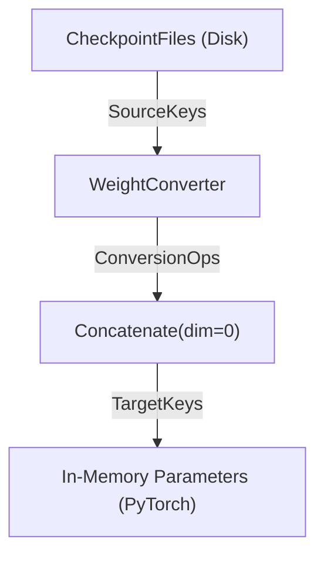
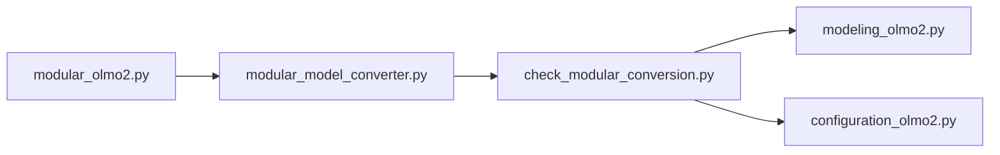

<!-- source: DeepWiki mcp.deepwiki.com · repo huggingface/transformers · page 1.2 Design Philosophy & V5 Migration Guide · fetched 2026-10-26 -->

# Design Philosophy & V5 Migration Guide

<details>
<summary>Relevant source files</summary>

The following files were used as context for generating this wiki page:

- [.ai/AGENTS.md](.ai/AGENTS.md)
- [.ai/skills/add-or-fix-type-checking/SKILL.md](.ai/skills/add-or-fix-type-checking/SKILL.md)
- [.github/ISSUE_TEMPLATE/bug-report.yml](.github/ISSUE_TEMPLATE/bug-report.yml)
- [.github/ISSUE_TEMPLATE/migration.yml](.github/ISSUE_TEMPLATE/migration.yml)
- [.github/PULL_REQUEST_TEMPLATE.md](.github/PULL_REQUEST_TEMPLATE.md)
- [.github/scripts/codeowners_for_review_action](.github/scripts/codeowners_for_review_action)
- [.github/workflows/assign-reviewers.yml](.github/workflows/assign-reviewers.yml)
- [.github/workflows/check-workflow-permissions.yml](.github/workflows/check-workflow-permissions.yml)
- [.github/workflows/codeql.yml](.github/workflows/codeql.yml)
- [.github/workflows/trufflehog.yml](.github/workflows/trufflehog.yml)
- [.gitignore](.gitignore)
- [AGENTS.md](AGENTS.md)
- [CLAUDE.md](CLAUDE.md)
- [CONTRIBUTING.md](CONTRIBUTING.md)
- [MIGRATION_GUIDE_V5.md](MIGRATION_GUIDE_V5.md)
- [Makefile](Makefile)
- [docs/source/ar/_toctree.yml](docs/source/ar/_toctree.yml)
- [docs/source/ar/tasks/language_modeling.md](docs/source/ar/tasks/language_modeling.md)
- [docs/source/ar/tasks/masked_language_modeling.md](docs/source/ar/tasks/masked_language_modeling.md)
- [docs/source/ar/tasks/multiple_choice.md](docs/source/ar/tasks/multiple_choice.md)
- [docs/source/ar/tasks/sequence_classification.md](docs/source/ar/tasks/sequence_classification.md)
- [docs/source/ar/tasks/summarization.md](docs/source/ar/tasks/summarization.md)
- [docs/source/ar/tasks/token_classification.md](docs/source/ar/tasks/token_classification.md)
- [docs/source/ar/tasks/translation.md](docs/source/ar/tasks/translation.md)
- [docs/source/en/main_classes/pipelines.md](docs/source/en/main_classes/pipelines.md)
- [docs/source/en/models.md](docs/source/en/models.md)
- [docs/source/en/modular_transformers.md](docs/source/en/modular_transformers.md)
- [docs/source/en/philosophy.md](docs/source/en/philosophy.md)
- [docs/source/en/pr_checks.md](docs/source/en/pr_checks.md)
- [docs/source/en/tasks/sequence_classification.md](docs/source/en/tasks/sequence_classification.md)
- [docs/source/en/testing.md](docs/source/en/testing.md)
- [docs/source/es/pr_checks.md](docs/source/es/pr_checks.md)
- [docs/source/it/big_models.md](docs/source/it/big_models.md)
- [docs/source/it/pr_checks.md](docs/source/it/pr_checks.md)
- [docs/source/ja/big_models.md](docs/source/ja/big_models.md)
- [docs/source/ja/main_classes/model.md](docs/source/ja/main_classes/model.md)
- [docs/source/ja/main_classes/output.md](docs/source/ja/main_classes/output.md)
- [docs/source/ja/main_classes/pipelines.md](docs/source/ja/main_classes/pipelines.md)
- [docs/source/ja/main_classes/text_generation.md](docs/source/ja/main_classes/text_generation.md)
- [docs/source/ja/pr_checks.md](docs/source/ja/pr_checks.md)
- [docs/source/ko/main_classes/model.md](docs/source/ko/main_classes/model.md)
- [docs/source/ko/main_classes/pipelines.md](docs/source/ko/main_classes/pipelines.md)
- [docs/source/ko/model_doc/albert.md](docs/source/ko/model_doc/albert.md)
- [docs/source/ko/model_doc/code_llama.md](docs/source/ko/model_doc/code_llama.md)
- [docs/source/ko/model_doc/gpt2.md](docs/source/ko/model_doc/gpt2.md)
- [docs/source/ko/models.md](docs/source/ko/models.md)
- [docs/source/ko/pr_checks.md](docs/source/ko/pr_checks.md)
- [docs/source/ko/tasks/sequence_classification.md](docs/source/ko/tasks/sequence_classification.md)
- [docs/source/pt/tasks/sequence_classification.md](docs/source/pt/tasks/sequence_classification.md)
- [docs/source/ro/pipeline_tutorial.md](docs/source/ro/pipeline_tutorial.md)
- [docs/source/zh/_toctree.yml](docs/source/zh/_toctree.yml)
- [docs/source/zh/big_models.md](docs/source/zh/big_models.md)
- [docs/source/zh/generation_strategies.md](docs/source/zh/generation_strategies.md)
- [docs/source/zh/kernels.md](docs/source/zh/kernels.md)
- [docs/source/zh/main_classes/image_processor.md](docs/source/zh/main_classes/image_processor.md)
- [docs/source/zh/main_classes/model.md](docs/source/zh/main_classes/model.md)
- [docs/source/zh/main_classes/output.md](docs/source/zh/main_classes/output.md)
- [docs/source/zh/main_classes/pipelines.md](docs/source/zh/main_classes/pipelines.md)
- [docs/source/zh/main_classes/text_generation.md](docs/source/zh/main_classes/text_generation.md)
- [docs/source/zh/model_doc/bert.md](docs/source/zh/model_doc/bert.md)
- [docs/source/zh/perf_train_cpu.md](docs/source/zh/perf_train_cpu.md)
- [docs/source/zh/performance.md](docs/source/zh/performance.md)
- [docs/source/zh/philosophy.md](docs/source/zh/philosophy.md)
- [docs/source/zh/tasks/sequence_classification.md](docs/source/zh/tasks/sequence_classification.md)
- [src/transformers/_typing.py](src/transformers/_typing.py)
- [src/transformers/models/cohere/tokenization_cohere.py](src/transformers/models/cohere/tokenization_cohere.py)
- [src/transformers/safetensors_conversion.py](src/transformers/safetensors_conversion.py)
- [tests/repo_utils/test_checkers.py](tests/repo_utils/test_checkers.py)
- [utils/check_inits.py](utils/check_inits.py)
- [utils/check_reviewers.py](utils/check_reviewers.py)
- [utils/check_types.py](utils/check_types.py)
- [utils/checkers-requirements.txt](utils/checkers-requirements.txt)
- [utils/checkers.py](utils/checkers.py)
- [utils/get_test_reports.py](utils/get_test_reports.py)

</details>


This page documents the core architectural principles of the Hugging Face Transformers library, the significant breaking changes introduced in Version 5 (v5), and the technical implementations of the dynamic weight loading API and the modular transformers system. It also outlines key contributor guidelines for maintaining code quality, repository consistency, and agentic contribution policies.

---

## Design Philosophy

The Transformers library architecture is founded on three main design tenets aimed at maintainability, clarity, and extensibility at scale.

### 1. Single-File-per-Model (Legacy)

- Each model family is implemented entirely within a **single Python file** named `modeling_<model_name>.py` located under `src/transformers/models/<model_name>/` [docs/source/en/modular_transformers.md:18]().
- This *one-model-one-file* approach limits complex inheritance hierarchies and deep abstractions, making debugging straightforward and source navigation predictable.
- Variants and heads associated with the model (e.g., sequence classification, causal LM heads) are contained within the same file.
- This design ensures all model-related code is easy to locate and understand without jumping between scattered files.

Sources: 
[docs/source/en/modular_transformers.md:16-25]()

### 2. Composition over Over-Abstraction

- The library favors *composition* rather than deep class inheritance hierarchies.
- Specific model heads **do not** subclass the base model to extend behavior. Instead, they **compose** the base model by explicitly invoking it within their `forward()` methods.
- This results in shallow abstraction: a user-facing model class typically inherits only from a shared `PreTrainedModel` base, with minimal layers on top.
- This design reduces indirection, eases debugging, and improves code clarity.

Sources: 
[docs/source/en/modular_transformers.md:16-30]()

### 3. Explicit Code & Readability

- Avoids extensive use of `nn.Sequential` subclasses to enable easy breakpoint setting and debugging.
- Prioritizes clear, descriptive naming over terse abbreviations for variables and methods to improve readability.
- Accepts some level of code duplication within each single-model file if it provides self-containment and clarity.
- These design choices promote a codebase accessible to contributors of varying expertise and language backgrounds.

Sources: 
[docs/source/en/modular_transformers.md:18-45]()

---

## V5 Migration: Core Changes

Version 5 brings major architectural evolution, focusing on simplification, modernization, and maintainability.

### Removal of TensorFlow and JAX Support

- All **TensorFlow** and **JAX** implementations have been removed from the library [MIGRATION_GUIDE_V5.md:21-28]().
- Development is now fully concentrated on **PyTorch (`torch`)** as the single backend, significantly reducing maintenance overhead across model families [MIGRATION_GUIDE_V5.md:23-26]().
- External collaboration continues with JAX ecosystem projects, e.g., MaxText, but without direct JAX model support internally [MIGRATION_GUIDE_V5.md:24-26]().

Sources: 
[MIGRATION_GUIDE_V5.md:21-28]()

### Tokenizer Backend Consolidation

Before v5, tokenizers were implemented in parallel variants:
- **Slow tokenizers:** Python-based implementations, often backed by [SentencePiece](https://github.com/google/sentencepiece) [MIGRATION_GUIDE_V5.md:122-123]().
- **Fast tokenizers:** Rust-based implementations via the 🤗 [`tokenizers`](https://github.com/huggingface/tokenizers) library [MIGRATION_GUIDE_V5.md:124]().

With v5:
- Only **one tokenizer file per model** remains: `tokenization_<model>.py` [MIGRATION_GUIDE_V5.md:126]().
- This file dynamically selects and utilizes the best available backend:
  1. [`TokenizersBackend`](MIGRATION_GUIDE_V5.md:88) (preferred): Rust-based tokenizers from the 🤗 `tokenizers` library offering optimal performance and features [MIGRATION_GUIDE_V5.md:128-134]().
  2. [`SentencePieceBackend`](MIGRATION_GUIDE_V5.md:135): For tokenizers requiring `sentencepiece`, inheriting from `PythonBackend` [MIGRATION_GUIDE_V5.md:135]().
  3. [`PythonBackend`](MIGRATION_GUIDE_V5.md:136): Pure Python fallback implementation [MIGRATION_GUIDE_V5.md:136]().
  4. [`MistralCommonBackend`](MIGRATION_GUIDE_V5.md:137): Relies on `MistralCommon`'s tokenization library [MIGRATION_GUIDE_V5.md:137]().
- The [`AutoTokenizer`](MIGRATION_GUIDE_V5.md:139) factory automatically detects and loads the appropriate backend transparently [MIGRATION_GUIDE_V5.md:139]().

Sources: 
[MIGRATION_GUIDE_V5.md:120-140]()

---

## Dynamic Weight Loading API

A principal advancement in v5 is the new **dynamic weight loading API** that cleanly abstracts and modularizes weight transformations during checkpoint loading [MIGRATION_GUIDE_V5.md:30-38]().

### Motivation and `WeightConverter` Class

Traditionally, checkpoint loading contained ad-hoc logic for reshaping, merging, and splitting weights across various model architectures and parallelism schemes [MIGRATION_GUIDE_V5.md:32-37](). The new API models checkpoint weight transformations declaratively via the [`WeightConverter`](MIGRATION_GUIDE_V5.md:39) class [MIGRATION_GUIDE_V5.md:39-46]()]:

```python
class WeightConverter(WeightTransform):
    operations: list[ConversionOps]
    source_keys: Union[str, list[str]]
    target_keys: Union[str, list[str]]
```

- `source_keys`: Checkpoint keys where source tensors are read [MIGRATION_GUIDE_V5.md:44]().
- `target_keys`: Model keys where transformed tensors are assigned [MIGRATION_GUIDE_V5.md:45]().
- `operations`: A list of tensor `ConversionOps` like reshaping, concatenation, or splitting [MIGRATION_GUIDE_V5.md:43]().

### Example: Query-Key-Value Fusion

A common case fuses query, key, and value projection weights into a single combined matrix [MIGRATION_GUIDE_V5.md:47-51]()]:

```python
conversion = WeightConverter(
    ["self_attn.q_proj", "self_attn.k_proj", "self_attn.v_proj"],  # The input layers
    "self_attn.qkv_proj",  # The single layer as output
    operations=[Concatenate(dim=0)],
)
```

Sources: 
[MIGRATION_GUIDE_V5.md:30-75]()

### Diagram: Dynamic Weight Loading Flow (Code Entity Space)

Title: "WeightConverter Data Flow Architecture"



Sources: 
[MIGRATION_GUIDE_V5.md:30-75]()

---

## Modular Transformers System

The **modular transformers system** balances DRY principles with user simplicity by using code generation [docs/source/en/modular_transformers.md:16-21]().

### How it works

- Contributors write a **modular file** named `modular_<model>.py` inside `src/transformers/models/<name>/` [docs/source/en/modular_transformers.md:47]().
- This modular file **inherits** from existing models and overrides or extends only what differs [docs/source/en/modular_transformers.md:18-20]().
- An internal generator tool (`modular_model_converter.py`) automatically generates standalone legacy-style `modeling_<model>.py` and `configuration_<model>.py` files [docs/source/en/modular_transformers.md:20]().
- Users continue to consume the familiar single-file-per-model import style transparently [docs/source/en/modular_transformers.md:20]().
- Consistency checkers (`check_modular_conversion.py`) ensure generated files remain synchronized [Makefile:22]().

Sources: 
[docs/source/en/modular_transformers.md:16-50](), 
[Makefile:17-36]()

### Diagram: Modular Transformers Conversion Pipeline (Code Entity Space)

Title: "Modular Conversion Pipeline"

Image/Component Mapping:
- `modular_olmo2.py` -> `modular_model_converter.py` -> `modeling_olmo2.py` / `configuration_olmo2.py`



Sources: 
[docs/source/en/modular_transformers.md:16-50](), 
[Makefile:17-36]()

---

## Contributing Guidelines & Code Agent Policy

The repository maintains strict policies to ensure high quality and to avoid overwhelming maintainers, especially concerning automated code generation and pull request hygiene [CONTRIBUTING.md:19-27]().

### Code Agent Policy

- **First-time contributors must NOT submit PRs or issues generated by any language model or code agent [.github/PULL_REQUEST_TEMPLATE.md:17-22]()].**
- Autonomous bots or agents are prohibited from creating issues or pull requests [.github/PULL_REQUEST_TEMPLATE.md:21-22]().
- PRs suspected of being agent-generated are likely to be closed without review and may result in blocking the user [.github/PULL_REQUEST_TEMPLATE.md:23-27]().
- Contributors must verify tests locally using `utils/tests_fetcher.py` and repository checkers via `make fix-repo` before opening a PR [CONTRIBUTING.md:61-64]().

Sources: 
[CONTRIBUTING.md:19-66](), 
[.github/PULL_REQUEST_TEMPLATE.md:17-32]()

---

## Summary Table

| Topic                             | Description                                                                                   | Relevant Code Entities / Files                                          |
|----------------------------------|-----------------------------------------------------------------------------------------------|------------------------------------------------------------------------|
| Single-File-Per-Model Philosophy | One Python file per model family with all code self-contained                                | `src/transformers/models/<model>/modeling_<model>.py` [docs/source/en/modular_transformers.md:18]() |
| Composition over Inheritance      | Heads compose base models explicitly; no deep subclassing complexity                         | Various model `forward()` implementations [docs/source/en/modular_transformers.md:18-25]() |
| Tokenizer Backend Consolidation   | Single tokenizer file with dynamic backend selection and `AutoTokenizer`                     | [`TokenizersBackend`](MIGRATION_GUIDE_V5.md:88), [`SentencePieceBackend`](MIGRATION_GUIDE_V5.md:135), [`AutoTokenizer`](MIGRATION_GUIDE_V5.md:139) [MIGRATION_GUIDE_V5.md:120-140]() |
| Dynamic Weight Loading API        | `WeightConverter` class for declarative weight transformations on pretrained checkpoints     | [`WeightConverter`](MIGRATION_GUIDE_V5.md:39), `ConversionOps`, `Concatenate` [MIGRATION_GUIDE_V5.md:30-75]() |
| Modular Transformers System       | Modular files inherit, generator autogenerates legacy standalone modeling files              | `modular_model_converter.py`, `modular_<model>.py` [docs/source/en/modular_transformers.md:18-125]() |
| Code Agent Policy                 | Prevents agent-generated submissions from first-time contributors                            | [.github/PULL_REQUEST_TEMPLATE.md:17-32]() [CONTRIBUTING.md:19-27]() |

Sources: 
[MIGRATION_GUIDE_V5.md:19-140](), 
[docs/source/en/modular_transformers.md:16-125](), 
[CONTRIBUTING.md:19-66](), 
[.github/PULL_REQUEST_TEMPLATE.md:17-32]()

---

