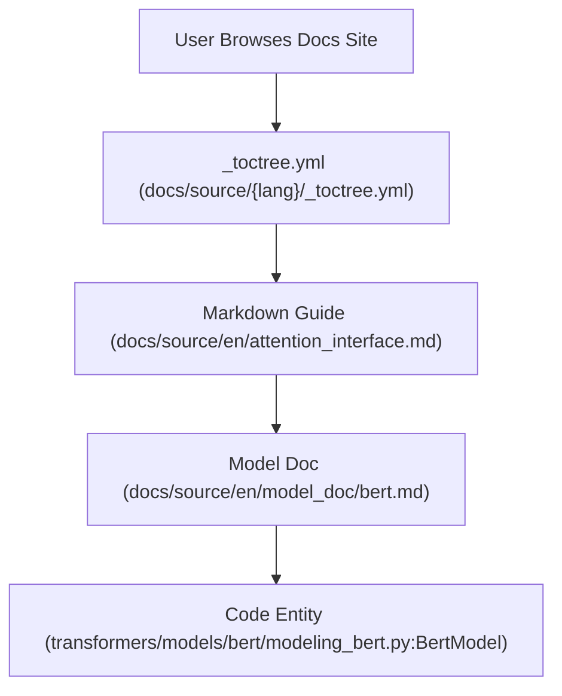
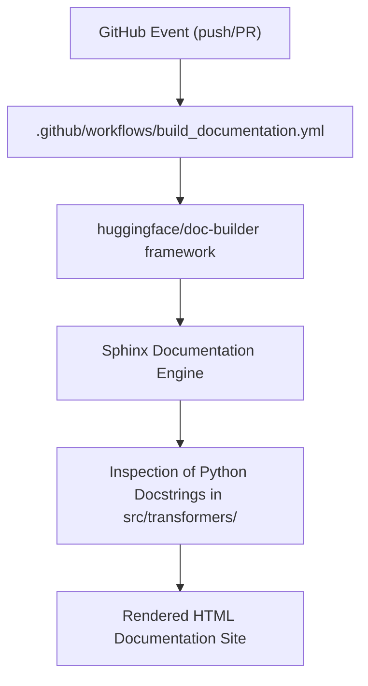

<!-- source: DeepWiki mcp.deepwiki.com · repo huggingface/transformers · page 1.3 Documentation Structure & Translations · fetched 2026-10-26 -->

# Documentation Structure & Translations

<details>
<summary>Relevant source files</summary>

The following files were used as context for generating this wiki page:

- [.github/workflows/build_documentation.yml](.github/workflows/build_documentation.yml)
- [.github/workflows/build_pr_documentation.yml](.github/workflows/build_pr_documentation.yml)
- [.github/workflows/upload_pr_documentation.yml](.github/workflows/upload_pr_documentation.yml)
- [SECURITY.md](SECURITY.md)
- [docs/source/ar/task_summary.md](docs/source/ar/task_summary.md)
- [docs/source/de/llm_tutorial.md](docs/source/de/llm_tutorial.md)
- [docs/source/en/attention_interface.md](docs/source/en/attention_interface.md)
- [docs/source/en/cache_explanation.md](docs/source/en/cache_explanation.md)
- [docs/source/en/model_doc/flan-ul2.md](docs/source/en/model_doc/flan-ul2.md)
- [docs/source/en/model_doc/reformer.md](docs/source/en/model_doc/reformer.md)
- [docs/source/en/perplexity.md](docs/source/en/perplexity.md)
- [docs/source/en/tokenizer_summary.md](docs/source/en/tokenizer_summary.md)
- [docs/source/es/_toctree.yml](docs/source/es/_toctree.yml)
- [docs/source/es/attention.md](docs/source/es/attention.md)
- [docs/source/es/conversations.md](docs/source/es/conversations.md)
- [docs/source/es/model_memory_anatomy.md](docs/source/es/model_memory_anatomy.md)
- [docs/source/es/pipeline_tutorial.md](docs/source/es/pipeline_tutorial.md)
- [docs/source/es/pipeline_webserver.md](docs/source/es/pipeline_webserver.md)
- [docs/source/es/task_summary.md](docs/source/es/task_summary.md)
- [docs/source/es/tasks/audio_classification.md](docs/source/es/tasks/audio_classification.md)
- [docs/source/es/tasks_explained.md](docs/source/es/tasks_explained.md)
- [docs/source/es/tokenizer_summary.md](docs/source/es/tokenizer_summary.md)
- [docs/source/es/torch_compile.md](docs/source/es/torch_compile.md)
- [docs/source/fr/_toctree.yml](docs/source/fr/_toctree.yml)
- [docs/source/fr/autoclass_tutorial.md](docs/source/fr/autoclass_tutorial.md)
- [docs/source/fr/task_summary.md](docs/source/fr/task_summary.md)
- [docs/source/fr/tasks_explained.md](docs/source/fr/tasks_explained.md)
- [docs/source/fr/tutoriel_pipeline.md](docs/source/fr/tutoriel_pipeline.md)
- [docs/source/hi/_toctree.yml](docs/source/hi/_toctree.yml)
- [docs/source/hi/accelerate.md](docs/source/hi/accelerate.md)
- [docs/source/hi/pipeline_tutorial.md](docs/source/hi/pipeline_tutorial.md)
- [docs/source/ja/_toctree.yml](docs/source/ja/_toctree.yml)
- [docs/source/ja/llm_tutorial.md](docs/source/ja/llm_tutorial.md)
- [docs/source/ja/model_doc/albert.md](docs/source/ja/model_doc/albert.md)
- [docs/source/ja/model_doc/bart.md](docs/source/ja/model_doc/bart.md)
- [docs/source/ja/model_doc/bert.md](docs/source/ja/model_doc/bert.md)
- [docs/source/ja/model_doc/big_bird.md](docs/source/ja/model_doc/big_bird.md)
- [docs/source/ja/model_doc/bigbird_pegasus.md](docs/source/ja/model_doc/bigbird_pegasus.md)
- [docs/source/ja/model_doc/bloom.md](docs/source/ja/model_doc/bloom.md)
- [docs/source/ja/model_doc/camembert.md](docs/source/ja/model_doc/camembert.md)
- [docs/source/ja/model_doc/canine.md](docs/source/ja/model_doc/canine.md)
- [docs/source/ja/model_doc/convbert.md](docs/source/ja/model_doc/convbert.md)
- [docs/source/ja/model_doc/ctrl.md](docs/source/ja/model_doc/ctrl.md)
- [docs/source/ja/model_doc/data2vec.md](docs/source/ja/model_doc/data2vec.md)
- [docs/source/ja/model_doc/deberta-v2.md](docs/source/ja/model_doc/deberta-v2.md)
- [docs/source/ja/model_doc/deberta.md](docs/source/ja/model_doc/deberta.md)
- [docs/source/ja/task_summary.md](docs/source/ja/task_summary.md)
- [docs/source/ko/_toctree.yml](docs/source/ko/_toctree.yml)
- [docs/source/ko/accelerator_selection.md](docs/source/ko/accelerator_selection.md)
- [docs/source/ko/cache_explanation.md](docs/source/ko/cache_explanation.md)
- [docs/source/tr/_config.py](docs/source/tr/_config.py)
- [docs/source/tr/_toctree.yml](docs/source/tr/_toctree.yml)
- [docs/source/tr/index.md](docs/source/tr/index.md)
- [docs/source/tr/installation.md](docs/source/tr/installation.md)
- [docs/source/tr/quicktour.md](docs/source/tr/quicktour.md)
- [docs/source/zh/pipeline_tutorial.md](docs/source/zh/pipeline_tutorial.md)
- [docs/source/zh/task_summary.md](docs/source/zh/task_summary.md)
- [i18n/README_ar.md](i18n/README_ar.md)
- [i18n/README_de.md](i18n/README_de.md)
- [i18n/README_es.md](i18n/README_es.md)
- [i18n/README_fr.md](i18n/README_fr.md)
- [i18n/README_hd.md](i18n/README_hd.md)
- [i18n/README_ja.md](i18n/README_ja.md)
- [i18n/README_pt-br.md](i18n/README_pt-br.md)
- [i18n/README_ru.md](i18n/README_ru.md)
- [i18n/README_te.md](i18n/README_te.md)
- [i18n/README_ur.md](i18n/README_ur.md)
- [i18n/README_vi.md](i18n/README_vi.md)
- [i18n/README_zh-hans.md](i18n/README_zh-hans.md)
- [i18n/README_zh-hant.md](i18n/README_zh-hant.md)

</details>


This page (Section 1.3) details the technical organization of the documentation tree within the `docs/` directory of the Hugging Face Transformers repository. It covers multi-language management via language-specific `_toctree.yml` files, the `model_doc` convention for per-model architecture documentation, internationalization (i18n) README guides, and the automated GitHub Actions workflows responsible for building, validating, and deploying the documentation.

---

## 1. Documentation Tree Organization per Language

The documentation site is structured hierarchically using YAML navigation files named `_toctree.yml`. Each supported language maintains its own `_toctree.yml` file located at:

```
docs/source/{lang}/_toctree.yml
```

### Characteristics of `_toctree.yml` Files

- These YAML files define the site's navigation hierarchy for a specific language, mapping top-level sections, nested subsections, and Markdown files.
- Each entry in the `sections` list contains objects specifying:
  - `title`: The localized section title displayed in the sidebar.
  - `local`: A relative path to a Markdown documentation file (e.g., `installation`, `quicktour`) within the language source folder.
  - `sections`: Nested subsections or pages to create hierarchical grouping.

### Example: Korean `_toctree.yml` Excerpt

```yaml
- sections:
  - local: index
    title: 🤗 Transformers
  - local: installation
    title: 설치방법
  - local: quicktour
    title: 둘러보기
  title: 시작하기
- isExpanded: false
  sections:
  - sections:
    - local: models
      title: 모델 로드하기
    - local: custom_models
      title: 사용자 정의 모델 공유하기
    # ...
  title: 모델
```

Sources: `docs/source/ko/_toctree.yml:1-28` [docs/source/ko/_toctree.yml:1-28]()

---

## 2. Model Documentation Convention: `model_doc`

Within each language directory (e.g., `docs/source/en/`), a dedicated subfolder named `model_doc/` contains individual Markdown files documenting specific model architectures:

```
docs/source/en/model_doc/bert.md
docs/source/ko/model_doc/bert.md
docs/source/zh/model_doc/bert.md
```

### Purpose and Scope of `model_doc` Files

- Provide in-depth architectural references, configuration parameters, and code usage patterns for individual model families.
- Supplement API reference docs and conceptual guides by detailing parameter behaviors, attention implementations, and subclassing specifics.
- Linked directly from major language `_toctree.yml` files under model overview sections.

Sources: `docs/source/ja/_toctree.yml:186-240` [docs/source/ja/_toctree.yml:186-240]()

---

## 3. Internationalization (i18n) Helper READMEs

Translation and localization workflows are supported by per-language helper README files stored in the repository's `i18n/` root directory:

- `i18n/README_zh-hans.md`
- `i18n/README_ja.md`
- `i18n/README_fr.md`
- `i18n/README_ko.md`
- `i18n/README_ru.md`

### Contents of i18n READMEs

- **Glossaries of Technical Terms:** Dictates whether specific terms (e.g., "tokenizer", "pipeline", "Trainer", "checkpoint") should be translated or retained in English.
- **Style Guidelines:** Specific rules on punctuation, spacing around English words in CJK languages, and quotation styles.
- **Badges & Metadata:** Shields and links reflecting translation status and build health.

Sources: `i18n/README_zh-hans.md:17-40` [i18n/README_zh-hans.md:17-40](), `i18n/README_ja.md:17-50` [i18n/README_ja.md:17-50]()

---

## 4. Documentation Build Workflows

Documentation validation and building are automated via GitHub Actions workflows defined in `.github/workflows/`.

### 4.1. Pull Request Verification: `build_pr_documentation.yml`

- **Trigger:** Pull request events and merge groups.
- **Operations:**
  - Sets up Python and installs `uv` package manager [.github/workflows/build_pr_documentation.yml:25-34]().
  - Installs the core `doc-builder` tool from source [.github/workflows/build_pr_documentation.yml:35-38]().
  - Executes `doc-builder check-links docs/source/en` to validate all internal and external links [.github/workflows/build_pr_documentation.yml:39-42]().
  - Invokes the reusable documentation build workflow for English docs only [.github/workflows/build_pr_documentation.yml:43-52]().

Sources: `.github/workflows/build_pr_documentation.yml:1-52` [.github/workflows/build_pr_documentation.yml:1-52]()

### 4.2. Main Build and Multi-Language Deployment: `build_documentation.yml`

- **Trigger:** `workflow_dispatch`, or pushes to `main`, `doc-builder*`, and release branches [.github/workflows/build_documentation.yml:3-11]().
- **Operations:**
  - Triggers builds for English (`en`) via `huggingface/doc-builder` workflow [.github/workflows/build_documentation.yml:16-25]().
  - Triggers a separate parallel job (`build_other_lang`) for all supported international languages (`ar de es fr hi it ja ko pt ro tr zh`) [.github/workflows/build_documentation.yml:27-36]().

Sources: `.github/workflows/build_documentation.yml:1-37` [.github/workflows/build_documentation.yml:1-36]()

---

## 5. Bridging Natural Language Space to Code Entity Space

The documentation acts as a bridge guiding users from conceptual natural language descriptions to concrete code entities in the codebase.

### Diagram 1: Navigation Tree to Source Code Mapping



**Description:**  
Links hierarchical documentation entries in `_toctree.yml` down to specific model documentation files and ultimately to the underlying Python classes (`BertModel`, `PreTrainedModel`) defined in model modules.

Sources: `docs/source/en/attention_interface.md:1-45` [docs/source/en/attention_interface.md:1-45](), `docs/source/ko/_toctree.yml:1-28` [docs/source/ko/_toctree.yml:1-28]()

---

### Diagram 2: Doc-Builder Pipeline to Code Entity Documentation



**Description:**  
Shows the transformation pipeline where the doc-builder workflow compiles Markdown files and extracts docstrings directly from Python source files into the deployed documentation.

Sources: `.github/workflows/build_documentation.yml:1-37` [.github/workflows/build_documentation.yml:1-36](), `.github/workflows/build_pr_documentation.yml:1-52` [.github/workflows/build_pr_documentation.yml:1-52]()

---

