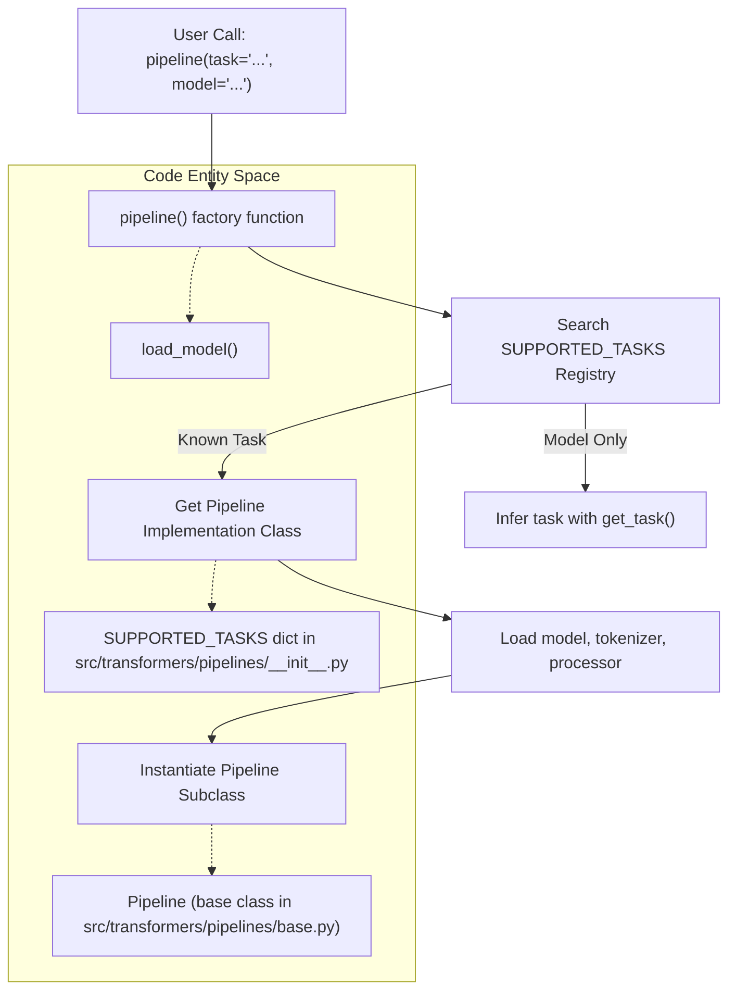
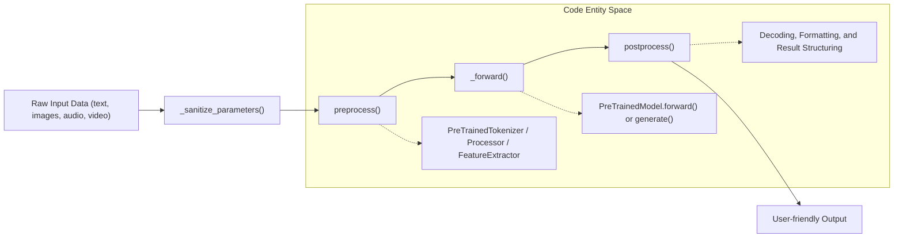

<!-- source: DeepWiki mcp.deepwiki.com · repo huggingface/transformers · page 10 Pipelines · fetched 2026-10-26 -->

# Pipelines

<details>
<summary>Relevant source files</summary>

The following files were used as context for generating this wiki page:

- [docs/source/en/tasks/zero_shot_object_detection.md](docs/source/en/tasks/zero_shot_object_detection.md)
- [src/transformers/models/dia/generation_dia.py](src/transformers/models/dia/generation_dia.py)
- [src/transformers/pipelines/__init__.py](src/transformers/pipelines/__init__.py)
- [src/transformers/pipelines/any_to_any.py](src/transformers/pipelines/any_to_any.py)
- [src/transformers/pipelines/audio_classification.py](src/transformers/pipelines/audio_classification.py)
- [src/transformers/pipelines/automatic_speech_recognition.py](src/transformers/pipelines/automatic_speech_recognition.py)
- [src/transformers/pipelines/base.py](src/transformers/pipelines/base.py)
- [src/transformers/pipelines/depth_estimation.py](src/transformers/pipelines/depth_estimation.py)
- [src/transformers/pipelines/document_question_answering.py](src/transformers/pipelines/document_question_answering.py)
- [src/transformers/pipelines/feature_extraction.py](src/transformers/pipelines/feature_extraction.py)
- [src/transformers/pipelines/image_classification.py](src/transformers/pipelines/image_classification.py)
- [src/transformers/pipelines/image_segmentation.py](src/transformers/pipelines/image_segmentation.py)
- [src/transformers/pipelines/image_text_to_text.py](src/transformers/pipelines/image_text_to_text.py)
- [src/transformers/pipelines/mask_generation.py](src/transformers/pipelines/mask_generation.py)
- [src/transformers/pipelines/object_detection.py](src/transformers/pipelines/object_detection.py)
- [src/transformers/pipelines/pt_utils.py](src/transformers/pipelines/pt_utils.py)
- [src/transformers/pipelines/table_question_answering.py](src/transformers/pipelines/table_question_answering.py)
- [src/transformers/pipelines/text_generation.py](src/transformers/pipelines/text_generation.py)
- [src/transformers/pipelines/text_to_audio.py](src/transformers/pipelines/text_to_audio.py)
- [src/transformers/pipelines/video_classification.py](src/transformers/pipelines/video_classification.py)
- [src/transformers/pipelines/zero_shot_audio_classification.py](src/transformers/pipelines/zero_shot_audio_classification.py)
- [src/transformers/pipelines/zero_shot_image_classification.py](src/transformers/pipelines/zero_shot_image_classification.py)
- [tests/pipelines/test_pipelines_any_to_any.py](tests/pipelines/test_pipelines_any_to_any.py)
- [tests/pipelines/test_pipelines_audio_classification.py](tests/pipelines/test_pipelines_audio_classification.py)
- [tests/pipelines/test_pipelines_automatic_speech_recognition.py](tests/pipelines/test_pipelines_automatic_speech_recognition.py)
- [tests/pipelines/test_pipelines_common.py](tests/pipelines/test_pipelines_common.py)
- [tests/pipelines/test_pipelines_depth_estimation.py](tests/pipelines/test_pipelines_depth_estimation.py)
- [tests/pipelines/test_pipelines_document_question_answering.py](tests/pipelines/test_pipelines_document_question_answering.py)
- [tests/pipelines/test_pipelines_image_classification.py](tests/pipelines/test_pipelines_image_classification.py)
- [tests/pipelines/test_pipelines_image_segmentation.py](tests/pipelines/test_pipelines_image_segmentation.py)
- [tests/pipelines/test_pipelines_image_text_to_text.py](tests/pipelines/test_pipelines_image_text_to_text.py)
- [tests/pipelines/test_pipelines_mask_generation.py](tests/pipelines/test_pipelines_mask_generation.py)
- [tests/pipelines/test_pipelines_object_detection.py](tests/pipelines/test_pipelines_object_detection.py)
- [tests/pipelines/test_pipelines_text_generation.py](tests/pipelines/test_pipelines_text_generation.py)
- [tests/pipelines/test_pipelines_text_to_audio.py](tests/pipelines/test_pipelines_text_to_audio.py)
- [tests/pipelines/test_pipelines_video_classification.py](tests/pipelines/test_pipelines_video_classification.py)
- [tests/pipelines/test_pipelines_zero_shot_image_classification.py](tests/pipelines/test_pipelines_zero_shot_image_classification.py)
- [tests/test_pipeline_mixin.py](tests/test_pipeline_mixin.py)

</details>


The `pipeline()` API provides a high-level, zero-code inference interface in the Transformers library, encapsulating the complete execution lifecycle from raw inputs to processed model outputs. It abstracts various model architectures and preprocessing implementations into unified, task-specific interfaces, enabling seamless usage across a wide range of modalities and tasks without the need for writing model-specific inference code [src/transformers/pipelines/base.py:1-180]().

This page offers a foundational overview of the pipeline system’s architecture, task routing, and built-in pipeline implementations. Detailed technical discussions and modality-specific pipelines are covered in dedicated child pages:
- For text generation, conversational chat handling, tool parsing, and streaming generation, see [Text & Conversational Pipelines](#10.1).
- For speech recognition, audio generation, vision classification, detection, and multimodal tasks, see [Vision, Audio & Multimodal Pipelines](#10.2).

---

### Core Architecture and Task Routing

At the heart of the pipelines system lies the abstract `Pipeline` base class, defined in `src/transformers/pipelines/base.py`. This class implements the core inference lifecycle segments: parameter sanitization, preprocessing, model forwarding, and post-processing. Each concrete pipeline class inherits from `Pipeline` and customizes these stages to fit its task and modality [src/transformers/pipelines/base.py:26-27]().

When you invoke the `pipeline()` factory function, it resolves either the explicit task string or detects the task by inspecting the provided model's metadata using the `SUPPORTED_TASKS` mapping in `src/transformers/pipelines/__init__.py`. This registry maps task names and their common aliases to:

- The corresponding pipeline implementation class,
- A set of valid model classes for PyTorch,
- Default model checkpoints for quick instantiation,
- The dominant modality type (e.g., text, audio, vision).

If only a model is provided without a task, `pipeline()` auto-infers the appropriate task by calling `get_task()` which analyzes the model type and configuration [src/transformers/pipelines/__init__.py:131-172]().

The factory then loads the model and associated tokenizer, processor, or feature extractor as needed and finally instantiates the appropriate pipeline subclass ready for inference.

**Diagram: Pipeline Initialization & Routing**



Sources: [src/transformers/pipelines/__init__.py:131-172](), [src/transformers/pipelines/base.py:26-27]()

---

### Execution Flow and Data Processing

At runtime, a pipeline processes inputs through a well-defined execution flow composed of these key steps:

1. **Parameter Sanitization** — `_sanitize_parameters()` manages user arguments, applies defaults, or transforms parameters to formats expected in subsequent stages [src/transformers/pipelines/text_generation.py:128-145]().
2. **Preprocessing** — `preprocess()` converts raw user inputs, such as text strings, images, or audio files, into tensors or other model-ready formats by invoking tokenizers, feature extractors, or processors [src/transformers/pipelines/text_to_audio.py:160-173]().
3. **Forward Inference** — `_forward()` submits the processed inputs to the model’s forward pass or generation method to obtain raw outputs like logits, token IDs, or feature maps [src/transformers/pipelines/base.py:1000-1001]().
4. **Postprocessing** — `postprocess()` transforms model outputs back to user-friendly formats, e.g., decoded strings, label predictions, or structured results [src/transformers/pipelines/base.py:1003-1004]().

Pipelines support batching and streaming via iterable datasets or sequences. To handle inputs of inconsistent dimensions (e.g., variable length text sequences, images), the utility function `pad_collate_fn()` implements padding and batching logic. It inspects input keys, applies padding values appropriately for tokens or images, and constructs uniform batches for efficient GPU processing [src/transformers/pipelines/base.py:125-180]().

**Diagram: Pipeline Execution Flow**



Sources: [src/transformers/pipelines/base.py:125-180](), [src/transformers/pipelines/base.py:1000-1004](), [src/transformers/pipelines/text_generation.py:128-145](), [src/transformers/pipelines/text_to_audio.py:160-173]()

---

### Supported Tasks and Modality-Specific Pipelines

The Transformers pipelines ecosystem supports a broad spectrum of tasks spanning multiple modalities. Each task is routed to a specialized pipeline class which implements dedicated pre/postprocessing and model forwarding logic:

- **Text & Conversational Pipelines**

  These pipelines operate on textual inputs or conversational chat formats, using tokenizers and autoregressive or encoder-decoder language models. Examples include:

  - `TextGenerationPipeline` — Autoregressive text generation and conversational model response continuation, supporting chat message parsing and tool-call extraction [src/transformers/pipelines/text_generation.py:22-70]().
  - `TextClassificationPipeline` — Sentiment analysis and text classification [src/transformers/pipelines/__init__.py:165-170]().
  - `TokenClassificationPipeline` — Named entity recognition and token-level labeling [src/transformers/pipelines/__init__.py:171-172]().

  These pipelines also implement chat templating, streamed generation, and specific ways to handle sequences of chat messages [src/transformers/pipelines/text_generation.py:22-70]().

  For details, see [Text & Conversational Pipelines](#10.1).

- **Vision, Audio & Multimodal Pipelines**

  These pipelines handle image, audio, video inputs and their combinations, relying on image processors, audio feature extractors, video processors, and multimodal models. Examples include:

  - `AutomaticSpeechRecognitionPipeline` — Speech-to-text models like Whisper and CTC-based architectures [src/transformers/pipelines/automatic_speech_recognition.py:146-158]().
  - `ImageClassificationPipeline` — Classifying images using vision transformers or CNNs [src/transformers/pipelines/__init__.py:181-182]().
  - `ImageTextToTextPipeline` — Captioning and vision-language QA combining images with text input [src/transformers/pipelines/image_text_to_text.py:53-114]().
  - `AnyToAnyPipeline` — Multimodal generation mixing images, audio, video, and text, including conversational chat mode [src/transformers/pipelines/any_to_any.py:67-130]().

  These pipelines include modality-specific pre/postprocessing such as frame sampling, mel spectrogram feature extraction, and zero-shot classification capabilities [src/transformers/pipelines/automatic_speech_recognition.py:101-106](), [src/transformers/pipelines/image_text_to_text.py:150-158]().

  For details, see [Vision, Audio & Multimodal Pipelines](#10.2).

---

### Summary Table of Representative Pipelines by Modality

| Modality | Example Pipeline Class | Primary Model Support | Child Page |
|---|---|---|---|
| **Text & Conversational** | `TextGenerationPipeline` | Autoregressive LLMs, conversational models | [Text & Conversational Pipelines](#10.1) |
| | `TextClassificationPipeline` | Sequence classification models | |
| | `TokenClassificationPipeline` | Token-level classification (NER) | |
| **Vision** | `ImageClassificationPipeline` | Vision transformers, CNN backbones | [Vision, Audio & Multimodal Pipelines](#10.2) |
| | `ImageTextToTextPipeline` | Vision-language models (captioning, VQA) | |
| | `ObjectDetectionPipeline` | Object detection models | |
| **Audio & Speech** | `AutomaticSpeechRecognitionPipeline` | Speech-to-text models (Whisper, Wav2Vec2) | |
| | `TextToAudioPipeline` | Text-to-speech and audio generation models | |
| **Multimodal** | `AnyToAnyPipeline` | Multimodal large language models | |

---

### Bridging Natural Language to Code Entities

**Diagram: Task Names to Pipeline Classes**

```mermaid
graph TD
    NL_Task_Sentiment["'sentiment-analysis'"]
    NL_Task_TextGen["'text-generation'"]
    NL_Task_Image2Text["'image-text-to-text'"]
    NL_Task_Multimodal["'any-to-any'"]

    Pipeline_TextClass["TextClassificationPipeline"]
    Pipeline_TextGen["TextGenerationPipeline"]
    Pipeline_ImgText["ImageTextToTextPipeline"]
    Pipeline_Any2Any["AnyToAnyPipeline"]

    NL_Task_Sentiment --> |"alias of 'text-classification'"| Pipeline_TextClass
    NL_Task_TextGen --> Pipeline_TextGen
    NL_Task_Image2Text --> Pipeline_ImgText
    NL_Task_Multimodal --> Pipeline_Any2Any

    subgraph "Code Entity Space"
      Pipeline_TextClass -.-> "src/transformers/pipelines/text_classification.py"
      Pipeline_TextGen -.-> "src/transformers/pipelines/text_generation.py"
      Pipeline_ImgText -.-> "src/transformers/pipelines/image_text_to_text.py"
      Pipeline_Any2Any -.-> "src/transformers/pipelines/any_to_any.py"
    end
```

Sources: [src/transformers/pipelines/__init__.py:135-139](), [src/transformers/pipelines/__init__.py:165-172](), [src/transformers/pipelines/text_generation.py:22-23](), [src/transformers/pipelines/image_text_to_text.py:53-54](), [src/transformers/pipelines/any_to_any.py:49-50]()

**Diagram: Pipeline Factory Resolution**

```mermaid
graph LR
    UserInput["User input: model, task"]
    pipeline_func["pipeline() factory in src/transformers/pipelines/__init__.py"]
    SUPPORTED_TASKS["SUPPORTED_TASKS registry in src/transformers/pipelines/__init__.py"]
    get_task_func["get_task() for auto-task inference in src/transformers/pipelines/__init__.py"]
    init_impl["Load implementation class"]
    load_model["load_model() in src/transformers/pipelines/base.py"]
    instantiate_pipe["Instantiate Pipeline"]

    UserInput --> pipeline_func
    pipeline_func -->|has task| SUPPORTED_TASKS
    pipeline_func -->|no task| get_task_func
    get_task_func --> SUPPORTED_TASKS
    SUPPORTED_TASKS --> init_impl
    init_impl --> load_model
    load_model --> instantiate_pipe
```



Sources: [src/transformers/pipelines/__init__.py:131-172](), [src/transformers/pipelines/base.py:62-63]()

---

### Summary

The pipelines API in Transformers offers a unified, high-level interface to effortless model inference across a rich set of tasks and modalities. It isolates users from model specifics and tokenization intricacies via dedicated pipeline classes derived from a central `Pipeline` base class, instantiated by a flexible factory routing on task or model type. For deeper concrete usage patterns and examples in text, conversational, speech, vision, and multimodal domains, refer to the child pages:
- [Text & Conversational Pipelines](#10.1)
- [Vision, Audio & Multimodal Pipelines](#10.2)

---

Sources:
- [src/transformers/pipelines/base.py:1-180]()
- [src/transformers/pipelines/__init__.py:131-172]()
- [src/transformers/pipelines/text_generation.py:22-70]()
- [src/transformers/pipelines/image_text_to_text.py:53-114]()
- [src/transformers/pipelines/any_to_any.py:67-130]()
- [src/transformers/pipelines/automatic_speech_recognition.py:146-158]()

---

