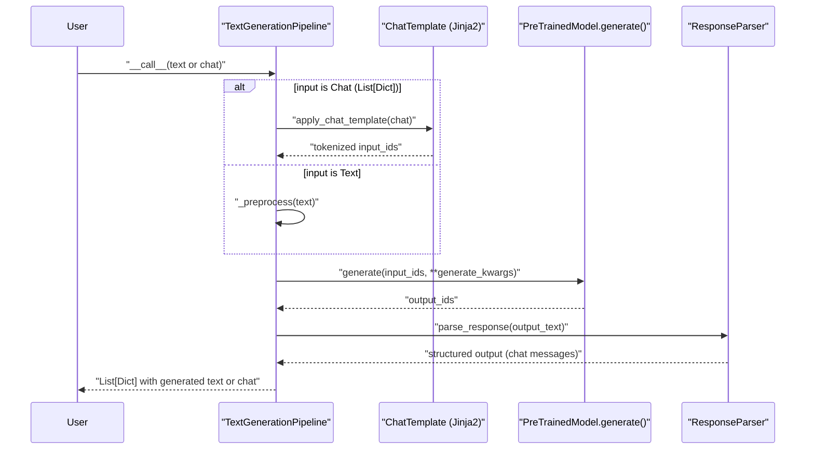
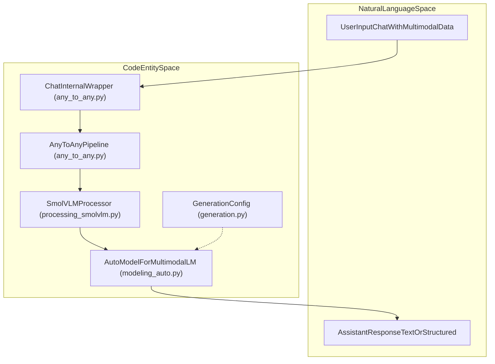
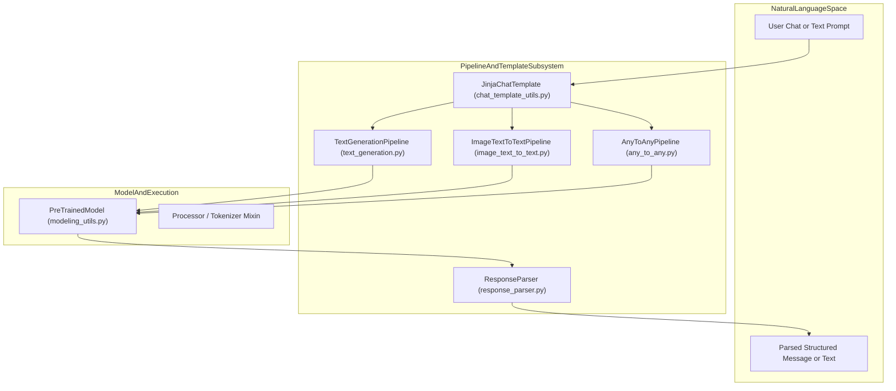

<!-- source: DeepWiki mcp.deepwiki.com · repo huggingface/transformers · page 10.1 Text & Conversational Pipelines · fetched 2026-10-26 -->

# Text & Conversational Pipelines

Relevant source files

The following files were used as context for generating this wiki page:

- [docs/source/en/chat_extras.md](docs/source/en/chat_extras.md)
- [docs/source/en/chat_response_parsing.md](docs/source/en/chat_response_parsing.md)
- [docs/source/en/chat_templating_writing.md](docs/source/en/chat_templating_writing.md)
- [docs/source/en/tasks/keypoint_matching.md](docs/source/en/tasks/keypoint_matching.md)
- [src/transformers/models/dia/generation_dia.py](src/transformers/models/dia/generation_dia.py)
- [src/transformers/models/ernie4_5_vl_moe/processing_ernie4_5_vl_moe.py](src/transformers/models/ernie4_5_vl_moe/processing_ernie4_5_vl_moe.py)
- [src/transformers/models/qwen2_5_omni/processing_qwen2_5_omni.py](src/transformers/models/qwen2_5_omni/processing_qwen2_5_omni.py)
- [src/transformers/models/qwen3_omni_moe/processing_qwen3_omni_moe.py](src/transformers/models/qwen3_omni_moe/processing_qwen3_omni_moe.py)
- [src/transformers/models/smolvlm/processing_smolvlm.py](src/transformers/models/smolvlm/processing_smolvlm.py)
- [src/transformers/pipelines/__init__.py](src/transformers/pipelines/__init__.py)
- [src/transformers/pipelines/any_to_any.py](src/transformers/pipelines/any_to_any.py)
- [src/transformers/pipelines/automatic_speech_recognition.py](src/transformers/pipelines/automatic_speech_recognition.py)
- [src/transformers/pipelines/base.py](src/transformers/pipelines/base.py)
- [src/transformers/pipelines/document_question_answering.py](src/transformers/pipelines/document_question_answering.py)
- [src/transformers/pipelines/image_text_to_text.py](src/transformers/pipelines/image_text_to_text.py)
- [src/transformers/pipelines/pt_utils.py](src/transformers/pipelines/pt_utils.py)
- [src/transformers/pipelines/table_question_answering.py](src/transformers/pipelines/table_question_answering.py)
- [src/transformers/pipelines/text_generation.py](src/transformers/pipelines/text_generation.py)
- [src/transformers/pipelines/text_to_audio.py](src/transformers/pipelines/text_to_audio.py)
- [src/transformers/utils/chat_parsing/content_parsers.py](src/transformers/utils/chat_parsing/content_parsers.py)
- [src/transformers/utils/chat_parsing/response_parser.py](src/transformers/utils/chat_parsing/response_parser.py)
- [src/transformers/utils/chat_parsing/response_templates.py](src/transformers/utils/chat_parsing/response_templates.py)
- [src/transformers/utils/chat_template_utils.py](src/transformers/utils/chat_template_utils.py)
- [tests/models/ernie4_5_vl_moe/test_processing_ernie4_5_vl_moe.py](tests/models/ernie4_5_vl_moe/test_processing_ernie4_5_vl_moe.py)
- [tests/models/qwen3_omni_moe/test_processing_qwen3_omni_moe.py](tests/models/qwen3_omni_moe/test_processing_qwen3_omni_moe.py)
- [tests/models/qwen3_vl/test_processing_qwen3_vl.py](tests/models/qwen3_vl/test_processing_qwen3_vl.py)
- [tests/pipelines/test_pipelines_any_to_any.py](tests/pipelines/test_pipelines_any_to_any.py)
- [tests/pipelines/test_pipelines_automatic_speech_recognition.py](tests/pipelines/test_pipelines_automatic_speech_recognition.py)
- [tests/pipelines/test_pipelines_common.py](tests/pipelines/test_pipelines_common.py)
- [tests/pipelines/test_pipelines_document_question_answering.py](tests/pipelines/test_pipelines_document_question_answering.py)
- [tests/pipelines/test_pipelines_image_text_to_text.py](tests/pipelines/test_pipelines_image_text_to_text.py)
- [tests/pipelines/test_pipelines_text_generation.py](tests/pipelines/test_pipelines_text_generation.py)
- [tests/pipelines/test_pipelines_text_to_audio.py](tests/pipelines/test_pipelines_text_to_audio.py)
- [tests/utils/test_chat_parsing.py](tests/utils/test_chat_parsing.py)
- [tests/utils/test_chat_template_utils.py](tests/utils/test_chat_template_utils.py)

The purpose of this page is to document the high-level `pipeline()` subsystems designed for text generation, conversational interactions, image-text-to-text tasks, and any-to-any multimodal tasks. It covers `TextGenerationPipeline`, `ImageTextToTextPipeline`, and `AnyToAnyPipeline`, as well as the underlying infrastructure for Jinja chat templates, declarative response parsing (`ResponseParser`), tool-call extraction, and streaming generation.

---

## 1. TextGenerationPipeline

The `TextGenerationPipeline` is the core pipeline class for autoregressive language models (such as GPT-2, Llama, and Mistral) supporting both standard free-form completion and conversational chat dialogues [src/transformers/pipelines/text_generation.py:23-100]().

### Implementation Highlights

- **Model Type Validation and Padding**: During initialization, it verifies compatibility against causal language model registries (`MODEL_FOR_CAUSAL_LM_MAPPING_NAMES`) and enforces `tokenizer.padding_side = "left"` for decoder-only models to guarantee correct batched generation behavior [src/transformers/pipelines/text_generation.py:99-107]().
- **Chat Mode Handling**: When inputs are structured as lists of message dictionaries (`role` and `content`), the pipeline formats them using the model's chat template and continues the dialogue by appending assistant responses [src/transformers/pipelines/text_generation.py:23-28]().
- **Prompt Prefixing**: For legacy or specific autoregressive models like XLNet and Transformer-XL, a specialized contextual prefix (`XL_PREFIX`) is prepended to shorter prompts [src/transformers/pipelines/text_generation.py:76-84]().
- **Default Generation Configuration**: Applies sensible defaults (`max_new_tokens=256`, `do_sample=True`, `temperature=0.7`) unless overridden [src/transformers/pipelines/text_generation.py:93-97]().

### Data Flow and Key Methods

Sources:
[src/transformers/pipelines/text_generation.py:23-100]()
[tests/pipelines/test_pipelines_text_generation.py:41-183]()

---

## 2. Multimodal Pipelines: ImageTextToTextPipeline & AnyToAnyPipeline

### 2.1 ImageTextToTextPipeline

The `ImageTextToTextPipeline` interfaces with `AutoModelForImageTextToText` architectures (such as BLIP or LLaVA) to generate text conditioned on images and text inputs [src/transformers/pipelines/image_text_to_text.py:53-113]().

- Accepts image inputs as PIL `Image` instances or URLs.
- Supports multi-turn chat structures where content items can alternate between text chunks and image references.
- Enforces vision backend checks and validates mapping configurations (`MODEL_FOR_IMAGE_TEXT_TO_TEXT_MAPPING_NAMES`) [src/transformers/pipelines/image_text_to_text.py:126-130]().

### 2.2 AnyToAnyPipeline

The `AnyToAnyPipeline` provides a unified multimodal interface for `AutoModelForMultimodalLM` models handling arbitrary combinations of audio, video, image, and text inputs and outputs [src/transformers/pipelines/any_to_any.py:67-128]().

- **Dynamic Modality Inspection**: Inspects `self.model.input_modalities` to require necessary backend packages (e.g., `vision`, `torchvision`, `librosa`) dynamically [src/transformers/pipelines/any_to_any.py:143-147]().
- **Internal Chat Wrapper**: Wraps raw message lists in an internal `Chat` class to cleanly segregate sample batches from single-conversation dialogue turns [src/transformers/pipelines/any_to_any.py:54-65]().

---

### Entity Mapping Diagram: Multimodal Pipeline Components

Sources:
[src/transformers/pipelines/image_text_to_text.py:53-130]()
[src/transformers/pipelines/any_to_any.py:54-149]()
[src/transformers/models/smolvlm/processing_smolvlm.py:110-141]()
[src/transformers/generation/configuration_utils.py]()

---

## 3. Chat Templating and Response Parsing

Conversational pipelines rely on a two-way interface: Jinja2-based chat templates for preparing inputs and declarative response templates (`ResponseParser`) for parsing outputs back into structured dictionaries.

### 3.1 Chat Templates & Tool Schemas

- Jinja2 templates convert message lists (`role`, `content`) into model-ready token sequences using the utilities in [`utils/chat_template_utils.py`] [src/transformers/utils/chat_template_utils.py:35-46]() [docs/source/en/chat_extras.md]().

- Tools passed as functions to `tools=` are introspected via their Python docstrings and type hints to build JSON schemas describing their callable arguments usable for structured tool calls. This enables safe function calling and argument extraction from generated outputs [src/transformers/utils/chat_template_utils.py:80-173]().

### 3.2 Response Parsing & Streaming (`ResponseParser`)

- The `ResponseParser` class processes a streamed or complete generated output string using a declarative `response_template`. It identifies chat message regions such as `content`, `thinking`, and `tool_calls`, extracting structured information incrementally [src/transformers/utils/chat_parsing/response_parser.py:66-147]().

- It requires the prompt prefix used during generation to correctly parse assistant messages, since some models pre-write tokens in the prompt (e.g. opening `<think>` tags). This supports both full message parsing (`parse_response`) and streaming parsing applications.

- Parsing emits events of types:
  - `region_open`: Beginning of a logical field.
  - `region_chunk`: Partial text chunk for a field.
  - `region_close`: End of field, with fully parsed and typed content.

| Event Type    | Description                                                   | Payload                         |
|---------------|---------------------------------------------------------------|---------------------------------|
| `region_open` | Model opened a structured region (e.g. content, tool_calls)   | field name                      |
| `region_chunk`| Incremental text chunk appended inside the current region     | field name, text chunk          |
| `region_close`| Model closed the structured region, content parsed and typed  | field name, fully parsed value  |

Sources:
[src/transformers/utils/chat_template_utils.py:80-181]()
[src/transformers/utils/chat_parsing/response_parser.py:66-147]()
[docs/source/en/chat_extras.md]()
[docs/source/en/chat_response_parsing.md]()

---

## 4. Parameter Sanitization and Implementation Details

Pipelines standardize parameter management with a `_sanitize_parameters` method that partitions user-supplied arguments into:

- **`preprocess_params`**: Passed to tokenizers or processors, handling inputs such as `max_length`, `timeout`, and `processor_kwargs`. These control how inputs are transformed before encoding [src/transformers/pipelines/image_text_to_text.py:131-158]() [src/transformers/pipelines/any_to_any.py:150-177]().

- **`forward_params`**: Forwarded directly to the underlying model's `generate()` call with options like `max_new_tokens`, `do_sample`, and `stop_strings` [src/transformers/pipelines/text_generation.py:128-145]() [src/transformers/pipelines/image_text_to_text.py:159-178]().

- **`postprocess_params`**: Control output formatting such as whether to return full text, tensors, or just the newly generated tokens [src/transformers/pipelines/image_text_to_text.py:148]().

This systematic separation enforces a clean, extensible pipeline interface supporting various tasks and model types.

Sources:
[src/transformers/pipelines/text_generation.py:128-145]()
[src/transformers/pipelines/image_text_to_text.py:131-178]()
[src/transformers/pipelines/any_to_any.py:150-181]()

---

## 5. Summary Architecture Diagram

Sources:
[src/transformers/pipelines/text_generation.py]()
[src/transformers/pipelines/image_text_to_text.py]()
[src/transformers/pipelines/any_to_any.py]()
[src/transformers/utils/chat_template_utils.py]()
[src/transformers/utils/chat_parsing/response_parser.py]()
[src/transformers/modeling_utils.py]()

---

# References

Sources used in this page include:

- `src/transformers/pipelines/text_generation.py` [lines: 23-100, 128-145]()
- `src/transformers/pipelines/image_text_to_text.py` [lines: 53-130, 131-178]()
- `src/transformers/pipelines/any_to_any.py` [lines: 54-149, 150-181]()
- `src/transformers/models/smolvlm/processing_smolvlm.py` [lines: 110-141]()
- `src/transformers/utils/chat_template_utils.py` [lines: 35-46, 80-181]()
- `src/transformers/utils/chat_parsing/response_parser.py` [lines: 66-147]()
- `tests/pipelines/test_pipelines_text_generation.py` [lines: 41-183]()
- `src/transformers/generation/configuration_utils.py`

---

