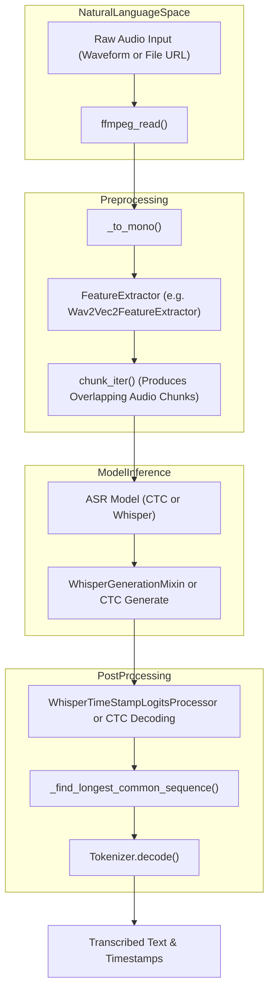
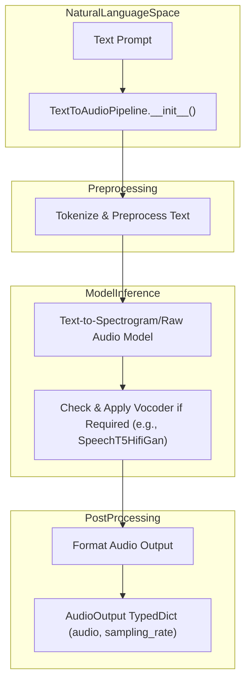
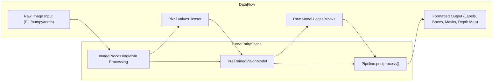
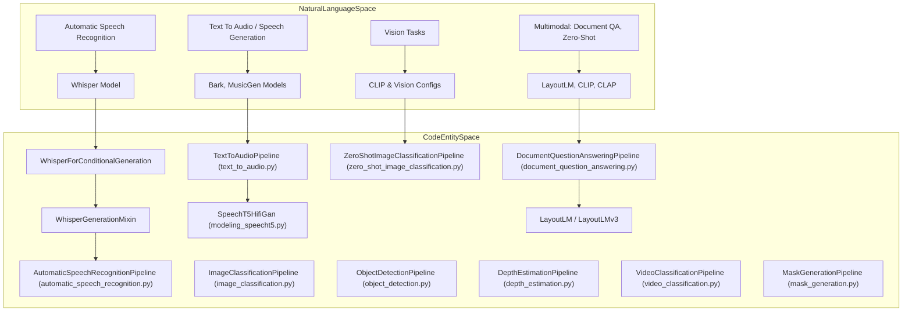
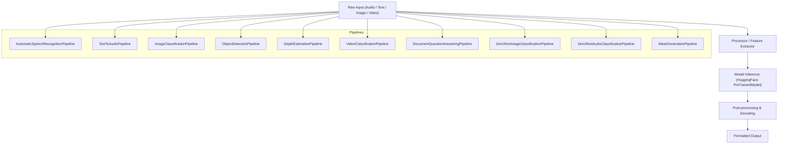

<!-- source: DeepWiki mcp.deepwiki.com · repo huggingface/transformers · page 10.2 Vision, Audio & Multimodal Pipelines · fetched 2026-10-26 -->

# Vision, Audio & Multimodal Pipelines

Relevant source files

The following files were used as context for generating this wiki page:

- [docs/source/en/tasks/zero_shot_object_detection.md](docs/source/en/tasks/zero_shot_object_detection.md)
- [src/transformers/models/dia/generation_dia.py](src/transformers/models/dia/generation_dia.py)
- [src/transformers/pipelines/__init__.py](src/transformers/pipelines/__init__.py)
- [src/transformers/pipelines/any_to_any.py](src/transformers/pipelines/any_to_any.py)
- [src/transformers/pipelines/audio_classification.py](src/transformers/pipelines/audio_classification.py)
- [src/transformers/pipelines/automatic_speech_recognition.py](src/transformers/pipelines/automatic_speech_recognition.py)
- [src/transformers/pipelines/base.py](src/transformers/pipelines/base.py)
- [src/transformers/pipelines/depth_estimation.py](src/transformers/pipelines/depth_estimation.py)
- [src/transformers/pipelines/document_question_answering.py](src/transformers/pipelines/document_question_answering.py)
- [src/transformers/pipelines/feature_extraction.py](src/transformers/pipelines/feature_extraction.py)
- [src/transformers/pipelines/image_classification.py](src/transformers/pipelines/image_classification.py)
- [src/transformers/pipelines/image_segmentation.py](src/transformers/pipelines/image_segmentation.py)
- [src/transformers/pipelines/image_text_to_text.py](src/transformers/pipelines/image_text_to_text.py)
- [src/transformers/pipelines/mask_generation.py](src/transformers/pipelines/mask_generation.py)
- [src/transformers/pipelines/object_detection.py](src/transformers/pipelines/object_detection.py)
- [src/transformers/pipelines/pt_utils.py](src/transformers/pipelines/pt_utils.py)
- [src/transformers/pipelines/table_question_answering.py](src/transformers/pipelines/table_question_answering.py)
- [src/transformers/pipelines/text_generation.py](src/transformers/pipelines/text_generation.py)
- [src/transformers/pipelines/text_to_audio.py](src/transformers/pipelines/text_to_audio.py)
- [src/transformers/pipelines/video_classification.py](src/transformers/pipelines/video_classification.py)
- [src/transformers/pipelines/zero_shot_audio_classification.py](src/transformers/pipelines/zero_shot_audio_classification.py)
- [src/transformers/pipelines/zero_shot_image_classification.py](src/transformers/pipelines/zero_shot_image_classification.py)
- [tests/pipelines/test_pipelines_any_to_any.py](tests/pipelines/test_pipelines_any_to_any.py)
- [tests/pipelines/test_pipelines_audio_classification.py](tests/pipelines/test_pipelines_audio_classification.py)
- [tests/pipelines/test_pipelines_automatic_speech_recognition.py](tests/pipelines/test_pipelines_automatic_speech_recognition.py)
- [tests/pipelines/test_pipelines_common.py](tests/pipelines/test_pipelines_common.py)
- [tests/pipelines/test_pipelines_depth_estimation.py](tests/pipelines/test_pipelines_depth_estimation.py)
- [tests/pipelines/test_pipelines_document_question_answering.py](tests/pipelines/test_pipelines_document_question_answering.py)
- [tests/pipelines/test_pipelines_image_classification.py](tests/pipelines/test_pipelines_image_classification.py)
- [tests/pipelines/test_pipelines_image_segmentation.py](tests/pipelines/test_pipelines_image_segmentation.py)
- [tests/pipelines/test_pipelines_image_text_to_text.py](tests/pipelines/test_pipelines_image_text_to_text.py)
- [tests/pipelines/test_pipelines_mask_generation.py](tests/pipelines/test_pipelines_mask_generation.py)
- [tests/pipelines/test_pipelines_object_detection.py](tests/pipelines/test_pipelines_object_detection.py)
- [tests/pipelines/test_pipelines_text_generation.py](tests/pipelines/test_pipelines_text_generation.py)
- [tests/pipelines/test_pipelines_text_to_audio.py](tests/pipelines/test_pipelines_text_to_audio.py)
- [tests/pipelines/test_pipelines_video_classification.py](tests/pipelines/test_pipelines_video_classification.py)
- [tests/pipelines/test_pipelines_zero_shot_image_classification.py](tests/pipelines/test_pipelines_zero_shot_image_classification.py)
- [tests/test_pipeline_mixin.py](tests/test_pipeline_mixin.py)

The `pipelines` subpackage in Hugging Face Transformers provides high-level APIs for performing inference across vision, audio, and multimodal tasks. These pipelines abstract complex workflows involving input preprocessing (feature extraction, resizing), model execution, and post-processing (decoding, formatting) into convenient callable interfaces.

This page delves into the technical implementation and data flow of major pipelines centered on vision, audio, and multimodal applications:
- Automatic Speech Recognition (ASR) including Whisper, CTC, and CTC+LM models
- Text-to-Audio generation
- Image, Video, and Audio Classification
- Zero-Shot Classification tasks
- Depth Estimation
- Object Detection
- Table & Document Question Answering (QA)
- Mask Generation

---

## 1. Automatic Speech Recognition (ASR)

The `AutomaticSpeechRecognitionPipeline` supports transcription of speech to text using both Connectionist Temporal Classification (CTC) models and Sequence-to-Sequence (Seq2Seq) models such as Whisper. It integrates audio loading and preprocessing, overlapping chunk-wise inference for long audio, and fine-grained timestamp decoding.

### Implementation Overview

- **Audio Input Handling:** The pipeline accepts raw waveforms or audio files. The audio is loaded and decoded using `ffmpeg_read` which supports multiple audio formats [src/transformers/pipelines/automatic_speech_recognition.py:41-58]().
- **Mono Conversion:** Multi-channel audio is converted to mono with `_to_mono()` to meet model input expectations [src/transformers/pipelines/automatic_speech_recognition.py:41-72]().
- **Feature Extraction:** Audio chunks are extracted via `chunk_iter()` which slices waveforms into overlapping windows for sequential processing [src/transformers/pipelines/automatic_speech_recognition.py:95-119]().
- **Model Support:** Both CTC-based models (e.g., Wav2Vec2) and seq2seq models (e.g., Whisper) are supported via the model auto-mapping. Whisper uses a specialized generation mixin that manages timestamp-emitting decoding and segment merging [src/transformers/pipelines/automatic_speech_recognition.py:146-172]().
- **Timestamp & Segment Handling:** For timestamp alignment, Whisper employs `WhisperTimeStampLogitsProcessor` that guides decoding toward valid timestamp token sequences. Segment outputs are merged across chunks by finding the longest common subsequence of tokens to maintain transcription coherence [src/transformers/pipelines/automatic_speech_recognition.py:121-143]().
- **Dynamic Time Warping:** Token-level timestamps are aligned with audio features via `_dynamic_time_warping()`, which computes optimal temporal alignment between audio frames and transcription tokens.

### Key Classes & Functions

| Class / Function | Role |
|---|---|
| `AutomaticSpeechRecognitionPipeline` [src/transformers/pipelines/automatic_speech_recognition.py:146-172]() | Main pipeline class handling audio input, chunking, model inference, decoding. |
| `_to_mono()` [src/transformers/pipelines/automatic_speech_recognition.py:41-72]() | Convert multi-channel audio to mono waveform. |
| `chunk_iter()` [src/transformers/pipelines/automatic_speech_recognition.py:95-119]() | Iterator yielding overlapping audio features chunks for model input. |
| `WhisperTimeStampLogitsProcessor` | Logits processor ensuring valid timestamp decoding for Whisper. |
| `_find_longest_common_sequence()` [src/transformers/pipelines/automatic_speech_recognition.py:121-143]() | Merge token sequences from audio chunks into final transcription output. |
| `_dynamic_time_warping()` | Align tokens and audio frames to produce accurate timestamps. |

### Detailed Data Flow

Sources:
- [src/transformers/pipelines/automatic_speech_recognition.py:41-172]()
- [tests/pipelines/test_pipelines_automatic_speech_recognition.py:58-182]()

---

## 2. Text-to-Audio Pipeline (TTS)

The `TextToAudioPipeline` converts text prompts into audio waveforms. It supports a spectrum of models from raw audio waveform generators (like Bark, MusicGen) to text-to-spectrogram models that rely on integrated or external neural vocoders (like SpeechT5HifiGan).

### Implementation Details

- **Model & Vocoder:** If the model is a text-to-spectrogram model, the pipeline automatically loads a compatible vocoder such as `SpeechT5HifiGan` to convert spectrograms to audio waveforms [src/transformers/pipelines/text_to_audio.py:124-129]().
- **Sampling Rate Resolution:** The pipeline extracts sampling rate metadata from model config, generation config, or feature extractor to provide accurate waveform output metadata [src/transformers/pipelines/text_to_audio.py:139-159]().
- **Preprocessing:** Input text is tokenized and optionally preprocessed, supporting batch input [src/transformers/pipelines/text_to_audio.py:161-173]().
- **Output:** Returns a dictionary containing generated waveform audio and its associated sampling rate, using `AudioOutput` typed dictionary [src/transformers/pipelines/text_to_audio.py:35-45]().

### Key Classes & Functions

| Class / Function | Role |
|---|---|
| `TextToAudioPipeline` [src/transformers/pipelines/text_to_audio.py:46-98]() | Main interface for text-to-audio generation. |
| `SpeechT5HifiGan` [src/transformers/pipelines/text_to_audio.py:30]() | Neural vocoder transforming spectrograms to waveforms. |
| `GenerationConfig` [src/transformers/pipelines/text_to_audio.py:20]() | Controls generation hyperparameters. |
| `AudioOutput` [src/transformers/pipelines/text_to_audio.py:35-45]() | Typed dictionary for pipeline output. |

### Data Flow Diagram

Sources:
- [src/transformers/pipelines/text_to_audio.py:20-173]()

---

## 3. Vision Pipelines

Vision pipelines utilize pre-trained vision models with associated `ImageProcessor` classes to perform end-to-end inference on images or videos.

### Common Vision Tasks and Pipelines

| Pipeline | Purpose | Example Model Classes |
|---|---|---|
| `ImageClassificationPipeline` | Classify an input image into categories | `AutoModelForImageClassification` |
| `ObjectDetectionPipeline` | Detect bounding boxes and labels in images | `DetrForObjectDetection` |
| `DepthEstimationPipeline` | Predict depth maps from single images (monocular) | `DPTForDepthEstimation` |
| `VideoClassificationPipeline` | Classify video content using sampled frames | `VideoMAEForVideoClassification` |
| `ZeroShotImageClassificationPipeline` | Classify images based on arbitrary text labels | `CLIPModel` |
| `MaskGenerationPipeline` | Generate segmentation masks (e.g., SAM models) | `SamModel` |

### Image Input Handling

Vision pipelines support multiple input image formats including PIL images, numpy arrays, and torch tensors. The core `ImageProcessingMixin` implements resizing, normalization, and tensor formatting. The `image_utils.py` module defines base image types and channel dimension transformations.

### Data Flow Example for Vision Tasks

Sources:
- [src/transformers/pipelines/__init__.py:141-200]()
- [tests/test_pipeline_mixin.py:110-121]()

---

## 4. Multimodal & Specialized Pipelines

### 4.1 Document Question Answering (Document QA)

`DocumentQuestionAnsweringPipeline` is designed for querying information from scanned documents or images with embedded text.

- **OCR Integration:** Uses Tesseract OCR for extracting normalized text tokens with bounding boxes from document images [src/transformers/pipelines/document_question_answering.py:166-174]().
- **Bounding Box Normalization:** `normalize_box` scales pixel coordinates to a 0-1000 range as expected by models like LayoutLM and LayoutLMv3 [src/transformers/pipelines/document_question_answering.py:53-59]().
- **Span Decoding:** Decodes start and end answer spans within model logits, applying filtering and ranking by probability [src/transformers/pipelines/document_question_answering.py:62-109]().

### 4.2 Zero-Shot Classification

- **ZeroShotImageClassificationPipeline:** Uses vision-language models (e.g., CLIP) to classify images according to arbitrary user-provided text labels.
- **ZeroShotAudioClassificationPipeline:** Extends zero-shot classification to audio by extracting features (mel-spectrograms or raw) and projecting into a joint embedding space.

These pipelines calculate similarity scores between embeddings from image/audio inputs and text candidates.
Sources:
- [src/transformers/pipelines/document_question_answering.py:53-174]()
- [src/transformers/pipelines/__init__.py:141-200]()

---

## Summary of Key Pipeline Classes

| Pipeline | Primary Use Case | Key Files & Classes |
|---|---|---|
| `AutomaticSpeechRecognitionPipeline` | Speech to text transcription | `pipelines/automatic_speech_recognition.py` [src/transformers/pipelines/__init__.py:147](), `models/whisper/generation_whisper.py` |
| `TextToAudioPipeline` | Text to speech/audio generation | `pipelines/text_to_audio.py` [src/transformers/pipelines/__init__.py:154]() |
| `ImageClassificationPipeline` | Image classification | `pipelines/image_classification.py` [src/transformers/pipelines/__init__.py:179]() |
| `ObjectDetectionPipeline` | Object detection | `pipelines/object_detection.py` [src/transformers/pipelines/__init__.py:73]() |
| `DepthEstimationPipeline` | Depth map estimation from images | `pipelines/depth_estimation.py` [src/transformers/pipelines/__init__.py:64]() |
| `VideoClassificationPipeline` | Video content classification | `pipelines/video_classification.py` [src/transformers/pipelines/__init__.py:85]() |
| `MaskGenerationPipeline` | Image segmentation mask generation | `pipelines/mask_generation.py` [src/transformers/pipelines/__init__.py:73]() |
| `DocumentQuestionAnsweringPipeline` | Document text question answering | `pipelines/document_question_answering.py` [src/transformers/pipelines/__init__.py:65]() |
| `ZeroShotImageClassificationPipeline` | Zero-shot classification on images | `pipelines/zero_shot_image_classification.py` [src/transformers/pipelines/__init__.py:88]() |
| `ZeroShotAudioClassificationPipeline` | Zero-shot classification on audio | `pipelines/zero_shot_audio_classification.py` [src/transformers/pipelines/__init__.py:86]() |
Sources:
- [src/transformers/pipelines/__init__.py:141-200]()

---

# Natural Language Concepts to Code Entities Mapping

Sources:
- [src/transformers/pipelines/automatic_speech_recognition.py]()
- [src/transformers/pipelines/text_to_audio.py]()
- [src/transformers/pipelines/image_classification.py]()
- [src/transformers/pipelines/object_detection.py]()
- [src/transformers/pipelines/depth_estimation.py]()
- [src/transformers/pipelines/video_classification.py]()
- [src/transformers/pipelines/zero_shot_image_classification.py]()
- [src/transformers/pipelines/mask_generation.py]()
- [src/transformers/pipelines/document_question_answering.py]()

---

# Audio & Vision Pipelines Summary Diagram

Sources:
- [src/transformers/pipelines/base.py]()
- [src/transformers/pipelines/__init__.py]()

---

# Detailed Notes

- The Whisper ASR pipeline is the most complex among ASR pipelines due to timestamp processing and seq2seq generation strategies. Whisper's custom generation logic is implemented in `WhisperGenerationMixin` with specialized logit processors to handle timestamp tokens and segment merging.
- CTC models rely on straightforward logit decoding and optionally beam search with language model integration. The pipeline smoothly supports long audio using chunking overlapping strides and merging results.
- The `TextToAudioPipeline` handles multiple TTS model types and seamlessly integrates vocoder synthesis when required by the model type [src/transformers/pipelines/text_to_audio.py:109-173]().
- Vision and multimodal pipelines leverage the common design paradigm of a processor (feature extractor or image processor), followed by a pretrained model, and ending with output formatting in the pipeline's `postprocess` method.
- Document QA pipelines combine OCR output parsing with span decoding on top of visual layout-aware transformers.
- Zero-shot classification pipelines embed input and candidate labels into a common embedding space for similarity comparison, enabling flexible classification without task-specific training.

---

Sources:
- [src/transformers/pipelines/automatic_speech_recognition.py:41-172]()
- [tests/pipelines/test_pipelines_automatic_speech_recognition.py:58-182]()
- [src/transformers/pipelines/text_to_audio.py:46-174]()
- [src/transformers/pipelines/document_question_answering.py:52-109]()
- [src/transformers/pipelines/__init__.py:141-200]()
- [tests/test_pipeline_mixin.py:39-120]()

---

