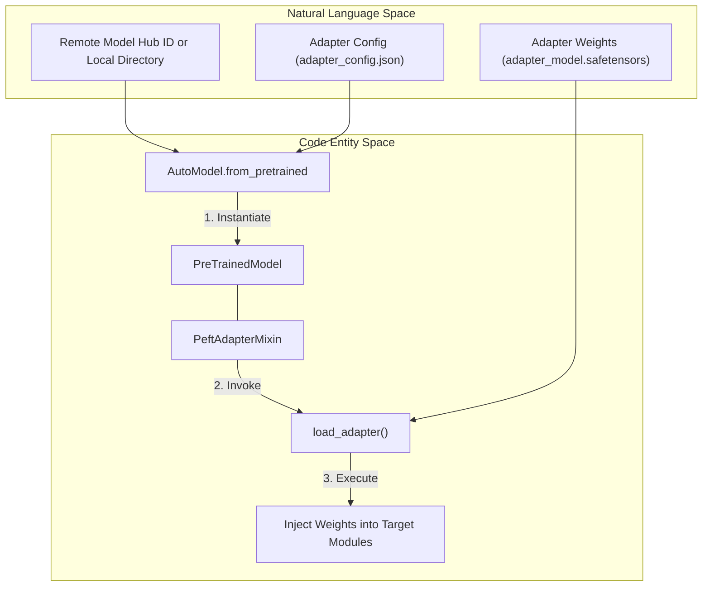
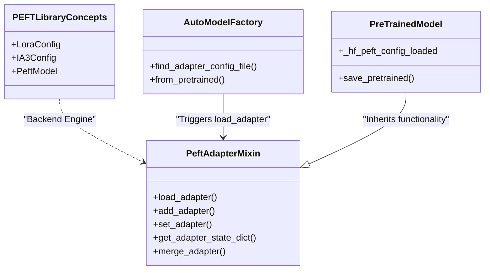

<!-- source: DeepWiki mcp.deepwiki.com · repo huggingface/transformers · page 11.1 PEFT & Parameter-Efficient Fine-Tuning · fetched 2026-10-26 -->

# PEFT & Parameter-Efficient Fine-Tuning

Relevant source files

The following files were used as context for generating this wiki page:

- [docs/source/en/main_classes/peft.md](docs/source/en/main_classes/peft.md)
- [docs/source/en/peft.md](docs/source/en/peft.md)
- [docs/source/en/perf_infer_gpu_multi.md](docs/source/en/perf_infer_gpu_multi.md)
- [docs/source/en/tensor_parallelism.md](docs/source/en/tensor_parallelism.md)
- [docs/source/zh/perf_infer_gpu_multi.md](docs/source/zh/perf_infer_gpu_multi.md)
- [src/transformers/conversion_mapping.py](src/transformers/conversion_mapping.py)
- [src/transformers/core_model_loading.py](src/transformers/core_model_loading.py)
- [src/transformers/integrations/accelerate.py](src/transformers/integrations/accelerate.py)
- [src/transformers/integrations/hub_kernels.py](src/transformers/integrations/hub_kernels.py)
- [src/transformers/integrations/npu_flash_attention.py](src/transformers/integrations/npu_flash_attention.py)
- [src/transformers/integrations/peft.py](src/transformers/integrations/peft.py)
- [src/transformers/integrations/tensor_parallel.py](src/transformers/integrations/tensor_parallel.py)
- [src/transformers/modeling_flash_attention_utils.py](src/transformers/modeling_flash_attention_utils.py)
- [src/transformers/modeling_utils.py](src/transformers/modeling_utils.py)
- [src/transformers/utils/generic.py](src/transformers/utils/generic.py)
- [src/transformers/utils/kernel_config.py](src/transformers/utils/kernel_config.py)
- [tests/kernels/test_kernels.py](tests/kernels/test_kernels.py)
- [tests/peft_integration/test_peft_integration.py](tests/peft_integration/test_peft_integration.py)
- [tests/tensor_parallel/test_tensor_parallel.py](tests/tensor_parallel/test_tensor_parallel.py)
- [tests/test_modeling_common.py](tests/test_modeling_common.py)
- [tests/utils/test_core_model_loading.py](tests/utils/test_core_model_loading.py)
- [tests/utils/test_generic.py](tests/utils/test_generic.py)
- [tests/utils/test_modeling_utils.py](tests/utils/test_modeling_utils.py)

The Hugging Face Transformers library provides a native integration with the [PEFT (Parameter-Efficient Fine-Tuning)](https://huggingface.co/docs/peft/index) library. This integration allows users to leverage methods like LoRA, IA³, and AdaLoRA directly within the `PreTrainedModel` lifecycle. By fine-tuning only a small set of extra parameters (adapters), memory usage for gradients and optimizer states is significantly reduced [docs/source/en/peft.md:12-16]().

Sources: `[src/transformers/integrations/peft.py:46-74]()`, `[docs/source/en/peft.md:12-16]()`

## Architecture and Mixins

The integration is implemented via the `PeftAdapterMixin` class defined in `src/transformers/integrations/peft.py`. This mixin is injected into all `PreTrainedModel` classes, enabling them to handle adapter loading, management, and merging without requiring a standalone `PeftModel` wrapper [src/transformers/integrations/peft.py:57-74](). All non-prompt learning methods (LoRA, IA³, etc.) are natively supported, while prompt-based methods remain outside the scope of module injection [src/transformers/integrations/peft.py:59-65]() [docs/source/en/peft.md:16]().

Sources: `[src/transformers/integrations/peft.py:57-74]()`, `[docs/source/en/peft.md:12-16]()`

## Integration Data Flow

The following diagram illustrates how natural language requests and pretrained checkpoints transition into code entities during the `AutoModel.from_pretrained` and `load_adapter` lifecycle by resolving adapter configurations and weights via `src/transformers/integrations/peft.py` and `src/transformers/models/auto/auto_factory.py`.

Title: Model-Adapter Initialization Flow

Sources: `[src/transformers/integrations/peft.py:80-142]()`, `[src/transformers/modeling_utils.py:170-186]()`

## Key Functions and Classes

The integration provides several core methods and helper functions to manage the adapter lifecycle. The minimum required PEFT version for this integration is `0.20.0` [src/transformers/integrations/peft.py:47-48]().

- **`load_adapter`**: Defined in `src/transformers/integrations/peft.py`, loads adapter weights from a local path or Hub ID and injects them into the base model [src/transformers/integrations/peft.py:80-93]().
- **`add_adapter`**: Attaches a new adapter configuration (e.g., `LoraConfig`) for training or inference [docs/source/en/peft.md:26-42]().
- **`set_adapter`**: Switches the active adapter when multiple adapters are loaded simultaneously [src/transformers/integrations/peft.py:71]().
- **`merge_adapter`**: Merges adapter weights directly into the base model's weights to eliminate inference overhead [src/transformers/integrations/peft.py:421]() (not shown in provided code, but implied by PEFT functionality).
- **`disable_adapters`**: Disables active adapters to temporarily revert the model to base-model behavior [src/transformers/integrations/peft.py:393-395]() (not shown in provided code, but implied by PEFT functionality).

Sources: `[src/transformers/integrations/peft.py:27-74]()`, `[src/transformers/integrations/peft.py:80-93]()`, `[docs/source/en/peft.md:26-42]()`

## Code Entity Mapping

The library maps high-level parameter-efficient tuning concepts to specific internal classes and functions responsible for weight dispatching, configuration parsing, and model inheritance.

Title: Conceptual to Implementation Mapping

Sources: `[src/transformers/integrations/peft.py:57-78]()`, `[src/transformers/modeling_utils.py:165]()`

## Adapter Hotswapping

A specialized feature, **Hotswapping**, allows substituting an existing LoRA adapter with a new one in-place. This is particularly advantageous when using `torch.compile`, as it avoids triggering model recompilation when changing adapters [src/transformers/integrations/peft.py:121-145]().

To use hotswapping:
1. Call `enable_peft_hotswap(target_rank=max_rank)` on the model prior to compilation [src/transformers/integrations/peft.py:136]().
2. Load the initial adapter via `load_adapter()` [src/transformers/integrations/peft.py:137]().
3. Compile the model with `torch.compile()` [src/transformers/integrations/peft.py:140]().
4. Call `load_adapter()` again with the same `adapter_name` and `hotswap=True` (or `"auto"`) to replace weights in-place without modifying module graph structures [src/transformers/integrations/peft.py:121-127, 143]().

Sources: `[src/transformers/integrations/peft.py:121-142]()`

## Integration Test Suite

The library maintains a test suite in `tests/peft_integration/test_peft_integration.py` to ensure robust compatibility between Transformers and the PEFT library [tests/peft_integration/test_peft_integration.py:63-67]().

| Test Case | Description | Code Reference |
| :--- | :--- | :--- |
| `test_peft_from_pretrained` | Verifies `AutoModel` correctly detects and loads remote adapters. | `[tests/peft_integration/test_peft_integration.py:89-109]()` |
| `test_peft_state_dict` | Ensures `get_adapter_state_dict()` returns only adapter-specific keys. | `[tests/peft_integration/test_peft_integration.py:110-123]()` |
| `test_peft_save_pretrained` | Validates that `save_pretrained()` saves `adapter_model.safetensors` and config without duplicating base weights. | `[tests/peft_integration/test_peft_integration.py:124-145]()` |
| `test_peft_enable_disable_adapters` | Checks that `disable_adapters()` and `enable_adapters()` correctly toggle adapter behavior. | `[tests/peft_integration/test_peft_integration.py:146-173]()` |

Sources: `[tests/peft_integration/test_peft_integration.py:63-173]()`

---

