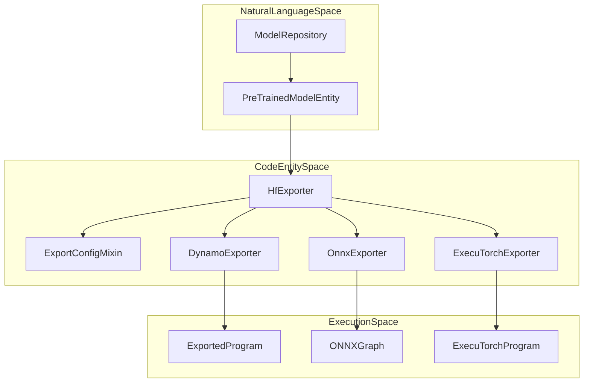
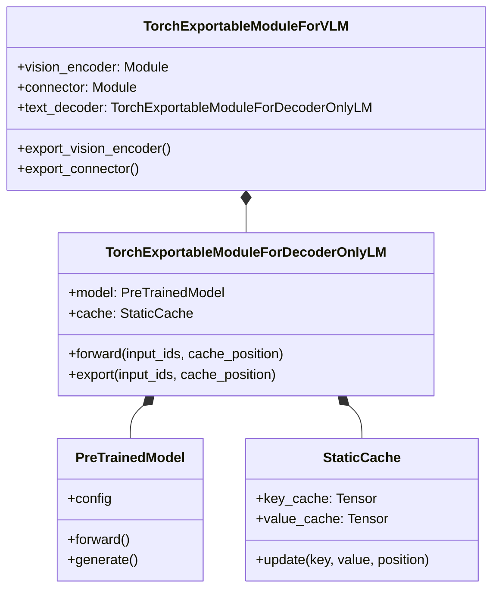

<!-- source: DeepWiki mcp.deepwiki.com · repo huggingface/transformers · page 11.2 Model Export · fetched 2026-10-26 -->

# Model Export

<details>
<summary>Relevant source files</summary>

The following files were used as context for generating this wiki page:

- [.circleci/config.yml](.circleci/config.yml)
- [.circleci/create_circleci_config.py](.circleci/create_circleci_config.py)
- [conftest.py](conftest.py)
- [pyproject.toml](pyproject.toml)
- [setup.py](setup.py)
- [src/transformers/cache_utils.py](src/transformers/cache_utils.py)
- [src/transformers/configuration_utils.py](src/transformers/configuration_utils.py)
- [src/transformers/dependency_versions_table.py](src/transformers/dependency_versions_table.py)
- [src/transformers/exporters/exporter_openvino.py](src/transformers/exporters/exporter_openvino.py)
- [src/transformers/generation/candidate_generator.py](src/transformers/generation/candidate_generator.py)
- [src/transformers/generation/configuration_utils.py](src/transformers/generation/configuration_utils.py)
- [src/transformers/generation/utils.py](src/transformers/generation/utils.py)
- [src/transformers/integrations/executorch.py](src/transformers/integrations/executorch.py)
- [src/transformers/masking_utils.py](src/transformers/masking_utils.py)
- [src/transformers/models/neucodec/feature_extraction_neucodec.py](src/transformers/models/neucodec/feature_extraction_neucodec.py)
- [src/transformers/models/neucodec/modular_neucodec.py](src/transformers/models/neucodec/modular_neucodec.py)
- [tests/conftest_tests/test_cache_fallback.py](tests/conftest_tests/test_cache_fallback.py)
- [tests/generation/test_candidate_generator.py](tests/generation/test_candidate_generator.py)
- [tests/generation/test_configuration_utils.py](tests/generation/test_configuration_utils.py)
- [tests/generation/test_utils.py](tests/generation/test_utils.py)
- [tests/repo_utils/test_check_noisy_comments.py](tests/repo_utils/test_check_noisy_comments.py)
- [tests/repo_utils/test_tests_fetcher.py](tests/repo_utils/test_tests_fetcher.py)
- [tests/utils/test_cache_utils.py](tests/utils/test_cache_utils.py)
- [tests/utils/test_configuration_utils.py](tests/utils/test_configuration_utils.py)
- [tests/utils/test_feature_extraction_utils.py](tests/utils/test_feature_extraction_utils.py)
- [tests/utils/test_image_processing_utils.py](tests/utils/test_image_processing_utils.py)
- [tests/utils/test_masking_utils.py](tests/utils/test_masking_utils.py)
- [tests/utils/test_testing_utils.py](tests/utils/test_testing_utils.py)
- [tests/utils/test_tokenization_utils.py](tests/utils/test_tokenization_utils.py)
- [utils/check_noisy_comments.py](utils/check_noisy_comments.py)
- [utils/get_pr_run_slow_jobs.py](utils/get_pr_run_slow_jobs.py)
- [utils/tests_fetcher.py](utils/tests_fetcher.py)

</details>


Model export in the Transformers library facilitates the transition from research-oriented PyTorch modules to production-ready deployment formats such as **ONNX**, **ExecuTorch**, and other optimized runtime graphs. This subsystem leverages `torch.export`, `torch.compile`, and the `exporters/` subpackage infrastructure to ensure that complex generative models—specifically those utilizing KV caching and dynamic attention—can be deployed efficiently across diverse hardware backends.

Sources: `[src/transformers/integrations/executorch.py:35-44]()`, `[src/transformers/cache_utils.py:1-28]()`

---

## 1. Core Export Architecture & Exporters Subpackage

The export infrastructure is structured around the `exporters/` subpackage, which provides modular exporters and mixins to serialize `PreTrainedModel` instances into intermediate representations or direct backend formats.

### Key Exporter Components

- **`ExportConfigMixin`**: A configuration mixin that defines export parameters, input/output naming conventions, and validation checks for tracing `[src/transformers/integrations/executorch.py:27-32]()`.
- **`HfExporter`**: The primary orchestration class managing high-level export workflows across different backend targets.
- **`DynamoExporter` / `OnnxExporter` / `ExecuTorchExporter`**: Backend-specific exporter classes that interface with PyTorch's `torch.export` and `torch.compile` pipelines to generate traceable execution graphs.

Sources: `[src/transformers/integrations/executorch.py:27-33]()`, `[src/transformers/cache_utils.py:1-15]()`

### Diagram: Model Export Orchestration Pipeline

Sources: `[src/transformers/integrations/executorch.py:27-43]()`, `[src/transformers/cache_utils.py:1-10]()`

---

## 2. TorchExportableModuleForDecoderOnlyLM & VLM Export

To satisfy the strict tracing requirements of `torch.export`, transformer models must be wrapped in specialized exportable modules that handle mutable state (such as KV caches) in a functional manner.

### TorchExportableModuleForDecoderOnlyLM

The `TorchExportableModuleForDecoderOnlyLM` class acts as a specialized wrapper for decoder-only language models `[src/transformers/integrations/executorch.py:122-122]()`. It standardizes the forward pass to accept `input_ids` and `cache_position`, which are critical for models using `StaticCache` during deployment `[src/transformers/integrations/executorch.py:136-137]()`.

Key responsibilities include:
- **Cache Initialization**: Initializes a `StaticCache` based on the model's configuration and a provided `max_cache_len` `[src/transformers/integrations/executorch.py:127-128]()`.
- **Attribute Management**: Mirrors essential model attributes like `config`, `generation_config`, and `device` to the wrapper level `[src/transformers/integrations/executorch.py:57-58]()`.
- **Forward Logic**: Ensures the model is called with `use_cache=True` and passes the `StaticCache` instance explicitly to the underlying model's forward method `[src/transformers/integrations/executorch.py:136-137]()`.

### Visual-Language Model (VLM) Export

For multimodal models, `TorchExportableModuleForVLM` provides a structured approach to export distinct components of the pipeline `[src/transformers/integrations/executorch.py:35-43]()`:
1. **Vision Encoder**: Processes raw pixels into visual features `[src/transformers/integrations/executorch.py:70-91]()`.
2. **Connector/Projector**: Maps visual features into the text embedding space `[src/transformers/integrations/executorch.py:93-117]()`.
3. **Text Decoder**: Generates text using the combined embeddings via `TorchExportableModuleForDecoderOnlyLM` `[src/transformers/integrations/executorch.py:118-144]()`.

Sources: `[src/transformers/integrations/executorch.py:35-144]()`, `[src/transformers/integrations/executorch.py:122-144]()`

---

## 3. Integration with KV Caching

Exporting generative models requires a static representation of the KV cache to avoid dynamic memory allocation during tracing and execution.

### StaticCache and Exporting

The `StaticCache` class is the primary mechanism for exportable KV caching `[src/transformers/cache_utils.py:44-44]()`. Unlike `DynamicCache` `[src/transformers/cache_utils.py:114-114]`, it pre-allocates tensors of a fixed `max_cache_len` `[src/transformers/cache_utils.py:105]()`.

During the export process:
1. The `TorchExportableModuleForDecoderOnlyLM` instantiates a `StaticCache` `[src/transformers/integrations/executorch.py:127-128]()`.
2. The `forward` method uses `cache_position` to index into the pre-allocated tensors `[src/transformers/integrations/executorch.py:136-137]()`.
3. This allows `torch.export` to trace the graph without encountering dynamic shape changes related to the cache size.

### Component Mapping for Export

| Entity | Role in Export | File Reference |
| :--- | :--- | :--- |
| `StaticCache` | Pre-allocated KV storage for fixed-shape tracing. | `[src/transformers/cache_utils.py:44]()` |
| `cache_position` | Tensor indicating the index in `StaticCache` for new tokens. | `[src/transformers/integrations/executorch.py:136]()` |
| `max_cache_len` | Defines the static boundary for the exported model's memory. | `[src/transformers/integrations/executorch.py:52]()` |
| `torch.export.Dim` | Used to define dynamic sequence lengths within static cache bounds. | `[src/transformers/integrations/executorch.py:130]()` |

Sources: `[src/transformers/cache_utils.py:44-121]()`, `[src/transformers/integrations/executorch.py:118-144]()`

---

## 4. Handling Dynamic Constraints & Tracing

To maintain performance while remaining within static export constraints, the library uses `torch.export.Dim` to represent the current sequence length as a dynamic variable that is strictly bounded by `max_cache_len` `[src/transformers/integrations/executorch.py:130]()`.

```python
# Example of dynamic shape definition for export in executorch.py
seq_len_dim = torch.export.Dim("seq_length_dim", max=max_seq_length - 1)
dynamic_shapes = {
    "input_ids": {1: seq_len_dim},
    "cache_position": {0: seq_len_dim},
}
```

This approach ensures that the exported graph remains valid for any sequence length up to the pre-allocated cache limit, enabling efficient execution on mobile and edge devices via ExecuTorch and ONNX Runtime.

### Diagram: Entity Association Class Diagram

Sources: `[src/transformers/integrations/executorch.py:35-67]()`, `[src/transformers/integrations/executorch.py:122-144]()`, `[src/transformers/cache_utils.py:44]()`

---

