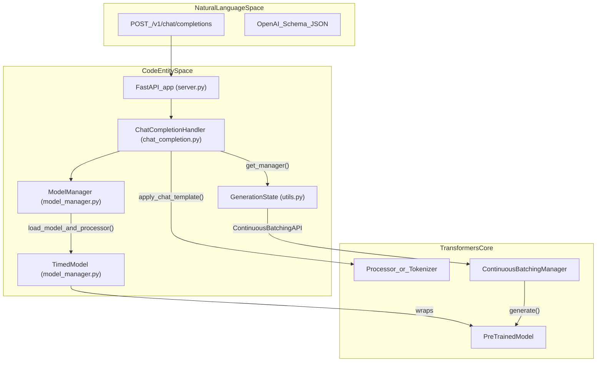

<!-- source: DeepWiki mcp.deepwiki.com · repo huggingface/transformers · page 11.3 CLI & Serving · fetched 2026-10-26 -->

# CLI & Serving

<details>
<summary>Relevant source files</summary>

The following files were used as context for generating this wiki page:

- [docs/source/en/_redirects.yml](docs/source/en/_redirects.yml)
- [docs/source/en/community_integrations/litert.md](docs/source/en/community_integrations/litert.md)
- [docs/source/en/serve-cli/serving.md](docs/source/en/serve-cli/serving.md)
- [docs/source/en/serve-cli/serving_optims.md](docs/source/en/serve-cli/serving_optims.md)
- [examples/pytorch/transformers_serve_cb_eval_job.py](examples/pytorch/transformers_serve_cb_eval_job.py)
- [src/transformers/cli/add_new_model_like.py](src/transformers/cli/add_new_model_like.py)
- [src/transformers/cli/chat.py](src/transformers/cli/chat.py)
- [src/transformers/cli/serve.py](src/transformers/cli/serve.py)
- [src/transformers/cli/serving/__init__.py](src/transformers/cli/serving/__init__.py)
- [src/transformers/cli/serving/chat_completion.py](src/transformers/cli/serving/chat_completion.py)
- [src/transformers/cli/serving/completion.py](src/transformers/cli/serving/completion.py)
- [src/transformers/cli/serving/response.py](src/transformers/cli/serving/response.py)
- [src/transformers/cli/serving/server.py](src/transformers/cli/serving/server.py)
- [src/transformers/cli/serving/transcription.py](src/transformers/cli/serving/transcription.py)
- [src/transformers/cli/serving/utils.py](src/transformers/cli/serving/utils.py)
- [src/transformers/cli/system.py](src/transformers/cli/system.py)
- [src/transformers/cli/transformers.py](src/transformers/cli/transformers.py)
- [tests/cli/conftest.py](tests/cli/conftest.py)
- [tests/cli/test_chat.py](tests/cli/test_chat.py)
- [tests/cli/test_serve.py](tests/cli/test_serve.py)
- [tests/utils/test_add_new_model_like.py](tests/utils/test_add_new_model_like.py)

</details>


The purpose and scope of this page is to document the Hugging Face Transformers command-line interface (CLI) and serving stack located under `src/transformers/cli/` and `src/transformers/cli/serving/`. This subsystem provides an OpenAI-compatible HTTP server (`transformers serve`), an interactive terminal chat client (`transformers chat`), model scaffolding (`transformers add-new-model-like`), and utilities for environment inspection and file downloading.

Sources: [src/transformers/cli/transformers.py](), [src/transformers/cli/serve.py](), [src/transformers/cli/chat.py]()

---

## 1. CLI Entry Points & Subcommands

The primary entry point for all command-line operations is the `transformers` command, managed via Typer [src/transformers/cli/transformers.py](). It maps various subcommands to specialized modules.

| Command | Module | Purpose |
| :--- | :--- | :--- |
| `serve` | [src/transformers/cli/serve.py:41-115]() | Launches an OpenAI-compatible FastAPI inference server. |
| `chat` | [src/transformers/cli/chat.py]() | Interactive terminal-based chat interface connecting to a local or remote server. |
| `add-new-model-like` | [src/transformers/cli/add_new_model_like.py:98-120]() | Scaffolding tool to create new model architectures based on existing ones. |
| `env` | [src/transformers/cli/system.py]() | Prints system telemetry (Python, PyTorch, GPU availability, etc.) for debugging. |
| `download` | [src/transformers/cli/download.py]() | Downloads weights and configuration files from the Hugging Face Hub. |

### Scaffolding New Models
The `add_new_model_like` function automates boilerplate creation when introducing new model architectures [src/transformers/cli/add_new_model_like.py:98-120](). It utilizes `libcst` via `ClassFinder` [src/transformers/cli/add_new_model_like.py:36-66]() to inspect existing model definitions, generate a corresponding directory structure under `src/transformers/models/`, and automatically register configuration and modeling classes in `AutoMapping` registries [src/transformers/cli/add_new_model_like.py:131-162]().

Sources: [src/transformers/cli/transformers.py](), [src/transformers/cli/add_new_model_like.py:36-162](), [src/transformers/cli/system.py](), [src/transformers/cli/download.py]()

---

## 2. Serving Architecture & Endpoints

The `transformers serve` command initializes a FastAPI application defined in `build_server` [src/transformers/cli/serving/server.py:44-149]() which exposes OpenAI-compatible REST endpoints. Model weights and lifecycle management are handled centrally by `ModelManager` [src/transformers/cli/serving/model_manager.py]().

### System Data Flow: Request to Inference
The following diagram illustrates how an incoming HTTP request is processed through the serving subpackage layers.


Sources: [src/transformers/cli/serve.py:137-164](), [src/transformers/cli/serving/model_manager.py](), [src/transformers/cli/serving/chat_completion.py:108-150]()

### Model Management & Lifecycle
`ModelManager` coordinates thread-safe model caching, dynamic loading, and memory cleanup [src/transformers/cli/serving/model_manager.py]().
- **Automatic Unloading**: Loaded models are wrapped in `TimedModel` instances [src/transformers/cli/serving/model_manager.py](). An idle timer (`model_timeout`) automatically unloads inactive models, invoking Python garbage collection and clearing PyTorch CUDA caches [src/transformers/cli/serve.py:87-89]().
- **Preloading**: Setting the `force_model` parameter [src/transformers/cli/serve.py:44-52]() disables the idle timeout, keeping the specified model permanently resident in memory [src/transformers/cli/serve.py:87-89]().
- **Streaming Progress**: The `/load_model` endpoint streams weight-downloading and initialization progress via Server-Sent Events (SSE) [src/transformers/cli/serving/server.py:119-131]().

### REST Endpoints

| Endpoint | Handler Class / Function | Description |
| :--- | :--- | :--- |
| `/v1/chat/completions` | `ChatCompletionHandler` [src/transformers/cli/serving/chat_completion.py:99-103]() | Supports text, VLM, and multimodal chat requests. |
| `/v1/completions` | `CompletionHandler` [src/transformers/cli/serving/completion.py]() | Legacy prompt-based text completion. |
| `/v1/responses` | `ResponseHandler` [src/transformers/cli/serving/response.py]() | Implementation of the OpenAI Responses API. |
| `/v1/audio/transcriptions` | `TranscriptionHandler` [src/transformers/cli/serving/transcription.py]() | Speech-to-text processing (e.g., Whisper). |
| `/load_model` | Inline Route [src/transformers/cli/serving/server.py:119-131]() | Preloads a model and streams progress via SSE. |
| `/health` | Inline Route [src/transformers/cli/serving/server.py:143-147]() | Liveness probe verifying Continuous Batching worker state. |

Sources: [src/transformers/cli/serve.py:113-118](), [src/transformers/cli/serving/server.py:44-149](), [src/transformers/cli/serving/chat_completion.py](), [src/transformers/cli/serving/response.py]()

---

## 3. Response Parsing, Chat Templates & Reasoning

To support advanced features like **tool calling** and **reasoning (thinking)** blocks within standard OpenAI-compatible streams, the serving layer uses `ResponseParser` [src/transformers/cli/serving/utils.py:31]().

### Parsing Logic & Token Streaming
The parser inspects token streams for structural delimiters (such as ``, `<tool_call>`, `</tool_call>`) and routes the content to appropriate fields in the OpenAI response format. This allows for rich, structured outputs beyond simple text. The `_RESPONSE_TEMPLATE_FALLBACKS` dictionary [src/transformers/cli/serving/utils.py:107-181]() provides default parsing rules for models that do not ship with their own `response_template`.

```mermaid
graph TD
    subgraph "ModelOutput"
        T1[""]
        T2["<tool_call>tool_call_json</tool_call>"]
        T3["Assistant message part 1"]
        T4["Assistant message part 2"]
    end

    subgraph "CodeEntitySpace"
        RP["ResponseParser (utils.py)"]
        RT["ReasoningText (utils.py)"]
        TC["ToolCall (utils.py)"]
        CH["ChatCompletionHandler (chat_completion.py)"]
        RH["ResponseHandler (response.py)"]
    end

    subgraph "SSEStream"
        D1["delta_reasoning_content_Thinking"]
        D2["delta_tool_call_json"]
        D3["delta_content_Assistant"]
    end

    T1 --> RP
    T2 --> RP
    T3 --> RP
    T4 --> RP

    RP -- "yield ReasoningText" --> RT
    RP -- "yield ToolCall" --> TC
    RP -- "yield str" --> CH
    RP -- "yield str" --> RH

    RT --> D1
    TC --> D2
    CH --> D3
    RH --> D3
```
Sources: [src/transformers/cli/serving/utils.py:31](), [src/transformers/cli/serving/utils.py:91-194](), [src/transformers/cli/serving/chat_completion.py:181-196](), [src/transformers/cli/serving/response.py:98-207]()

---

## 4. Server Performance Optimizations

The serving CLI exposes core performance options via Typer options:

1.  **Continuous Batching**: Enabled via `--continuous-batching`, utilizing `ContinuousBatchingManager` to interleave prefill and decode steps dynamically [src/transformers/cli/serve.py:54-57](). Tuned via parameters like `--cb-block-size`, `--cb-num-blocks`, and `--cb-max-batch-tokens` [src/transformers/cli/serve.py:91-105]().
2.  **Quantization**: Supports `--quantization bnb-4bit` or `bnb-8bit` runtime weights mapping via `BitsAndBytesConfig` [src/transformers/cli/serve.py:62-64]().
3.  **Attention Backends**: Users can configure specific implementations such as `--attn-implementation flash_attention_2` or `sdpa` [src/transformers/cli/serve.py:58-60](). On Apple Silicon, the server auto-selects Metal flash-sdpa if available [docs/source/en/serve-cli/serving_optims.md:65-74]().
4.  **Torch Compile**: The `--compile` flag triggers `torch.compile` tracing on the model execution loop [src/transformers/cli/serve.py:61]().

Sources: [src/transformers/cli/serve.py:54-105](), [docs/source/en/serve-cli/serving_optims.md]()

---

## 5. Interactive Chat Client

The `transformers chat` command provides `RichInterface` for terminal-based conversations with serving instances [src/transformers/cli/chat.py:113-120]().

### Key Features
- **Markdown Rendering**: Uses `rich` to format assistant outputs, incorporating newline handling workarounds for chat formatting [src/transformers/cli/chat.py:145-167]().
- **Session Management**: Supports meta-commands such as `!save` (exports conversation history to YAML) and `!clear` [src/transformers/cli/chat.py:87-103]().
- **Dynamic Settings**: Allows runtime parameter updates via `!set` [src/transformers/cli/chat.py:97-99]().
- **Live Streaming**: Leverages `rich.live` to stream tokens in real-time [src/transformers/cli/chat.py:124-170]().

Sources: [src/transformers/cli/chat.py](), [tests/cli/test_chat.py]()

---

