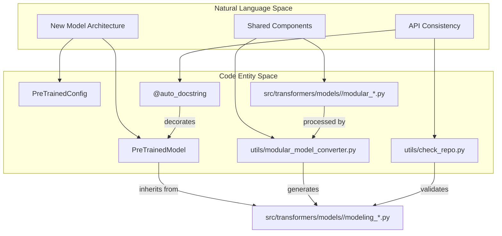
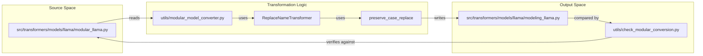

<!-- source: DeepWiki mcp.deepwiki.com · repo huggingface/transformers · page 12 Adding New Models · fetched 2026-10-26 -->

# Adding New Models

Relevant source files

The following files were used as context for generating this wiki page:

- [.ai/AGENTS.md](.ai/AGENTS.md)
- [.ai/skills/add-or-fix-type-checking/SKILL.md](.ai/skills/add-or-fix-type-checking/SKILL.md)
- [.github/ISSUE_TEMPLATE/bug-report.yml](.github/ISSUE_TEMPLATE/bug-report.yml)
- [.github/ISSUE_TEMPLATE/migration.yml](.github/ISSUE_TEMPLATE/migration.yml)
- [.github/PULL_REQUEST_TEMPLATE.md](.github/PULL_REQUEST_TEMPLATE.md)
- [.github/scripts/codeowners_for_review_action](.github/scripts/codeowners_for_review_action)
- [.github/workflows/assign-reviewers.yml](.github/workflows/assign-reviewers.yml)
- [.github/workflows/check-workflow-permissions.yml](.github/workflows/check-workflow-permissions.yml)
- [.github/workflows/codeql.yml](.github/workflows/codeql.yml)
- [.github/workflows/trufflehog.yml](.github/workflows/trufflehog.yml)
- [.gitignore](.gitignore)
- [AGENTS.md](AGENTS.md)
- [CLAUDE.md](CLAUDE.md)
- [CONTRIBUTING.md](CONTRIBUTING.md)
- [Makefile](Makefile)
- [docs/source/en/model_doc/paddleocr_vl.md](docs/source/en/model_doc/paddleocr_vl.md)
- [docs/source/en/modular_transformers.md](docs/source/en/modular_transformers.md)
- [docs/source/en/pr_checks.md](docs/source/en/pr_checks.md)
- [docs/source/en/testing.md](docs/source/en/testing.md)
- [docs/source/es/pr_checks.md](docs/source/es/pr_checks.md)
- [docs/source/it/pr_checks.md](docs/source/it/pr_checks.md)
- [docs/source/ja/pr_checks.md](docs/source/ja/pr_checks.md)
- [docs/source/ko/pr_checks.md](docs/source/ko/pr_checks.md)
- [examples/modular-transformers/configuration_duplicated_method.py](examples/modular-transformers/configuration_duplicated_method.py)
- [examples/modular-transformers/configuration_my_new_model.py](examples/modular-transformers/configuration_my_new_model.py)
- [examples/modular-transformers/configuration_my_new_model2.py](examples/modular-transformers/configuration_my_new_model2.py)
- [examples/modular-transformers/configuration_new_model.py](examples/modular-transformers/configuration_new_model.py)
- [examples/modular-transformers/modeling_dummy_bert.py](examples/modular-transformers/modeling_dummy_bert.py)
- [examples/modular-transformers/modeling_from_uppercase_model.py](examples/modular-transformers/modeling_from_uppercase_model.py)
- [examples/modular-transformers/modeling_global_indexing.py](examples/modular-transformers/modeling_global_indexing.py)
- [examples/modular-transformers/modeling_multimodal2.py](examples/modular-transformers/modeling_multimodal2.py)
- [examples/modular-transformers/modeling_my_new_model2.py](examples/modular-transformers/modeling_my_new_model2.py)
- [examples/modular-transformers/modeling_new_task_model.py](examples/modular-transformers/modeling_new_task_model.py)
- [examples/modular-transformers/modeling_roberta.py](examples/modular-transformers/modeling_roberta.py)
- [examples/modular-transformers/modeling_super.py](examples/modular-transformers/modeling_super.py)
- [examples/modular-transformers/modeling_switch_function.py](examples/modular-transformers/modeling_switch_function.py)
- [examples/modular-transformers/modeling_test_detr.py](examples/modular-transformers/modeling_test_detr.py)
- [examples/modular-transformers/modular_multimodal2.py](examples/modular-transformers/modular_multimodal2.py)
- [src/transformers/_typing.py](src/transformers/_typing.py)
- [src/transformers/models/paddleocr_vl/__init__.py](src/transformers/models/paddleocr_vl/__init__.py)
- [src/transformers/safetensors_conversion.py](src/transformers/safetensors_conversion.py)
- [tests/repo_utils/modular/test_conversion_order.py](tests/repo_utils/modular/test_conversion_order.py)
- [tests/repo_utils/test_check_modular_conversion.py](tests/repo_utils/test_check_modular_conversion.py)
- [tests/repo_utils/test_checkers.py](tests/repo_utils/test_checkers.py)
- [utils/add_dates.py](utils/add_dates.py)
- [utils/check_inits.py](utils/check_inits.py)
- [utils/check_modular_conversion.py](utils/check_modular_conversion.py)
- [utils/check_reviewers.py](utils/check_reviewers.py)
- [utils/check_types.py](utils/check_types.py)
- [utils/checkers-requirements.txt](utils/checkers-requirements.txt)
- [utils/checkers.py](utils/checkers.py)
- [utils/create_dependency_mapping.py](utils/create_dependency_mapping.py)
- [utils/get_test_reports.py](utils/get_test_reports.py)
- [utils/modular_model_converter.py](utils/modular_model_converter.py)

This page serves as a high-level guide for contributors adding new model architectures to the Hugging Face Transformers library. The library supports two primary methods for model addition: the **Modular Transformers System** (recommended for models sharing components with existing architectures) and the **Legacy Single-File Approach** (for entirely novel architectures).

For deep technical details, implementation walkthroughs, and checker script specifications, refer to the child pages:
- **[Modular Transformers System](#12.1)**
- **[Repository Consistency & Documentation Checks](#12.2)**

---

### 1. Modular Transformers System

The modular transformers system reduces code duplication by allowing imports and inheritance across model files [docs/source/en/modular_transformers.md:18-20](). Instead of writing standalone files from scratch, contributors define a `modular_<name>.py` file within the model directory, inheriting from existing classes [docs/source/en/modular_transformers.md:18-20](). A code generator then produces the standalone `modeling_<name>.py` file [docs/source/en/modular_transformers.md:20-20]().

*   **Code Generation**: `utils/modular_model_converter.py` parses modular sources, applies naming transforms via `ReplaceNameTransformer`, and outputs standalone files [utils/modular_model_converter.py:55-71](), [utils/modular_model_converter.py:142-150](). The generated files include an `AUTO_GENERATED_MESSAGE` header to prevent manual edits [utils/modular_model_converter.py:44-49]().
*   **Validation**: `utils/check_modular_conversion.py` runs in CI to verify that generated files match the modular definitions and prevents manual drift [utils/check_modular_conversion.py:19-26](). It can also fix discrepancies by overwriting the generated files [utils/check_modular_conversion.py:25-25]().

For details on configuration inheritance, `@strict` and `@auto_docstring` decorators, topological sorting via `find_priority_list`, and reference implementations, see **[Modular Transformers System](#12.1)**.

Sources: [docs/source/en/modular_transformers.md:18-48](), [utils/modular_model_converter.py:44-49](), [utils/modular_model_converter.py:55-71](), [utils/modular_model_converter.py:142-150](), [utils/check_modular_conversion.py:19-26]()

---

### 2. Legacy Single-File Approach

For models that do not cleanly inherit from existing architectures, the legacy approach requires manually creating self-contained files such as `modeling_<name>.py`, `configuration_<name>.py`, and `tokenization_<name>.py` [docs/source/en/modular_transformers.md:23-23]().

*   **Scope**: Used when a model introduces entirely unique operational layers, custom non-standard attention mechanisms, or distinct tokenization logic that cannot be factored out via inheritance [docs/source/en/modular_transformers.md:23-23]().
*   **Standards**: Manual implementations must adhere strictly to the `PreTrainedModel` and `PreTrainedConfig` serialization and initialization contracts.

Sources: [docs/source/en/modular_transformers.md:23-26]()

---

### 3. Repository Consistency & Documentation Checks

Transformers enforces strict repository quality and consistency standards using an automated suite of checker scripts located in `utils/` [Makefile:17-36]() and managed by `utils/checkers.py` [Makefile:43-63]().

*   **Docstring Automation**: The `@auto_docstring` decorator automatically populates model and configuration argument documentation from pretrained checkpoints [examples/modular-transformers/modeling_new_task_model.py:31-36]().
*   **Consistency Utilities**: Scripts such as `utils/check_repo.py`, `utils/check_config_attributes.py`, `utils/check_inits.py`, `utils/check_auto.py`, and `utils/add_dates.py` validate imports, mapping registries, and model release metadata [Makefile:17-36](). These checks are integrated into the `Makefile` targets like `check-code-quality` and `check-repository-consistency` [Makefile:50-55]().

For details on the full suite of checkers, how they run locally or in CI, and cache invalidation mechanics, see **[Repository Consistency & Documentation Checks](#12.2)**.

Sources: [Makefile:17-36](), [Makefile:43-63](), [examples/modular-transformers/modeling_new_task_model.py:31-36]()

---

### Bridging Concepts to Code

The following diagrams illustrate how conceptual requirements for adding a new model map to specific codebase entities, scripts, and validation workflows.

#### Model Addition Infrastructure

Sources: [docs/source/en/modular_transformers.md:18-48](), [utils/modular_model_converter.py:55-71](), [examples/modular-transformers/modeling_new_task_model.py:31-89]()

#### Modular Conversion Pipeline

Sources: [utils/modular_model_converter.py:94-119](), [utils/modular_model_converter.py:142-152](), [utils/check_modular_conversion.py:74-97]()

| Component | File Path | Role |
| :--- | :--- | :--- |
| **Converter** | `utils/modular_model_converter.py` | Parses modular sources and generates standalone modeling files. |
| **Checker** | `utils/check_modular_conversion.py` | CI script that validates generated files against modular sources. |
| **Unified Runner** | `utils/checkers.py` | Orchestrates repository quality and consistency checks via `Makefile` targets. |
| **Dates Utility** | `utils/add_dates.py` | Enforces release dates and paper metadata in documentation. |

Sources: [utils/modular_model_converter.py:1-20](), [utils/check_modular_conversion.py:19-26](), [Makefile:43-63](), [utils/add_dates.py:14-22]()

---

