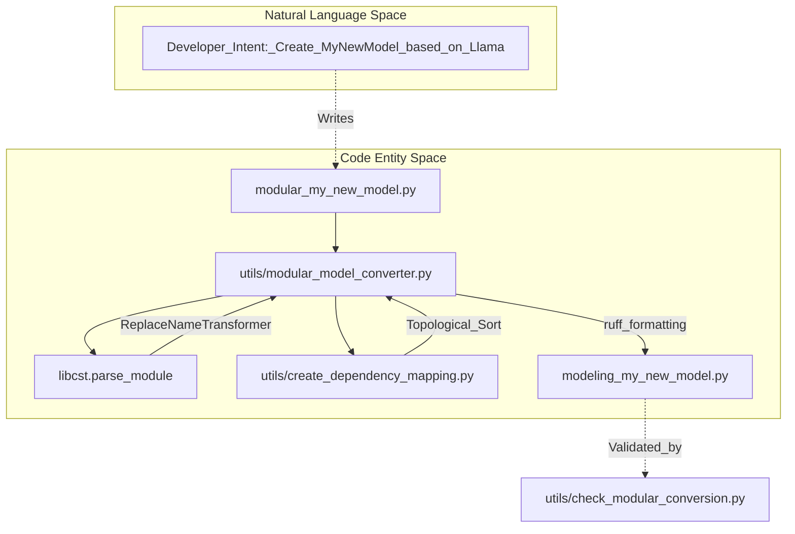
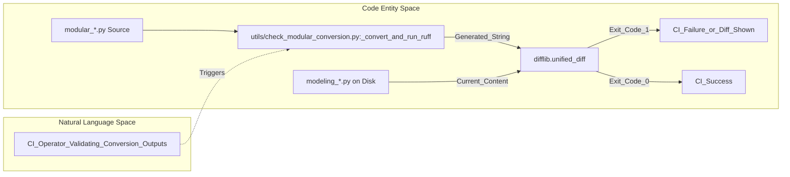

<!-- source: DeepWiki mcp.deepwiki.com · repo huggingface/transformers · page 12.1 Modular Transformers System · fetched 2026-10-26 -->

# Modular Transformers System

<details>
<summary>Relevant source files</summary>

The following files were used as context for generating this wiki page:

- [docs/source/en/model_doc/paddleocr_vl.md](docs/source/en/model_doc/paddleocr_vl.md)
- [examples/modular-transformers/configuration_duplicated_method.py](examples/modular-transformers/configuration_duplicated_method.py)
- [examples/modular-transformers/configuration_my_new_model.py](examples/modular-transformers/configuration_my_new_model.py)
- [examples/modular-transformers/configuration_my_new_model2.py](examples/modular-transformers/configuration_my_new_model2.py)
- [examples/modular-transformers/configuration_new_model.py](examples/modular-transformers/configuration_new_model.py)
- [examples/modular-transformers/modeling_dummy_bert.py](examples/modular-transformers/modeling_dummy_bert.py)
- [examples/modular-transformers/modeling_from_uppercase_model.py](examples/modular-transformers/modeling_from_uppercase_model.py)
- [examples/modular-transformers/modeling_global_indexing.py](examples/modular-transformers/modeling_global_indexing.py)
- [examples/modular-transformers/modeling_multimodal2.py](examples/modular-transformers/modeling_multimodal2.py)
- [examples/modular-transformers/modeling_my_new_model2.py](examples/modular-transformers/modeling_my_new_model2.py)
- [examples/modular-transformers/modeling_new_task_model.py](examples/modular-transformers/modeling_new_task_model.py)
- [examples/modular-transformers/modeling_roberta.py](examples/modular-transformers/modeling_roberta.py)
- [examples/modular-transformers/modeling_super.py](examples/modular-transformers/modeling_super.py)
- [examples/modular-transformers/modeling_switch_function.py](examples/modular-transformers/modeling_switch_function.py)
- [examples/modular-transformers/modeling_test_detr.py](examples/modular-transformers/modeling_test_detr.py)
- [examples/modular-transformers/modular_multimodal2.py](examples/modular-transformers/modular_multimodal2.py)
- [src/transformers/models/paddleocr_vl/__init__.py](src/transformers/models/paddleocr_vl/__init__.py)
- [tests/repo_utils/modular/test_conversion_order.py](tests/repo_utils/modular/test_conversion_order.py)
- [tests/repo_utils/test_check_modular_conversion.py](tests/repo_utils/test_check_modular_conversion.py)
- [utils/add_dates.py](utils/add_dates.py)
- [utils/check_modular_conversion.py](utils/check_modular_conversion.py)
- [utils/create_dependency_mapping.py](utils/create_dependency_mapping.py)
- [utils/modular_model_converter.py](utils/modular_model_converter.py)

</details>


## Purpose and Scope
The **Modular Transformers System** is a code generation and maintenance framework designed to reduce code duplication while preserving the "single-file-per-model" philosophy of the Transformers library. It allows developers to define models by inheriting or composing from existing components in a `modular_*.py` file, which then automatically generates the standard `modeling_*.py`, `configuration_*.py`, and other related files [utils/modular_model_converter.py:44-50]().
Sources: `[utils/modular_model_converter.py:44-50]()`, `[utils/check_modular_conversion.py:19-26]()`

---

## Data Flow and Architecture
The conversion process involves analyzing the dependency graph between modular files, transforming relative imports, and applying name-mapping logic to ensure the generated code uses the new model's nomenclature [utils/create_dependency_mapping.py:7-20]().

Title: Modular Conversion Logic Flow

Sources: `[utils/modular_model_converter.py:142-170]()`, `[utils/create_dependency_mapping.py:7-20]()`, `[utils/check_modular_conversion.py:74-97]()`

---

## Implementation Details

### Dependency Mapping
Because modular models can depend on other modular models, the system performs a topological sort to determine the correct conversion order. The `find_priority_list` function extracts model-specific imports to build this graph [utils/create_dependency_mapping.py:87-120]().
*   `topological_sort`: Organizes modular files into levels where level 0 has no modular dependencies [utils/create_dependency_mapping.py:7-47]().
*   `is_model_import`: Identifies if an import statement refers to a `modeling_`, `configuration_`, or `tokenization_` file [utils/create_dependency_mapping.py:62-74]().
Sources: `[utils/create_dependency_mapping.py:7-120]()`

### Code Transformation Logic
The `ReplaceNameTransformer` (a `m.MatcherDecoratableTransformer`) is responsible for the heavy lifting of renaming entities [utils/modular_model_converter.py:142-165](). It handles:
1.  **Case Preservation**: Automatically converts `llama` to `my_new_model`, `Llama` to `MyNewModel`, and `LLAMA` to `MY_NEW_MODEL` [utils/modular_model_converter.py:142-165]().
2.  **String/Comment Updates**: Replaces model names within docstrings and comments, except for specific protected names like `mamba_ssm` [utils/modular_model_converter.py:80-91]().
3.  **Import Rewriting**: Converts relative imports into absolute or correctly resolved relative paths [utils/modular_model_converter.py:30-35]().
Sources: `[utils/modular_model_converter.py:30-91]()`, `[utils/modular_model_converter.py:142-165]()`

### Generated File Structure
Every generated file starts with a mandatory warning header to prevent manual edits [utils/modular_model_converter.py:44-50]().

```python
#                🚨🚨🚨🚨🚨🚨🚨🚨🚨🚨🚨🚨🚨🚨🚨🚨🚨🚨🚨🚨🚨🚨🚨🚨🚨🚨🚨🚨🚨🚨🚨🚨🚨🚨🚨🚨🚨🚨🚨🚨🚨🚨🚨🚨🚨🚨🚨🚨
#           This file was automatically generated from examples/modular-transformers/modular_new_task_model.py.
#               Do NOT edit this file manually as any edits will be overwritten by the generation of
#             the file from the modular. If any change should be done, please apply the change to the
#                          modular_new_task_model.py file directly. One of our CI enforces this.
#                🚨🚨🚨🚨🚨🚨🚨🚨🚨🚨🚨🚨🚨🚨🚨🚨🚨🚨🚨🚨🚨🚨🚨🚨🚨🚨🚨🚨🚨🚨🚨🚨🚨🚨🚨🚨🚨🚨🚨🚨🚨🚨🚨🚨🚨🚨🚨🚨
```
Sources: `[utils/modular_model_converter.py:44-50]()`, `[examples/modular-transformers/modeling_new_task_model.py:1-6]()`

---

## Validation and CI Integration
The `utils/check_modular_conversion.py` script is used in CI to ensure consistency [utils/check_modular_conversion.py:19-26](). It re-runs the conversion in memory and compares the output against the files currently in the repository.

*   `compare_files`: Coordinates the conversion of a modular file and compares it with the existing modeling file [utils/check_modular_conversion.py:100-106]().
*   `process_file`: Generates a unified diff if discrepancies are found and can optionally overwrite the local file [utils/check_modular_conversion.py:35-71]().
*   `guaranteed_no_diff`: Optimization that skips checks if neither the modular file nor its dependencies have changed in the current git diff [utils/check_modular_conversion.py:149-173]().

Title: Validation Architecture Flow

Sources: `[utils/check_modular_conversion.py:35-106]()`, `[utils/check_modular_conversion.py:149-173]()`

---

## Reference Implementations
The `examples/modular-transformers/` directory contains templates for common modeling tasks:

| File | Purpose |
| :--- | :--- |
| `examples/modular-transformers/modeling_new_task_model.py` | Demonstrates a multimodal projector and custom causal mask mapping [examples/modular-transformers/modeling_new_task_model.py:77-86](). |
| `examples/modular-transformers/modeling_super.py` | Shows integration with Hub kernels and advanced RoPE implementations [examples/modular-transformers/modeling_super.py:28-43](). |
| `examples/modular-transformers/modeling_my_new_model2.py` | Illustrates overriding specific components like `RMSNorm` while keeping the rest of the transformer stack [examples/modular-transformers/modeling_my_new_model2.py:37-51](). |
| `examples/modular-transformers/configuration_my_new_model.py` | Example of a standard modular configuration with `auto_docstring` and `strict` validation [examples/modular-transformers/configuration_my_new_model.py:16-18](). |
| `examples/modular-transformers/modeling_dummy_bert.py` | Provides a modular implementation of a BERT-like model, showcasing embeddings and attention mechanisms [examples/modular-transformers/modeling_dummy_bert.py:27-86](). |
| `examples/modular-transformers/modeling_roberta.py` | A modular version of the RoBERTa model, demonstrating its specific embedding and attention implementations [examples/modular-transformers/modeling_roberta.py:27-89](). |
| `examples/modular-transformers/modeling_multimodal2.py` | Example of a multimodal model with distinct vision and text configurations, and custom attention and MLP layers [examples/modular-transformers/modeling_multimodal2.py:45-62](). |
| `examples/modular-transformers/configuration_new_model.py` | Demonstrates how to define a new model's configuration, including tensor parallelism and pipeline parallelism plans [examples/modular-transformers/configuration_new_model.py:33-47](). |

Sources: `[examples/modular-transformers/modeling_new_task_model.py:1-152]()`, `[examples/modular-transformers/modeling_super.py:1-146]()`, `[examples/modular-transformers/modeling_my_new_model2.py:1-154]()`, `[examples/modular-transformers/configuration_my_new_model.py:1-104]()`, `[examples/modular-transformers/modeling_dummy_bert.py:1-149]()`, `[examples/modular-transformers/modeling_roberta.py:1-151]()`, `[examples/modular-transformers/modeling_multimodal2.py:1-181]()`, `[examples/modular-transformers/configuration_new_model.py:1-73]()`

---

