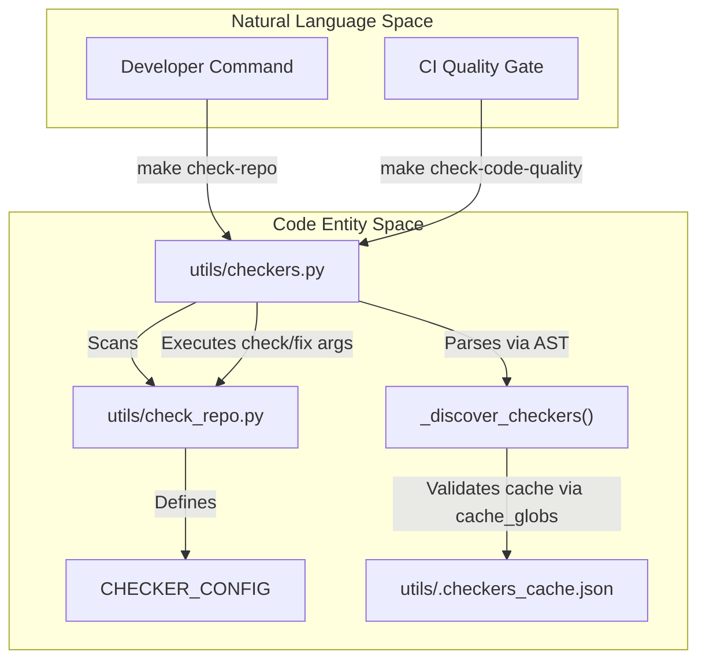
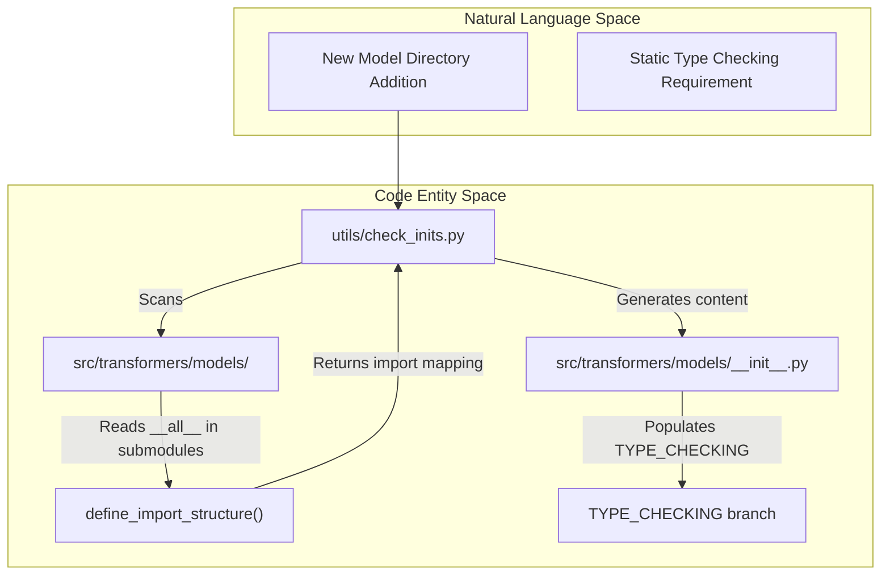
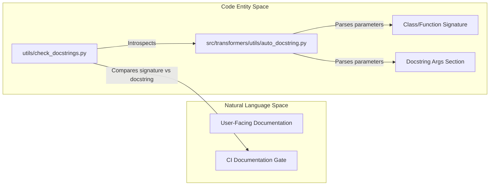

<!-- source: DeepWiki mcp.deepwiki.com · repo huggingface/transformers · page 12.2 Repository Consistency & Documentation Checks · fetched 2026-10-26 -->

# Repository Consistency & Documentation Checks

Relevant source files

The following files were used as context for generating this wiki page:

- [.ai/AGENTS.md](.ai/AGENTS.md)
- [.ai/skills/add-or-fix-type-checking/SKILL.md](.ai/skills/add-or-fix-type-checking/SKILL.md)
- [.github/ISSUE_TEMPLATE/bug-report.yml](.github/ISSUE_TEMPLATE/bug-report.yml)
- [.github/ISSUE_TEMPLATE/migration.yml](.github/ISSUE_TEMPLATE/migration.yml)
- [.github/PULL_REQUEST_TEMPLATE.md](.github/PULL_REQUEST_TEMPLATE.md)
- [.github/scripts/codeowners_for_review_action](.github/scripts/codeowners_for_review_action)
- [.github/workflows/assign-reviewers.yml](.github/workflows/assign-reviewers.yml)
- [.github/workflows/check-workflow-permissions.yml](.github/workflows/check-workflow-permissions.yml)
- [.github/workflows/codeql.yml](.github/workflows/codeql.yml)
- [.github/workflows/trufflehog.yml](.github/workflows/trufflehog.yml)
- [.gitignore](.gitignore)
- [AGENTS.md](AGENTS.md)
- [CLAUDE.md](CLAUDE.md)
- [CONTRIBUTING.md](CONTRIBUTING.md)
- [Makefile](Makefile)
- [docs/source/en/_toctree.yml](docs/source/en/_toctree.yml)
- [docs/source/en/index.md](docs/source/en/index.md)
- [docs/source/en/modular_transformers.md](docs/source/en/modular_transformers.md)
- [docs/source/en/pr_checks.md](docs/source/en/pr_checks.md)
- [docs/source/en/testing.md](docs/source/en/testing.md)
- [docs/source/es/pr_checks.md](docs/source/es/pr_checks.md)
- [docs/source/it/pr_checks.md](docs/source/it/pr_checks.md)
- [docs/source/ja/pr_checks.md](docs/source/ja/pr_checks.md)
- [docs/source/ko/pr_checks.md](docs/source/ko/pr_checks.md)
- [src/transformers/__init__.py](src/transformers/__init__.py)
- [src/transformers/_typing.py](src/transformers/_typing.py)
- [src/transformers/models/__init__.py](src/transformers/models/__init__.py)
- [src/transformers/models/auto/auto_mappings.py](src/transformers/models/auto/auto_mappings.py)
- [src/transformers/models/auto/configuration_auto.py](src/transformers/models/auto/configuration_auto.py)
- [src/transformers/models/auto/feature_extraction_auto.py](src/transformers/models/auto/feature_extraction_auto.py)
- [src/transformers/models/auto/image_processing_auto.py](src/transformers/models/auto/image_processing_auto.py)
- [src/transformers/models/auto/modeling_auto.py](src/transformers/models/auto/modeling_auto.py)
- [src/transformers/models/auto/processing_auto.py](src/transformers/models/auto/processing_auto.py)
- [src/transformers/models/auto/tokenization_auto.py](src/transformers/models/auto/tokenization_auto.py)
- [src/transformers/safetensors_conversion.py](src/transformers/safetensors_conversion.py)
- [src/transformers/utils/auto_docstring.py](src/transformers/utils/auto_docstring.py)
- [src/transformers/utils/dummy_pt_objects.py](src/transformers/utils/dummy_pt_objects.py)
- [tests/repo_utils/test_checkers.py](tests/repo_utils/test_checkers.py)
- [utils/check_auto.py](utils/check_auto.py)
- [utils/check_config_attributes.py](utils/check_config_attributes.py)
- [utils/check_docstrings.py](utils/check_docstrings.py)
- [utils/check_inits.py](utils/check_inits.py)
- [utils/check_repo.py](utils/check_repo.py)
- [utils/check_reviewers.py](utils/check_reviewers.py)
- [utils/check_types.py](utils/check_types.py)
- [utils/checkers-requirements.txt](utils/checkers-requirements.txt)
- [utils/checkers.py](utils/checkers.py)
- [utils/get_test_reports.py](utils/get_test_reports.py)

The Transformers library employs a comprehensive suite of utility scripts located in the `utils/` directory to maintain repository health, ensure architectural consistency, and enforce documentation standards. These checks are integrated into the CI pipeline via unified runners and GitHub Actions to validate every Pull Request.

## Overview of Consistency Checkers

The consistency suite ensures that the modular model architecture, import structures, and the complex mappings of the `Auto` classes remain synchronized as new features and models are added. These checkers are orchestrated centrally by `utils/checkers.py` and exposed through target commands in the `Makefile` [utils/checkers.py:15-48]().

### Key Utility Scripts and Architecture

| Script | Purpose | Cited Code |
| :--- | :--- | :--- |
| `utils/checkers.py` | Unified plugin-based runner scanning `utils/*.py` for `CHECKER_CONFIG` definitions via AST inspection. | [utils/checkers.py:15-48]() |
| `utils/check_repo.py` | Validates model registration in `__init__.py` files, test coverage, and auto-mapping completeness. | [utils/check_repo.py:15-22]() |
| `utils/check_inits.py` | Automatically regenerates and validates `src/transformers/models/__init__.py` based on submodule `__all__` definitions. | [src/transformers/models/__init__.py:1-6]() |
| `utils/check_docstrings.py` | Validates that public objects have an argument section in their docstrings matching their exact Python signature. | [utils/check_docstrings.py:14-33]() |
| `src/transformers/utils/auto_docstring.py` | Provides argument definitions and parsing utilities for automatic docstring generation. | [utils/check_docstrings.py:53-62]() |
| `utils/check_config_attributes.py` | Ensures configuration classes possess required attributes matching model `__init__` parameters. | [utils/check_config_attributes.py:23-31]() |
| `utils/check_types.py` | Runs type checks on specified directories to enforce type annotations. | [utils/check_types.py:1-51]() |
| `utils/check_auto.py` | Verifies the consistency of `Auto` classes and their mappings. | [src/transformers/models/auto/modeling_auto.py:21-27]() |

Sources: [utils/checkers.py:15-48](), [src/transformers/models/__init__.py:1-6](), [utils/check_docstrings.py:14-33](), [utils/check_config_attributes.py:23-31]()

---

## Unified Checker Framework & Discovery

The repository's consistency and quality checks are unified under `utils/checkers.py`, which implements a lightweight plugin system [utils/checkers.py:24-48](). Rather than importing every checking module at startup, `utils/checkers.py` parses each script in `utils/*.py` using Python's `ast` module to locate top-level `CHECKER_CONFIG` dictionaries.

### Plugin Discovery and Execution Flow

Sources: [utils/checkers.py:24-48](), [utils/check_repo.py:54-68]()

Each `CHECKER_CONFIG` specifies metadata such as `name`, `label`, `cache_globs`, `check_args`, and `fix_args`. Caching is implemented via content-hashing files matched by `cache_globs`, avoiding redundant checker runs when relevant files remain unchanged. The cache file is `utils/.checkers_cache.json`.

---

## Auto-Mapping & Init Synchronization

Transformers relies heavily on `_LazyModule` and `_LazyAutoMapping` to defer runtime imports. The `utils/check_inits.py` script ensures that the `TYPE_CHECKING` blocks and runtime export structures in `src/transformers/models/__init__.py` match the physical module layout on disk [src/transformers/models/__init__.py:1-6]().

### Init Synchronization Data Flow

Sources: [src/transformers/models/__init__.py:1-6](), [src/transformers/models/__init__.py:21-25]()

The `check_inits.py` script reads disk structures via `define_import_structure` and compares them against `src/transformers/models/__init__.py` [src/transformers/models/__init__.py:1-6](). Running with `--fix_and_overwrite` automatically regenerates the file.

---

## Documentation & Docstring Enforcement

The library uses `utils/check_docstrings.py` alongside `src/transformers/utils/auto_docstring.py` to ensure that public functions, classes, and configurations have docstring argument sections matching their exact Python signatures [utils/check_docstrings.py:14-33]().

### Docstring Validation Process

Sources: [utils/check_docstrings.py:14-33](), [utils/check_docstrings.py:53-62]()

If inconsistencies are discovered, `utils/check_docstrings.py` reports mismatches or can auto-correct them when invoked with `--fix_and_overwrite` [utils/check_docstrings.py:25-32]().

### `auto_docstring.py` Implementation Details

The `src/transformers/utils/auto_docstring.py` module provides the core logic for parsing and generating docstring arguments. It defines several classes like `ConfigArgs`, `ImageProcessorArgs`, `ModelArgs`, `ModelOutputArgs`, and `ProcessorArgs` which contain predefined argument descriptions and shapes.

Key functions include:
*   `get_args_doc_from_source()`: Extracts argument documentation from source code [utils/check_docstrings.py:53-62]().
*   `parse_docstring()`: Parses an existing docstring to extract argument sections [utils/check_docstrings.py:53-62]().
*   `set_min_indent()`: Utility for formatting docstring indentation [utils/check_docstrings.py:53-62]().

Sources: [utils/check_docstrings.py:53-62]()

---

## Config Attributes Check (`check_config_attributes.py`)

The `utils/check_config_attributes.py` script verifies that configuration classes define attributes matching the modeling parameters expected by their corresponding models. It inspects configurations via `CONFIG_MAPPING` [src/transformers/models/auto/configuration_auto.py:153-153]() and checks for special exceptions or custom allowances in `SPECIAL_CASES_TO_ALLOW` [utils/check_config_attributes.py:44-44]().

Sources: [utils/check_config_attributes.py:41-44](), [src/transformers/models/auto/configuration_auto.py:153-153]()

---

## Repository Consistency (`check_repo.py`)

The `utils/check_repo.py` script performs a variety of checks to ensure overall repository consistency. This includes verifying model registration, test coverage, and the completeness of auto-mappings. It also checks for undocumented objects, though some can be explicitly ignored via `ignore_undocumented` [utils/check_docstrings.py:48-48]().

The script defines several important lists:
*   `PRIVATE_MODELS`: A list of models that are intentionally private and should not be exposed or tested directly [utils/check_repo.py:77-151]().
*   `IGNORE_NON_TESTED`: Models that are not tested, with a comment explaining the reason [utils/check_repo.py:153-173](). This list should be kept minimal.

The script also checks the consistency of `Auto` classes by iterating through `CONFIG_MAPPING_NAMES`, `TOKENIZER_MAPPING_NAMES`, `IMAGE_PROCESSOR_MAPPING_NAMES`, `FEATURE_EXTRACTOR_MAPPING_NAMES`, and `PROCESSOR_MAPPING_NAMES` [utils/check_repo.py:45-49](). It ensures that all models are present in at least one `Auto` class and that the mappings are correctly defined and importable.

Sources: [utils/check_repo.py:45-49](), [utils/check_repo.py:77-151](), [utils/check_repo.py:153-173](), [utils/check_docstrings.py:48-48]()

---

## CI Enforcement

The various consistency and documentation checks are enforced through CI pipelines, configured via project automation scripts and Makefiles.

### `not_doctested.txt`

The `not_doctested.txt` file lists files that are intentionally excluded from doctesting. This is managed by the doctest list checker, which ensures this list remains up-to-date and accurate across releases.

Sources: [utils/check_docstrings.py:14-33]()

### CircleCI Configuration

The `.circleci/create_circleci_config.py` script dynamically generates the `.circleci/config.yml` file, which defines the CI jobs. This script includes logic for setting common environment variables, pytest options, and handling flaky tests.

Sources: [docs/source/en/_toctree.yml:1-221]()

### GitHub Actions

GitHub Actions workflows, such as `.github/workflows/circleci-failure-summary-comment.yml.bak`, are used to monitor and report on CI failures, ensuring that issues identified by the consistency checks are promptly addressed.

Sources: [docs/source/en/_toctree.yml:1-221]()

---

