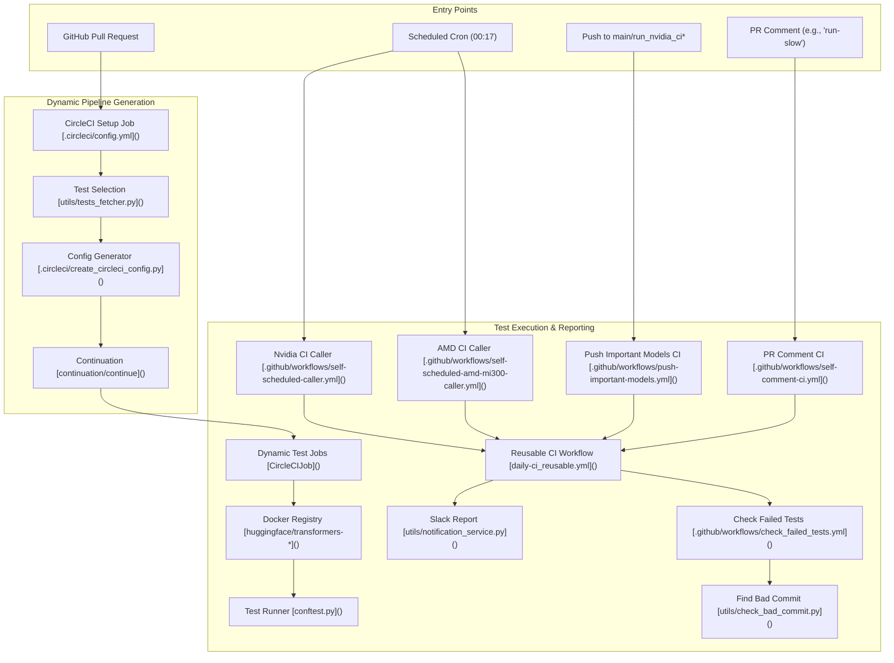

<!-- source: DeepWiki mcp.deepwiki.com · repo huggingface/transformers · page 13 CI/CD, Testing & Infrastructure · fetched 2026-10-26 -->

# CI/CD, Testing & Infrastructure

Relevant source files

The following files were used as context for generating this wiki page:

- [.circleci/config.yml](.circleci/config.yml)
- [.circleci/create_circleci_config.py](.circleci/create_circleci_config.py)
- [.github/workflows/benchmark_v2_mi300_caller.yml](.github/workflows/benchmark_v2_mi300_caller.yml)
- [.github/workflows/check_failed_tests.yml](.github/workflows/check_failed_tests.yml)
- [.github/workflows/collated-reports.yml](.github/workflows/collated-reports.yml)
- [.github/workflows/get-pr-info.yml](.github/workflows/get-pr-info.yml)
- [.github/workflows/get-pr-number.yml](.github/workflows/get-pr-number.yml)
- [.github/workflows/model_jobs_intel_gaudi.yml](.github/workflows/model_jobs_intel_gaudi.yml)
- [.github/workflows/pr-repo-consistency-bot.yml](.github/workflows/pr-repo-consistency-bot.yml)
- [.github/workflows/pr_build_doc_with_comment.yml](.github/workflows/pr_build_doc_with_comment.yml)
- [.github/workflows/pr_slow_ci_suggestion.yml](.github/workflows/pr_slow_ci_suggestion.yml)
- [.github/workflows/push-important-models.yml](.github/workflows/push-important-models.yml)
- [.github/workflows/self-comment-ci-amd.yml](.github/workflows/self-comment-ci-amd.yml)
- [.github/workflows/self-comment-ci.yml](.github/workflows/self-comment-ci.yml)
- [.github/workflows/self-nightly-caller.yml](.github/workflows/self-nightly-caller.yml)
- [.github/workflows/self-scheduled-amd-mi250-caller.yml](.github/workflows/self-scheduled-amd-mi250-caller.yml)
- [.github/workflows/self-scheduled-amd-mi300-caller.yml](.github/workflows/self-scheduled-amd-mi300-caller.yml)
- [.github/workflows/self-scheduled-caller.yml](.github/workflows/self-scheduled-caller.yml)
- [.github/workflows/self-scheduled-flash-attn-caller.yml](.github/workflows/self-scheduled-flash-attn-caller.yml)
- [.github/workflows/self-scheduled-intel-gaudi.yml](.github/workflows/self-scheduled-intel-gaudi.yml)
- [.github/workflows/self-scheduled-intel-gaudi3-caller.yml](.github/workflows/self-scheduled-intel-gaudi3-caller.yml)
- [.github/workflows/slack-report.yml](.github/workflows/slack-report.yml)
- [.github/workflows/ssh-runner.yml](.github/workflows/ssh-runner.yml)
- [.github/workflows/trl-ci-bot.yml](.github/workflows/trl-ci-bot.yml)
- [conftest.py](conftest.py)
- [pyproject.toml](pyproject.toml)
- [setup.py](setup.py)
- [src/transformers/data/processors/squad.py](src/transformers/data/processors/squad.py)
- [src/transformers/dependency_versions_table.py](src/transformers/dependency_versions_table.py)
- [src/transformers/exporters/exporter_openvino.py](src/transformers/exporters/exporter_openvino.py)
- [src/transformers/models/neucodec/feature_extraction_neucodec.py](src/transformers/models/neucodec/feature_extraction_neucodec.py)
- [src/transformers/models/neucodec/modular_neucodec.py](src/transformers/models/neucodec/modular_neucodec.py)
- [tests/conftest_tests/test_cache_fallback.py](tests/conftest_tests/test_cache_fallback.py)
- [tests/repo_utils/test_check_noisy_comments.py](tests/repo_utils/test_check_noisy_comments.py)
- [tests/repo_utils/test_split_model_tests.py](tests/repo_utils/test_split_model_tests.py)
- [tests/repo_utils/test_tests_fetcher.py](tests/repo_utils/test_tests_fetcher.py)
- [tests/utils/test_testing_utils.py](tests/utils/test_testing_utils.py)
- [utils/check_bad_commit.py](utils/check_bad_commit.py)
- [utils/check_noisy_comments.py](utils/check_noisy_comments.py)
- [utils/collated_reports.py](utils/collated_reports.py)
- [utils/get_pr_run_slow_jobs.py](utils/get_pr_run_slow_jobs.py)
- [utils/notification_service.py](utils/notification_service.py)
- [utils/process_bad_commit_report.py](utils/process_bad_commit_report.py)
- [utils/split_model_tests.py](utils/split_model_tests.py)
- [utils/tests_fetcher.py](utils/tests_fetcher.py)

This section provides a high-level overview of the automation pipelines, testing frameworks, and infrastructure components that ensure the stability and quality of the `transformers` library. The system is designed to handle a massive suite of tests across diverse hardware (CPU, NVIDIA GPU, AMD GPU, Intel Gaudi) and software environments.

## System Architecture Overview

The infrastructure bridges the gap between code changes in a Pull Request (PR) and the execution of thousands of tests. It utilizes a combination of **CircleCI** for core logic and **GitHub Actions** for specialized hardware, Docker image builds, and reporting.

### CI/CD Workflow & Test Selection Architecture

Sources: [.circleci/config.yml:1-100](), [.circleci/create_circleci_config.py:93-145](), [utils/tests_fetcher.py:18-29](), [.github/workflows/self-scheduled-caller.yml](), [.github/workflows/self-scheduled-amd-mi300-caller.yml](), [.github/workflows/push-important-models.yml](), [.github/workflows/self-comment-ci.yml:1-160](), [utils/notification_service.py:1-188](), [.github/workflows/check_failed_tests.yml](), [utils/check_bad_commit.py:1-176]()

### Dependency & Consistency Check Architecture

```mermaid
graph TD
    subgraph "Makefile Entry Points [Makefile]()"
        Quality["make check-code-quality"]
        Consistency["make check-repository-consistency"]
        Fix["make fix-repo"]
    end

    Quality --> Ruff["Linter/Formatter (ruff)"]
    Quality --> Ty["Type Checker (ty)"]

    Consistency --> Checkers["Consistency Checker [utils/checkers.py]()"]
    Checkers --> AutoMappings["Auto Mappings"]
    Checkers --> Inits["Inits"]
    Checkers --> Copies["Copies"]
    Checkers --> DepsTable["Dependency Table"]
    Checkers --> ModularConversion["Modular Conversion"]
    Checkers --> DocToc["Doc TOC"]
    Checkers --> Reviewers["Reviewers"]
    Checkers --> ModelingRulesDoc["Modeling Rules Doc"]
    Checkers --> Docstrings["Docstrings"]
    Checkers --> Dummies["Dummies"]
    Checkers --> Repo["Repo"]
    Checkers --> PipelineTyping["Pipeline Typing"]
    Checkers --> ConfigDocstrings["Config Docstrings"]
    Checkers --> ConfigAttributes["Config Attributes"]
    Checkers --> DoctestList["Doctest List"]
    Checkers --> UpdateMetadata["Update Metadata"]
    Checkers --> AddDates["Add Dates"]

    Fix --> CheckersFix["Consistency Checker (with --fix) [utils/checkers.py]()"]
```

Sources: [Makefile](), [utils/checkers.py](), [utils/check_inits.py](), [utils/check_modeling_rules_doc.py]()

---

## Core Components

### 13.1 CircleCI Pipeline & Test Selection
The primary CI engine uses a dynamic configuration pattern to manage the library's vast test suite. Instead of a static list of jobs, it runs a setup workflow that analyzes the repository diff.
*   **Dynamic Configuration:** The `CircleCIJob` dataclass in [.circleci/create_circleci_config.py:93-168]() defines the schema for generated jobs, including environment variables like `TRANSFORMERS_IS_CI` and `PYTEST_TIMEOUT` [.circleci/create_circleci_config.py:24-33](). The `create_circleci_config.py` script generates the final `.circleci/config.yml` based on detected changes.
*   **Intelligent Fetching:** [utils/tests_fetcher.py:18-29]() analyzes the `git` diff to identify impacted models. If "core files" like `modeling_utils.py` or `setup.py` are modified, it triggers a full CI run [utils/tests_fetcher.py:76-84](). The `tests_fetcher.py` script also handles filtering tests by files and selecting core model tests when too many models are impacted.
*   **Test Environment:** The [conftest.py]() file provides global fixtures and logic, such as a read-only cache fallback mechanism (`_with_tmpdir_cache_fallback`) to handle CI environments where the filesystem is locked [conftest.py:109-156](). Pytest markers are used to categorize tests, and `pytest-rerunfailures` is configured to handle flaky tests based on patterns like `OSError` or `Timeout` [.circleci/create_circleci_config.py:45-61]().

For details, see [CircleCI Pipeline & Test Selection](#13.1).

### 13.2 GitHub Actions Workflows
GitHub Actions (GHA) handles specialized tasks, scheduled builds, and maintenance utilities across the repository.
*   **Docker Automation:** Workflows build and push images for PyTorch, DeepSpeed, and AMD ROCm to DockerHub.
*   **Repository Maintenance:** Workflows manage stale PRs, reviewer assignments, and documentation builds. The `.github/workflows/self-comment-ci.yml` workflow allows maintainers to trigger slow tests on PRs via comments like `run-slow` [.github/workflows/self-comment-ci.yml:31-32](). The `notification_service.py` utility is used for Slack reporting of CI results [.github/workflows/slack-report.yml:122-126](). The `check_bad_commit.py` script is used to bisect and find the commit that introduced a test failure [.github/workflows/check_failed_tests.yml]().

For details, see [GitHub Actions Workflows](#13.2).

### 13.3 Docker Images
The library maintains specialized Dockerfiles in the `docker/` directory to provide consistent execution environments across backends.
*   **Lightweight CI Environments:** Dockerfiles such as `docker/consistency.dockerfile` and `docker/torch-light.dockerfile` configure lean Python containers with `uv` and pinned package dependencies.
*   **Specialized Stacks:** Additional images handle exotic models, custom tokenizers `docker/custom-tokenizers.dockerfile` and examples test suites `docker/examples-torch.dockerfile`. These images include `transformers-all-latest-gpu`, `quantization-latest-gpu`, `pytorch-amd-gpu`, and various `pytorch-deepspeed-*` images.

For details, see [Docker Images](#13.3).

### 13.4 Benchmarking Framework
The library includes an extensive benchmarking subsystem located in the `benchmark/` and `benchmark_v2/` directories to track performance regressions and hardware utilization.
*   **Configuration & Runners:** Utilizes classes such as `BenchmarkConfig` and `BenchmarkRunner` alongside hardware metric collectors [setup.py:102]().
*   **Execution:** Integrates continuous batching scripts and performance telemetry reporting. New benchmarks can be added by defining `BenchmarkConfig` and implementing `BenchmarkRunner`. The `continuous_batching_overall.py` script is an example of a benchmark.

For details, see [Benchmarking Framework](#13.4).

### 13.5 Test Suite Organization & Common Test Mixins
The test suite under `tests/` is structured around reusable mixins and testing utilities.
*   **Model Testing:** Common behaviors are validated through mixins like `ModelTesterMixin` in `test_modeling_common.py`. Similar mixins exist for `TokenizerTesterMixin` and `ProcessorTesterMixin`.
*   **Utilities & Decorators:** `tests/utils/test_testing_utils.py` and `tests/repo_utils/test_tests_fetcher.py` validate the testing infrastructure itself. The `testing_utils.py` module provides decorators for skipping tests based on conditions (e.g., `require_torch`, `require_accelerate`).

For details, see [Test Suite Organization & Common Test Mixins](#13.5).

---

## Dependency & Consistency Management

Dependencies are centrally defined in [setup.py:72-165]() and synchronized throughout the repository into [src/transformers/dependency_versions_table.py:4-91](). The `Makefile` provides convenient targets for running various checks and fixes.

| Command | Utility | Purpose |
| :--- | :--- | :--- |
| `make check-code-quality` | `ruff`, `ty` | Runs `ruff` linting/formatting and `ty` type checking [pyproject.toml:16-134]() |
| `make check-repository-consistency` | `utils/checkers.py` | Validates `auto_mappings`, `inits`, `copies`, and `deps_table` [Makefile]() |
| `make fix-repo` | `utils/checkers.py` | Automatically updates `dependency_versions_table.py` and `modular_conversion` [Makefile]() |

Sources: [Makefile](), [utils/checkers.py](), [setup.py:72-165](), [src/transformers/dependency_versions_table.py:4-91](), [pyproject.toml:16-134]()

---

