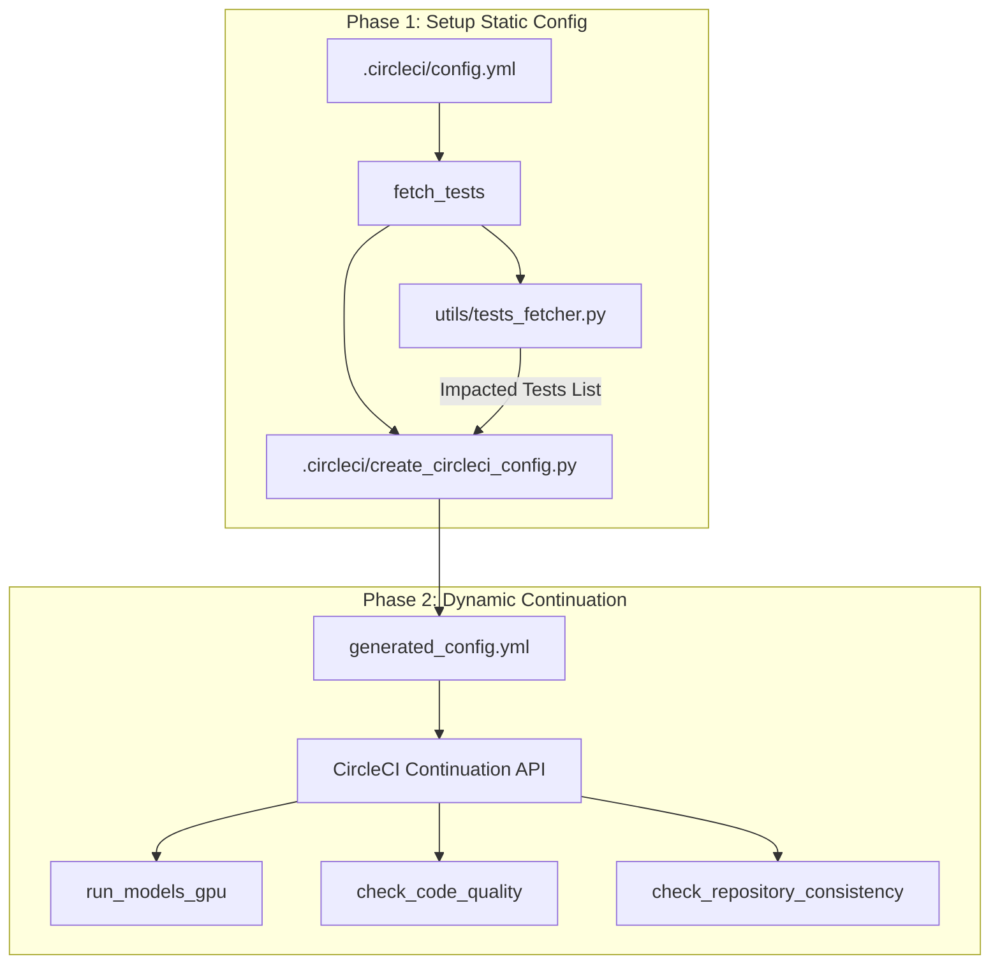

<!-- source: DeepWiki mcp.deepwiki.com · repo huggingface/transformers · page 13.1 CircleCI Pipeline & Test Selection · fetched 2026-10-26 -->

# CircleCI Pipeline & Test Selection

<details>
<summary>Relevant source files</summary>

The following files were used as context for generating this wiki page:

- [.circleci/config.yml](.circleci/config.yml)
- [.circleci/create_circleci_config.py](.circleci/create_circleci_config.py)
- [conftest.py](conftest.py)
- [pyproject.toml](pyproject.toml)
- [setup.py](setup.py)
- [src/transformers/dependency_versions_table.py](src/transformers/dependency_versions_table.py)
- [src/transformers/exporters/exporter_openvino.py](src/transformers/exporters/exporter_openvino.py)
- [src/transformers/models/neucodec/feature_extraction_neucodec.py](src/transformers/models/neucodec/feature_extraction_neucodec.py)
- [src/transformers/models/neucodec/modular_neucodec.py](src/transformers/models/neucodec/modular_neucodec.py)
- [tests/conftest_tests/test_cache_fallback.py](tests/conftest_tests/test_cache_fallback.py)
- [tests/repo_utils/test_check_noisy_comments.py](tests/repo_utils/test_check_noisy_comments.py)
- [tests/repo_utils/test_tests_fetcher.py](tests/repo_utils/test_tests_fetcher.py)
- [tests/utils/test_testing_utils.py](tests/utils/test_testing_utils.py)
- [utils/check_noisy_comments.py](utils/check_noisy_comments.py)
- [utils/get_pr_run_slow_jobs.py](utils/get_pr_run_slow_jobs.py)
- [utils/tests_fetcher.py](utils/tests_fetcher.py)

</details>


The Hugging Face Transformers library utilizes a sophisticated CI/CD architecture designed to handle a massive codebase with hundreds of model architectures. To balance exhaustive testing with resource efficiency, the pipeline employs **dynamic configuration generation**, **intelligent test selection**, **robust read-only cache fallbacks**, and **specialized pytest markers**.

---

## 1. Pipeline Overview & Continuation Pattern

The CI workflow is defined in `.circleci/config.yml` using the **CircleCI Continuation Orb** [.circleci/config.yml:3-4](). Instead of a static list of jobs, the initial setup workflow analyzes the commit and dynamically generates a second configuration file tailored specifically to the modified files in the pull request or commit.

### High-Level Data Flow

1.  **Trigger**: A push or pull request triggers the initial CircleCI workflow defined in `.circleci/config.yml` [.circleci/config.yml:1-2]().
2.  **Test Fetching**: The `fetch_tests` job runs `utils/tests_fetcher.py` to identify which modules and tests are impacted by the changes [.circleci/config.yml:60-71]().
3.  **Dynamic Config Generation**: The script `.circleci/create_circleci_config.py` evaluates the impacted test lists and generates a `generated_config.yml` [.circleci/config.yml:73]().
4.  **Continuation**: The `continuation/continue` step submits the generated configuration to CircleCI, launching the concrete test jobs [.circleci/config.yml:96-98]().

### Diagram: Dynamic Pipeline Execution

**Sources:** [.circleci/config.yml:1-98](), [.circleci/create_circleci_config.py:1-20](), [utils/tests_fetcher.py:15-49]()

---

## 2. Intelligent Test Selection (`tests_fetcher.py`)

The core of the execution efficiency strategy lies in `utils/tests_fetcher.py`. It ensures that only tests relevant to the modified code are scheduled.

### Selection Logic Stages
1.  **Modified File Identification**: Uses `git` to compute differences between the current branch and the base branch, excluding changes restricted solely to docstrings or comments via `clean_code()` [utils/tests_fetcher.py:106-135]().
2.  **Dependency Mapping**: Builds a reverse dependency map by tracking imports: if `Module A` imports `Module B`, modifying `B` triggers tests associated with `A` [utils/tests_fetcher.py:25-29]().
3.  **Core File Protection**: Modifications to critical library entrypoints and shared components in `CORE_FILES` automatically trigger a full CI suite because they impact nearly the entire repository [utils/tests_fetcher.py:76-84]():
    *   `setup.py` [utils/tests_fetcher.py:77]()
    *   `.circleci/create_circleci_config.py` [utils/tests_fetcher.py:78]()
    *   `src/transformers/modeling_utils.py` [utils/tests_fetcher.py:79]()
    *   `src/transformers/core_model_loading.py` [utils/tests_fetcher.py:80]()
    *   `src/transformers/cache_utils.py` [utils/tests_fetcher.py:81]()
    *   `src/transformers/generation/utils.py` [utils/tests_fetcher.py:82]()
    *   `src/transformers/utils/output_capturing.py` [utils/tests_fetcher.py:83]()
4.  **Thresholding**: If more than `NUM_MODELS_TO_TRIGGER_FULL_CI` (default: 15) models are impacted, the script automatically falls back to a full CI run [utils/tests_fetcher.py:71-72]().

### Diagram: Test Selection: Natural Language to Code Entity Mapping
```mermaid
graph LR
    subgraph "Natural Language Intent"
        NL1[""I changed a comment in BERT""]
        NL2[""I updated Llama modeling""]
        NL3[""I changed modeling_utils.py""]
    end

    subgraph "Code Entity Space"
        F1[""clean_code() in utils/tests_fetcher.py""]
        F2[""get_all_tests() in utils/tests_fetcher.py""]
        F3[""CORE_FILES in utils/tests_fetcher.py""]
        F4[""infer_tests_to_run() in utils/tests_fetcher.py""]
    end

    NL1 --> F1
    NL2 --> F4
    NL2 --> F2
    NL3 --> F3
```
**Sources:** [utils/tests_fetcher.py:15-84](), [utils/tests_fetcher.py:106-135]()

---

## 3. Dynamic Configuration & Job Modeling (`create_circleci_config.py`)

Once tests are fetched, `.circleci/create_circleci_config.py` constructs the workflow YAML.

### Key Classes and Features
*   **`CircleCIJob`**: A dataclass encapsulating job parameters, environment additions, custom `install_steps` (such as installing `uv` and custom pytest branches), and test selection arrays [.circleci/create_circleci_config.py:92-108]().
*   **`EmptyJob`**: Manages placeholder or terminal workflow steps such as workflow status verification and test report aggregation [.circleci/create_circleci_config.py:64-89]().
*   **Flaky Test Handling**: Detects transient network or hardware exceptions (e.g., `OSError`, `Timeout`, `ConnectionError`, `HFHubHTTPError`, `FileNotFoundError`) via `FLAKY_TEST_FAILURE_PATTERNS`, integrating seamlessly with `pytest-rerunfailures` [.circleci/create_circleci_config.py:46-61]().
*   **Environment Standardization**: `COMMON_ENV_VARIABLES` enforces uniform environment settings across jobs, including `OMP_NUM_THREADS: 1`, `TRANSFORMERS_IS_CI: True`, and `PYTEST_TIMEOUT: 120` [.circleci/create_circleci_config.py:24-33]().

**Sources:** [.circleci/create_circleci_config.py:24-61](), [.circleci/create_circleci_config.py:92-146]()

---

## 4. Read-Only Cache Fallback & Pytest Fixtures (`conftest.py`)

The `conftest.py` file initializes global pytest behaviors, test-runner memory configurations, and filesystem fallback routines.

### Read-Only Cache Fallback (`_with_tmpdir_cache_fallback`)
In CircleCI environments, the shared Hugging Face cache directory is mounted as read-only. When tests attempt to download or update model files, operations fail with `EROFS` (Read-only file system). 
*   **Error Detection**: `_is_readonly_fs_error()` [conftest.py:87-106]() inspects the exception cause chain, catching standard `OSError` with `errno.EROFS` as well as bare `RuntimeError` raised by the `hf_xet` Rust library matching `(os error <N>)` patterns.
*   **Fallback Execution**: When a read-only filesystem error occurs, the `_with_tmpdir_cache_fallback` decorator [conftest.py:109-153]() creates a session-scoped temporary directory via `tempfile.mkdtemp()`, disables Xet (`HF_HUB_DISABLE_XET`), and retries the download safely into the writable temporary cache.
*   **Event Aggregation**: Fallback events are logged per process via `_record_fallback_event()` [conftest.py:55-65]() and aggregated by the controller via `_collect_fallback_events()` [conftest.py:68-77]() to track cache misses.

### Diagram: Read-Only Cache Fallback Architecture
```mermaid
graph TD
    subgraph "Natural Language & Runtime Space"
        NL[""Shared CI Cache is Read-Only / EROFS Raised""]
    end

    subgraph "Code Entity Space"
        C1[""_with_tmpdir_cache_fallback() in conftest.py""]
        C2[""_is_readonly_fs_error() in conftest.py""]
        C3[""_record_fallback_event() in conftest.py""]
    end

    subgraph "Filesystem & Runtime"
        R1[""HF_HUB_CACHE Read-Only Mount""]
        R2[""EROFS or os error 30 Exception""]
        R3[""Temp Writable Directory via tempfile.mkdtemp()""]
    end

    NL --> R1
    C1 -- "Call huggingface_hub" --> R1
    R1 -- "Raises EROFS" --> R2
    R2 --> C2
    C2 -- "Matches EROFS/Xet Error" --> C3
    C3 -- "Redirects cache_dir" --> R3
```
**Sources:** [conftest.py:46-155]()

---

## 5. Pytest Markers & Configuration (`pyproject.toml`)

Pytest behavior and custom domain markers are configured centrally in `pyproject.toml` to categorize test execution and control runner flags.

| Marker Name | Purpose |
| :--- | :--- | :--- |
| `all_flash_attn_test` | Groups all mainline FlashAttention tests together |
| `flash_attn_4_test` / `flash_attn_3_test` | Isolates tests specific to FlashAttention-4 and FlashAttention-3 |
| `bitsandbytes` | Marks bitsandbytes 4-bit and 8-bit quantization integration tests |
| `generate` | Marks tests utilizing the `GenerationTesterMixin` |
| `is_training_test` | Marks tests using `TrainingTesterMixin` |
| `is_tensor_parallel_test` | Marks tests using `TensorParallelTesterMixin` |
| `is_fsdp_test` | Marks PyTorch FSDP distributed training tests |

**Sources:** [pyproject.toml:83-93]()

---

## 6. Summary of CI Job Types

The pipeline triggers specialized jobs depending on code modifications and `Makefile` specifications [.circleci/config.yml:100-161]():

| Job Name | Purpose | Implementation Target |
| :--- | :--- | :--- |
| `check_code_quality` | Enforces linting, formatting, and static analysis via `ruff` | `make check-code-quality` [.circleci/config.yml:118]() |
| `check_repository_consistency` | Validates `__init__.py` exports, `Auto` mappings, and template synchronizations | `make check-repository-consistency` [.circleci/config.yml:139]() |
| `fetch_tests` | Determines impacted test files and invokes dynamic configuration generation | `python utils/tests_fetcher.py` [.circleci/config.yml:71]() |
| `run_models_gpu` | Executes model-specific functional tests on GPU nodes | Generated via `create_circleci_config.py` [.circleci/config.yml:73]()

**Sources:** [.circleci/config.yml:60-161]()

---

