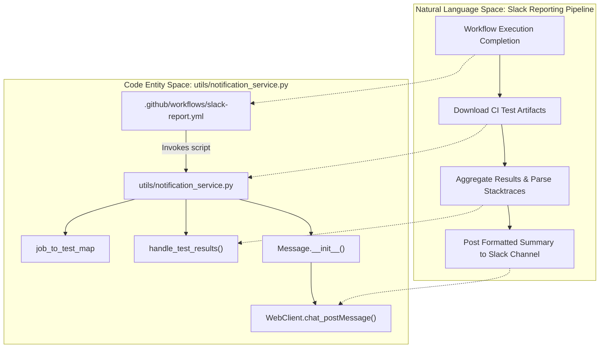
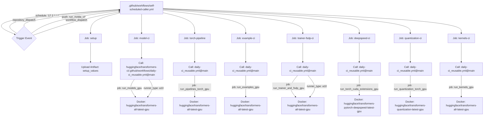
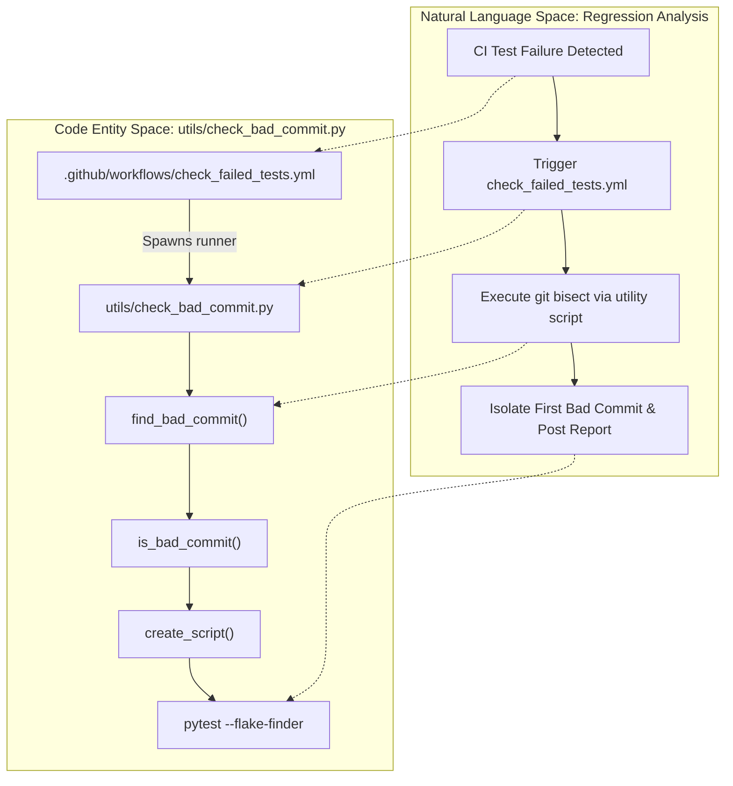

<!-- source: DeepWiki mcp.deepwiki.com · repo huggingface/transformers · page 13.2 GitHub Actions Workflows · fetched 2026-10-26 -->

# GitHub Actions Workflows

Relevant source files

The following files were used as context for generating this wiki page:

- [.github/workflows/benchmark_v2_mi300_caller.yml](.github/workflows/benchmark_v2_mi300_caller.yml)
- [.github/workflows/check_failed_tests.yml](.github/workflows/check_failed_tests.yml)
- [.github/workflows/collated-reports.yml](.github/workflows/collated-reports.yml)
- [.github/workflows/get-pr-info.yml](.github/workflows/get-pr-info.yml)
- [.github/workflows/get-pr-number.yml](.github/workflows/get-pr-number.yml)
- [.github/workflows/model_jobs_intel_gaudi.yml](.github/workflows/model_jobs_intel_gaudi.yml)
- [.github/workflows/pr-ci-post-dashboard-link.yml](.github/workflows/pr-ci-post-dashboard-link.yml)
- [.github/workflows/pr-repo-consistency-bot.yml](.github/workflows/pr-repo-consistency-bot.yml)
- [.github/workflows/pr_build_doc_with_comment.yml](.github/workflows/pr_build_doc_with_comment.yml)
- [.github/workflows/pr_slow_ci_suggestion.yml](.github/workflows/pr_slow_ci_suggestion.yml)
- [.github/workflows/push-important-models.yml](.github/workflows/push-important-models.yml)
- [.github/workflows/self-comment-ci-amd.yml](.github/workflows/self-comment-ci-amd.yml)
- [.github/workflows/self-comment-ci.yml](.github/workflows/self-comment-ci.yml)
- [.github/workflows/self-nightly-caller.yml](.github/workflows/self-nightly-caller.yml)
- [.github/workflows/self-scheduled-amd-mi250-caller.yml](.github/workflows/self-scheduled-amd-mi250-caller.yml)
- [.github/workflows/self-scheduled-amd-mi300-caller.yml](.github/workflows/self-scheduled-amd-mi300-caller.yml)
- [.github/workflows/self-scheduled-caller.yml](.github/workflows/self-scheduled-caller.yml)
- [.github/workflows/self-scheduled-flash-attn-caller.yml](.github/workflows/self-scheduled-flash-attn-caller.yml)
- [.github/workflows/self-scheduled-intel-gaudi.yml](.github/workflows/self-scheduled-intel-gaudi.yml)
- [.github/workflows/self-scheduled-intel-gaudi3-caller.yml](.github/workflows/self-scheduled-intel-gaudi3-caller.yml)
- [.github/workflows/slack-report.yml](.github/workflows/slack-report.yml)
- [.github/workflows/ssh-runner.yml](.github/workflows/ssh-runner.yml)
- [.github/workflows/trl-ci-bot.yml](.github/workflows/trl-ci-bot.yml)
- [src/transformers/data/processors/squad.py](src/transformers/data/processors/squad.py)
- [tests/repo_utils/test_github_utils.py](tests/repo_utils/test_github_utils.py)
- [tests/repo_utils/test_split_model_tests.py](tests/repo_utils/test_split_model_tests.py)
- [tests/repo_utils/test_update_pr_ci_dashboard_recap.py](tests/repo_utils/test_update_pr_ci_dashboard_recap.py)
- [tests/utils/test_get_previous_daily_ci.py](tests/utils/test_get_previous_daily_ci.py)
- [utils/check_bad_commit.py](utils/check_bad_commit.py)
- [utils/check_self_hosted_runner.py](utils/check_self_hosted_runner.py)
- [utils/collated_reports.py](utils/collated_reports.py)
- [utils/compare_test_runs.py](utils/compare_test_runs.py)
- [utils/get_ci_error_statistics.py](utils/get_ci_error_statistics.py)
- [utils/get_github_job_time.py](utils/get_github_job_time.py)
- [utils/get_previous_daily_ci.py](utils/get_previous_daily_ci.py)
- [utils/github_utils.py](utils/github_utils.py)
- [utils/notification_service.py](utils/notification_service.py)
- [utils/post_mlinter_review.py](utils/post_mlinter_review.py)
- [utils/process_bad_commit_report.py](utils/process_bad_commit_report.py)
- [utils/process_circleci_workflow_test_reports.py](utils/process_circleci_workflow_test_reports.py)
- [utils/split_model_tests.py](utils/split_model_tests.py)
- [utils/update_pr_ci_dashboard_recap.py](utils/update_pr_ci_dashboard_recap.py)

The `.github/workflows/` directory contains the automation infrastructure for the Hugging Face Transformers library. While CircleCI handles primary continuous integration for CPU and standard GPU tests, GitHub Actions (GHA) manages Docker image builds, doctests, benchmarks, specialized hardware CI (AMD, Intel Gaudi, NVIDIA A10/H100), Slack reporting via `utils/notification_service.py`, PR management, repository consistency bots, and automated regression analysis.

## Infrastructure & Workflow Orchestration

The workflow system uses reusable workflows via `workflow_call` patterns to standardize execution across push, schedule, and PR comment triggers [.github/workflows/slack-report.yml:4-30]().

### Docker Image Build System
The library maintains specialized container images to ensure consistent dependencies and CUDA versions across hardware backends. The `build-docker-images.yml` workflow orchestrates these builds on a scheduled or manual trigger [.github/workflows/build-docker-images.yml:1-16]().

| Image Name | Purpose | Base / Context |
| :--- | :--- | :--- |
| `transformers-all-latest-gpu` | Main CI image for model testing, including FlashAttention and quantization. | `./docker/transformers-all-latest-gpu` [.github/workflows/build-docker-images.yml:48-52]() |
| `transformers-quantization-latest-gpu` | Specialized for quantization backends (BNB, AWQ, GPTQ, HQQ). | `./docker/transformers-quantization-latest-gpu` [.github/workflows/self-scheduled-caller.yml:122-122]() |
| `transformers-pytorch-deepspeed-latest-gpu` | DeepSpeed integration testing container. | `./docker/transformers-pytorch-deepspeed-latest-gpu` [.github/workflows/build-docker-images.yml:128-132]() |
| `transformers-doc-builder` | Environment for building and validating documentation. | `./docker/transformers-doc-builder` [.github/workflows/build-docker-images.yml:166-168]() |

Sources:
- [.github/workflows/build-docker-images.yml:1-197]()
- [.github/workflows/self-scheduled-caller.yml:103-127]()

### Slack Reporting Service
The `slack-report.yml` workflow acts as a centralized notification hub. It downloads test artifacts, invokes `utils/notification_service.py`, and posts structured test summaries to Slack channels [utils/notification_service.py:36-44](). The script maps job identifiers (e.g., `run_models_gpu`) to human-readable categories using `job_to_test_map` and stores results via `test_to_result_name` [utils/notification_service.py:36-55]().

Title: Slack Notification Architecture Mapping

Sources:
- [.github/workflows/slack-report.yml:42-126]()
- [utils/notification_service.py:36-55]()
- [utils/notification_service.py:74-102]()
- [utils/notification_service.py:138-188]()

## Specialized CI Callers & Runners

Transformers utilizes self-hosted runners and specialized triggers for hardware and intensive workloads.

### Hardware-Specific CI Callers
Workflows such as `self-scheduled-caller.yml` (Nvidia), `self-scheduled-amd-mi300-caller.yml`, and `self-scheduled-intel-gaudi.yml` trigger nightly and scheduled regression tests [.github/workflows/self-scheduled-caller.yml:1-138](). These callers invoke `daily-ci_reusable.yml` with specific runner types (e.g., `runner_type: "a10"`) and container specifications [.github/workflows/self-scheduled-caller.yml:53-64]().

Title: Self-Scheduled CI Caller Workflow

Sources:
- [.github/workflows/self-scheduled-caller.yml:1-139]()
- [.github/workflows/self-scheduled-amd-mi300-caller.yml]()
- [.github/workflows/self-scheduled-intel-gaudi.yml]()

### PR Slow CI & Important Models Push
For tests that cannot run on every PR commit due to compute constraints, `self-comment-ci.yml` allows maintainers to trigger slow suites via issue comments like `run-slow` [.github/workflows/self-comment-ci.yml:1-33]().
1. **Security Verification**: It compares the `merge_commit` timestamp against the comment creation timestamp to prevent unauthorized code execution [.github/workflows/self-comment-ci.yml:50-61]().
2. **Model Selection**: `utils/pr_slow_ci_models.py` parses the comment text to extract targeted models or quantization schemes [.github/workflows/self-comment-ci.yml:90-95]().
3. **Push Triggers**: The `push-important-models.yml` workflow detects modified files on `main`, checks `IMPORTANT_MODELS` from `utils/important_files.py`, and triggers targeted model CI runs [.github/workflows/push-important-models.yml:11-162]().

Sources:
- [.github/workflows/self-comment-ci.yml:1-160]()
- [.github/workflows/push-important-models.yml:1-164]()
- `utils/pr_slow_ci_models.py`

### SSH Runners & Debugging
The `ssh-runner.yml` workflow allows maintainers to provision runners via `workflow_dispatch` to interactively debug failing test environments using Tailscale SSH [.github/workflows/ssh-runner.yml:1-170](). The workflow dynamically selects the runner group (`aws-g5-4xlarge-cache-ssh`, `aws-g5-12xlarge-cache-ssh`, `aws-m8i-l-cache`) based on `runner_type` and `num_gpus` inputs [.github/workflows/ssh-runner.yml:31-64](). It also sets up common environment variables and installs utilities like `psutil` and `memory_monitor.py` for debugging [.github/workflows/ssh-runner.yml:105-128]().

Sources:
- [.github/workflows/ssh-runner.yml:1-173]()

## PR Management, Consistency & Regression Analysis

### PR Dashboard & Recap
The `pr-ci-post-dashboard-link.yml` workflow triggers upon completion of the "PR CI" suite [.github/workflows/pr-ci-post-dashboard-link.yml:1-7](). It executes `utils/update_pr_ci_dashboard_recap.py` to compile CircleCI and GHA results into a consolidated pull request comment [.github/workflows/pr-ci-post-dashboard-link.yml:19-36](). Additionally, it posts `mlinter` review findings if available, by downloading the `mlinter-findings` artifact and running `utils/post_mlinter_review.py` [.github/workflows/pr-ci-post-dashboard-link.yml:38-61]().

Sources:
- [.github/workflows/pr-ci-post-dashboard-link.yml:1-61]()
- `utils/update_pr_ci_dashboard_recap.py`
- `utils/post_mlinter_review.py`

### Repository Consistency Bot
The `pr-repo-consistency-bot.yml` workflow responds to comments like `@bot /repo` or `@bot /style` [.github/workflows/pr-repo-consistency-bot.yml:1-20](). It checks out the trusted `main` branch to install quality-check dependencies (`pip install -e ".[quality]"`) before fetching and testing the PR branch securely [.github/workflows/pr-repo-consistency-bot.yml:128-164](). It also deletes previous bot comments to keep the PR thread clean [.github/workflows/pr-repo-consistency-bot.yml:59-91]().

Sources:
- [.github/workflows/pr-repo-consistency-bot.yml:1-163]()

### Automated Regression Bisection
The `check_failed_tests.yml` workflow automates identifying the exact commit that introduced a test failure using `git bisect` [.github/workflows/check_failed_tests.yml:1-122]().

Title: Automated Regression Bisection Architecture Mapping

- **Flakiness Handling**: `utils/check_bad_commit.py` defines `create_script()` which wraps `pytest` execution with `--flake-finder` and `--flake-runs=4` to separate intermittent failures from deterministic code regressions [utils/check_bad_commit.py:28-76]().
- **Bisect Logic**: `find_bad_commit()` navigates commit ranges to pinpoint the failing commit [utils/check_bad_commit.py:126-143](). It also handles cases where the test might not exist in older commits or is flaky [utils/check_bad_commit.py:158-179]().
- **Previous CI Run Information**: The workflow downloads `setup_values` artifacts to retrieve `prev_workflow_run_id` and `other_workflow_run_id` which are used by `utils/get_previous_daily_ci.py` to compare against previous CI runs [utils/get_previous_daily_ci.py:115-148]().

Sources:
- [.github/workflows/check_failed_tests.yml:1-200]()
- [utils/check_bad_commit.py:28-179]()
- [utils/get_previous_daily_ci.py:115-148]()

## Documentation & Special Workflows

Transformers leverages GHA and external actions for documentation validation and previews.

### Documentation Building
- **PR Previews**: `pr_build_doc_with_comment.yml` listens for `build-doc` comments on pull requests and invokes `huggingface/doc-builder` to generate multi-language documentation previews [.github/workflows/pr_build_doc_with_comment.yml:1-105]().
- **Commit Status Sync**: It updates GitHub Commit Statuses (`custom-doc-build`) to reflect documentation build success or failure [.github/workflows/pr_build_doc_with_comment.yml:50-73]() [.github/workflows/pr_build_doc_with_comment.yml:106-139]().

Sources:
- [.github/workflows/pr_build_doc_with_comment.yml:1-140]()

---

