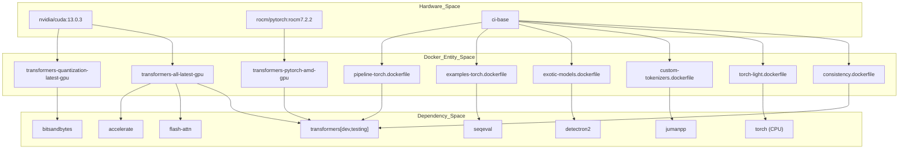

<!-- source: DeepWiki mcp.deepwiki.com · repo huggingface/transformers · page 13.3 Docker Images · fetched 2026-10-26 -->

# Docker Images

<details>
<summary>Relevant source files</summary>

The following files were used as context for generating this wiki page:

- [.github/workflows/add-model-like.yml](.github/workflows/add-model-like.yml)
- [.github/workflows/build-ci-docker-images.yml](.github/workflows/build-ci-docker-images.yml)
- [.github/workflows/build-docker-images.yml](.github/workflows/build-docker-images.yml)
- [.github/workflows/build-nightly-ci-docker-images.yml](.github/workflows/build-nightly-ci-docker-images.yml)
- [.github/workflows/build-past-ci-docker-images.yml](.github/workflows/build-past-ci-docker-images.yml)
- [.github/workflows/check_tiny_models.yml](.github/workflows/check_tiny_models.yml)
- [.github/workflows/doctest_job.yml](.github/workflows/doctest_job.yml)
- [.github/workflows/doctests.yml](.github/workflows/doctests.yml)
- [.github/workflows/extras-smoke-test.yml](.github/workflows/extras-smoke-test.yml)
- [.github/workflows/new_model_pr_merged_notification.yml](.github/workflows/new_model_pr_merged_notification.yml)
- [.github/workflows/release-conda.yml](.github/workflows/release-conda.yml)
- [.github/workflows/release.yml](.github/workflows/release.yml)
- [.github/workflows/self-scheduled-amd-mi355-caller.yml](.github/workflows/self-scheduled-amd-mi355-caller.yml)
- [.github/workflows/stale.yml](.github/workflows/stale.yml)
- [.github/workflows/update_metdata.yml](.github/workflows/update_metdata.yml)
- [docker/consistency.dockerfile](docker/consistency.dockerfile)
- [docker/custom-tokenizers.dockerfile](docker/custom-tokenizers.dockerfile)
- [docker/examples-torch.dockerfile](docker/examples-torch.dockerfile)
- [docker/exotic-models.dockerfile](docker/exotic-models.dockerfile)
- [docker/pipeline-torch.dockerfile](docker/pipeline-torch.dockerfile)
- [docker/quality.dockerfile](docker/quality.dockerfile)
- [docker/torch-light.dockerfile](docker/torch-light.dockerfile)
- [docker/transformers-all-latest-gpu/Dockerfile](docker/transformers-all-latest-gpu/Dockerfile)
- [docker/transformers-pytorch-amd-gpu/Dockerfile](docker/transformers-pytorch-amd-gpu/Dockerfile)
- [docker/transformers-pytorch-deepspeed-amd-gpu/Dockerfile](docker/transformers-pytorch-deepspeed-amd-gpu/Dockerfile)
- [docker/transformers-pytorch-deepspeed-latest-gpu/Dockerfile](docker/transformers-pytorch-deepspeed-latest-gpu/Dockerfile)
- [docker/transformers-pytorch-deepspeed-nightly-gpu/Dockerfile](docker/transformers-pytorch-deepspeed-nightly-gpu/Dockerfile)
- [docker/transformers-pytorch-gpu/Dockerfile](docker/transformers-pytorch-gpu/Dockerfile)
- [docker/transformers-quantization-latest-gpu/Dockerfile](docker/transformers-quantization-latest-gpu/Dockerfile)
- [utils/pr_slow_ci_models.py](utils/pr_slow_ci_models.py)

</details>


The purpose and scope of the `docker/` directory is to provide reproducible environments for development, continuous integration (CI), and specialized hardware testing (NVIDIA GPU, AMD GPU, DeepSpeed, quantization backends) across the Transformers codebase. These Dockerfiles ensure that the complex dependency trees—spanning multiple deep learning frameworks, specialized acceleration libraries, and hardware-specific compilation flags—remain strictly versioned and consistent.

---

## GPU-Accelerated Development & CI Images

The primary GPU images are built on top of NVIDIA CUDA or AMD ROCm base images and incorporate full sets of optional dependencies for testing vision, audio, multimodal models, and heavy integrations.

### Transformers All-Latest GPU
The `transformers-all-latest-gpu` container serves as the flagship environment for general model CI. It targets stable PyTorch and CUDA versions while packing extensive third-party toolkits like `peft`, `accelerate`, `optimum`, and `bitsandbytes` [docker/transformers-all-latest-gpu/Dockerfile:88-106]().

Key implementation features include:
*   **Version Management**: Uses `ARG` declarations to pin `PYTORCH`, `CUDA`, and `TORCHCODEC` versions explicitly, securing ABI compatibility between PyTorch and auxiliary extensions like `torchaudio` [docker/transformers-all-latest-gpu/Dockerfile:12-55]().
*   **Flash Attention Integration**: Conditionally installs `flash-attn` based on the `FLASH_ATTN` build argument, explicitly managing `ninja` and `wheel` build dependencies to circumvent build isolation limitations on Ubuntu 22.04 [docker/transformers-all-latest-gpu/Dockerfile:117-124]().
*   **Runtime Smoke Testing**: Verifies package loading and CUDA availability at build completion, preventing faulty images from propagating to CI runners [docker/transformers-all-latest-gpu/Dockerfile:150-152]().

Sources: [docker/transformers-all-latest-gpu/Dockerfile:1-152]()

### Quantization Latest GPU
The `transformers-quantization-latest-gpu` image targets modern quantization backends, maintaining strict parity with required torch stacks (e.g., `torch>=2.11`) to prevent mid-build dependency churn from packages like `compressed-tensors` [docker/transformers-quantization-latest-gpu/Dockerfile:1-17]().

*   **Integrated Backends**: Pre-installs `bitsandbytes`, `hqq`, `optimum-quanto`, `compressed-tensors`, `amd-quark`, `auto-round`, and `torchao` [docker/transformers-quantization-latest-gpu/Dockerfile:58-83]().
*   **Fouroversix Handling**: Installs `fouroversix` with `SKIP_CUDA_BUILD=1` to fall back on reference Triton paths for non-Blackwell runner architectures (e.g., A10G) while keeping the package importable for test suites [docker/transformers-quantization-latest-gpu/Dockerfile:98-115]().
*   **ABI Guarding**: Features an execution smoke check ensuring eager `transformers` imports do not crash due to `torchaudio` C++ ABI mismatches [docker/transformers-quantization-latest-gpu/Dockerfile:120-124]().

Sources: [docker/transformers-quantization-latest-gpu/Dockerfile:1-125]()

### AMD ROCm GPU
The `transformers-pytorch-amd-gpu` image adapts the environment for AMD ROCm infrastructure (`rocm7.2.2`). It rebuilds `torchvision` from source to keep decoding operations on the GPU using ROCm-specific kernels and pulls pre-compiled `flash_attn` wheels from AMD's repository [docker/transformers-pytorch-amd-gpu/Dockerfile:1-56]().

Sources: [docker/transformers-pytorch-amd-gpu/Dockerfile:1-61]()

### Docker Image Hierarchy and Data Flow

Title: "Docker Image Hierarchy and Data Flow"

Sources: [docker/transformers-all-latest-gpu/Dockerfile:1-106](), [docker/transformers-quantization-latest-gpu/Dockerfile:1-86](), [docker/transformers-pytorch-amd-gpu/Dockerfile:1-40](), [docker/consistency.dockerfile:1-10](), [docker/torch-light.dockerfile:1-6](), [docker/custom-tokenizers.dockerfile:1-18](), [docker/exotic-models.dockerfile:1-11](), [docker/examples-torch.dockerfile:1-6](), [docker/pipeline-torch.dockerfile:1-6]()

---

## DeepSpeed Specialized Images

DeepSpeed images build directly from NVIDIA CUDA base images, pre-compiling DeepSpeed kernels (`DS_BUILD_CPU_ADAM=1`, `DS_BUILD_FUSED_ADAM=1`) to eliminate compilation overhead and timeouts during CI job initialization [docker/transformers-pytorch-deepspeed-latest-gpu/Dockerfile:59-62](). They are specifically designed to handle the nuances of DeepSpeed's CUDA compatibility, particularly regarding `TORCH_CUDA_ARCH_LIST` to target specific GPU architectures [docker/transformers-pytorch-deepspeed-latest-gpu/Dockerfile:54-56]().

The `transformers-pytorch-deepspeed-latest-gpu` Dockerfile is deliberately held on CUDA 12.x rather than following `transformers-all-latest-gpu` to CUDA 13.0. This is because DeepSpeed's `op_builder/builder.py` currently only has branches for CUDA 11 and CUDA 12, leading to compilation failures on CUDA 13 due to unsupported GPU architectures [docker/transformers-pytorch-deepspeed-latest-gpu/Dockerfile:1-13]().

The `transformers-pytorch-deepspeed-amd-gpu` Dockerfile provides a DeepSpeed environment tailored for AMD ROCm, inheriting from `rocm/pytorch` and installing DeepSpeed with ROCm-specific build flags.

Sources: [docker/transformers-pytorch-deepspeed-latest-gpu/Dockerfile:1-71](), [docker/transformers-pytorch-deepspeed-amd-gpu/Dockerfile]()

---

## Lightweight CI Dockerfiles

For jobs requiring only linting, consistency checks, or CPU-bound unit testing, lightweight `python:3.10-slim` images leverage `uv` for ultra-fast dependency resolution [docker/consistency.dockerfile:1-16]().

| Dockerfile | Target Purpose | Key Installed Dependencies |
| :--- | :--- | :--- |
| `consistency.dockerfile` | Repository structure and consistency verification | `transformers[quality,testing,torch-speech,vision]`, `GitPython` [docker/consistency.dockerfile:1-10]() |
| `torch-light.dockerfile` | Rapid CPU-based unit tests | PyTorch (CPU), `timm`, `accelerate`, `tiktoken` [docker/torch-light.dockerfile:8-10]() |
| `custom-tokenizers.dockerfile` | Exotic tokenization integration tests | `transformers[ja,rjieba]`, `unidic`, `jumanpp` [docker/custom-tokenizers.dockerfile:20-22]() |
| `exotic-models.dockerfile` | Model architectures with niche external dependencies | `detectron2`, `pytesseract`, `opencv-python` [docker/exotic-models.dockerfile:10-15]() |
| `examples-torch.dockerfile` | Example training script validation | `seqeval`, `albumentations`, `jiwer` [docker/examples-torch.dockerfile:10]() |
| `pipeline-torch.dockerfile` | Pipeline-specific CPU tests | `transformers[sklearn,sentencepiece,vision,testing]`, `librosa` [docker/pipeline-torch.dockerfile:10]()

Sources: [docker/consistency.dockerfile:1-16](), [docker/torch-light.dockerfile:1-18](), [docker/custom-tokenizers.dockerfile:1-36](), [docker/exotic-models.dockerfile:1-25](), [docker/examples-torch.dockerfile:1-20](), [docker/pipeline-torch.dockerfile:1-19]()

---

## Build and Deployment Pipeline

Container lifecycles are controlled via automated workflows that handle regular rebuilds against `main`, customizable argument passing (`PYTORCH`, `CUDA`), and reporting integrations.

Title: "Build and Deployment Pipeline"
```mermaid
graph LR
    subgraph "Triggers"
        Sched["Scheduled_Cron_Job"]
        Dispatch["Workflow_Dispatch"]
        PushBranch["Push_to_build_ci_docker_image_*_branch"]
        WorkflowCall["Workflow_Call"]
    end

    subgraph "GitHub_Actions_Jobs"
        LatestDocker["latest-docker"]
        FlashAttnCIImage["flash-attn-ci-image"]
        LatestTorchDeepSpeedDocker["latest-torch-deepspeed-docker"]
        DocBuilder["doc-builder"]
        LatestPytorchAMD["latest-pytorch-amd"]
        # ... other jobs from build-docker-images.yml
    end

    subgraph "Docker_Build_Process"
        Checkout["Check_out_code"]
        SetupBuildx["Set_up_Docker_Buildx"]
        LoginDockerHub["Login_to_DockerHub"]
        BuildAndPush["Build_and_push"]
    end

    subgraph "Registry_and_Notifications"
        DHub["DockerHub_Registry"]
        PostToSlack["Post_to_Slack"]
    end

    Sched --> LatestDocker
    Dispatch --> LatestDocker
    PushBranch --> LatestDocker
    WorkflowCall --> LatestDocker

    LatestDocker --> Checkout
    LatestDocker --> SetupBuildx
    LatestDocker --> LoginDockerHub
    LatestDocker --> BuildAndPush

    FlashAttnCIImage --> Checkout
    FlashAttnCIImage --> SetupBuildx
    FlashAttnCIImage --> LoginDockerHub
    FlashAttnCIImage --> BuildAndPush

    LatestTorchDeepSpeedDocker --> Checkout
    LatestTorchDeepSpeedDocker --> SetupBuildx
    LatestTorchDeepSpeedDocker --> LoginDockerHub
    LatestTorchDeepSpeedDocker --> BuildAndPush

    DocBuilder --> Checkout
    DocBuilder --> SetupBuildx
    DocBuilder --> LoginDockerHub
    DocBuilder --> BuildAndPush

    LatestPytorchAMD --> Checkout
    LatestPytorchAMD --> SetupBuildx
    LatestPytorchAMD --> LoginDockerHub
    LatestPytorchAMD --> BuildAndPush

    BuildAndPush -- "Pushes image" --> DHub
    BuildAndPush -- "Reports status" --> PostToSlack
```
Sources: [.github/workflows/build-docker-images.yml:1-195](), [.github/workflows/self-scheduled-amd-mi355-caller.yml](), [docker/consistency.dockerfile:1-16]()

---

