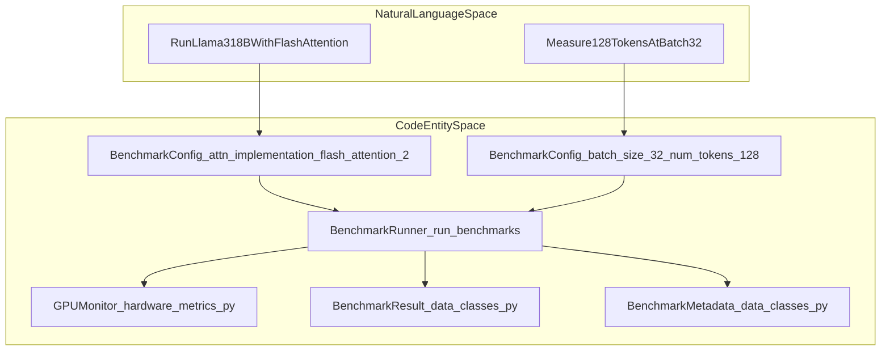
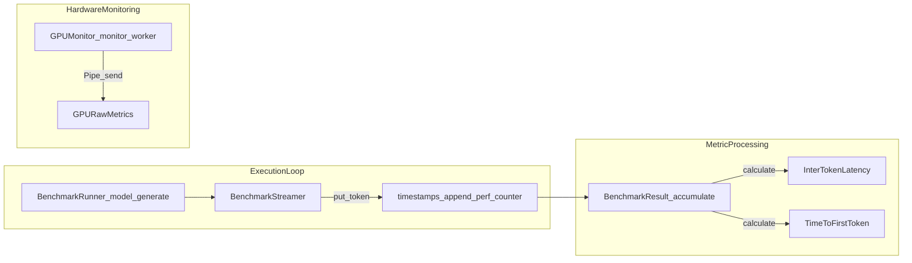
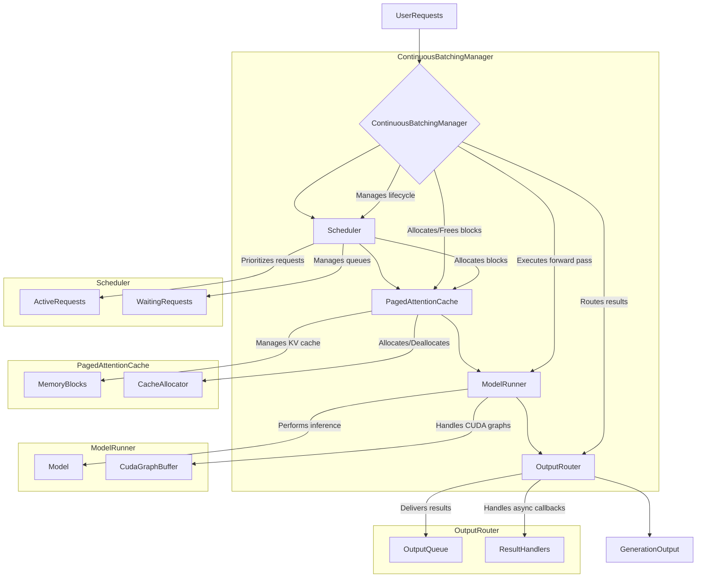

<!-- source: DeepWiki mcp.deepwiki.com · repo huggingface/transformers · page 13.4 Benchmarking Framework · fetched 2026-10-26 -->

# Benchmarking Framework

Relevant source files

The following files were used as context for generating this wiki page:

- [.github/workflows/benchmark.yml](.github/workflows/benchmark.yml)
- [.github/workflows/benchmark_v2.yml](.github/workflows/benchmark_v2.yml)
- [.github/workflows/benchmark_v2_a10_caller.yml](.github/workflows/benchmark_v2_a10_caller.yml)
- [benchmark_v2/README.md](benchmark_v2/README.md)
- [benchmark_v2/framework/benchmark_config.py](benchmark_v2/framework/benchmark_config.py)
- [benchmark_v2/framework/benchmark_runner.py](benchmark_v2/framework/benchmark_runner.py)
- [benchmark_v2/framework/data_classes.py](benchmark_v2/framework/data_classes.py)
- [benchmark_v2/framework/hardware_metrics.py](benchmark_v2/framework/hardware_metrics.py)
- [benchmark_v2/requirements.txt](benchmark_v2/requirements.txt)
- [benchmark_v2/run_benchmarks.py](benchmark_v2/run_benchmarks.py)
- [scripts/check_tokenizers.py](scripts/check_tokenizers.py)
- [src/transformers/models/rt_detr/convert_rt_detr_original_pytorch_checkpoint_to_hf.py](src/transformers/models/rt_detr/convert_rt_detr_original_pytorch_checkpoint_to_hf.py)

## Purpose and Scope
The Transformers benchmarking framework provides a standardized suite for measuring the performance of model inference, with a particular focus on modern LLM optimizations such as **Continuous Batching**, **Attention Backends** (FlashAttention-2, SDPA, FlexAttention), and **Hardware Efficiency**. The framework is primarily housed in the `benchmark_v2/` directory and integrates with GitHub Actions for automated performance regression tracking.

Sources: [`benchmark_v2/README.md:1-138`](), [`.github/workflows/benchmark.yml:1-65`]()

## Core Components

The framework is built around a decoupled architecture where configurations, execution logic, and metric collection are handled by specialized classes.

### BenchmarkConfig
The `BenchmarkConfig` class defines the parameters for a single execution scenario. It handles the validation of optimization combinations, such as ensuring that `flex_attention` is not used with `continuous_batching` [`benchmark_v2/framework/benchmark_config.py:123-127`](). It also manages `torch.compile` settings via `CompileConfig` [`benchmark_v2/framework/benchmark_config.py:94`]().

Key attributes include:
*   **Workload**: `batch_size`, `sequence_length`, and `num_tokens_to_generate` [`benchmark_v2/framework/benchmark_config.py:83-85`]().
*   **Optimizations**: `attn_implementation` (eager, sdpa, flash_attention_2, flex_attention), `compile_config`, and `kernelize` [`benchmark_v2/framework/benchmark_config.py:87-95`]().
*   **Distributed**: `tp_plan` for Tensor Parallelism, which is translated into a `DistributedConfig` for `from_pretrained` [`benchmark_v2/framework/benchmark_config.py:146-158`]().

Sources: [`benchmark_v2/framework/benchmark_config.py:55-101`]()

### BenchmarkRunner
The `BenchmarkRunner` orchestrates the model lifecycle and execution. It is responsible for:
1.  **Model Loading**: Initializing models with specific `attn_implementation` and device settings [`benchmark_v2/framework/benchmark_runner.py:139-158`]().
2.  **Memory Management**: Invoking `flush_memory` to clear CUDA/XPU caches and `torch.compile` artifacts (`torch._dynamo.reset()`, `FxGraphCache.clear()`) between runs to ensure measurement isolation [`benchmark_v2/framework/benchmark_runner.py:82-109`]().
3.  **Warmup & Measurement**: Executing the specified number of iterations to stabilize performance before recording metrics [`benchmark_v2/framework/benchmark_runner.py:139-485`]().

Sources: [`benchmark_v2/framework/benchmark_runner.py:82-109`](), [`benchmark_v2/framework/benchmark_runner.py:139-158`]()

### Metrics & Monitoring
Metrics are captured using two primary mechanisms:
*   **BenchmarkResult**: Tracks high-level performance like `e2e_latency`, `time_to_first_token` (TTFT), and `inter_token_latency` (ITL) [`benchmark_v2/framework/data_classes.py:92-101`]().
*   **GPUMonitor**: A background process that samples GPU utilization and memory usage at a specified interval (default 0.05s) using `pynvml` (NVIDIA), `amdsmi` (AMD), or `torch.xpu` (Intel) [`benchmark_v2/framework/hardware_metrics.py:132-158`]().

Sources: [`benchmark_v2/framework/data_classes.py:92-101`](), [`benchmark_v2/framework/hardware_metrics.py:132-158`]()

### Entity Mapping: Configuration to Execution
The following diagram illustrates how high-level benchmark requirements are translated into internal framework entities.

**Benchmark Configuration Flow**

Sources: [`benchmark_v2/framework/benchmark_config.py:55-101`](), [`benchmark_v2/framework/benchmark_runner.py:139-165`](), [`benchmark_v2/framework/hardware_metrics.py:132-158`](), [`benchmark_v2/framework/data_classes.py:57-92`]().

---

## Performance Data Flow

The benchmark measures the efficiency of the generation loop by intercepting token timestamps via a custom streamer (`BenchmarkStreamer`) [`benchmark_v2/framework/benchmark_runner.py:112-137`]().

**Generation Measurement Data Flow**

Sources: [`benchmark_v2/framework/benchmark_runner.py:112-137`](), [`benchmark_v2/framework/data_classes.py:103-122`](), [`benchmark_v2/framework/hardware_metrics.py:160-195`]().

### Key Metrics
*   **Throughput**: Calculated as `total_generated_tokens / e2e_latency` [`benchmark_v2/framework/data_classes.py:160-161`]().
*   **ITL (Inter-Token Latency)**: The average time between consecutive token generations [`benchmark_v2/framework/data_classes.py:119`]().
*   **TTFT (Time to First Token)**: The latency of the first prefill/generation step [`benchmark_v2/framework/data_classes.py:118`]().

Sources: [`benchmark_v2/framework/data_classes.py:116-122`](), [`benchmark_v2/framework/data_classes.py:160-161`]()

---

## Continuous Batching Overall Script

The `continuous_batching_overall.py` script, located in `benchmark_v2/benchmark_scripts/`, is a specialized benchmark for evaluating the performance of the continuous batching generation API. This script leverages the core `ContinuousBatchingManager` and its components to simulate real-world inference workloads.

### Key Components of Continuous Batching
The continuous batching system is designed to optimize GPU utilization by dynamically batching requests and managing KV cache memory.

**Continuous Batching Architecture**

Sources: `src/transformers/generation/continuous_batching/continuous_api.py:162-1481`(), `src/transformers/generation/continuous_batching/scheduler.py:29-33`(), `src/transformers/generation/continuous_batching/cache.py:89-93`(), `src/transformers/generation/continuous_batching/model_runner.py:1-10`(), `src/transformers/generation/continuous_batching/continuous_api.py:94-95`()

*   **`ContinuousBatchingManager`**: The central orchestrator for continuous batching. It coordinates the scheduler, cache, model runner, and output router.
*   **`Scheduler`**: Responsible for managing the lifecycle of requests, from waiting queues to active processing. It prioritizes requests and allocates cache blocks. Implementations like `FIFOScheduler` determine the scheduling policy.
*   **`PagedAttentionCache`**: Manages the KV cache memory using a paged attention mechanism, inspired by VLLM's hybrid allocator. It allocates and frees memory blocks for requests.
*   **`ModelRunner`**: Executes the model's forward pass. It can leverage CUDA graphs for performance optimization.
*   **`OutputRouter`**: Routes `GenerationOutput` objects to their respective handlers or a shared output queue.
*   **`RequestState`**: A dataclass that tracks the state of a single generation request throughout its lifecycle, including prompt tokens, generated tokens, and status.
*   **`GenerationOutput`**: Encapsulates the results of a generation request, including generated tokens, log probabilities, and timestamps.

The `continuous_batching_overall.py` script uses these components to measure metrics like throughput and latency under various load conditions, often comparing different attention implementations (`sdpa_paged`, `eager_paged`, `flash_paged`).

Sources: `benchmark_v2/benchmark_scripts/continuous_batching_overall.py`(), `src/transformers/generation/continuous_batching/continuous_api.py:48-162`(), `src/transformers/generation/continuous_batching/scheduler.py:29-433`(), `src/transformers/generation/continuous_batching/cache.py:89-815`(), `src/transformers/generation/continuous_batching/requests.py:94-152`(), `src/transformers/integrations/sdpa_paged.py:1-148`(), `src/transformers/integrations/eager_paged.py:1-148`(), `src/transformers/integrations/flash_paged.py:1-148`().

---

## GitHub Actions Workflows

The framework is automated via two main workflows: `benchmark.yml` for PR/Push testing and `benchmark_v2.yml` for scheduled daily runs [`.github/workflows/benchmark.yml:1-8`](), [`.github/workflows/benchmark_v2.yml:1-10`]().

### Workflow Configuration
*   **benchmark.yml**: Triggers on pushes to `main` or when the `run-benchmark` label is added to a PR [`.github/workflows/benchmark.yml:3-7`](). It uses the `huggingface/transformers-all-latest-gpu` Docker image [`.github/workflows/benchmark.yml:34`]().
*   **benchmark_v2.yml**: A reusable workflow for scheduled benchmarks, allowing configurable runners (e.g., A10, H100) and container images [`.github/workflows/benchmark_v2.yml:4-30`](). An example caller workflow is `benchmark_v2_a10_caller.yml` [`.github/workflows/benchmark_v2_a10_caller.yml:1-21`]().
*   **Reporting**: Results are pushed to the Hugging Face Hub as datasets (e.g., `hf-benchmarks/transformers`) for long-term tracking [`.github/workflows/benchmark.yml:15, 58`]().

Sources: [`.github/workflows/benchmark.yml:1-65`](), [`.github/workflows/benchmark_v2.yml:1-91`](), [`.github/workflows/benchmark_v2_a10_caller.yml:1-21`]()

### Execution Steps
1.  **Environment Setup**: Uninstalls pre-installed transformers and installs the current branch in edit mode with `[torch,kernels]` extras [`.github/workflows/benchmark.yml:46-47`]().
2.  **Config Discovery**: `run_benchmarks.py` generates configurations based on a `--level` argument (1-4) or a provided `--config-file` [`benchmark_v2/run_benchmarks.py:45-52, 113`]().
3.  **Benchmark Run**: The `BenchmarkRunner` executes the matrix of configs and captures `GPURawMetrics` and `BenchmarkResult` [`benchmark_v2/run_benchmarks.py:130-133`]().

Sources: [`.github/workflows/benchmark.yml:43-58`](), [`benchmark_v2/run_benchmarks.py:31-137`]()

---

## Writing New Benchmarks & Framework Utilities

To add new benchmark coverage, developers interact with the `run_benchmarks.py` entry point and the `framework/` subpackage [`benchmark_v2/README.md:131-138`]().

### Core Utilities
| Component | Responsibility | Citations |
| :--- | :--- | :--- |
| `run_benchmarks.py` | CLI entry point, argument parsing, and result Hub uploading | [`benchmark_v2/run_benchmarks.py:31-137`]() |
| `adapt_configs` | Helper to inject CLI overrides into the config matrix | [`benchmark_v2/framework/benchmark_config.py:160-250`]() |
| `HardwareInfo` | Collects system-level metadata (CPU count, memory total, Python/Torch versions) | [`benchmark_v2/framework/hardware_metrics.py:38-57`]() |
| `flush_memory` | Utility to prevent OOM and ensure clean measurement states by resetting `torch._dynamo` and clearing caches | [`benchmark_v2/framework/benchmark_runner.py:82-109`]()

Sources: [`benchmark_v2/run_benchmarks.py:31-137`](), [`benchmark_v2/framework/benchmark_config.py:160-250`](), [`benchmark_v2/framework/hardware_metrics.py:38-57`](), [`benchmark_v2/framework/benchmark_runner.py:82-109`]()

---

