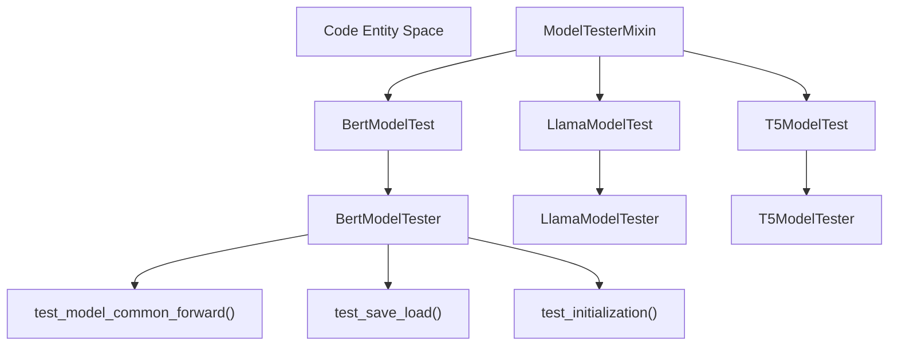
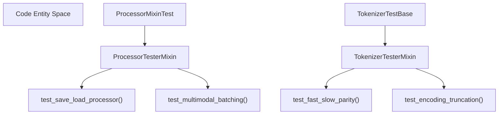
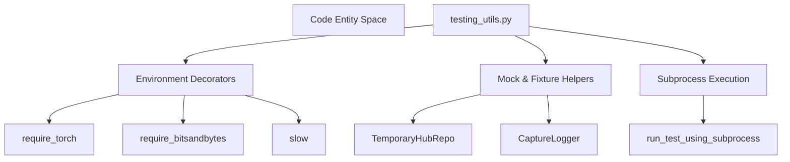

<!-- source: DeepWiki mcp.deepwiki.com · repo huggingface/transformers · page 13.5 Test Suite Organization & Common Test Mixins · fetched 2026-10-26 -->

# Test Suite Organization & Common Test Mixins

<details>
<summary>Relevant source files</summary>

The following files were used as context for generating this wiki page:

- [docs/source/en/main_classes/optimizer_schedules.md](docs/source/en/main_classes/optimizer_schedules.md)
- [docs/source/en/main_classes/peft.md](docs/source/en/main_classes/peft.md)
- [docs/source/en/main_classes/quantization.md](docs/source/en/main_classes/quantization.md)
- [docs/source/en/peft.md](docs/source/en/peft.md)
- [docs/source/en/perf_infer_gpu_multi.md](docs/source/en/perf_infer_gpu_multi.md)
- [docs/source/en/quantization/overview.md](docs/source/en/quantization/overview.md)
- [docs/source/en/tasks/zero_shot_object_detection.md](docs/source/en/tasks/zero_shot_object_detection.md)
- [docs/source/en/tensor_parallelism.md](docs/source/en/tensor_parallelism.md)
- [docs/source/zh/perf_infer_gpu_multi.md](docs/source/zh/perf_infer_gpu_multi.md)
- [examples/scheduler/README.md](examples/scheduler/README.md)
- [examples/scheduler/run_greedy.py](examples/scheduler/run_greedy.py)
- [src/transformers/conversion_mapping.py](src/transformers/conversion_mapping.py)
- [src/transformers/core_model_loading.py](src/transformers/core_model_loading.py)
- [src/transformers/integrations/__init__.py](src/transformers/integrations/__init__.py)
- [src/transformers/integrations/accelerate.py](src/transformers/integrations/accelerate.py)
- [src/transformers/integrations/hub_kernels.py](src/transformers/integrations/hub_kernels.py)
- [src/transformers/integrations/npu_flash_attention.py](src/transformers/integrations/npu_flash_attention.py)
- [src/transformers/integrations/peft.py](src/transformers/integrations/peft.py)
- [src/transformers/integrations/tensor_parallel.py](src/transformers/integrations/tensor_parallel.py)
- [src/transformers/modeling_flash_attention_utils.py](src/transformers/modeling_flash_attention_utils.py)
- [src/transformers/modeling_utils.py](src/transformers/modeling_utils.py)
- [src/transformers/models/layoutlmv2/configuration_layoutlmv2.py](src/transformers/models/layoutlmv2/configuration_layoutlmv2.py)
- [src/transformers/optimization.py](src/transformers/optimization.py)
- [src/transformers/pipelines/audio_classification.py](src/transformers/pipelines/audio_classification.py)
- [src/transformers/pipelines/depth_estimation.py](src/transformers/pipelines/depth_estimation.py)
- [src/transformers/pipelines/feature_extraction.py](src/transformers/pipelines/feature_extraction.py)
- [src/transformers/pipelines/image_classification.py](src/transformers/pipelines/image_classification.py)
- [src/transformers/pipelines/image_segmentation.py](src/transformers/pipelines/image_segmentation.py)
- [src/transformers/pipelines/mask_generation.py](src/transformers/pipelines/mask_generation.py)
- [src/transformers/pipelines/object_detection.py](src/transformers/pipelines/object_detection.py)
- [src/transformers/pipelines/video_classification.py](src/transformers/pipelines/video_classification.py)
- [src/transformers/pipelines/zero_shot_audio_classification.py](src/transformers/pipelines/zero_shot_audio_classification.py)
- [src/transformers/pipelines/zero_shot_image_classification.py](src/transformers/pipelines/zero_shot_image_classification.py)
- [src/transformers/quantizers/auto.py](src/transformers/quantizers/auto.py)
- [src/transformers/testing_utils.py](src/transformers/testing_utils.py)
- [src/transformers/trainer.py](src/transformers/trainer.py)
- [src/transformers/trainer_pt_utils.py](src/transformers/trainer_pt_utils.py)
- [src/transformers/trainer_utils.py](src/transformers/trainer_utils.py)
- [src/transformers/training_args.py](src/transformers/training_args.py)
- [src/transformers/utils/__init__.py](src/transformers/utils/__init__.py)
- [src/transformers/utils/generic.py](src/transformers/utils/generic.py)
- [src/transformers/utils/import_utils.py](src/transformers/utils/import_utils.py)
- [src/transformers/utils/kernel_config.py](src/transformers/utils/kernel_config.py)
- [src/transformers/utils/quantization_config.py](src/transformers/utils/quantization_config.py)
- [tests/kernels/test_kernels.py](tests/kernels/test_kernels.py)
- [tests/optimization/test_greedy_lr.py](tests/optimization/test_greedy_lr.py)
- [tests/optimization/test_optimization.py](tests/optimization/test_optimization.py)
- [tests/peft_integration/test_peft_integration.py](tests/peft_integration/test_peft_integration.py)
- [tests/pipelines/test_pipelines_audio_classification.py](tests/pipelines/test_pipelines_audio_classification.py)
- [tests/pipelines/test_pipelines_depth_estimation.py](tests/pipelines/test_pipelines_depth_estimation.py)
- [tests/pipelines/test_pipelines_image_classification.py](tests/pipelines/test_pipelines_image_classification.py)
- [tests/pipelines/test_pipelines_image_segmentation.py](tests/pipelines/test_pipelines_image_segmentation.py)
- [tests/pipelines/test_pipelines_mask_generation.py](tests/pipelines/test_pipelines_mask_generation.py)
- [tests/pipelines/test_pipelines_object_detection.py](tests/pipelines/test_pipelines_object_detection.py)
- [tests/pipelines/test_pipelines_video_classification.py](tests/pipelines/test_pipelines_video_classification.py)
- [tests/pipelines/test_pipelines_zero_shot_image_classification.py](tests/pipelines/test_pipelines_zero_shot_image_classification.py)
- [tests/tensor_parallel/test_tensor_parallel.py](tests/tensor_parallel/test_tensor_parallel.py)
- [tests/test_modeling_common.py](tests/test_modeling_common.py)
- [tests/test_pipeline_mixin.py](tests/test_pipeline_mixin.py)
- [tests/trainer/test_trainer.py](tests/trainer/test_trainer.py)
- [tests/trainer/test_trainer_optimizers.py](tests/trainer/test_trainer_optimizers.py)
- [tests/utils/test_core_model_loading.py](tests/utils/test_core_model_loading.py)
- [tests/utils/test_generic.py](tests/utils/test_generic.py)
- [tests/utils/test_modeling_utils.py](tests/utils/test_modeling_utils.py)

</details>


## Purpose & Scope
This page details the organization, architecture, and common utilities of the Hugging Face `transformers` test suite located under the `tests/` directory. It explains how test mixins—such as `ModelTesterMixin` in `tests/test_modeling_common.py` [tests/test_modeling_common.py:1-6598]()—enable code reuse across hundreds of models, how processor and tokenizer tests are structured, how pipeline and export mixins operate, and how testing decorators and fixtures control execution environments.

---

## 1. Test Suite Directory Layout (`tests/`)
The `tests/` root directory mirrors the functional decomposition of the library itself. It isolates model-specific integration tests, core subsystem unit tests, training workflows, and repository consistency checks.

```
tests/
├── models/                     # Model-specific unit and integration tests (one subdir per architecture)
│   ├── bert/
│   ├── llama/
│   └── ...
├── pipelines/                  # Pipeline zero-shot / task-specific integration tests
├── trainer/                    # Trainer class, callbacks, and training arguments tests
├── utils/                      # Unit tests for core utilities, hub integration, and modeling helpers
├── exporters/                  # Model export tests (ONNX, ExecuTorch, etc.)
├── test_modeling_common.py     # Central ModelTesterMixin and shared modeling test suite
├── test_processing_common.py   # Shared processor and multimodal preparation tests
├── test_pipeline_mixin.py      # Pipeline integration and test mixins
└── testing_utils.py            # Global testing decorators, fixtures, and subprocess helpers
```

Sources: `tests/test_modeling_common.py` [tests/test_modeling_common.py:1-6598](), `src/transformers/modeling_utils.py` [src/transformers/modeling_utils.py:1-186]()

---

## 2. Model Testing Infrastructure & `ModelTesterMixin`
Rather than writing independent test suites for every model architecture, `transformers` employs a mixin-based design centered around `ModelTesterMixin` inside `tests/test_modeling_common.py` [tests/test_modeling_common.py:1-6598]().

### Key Components of Model Testing
1. **Model Tester Class**: Each model family (e.g., `LlamaModelTest`, `BertModelTest`) defines a nested `*ModelTester` class that instantiates small-scale configurations (e.g., hidden size = 32, num layers = 2) and generates dummy inputs for testing [tests/test_modeling_common.py:1-6598]().
2. **`ModelTesterMixin`**: Implements standardized test cases that run against every model variant. These include:
   - `test_initialization()`: Verifies weights initialize correctly and pass post-initialization hooks [tests/test_modeling_common.py:1-6598]().
   - `test_forward_signature()`: Checks forward pass argument validation [tests/test_modeling_common.py:1-6598]().
   - `test_model_common_forward()`: Ensures standard inputs produce expected tensor shapes and keys [tests/test_modeling_common.py:1-6598]().
   - `test_save_load()`: Validates `save_pretrained()` and `from_pretrained()` roundtrip serialization [tests/test_modeling_common.py:1-6598]().
   - `test_determinism()`: Ensures identical inputs yield identical outputs under evaluation mode [tests/test_modeling_common.py:1-6598]().


*Model Testing Hierarchy bridging mixin classes to model-specific test implementations.*

Sources: `tests/test_modeling_common.py` [tests/test_modeling_common.py:1-6598]()

---

## 3. Tokenizer, Processor & Multimodal Common Tests
To verify input preparation subsystems, `transformers` utilizes processor and tokenizer test mixins that ensure correct batching, padding, and truncation behaviors across slow and fast (Rust-backed) implementations.

### Tokenizer and Processor Mixins
- **`TokenizerTesterMixin`**: Tests encoding/decoding consistency, added tokens, truncation strategies, padding side configurations, and fast-versus-slow backend parity.
- **`ProcessorTesterMixin`**: Validates multimodal processors (e.g., `ProcessorMixin` [src/transformers/trainer.py:83]() subclasses) that combine tokenizers with image processors or audio feature extractors. This mixin is defined in `tests/test_processing_common.py` [tests/test_processing_common.py:129-130](). It provides methods like `test_save_load_processor()` and `test_multimodal_batching()` [tests/test_processing_common.py:1-1853]().
- **Image/Video/Audio Processing Tests**: Subsystems under `tests/` test resizing, normalization, and tensor batching for vision and audio pipelines, ensuring keys like `pixel_values` or `input_features` are formatted correctly. The `MODALITY_INPUT_DATA` [tests/test_processing_common.py:56-73]() and `MODALITY_TEST_SPECS` [tests/test_processing_common.py:76-103]() dictionaries in `tests/test_processing_common.py` define common input data and test configurations for different modalities.


*Processor and Tokenizer Testing Mixins mapping test suites to their respective validation functions.*

Sources: `tests/test_processing_common.py` [tests/test_processing_common.py:1-1853](), `tests/test_image_processing_common.py` [tests/test_image_processing_common.py:1-1139]()

---

## 4. Pipeline & Export Test Mixins
Pipelines and model exporters have dedicated test harnesses to verify end-to-end task execution and model conversion artifacts.

- **Pipeline Test Mixins (`tests/test_pipeline_mixin.py` [tests/test_pipeline_mixin.py:1-1](), `tests/pipelines/test_pipelines_common.py` [tests/pipelines/test_pipelines_common.py:1-1])**:
  - Test task routing, batch inference, device placement (`device=0` or `cpu`), and streaming response generation.
  - Subclasses test specific pipelines like text generation (`TextGenerationPipeline` [src/transformers/pipelines/text_generation.py:1-1]()), automatic speech recognition, and image classification. The `Pipeline` base class is defined in `src/transformers/pipelines/base.py` [src/transformers/pipelines/base.py:58-64]().
- **Export Test Mixins (`ExportTesterMixin`)**:
  - Located in `tests/exporters/test_export.py` [tests/exporters/test_export.py:1-1](), this mixin verifies that models can be successfully exported to ONNX, ExecuTorch, and TorchScript formats without graph tracing errors or unsupported operations.

Sources: `tests/test_pipeline_mixin.py` [tests/test_pipeline_mixin.py:1-1](), `tests/exporters/test_export.py` [tests/exporters/test_export.py:1-1](), `src/transformers/pipelines/base.py` [src/transformers/pipelines/base.py:1-100]()

---

## 5. Testing Utilities & Decorators (`testing_utils.py`)
The testing infrastructure provides decorators and context managers that control test execution based on available hardware, optional dependencies, and test flags.

### Key Decorators and Utilities
- **Dependency & Hardware Requirement Decorators**:
  - `@require_torch`: Skips tests if PyTorch is not available [tests/trainer/test_trainer.py:99]().
  - `@require_torch_gpu` / `@require_torch_accelerator`: Restricts tests to environments with accelerators [tests/trainer/test_trainer.py:117-118]().
  - `@require_bitsandbytes`: Skips tests if `bitsandbytes` is missing [tests/trainer/test_trainer.py:61]().
  - `@slow`: Marks tests that download large weights or take extended time to run (skipped by default unless `--slow` is passed) [tests/trainer/test_trainer.py:73]().
- **Capture and Debugging Tools**:
  - `CaptureLogger`: Context manager to inspect log messages and warnings generated during test execution [tests/trainer/test_trainer.py:55]().
  - `TemporaryHubRepo`: Creates temporary sandboxed repositories on the Hugging Face Hub for upload/download integration testing [tests/utils/test_modeling_utils.py:68]().


*Testing Utilities and Decorators mapping helper utilities to execution controllers.*

Sources: `src/transformers/testing_utils.py` [src/transformers/testing_utils.py:1-4940](), `tests/trainer/test_trainer.py` [tests/trainer/test_trainer.py:1-183](), `tests/utils/test_modeling_utils.py` [tests/utils/test_modeling_utils.py:1-217]()

---

## 6. Repository Consistency & Utility Tests
To maintain codebase integrity, `tests/utils/` contains automated consistency checks that run during CI/CD to prevent drift between configuration classes, auto-mappings, and documentation.

- **`check_repo.py`**: Validates that all models are registered in auto-mapping files and init modules.
- **`check_config_attributes.py`**: Ensures configuration classes define required attributes and follow serialization rules. The `PreTrainedConfig` [src/transformers/modeling_utils.py:49]() class is central to this.
- **`tests/utils/test_modeling_utils.py` [tests/utils/test_modeling_utils.py:1-217]**: Tests core modeling helpers like weight tying verification (`_find_identical`, `_find_disjoint`) [src/transformers/modeling_utils.py:137-138]() (note: these functions are not directly shown in the provided `modeling_utils.py` snippet, but are referenced in `test_modeling_utils.py`), sharded state dict splitting, and safe loading protocols. The `WeightConverter` [src/transformers/core_model_loading.py:52](), `WeightRenaming` [src/transformers/core_model_loading.py:53](), and `WeightTransform` [src/transformers/core_model_loading.py:35]() classes are fundamental to weight loading and conversion.

Sources: `tests/utils/test_modeling_utils.py` [tests/utils/test_modeling_utils.py:1-217](), `src/transformers/modeling_utils.py` [src/transformers/modeling_utils.py:49](), `src/transformers/core_model_loading.py` [src/transformers/core_model_loading.py:52-54]()

---

## Summary Table of Test Mixins & Locations

| Mixin / Utility Class | Source File | Primary Responsibility |
| :--- | :--- | :--- |
| `ModelTesterMixin` | `tests/test_modeling_common.py` [tests/test_modeling_common.py:1-6598]() | Common forward pass, initialization, and serialization tests for models. |
| `TokenizerTesterMixin` | `tests/test_processing_common.py` [tests/test_processing_common.py:1-1853]() | Fast/slow parity, padding, and tokenization edge cases. |
| `ProcessorTesterMixin` | `tests/test_processing_common.py` [tests/test_processing_common.py:129-130]() | Multimodal processor composition and batching validation. |
| `ExportTesterMixin` | `tests/exporters/test_export.py` [tests/exporters/test_export.py:1-1]() | ONNX and ExecuTorch format export validation. |
| `TestCasePlus` | `src/transformers/testing_utils.py` [src/transformers/testing_utils.py:1-1]() | Base test case providing temporary directory management and subprocess utilities. |

Sources: `tests/test_modeling_common.py` [tests/test_modeling_common.py:1-6598](), `tests/test_processing_common.py` [tests/test_processing_common.py:1-1853](), `src/transformers/modeling_utils.py` [src/transformers/modeling_utils.py:1-186]()

---

