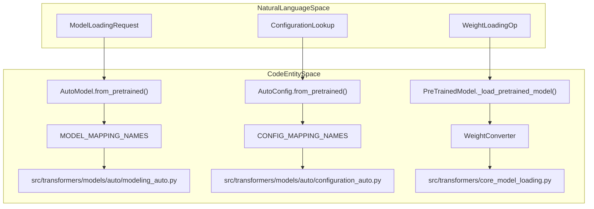
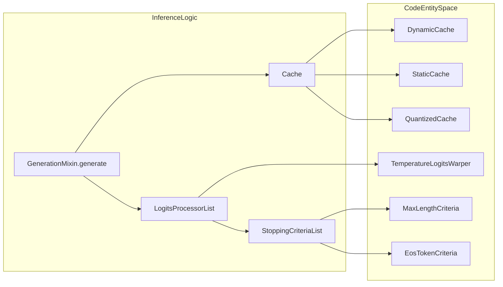

<!-- source: DeepWiki mcp.deepwiki.com · repo huggingface/transformers · page 14 Glossary · fetched 2026-10-26 -->

# Glossary

Relevant source files

The following files were used as context for generating this wiki page:

- [docs/source/en/_toctree.yml](docs/source/en/_toctree.yml)
- [docs/source/en/expert_parallelism.md](docs/source/en/expert_parallelism.md)
- [docs/source/en/experts_interface.md](docs/source/en/experts_interface.md)
- [docs/source/en/fsdp.md](docs/source/en/fsdp.md)
- [docs/source/en/index.md](docs/source/en/index.md)
- [docs/source/en/main_classes/optimizer_schedules.md](docs/source/en/main_classes/optimizer_schedules.md)
- [docs/source/en/main_classes/peft.md](docs/source/en/main_classes/peft.md)
- [docs/source/en/main_classes/quantization.md](docs/source/en/main_classes/quantization.md)
- [docs/source/en/model_doc/hy_v4.md](docs/source/en/model_doc/hy_v4.md)
- [docs/source/en/model_doc/kimi_k25.md](docs/source/en/model_doc/kimi_k25.md)
- [docs/source/en/model_doc/mellum.md](docs/source/en/model_doc/mellum.md)
- [docs/source/en/model_doc/minimax_m3_vl.md](docs/source/en/model_doc/minimax_m3_vl.md)
- [docs/source/en/peft.md](docs/source/en/peft.md)
- [docs/source/en/perf_infer_gpu_multi.md](docs/source/en/perf_infer_gpu_multi.md)
- [docs/source/en/quantization/overview.md](docs/source/en/quantization/overview.md)
- [docs/source/en/tensor_parallelism.md](docs/source/en/tensor_parallelism.md)
- [docs/source/zh/perf_infer_gpu_multi.md](docs/source/zh/perf_infer_gpu_multi.md)
- [examples/scheduler/README.md](examples/scheduler/README.md)
- [examples/scheduler/run_greedy.py](examples/scheduler/run_greedy.py)
- [src/transformers/__init__.py](src/transformers/__init__.py)
- [src/transformers/cache_utils.py](src/transformers/cache_utils.py)
- [src/transformers/configuration_utils.py](src/transformers/configuration_utils.py)
- [src/transformers/conversion_mapping.py](src/transformers/conversion_mapping.py)
- [src/transformers/core_model_loading.py](src/transformers/core_model_loading.py)
- [src/transformers/distributed/__init__.py](src/transformers/distributed/__init__.py)
- [src/transformers/distributed/configuration_utils.py](src/transformers/distributed/configuration_utils.py)
- [src/transformers/distributed/fsdp.py](src/transformers/distributed/fsdp.py)
- [src/transformers/distributed/mixin.py](src/transformers/distributed/mixin.py)
- [src/transformers/distributed/pipeline_parallel.py](src/transformers/distributed/pipeline_parallel.py)
- [src/transformers/distributed/tensor_parallel.py](src/transformers/distributed/tensor_parallel.py)
- [src/transformers/distributed/utils.py](src/transformers/distributed/utils.py)
- [src/transformers/generation/candidate_generator.py](src/transformers/generation/candidate_generator.py)
- [src/transformers/generation/configuration_utils.py](src/transformers/generation/configuration_utils.py)
- [src/transformers/generation/utils.py](src/transformers/generation/utils.py)
- [src/transformers/integrations/__init__.py](src/transformers/integrations/__init__.py)
- [src/transformers/integrations/accelerate.py](src/transformers/integrations/accelerate.py)
- [src/transformers/integrations/executorch.py](src/transformers/integrations/executorch.py)
- [src/transformers/integrations/hub_kernels.py](src/transformers/integrations/hub_kernels.py)
- [src/transformers/integrations/npu_flash_attention.py](src/transformers/integrations/npu_flash_attention.py)
- [src/transformers/integrations/peft.py](src/transformers/integrations/peft.py)
- [src/transformers/integrations/tensor_parallel.py](src/transformers/integrations/tensor_parallel.py)
- [src/transformers/masking_utils.py](src/transformers/masking_utils.py)
- [src/transformers/modeling_flash_attention_utils.py](src/transformers/modeling_flash_attention_utils.py)
- [src/transformers/modeling_utils.py](src/transformers/modeling_utils.py)
- [src/transformers/models/__init__.py](src/transformers/models/__init__.py)
- [src/transformers/models/auto/auto_mappings.py](src/transformers/models/auto/auto_mappings.py)
- [src/transformers/models/auto/configuration_auto.py](src/transformers/models/auto/configuration_auto.py)
- [src/transformers/models/auto/feature_extraction_auto.py](src/transformers/models/auto/feature_extraction_auto.py)
- [src/transformers/models/auto/image_processing_auto.py](src/transformers/models/auto/image_processing_auto.py)
- [src/transformers/models/auto/modeling_auto.py](src/transformers/models/auto/modeling_auto.py)
- [src/transformers/models/auto/processing_auto.py](src/transformers/models/auto/processing_auto.py)
- [src/transformers/models/auto/tokenization_auto.py](src/transformers/models/auto/tokenization_auto.py)
- [src/transformers/models/layoutlmv2/configuration_layoutlmv2.py](src/transformers/models/layoutlmv2/configuration_layoutlmv2.py)
- [src/transformers/models/mellum/__init__.py](src/transformers/models/mellum/__init__.py)
- [src/transformers/models/mellum/configuration_mellum.py](src/transformers/models/mellum/configuration_mellum.py)
- [src/transformers/models/mellum/modular_mellum.py](src/transformers/models/mellum/modular_mellum.py)
- [src/transformers/models/qwen3/configuration_qwen3.py](src/transformers/models/qwen3/configuration_qwen3.py)
- [src/transformers/models/qwen3_moe/configuration_qwen3_moe.py](src/transformers/models/qwen3_moe/configuration_qwen3_moe.py)
- [src/transformers/optimization.py](src/transformers/optimization.py)
- [src/transformers/quantizers/auto.py](src/transformers/quantizers/auto.py)
- [src/transformers/testing_utils.py](src/transformers/testing_utils.py)
- [src/transformers/trainer.py](src/transformers/trainer.py)
- [src/transformers/trainer_pt_utils.py](src/transformers/trainer_pt_utils.py)
- [src/transformers/trainer_utils.py](src/transformers/trainer_utils.py)
- [src/transformers/training_args.py](src/transformers/training_args.py)
- [src/transformers/utils/__init__.py](src/transformers/utils/__init__.py)
- [src/transformers/utils/dummy_pt_objects.py](src/transformers/utils/dummy_pt_objects.py)
- [src/transformers/utils/generic.py](src/transformers/utils/generic.py)
- [src/transformers/utils/import_utils.py](src/transformers/utils/import_utils.py)
- [src/transformers/utils/kernel_config.py](src/transformers/utils/kernel_config.py)
- [src/transformers/utils/loading_report.py](src/transformers/utils/loading_report.py)
- [src/transformers/utils/quantization_config.py](src/transformers/utils/quantization_config.py)
- [tests/generation/test_candidate_generator.py](tests/generation/test_candidate_generator.py)
- [tests/generation/test_configuration_utils.py](tests/generation/test_configuration_utils.py)
- [tests/generation/test_utils.py](tests/generation/test_utils.py)
- [tests/kernels/test_kernels.py](tests/kernels/test_kernels.py)
- [tests/models/deepseek_v4/test_modeling_deepseek_v4.py](tests/models/deepseek_v4/test_modeling_deepseek_v4.py)
- [tests/models/mellum/__init__.py](tests/models/mellum/__init__.py)
- [tests/optimization/test_greedy_lr.py](tests/optimization/test_greedy_lr.py)
- [tests/optimization/test_optimization.py](tests/optimization/test_optimization.py)
- [tests/peft_integration/test_peft_integration.py](tests/peft_integration/test_peft_integration.py)
- [tests/pipeline_parallel/test_pipeline_parallel.py](tests/pipeline_parallel/test_pipeline_parallel.py)
- [tests/tensor_parallel/test_tensor_parallel.py](tests/tensor_parallel/test_tensor_parallel.py)
- [tests/test_fsdp_mixin.py](tests/test_fsdp_mixin.py)
- [tests/test_modeling_common.py](tests/test_modeling_common.py)
- [tests/test_tensor_parallel_mixin.py](tests/test_tensor_parallel_mixin.py)
- [tests/trainer/test_trainer.py](tests/trainer/test_trainer.py)
- [tests/trainer/test_trainer_optimizers.py](tests/trainer/test_trainer_optimizers.py)
- [tests/utils/test_cache_utils.py](tests/utils/test_cache_utils.py)
- [tests/utils/test_configuration_utils.py](tests/utils/test_configuration_utils.py)
- [tests/utils/test_core_model_loading.py](tests/utils/test_core_model_loading.py)
- [tests/utils/test_feature_extraction_utils.py](tests/utils/test_feature_extraction_utils.py)
- [tests/utils/test_generic.py](tests/utils/test_generic.py)
- [tests/utils/test_image_processing_utils.py](tests/utils/test_image_processing_utils.py)
- [tests/utils/test_masking_utils.py](tests/utils/test_masking_utils.py)
- [tests/utils/test_modeling_utils.py](tests/utils/test_modeling_utils.py)
- [tests/utils/test_tokenization_utils.py](tests/utils/test_tokenization_utils.py)
- [utils/check_auto.py](utils/check_auto.py)
- [utils/check_config_attributes.py](utils/check_config_attributes.py)
- [utils/check_repo.py](utils/check_repo.py)

This glossary defines codebase-specific terms, abbreviations, and domain concepts essential for engineers onboarding to the Hugging Face Transformers library. It provides technical definitions and code pointers to navigate core abstractions, initialization registries, generation mechanisms, and training infrastructure.

## Purpose and Scope

The scope of this document covers foundational library abstractions, dynamic factory mechanisms, weight loading pipelines, text generation components, and distributed training primitives. Every entry references the concrete implementation classes, configuration objects, and file paths within the codebase.

Sources: [src/transformers/modeling_utils.py:1-50](), [src/transformers/trainer.py:1-30]()

## Core Abstractions

### PreTrainedModel
The foundational base class for all PyTorch neural network models in the library. [`PreTrainedModel`] manages model initialization via `post_init()`, parameter weight tying through `_tied_weights_keys`, safe serialization/deserialization via `from_pretrained()` and `save_pretrained()`, and gradient checkpointing execution [src/transformers/modeling_utils.py:1020-1100]().
*   **Key Method**: `from_pretrained()` - Resolves model identifiers, downloads weights and configuration files from the Hub, and loads the state dictionary into the instantiated model [src/transformers/modeling_utils.py:2500-2600]().
*   **Key Method**: `save_pretrained()` - Serializes model weights (in PyTorch or Safetensors format) alongside `config.json` and `generation_config.json` [src/transformers/modeling_utils.py:2200-2300]().

### PreTrainedConfig
The base configuration class storing all hyperparameters required to build a model (e.g., `hidden_size`, `num_attention_heads`, `vocab_size`). [`PreTrainedConfig`] handles JSON serialization and deserialization, hub synchronization via `PushToHubMixin`, and mapping configuration dictionaries to specific architectures [src/transformers/configuration_utils.py:100-180]().

### Auto Classes
A dynamic factory system that resolves model identifiers, paths, or configuration structures to their concrete model, configuration, tokenizer, image processor, or processor classes using lazy mapping registries [src/transformers/models/auto/modeling_auto.py:41-90]().
*   **AutoModel**: Resolves strings like `"meta-llama/Llama-2-7b"` to concrete model subclasses [src/transformers/models/auto/modeling_auto.py:41]().
*   **AutoConfig**: Resolves configuration files to concrete subclasses of [`PreTrainedConfig`] [src/transformers/models/auto/configuration_auto.py:10-50]().

Sources: [src/transformers/modeling_utils.py:1020-1100](), [src/transformers/configuration_utils.py:100-180](), [src/transformers/models/auto/modeling_auto.py:41-90]()

## Code Entity Space Mapping

The following diagram associates high-level library loading requests with their underlying factory registries, configuration mappers, and weight conversion modules.

Title: "Registry and Factory Mapping Architecture"

Sources: [src/transformers/models/auto/modeling_auto.py:41-86](), [src/transformers/models/auto/configuration_auto.py:27-30](), [src/transformers/modeling_utils.py:2500-2600](), [src/transformers/core_model_loading.py:50-55]()

## Text Generation Terms

### GenerationMixin
A mixin class providing the `.generate()` method for autoregressive models. [`GenerationMixin`] coordinates decoding loops across various strategies including greedy search, multinomial sampling, beam search, and assisted generation [src/transformers/generation/utils.py:1000-1100]().

### KV Cache
An abstraction represented by the [`Cache`] abstract base class that manages Key-Value tensor storage across generation steps to avoid redundant calculations [src/transformers/cache_utils.py:1-60]().
*   **DynamicCache**: A cache implementation that dynamically concatenates new key and value states along the sequence dimension [src/transformers/cache_utils.py:114-122]().
*   **StaticCache**: A pre-allocated, fixed-shape cache optimized for `torch.compile` execution [src/transformers/generation/configuration_utils.py:47-48]().
*   **QuantizedCache**: A cache variant that compresses key and value tensors using low-precision schemes (e.g., HQQ or Quanto) to reduce memory overhead [src/transformers/cache_utils.py:34-36]().

### LogitsProcessor
An element of the `LogitsProcessorList` pipeline that modifies raw prediction scores before token selection. Concrete implementations include `TemperatureLogitsWarper`, `TopPLogitsWarper`, and `RepetitionPenaltyLogitsProcessor` [src/transformers/generation/logits_process.py:77-104]().

Sources: [src/transformers/generation/utils.py:1000-1100](), [src/transformers/cache_utils.py:1-60](), [src/transformers/generation/logits_process.py:77-104]()

## Text Generation Subsystem Flow

The following diagram details how text generation execution flows from high-level generation requests down to concrete cache managers and logits processors.

Title: "Text Generation Subsystem Flow"

Sources: [src/transformers/generation/utils.py:129-148](), [src/transformers/cache_utils.py:30-35](), [src/transformers/generation/logits_process.py:87-98](), [src/transformers/generation/stopping_criteria.py:105-113]()

## Training & Optimization

### Trainer
The core training class encapsulating the training loop, evaluation loops, gradient accumulation, metric computation, checkpoint rotation, and distributed backends (DDP, FSDP, DeepSpeed) [src/transformers/trainer.py:180-250]().

### TrainingArguments
A dataclass containing hyperparameters and configuration options for the [`Trainer`], including learning rates, batch sizes, gradient clipping, optimizer choices, and mixed precision flags [src/transformers/training_args.py:180-200]().

### Data Collator
Callable classes or functions responsible for batching and padding lists of dataset items into model-ready tensors. Examples include `DataCollatorWithPadding` and `DataCollatorForLanguageModeling` [src/transformers/trainer.py:56-57]().

Sources: [src/transformers/trainer.py:180-250](), [src/transformers/training_args.py:180-200]()

## Infrastructure & Formats

### Safetensors
A safe, zero-copy tensor serialization format (`.safetensors`) utilized as the default weight format across the library to prevent arbitrary code execution vulnerabilities present in Python `pickle` [src/transformers/modeling_utils.py:38-40]().

### SDPA (Scaled Dot Product Attention)
PyTorch's native attention dispatch mechanism (`torch.nn.functional.scaled_dot_product_attention`) providing optimized kernels (FlashAttention, memory-efficient attention) during model forward passes [src/transformers/integrations/sdpa_attention.py:86]().

### Modular Transformers
A development pattern using `modular_*.py` files and code generators to eliminate boilerplate duplication across model architectures while compiling down to standard single-file model implementations [docs/source/en/_toctree.yml:38]().

Sources: [src/transformers/modeling_utils.py:38-40](), [src/transformers/integrations/sdpa_attention.py:86](), [docs/source/en/_toctree.yml:38]()

## Domain Concept Definitions

| Term | Definition | Code Pointer |
| :--- | :--- | :--- |
| **model_type** | A string identifier (e.g., "llama", "bert") used by AutoClasses to map to specific model architectures. | [src/transformers/models/auto/modeling_auto.py:41-176]() |
| **_LazyModule** | A utility class for lazy-loading modules and their contents, improving import times by deferring imports until an attribute is accessed. | [src/transformers/utils/dummy_pt_objects.py:10-15]() |
| **WeightConverter** | A class responsible for converting model weights from one format or structure to another, often used during `from_pretrained` for compatibility. | [src/transformers/core_model_loading.py:52-55]() |
| **tp_plan/ep_plan** | Dictionaries within `DistributedConfig` that define the tensor parallelism (tp) and expert parallelism (ep) strategies for sharding model layers. | [src/transformers/modeling_utils.py:60]() |
| **DTensor shard-on-read** | A strategy for distributed tensors where sharding operations are applied dynamically when the tensor is accessed, rather than at creation. | [src/transformers/modeling_utils.py:59]() |
| **hotswapping** | The ability to dynamically replace or update components of a model, such as PEFT adapters, during runtime without restarting the application. | [src/transformers/integrations/peft.py:85]() |
| **GQA (Grouped Query Attention)** | An optimization for multi-head attention where query heads are grouped to share key and value heads, reducing memory and computation. | [src/transformers/modeling_flash_attention_utils.py:89-93]() |
| **RoPE (Rotary Positional Embeddings)** | A type of positional encoding that applies a rotation matrix to query and key vectors, commonly used in modern LLMs. | [src/transformers/modeling_rope_utils.py:95]() |
| **MoE/TopKRouter** | Mixture-of-Experts (MoE) models use a `TopKRouter` to dynamically select a subset of "expert" neural networks for each token, improving capacity and efficiency. | [tests/test_modeling_common.py:55-60]() |
| **SSM (State Space Model)** | A class of sequence models that use a state-space representation, offering efficient parallel computation and long-range dependency modeling. | [docs/source/en/_toctree.yml:106]() |
| **KV cache layers** | The specific implementations of the Key-Value cache, such as `DynamicCache`, `StaticCache`, or `QuantizedCache`, used to store intermediate attention states. | [src/transformers/cache_utils.py:30-36]() |
| **paged attention** | An attention mechanism that manages KV cache memory in fixed-size "pages," allowing for more efficient memory utilization and continuous batching. | [docs/source/en/_toctree.yml:116]() |
| **continuous batching** | An inference optimization technique that processes multiple requests concurrently by dynamically adding new requests to the batch as previous ones complete. | [docs/source/en/_toctree.yml:112]() |
| **modular transformers** | A system for defining model architectures in a modular way, allowing for easier reuse of components and automated generation of model code. | [docs/source/en/_toctree.yml:38]() |
| **auto_docstring** | A utility for automatically generating or checking docstrings for consistency and completeness within the codebase. | [docs/source/en/_toctree.yml:49]() |
| **tests_fetcher** | A script or utility used in CI/CD to intelligently select and fetch relevant tests based on code changes, optimizing test execution time. | [src/transformers/testing_utils.py:1-10]() |
| **heterogeneity spec** | Configuration layer (e.g., `integrations/heterogeneity`) that allows for per-layer attribute overrides, enabling mixed-precision or mixed-architecture models. | [docs/source/en/_toctree.yml:22]() |
| **HfQuantizer** | The base class for quantization strategies, providing a unified interface for applying various quantization methods to models. | [src/transformers/quantizers/auto.py:30-50]() |
| **HfExporter** | A base class for exporting Hugging Face models to various deployment formats like ONNX, ExecuTorch, or OpenVINO. | [docs/source/en/_toctree.yml:128]() |
| **chat template** | A Jinja template used to format conversational inputs for chat models, ensuring consistent prompt structure. | [docs/source/en/_toctree.yml:149]() |
| **BatchEncoding/BatchFeature** | Data structures used by tokenizers and processors to hold encoded inputs (e.g., `input_ids`, `attention_mask`) and extracted features, respectively. | [src/transformers/__init__.py:111]() |

Sources: [src/transformers/models/auto/modeling_auto.py:41-176](), [src/transformers/utils/dummy_pt_objects.py:10-15](), [src/transformers/core_model_loading.py:52-55](), [src/transformers/modeling_utils.py:60](), [src/transformers/modeling_utils.py:59](), [src/transformers/integrations/peft.py:85](), [src/transformers/modeling_flash_attention_utils.py:89-93](), [src/transformers/modeling_rope_utils.py:95](), [tests/test_modeling_common.py:55-60](), [docs/source/en/_toctree.yml:106](), [src/transformers/cache_utils.py:30-36](), [docs/source/en/_toctree.yml:116](), [docs/source/en/_toctree.yml:112](), [docs/source/en/_toctree.yml:38](), [docs/source/en/_toctree.yml:49](), [src/transformers/testing_utils.py:1-10](), [docs/source/en/_toctree.yml:22](), [src/transformers/quantizers/auto.py:30-50](), [docs/source/en/_toctree.yml:128](), [docs/source/en/_toctree.yml:149](), [src/transformers/__init__.py:111]()