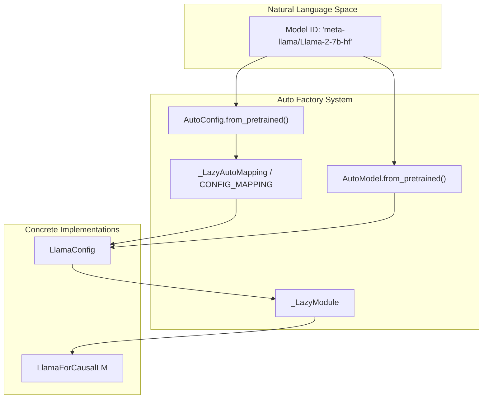
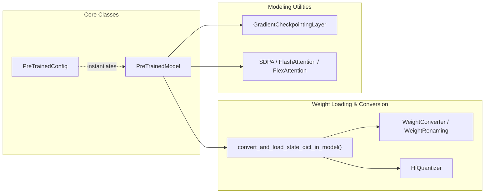

<!-- source: DeepWiki mcp.deepwiki.com · repo huggingface/transformers · page 2 Core Architecture · fetched 2026-10-26 -->

# Core Architecture

Relevant source files

The following files were used as context for generating this wiki page:

- [docs/source/en/_toctree.yml](docs/source/en/_toctree.yml)
- [docs/source/en/index.md](docs/source/en/index.md)
- [docs/source/en/main_classes/peft.md](docs/source/en/main_classes/peft.md)
- [docs/source/en/peft.md](docs/source/en/peft.md)
- [docs/source/en/perf_infer_gpu_multi.md](docs/source/en/perf_infer_gpu_multi.md)
- [docs/source/en/tensor_parallelism.md](docs/source/en/tensor_parallelism.md)
- [docs/source/zh/perf_infer_gpu_multi.md](docs/source/zh/perf_infer_gpu_multi.md)
- [src/transformers/__init__.py](src/transformers/__init__.py)
- [src/transformers/conversion_mapping.py](src/transformers/conversion_mapping.py)
- [src/transformers/core_model_loading.py](src/transformers/core_model_loading.py)
- [src/transformers/integrations/accelerate.py](src/transformers/integrations/accelerate.py)
- [src/transformers/integrations/hub_kernels.py](src/transformers/integrations/hub_kernels.py)
- [src/transformers/integrations/npu_flash_attention.py](src/transformers/integrations/npu_flash_attention.py)
- [src/transformers/integrations/peft.py](src/transformers/integrations/peft.py)
- [src/transformers/integrations/tensor_parallel.py](src/transformers/integrations/tensor_parallel.py)
- [src/transformers/modeling_flash_attention_utils.py](src/transformers/modeling_flash_attention_utils.py)
- [src/transformers/modeling_utils.py](src/transformers/modeling_utils.py)
- [src/transformers/models/__init__.py](src/transformers/models/__init__.py)
- [src/transformers/models/auto/auto_mappings.py](src/transformers/models/auto/auto_mappings.py)
- [src/transformers/models/auto/configuration_auto.py](src/transformers/models/auto/configuration_auto.py)
- [src/transformers/models/auto/feature_extraction_auto.py](src/transformers/models/auto/feature_extraction_auto.py)
- [src/transformers/models/auto/image_processing_auto.py](src/transformers/models/auto/image_processing_auto.py)
- [src/transformers/models/auto/modeling_auto.py](src/transformers/models/auto/modeling_auto.py)
- [src/transformers/models/auto/processing_auto.py](src/transformers/models/auto/processing_auto.py)
- [src/transformers/models/auto/tokenization_auto.py](src/transformers/models/auto/tokenization_auto.py)
- [src/transformers/utils/dummy_pt_objects.py](src/transformers/utils/dummy_pt_objects.py)
- [src/transformers/utils/generic.py](src/transformers/utils/generic.py)
- [src/transformers/utils/kernel_config.py](src/transformers/utils/kernel_config.py)
- [tests/kernels/test_kernels.py](tests/kernels/test_kernels.py)
- [tests/peft_integration/test_peft_integration.py](tests/peft_integration/test_peft_integration.py)
- [tests/tensor_parallel/test_tensor_parallel.py](tests/tensor_parallel/test_tensor_parallel.py)
- [tests/test_modeling_common.py](tests/test_modeling_common.py)
- [tests/utils/test_core_model_loading.py](tests/utils/test_core_model_loading.py)
- [tests/utils/test_generic.py](tests/utils/test_generic.py)
- [tests/utils/test_modeling_utils.py](tests/utils/test_modeling_utils.py)
- [utils/check_auto.py](utils/check_auto.py)
- [utils/check_config_attributes.py](utils/check_config_attributes.py)
- [utils/check_repo.py](utils/check_repo.py)

The Hugging Face Transformers library builds on a cohesive set of foundational abstractions that standardize the creation, configuration, and use of models across domains such as natural language processing, vision, and audio. This core design enables a consistent, extensible, and scalable ecosystem where a wide variety of models, tokenizers, and processors conform to shared interfaces and workflows.

At the center of this architecture lie three key pillars: configuration management via `PreTrainedConfig`, model encapsulation through `PreTrainedModel`, and a dynamic lazy-loading factory system implemented by the `Auto` classes (`src/transformers/models/auto/modeling_auto.py:1-40`, `src/transformers/models/auto/configuration_auto.py:14-30`). These components collaborate seamlessly to abstract away the complexity of model internals and weight handling, presenting users with a simple yet powerful API.

---

## Foundational Abstractions

### PreTrainedConfig

`PreTrainedConfig` is the canonical class for storing model metadata and hyperparameters (`src/transformers/configuration_utils.py:1-50`). It provides:

- Serialization and deserialization methods like `save_pretrained` and `from_pretrained` for easy checkpoint management.
- Encoding of a model’s architectural parameters, including hidden sizes, number of layers, attention mechanisms, activation functions, and more.
- Support for extra domains such as quantization settings and integration with generation configurations (`GenerationConfig`).
- Identification of the model type via the `model_type` attribute, which is crucial for automated model class resolution.

This class guarantees that all configurations adhere to a unified interface for loading, saving, and manipulation, thereby ensuring reproducibility and checkpoint interoperability across the library.

For a comprehensive deep dive, see [PreTrainedModel & PreTrainedConfig](#2.1).

Sources: `src/transformers/configuration_utils.py:1-50`

### PreTrainedModel

`PreTrainedModel` subclasses PyTorch's `nn.Module` and forms the base for every Hugging Face model (`src/transformers/modeling_utils.py:165-190`). It extends the plain PyTorch model functionality with:

- Standard lifecycle hooks including `post_init` for fine-tuning initialization, and `from_pretrained` / `save_pretrained` for checkpoint management.
- Flexible and robust weight loading which supports sharded checkpoints, safetensors format, DeepSpeed zero optimization, and Accelerate integration.
- Management of tied weights through the internal `_tied_weights_keys` dictionary, safeguarding parameter sharing between layers.
- Features to support memory-efficient training, such as gradient checkpointing (`src/transformers/modeling_utils.py:40-45`).
- Transparent selection among optimized attention backends (like SDPA, Flash Attention, Flex Attention) based on hardware capabilities and user settings (`src/transformers/modeling_utils.py:79-90`).
- Methods and helpers for distributed training device placement and integration (`src/transformers/modeling_utils.py:57-65`).

This class ensures uniform and battle-tested behaviors for all model implementations throughout the library.

For details, see [PreTrainedModel & PreTrainedConfig](#2.1).

Sources: `src/transformers/modeling_utils.py:1-186`

### Auto Factory System

The `Auto` classes (`AutoModel`, `AutoConfig`, `AutoTokenizer`, `AutoImageProcessor`, `AutoProcessor`, etc.) follow a dynamic lazy-loading factory design pattern that:

- Takes a string identifier (e.g., `"bert-base-uncased"`) and dynamically maps it to the correct configuration, model, or tokenizer class (`src/transformers/models/auto/configuration_auto.py:93-120`).
- Internally uses registry mappings such as `_LazyAutoMapping` to defer the import of heavy model implementations until they are explicitly required, optimizing startup time and resource usage (`src/transformers/models/auto/auto_factory.py:1-50`, `src/transformers/__init__.py:15-35`).
- Supports `trust_remote_code`, which enables safe execution of custom model code uploaded on the Hugging Face Hub (`src/transformers/models/auto/configuration_auto.py:24-27`).
- Offers a uniform API whereby users can load any supported model and related components using a consistent call pattern.

This system greatly enhances scalability and adaptability given the rapidly growing ecosystem of architectures.

For in-depth mechanics, refer to [Auto Classes & Lazy-Loading Factory](#2.2).

Sources: `src/transformers/models/auto/configuration_auto.py:93-153`, `src/transformers/__init__.py:15-35`

### Weight Loading and Conversion Lifecycle

The library features an advanced weight loading architecture tailored to heterogeneous checkpoint formats (`src/transformers/core_model_loading.py:1-60`, `src/transformers/conversion_mapping.py:1-45`):

- **`WeightConverter`** and **`WeightRenaming`** classes formally describe mappings to rename parameter keys and transform tensor shapes to fit the internal model implementations.
- This system addresses complex cases like fused QKV weights, stacking of Mixture-of-Experts (MoE) expert weights, and rotary positional encoding permutations.
- The primary function `convert_and_load_state_dict_in_model` orchestrates the conversion, safe loading, and compatibility verification of checkpoint weights (`src/transformers/modeling_utils.py:51-56`).
- Supports sharded checkpoints, safetensors-optimized weights, and smooth transitions between checkpoint version formats.

For technical specifics, see [Model Weight Loading & Conversion](#2.3).

Sources: `src/transformers/core_model_loading.py:1-60`, `src/transformers/conversion_mapping.py:1-45`, `src/transformers/modeling_utils.py:51-56`

### Common Modeling Layers & Utilities

The library extracts shared modeling primitives and utilities into reusable modules:

- `GradientCheckpointingLayer` assists with memory-efficient gradient computations (`src/tests/test_modeling_common.py:62-62`).
- `modeling_layers.py`, `masking_utils.py`, and `modeling_rope_utils.py` provide standard components such as attention mask handling and rotary positional encoding variants (`src/transformers/modeling_utils.py:88-95`).
- `pytorch_utils.py` encapsulates various PyTorch helper functions for tensor operations and performance tuning (`src/transformers/modeling_utils.py:96-96`).
- Attention backend integration points enable seamless switching between optimized kernels like SDPA, FlashAttention, and FlexAttention (`src/transformers/modeling_utils.py:79-86`).

For further information, consult [Common Modeling Layers & Utilities](#2.4).

Sources: `src/tests/test_modeling_common.py:62-63`, `src/transformers/modeling_utils.py:79-96`

---

## System Entity Map: Bridging Natural Language Model IDs to Code Entities

### Diagram 1: Model Resolution Flow Between Model IDs and Code Entities

This diagram illustrates how a human-readable model identifier string flows through the system. The `AutoConfig` and `AutoModel` use internal lazy mapping (`src/transformers/models/auto/configuration_auto.py:93-120`) and dynamic imports to resolve and load corresponding configuration and model classes only when needed.

Sources: `src/transformers/models/auto/configuration_auto.py:93-153`, `src/transformers/__init__.py:15-35`

### Diagram 2: Core Architecture Components and Their Interactions

This representation exposes the dependencies and lifecycle in the core components. The configuration class directs model creation; weight loading mechanisms enable conversion and quantization (`src/transformers/modeling_utils.py:51-56`, `src/transformers/modeling_utils.py:97-99`); and models leverage shared layers and optimized attention kernels (`src/transformers/modeling_utils.py:79-86`).

Sources: `src/transformers/modeling_utils.py:51-99`, `src/tests/test_modeling_common.py:62-63`

---

## Summary Table of Core Components

| Component                | Code Entity                          | Role / Responsibility                                   |
|--------------------------|------------------------------------|---------------------------------------------------------|
| Configuration            | `PreTrainedConfig`                 | Metadata, hyperparameters, serialization handling       |
| Base Model Class         | `PreTrainedModel`                  | Weight loading, tied weights, backend selection          |
| Lazy Factory Mappings    | `_LazyAutoMapping`                 | Lazy resolution of model IDs to implementation classes   |
| Weight Conversion System | `WeightConverter`, `WeightRenaming` | Rename/transform checkpoint weights for compatibility    |
| Conversion Primitives    | `ConversionOps`                   | Atomic operations for weight conversion                  |
| Quantization             | `HfQuantizer`                    | Support for low-bit weight formats                        |
| Common Modeling Layers   | `GradientCheckpointingLayer`, Attention backends | Reusable layers and efficient GPU kernel integration    |

Sources: `src/transformers/configuration_utils.py:1-50`, `src/transformers/modeling_utils.py:40-100`, `src/transformers/core_model_loading.py:1-60`

---

## Navigation to Detailed Subsystems

This page provides a high-level architectural overview. For deep knowledge, each topic is covered extensively in separate focused documentation pages:

- **[PreTrainedModel & PreTrainedConfig](#2.1)**  
  Deep coverage of configuration and model base classes, their lifecycle methods, weight tying, attention backend selection, and memory optimization.

- **[Auto Classes & Lazy-Loading Factory](#2.2)**  
  Explanation of dynamic factory pattern, lazy imports, `_LazyAutoMapping`, `trust_remote_code`, and the loading of third-party Hub models.

- **[Model Weight Loading & Conversion](#2.3)**  
  Detailed design of the weight conversion machinery, including fused and expert weights, transformer permutations, and sharded checkpoint support.

- **[Common Modeling Layers & Utilities](#2.4)**  
  Shared low-level layers and utilities: gradient checkpointing layers, attention handling, RoPE utilities, and PyTorch helper functions.

Sources: `docs/source/en/_toctree.yml:1-76`, `src/transformers/__init__.py:15-60`

---

