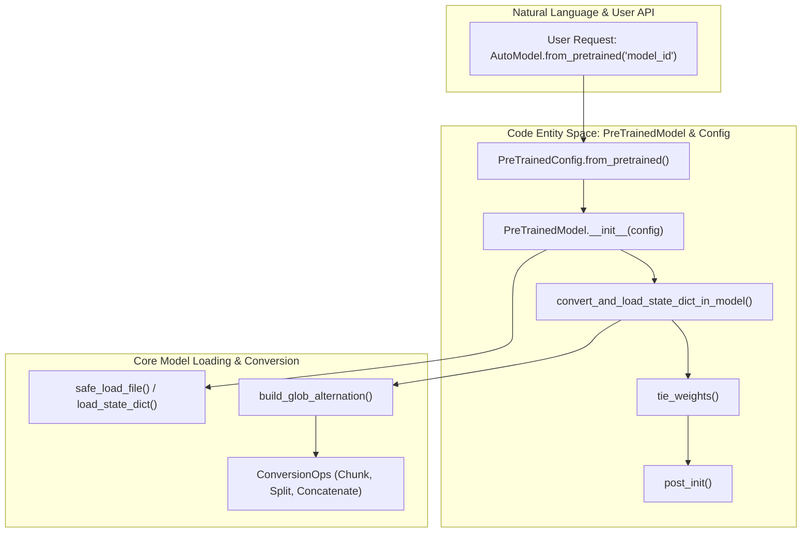
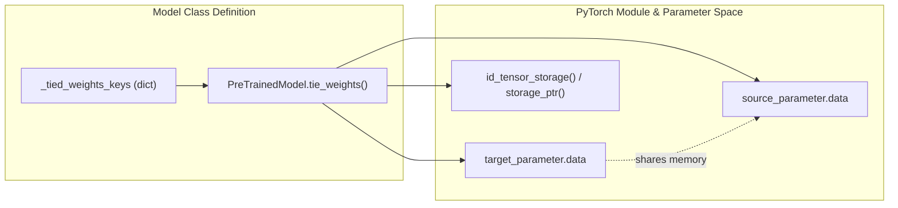

<!-- source: DeepWiki mcp.deepwiki.com · repo huggingface/transformers · page 2.1 PreTrainedModel & PreTrainedConfig · fetched 2026-10-26 -->

# PreTrainedModel & PreTrainedConfig

Relevant source files

The following files were used as context for generating this wiki page:

- [docs/source/en/main_classes/peft.md](docs/source/en/main_classes/peft.md)
- [docs/source/en/peft.md](docs/source/en/peft.md)
- [docs/source/en/perf_infer_gpu_multi.md](docs/source/en/perf_infer_gpu_multi.md)
- [docs/source/en/tensor_parallelism.md](docs/source/en/tensor_parallelism.md)
- [docs/source/zh/perf_infer_gpu_multi.md](docs/source/zh/perf_infer_gpu_multi.md)
- [src/transformers/cache_utils.py](src/transformers/cache_utils.py)
- [src/transformers/configuration_utils.py](src/transformers/configuration_utils.py)
- [src/transformers/conversion_mapping.py](src/transformers/conversion_mapping.py)
- [src/transformers/core_model_loading.py](src/transformers/core_model_loading.py)
- [src/transformers/generation/candidate_generator.py](src/transformers/generation/candidate_generator.py)
- [src/transformers/generation/configuration_utils.py](src/transformers/generation/configuration_utils.py)
- [src/transformers/generation/utils.py](src/transformers/generation/utils.py)
- [src/transformers/integrations/accelerate.py](src/transformers/integrations/accelerate.py)
- [src/transformers/integrations/executorch.py](src/transformers/integrations/executorch.py)
- [src/transformers/integrations/hub_kernels.py](src/transformers/integrations/hub_kernels.py)
- [src/transformers/integrations/npu_flash_attention.py](src/transformers/integrations/npu_flash_attention.py)
- [src/transformers/integrations/peft.py](src/transformers/integrations/peft.py)
- [src/transformers/integrations/tensor_parallel.py](src/transformers/integrations/tensor_parallel.py)
- [src/transformers/masking_utils.py](src/transformers/masking_utils.py)
- [src/transformers/modeling_flash_attention_utils.py](src/transformers/modeling_flash_attention_utils.py)
- [src/transformers/modeling_utils.py](src/transformers/modeling_utils.py)
- [src/transformers/utils/generic.py](src/transformers/utils/generic.py)
- [src/transformers/utils/kernel_config.py](src/transformers/utils/kernel_config.py)
- [tests/generation/test_candidate_generator.py](tests/generation/test_candidate_generator.py)
- [tests/generation/test_configuration_utils.py](tests/generation/test_configuration_utils.py)
- [tests/generation/test_utils.py](tests/generation/test_utils.py)
- [tests/kernels/test_kernels.py](tests/kernels/test_kernels.py)
- [tests/peft_integration/test_peft_integration.py](tests/peft_integration/test_peft_integration.py)
- [tests/tensor_parallel/test_tensor_parallel.py](tests/tensor_parallel/test_tensor_parallel.py)
- [tests/test_modeling_common.py](tests/test_modeling_common.py)
- [tests/utils/test_cache_utils.py](tests/utils/test_cache_utils.py)
- [tests/utils/test_configuration_utils.py](tests/utils/test_configuration_utils.py)
- [tests/utils/test_core_model_loading.py](tests/utils/test_core_model_loading.py)
- [tests/utils/test_feature_extraction_utils.py](tests/utils/test_feature_extraction_utils.py)
- [tests/utils/test_generic.py](tests/utils/test_generic.py)
- [tests/utils/test_image_processing_utils.py](tests/utils/test_image_processing_utils.py)
- [tests/utils/test_masking_utils.py](tests/utils/test_masking_utils.py)
- [tests/utils/test_modeling_utils.py](tests/utils/test_modeling_utils.py)
- [tests/utils/test_tokenization_utils.py](tests/utils/test_tokenization_utils.py)

This page provides a technical deep dive into the two foundational base classes of the Hugging Face Transformers library: `PreTrainedModel` and `PreTrainedConfig`. These classes govern the lifecycle of every model in the library, handling everything from weight initialization and serialization to advanced features like gradient checkpointing, weight tying, attention implementation selection, per-layer attribute overrides via heterogeneity configurations, and the `PreTrainedConfig` serialization contract.

---

## PreTrainedConfig & Serialization Contract

`PreTrainedConfig` is the base class for all model configuration classes. It encapsulates the hyperparameters and architectural metadata required to instantiate a model and serves as the serialization and deserialization contract for model setups.

### Serialization and Lifecycle

- **Loading via `from_pretrained`**:  
  The class method loads the configuration for a model from a local directory or the Hugging Face Hub, resolving model identifiers, downloading configuration JSON files (`config.json`), and supporting custom configurations when `trust_remote_code=True` `[src/transformers/configuration_utils.py:1-48]`.

- **Saving via `save_pretrained`**:  
  Saves the configuration to disk as `config.json`, balancing readability and backward compatibility while integrating with Hub upload workflows.

- **Serialization Contract**:  
  - Special floating-point values (`NaN`, `Infinity`, `-Infinity`) are handled via explicit tagging (`_FLOAT_TAG_KEY`, `_FLOAT_TAG_VALUES`) to preserve JSON validity `[src/transformers/configuration_utils.py:60-65]`.
  - Legacy layer type names are automatically remapped to canonical names via `remap_legacy_layer_types` and `_LEGACY_LAYER_TYPE_REMAP` (e.g., `"mamba"` to `"linear_attention"`, `"attention"` to `"full_attention"`) `[src/transformers/configuration_utils.py:92-136]`.
  - Config classes can utilize dataclass transforms and kwargs wrapping (`wrap_init_to_accept_kwargs`) to ensure strict yet flexible parameter parsing `[src/transformers/configuration_utils.py:30-165]`.

### Heterogeneity Config Layer (`integrations/heterogeneity`)

For architectures with per-layer attribute overrides (e.g., varying hidden sizes, intermediate dimensions, or attention head counts across layers), `PreTrainedConfig` integrates `HeterogeneousConfigMixin`. This mixin allows configuration attributes to be specified as lists or dictionaries per layer index, letting models construct heterogeneous layer stacks dynamically.

Sources: `[src/transformers/configuration_utils.py:1-165]`, `[src/transformers/configuration_utils.py:488-540]()`

---

## PreTrainedModel & Loading Lifecycle

`PreTrainedModel` is an abstract subclass of `torch.nn.Module`, forming the foundational base for all PyTorch-based transformer models.

### Loading Lifecycle (`from_pretrained`)

1. **Resolve and Load Configuration**: Instantiates or loads the corresponding `PreTrainedConfig` `[src/transformers/modeling_utils.py:45-50]`.
2. **Model Initialization**: Instantiates the model class with the loaded config, invoking `_init_weights()` for uninitialized weights.
3. **Load Weights with Conversion**: Loads state dictionaries from `.bin` or `.safetensors` files, supporting sharded checkpoints and structural weight transformations via `WeightConverter`, `WeightRenaming`, and `ConversionOps` `[src/transformers/core_model_loading.py:81-181]`.
4. **Enforce Weight Tying**: Executes `tie_weights()` to share memory storage across designated parameter pairs `[src/transformers/modeling_utils.py:60-65]`.
5. **Post-Initialization Hook**: Runs `post_init()` to finalize initialization, quantization, and adapter setup.

### Loading Flow Diagram: Natural Language to Code Mapping

Sources: `[src/transformers/modeling_utils.py:35-186]`, `[src/transformers/core_model_loading.py:49-181]()`

---

## Weight Tying Implementation

Weight tying allows multiple parts of a model to share a single parameter tensor, reducing memory usage.

- The `_tied_weights_keys` class attribute defines a mapping of target parameter names to source parameter names `[src/transformers/tests/utils/test_modeling_utils.py:185-188]()`.
- The `tie_weights()` method iterates through these mappings, assigning the target parameter reference to point to the source parameter's tensor storage `[src/transformers/modeling_utils.py:63-63]()`.
- Underlying storage pointers (`storage_ptr()`) are validated to ensure true memory sharing.

### Weight Tying Diagram: Logic to Code Entities

Sources: `[src/transformers/modeling_utils.py:63-63]`, `[src/transformers/pytorch_utils.py:96-96]()`

---

## Attention Implementation Selection

`PreTrainedModel` supports pluggable attention mechanisms, selectable via configuration or keyword arguments during initialization and forward passes.

| Implementation | Description | Requirements |
|----------------|-------------|--------------|
| **Eager** | Standard PyTorch native attention implementation | Always available |
| **SDPA** | Scaled Dot-Product Attention optimized kernels | PyTorch ≥ 2.0 |
| **FlashAttention-2 / 3 / 4** | High-performance hardware-accelerated CUDA/XPU kernels | CUDA/XPU + `flash-attn` package `[src/transformers/modeling_flash_attention_utils.py:96-140]()` |
| **FlexAttention** | PyTorch-native flexible compiled attention backend | PyTorch ≥ 2.5 + compatible hardware `[src/transformers/modeling_utils.py:120-120]()` |

The backend selection checks hardware availability and compatibility matrices dynamically before dispatching `flash_attention_forward`, `sdpa_attention_forward`, or eager implementations `[src/transformers/modeling_utils.py:79-93]()`.

Sources: `[src/transformers/modeling_utils.py:79-93]`, `[src/transformers/modeling_flash_attention_utils.py:96-140]()`

---

## Advanced Modeling Features & Gradient Checkpointing

To optimize memory consumption during training, `PreTrainedModel` provides built-in gradient checkpointing support:

- Calling `gradient_checkpointing_enable()` sets internal flags on the model and its constituent layers `[src/transformers/modeling_utils.py:44-44]()`.
- Individual modules inheriting from `GradientCheckpointingLayer` wrap their forward computation graph with PyTorch's `checkpoint()` utility, trading compute for reduced activation memory `[src/transformers/tests/test_modeling_common.py:62-62]()`.

Sources: `[src/transformers/modeling_utils.py:44-44]`, `[src/transformers/tests/test_modeling_common.py:62-62]()`

---

## Checkpoint Conversion System

When loading heterogeneous checkpoints from external formats or legacy structures, `transformers` utilizes `WeightConverter`, `WeightRenaming`, and subclasses of `ConversionOps` `[src/transformers/core_model_loading.py:51-181]()`.

- **`Chunk` / `Split`**: Divide fused tensors (such as combined QKV projections or multi-expert feed-forward weights) along specified dimensions `[src/transformers/core_model_loading.py:112-181]()`.
- **`Concatenate`**: Combines separate parameter tensors into unified projections.
- **`WeightRenaming`**: Matches source regex patterns against incoming state dictionaries and maps them to target architecture names.

Sources: `[src/transformers/core_model_loading.py:51-181]`, `[src/transformers/conversion_mapping.py:21-36]()`

---

