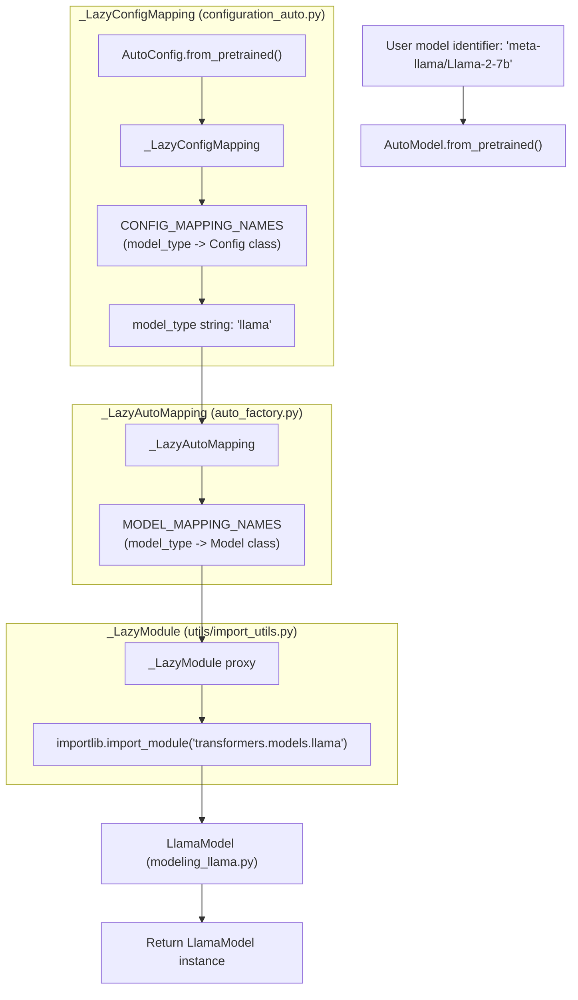
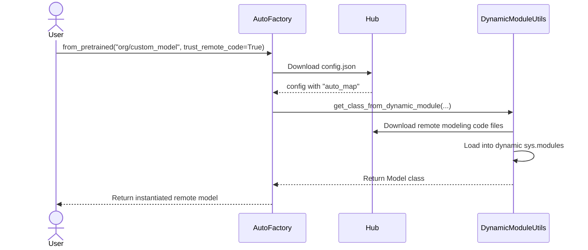

<!-- source: DeepWiki mcp.deepwiki.com · repo huggingface/transformers · page 2.2 Auto Classes & Lazy-Loading Factory · fetched 2026-10-26 -->

# Auto Classes & Lazy-Loading Factory

Relevant source files

The following files were used as context for generating this wiki page:

- [docs/source/en/_toctree.yml](docs/source/en/_toctree.yml)
- [docs/source/en/index.md](docs/source/en/index.md)
- [docs/source/en/main_classes/video_processor.md](docs/source/en/main_classes/video_processor.md)
- [src/transformers/__init__.py](src/transformers/__init__.py)
- [src/transformers/dynamic_module_utils.py](src/transformers/dynamic_module_utils.py)
- [src/transformers/feature_extraction_utils.py](src/transformers/feature_extraction_utils.py)
- [src/transformers/file_utils.py](src/transformers/file_utils.py)
- [src/transformers/image_processing_base.py](src/transformers/image_processing_base.py)
- [src/transformers/modelcard.py](src/transformers/modelcard.py)
- [src/transformers/models/__init__.py](src/transformers/models/__init__.py)
- [src/transformers/models/auto/auto_factory.py](src/transformers/models/auto/auto_factory.py)
- [src/transformers/models/auto/auto_mappings.py](src/transformers/models/auto/auto_mappings.py)
- [src/transformers/models/auto/configuration_auto.py](src/transformers/models/auto/configuration_auto.py)
- [src/transformers/models/auto/feature_extraction_auto.py](src/transformers/models/auto/feature_extraction_auto.py)
- [src/transformers/models/auto/image_processing_auto.py](src/transformers/models/auto/image_processing_auto.py)
- [src/transformers/models/auto/modeling_auto.py](src/transformers/models/auto/modeling_auto.py)
- [src/transformers/models/auto/processing_auto.py](src/transformers/models/auto/processing_auto.py)
- [src/transformers/models/auto/tokenization_auto.py](src/transformers/models/auto/tokenization_auto.py)
- [src/transformers/models/auto/video_processing_auto.py](src/transformers/models/auto/video_processing_auto.py)
- [src/transformers/models/instructblipvideo/video_processing_instructblipvideo.py](src/transformers/models/instructblipvideo/video_processing_instructblipvideo.py)
- [src/transformers/models/internvl/video_processing_internvl.py](src/transformers/models/internvl/video_processing_internvl.py)
- [src/transformers/models/smolvlm/video_processing_smolvlm.py](src/transformers/models/smolvlm/video_processing_smolvlm.py)
- [src/transformers/tokenization_utils_tokenizers.py](src/transformers/tokenization_utils_tokenizers.py)
- [src/transformers/utils/dummy_pt_objects.py](src/transformers/utils/dummy_pt_objects.py)
- [src/transformers/utils/hub.py](src/transformers/utils/hub.py)
- [src/transformers/video_processing_utils.py](src/transformers/video_processing_utils.py)
- [src/transformers/video_utils.py](src/transformers/video_utils.py)
- [tests/models/auto/test_configuration_auto.py](tests/models/auto/test_configuration_auto.py)
- [tests/models/auto/test_feature_extraction_auto.py](tests/models/auto/test_feature_extraction_auto.py)
- [tests/models/auto/test_image_processing_auto.py](tests/models/auto/test_image_processing_auto.py)
- [tests/models/auto/test_modeling_auto.py](tests/models/auto/test_modeling_auto.py)
- [tests/models/auto/test_tokenization_auto.py](tests/models/auto/test_tokenization_auto.py)
- [tests/models/auto/test_video_processing_auto.py](tests/models/auto/test_video_processing_auto.py)
- [tests/models/smolvlm/test_video_processing_smolvlm.py](tests/models/smolvlm/test_video_processing_smolvlm.py)
- [tests/tokenization/test_tokenization_fast.py](tests/tokenization/test_tokenization_fast.py)
- [tests/utils/test_dynamic_module_utils.py](tests/utils/test_dynamic_module_utils.py)
- [tests/utils/test_video_utils.py](tests/utils/test_video_utils.py)
- [utils/check_auto.py](utils/check_auto.py)
- [utils/check_config_attributes.py](utils/check_config_attributes.py)
- [utils/check_repo.py](utils/check_repo.py)

The Auto Class system in Hugging Face’s Transformers library provides a unified, extensible interface that maps textual model identifiers (e.g., `"bert-base-uncased"`, `"meta-llama/Llama-2-7b"`) transparently to the appropriate configuration, model, tokenizer, image processor, or composite processor classes. This abstraction enables users to instantiate these objects without manual specification of underlying model classes.

This capability is enabled by a lazy-loading factory pattern which defers imports of backend modules until needed, improving startup time, reducing memory footprint, and supporting dynamic augmentations such as remote custom code loading. This design maintains a clean user API that transparently handles diverse model architectures and modalities.

---

## Architecture Overview

The auto system follows the data flow below:

1. **Resolve model identifier or config**: From a user-provided string identifier or a loaded `PreTrainedConfig`, extract a `model_type` string describing the architecture family [src/transformers/models/auto/configuration_auto.py:81-90]().
2. **Lazy mappings to classes**: Use `model_type` as a key to look up specific classes in lazy mapping registries for configurations (`AutoConfig`), models (`AutoModel` and variants), tokenizers (`AutoTokenizer`), image processors (`AutoImageProcessor`), and combined processors (`AutoProcessor`).
3. **Lazy module proxy**: Class retrieval occurs behind a `_LazyModule` import proxy to defer imports until attribute use [src/transformers/utils/import_utils.py]().
4. **Optional trusted remote code**: If `trust_remote_code=True` is passed, unknown or custom `model_type`s trigger downloading and dynamic loading of remote model Python code from the Hugging Face Hub [src/transformers/dynamic_module_utils.py](). This creates dynamic modules on-the-fly, registered in `sys.modules`.
5. **Graceful optional backend handling**: If backend dependencies are missing (e.g., PyTorch, tokenizers), dummy placeholder classes (`DummyObject`) provide informative runtime errors instead of import failures [src/transformers/utils/dummy_pt_objects.py]().
6. **Instantiate and return**: With classes resolved, instantiate the requested factory object.

---

## From Model Identifier to Concrete Class: Data Flow Diagram

Sources: [src/transformers/models/auto/configuration_auto.py:93-118](), [src/transformers/models/auto/auto_factory.py:435-470](), [src/transformers/utils/import_utils.py]()

---

# Core Components

## 1. Lazy Mappings: `_LazyAutoMapping` and `_LazyConfigMapping`

The backbone of the auto system comprises dictionary-like mappings that resolve model-type strings to classes on-demand, deferring module imports.

- **`_LazyConfigMapping`**: A class used in `configuration_auto.py` that maps string keys (`model_type`) to configuration classes inheriting `PreTrainedConfig`. On first access, the target module (e.g., `.llama`) is imported dynamically, and configuration classes are retrieved and cached [src/transformers/models/auto/configuration_auto.py:93-118]().
- **`_LazyAutoMapping`**: Defined in `auto_factory.py`, it lazily loads model classes (and similarly tokenizer, image processor, processor classes) from model submodules keyed by `model_type` [src/transformers/models/auto/auto_factory.py:435-470](). This prevents eager loading of large modeling codebases.

Both classes support typical dictionary methods (`__getitem__`, `register`, iteration) and maintain internal caches for performance.

**Implementation references:**  
- `_LazyConfigMapping`: [src/transformers/models/auto/configuration_auto.py:93-118]()  
- `_LazyAutoMapping`: [src/transformers/models/auto/auto_factory.py:435-470]()

Sources: [src/transformers/models/auto/configuration_auto.py:93-118](), [src/transformers/models/auto/auto_factory.py:435-470]()

## 2. The `_LazyModule` Import Proxy

The `_LazyModule` (in `utils/import_utils.py`) intercepts attribute access on a module-like object and performs the actual import of the real submodule only upon first use. This mechanism enables:

- Minimizing initial import overhead of heavy submodules.
- Providing a seamless user API with immediate access to submodules/classes.
- Dynamic dispatch for model families and their tokenizers/processors.

This pattern is extensively used in the top-level transformers namespace and in the models submodule to optimize startup performance [src/transformers/__init__.py:16-19]().

Sources: [src/transformers/__init__.py:16-19](), [src/transformers/utils/import_utils.py]()

## 3. Dummy Objects for Optional Backends

To support environments lacking some optional dependencies (e.g., PyTorch, tokenizers, vision libs), the library declares dummy placeholder classes decorated by `DummyObject` from `src/transformers/utils/dummy_pt_objects.py`. These placeholders:

- Provide informative error messages only when instantiated or used via `requires_backends` [src/transformers/utils/dummy_pt_objects.py:5-10]().
- Avoid import-time failures to not break the entire library when optional backends are missing.

Sources: [src/transformers/utils/dummy_pt_objects.py:1-488]()

---

# Dynamic Module System for Trusted Remote Code

The library allows users to load remote models that may have custom Python code (e.g., novel architectures or tokenizers) not shipped in the Transformers source. This mode activates if and only if the user opts in with `trust_remote_code=True` [src/transformers/dynamic_module_utils.py]().

**Mechanism summary:**

1. Upon detecting an unknown `model_type` during `from_pretrained()`, the config's `"auto_map"` metadata is checked [src/transformers/models/auto/configuration_auto.py:24-27]().
2. Relevant Python files (e.g., modeling code) are downloaded from the HF Hub at runtime.
3. The downloaded Python files are loaded dynamically into new modules in `sys.modules`.
4. Model classes are retrieved from these dynamic modules and instantiated.

---

## Sequence Diagram: Dynamic Remote Code Loading with `trust_remote_code=True`

Sources: [src/transformers/dynamic_module_utils.py](), [src/transformers/models/auto/configuration_auto.py:24-27]()

---

# Specialization of Auto Classes & Their Lazy Registries

Each Auto class specializes in loading a category of objects and uses its dedicated lazy mapping:

| Auto Class            | Lazy Mapping Dictionary & Location               | Notes                                                  |
|-----------------------|-------------------------------------------------|--------------------------------------------------------|
| `AutoConfig`          | `CONFIG_MAPPING_NAMES` in `configuration_auto.py` | Maps `model_type` to `PreTrainedConfig` subclasses.    |
| `AutoModel*`          | `MODEL_MAPPING_NAMES` in `modeling_auto.py`       | Maps `model_type` to model classes (various variants). |
| `AutoTokenizer`       | `TOKENIZER_MAPPING_NAMES` in `tokenization_auto.py` | Maps to tokenizer classes; prefers Rust-based fast tokenizers if available. |
| `AutoImageProcessor`  | `IMAGE_PROCESSOR_MAPPING_NAMES` in `image_processing_auto.py` | Maps model types to image processor classes; handles backend fallbacks. |
| `AutoProcessor`       | `PROCESSOR_MAPPING_NAMES` in `processing_auto.py`  | For combined multimodal processor classes.              |

Sources: [src/transformers/models/auto/configuration_auto.py:26](), [src/transformers/models/auto/modeling_auto.py:41-176](), [src/transformers/models/auto/tokenization_auto.py:64-135](), [src/transformers/models/auto/image_processing_auto.py:68-119]()

---

# References and Key Source Files

- `src/transformers/models/auto/modeling_auto.py` [src/transformers/models/auto/modeling_auto.py:1-2700]()  
- `src/transformers/models/auto/configuration_auto.py` [src/transformers/models/auto/configuration_auto.py:1-465]()  
- `src/transformers/models/auto/tokenization_auto.py` [src/transformers/models/auto/tokenization_auto.py:1-1034]()  
- `src/transformers/models/auto/image_processing_auto.py` [src/transformers/models/auto/image_processing_auto.py:1-780]()  
- `src/transformers/models/auto/auto_factory.py` [src/transformers/models/auto/auto_factory.py:1-600]()  
- `src/transformers/utils/import_utils.py` [src/transformers/utils/import_utils.py:1-800]()  
- `src/transformers/utils/dummy_pt_objects.py` [src/transformers/utils/dummy_pt_objects.py:1-488]()  
- `src/transformers/dynamic_module_utils.py` [src/transformers/dynamic_module_utils.py:1-500]()

---

