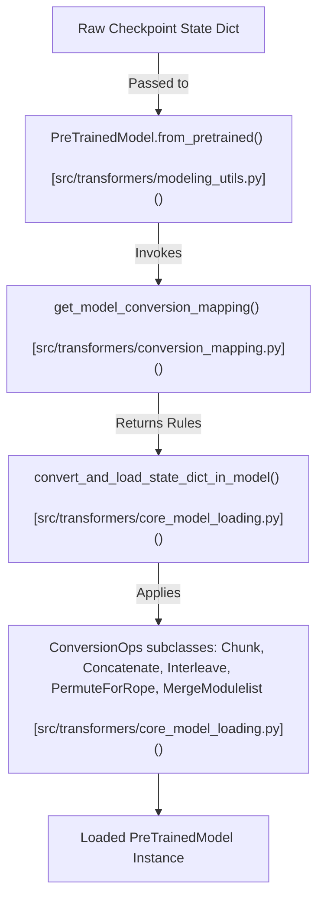
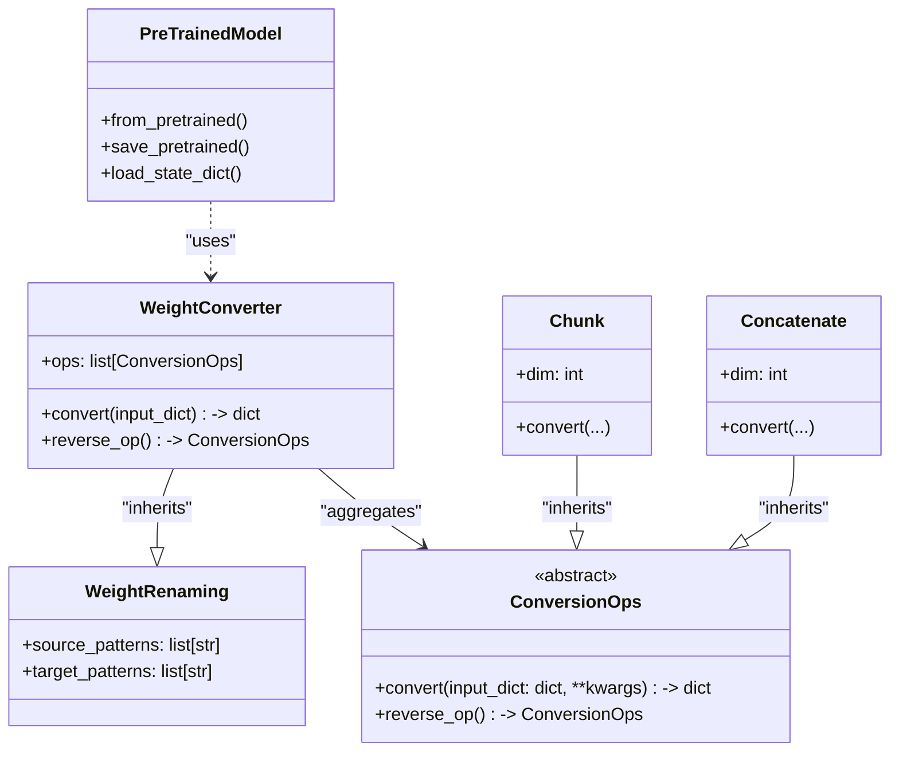

<!-- source: DeepWiki mcp.deepwiki.com · repo huggingface/transformers · page 2.3 Model Weight Loading & Conversion · fetched 2026-10-26 -->

# Model Weight Loading & Conversion

Relevant source files

The following files were used as context for generating this wiki page:

- [docs/source/en/main_classes/peft.md](docs/source/en/main_classes/peft.md)
- [docs/source/en/peft.md](docs/source/en/peft.md)
- [docs/source/en/perf_infer_gpu_multi.md](docs/source/en/perf_infer_gpu_multi.md)
- [docs/source/en/tensor_parallelism.md](docs/source/en/tensor_parallelism.md)
- [docs/source/zh/perf_infer_gpu_multi.md](docs/source/zh/perf_infer_gpu_multi.md)
- [src/transformers/conversion_mapping.py](src/transformers/conversion_mapping.py)
- [src/transformers/core_model_loading.py](src/transformers/core_model_loading.py)
- [src/transformers/dynamic_module_utils.py](src/transformers/dynamic_module_utils.py)
- [src/transformers/file_utils.py](src/transformers/file_utils.py)
- [src/transformers/integrations/accelerate.py](src/transformers/integrations/accelerate.py)
- [src/transformers/integrations/hub_kernels.py](src/transformers/integrations/hub_kernels.py)
- [src/transformers/integrations/npu_flash_attention.py](src/transformers/integrations/npu_flash_attention.py)
- [src/transformers/integrations/peft.py](src/transformers/integrations/peft.py)
- [src/transformers/integrations/tensor_parallel.py](src/transformers/integrations/tensor_parallel.py)
- [src/transformers/modelcard.py](src/transformers/modelcard.py)
- [src/transformers/modeling_flash_attention_utils.py](src/transformers/modeling_flash_attention_utils.py)
- [src/transformers/modeling_utils.py](src/transformers/modeling_utils.py)
- [src/transformers/tokenization_utils_tokenizers.py](src/transformers/tokenization_utils_tokenizers.py)
- [src/transformers/utils/generic.py](src/transformers/utils/generic.py)
- [src/transformers/utils/hub.py](src/transformers/utils/hub.py)
- [src/transformers/utils/kernel_config.py](src/transformers/utils/kernel_config.py)
- [tests/kernels/test_kernels.py](tests/kernels/test_kernels.py)
- [tests/models/auto/test_configuration_auto.py](tests/models/auto/test_configuration_auto.py)
- [tests/models/auto/test_feature_extraction_auto.py](tests/models/auto/test_feature_extraction_auto.py)
- [tests/models/auto/test_modeling_auto.py](tests/models/auto/test_modeling_auto.py)
- [tests/models/auto/test_tokenization_auto.py](tests/models/auto/test_tokenization_auto.py)
- [tests/peft_integration/test_peft_integration.py](tests/peft_integration/test_peft_integration.py)
- [tests/tensor_parallel/test_tensor_parallel.py](tests/tensor_parallel/test_tensor_parallel.py)
- [tests/test_modeling_common.py](tests/test_modeling_common.py)
- [tests/tokenization/test_tokenization_fast.py](tests/tokenization/test_tokenization_fast.py)
- [tests/utils/test_core_model_loading.py](tests/utils/test_core_model_loading.py)
- [tests/utils/test_dynamic_module_utils.py](tests/utils/test_dynamic_module_utils.py)
- [tests/utils/test_generic.py](tests/utils/test_generic.py)
- [tests/utils/test_modeling_utils.py](tests/utils/test_modeling_utils.py)

The Model Weight Loading & Conversion subsystem provides a comprehensive and extensible framework within the Hugging Face Transformers library for loading heterogeneous checkpoints. These checkpoints often come from diverse training frameworks or repository conventions, featuring differences such as fused attention QKV weights, Mixture-of-Experts (MoE) expert stacking, rotary positional embedding (RoPE) permutations, or tensor layout variants.

This system abstracts the complexities of loading such heterogeneous checkpoints through key renaming, tensor transformations, stacking operations, and permutations. It integrates seamlessly with quantization mechanisms and memory offloading to support efficient loading across a variety of hardware configurations.

This page discusses the core implementation found primarily in `src/transformers/core_model_loading.py` and `src/transformers/conversion_mapping.py`, focusing on the mechanisms for handling fused QKV, MoE expert stacking, and RoPE permutations.

---

## System Architecture Overview

### Key Classes & Components

| Component               | Description                                                                                     | Implementation Location                       |
|-------------------------|-------------------------------------------------------------------------------------------------|----------------------------------------------|
| **WeightRenaming**       | Handles renaming of checkpoint keys using glob-like regex pattern matching.                      | `src/transformers/core_model_loading.py` [49-78]()          |
| **WeightConverter**      | Extends renaming with a sequence of tensor `ConversionOps` to convert weights on load.           | `src/transformers/core_model_loading.py` [81-110]()          |
| **ConversionOps**        | Abstract base and concrete tensor transformations (e.g., `Chunk`, `Concatenate`, `Interleave`). | `src/transformers/core_model_loading.py` [81-94](), [112-185]() |
| **Conversion Mapping**   | Model-specific mappings that coordinate renamings and conversion ops, including MoE and RoPE handling. | `src/transformers/conversion_mapping.py` [1-40]()              |

### Data Flow Overview

The following diagram bridges natural language functional concepts to code entities within `modeling_utils.py`, `conversion_mapping.py`, and `core_model_loading.py`:

**Sources:**  
[src/transformers/modeling_utils.py:49-55](), [src/transformers/core_model_loading.py:530-560](), [src/transformers/conversion_mapping.py:1-40]()

---

## Conversion Operations: Tensor Transformations for Flexible Loading

At the core of supporting heterogeneous checkpoint formats is the system of `ConversionOps`, modular tensor operations applied during weight loading to reshape, split, concatenate, or permute tensors to the model’s expected format.

| Operation         | Class Name             | Description                                                                                  | Location                          |
|-------------------|------------------------|----------------------------------------------------------------------------------------------|---------------------------------|
| **Chunk**         | `Chunk`                | Splits a tensor along a given dimension into multiple equal chunks (e.g., fused QKV split).   | `src/transformers/core_model_loading.py` [112-147]() |
| **Concatenate**   | `Concatenate`          | Concatenates multiple tensors along a specific dimension (inverse of `Chunk`).                | `src/transformers/core_model_loading.py` [150-185]() |
| **Interleave**    | `Interleave`           | Interleaves/deinterleaves tensor slices to reorder elements, e.g., for RoPE key permutation.  | `src/transformers/core_model_loading.py` [186-207]() |
| **Transpose**     | `Transpose`            | Simple permute of two tensor dimensions for layout adjustment.                                | `src/transformers/core_model_loading.py` [207-210]() |
| **PermuteForRope**| `PermuteForRope`       | Specialized permutation to align rotary embeddings from different RoPE implementations.      | `src/transformers/conversion_mapping.py` [27-30]()  |
| **MergeModulelist** | `MergeModulelist`     | Stacks expert weights from a module list into one tensor, used for MoE expert stacking.       | `src/transformers/conversion_mapping.py` [24-27]()  |

**Sources:**  
[src/transformers/core_model_loading.py:112-210](), [src/transformers/conversion_mapping.py:21-35]()

---

### Handling Fused QKV Weights

Many attention architectures store Q, K, and V projections fused in one large weight tensor for better performance. The `Chunk(dim=0)` operation defined in `src/transformers/core_model_loading.py` [112-147]() is commonly used to split these fused weights into three separate tensors corresponding to query, key, and value projection layers.

### Mixture-of-Experts Expert Stacking

MoE layers often expect experts' weights stacked along a new dimension. The `MergeModulelist` operation aggregates a list of expert tensors into a single tensor layered on a new dimension for batched inference. This supports checkpoint formats where experts are stored as separate submodules.

### RoPE Positional Embeddings Permutation

Different implementations of Rotary Positional Embeddings reorder or permute positional embedding tensors distinctively. Conversion ops like `Interleave` and `PermuteForRope` rotate and reorder tensor dimensions so that pretrained RoPE weights from varied training frameworks conform to the model’s expected internal representation.

**Sources:**  
[src/transformers/core_model_loading.py:112-147](), [src/transformers/conversion_mapping.py:21-35]()

---

## Core Classes & Workflow Details

### `WeightRenaming`

- Defined as a class that supports renaming keys in the checkpoint state dict using glob-like regex patterns.
- Each `WeightRenaming` has `source_patterns` and `target_patterns`.
- Used to rename keys, handle prefix changes, and support straightforward key adjustments.

### `WeightConverter` (inherits `WeightRenaming`)

- Extends `WeightRenaming` to support a sequence of tensor conversion operations (`ConversionOps`).
- Holds a list of ops that transform tensor values associated with checkpoint keys.
- On weight loading, applies these ops in order to convert tensors (e.g., splitting, concatenating, permuting).
- Supports reverse operations for saving or conversion reverting [src/transformers/core_model_loading.py:81-110]().

### `ConversionOps` Abstract Base & Derived Classes

- Base class `ConversionOps` defines `convert()` and `reverse_op` properties [src/transformers/core_model_loading.py:81-100]().
- Implements modular tensor transformations that operate on input tensors and transform them for model loading.

### Class-Level Architecture Diagram

**Sources:**  
[src/transformers/core_model_loading.py:49-110]()

---

## Integration with Quantization & Offloading

The loading and conversion system seamlessly integrates with hardware-aware optimizations:

- **Quantization Support (`HfQuantizer`)**: Custom quantizers can be integrated as conversion ops or invoked during loading to convert weights into low-bit precision formats on-the-fly (e.g., bitsandbytes, GPTQ, AWQ) via `src/transformers/quantizers/auto.py` [98-99]().
- **Accelerate Offloading**: Device maps and disk offloading strategies from `src/transformers/integrations/accelerate.py` [69-77]() allow memory-efficient loading for large models by offloading tensors to different devices or disk during loading.

**Sources:**  
[src/transformers/modeling_utils.py:97-99](), [src/transformers/integrations/accelerate.py:69-77]()

---

## Summary

The Model Weight Loading & Conversion subsystem offers a powerful and modular framework for handling a wide variety of checkpoint formats and model architectures within Hugging Face Transformers:

- Provides universal key renaming and regex-based mapping to handle arbitrary checkpoint key patterns.
- Applies versatile tensor transformation ops to reshape, split, merge, and reorder weights on load.
- Supports mixture-of-experts expert stacking for MoE architectures.
- Aligns rotary positional embedding tensors across diverse frameworks through permutation.
- Integrates with quantization and offloading to optimize large model loading.

**Sources:**  
[src/transformers/core_model_loading.py:30-110](), [src/transformers/conversion_mapping.py:1-40](), [src/transformers/modeling_utils.py:49-55]()

---

