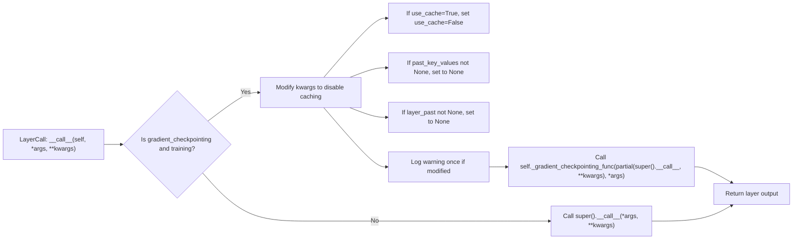
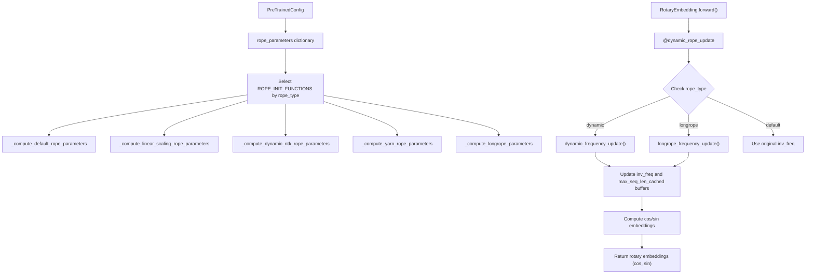
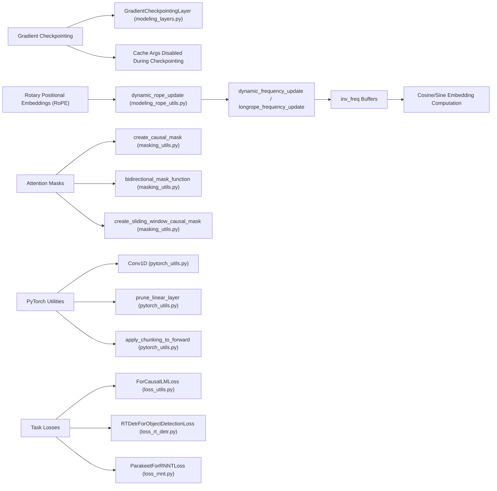
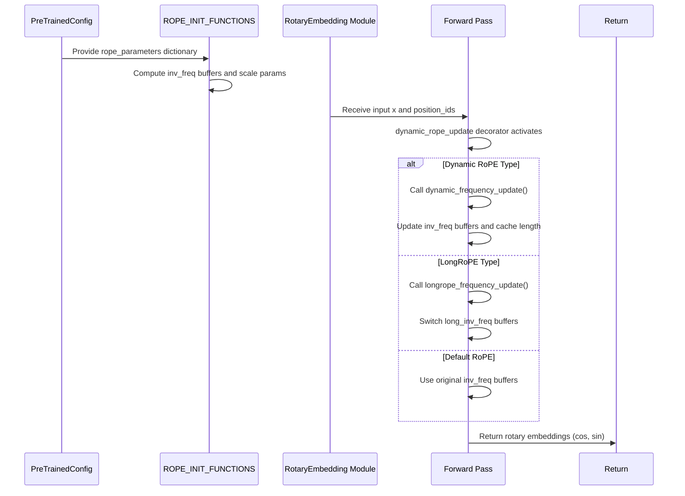

<!-- source: DeepWiki mcp.deepwiki.com · repo huggingface/transformers · page 2.4 Common Modeling Layers & Utilities · fetched 2026-10-26 -->

# Common Modeling Layers & Utilities

<details>
<summary>Relevant source files</summary>

The following files were used as context for generating this wiki page:

- [docs/source/en/model_doc/inkling.md](docs/source/en/model_doc/inkling.md)
- [docs/source/en/model_doc/mm-grounding-dino.md](docs/source/en/model_doc/mm-grounding-dino.md)
- [docs/source/en/model_doc/phi4_multimodal.md](docs/source/en/model_doc/phi4_multimodal.md)
- [src/transformers/generation/stopping_criteria.py](src/transformers/generation/stopping_criteria.py)
- [src/transformers/loss/loss_d_fine.py](src/transformers/loss/loss_d_fine.py)
- [src/transformers/loss/loss_utils.py](src/transformers/loss/loss_utils.py)
- [src/transformers/modeling_layers.py](src/transformers/modeling_layers.py)
- [src/transformers/modeling_rope_utils.py](src/transformers/modeling_rope_utils.py)
- [src/transformers/models/d_fine/configuration_d_fine.py](src/transformers/models/d_fine/configuration_d_fine.py)
- [src/transformers/models/d_fine/modeling_d_fine.py](src/transformers/models/d_fine/modeling_d_fine.py)
- [src/transformers/models/d_fine/modular_d_fine.py](src/transformers/models/d_fine/modular_d_fine.py)
- [src/transformers/models/deimv2/configuration_deimv2.py](src/transformers/models/deimv2/configuration_deimv2.py)
- [src/transformers/models/deimv2/modeling_deimv2.py](src/transformers/models/deimv2/modeling_deimv2.py)
- [src/transformers/models/deimv2/modular_deimv2.py](src/transformers/models/deimv2/modular_deimv2.py)
- [src/transformers/models/grounding_dino/modeling_grounding_dino.py](src/transformers/models/grounding_dino/modeling_grounding_dino.py)
- [src/transformers/models/grounding_dino/processing_grounding_dino.py](src/transformers/models/grounding_dino/processing_grounding_dino.py)
- [src/transformers/models/inkling/configuration_inkling.py](src/transformers/models/inkling/configuration_inkling.py)
- [src/transformers/models/inkling/feature_extraction_inkling.py](src/transformers/models/inkling/feature_extraction_inkling.py)
- [src/transformers/models/inkling/image_processing_inkling.py](src/transformers/models/inkling/image_processing_inkling.py)
- [src/transformers/models/inkling/modeling_inkling.py](src/transformers/models/inkling/modeling_inkling.py)
- [src/transformers/models/inkling/modular_inkling.py](src/transformers/models/inkling/modular_inkling.py)
- [src/transformers/models/inkling/processing_inkling.py](src/transformers/models/inkling/processing_inkling.py)
- [src/transformers/models/jina_embeddings_v3/modeling_jina_embeddings_v3.py](src/transformers/models/jina_embeddings_v3/modeling_jina_embeddings_v3.py)
- [src/transformers/models/jina_embeddings_v3/modular_jina_embeddings_v3.py](src/transformers/models/jina_embeddings_v3/modular_jina_embeddings_v3.py)
- [src/transformers/models/llama/configuration_llama.py](src/transformers/models/llama/configuration_llama.py)
- [src/transformers/models/mistral/configuration_mistral.py](src/transformers/models/mistral/configuration_mistral.py)
- [src/transformers/models/mm_grounding_dino/__init__.py](src/transformers/models/mm_grounding_dino/__init__.py)
- [src/transformers/models/mm_grounding_dino/configuration_mm_grounding_dino.py](src/transformers/models/mm_grounding_dino/configuration_mm_grounding_dino.py)
- [src/transformers/models/mm_grounding_dino/convert_mm_grounding_dino_to_hf.py](src/transformers/models/mm_grounding_dino/convert_mm_grounding_dino_to_hf.py)
- [src/transformers/models/mm_grounding_dino/modeling_mm_grounding_dino.py](src/transformers/models/mm_grounding_dino/modeling_mm_grounding_dino.py)
- [src/transformers/models/mm_grounding_dino/modular_mm_grounding_dino.py](src/transformers/models/mm_grounding_dino/modular_mm_grounding_dino.py)
- [src/transformers/models/nomic_bert/modeling_nomic_bert.py](src/transformers/models/nomic_bert/modeling_nomic_bert.py)
- [src/transformers/models/phi4_multimodal/convert_phi4_multimodal_weights_to_hf.py](src/transformers/models/phi4_multimodal/convert_phi4_multimodal_weights_to_hf.py)
- [src/transformers/models/phi4_multimodal/processing_phi4_multimodal.py](src/transformers/models/phi4_multimodal/processing_phi4_multimodal.py)
- [src/transformers/models/pp_doclayout_v2/modeling_pp_doclayout_v2.py](src/transformers/models/pp_doclayout_v2/modeling_pp_doclayout_v2.py)
- [src/transformers/models/pp_doclayout_v2/modular_pp_doclayout_v2.py](src/transformers/models/pp_doclayout_v2/modular_pp_doclayout_v2.py)
- [src/transformers/models/pp_doclayout_v3/image_processing_pp_doclayout_v3.py](src/transformers/models/pp_doclayout_v3/image_processing_pp_doclayout_v3.py)
- [src/transformers/models/pp_doclayout_v3/modeling_pp_doclayout_v3.py](src/transformers/models/pp_doclayout_v3/modeling_pp_doclayout_v3.py)
- [src/transformers/models/pp_doclayout_v3/modular_pp_doclayout_v3.py](src/transformers/models/pp_doclayout_v3/modular_pp_doclayout_v3.py)
- [src/transformers/models/rt_detr/configuration_rt_detr.py](src/transformers/models/rt_detr/configuration_rt_detr.py)
- [src/transformers/models/rt_detr/modeling_rt_detr.py](src/transformers/models/rt_detr/modeling_rt_detr.py)
- [src/transformers/models/rt_detr/modular_rt_detr.py](src/transformers/models/rt_detr/modular_rt_detr.py)
- [src/transformers/models/rt_detr_v2/configuration_rt_detr_v2.py](src/transformers/models/rt_detr_v2/configuration_rt_detr_v2.py)
- [src/transformers/models/rt_detr_v2/modeling_rt_detr_v2.py](src/transformers/models/rt_detr_v2/modeling_rt_detr_v2.py)
- [src/transformers/models/rt_detr_v2/modular_rt_detr_v2.py](src/transformers/models/rt_detr_v2/modular_rt_detr_v2.py)
- [src/transformers/models/tvp/modeling_tvp.py](src/transformers/models/tvp/modeling_tvp.py)
- [src/transformers/pytorch_utils.py](src/transformers/pytorch_utils.py)
- [tests/generation/test_stopping_criteria.py](tests/generation/test_stopping_criteria.py)
- [tests/models/d_fine/test_modeling_d_fine.py](tests/models/d_fine/test_modeling_d_fine.py)
- [tests/models/deimv2/test_modeling_deimv2.py](tests/models/deimv2/test_modeling_deimv2.py)
- [tests/models/grounding_dino/test_modeling_grounding_dino.py](tests/models/grounding_dino/test_modeling_grounding_dino.py)
- [tests/models/inkling/test_modeling_inkling.py](tests/models/inkling/test_modeling_inkling.py)
- [tests/models/inkling/test_processing_inkling.py](tests/models/inkling/test_processing_inkling.py)
- [tests/models/jina_embeddings_v3/test_modeling_jina_embeddings_v3.py](tests/models/jina_embeddings_v3/test_modeling_jina_embeddings_v3.py)
- [tests/models/mm_grounding_dino/test_modeling_mm_grounding_dino.py](tests/models/mm_grounding_dino/test_modeling_mm_grounding_dino.py)
- [tests/models/nomic_bert/test_modeling_nomic_bert.py](tests/models/nomic_bert/test_modeling_nomic_bert.py)
- [tests/models/phi4_multimodal/test_processing_phi4_multimodal.py](tests/models/phi4_multimodal/test_processing_phi4_multimodal.py)
- [tests/models/pp_doclayout_v2/test_modeling_pp_doclayout_v2.py](tests/models/pp_doclayout_v2/test_modeling_pp_doclayout_v2.py)
- [tests/models/pp_doclayout_v3/test_image_processing_pp_doclayout_v3.py](tests/models/pp_doclayout_v3/test_image_processing_pp_doclayout_v3.py)
- [tests/models/pp_doclayout_v3/test_modeling_pp_doclayout_v3.py](tests/models/pp_doclayout_v3/test_modeling_pp_doclayout_v3.py)
- [tests/models/rt_detr/test_modeling_rt_detr.py](tests/models/rt_detr/test_modeling_rt_detr.py)
- [tests/models/rt_detr_v2/test_modeling_rt_detr_v2.py](tests/models/rt_detr_v2/test_modeling_rt_detr_v2.py)
- [tests/models/tvp/test_modeling_tvp.py](tests/models/tvp/test_modeling_tvp.py)
- [tests/utils/test_modeling_rope_utils.py](tests/utils/test_modeling_rope_utils.py)

</details>


This section details the shared building blocks and utility functions used across model implementations in the Transformers library. These utilities ensure architectural consistency, provide optimized implementations for common operations such as Rotary Positional Embeddings (RoPE), manage complex logic including gradient checkpointing and attention masking, and unify loss calculation strategies across diverse tasks.

The main components covered include:
- `GradientCheckpointingLayer` as a base for activation checkpointing support in `[src/transformers/modeling_layers.py:53-110]()`,
- Utilities from `[src/transformers/modeling_layers.py]()` for common reusable layers and heads,
- Masking utilities from `[src/transformers/masking_utils.py]()` for attention mask generation,
- Advanced RoPE variants and dynamic update mechanisms in `[src/transformers/modeling_rope_utils.py:34-130]()`,
- Helper utilities for PyTorch in `[src/transformers/pytorch_utils.py:50-179]()`,
- The loss subpackage under `[src/transformers/loss/loss_utils.py:1-201]()` covering language modeling, sequence classification, segmentation, object detection, and speech recognition losses.

---

## Gradient Checkpointing Infrastructure

### Overview

Gradient checkpointing allows trading computation for memory efficiency during training by saving fewer intermediate activations and recomputing them on the backward pass. The Transformers library standardizes checkpointing support with a base class `GradientCheckpointingLayer` defined in `[src/transformers/modeling_layers.py:53-110]()` that can be extended by model layers.

### Implementation Details

- **Class:** `GradientCheckpointingLayer` inherits from `torch.nn.Module`.
- Overrides the `__call__` method to intercept forward calls.
- When `self.gradient_checkpointing` is `True` and the model is in training mode:
  - It disables caching-related keyword arguments like `use_cache`, `past_key_values`, and `layer_past` to avoid conflicts when recomputing activations.
  - Logs a warning once when modifying these arguments.
  - Calls the assigned checkpointing function `_gradient_checkpointing_func` which wraps the normal forward with checkpointing enabled.
  - Inputs that require gradients are passed as positional arguments to ensure gradient correctness during recomputation.
- Otherwise, it calls the usual forward pass.

### Usage Notes

- Inputs requiring gradients (e.g., hidden states) **must be passed as positional arguments** during checkpointing with `use_reentrant=True`.
- Passing such inputs as keyword arguments can break correct gradient propagation during recomputation.

### Diagram: `GradientCheckpointingLayer` Call Flow



Sources: `[src/transformers/modeling_layers.py:53-110]()`

---

## Rotary Positional Embeddings (RoPE) Utilities

### Overview of RoPE

Rotary Positional Embeddings enhance transformer models by encoding position information through rotations in the query and key vectors within attention. This approach allows effective relative positional representation and better extrapolation to longer sequences.

The library supports multiple RoPE variants via `[src/transformers/modeling_rope_utils.py]()`, including:
- **Default RoPE:** Classic sinusoidal frequency-based embeddings.
- **Linear scaling RoPE:** Frequencies scale linearly with position.
- **Dynamic NTK RoPE:** Dynamic recomputation of frequencies allowing variable sequence lengths.
- **YaRN RoPE:** A dynamic variant that uses beta parameters for scaling frequencies.
- **LongRoPE:** Switches between short and long frequency factors based on input sequence length.

### Dynamic RoPE Frequency Updates

Some RoPE variants update their inverse frequency tensors (`inv_freq`) dynamically during forward passes to handle sequence length changes or scaling properties. This dynamic update is managed by the `@dynamic_rope_update` decorator in `[src/transformers/modeling_rope_utils.py:34-130]()`.

- For **dynamic NTK** RoPE: the `dynamic_frequency_update` function handles growth beyond cached lengths and resets for short sequences.
- For **LongRoPE**: the `longrope_frequency_update` switches between stored short and long frequency buffers depending on the input token positions.

### RoPE Parameter Initialization Functions

RoPE variants have corresponding parameter initialization functions producing inverse frequency tensors and optional scaling factors. These functions are mapped in `ROPE_INIT_FUNCTIONS`:

```python
ROPE_INIT_FUNCTIONS = {
    "default": _compute_default_rope_parameters,
    "linear": _compute_linear_scaling_rope_parameters,
    "dynamic": _compute_dynamic_ntk_rope_parameters,
    "yarn": _compute_yarn_rope_parameters,
    "longrope": _compute_longrope_parameters,
}
```

### Diagram: RoPE Parameter Initialization and Forward Update



Sources: `[src/transformers/modeling_rope_utils.py:34-130]()`, `[src/transformers/modeling_rope_utils.py:255-303]()`

---

## Shared Modeling Layers in `modeling_layers.py`

This module defines reusable and generic modeling components used across multiple architectures, encouraging reuse and architectural uniformity.

### `GenericForSequenceClassification`

- Implemented in `[src/transformers/modeling_layers.py:114-163]()`.
- Instantiates a base model loaded from a given config (`AutoModel.from_config(config)`).
- Contains a linear classification head (`self.score`) on top of the final hidden states.
- The `forward` method routes inputs through the model and applies the classifier, supporting flexible input embedding modes and handling padding tokens carefully.

Sources: `[src/transformers/modeling_layers.py:53-163]()`

---

## Masking Utilities (`masking_utils.py`)

Attention masking is crucial to control token visibility in self-attention mechanisms across varying sequence lengths and architectures.

### Key Masking Utilities

- **`create_causal_mask`**: Generates standard lower-triangular masks to enforce autoregressive (causal) attention.
- **`bidirectional_mask_function`**: Supplies bidirectional mask logic useful for encoder models.
- **`create_sliding_window_causal_mask`**: Produces causal masks constrained to a limited sliding window across positions, enabling efficient long context handling.

Sources: `[src/transformers/masking_utils.py:1-100]()`, `[src/transformers/modeling_layers.py:30]()`

---

## PyTorch Utilities (`pytorch_utils.py`)

This module provides foundational PyTorch layers and helper functions used across models.

### Key Utilities

- **`Conv1D`** (`[src/transformers/pytorch_utils.py:95-122]()`): Implements a 1D convolutional layer consistent with GPT/OpenAI style, behaving like a linear projection with transposed weights.
- **`prune_linear_layer`** (`[src/transformers/pytorch_utils.py:61-92]()`): Prunes a linear layer by selecting a subset of indices in a specified dimension, returning a new `nn.Linear` layer with weights and biases remapped.
- **`apply_chunking_to_forward`** (`[src/transformers/pytorch_utils.py:124-179]()`): Splits input tensors into smaller chunks along a dimension, applies a forward function independently per chunk, and concatenates chunk outputs to reduce memory footprint.

Sources: `[src/transformers/pytorch_utils.py:50-179]()`

---

## Loss Subpackage (`loss/`)

The `loss/` subpackage standardizes loss calculations across diverse tasks, ranging from standard language modeling to object detection and speech recognition.

### Key Loss Functions and Modules

- **`fixed_cross_entropy` & `ForCausalLMLoss`**: Implemented in `[src/transformers/loss/loss_utils.py:32-71]()`, handles token upcasting, label shifting for autoregressive targets, and normalization by `num_items_in_batch`.
- **`ForMaskedLMLoss`, `ForSequenceClassificationLoss`, `ForQuestionAnsweringLoss`, `ForTokenClassification`, `ForSemanticSegmentationLoss`**: Standard losses for BERT-style masked language modeling, classification, regression, span QA, token classification, and segmentation (`[src/transformers/loss/loss_utils.py:74-201]()`).
- **Object Detection Losses**: Specialized bipartite matching and loss modules for detection models such as RT-DETR (`RTDetrForObjectDetectionLoss`, `[src/transformers/loss/loss_rt_detr.py]()`), D-FINE (`DFineForObjectDetectionLoss`, `[src/transformers/loss/loss_d_fine.py]()`), Deformable DETR (`DeformableDetrForObjectDetectionLoss`, `[src/transformers/loss/loss_deformable_detr.py]()`), and Grounding DINO (`GroundingDinoForObjectDetectionLoss`, `[src/transformers/loss/loss_grounding_dino.py]()`).
- **Speech Recognition Losses**: RNN-T and TDT loss integrations for Parakeet models (`ParakeetForRNNTLoss`, `ParakeetForTDTLoss`, `[src/transformers/loss/loss_rnnt.py]()`, `[src/transformers/loss/loss_tdt.py]()`).

Sources: `[src/transformers/loss/loss_utils.py:1-201]()`

---

# Summary Diagrams

## Mapping Natural Language Concepts to Code Entities



## Data Flow: RoPE Parameters Initialization and Forward Update



---

# References & Sources

- Gradient Checkpointing Layer & Generic Heads: `[src/transformers/modeling_layers.py:53-110]()`
- Rotary Positional Embeddings & Dynamic Updates: `[src/transformers/modeling_rope_utils.py:34-130]()`, `[src/transformers/modeling_rope_utils.py:255-303]()`
- Masking Utilities: `[src/transformers/modeling_layers.py:29]()`, `[src/transformers/masking_utils.py:1-100]()`
- PyTorch Utilities (Conv1D, Pruning, Chunking): `[src/transformers/pytorch_utils.py:50-179]()`
- Loss Utilities & Subpackage: `[src/transformers/loss/loss_utils.py:1-201]()`

---

