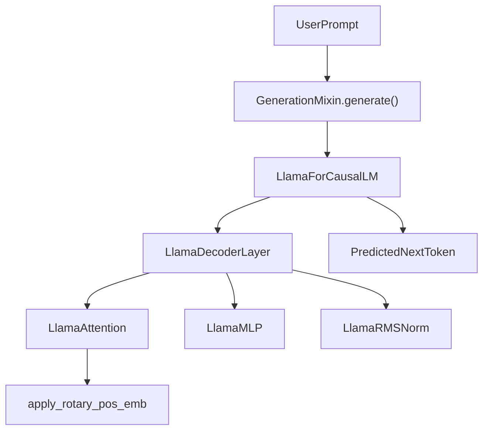
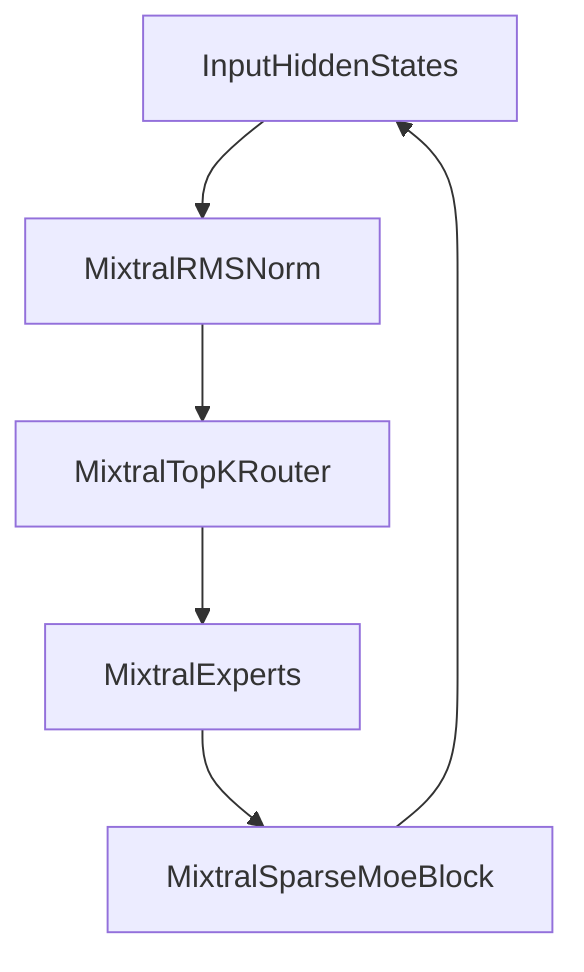

<!-- source: DeepWiki mcp.deepwiki.com · repo huggingface/transformers · page 3 Model Architectures · fetched 2026-10-26 -->

# Model Architectures

Relevant source files

The following files were used as context for generating this wiki page:

- [docs/source/en/model_doc/granitevision.md](docs/source/en/model_doc/granitevision.md)
- [docs/source/en/model_doc/idefics2.md](docs/source/en/model_doc/idefics2.md)
- [docs/source/en/model_doc/llava.md](docs/source/en/model_doc/llava.md)
- [docs/source/en/model_doc/llava_next.md](docs/source/en/model_doc/llava_next.md)
- [docs/source/en/model_doc/llava_next_video.md](docs/source/en/model_doc/llava_next_video.md)
- [docs/source/en/model_doc/llava_onevision.md](docs/source/en/model_doc/llava_onevision.md)
- [docs/source/en/model_doc/minimax.md](docs/source/en/model_doc/minimax.md)
- [docs/source/en/model_doc/mistral.md](docs/source/en/model_doc/mistral.md)
- [docs/source/en/model_doc/mistral3.md](docs/source/en/model_doc/mistral3.md)
- [docs/source/en/model_doc/mixtral.md](docs/source/en/model_doc/mixtral.md)
- [docs/source/en/model_doc/qwen2.md](docs/source/en/model_doc/qwen2.md)
- [docs/source/en/model_doc/qwen2_5_vl.md](docs/source/en/model_doc/qwen2_5_vl.md)
- [docs/source/en/model_doc/qwen2_moe.md](docs/source/en/model_doc/qwen2_moe.md)
- [docs/source/en/model_doc/qwen2_vl.md](docs/source/en/model_doc/qwen2_vl.md)
- [docs/source/en/model_doc/seamless_m4t.md](docs/source/en/model_doc/seamless_m4t.md)
- [docs/source/en/model_doc/seamless_m4t_v2.md](docs/source/en/model_doc/seamless_m4t_v2.md)
- [docs/source/en/model_doc/splinter.md](docs/source/en/model_doc/splinter.md)
- [docs/source/en/model_doc/switch_transformers.md](docs/source/en/model_doc/switch_transformers.md)
- [docs/source/en/model_doc/video_llava.md](docs/source/en/model_doc/video_llava.md)
- [docs/source/en/model_doc/vipllava.md](docs/source/en/model_doc/vipllava.md)
- [docs/source/en/model_doc/xlm-roberta.md](docs/source/en/model_doc/xlm-roberta.md)
- [docs/source/en/tasks/prompting.md](docs/source/en/tasks/prompting.md)
- [src/transformers/models/cohere/modeling_cohere.py](src/transformers/models/cohere/modeling_cohere.py)
- [src/transformers/models/gemma/modeling_gemma.py](src/transformers/models/gemma/modeling_gemma.py)
- [src/transformers/models/llama/modeling_llama.py](src/transformers/models/llama/modeling_llama.py)
- [src/transformers/models/llava_next/convert_llava_next_weights_to_hf.py](src/transformers/models/llava_next/convert_llava_next_weights_to_hf.py)
- [src/transformers/models/llava_onevision/convert_llava_onevision_weights_to_hf.py](src/transformers/models/llava_onevision/convert_llava_onevision_weights_to_hf.py)
- [src/transformers/models/mistral/__init__.py](src/transformers/models/mistral/__init__.py)
- [src/transformers/models/mistral/modeling_mistral.py](src/transformers/models/mistral/modeling_mistral.py)
- [src/transformers/models/mixtral/__init__.py](src/transformers/models/mixtral/__init__.py)
- [src/transformers/models/mixtral/modeling_mixtral.py](src/transformers/models/mixtral/modeling_mixtral.py)
- [src/transformers/models/olmo/modeling_olmo.py](src/transformers/models/olmo/modeling_olmo.py)
- [src/transformers/models/persimmon/modeling_persimmon.py](src/transformers/models/persimmon/modeling_persimmon.py)
- [src/transformers/models/phi/modeling_phi.py](src/transformers/models/phi/modeling_phi.py)
- [src/transformers/models/phi3/modeling_phi3.py](src/transformers/models/phi3/modeling_phi3.py)
- [src/transformers/models/qwen2/__init__.py](src/transformers/models/qwen2/__init__.py)
- [src/transformers/models/qwen2/modeling_qwen2.py](src/transformers/models/qwen2/modeling_qwen2.py)
- [src/transformers/models/qwen2_moe/__init__.py](src/transformers/models/qwen2_moe/__init__.py)
- [src/transformers/models/qwen2_moe/modeling_qwen2_moe.py](src/transformers/models/qwen2_moe/modeling_qwen2_moe.py)
- [src/transformers/models/stablelm/modeling_stablelm.py](src/transformers/models/stablelm/modeling_stablelm.py)
- [src/transformers/models/starcoder2/modeling_starcoder2.py](src/transformers/models/starcoder2/modeling_starcoder2.py)
- [tests/models/minimax/test_modeling_minimax.py](tests/models/minimax/test_modeling_minimax.py)

The `transformers` library supports an extensive range of model architectures that enable applications across diverse modalities and tasks, including autoregressive language modeling, sequence-to-sequence generation, vision, audio processing, and multimodal fusion. These models follow a modular "single-file-per-model" design philosophy, which enhances maintainability and clarity. Almost all models inherit from the base class `PreTrainedModel`, offering standard utilities for weight loading, configuration handling, and shared core components such as attention mechanisms, normalization layers, and rotary positional embeddings.

This page provides a high-level taxonomy of the major model families implemented under `transformers/models/`. For detailed architectural descriptions, implementation specifics, and design patterns, please refer to the linked child pages.

---

### Architectural Taxonomy

Models are organized by architecture type and main modality focus. Foundational building blocks—including RMSNorm normalization variants, rotary positional embeddings (RoPE), and SwiGLU-style MLPs—are shared and adapted across multiple model families.

---

#### 3.1. Decoder-Only Language Models (LLMs)

Decoder-only models are autoregressive transformers predicting the next token based on previous tokens in a unidirectional manner. This architecture paradigm underpins most modern large language models (LLMs).

Representative models include:
- Llama (`src/transformers/models/llama/modeling_llama.py`)
- Mistral (`src/transformers/models/mistral/modeling_mistral.py`)
- Gemma (`src/transformers/models/gemma/modeling_gemma.py`)
- Qwen2/3 (`src/transformers/models/qwen2/modeling_qwen2.py`)
- Phi (`src/transformers/models/phi/modeling_phi.py`)
- Cohere (`src/transformers/models/cohere/modeling_cohere.py`)
- StableLM, Starcoder2, OLMo, Falcon, and others.

Common architectural elements include:
- **Normalization:** Variants of RMSNorm for stable training and quality, e.g., `LlamaRMSNorm` [src/transformers/models/llama/modeling_llama.py:52-70]() and `GemmaRMSNorm` [src/transformers/models/gemma/modeling_gemma.py:63-81]().
- **Rotary Positional Embeddings (RoPE):** Used to encode relative position information efficiently, implemented as classes like `LlamaRotaryEmbedding` [src/transformers/models/llama/modeling_llama.py:72-117](), `GemmaRotaryEmbedding` [src/transformers/models/gemma/modeling_gemma.py:99-144](), and `CohereRotaryEmbedding` [src/transformers/models/cohere/modeling_cohere.py:67-112]().
- **Attention Variants:** Includes grouped-query attention (GQA) and sliding window causal masking.
- **MLP Blocks:** SwiGLU-style gated MLPs combining gating and activation (e.g., `GemmaMLP` [src/transformers/models/gemma/modeling_gemma.py:83-97]()).

For a comprehensive survey of decoder-only LLM architectures, core components, and model-specific nuances, see [Decoder-Only Language Models (LLMs)](#3.1).

Sources:
- [src/transformers/models/llama/modeling_llama.py:26-153]()
- [src/transformers/models/mistral/modeling_mistral.py:14-146]()
- [src/transformers/models/gemma/modeling_gemma.py:1-159]()

---

#### 3.2. Mixture-of-Experts (MoE) Models

Mixture-of-Experts architectures enhance model capacity with conditional computation by routing input tokens to specialized expert neural subnetworks dynamically, increasing parameter efficiency without linear computational cost growth.

Key features:
- **Routing:** Top-k expert selection per token, implemented via classes like `MixtralTopKRouter` [src/transformers/models/mixtral/modeling_mixtral.py:95-111]().
- **Expert Layers:** Sparse expert MLP subnetworks process routed tokens independently, e.g., `MixtralSparseMoeBlock` [src/transformers/models/mixtral/modeling_mixtral.py:113-130]() and `Qwen2MoeMLP` [src/transformers/models/qwen2_moe/modeling_qwen2_moe.py:122-136]().
- **Normalization:** Adapted RMSNorm layers designed for MoE stability, such as `Qwen2MoeRMSNorm` [src/transformers/models/qwen2_moe/modeling_qwen2_moe.py:55-73]().

For details on MoE routing algorithms, expert parallelism, load balancing, and auxiliary loss strategies, see the child page [Mixture-of-Experts (MoE) Models](#3.2).

Sources:
- [src/transformers/models/mixtral/modeling_mixtral.py:55-145]()
- [src/transformers/models/qwen2_moe/modeling_qwen2_moe.py:55-146]()

---

#### 3.3. State Space & Hybrid Models

State space models (SSMs) and hybrids combine efficient sequence modeling with or without attention. SSMs capture long-range dependencies via recurrent state updates, often mixed with attention layers.

Examples include: Mamba, Jamba, FalconMamba/H1, NemotronH, Qwen3-Next, RWKV.

This family optimizes memory and computation for very long sequences and hybrid attention+SSM architectures. Detailed coverage is in [State Space & Hybrid Models](#3.3).

Sources:
- [src/transformers/models/llama/modeling_llama.py:26-45]()

---

#### 3.4. Encoder-Decoder & Sequence-to-Sequence Models

Encoder-decoder transformers simultaneously encode input sequences and decode output sequences, making them suitable for translation, summarization, and other seq2seq tasks.

Models: T5 and derivatives (e.g., T5Gemma), BART, mBART, Marian, Pegasus, M2M-100, NLLB, SwitchTransformers, LongT5.

Architectural focus:
- Cross-attention layers bridging encoder and decoder.
- Weight sharing options between encoder and decoder.
- Sequence-to-sequence generation pipelines.

See [Encoder-Decoder & Sequence-to-Sequence Models](#3.4) for comprehensive details.

Sources:
- [src/transformers/models/llama/modeling_llama.py:26-45]()

---

#### 3.5. Encoder-Only & Embedding Models

Encoder-only models focus on bidirectional context encoding, widely used for masked language modeling, embeddings extraction, and classification.

Main groups:
- BERT-family: BERT, RoBERTa, XLM-R, ELECTRA, DeBERTa.
- Specialized variants: ModernBERT and its decoder variant.
- Non-Language encoders: ESM protein models trained on biological sequences.
- Retrieval and embedding solutions: ColPali, ColQwen2, and image model wrappers like those over timm.

For a deeper dive, see [Encoder-Only & Embedding Models](#3.5).

Sources:
- [src/transformers/models/llama/modeling_llama.py:26-45]()

---

#### 3.6. Vision Backbones & Object Detection

Vision transformers and related architectures support image classification, detection, and segmentation.

Models:
- Vision Transformers (ViT), DINOv2/v3, SigLIP, CLIP.
- Detection and segmentation: DETR, Deformable DETR, RT-DETR, D-FINE, Mask2Former, SAM family, Grounding DINO, OWL-ViT.

Utilities include backbone processing helpers optimized for vision tasks. Details: [Vision Backbones & Object Detection](#3.6).

Sources:
- [src/transformers/models/llama/modeling_llama.py:26-45]()

---

#### 3.7. Vision-Language Models

Vision-language models integrate textual and visual inputs in a multimodal transformer framework, enabling tasks like image captioning, VQA, and instruction-following models.

Representative models:
- LLaVA family, PaliGemma, BLIP/BLIP-2, InstructBLIP, Idefics2/3, SmolVLM, InternVL, Qwen2-VL/Qwen3-VL, GLM-4V, Janus, Gemma3.

Architectural highlights include image token expansion, multi-modal projection layers, and cross-modal fusion layers. Refer to [Vision-Language Models](#3.7) for coverage.

Sources:
- [src/transformers/models/llama/modeling_llama.py:26-45]()

---

#### 3.8. Audio & Speech Models

Models for speech recognition, text-to-speech, and audio codecs:
- Speech recognition: Whisper, Wav2Vec2, HuBERT, WavLM, SeamlessM4T, Parakeet, Voxtral.
- Text-to-speech: SpeechT5, Bark, VITS.
- Neural codecs: EnCodec, DAC, Mimi.

Techniques include CTC decoding, audio feature extraction, and vocoder integration. See [Audio & Speech Models](#3.8).

Sources:
- [src/transformers/models/llama/modeling_llama.py:26-45]()

---

#### 3.9. Multimodal Omni & Specialized Models

These span multiple simultaneous modalities such as text, vision, and audio, with integrated transformer backbones.

Examples: Qwen2.5-Omni, Qwen3-Omni, MusicGen, RAG, Qwen2-Audio, Kosmos-2.5, recurrent Gemma. See [Multimodal Omni & Specialized Models](#3.9) for details.

Sources:
- [src/transformers/models/llama/modeling_llama.py:26-45]()

---

### Architecture Mapping: Natural Language to Code Entities

To illustrate how the conceptual model families relate to specific code constructs within the codebase, the diagrams below bridge natural language structures and the concrete class names or functions implementing them.

#### Decoder-Only LLM Autoregressive Generation Flow

Sources:
- [src/transformers/models/llama/modeling_llama.py:26-153]()
- [src/transformers/models/mistral/modeling_mistral.py:14-146]()

#### Mixture-of-Experts (MoE) Token Routing and Expert Layers

Sources:
- [src/transformers/models/mixtral/modeling_mixtral.py:55-145]()

---

### Summary Table: Model Families Overview

| Model Family                     | Representative Classes / Files                                         | Primary Modality     | Key Architectural Features                                  |
|---------------------------------|-----------------------------------------------------------------------|---------------------|-------------------------------------------------------------|
| **Decoder-Only LLMs**            | `LlamaForCausalLM` [src/transformers/models/llama/modeling_llama.py]() | Text                | RMSNorm, RoPE, GQA attention, SwiGLU MLP, causal masking    |
| **Mixture-of-Experts (MoE)**    | `MixtralSparseMoeBlock` [src/transformers/models/mixtral/modeling_mixtral.py](), `Qwen2MoeMLP` [src/transformers/models/qwen2_moe/modeling_qwen2_moe.py]() | Text                | Top-k routing, sparse MLP experts, load balancing, expert parallelism |
| **State Space & Hybrid**         | Various non-attention and hybrid SSM models [see #3.3 child page]     | Sequence (Text etc.) | SSM recurrence, selective state spaces, hybrid attention+SSM|
| **Encoder-Decoder & Seq2Seq**   | T5, BART, Marian, Pegasus, NLLB, SwitchTransformers [see #3.4]       | Text                | Cross-attention, encoder-decoder sharing, seq2seq generation|
| **Encoder-Only & Embedding**    | BERT-family, ModernBERT, ESM, retrieval (e.g., ColPali) [see #3.5]    | Text / Embeddings   | Masked LM, embedding head, classification                    |
| **Vision Backbones & Detection**| ViT, DINOv2, DETR, Mask2Former, SAM [see #3.6]                       | Images               | Patch embedding, multi-head attention, detection heads      |
| **Vision-Language Models**       | LLaVA, BLIP, Qwen2-VL / Qwen3-VL, GLM-4V [see #3.7]                  | Images + Text        | Image token expansion, multimodal fusion, projectors         |
| **Audio & Speech Models**        | Whisper, Wav2Vec2, Bark, EnCodec [see #3.8]                         | Audio                | Audio features, CTC decoding, neural vocoders               |
| **Multimodal Omni & Specialized**| Qwen2.5-Omni, MusicGen, Kosmos-2.5 [see #3.9]                       | Text, Images, Audio  | Unified transformers, multimodal embedding, shared KV cache |

Sources:
- [src/transformers/models/llama/modeling_llama.py:1-153]()
- [src/transformers/models/mixtral/modeling_mixtral.py:1-145]()

---

