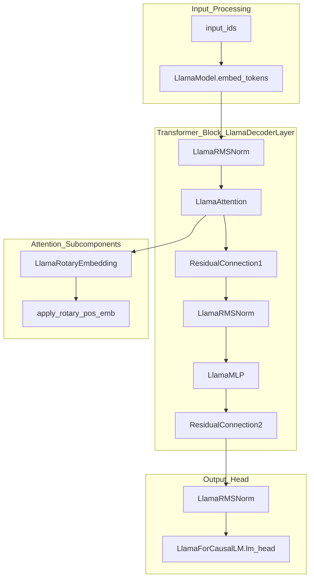
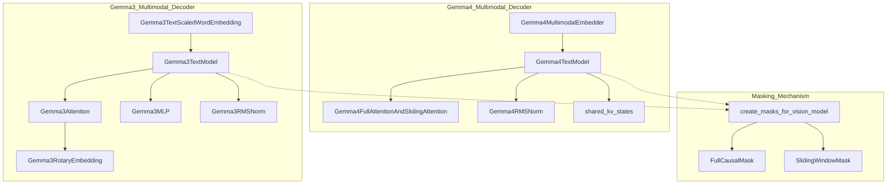
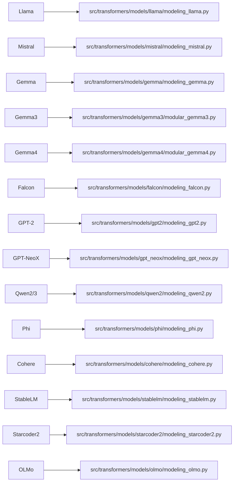
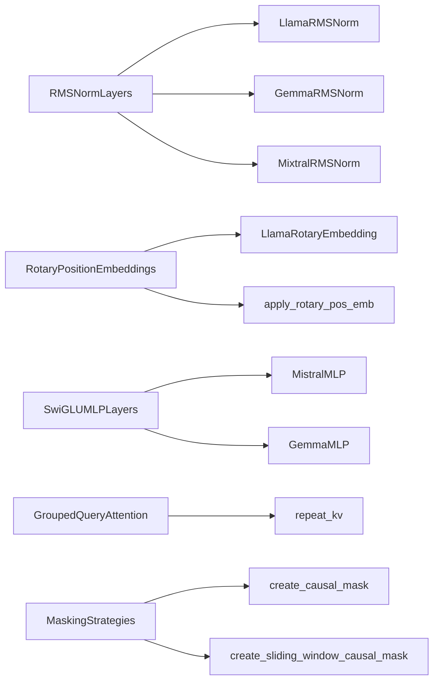

<!-- source: DeepWiki mcp.deepwiki.com · repo huggingface/transformers · page 3.1 Decoder-Only Language Models (LLMs) · fetched 2026-10-26 -->

# Decoder-Only Language Models (LLMs)

Relevant source files

The following files were used as context for generating this wiki page:

- [docs/source/en/model_doc/bark.md](docs/source/en/model_doc/bark.md)
- [docs/source/en/model_doc/gemma2.md](docs/source/en/model_doc/gemma2.md)
- [docs/source/en/model_doc/gemma4.md](docs/source/en/model_doc/gemma4.md)
- [docs/source/en/model_doc/gpt2.md](docs/source/en/model_doc/gpt2.md)
- [docs/source/en/model_doc/gpt_neox.md](docs/source/en/model_doc/gpt_neox.md)
- [docs/source/en/model_doc/kyutai_speech_to_text.md](docs/source/en/model_doc/kyutai_speech_to_text.md)
- [docs/source/ko/model_doc/gemma2.md](docs/source/ko/model_doc/gemma2.md)
- [src/transformers/models/bamba/configuration_bamba.py](src/transformers/models/bamba/configuration_bamba.py)
- [src/transformers/models/bamba/convert_mamba_ssm_checkpoint.py](src/transformers/models/bamba/convert_mamba_ssm_checkpoint.py)
- [src/transformers/models/bloom/modeling_bloom.py](src/transformers/models/bloom/modeling_bloom.py)
- [src/transformers/models/codegen/modeling_codegen.py](src/transformers/models/codegen/modeling_codegen.py)
- [src/transformers/models/cohere/modeling_cohere.py](src/transformers/models/cohere/modeling_cohere.py)
- [src/transformers/models/cohere2/configuration_cohere2.py](src/transformers/models/cohere2/configuration_cohere2.py)
- [src/transformers/models/cohere2/modeling_cohere2.py](src/transformers/models/cohere2/modeling_cohere2.py)
- [src/transformers/models/cohere2/modular_cohere2.py](src/transformers/models/cohere2/modular_cohere2.py)
- [src/transformers/models/ctrl/modeling_ctrl.py](src/transformers/models/ctrl/modeling_ctrl.py)
- [src/transformers/models/decision_transformer/modeling_decision_transformer.py](src/transformers/models/decision_transformer/modeling_decision_transformer.py)
- [src/transformers/models/diffllama/modeling_diffllama.py](src/transformers/models/diffllama/modeling_diffllama.py)
- [src/transformers/models/diffllama/modular_diffllama.py](src/transformers/models/diffllama/modular_diffllama.py)
- [src/transformers/models/diffusion_gemma/configuration_diffusion_gemma.py](src/transformers/models/diffusion_gemma/configuration_diffusion_gemma.py)
- [src/transformers/models/diffusion_gemma/convert_diffusion_gemma_weights.py](src/transformers/models/diffusion_gemma/convert_diffusion_gemma_weights.py)
- [src/transformers/models/encoder_decoder/modeling_encoder_decoder.py](src/transformers/models/encoder_decoder/modeling_encoder_decoder.py)
- [src/transformers/models/falcon/modeling_falcon.py](src/transformers/models/falcon/modeling_falcon.py)
- [src/transformers/models/falcon_h1/configuration_falcon_h1.py](src/transformers/models/falcon_h1/configuration_falcon_h1.py)
- [src/transformers/models/gemma/modeling_gemma.py](src/transformers/models/gemma/modeling_gemma.py)
- [src/transformers/models/gemma/modular_gemma.py](src/transformers/models/gemma/modular_gemma.py)
- [src/transformers/models/gemma2/modeling_gemma2.py](src/transformers/models/gemma2/modeling_gemma2.py)
- [src/transformers/models/gemma2/modular_gemma2.py](src/transformers/models/gemma2/modular_gemma2.py)
- [src/transformers/models/gemma3/configuration_gemma3.py](src/transformers/models/gemma3/configuration_gemma3.py)
- [src/transformers/models/gemma3/modeling_gemma3.py](src/transformers/models/gemma3/modeling_gemma3.py)
- [src/transformers/models/gemma3/modular_gemma3.py](src/transformers/models/gemma3/modular_gemma3.py)
- [src/transformers/models/gemma3n/configuration_gemma3n.py](src/transformers/models/gemma3n/configuration_gemma3n.py)
- [src/transformers/models/gemma3n/modeling_gemma3n.py](src/transformers/models/gemma3n/modeling_gemma3n.py)
- [src/transformers/models/gemma3n/modular_gemma3n.py](src/transformers/models/gemma3n/modular_gemma3n.py)
- [src/transformers/models/gemma4/configuration_gemma4.py](src/transformers/models/gemma4/configuration_gemma4.py)
- [src/transformers/models/gemma4/modeling_gemma4.py](src/transformers/models/gemma4/modeling_gemma4.py)
- [src/transformers/models/gemma4/modular_gemma4.py](src/transformers/models/gemma4/modular_gemma4.py)
- [src/transformers/models/gemma4_unified/configuration_gemma4_unified.py](src/transformers/models/gemma4_unified/configuration_gemma4_unified.py)
- [src/transformers/models/gemma4_unified/convert_gemma4_unified_weights.py](src/transformers/models/gemma4_unified/convert_gemma4_unified_weights.py)
- [src/transformers/models/gemma4_unified/modeling_gemma4_unified.py](src/transformers/models/gemma4_unified/modeling_gemma4_unified.py)
- [src/transformers/models/gemma4_unified/modular_gemma4_unified.py](src/transformers/models/gemma4_unified/modular_gemma4_unified.py)
- [src/transformers/models/gpt2/modeling_gpt2.py](src/transformers/models/gpt2/modeling_gpt2.py)
- [src/transformers/models/gpt_bigcode/modeling_gpt_bigcode.py](src/transformers/models/gpt_bigcode/modeling_gpt_bigcode.py)
- [src/transformers/models/gpt_neo/modeling_gpt_neo.py](src/transformers/models/gpt_neo/modeling_gpt_neo.py)
- [src/transformers/models/gpt_neox/modeling_gpt_neox.py](src/transformers/models/gpt_neox/modeling_gpt_neox.py)
- [src/transformers/models/gpt_neox_japanese/modeling_gpt_neox_japanese.py](src/transformers/models/gpt_neox_japanese/modeling_gpt_neox_japanese.py)
- [src/transformers/models/gptj/modeling_gptj.py](src/transformers/models/gptj/modeling_gptj.py)
- [src/transformers/models/granitemoehybrid/configuration_granitemoehybrid.py](src/transformers/models/granitemoehybrid/configuration_granitemoehybrid.py)
- [src/transformers/models/granitemoehybrid/modular_granitemoehybrid.py](src/transformers/models/granitemoehybrid/modular_granitemoehybrid.py)
- [src/transformers/models/granitemoeshared/modular_granitemoeshared.py](src/transformers/models/granitemoeshared/modular_granitemoeshared.py)
- [src/transformers/models/helium/configuration_helium.py](src/transformers/models/helium/configuration_helium.py)
- [src/transformers/models/kyutai_speech_to_text/__init__.py](src/transformers/models/kyutai_speech_to_text/__init__.py)
- [src/transformers/models/kyutai_speech_to_text/configuration_kyutai_speech_to_text.py](src/transformers/models/kyutai_speech_to_text/configuration_kyutai_speech_to_text.py)
- [src/transformers/models/kyutai_speech_to_text/convert_kyutai_speech_to_text_to_hf.py](src/transformers/models/kyutai_speech_to_text/convert_kyutai_speech_to_text_to_hf.py)
- [src/transformers/models/kyutai_speech_to_text/feature_extraction_kyutai_speech_to_text.py](src/transformers/models/kyutai_speech_to_text/feature_extraction_kyutai_speech_to_text.py)
- [src/transformers/models/kyutai_speech_to_text/modeling_kyutai_speech_to_text.py](src/transformers/models/kyutai_speech_to_text/modeling_kyutai_speech_to_text.py)
- [src/transformers/models/kyutai_speech_to_text/modular_kyutai_speech_to_text.py](src/transformers/models/kyutai_speech_to_text/modular_kyutai_speech_to_text.py)
- [src/transformers/models/llama/modeling_llama.py](src/transformers/models/llama/modeling_llama.py)
- [src/transformers/models/lxmert/modeling_lxmert.py](src/transformers/models/lxmert/modeling_lxmert.py)
- [src/transformers/models/mimi/modeling_mimi.py](src/transformers/models/mimi/modeling_mimi.py)
- [src/transformers/models/mistral/modeling_mistral.py](src/transformers/models/mistral/modeling_mistral.py)
- [src/transformers/models/mixtral/modeling_mixtral.py](src/transformers/models/mixtral/modeling_mixtral.py)
- [src/transformers/models/moshi/modeling_moshi.py](src/transformers/models/moshi/modeling_moshi.py)
- [src/transformers/models/mpt/modeling_mpt.py](src/transformers/models/mpt/modeling_mpt.py)
- [src/transformers/models/olmo/modeling_olmo.py](src/transformers/models/olmo/modeling_olmo.py)
- [src/transformers/models/openai/modeling_openai.py](src/transformers/models/openai/modeling_openai.py)
- [src/transformers/models/opt/modeling_opt.py](src/transformers/models/opt/modeling_opt.py)
- [src/transformers/models/persimmon/modeling_persimmon.py](src/transformers/models/persimmon/modeling_persimmon.py)
- [src/transformers/models/phi/modeling_phi.py](src/transformers/models/phi/modeling_phi.py)
- [src/transformers/models/phi3/modeling_phi3.py](src/transformers/models/phi3/modeling_phi3.py)
- [src/transformers/models/qwen2/modeling_qwen2.py](src/transformers/models/qwen2/modeling_qwen2.py)
- [src/transformers/models/qwen2_moe/modeling_qwen2_moe.py](src/transformers/models/qwen2_moe/modeling_qwen2_moe.py)
- [src/transformers/models/recurrent_gemma/modeling_recurrent_gemma.py](src/transformers/models/recurrent_gemma/modeling_recurrent_gemma.py)
- [src/transformers/models/speech_encoder_decoder/modeling_speech_encoder_decoder.py](src/transformers/models/speech_encoder_decoder/modeling_speech_encoder_decoder.py)
- [src/transformers/models/stablelm/modeling_stablelm.py](src/transformers/models/stablelm/modeling_stablelm.py)
- [src/transformers/models/starcoder2/modeling_starcoder2.py](src/transformers/models/starcoder2/modeling_starcoder2.py)
- [src/transformers/models/t5gemma2/configuration_t5gemma2.py](src/transformers/models/t5gemma2/configuration_t5gemma2.py)
- [src/transformers/models/t5gemma2/modeling_t5gemma2.py](src/transformers/models/t5gemma2/modeling_t5gemma2.py)
- [src/transformers/models/t5gemma2/modular_t5gemma2.py](src/transformers/models/t5gemma2/modular_t5gemma2.py)
- [src/transformers/models/trocr/modeling_trocr.py](src/transformers/models/trocr/modeling_trocr.py)
- [src/transformers/models/vision_encoder_decoder/modeling_vision_encoder_decoder.py](src/transformers/models/vision_encoder_decoder/modeling_vision_encoder_decoder.py)
- [src/transformers/models/xglm/modeling_xglm.py](src/transformers/models/xglm/modeling_xglm.py)
- [tests/models/aya_vision/test_modeling_aya_vision.py](tests/models/aya_vision/test_modeling_aya_vision.py)
- [tests/models/cohere2/test_modeling_cohere2.py](tests/models/cohere2/test_modeling_cohere2.py)
- [tests/models/deepseek_v3/test_modeling_deepseek_v3.py](tests/models/deepseek_v3/test_modeling_deepseek_v3.py)
- [tests/models/diffllama/test_modeling_diffllama.py](tests/models/diffllama/test_modeling_diffllama.py)
- [tests/models/fast_vlm/test_modeling_fast_vlm.py](tests/models/fast_vlm/test_modeling_fast_vlm.py)
- [tests/models/gemma/test_modeling_gemma.py](tests/models/gemma/test_modeling_gemma.py)
- [tests/models/gemma2/test_modeling_gemma2.py](tests/models/gemma2/test_modeling_gemma2.py)
- [tests/models/gemma3/test_modeling_gemma3.py](tests/models/gemma3/test_modeling_gemma3.py)
- [tests/models/gemma3n/test_modeling_gemma3n.py](tests/models/gemma3n/test_modeling_gemma3n.py)
- [tests/models/gemma4/test_modeling_gemma4.py](tests/models/gemma4/test_modeling_gemma4.py)
- [tests/models/gemma4_unified/test_modeling_gemma4_unified.py](tests/models/gemma4_unified/test_modeling_gemma4_unified.py)
- [tests/models/gpt2/test_modeling_gpt2.py](tests/models/gpt2/test_modeling_gpt2.py)
- [tests/models/gpt_neox/test_modeling_gpt_neox.py](tests/models/gpt_neox/test_modeling_gpt_neox.py)
- [tests/models/granitemoehybrid/test_modeling_granitemoehybrid.py](tests/models/granitemoehybrid/test_modeling_granitemoehybrid.py)
- [tests/models/lighton_ocr/test_modeling_lighton_ocr.py](tests/models/lighton_ocr/test_modeling_lighton_ocr.py)
- [tests/models/llama/test_modeling_llama.py](tests/models/llama/test_modeling_llama.py)
- [tests/models/mistral/test_modeling_mistral.py](tests/models/mistral/test_modeling_mistral.py)
- [tests/models/mixtral/test_modeling_mixtral.py](tests/models/mixtral/test_modeling_mixtral.py)
- [tests/models/olmo/test_modeling_olmo.py](tests/models/olmo/test_modeling_olmo.py)
- [tests/models/paddleocr_vl/test_modeling_paddleocr_vl.py](tests/models/paddleocr_vl/test_modeling_paddleocr_vl.py)
- [tests/models/paligemma2/test_modeling_paligemma2.py](tests/models/paligemma2/test_modeling_paligemma2.py)
- [tests/models/perception_lm/test_modeling_perception_lm.py](tests/models/perception_lm/test_modeling_perception_lm.py)
- [tests/models/phi3/test_modeling_phi3.py](tests/models/phi3/test_modeling_phi3.py)
- [tests/models/qwen2/test_modeling_qwen2.py](tests/models/qwen2/test_modeling_qwen2.py)
- [tests/models/qwen2_moe/test_modeling_qwen2_moe.py](tests/models/qwen2_moe/test_modeling_qwen2_moe.py)
- [tests/models/qwen3/test_modeling_qwen3.py](tests/models/qwen3/test_modeling_qwen3.py)
- [tests/models/qwen3_moe/test_modeling_qwen3_moe.py](tests/models/qwen3_moe/test_modeling_qwen3_moe.py)
- [tests/models/recurrent_gemma/test_modeling_recurrent_gemma.py](tests/models/recurrent_gemma/test_modeling_recurrent_gemma.py)
- [tests/models/t5gemma2/test_modeling_t5gemma2.py](tests/models/t5gemma2/test_modeling_t5gemma2.py)

Modern autoregressive Language Models (LLMs) in the Transformers library follow a decoder-only transformer architecture pattern. This design processes input token sequences through a stack of transformer decoder layers under causal masking, enforcing autoregressive generation where each token prediction depends only on previously generated tokens.

---

## Core Architecture Pattern

Popular decoder-only LLMs such as Llama, Mistral, Gemma (and its variants), Qwen2/3, Phi, Cohere, StableLM, Starcoder2, OLMo, Falcon, GPT-2, and GPT-NeoX share this general structure:

- **Input Embeddings Layer**: Converts input token IDs to dense hidden vectors, often scaled by a learned or static factor.
- **Transformer Decoder Blocks Stack**: Multiple layers consisting of:
  - Multi-headed self-attention sublayer, often enhanced by Rotary Positional Embeddings (RoPE) to encode relative positional information.
  - SwiGLU-activated feed-forward MLP layers (also called gated linear units).
  - Norm layers (usually RMSNorm variants) applied before or after submodules.
- **Causal Masking**: Ensures tokens can only attend to previous tokens and themselves, preserving autoregressiveness.
- **Output Head (Language Modeling Head)**: A linear projection layer that maps final hidden states to vocabulary logits for next token prediction.

Attention mechanisms may incorporate Grouped-Query Attention (GQA) to reduce memory and compute by sharing keys/values across groups of query heads, as used in Mistral, Llama 3, Falcon, etc.

Sources: [src/transformers/models/llama/modeling_llama.py:53-159](), [src/transformers/models/mistral/modeling_mistral.py:34-118]()

---

## Data Flow and Entity Mapping in Llama

The following diagram provides a technical mapping of Llama's key components from input tokens to final logits, bridging natural language concepts with code entities:

- Input tokens enter `LlamaModel` through `embed_tokens` [src/transformers/models/llama/modeling_llama.py:53-67]().
- Each transformer layer applies RMSNorm normalization, self-attention (`LlamaAttention`), and a SwiGLU MLP (`LlamaMLP`) [src/transformers/models/llama/modeling_llama.py:73-159]().
- Rotary position embeddings (`LlamaRotaryEmbedding`) inject relative positional info into queries and keys via `apply_rotary_pos_emb` [src/transformers/models/llama/modeling_llama.py:73-149]().
- Residual connections surround self-attention and MLP blocks for training stability.
- The final normalized hidden states are projected to vocabulary logits by `lm_head`.

Sources: [src/transformers/models/llama/modeling_llama.py:53-67](), [src/transformers/models/llama/modeling_llama.py:73-128](), [src/transformers/models/llama/modeling_llama.py:127-159]()

---

## Shared Components and Implementation Details

### Rotary Positional Embeddings (RoPE)

RoPE is the prevalent technique for encoding positional information:

- Encodes relative token positions using rotation-based embeddings applied multiplicatively to query/key vectors in attention.
- Classes like `LlamaRotaryEmbedding` compute inverse frequency tensors and a scaling factor (`rope_theta` hyperparameter) for embedding calculation [src/transformers/models/llama/modeling_llama.py:73-117]().
- The `apply_rotary_pos_emb(q, k, cos, sin)` function applies rotary embeddings efficiently by splitting and rotating halves of the hidden dimensions [src/transformers/models/llama/modeling_llama.py:119-149]().
- Advanced features include "dynamic RoPE update," allowing positional embeddings to adapt for varying sequence lengths, important in Llama 3.1 and others [src/transformers/models/llama/modeling_llama.py:108-117]().
- Variants of RoPE (e.g., "default") differ slightly across model implementations like Mistral, Gemma, Gemma2, Falcon, Qwen2, and Cohere.

Sources: [src/transformers/models/llama/modeling_llama.py:73-155](), [src/transformers/models/mistral/modeling_mistral.py:51-81](), [src/transformers/models/gemma/modeling_gemma.py:99-159](), [src/transformers/models/gemma2/modeling_gemma2.py:85-140]()

---

### RMS Normalization (RMSNorm)

RMSNorm normalizes by root mean square magnitude, omitting mean subtraction:

- Implemented for efficiency and numerical stability benefits over LayerNorm.
- `LlamaRMSNorm` defines the norm with a learnable parameter `weight` and epsilon `eps` to avoid divide-by-zero [src/transformers/models/llama/modeling_llama.py:51-70]().
- Gemma and Mistral variants (e.g., `GemmaRMSNorm`, `MixtralRMSNorm`) extend with additional learnable offset bias `(1 + weight)` and differences in normalization ordering [src/transformers/models/gemma/modeling_gemma.py:63-80](), [src/transformers/models/mixtral/modeling_mixtral.py:133-145]().
- Implementations convert inputs to float32 for stable variance calculation and cast back to original dtype on output [src/transformers/models/llama/modeling_llama.py:61-66]().

Sources: [src/transformers/models/llama/modeling_llama.py:53-67](), [src/transformers/models/gemma/modeling_gemma.py:63-80](), [src/transformers/models/mixtral/modeling_mixtral.py:133-145]()

---

### SwiGLU MLP (Feed-Forward Layer)

All modern decoder-only LLMs utilize SwiGLU gating in the feed-forward block to improve expressivity:

- Contains three linear layers:
  - `gate_proj`: projects input to intermediate hidden size [src/transformers/models/mistral/modeling_mistral.py:40]().
  - `up_proj`: alternative projection (same size) [src/transformers/models/mistral/modeling_mistral.py:41]().
  - `down_proj`: projects back to hidden size [src/transformers/models/mistral/modeling_mistral.py:42]().
- The forward pass computes: `down_proj(activation(gate_proj(x)) * up_proj(x))` [src/transformers/models/mistral/modeling_mistral.py:46]().
- Typical activation function is SiLU in Mistral and variants of GELU in Gemma family [src/transformers/models/mistral/modeling_mistral.py:43](), [src/transformers/models/gemma/modeling_gemma.py:92]().
- This gated structure allows multiplicative interactions increasing model capacity without higher parameter count.

Sources: [src/transformers/models/mistral/modeling_mistral.py:34-49](), [src/transformers/models/gemma/modeling_gemma.py:83-98]()

---

### Grouped-Query Attention (GQA)

GQA reduces memory and compute by grouping the key-value heads fewer than query heads:

- Keys and values are projected to fewer heads (`num_key_value_heads`), then repeated to match queries [src/transformers/models/mistral/modeling_mistral.py:83-107]().
- The `repeat_kv` function expands key/value tensors along group dimension to align with full attention heads [src/transformers/models/mistral/modeling_mistral.py:83-92]().
- Mistral’s attention explicitly implements this pattern, and it’s used across Llama 3, Falcon, and others for efficiency [src/transformers/models/mistral/modeling_mistral.py:83-118]().
- Enables a tradeoff between computational speed and modeling fidelity.

Sources: [src/transformers/models/mistral/modeling_mistral.py:83-118]()

---

### Masking and Attention Backends

- **Causal Masking:** Ensures tokens attend only to current and previous tokens, guaranteeing autoregressiveness [src/transformers/models/llama/modeling_llama.py:28]().
- Some models support **Sliding-Window Masking** where attention is limited to a fixed window of preceding tokens for scaling to long sequences (e.g., Mistral, Gemma3/4) [src/transformers/models/mistral/modeling_mistral.py:16](), [src/transformers/models/gemma3/modular_gemma3.py:30]().
- Masking utilities used include `create_causal_mask` and `create_sliding_window_causal_mask` [src/transformers/models/mistral/modeling_mistral.py:16]().
- Multiple attention backends are supported:
  - FlashAttention: CUDA/Triton-accelerated kernels providing high performance.
  - SDPA (Scaled Dot-Product Attention): reference implementation.
  - Eager attention: manual computation with masking and dropout, for compatibility [src/transformers/models/mistral/modeling_mistral.py:95-117]().
- KV caching systems hold past keys and values to enable fast decoding, especially for autoregressive generation [src/transformers/models/mistral/modeling_mistral.py:143]().

Sources: [src/transformers/models/mistral/modeling_mistral.py:16-40](), [src/transformers/models/mistral/modeling_mistral.py:95-118](), [src/transformers/models/llama/modeling_llama.py:28-40]()

---

## Model Variations Summary Table

| Feature                  | Llama                           | Mistral                       | Gemma                         | Falcon                       | GPT-2 / GPT-NeoX            |
|--------------------------|--------------------------------|-------------------------------|-------------------------------|------------------------------|-----------------------------|
| **Normalization**        | `LlamaRMSNorm`                 | `MixtralRMSNorm`              | `GemmaRMSNorm`                | `LayerNorm`                  | `LayerNorm`                 |
| **Positional Encoding**  | RoPE with dynamic scaling      | RoPE + sliding window mask    | RoPE                          | RoPE                         | Absolute/Rotary             |
| **Activation (MLP)**     | SiLU (SwiGLU)                  | SiLU (SwiGLU)                 | GELU and SwiGLU variants      | GELU                         | GELU / GELU-variants        |
| **Attention Mechanism**  | Multi-headed with GQA & MQA    | Grouped-Query Attention (GQA) | Multi-headed                  | Multi-headed with GQA & MQA  | Multi-headed standard SDPA  |
| **Masking**              | Strict causal                  | Sliding window causal         | Strict causal                 | Strict causal                | Strict causal               |
| **KV Cache Support**     | Yes                           | Yes (flash attention optimized) | Yes                         | Yes                         | Yes                        |

Sources: [src/transformers/models/llama/modeling_llama.py:1-72](), [src/transformers/models/mistral/modeling_mistral.py:35-120](), [src/transformers/models/gemma/modeling_gemma.py:50-98](), [src/transformers/models/falcon/modeling_falcon.py:60-160]()

---

## Advanced Multimodal & Hybrid Decoder-Only Models

### Gemma 3 & Gemma 4 Extensions

- Gemma3 and Gemma4 extend decoder-only LLMs with **multimodal capabilities**, supporting text, image, and audio token embeddings [src/transformers/models/gemma3/modular_gemma3.py:50-120](), [src/transformers/models/gemma4/modular_gemma4.py:64-105]().
- Use specialized embedding layers like `Gemma3TextScaledWordEmbedding` and multimodal embedders [src/transformers/models/gemma3/modular_gemma3.py:61](), [src/transformers/models/gemma4/modular_gemma4.py:68]().
- Gemma4 enables **shared key-value caches across layers** (`shared_kv_states` dictionary) to optimize memory [src/transformers/models/gemma4/modular_gemma4.py:90]().
- Attention mechanisms mix full causal and local sliding-window attention for scalability [src/transformers/models/gemma3/modular_gemma3.py:122]().
- Masking functions such as `create_masks_for_vision_model` compose causal and sliding window masks, adapted for multimodal inputs [src/transformers/models/gemma4/modular_gemma4.py:83-143]().

### System Architecture Diagram: Gemma3 & Gemma4

Sources: [src/transformers/models/gemma3/modular_gemma3.py:50-130](), [src/transformers/models/gemma4/modular_gemma4.py:83-140](), [src/transformers/models/gemma4/modeling_gemma4.py:78-102]()

---

## Decoder-Only LLM Models and Their Code Mappings

Sources: Repository source files and import paths across `src/transformers/models/`.

---

## Common Components Shared Across LLM Models

Sources: [src/transformers/models/llama/modeling_llama.py:51-149](), [src/transformers/models/mistral/modeling_mistral.py:34-118](), [src/transformers/models/gemma/modeling_gemma.py:63-98]()

---

