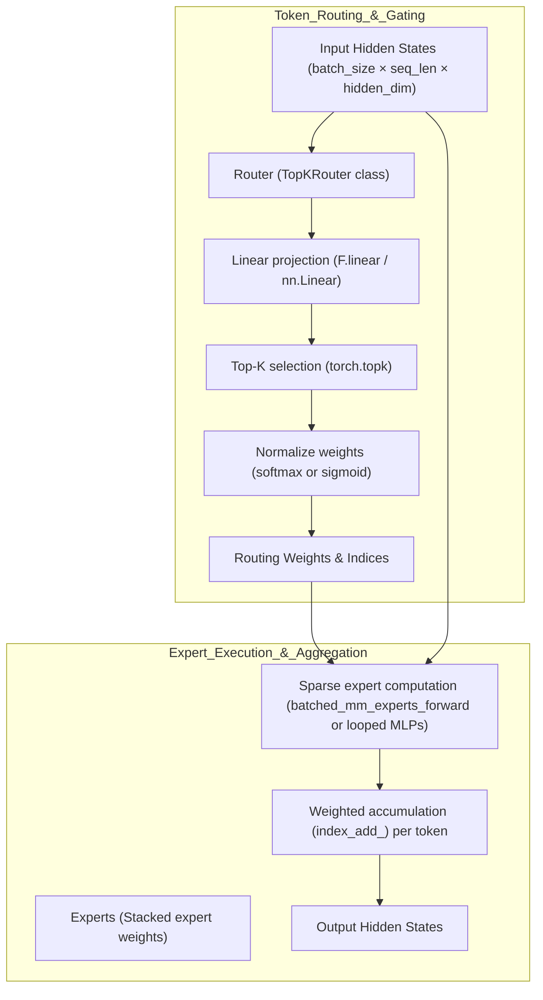
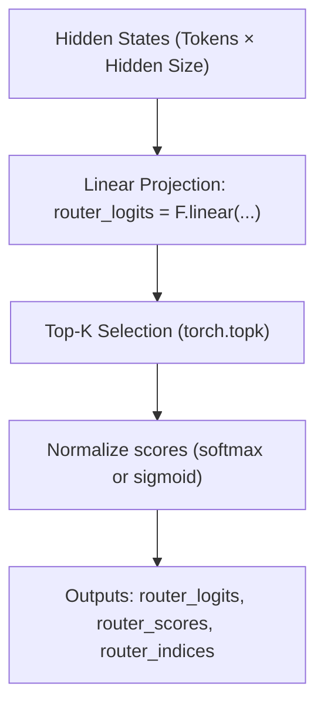
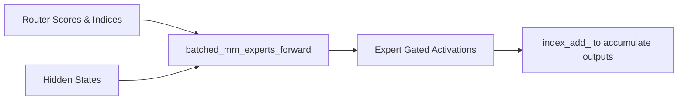

<!-- source: DeepWiki mcp.deepwiki.com · repo huggingface/transformers · page 3.2 Mixture-of-Experts (MoE) Models · fetched 2026-10-26 -->

# Mixture-of-Experts (MoE) Models

<details>
<summary>Relevant source files</summary>

The following files were used as context for generating this wiki page:

- [docs/source/en/model_doc/dbrx.md](docs/source/en/model_doc/dbrx.md)
- [docs/source/ko/model_doc/dbrx.md](docs/source/ko/model_doc/dbrx.md)
- [src/transformers/integrations/flash_attention.py](src/transformers/integrations/flash_attention.py)
- [src/transformers/integrations/flex_attention.py](src/transformers/integrations/flex_attention.py)
- [src/transformers/integrations/sdpa_attention.py](src/transformers/integrations/sdpa_attention.py)
- [src/transformers/models/afmoe/configuration_afmoe.py](src/transformers/models/afmoe/configuration_afmoe.py)
- [src/transformers/models/afmoe/modeling_afmoe.py](src/transformers/models/afmoe/modeling_afmoe.py)
- [src/transformers/models/afmoe/modular_afmoe.py](src/transformers/models/afmoe/modular_afmoe.py)
- [src/transformers/models/axk1/configuration_axk1.py](src/transformers/models/axk1/configuration_axk1.py)
- [src/transformers/models/axk1/modeling_axk1.py](src/transformers/models/axk1/modeling_axk1.py)
- [src/transformers/models/axk2/configuration_axk2.py](src/transformers/models/axk2/configuration_axk2.py)
- [src/transformers/models/axk2/modeling_axk2.py](src/transformers/models/axk2/modeling_axk2.py)
- [src/transformers/models/axk2/modular_axk2.py](src/transformers/models/axk2/modular_axk2.py)
- [src/transformers/models/dbrx/configuration_dbrx.py](src/transformers/models/dbrx/configuration_dbrx.py)
- [src/transformers/models/dbrx/modeling_dbrx.py](src/transformers/models/dbrx/modeling_dbrx.py)
- [src/transformers/models/dbrx/modular_dbrx.py](src/transformers/models/dbrx/modular_dbrx.py)
- [src/transformers/models/deepseek_ocr2/configuration_deepseek_ocr2.py](src/transformers/models/deepseek_ocr2/configuration_deepseek_ocr2.py)
- [src/transformers/models/deepseek_v2/configuration_deepseek_v2.py](src/transformers/models/deepseek_v2/configuration_deepseek_v2.py)
- [src/transformers/models/deepseek_v2/modeling_deepseek_v2.py](src/transformers/models/deepseek_v2/modeling_deepseek_v2.py)
- [src/transformers/models/deepseek_v2/modular_deepseek_v2.py](src/transformers/models/deepseek_v2/modular_deepseek_v2.py)
- [src/transformers/models/deepseek_v3/configuration_deepseek_v3.py](src/transformers/models/deepseek_v3/configuration_deepseek_v3.py)
- [src/transformers/models/deepseek_v3/modeling_deepseek_v3.py](src/transformers/models/deepseek_v3/modeling_deepseek_v3.py)
- [src/transformers/models/deepseek_v3/modular_deepseek_v3.py](src/transformers/models/deepseek_v3/modular_deepseek_v3.py)
- [src/transformers/models/deepseek_v32/configuration_deepseek_v32.py](src/transformers/models/deepseek_v32/configuration_deepseek_v32.py)
- [src/transformers/models/deepseek_v32/modeling_deepseek_v32.py](src/transformers/models/deepseek_v32/modeling_deepseek_v32.py)
- [src/transformers/models/deepseek_v32/modular_deepseek_v32.py](src/transformers/models/deepseek_v32/modular_deepseek_v32.py)
- [src/transformers/models/deepseek_v4/configuration_deepseek_v4.py](src/transformers/models/deepseek_v4/configuration_deepseek_v4.py)
- [src/transformers/models/deepseek_v4/modeling_deepseek_v4.py](src/transformers/models/deepseek_v4/modeling_deepseek_v4.py)
- [src/transformers/models/deepseek_v4/modular_deepseek_v4.py](src/transformers/models/deepseek_v4/modular_deepseek_v4.py)
- [src/transformers/models/doge/modeling_doge.py](src/transformers/models/doge/modeling_doge.py)
- [src/transformers/models/doge/modular_doge.py](src/transformers/models/doge/modular_doge.py)
- [src/transformers/models/dots1/configuration_dots1.py](src/transformers/models/dots1/configuration_dots1.py)
- [src/transformers/models/dots1/modeling_dots1.py](src/transformers/models/dots1/modeling_dots1.py)
- [src/transformers/models/dots1/modular_dots1.py](src/transformers/models/dots1/modular_dots1.py)
- [src/transformers/models/ernie4_5_moe/configuration_ernie4_5_moe.py](src/transformers/models/ernie4_5_moe/configuration_ernie4_5_moe.py)
- [src/transformers/models/exaone_moe/configuration_exaone_moe.py](src/transformers/models/exaone_moe/configuration_exaone_moe.py)
- [src/transformers/models/exaone_moe/modeling_exaone_moe.py](src/transformers/models/exaone_moe/modeling_exaone_moe.py)
- [src/transformers/models/exaone_moe/modular_exaone_moe.py](src/transformers/models/exaone_moe/modular_exaone_moe.py)
- [src/transformers/models/flex_olmo/configuration_flex_olmo.py](src/transformers/models/flex_olmo/configuration_flex_olmo.py)
- [src/transformers/models/flex_olmo/modeling_flex_olmo.py](src/transformers/models/flex_olmo/modeling_flex_olmo.py)
- [src/transformers/models/flex_olmo/modular_flex_olmo.py](src/transformers/models/flex_olmo/modular_flex_olmo.py)
- [src/transformers/models/glm4_moe/configuration_glm4_moe.py](src/transformers/models/glm4_moe/configuration_glm4_moe.py)
- [src/transformers/models/glm4_moe/modeling_glm4_moe.py](src/transformers/models/glm4_moe/modeling_glm4_moe.py)
- [src/transformers/models/glm4_moe/modular_glm4_moe.py](src/transformers/models/glm4_moe/modular_glm4_moe.py)
- [src/transformers/models/glm4_moe_lite/configuration_glm4_moe_lite.py](src/transformers/models/glm4_moe_lite/configuration_glm4_moe_lite.py)
- [src/transformers/models/glm4_moe_lite/modeling_glm4_moe_lite.py](src/transformers/models/glm4_moe_lite/modeling_glm4_moe_lite.py)
- [src/transformers/models/glm4_moe_lite/modular_glm4_moe_lite.py](src/transformers/models/glm4_moe_lite/modular_glm4_moe_lite.py)
- [src/transformers/models/glm5_next/configuration_glm5_next.py](src/transformers/models/glm5_next/configuration_glm5_next.py)
- [src/transformers/models/glm5_next/modeling_glm5_next.py](src/transformers/models/glm5_next/modeling_glm5_next.py)
- [src/transformers/models/glm5_next/modular_glm5_next.py](src/transformers/models/glm5_next/modular_glm5_next.py)
- [src/transformers/models/glm_moe_dsa/configuration_glm_moe_dsa.py](src/transformers/models/glm_moe_dsa/configuration_glm_moe_dsa.py)
- [src/transformers/models/glm_moe_dsa/modeling_glm_moe_dsa.py](src/transformers/models/glm_moe_dsa/modeling_glm_moe_dsa.py)
- [src/transformers/models/glm_moe_dsa/modular_glm_moe_dsa.py](src/transformers/models/glm_moe_dsa/modular_glm_moe_dsa.py)
- [src/transformers/models/gpt_oss/configuration_gpt_oss.py](src/transformers/models/gpt_oss/configuration_gpt_oss.py)
- [src/transformers/models/gpt_oss/modeling_gpt_oss.py](src/transformers/models/gpt_oss/modeling_gpt_oss.py)
- [src/transformers/models/gpt_oss/modular_gpt_oss.py](src/transformers/models/gpt_oss/modular_gpt_oss.py)
- [src/transformers/models/granite_swa/modeling_granite_swa.py](src/transformers/models/granite_swa/modeling_granite_swa.py)
- [src/transformers/models/granite_swa/modular_granite_swa.py](src/transformers/models/granite_swa/modular_granite_swa.py)
- [src/transformers/models/granitemoe/modeling_granitemoe.py](src/transformers/models/granitemoe/modeling_granitemoe.py)
- [src/transformers/models/granitemoe/modular_granitemoe.py](src/transformers/models/granitemoe/modular_granitemoe.py)
- [src/transformers/models/granitemoe_swa/modeling_granitemoe_swa.py](src/transformers/models/granitemoe_swa/modeling_granitemoe_swa.py)
- [src/transformers/models/granitemoe_swa/modular_granitemoe_swa.py](src/transformers/models/granitemoe_swa/modular_granitemoe_swa.py)
- [src/transformers/models/granitemoeshared/modeling_granitemoeshared.py](src/transformers/models/granitemoeshared/modeling_granitemoeshared.py)
- [src/transformers/models/hunyuan_v1_moe/configuration_hunyuan_v1_moe.py](src/transformers/models/hunyuan_v1_moe/configuration_hunyuan_v1_moe.py)
- [src/transformers/models/hy_v4/__init__.py](src/transformers/models/hy_v4/__init__.py)
- [src/transformers/models/hy_v4/configuration_hy_v4.py](src/transformers/models/hy_v4/configuration_hy_v4.py)
- [src/transformers/models/hy_v4/modeling_hy_v4.py](src/transformers/models/hy_v4/modeling_hy_v4.py)
- [src/transformers/models/hy_v4/modular_hy_v4.py](src/transformers/models/hy_v4/modular_hy_v4.py)
- [src/transformers/models/ibert/modeling_ibert.py](src/transformers/models/ibert/modeling_ibert.py)
- [src/transformers/models/jetmoe/modeling_jetmoe.py](src/transformers/models/jetmoe/modeling_jetmoe.py)
- [src/transformers/models/kimi_linear/modeling_kimi_linear.py](src/transformers/models/kimi_linear/modeling_kimi_linear.py)
- [src/transformers/models/llama4/configuration_llama4.py](src/transformers/models/llama4/configuration_llama4.py)
- [src/transformers/models/llama4/convert_llama4_weights_to_hf.py](src/transformers/models/llama4/convert_llama4_weights_to_hf.py)
- [src/transformers/models/llama4/modeling_llama4.py](src/transformers/models/llama4/modeling_llama4.py)
- [src/transformers/models/longcat_flash/configuration_longcat_flash.py](src/transformers/models/longcat_flash/configuration_longcat_flash.py)
- [src/transformers/models/longcat_flash/modeling_longcat_flash.py](src/transformers/models/longcat_flash/modeling_longcat_flash.py)
- [src/transformers/models/longcat_flash/modular_longcat_flash.py](src/transformers/models/longcat_flash/modular_longcat_flash.py)
- [src/transformers/models/minicpm3/modeling_minicpm3.py](src/transformers/models/minicpm3/modeling_minicpm3.py)
- [src/transformers/models/minicpm3/modular_minicpm3.py](src/transformers/models/minicpm3/modular_minicpm3.py)
- [src/transformers/models/minimax/configuration_minimax.py](src/transformers/models/minimax/configuration_minimax.py)
- [src/transformers/models/minimax/modeling_minimax.py](src/transformers/models/minimax/modeling_minimax.py)
- [src/transformers/models/minimax/modular_minimax.py](src/transformers/models/minimax/modular_minimax.py)
- [src/transformers/models/minimax_m2/configuration_minimax_m2.py](src/transformers/models/minimax_m2/configuration_minimax_m2.py)
- [src/transformers/models/minimax_m2/modular_minimax_m2.py](src/transformers/models/minimax_m2/modular_minimax_m2.py)
- [src/transformers/models/mistral4/configuration_mistral4.py](src/transformers/models/mistral4/configuration_mistral4.py)
- [src/transformers/models/mistral4/modeling_mistral4.py](src/transformers/models/mistral4/modeling_mistral4.py)
- [src/transformers/models/mistral4/modular_mistral4.py](src/transformers/models/mistral4/modular_mistral4.py)
- [src/transformers/models/mixtral/modular_mixtral.py](src/transformers/models/mixtral/modular_mixtral.py)
- [src/transformers/models/mllama/convert_mllama_weights_to_hf.py](src/transformers/models/mllama/convert_mllama_weights_to_hf.py)
- [src/transformers/models/mpnet/modeling_mpnet.py](src/transformers/models/mpnet/modeling_mpnet.py)
- [src/transformers/models/nystromformer/modeling_nystromformer.py](src/transformers/models/nystromformer/modeling_nystromformer.py)
- [src/transformers/models/olmoe/modeling_olmoe.py](src/transformers/models/olmoe/modeling_olmoe.py)
- [src/transformers/models/openai_privacy_filter/configuration_openai_privacy_filter.py](src/transformers/models/openai_privacy_filter/configuration_openai_privacy_filter.py)
- [src/transformers/models/openai_privacy_filter/modeling_openai_privacy_filter.py](src/transformers/models/openai_privacy_filter/modeling_openai_privacy_filter.py)
- [src/transformers/models/openai_privacy_filter/modular_openai_privacy_filter.py](src/transformers/models/openai_privacy_filter/modular_openai_privacy_filter.py)
- [src/transformers/models/phimoe/modeling_phimoe.py](src/transformers/models/phimoe/modeling_phimoe.py)
- [src/transformers/models/qwen3_5/configuration_qwen3_5.py](src/transformers/models/qwen3_5/configuration_qwen3_5.py)
- [src/transformers/models/qwen3_5_moe/configuration_qwen3_5_moe.py](src/transformers/models/qwen3_5_moe/configuration_qwen3_5_moe.py)
- [src/transformers/models/qwen3_moe/modeling_qwen3_moe.py](src/transformers/models/qwen3_moe/modeling_qwen3_moe.py)
- [src/transformers/models/qwen3_moe/modular_qwen3_moe.py](src/transformers/models/qwen3_moe/modular_qwen3_moe.py)
- [src/transformers/models/qwen3_next/configuration_qwen3_next.py](src/transformers/models/qwen3_next/configuration_qwen3_next.py)
- [src/transformers/models/qwen4_exp/modular_qwen4_exp.py](src/transformers/models/qwen4_exp/modular_qwen4_exp.py)
- [src/transformers/models/solar_open/configuration_solar_open.py](src/transformers/models/solar_open/configuration_solar_open.py)
- [src/transformers/models/solar_open/modeling_solar_open.py](src/transformers/models/solar_open/modeling_solar_open.py)
- [src/transformers/models/solar_open/modular_solar_open.py](src/transformers/models/solar_open/modular_solar_open.py)
- [src/transformers/models/vilt/modeling_vilt.py](src/transformers/models/vilt/modeling_vilt.py)
- [src/transformers/models/visual_bert/modeling_visual_bert.py](src/transformers/models/visual_bert/modeling_visual_bert.py)
- [src/transformers/models/youtu/modeling_youtu.py](src/transformers/models/youtu/modeling_youtu.py)
- [src/transformers/models/youtu/modular_youtu.py](src/transformers/models/youtu/modular_youtu.py)
- [tests/causal_lm_tester.py](tests/causal_lm_tester.py)
- [tests/fixtures/dac/expected_integration.json](tests/fixtures/dac/expected_integration.json)
- [tests/fixtures/gpt_oss/integration_tests.json](tests/fixtures/gpt_oss/integration_tests.json)
- [tests/models/afmoe/test_modeling_afmoe.py](tests/models/afmoe/test_modeling_afmoe.py)
- [tests/models/axk1/test_modeling_axk1.py](tests/models/axk1/test_modeling_axk1.py)
- [tests/models/axk2/test_modeling_axk2.py](tests/models/axk2/test_modeling_axk2.py)
- [tests/models/dbrx/test_modeling_dbrx.py](tests/models/dbrx/test_modeling_dbrx.py)
- [tests/models/doge/test_modeling_doge.py](tests/models/doge/test_modeling_doge.py)
- [tests/models/flex_olmo/test_modeling_flex_olmo.py](tests/models/flex_olmo/test_modeling_flex_olmo.py)
- [tests/models/florence2/test_modeling_florence2.py](tests/models/florence2/test_modeling_florence2.py)
- [tests/models/glm46v/test_modeling_glm46v.py](tests/models/glm46v/test_modeling_glm46v.py)
- [tests/models/glm4_moe_lite/test_modeling_glm4_moe_lite.py](tests/models/glm4_moe_lite/test_modeling_glm4_moe_lite.py)
- [tests/models/glm4v/test_modeling_glm4v.py](tests/models/glm4v/test_modeling_glm4v.py)
- [tests/models/glm4v_moe/test_modeling_glm4v_moe.py](tests/models/glm4v_moe/test_modeling_glm4v_moe.py)
- [tests/models/glm5_next/test_modeling_glm5_next.py](tests/models/glm5_next/test_modeling_glm5_next.py)
- [tests/models/glm_moe_dsa/test_modeling_glm_moe_dsa.py](tests/models/glm_moe_dsa/test_modeling_glm_moe_dsa.py)
- [tests/models/gpt_oss/test_modeling_gpt_oss.py](tests/models/gpt_oss/test_modeling_gpt_oss.py)
- [tests/models/hy_v4/__init__.py](tests/models/hy_v4/__init__.py)
- [tests/models/kimi_k25/test_modeling_kimi_k25.py](tests/models/kimi_k25/test_modeling_kimi_k25.py)
- [tests/models/minimax_m2/test_modeling_minimax_m2.py](tests/models/minimax_m2/test_modeling_minimax_m2.py)
- [tests/models/phimoe/test_modeling_phimoe.py](tests/models/phimoe/test_modeling_phimoe.py)
- [tests/models/qwen4_exp/test_modeling_qwen4_exp.py](tests/models/qwen4_exp/test_modeling_qwen4_exp.py)
- [tests/models/solar_open/test_modeling_solar_open.py](tests/models/solar_open/test_modeling_solar_open.py)
- [tests/models/tipsv2_dpt/test_modeling_tipsv2_dpt.py](tests/models/tipsv2_dpt/test_modeling_tipsv2_dpt.py)
- [tests/models/youtu/test_modeling_youtu.py](tests/models/youtu/test_modeling_youtu.py)

</details>


Mixture-of-Experts (MoE) architectures in the Hugging Face `transformers` library provide a scalable technique to increase model capacity by sparsely activating subsets of sub-networks ("experts") within each layer. This enables models such as Mixtral, Qwen2/3-MoE, DeepSeek-V2/V3/V3.2/V4, GPT-OSS, Llama4, DBRX, JetMoE, GraniteMoE, PhiMoE, OLMoE, GLM-MoE, and MiniMax to scale to extremely large parameter counts while maintaining inference-time efficiency.

This page details the MoE-specific architecture implemented across these models. It covers key components like the **TopKRouter** mechanism for expert selection, **expert weight stacking** optimizations, **load-balancing auxiliary loss**, and support for **expert parallelism** in distributed training and inference.

---

## Architecture Overview

MoE replaces the standard feed-forward network (FFN or MLP) layers in transformer blocks with sparse routing logic and a set of experts. Each token's hidden state selects a small subset of the experts, typically via a top-k gating mechanism, and routes computation accordingly.

### Core Components Diagram: Natural Language Space to Code Entity Space



- The **Router** maps hidden states to logits over experts. Top-k gating selects the experts and normalizes weights.
- The **Experts** form a set of parametric feed-forward blocks, implemented as stacked parameters for memory efficient batch execution.
- Sparse routing computes expert outputs for selected tokens and aggregates weighted outputs.
  
**Sources:**  
[src/transformers/models/llama4/modeling_llama4.py:141-152]()  
[src/transformers/models/gpt_oss/modular_gpt_oss.py:114-130]()  
[src/transformers/models/qwen3_moe/modeling_qwen3_moe.py:127-144]()  
[src/transformers/integrations/moe.py:78-132]()  

---

## 1. TopKRouter: Expert Routing Mechanism

The **TopKRouter** is responsible for choosing which experts each token attends to. It typically:

- Projects input hidden states into expert logits using a learned linear layer.
- Selects the top-k experts by highest logits.
- Applies a normalization (softmax or sigmoid + normalization) on selected logits to generate routing weights.

### Implementations

#### Llama4Router (Llama4)

- Linear layer parameterized with shape `(hidden_size, num_local_experts)` without bias.
- For each token, selects top-k experts and computes sigmoid-normalized scores, clipping others to -inf before sigmoid.
- Returns both normalized scores and raw logits for auxiliary loss computation.

```python
class Llama4Router(nn.Linear):
    def __init__(self, config):
        super().__init__(config.hidden_size, config.num_local_experts, bias=False)
        self.num_experts = config.num_local_experts
        self.top_k = config.num_experts_per_tok

    def forward(self, hidden_states):
        router_logits = super().forward(hidden_states)
        router_top_value, router_indices = torch.topk(router_logits, self.top_k, dim=1)
        router_scores = torch.full_like(router_logits, float("-inf")).scatter_(1, router_indices, router_top_value)
        router_scores = torch.nn.functional.sigmoid(router_scores.float()).to(router_scores.dtype)
        return router_scores, router_logits
```
[src/transformers/models/llama4/modeling_llama4.py:140-152]()

The sigmoid normalization differs from the more conventional softmax but is tailored for stable expert weighting in this model.

#### GptOssTopKRouter (GPT-OSS)

- Uses `F.linear` with learnable weights and bias.
- Applies softmax over top-k selected logits to obtain normalized router scores.
- Returns router logits, scores, and indices.

```python
class GptOssTopKRouter(nn.Module):
    def __init__(self, config):
        super().__init__()
        self.top_k = config.num_experts_per_tok
        self.num_experts = config.num_local_experts
        self.hidden_dim = config.hidden_size
        self.weight = nn.Parameter(torch.zeros(self.num_experts, self.hidden_dim))
        self.bias = nn.Parameter(torch.zeros(self.num_experts))

    def forward(self, hidden_states):
        router_logits = F.linear(hidden_states, self.weight, self.bias)  # (num_tokens, num_experts)
        router_top_value, router_indices = torch.topk(router_logits, self.top_k, dim=-1)  # (num_tokens, top_k)
        router_scores = torch.nn.functional.softmax(router_top_value, dim=1, dtype=router_top_value.dtype)
        return router_logits, router_scores, router_indices
```
[src/transformers/models/gpt_oss/modular_gpt_oss.py:114-129]()

#### Qwen3VLMoeTextTopKRouter (Qwen2/3-MoE)

- Simple linear transformation with learnable weight.
- Top-k selection with softmax normalization.
- Returns router logits, weights, and indices for further expert dispatch.

```python
class Qwen3VLMoeTextTopKRouter(nn.Module):
    def __init__(self, config):
        super().__init__()
        self.top_k = config.num_experts_per_tok
        self.num_experts = config.num_local_experts
        self.weight = nn.Parameter(torch.zeros(self.num_experts, config.hidden_size))

    def forward(self, hidden_states):
        router_logits = F.linear(hidden_states, self.weight)
        router_top_value, router_indices = torch.topk(router_logits, self.top_k, dim=1)
        router_scores = torch.nn.functional.softmax(router_top_value, dim=1, dtype=router_top_value.dtype)
        return router_logits, router_scores, router_indices
```
[src/transformers/models/qwen3_moe/modeling_qwen3_moe.py:127-144]()

### TopKRouter Workflow Diagram



**Sources:**  
[src/transformers/models/llama4/modeling_llama4.py:141-152]()  
[src/transformers/models/gpt_oss/modular_gpt_oss.py:114-130]()  
[src/transformers/models/qwen3_moe/modeling_qwen3_moe.py:127-144]()  

---

## 2. Expert Weight Stacking and Computation

Experts are implemented as collections of weight tensors stacked across the expert dimension rather than as separate modules per expert. This design allows efficient batched computation and seamless expert parallelism.

### Common Parameter Shapes

- For example, in `Llama4TextExperts`:
  - `gate_up_proj` parameter has shape `(num_experts, hidden_size, 2 * intermediate_size)`, combining gating and up projections.
  - `down_proj` parameter has shape `(num_experts, intermediate_size, hidden_size)`.

### Llama4TextExperts Forward

The forward process applies gating and activation per expert in a batched fashion:

- Reshape input hidden states to separate expert dimension.
- Compute `gate_up = hidden_states @ gate_up_proj` using batched matrix multiply.
- Split `gate_up` into `gate` and `up` parts.
- Apply nonlinearity to `gate` and multiply with `up`.
- Multiply by `down_proj`.
- Flatten result to original token dimension.

```python
class Llama4TextExperts(nn.Module):
    def __init__(self, config):
        super().__init__()
        self.num_experts = config.num_local_experts
        self.intermediate_size = config.intermediate_size
        self.hidden_size = config.hidden_size
        self.expert_dim = self.intermediate_size
        self.gate_up_proj = nn.Parameter(torch.zeros(self.num_experts, self.hidden_size, 2 * self.expert_dim))
        self.down_proj = nn.Parameter(torch.empty((self.num_experts, self.expert_dim, self.hidden_size)))
        self.act_fn = ACT2FN[config.hidden_act]

    def forward(self, hidden_states: torch.Tensor) -> torch.Tensor:
        """
        This should really not be run on a single machine, as we are reaching compute bound:
        - the inputs are expected to be "sorted" per expert already.
        - the weights are viewed with another dim, to match num_expert, 1, shape * num_tokens, shape
        Args:
            hidden_states (torch.Tensor): (batch_size * token_num, hidden_size)
            selected_experts (torch.Tensor): (batch_size * token_num, top_k)
            routing_weights (torch.Tensor): (batch_size * token_num, top_k)
        Returns:
            torch.Tensor
        """
        hidden_states = hidden_states.view(self.gate_up_proj.shape[0], -1, self.hidden_size)
        gate_up = torch.bmm(hidden_states, self.gate_up_proj)
        gate, up = gate_up.chunk(2, dim=-1)  # not supported for DTensors
        next_states = torch.bmm((up * self.act_fn(gate)), self.down_proj)
        next_states = next_states.view(-1, self.hidden_size)
        return next_states
```
[src/transformers/models/llama4/modeling_llama4.py:54-83]()

### GPT-OSS Experts

GPT-OSS experts extend the above with bias terms and a custom gating mechanism including clamping and scaling:

- Uses biases for gate-up and down projections.
- For each expert actively routed to by tokens, computes gated output.
- Uses an accumulation pattern via `index_add_` to combine weighted expert outputs according to routing weights.

This is implemented by iterating over experts hit by the current batch's router indices and applying masked specialist computation.

```python
@use_experts_implementation(is_concatenated=False, is_transposed=True, has_bias=True)
class GptOssExperts(nn.Module):
    def __init__(self, config):
        super().__init__()
        self.intermediate_size = config.intermediate_size
        self.num_experts = config.num_local_experts
        self.hidden_size = config.hidden_size
        self.gate_up_proj = nn.Parameter(torch.empty(self.num_experts, self.hidden_size, 2 * self.intermediate_size))
        self.gate_up_proj_bias = nn.Parameter(torch.empty(self.num_experts, 2 * self.intermediate_size))
        self.down_proj = nn.Parameter(torch.empty((self.num_experts, self.intermediate_size, self.hidden_size)))
        self.down_proj_bias = nn.Parameter(torch.empty(self.num_experts, self.hidden_size))
        self.alpha = config.swiglu_alpha
        self.limit = config.swiglu_limit

    def _apply_gate(self, gate_up: torch.Tensor) -> torch.Tensor:
        gate, up = gate_up[..., ::2], gate_up[..., 1::2]
        gate = gate.clamp(min=None, max=self.limit)
        up = up.clamp(min=-self.limit, max=self.limit)
        glu = gate * torch.sigmoid(gate * self.alpha)
        gated_output = (up + 1) * glu
        return gated_output

    def forward(self, hidden_states: torch.Tensor, router_indices=None, routing_weights=None) -> torch.Tensor:
        next_states = torch.zeros_like(hidden_states, dtype=hidden_states.dtype, device=hidden_states.device)
        with torch.no_grad():
            expert_mask = torch.nn.functional.one_hot(
                router_indices, num_classes=self.num_experts
            )  # masking is also a class
            expert_mask = expert_mask.permute(2, 1, 0)
            # we sum on the top_k and on the sequence length to get which experts
            # are hit this time around
            expert_hit = torch.greater(expert_mask.sum(dim=(-1, -2)), 0).nonzero()
        for expert_idx in expert_hit:
            # expert_idx only have 1 element, so we can use scale for fast indexing
            expert_idx = expert_idx[0]
            # skip masking index
            if expert_idx == self.num_experts:
                continue
            top_k_pos, token_idx = torch.where(expert_mask[expert_idx])
            current_state = hidden_states[token_idx]
            gate_up = current_state @ self.gate_up_proj[expert_idx] + self.gate_up_proj_bias[expert_idx]
            gated_output = self._apply_gate(gate_up)
            out = gated_output @ self.down_proj[expert_idx] + self.down_proj_bias[expert_idx]
            weighted_output = out * routing_weights[token_idx, top_k_pos, None]
            next_states.index_add_(0, token_idx, weighted_output.to(hidden_states.dtype))

        return next_states
```
[src/transformers/models/gpt_oss/modular_gpt_oss.py:66-112]()

### Batched Experts Dispatch Utility

To speed up expert computation, many models rely on the `batched_mm_experts_forward` function defined in `integrations/moe.py` (not fully shown here). This function performs batched matrix multiplication for all experts and tokens in a single kernel call, replacing slower Python loops. This function accepts tokens, routing indices, routing weights, expert weight tensors, and optionally performs margin clipping for expert parallelism safety.



This method enables parallel execution of all experts on all tokens with efficient GPU usage, essential to training and inference scaling.

**Sources:**  
[src/transformers/models/llama4/modeling_llama4.py:55-85]()  
[src/transformers/models/gpt_oss/modular_gpt_oss.py:66-112]()  
[src/transformers/integrations/moe.py:78-132]()  

---

## 3. Load-Balancing Auxiliary Loss

MoE training includes an auxiliary load-balancing loss to encourage an even distribution of tokens across experts and avoid collapse (where a few experts dominate). This loss uses router logits or probabilities to compute expert utilization statistics.

- Router logits or scores are exposed from the router forward passes.
- External training scripts compute this auxiliary loss during training.
- This mechanism is consistent across MoE models like Mixtral, Qwen2-MoE, and Llama4.

**Sources:**  
[src/transformers/models/mixtral/modeling_mixtral.py:45]()  
[src/transformers/models/qwen3_moe/modeling_qwen3_moe.py:44]()  

---

## 4. Expert Parallelism (EP)

Large MoE models can have thousands of experts distributed across multiple devices for scale-out training and inference. Expert parallelism handles sharding by experts.

- The router dispatches tokens to experts that may reside on different GPUs.
- The distributed infrastructure, via the `DistributedMixin` and parallelism plans (`ep_plan`), maps expert weights and router computations across devices.
- The `batched_mm_experts_forward` call includes margin clipping to safely index expert ranges per device.

This makes it possible to train models with extremely large total expert counts beyond single-GPU memory.

**Sources:**  
[src/transformers/integrations/moe.py:128-132]()  

---

## 5. Model-Specific MoE Implementations

| Model             | Router Class              | Expert Class                | Key Details                                                                           | File                                            |
|-------------------|---------------------------|-----------------------------|----------------------------------------------------------------------------------------|-------------------------------------------------|
| **Mixtral**       | `MixtralTopKRouter`       | `MixtralExperts`            | Classic top-k router. Jitter noise on inputs during training.                         | `src/transformers/models/mixtral/modeling_mixtral.py`  |
| **Qwen2/3-MoE**   | `Qwen3VLMoeTextTopKRouter`| `Qwen3VLMoeTextExperts`     | Sparse experts and shared dense MLP. Encoding top-k router with softmax scoring.      | `src/transformers/models/qwen3_moe/modeling_qwen3_moe.py` |
| **DeepSeek-V2/V3/V3.2/V4** | `DeepseekV3TopkRouter`  | `DeepseekV3MLP`             | Top-k routing with inference optimizations. DeepSeek-V4 uses `DeepseekV4MoE` and `DeepseekV4MLP`. | `src/transformers/models/deepseek_v3/modeling_deepseek_v3.py` <br> `src/transformers/models/deepseek_v4/modeling_deepseek_v4.py` |
| **GPT-OSS**       | `GptOssTopKRouter`        | `GptOssExperts`             | Bias-supported gating and GLU variant expert MLPs. Uses optimized kernel decorators.  | `src/transformers/models/gpt_oss/modular_gpt_oss.py`  |
| **Llama4**        | `Llama4Router`            | `Llama4TextExperts`         | Sigmoid normalized router with SwiGLU gating and a shared expert MLP.                | `src/transformers/models/llama4/modeling_llama4.py`      |
| **GraniteMoE**    | `GraniteTopKRouter`       | `GraniteExperts`            | Modular expert design with rotary embeddings and batching optimized with Flash Attention utils. | `src/transformers/models/granitemoe/modeling_granitemoe.py`   |
| **GLM-MoE-DSA**   | `GlmMoeDsaTopkRouter`     | Routed experts & Indexer    | Sparse attention with DSA indexer, interleaved rotary embeddings, and expert scaling. | `src/transformers/models/glm_moe_dsa/modular_glm_moe_dsa.py` |
| **DBRX**          | `DbrxTopKRouter`          | `DbrxExperts`               | Top-k router with custom expert implementation.                                       | `src/transformers/models/dbrx/modeling_dbrx.py` |
| **JetMoE**        | `JetMoeTopKGating`        | `JetMoeParallelExperts`     | Top-k gating with parallel expert weights for efficient computation.                  | `src/transformers/models/jetmoe/modeling_jetmoe.py` |
| **PhiMoE**        | `PhiMoETopKRouter`        | `PhiMoEExperts`             | Top-k router with custom expert implementation.                                       | `src/transformers/models/phimoe/modeling_phimoe.py` |
| **OLMoE**         | `OlmoeTopKRouter`         | `OlmoeExperts`              | Top-k router with custom expert implementation.                                       | `src/transformers/models/olmoe/modeling_olmoe.py` |
| **MiniMax**       | `MiniMaxTopKRouter`       | `MiniMaxExperts`            | Top-k router with custom expert implementation.                                       | `src/transformers/models/minimax/modeling_minimax.py` |

---

## 6. Rotary Embeddings in MoE Models

Rotary Positional Embeddings (RoPE) provide relative positional information within attention layers and are widely employed by MoE models for their efficiency and compatibility with sparse expert routing.

- Implemented as modular classes such as `Llama4RotaryEmbedding`, `JetMoeRotaryEmbedding`, `DeepseekV4RotaryEmbedding`, and `GlmMoeDsaRotaryEmbedding`.
- Typically, they compute per-head sinusoidal frequencies and apply rotations to query and key tensors.
- Many use advanced interleaved or partial rotary dimension patterns to optimize for memory and compute.
- Rotary embeddings are applied dynamically with support for variable sequence lengths and caching.

For example, `DeepseekV4RotaryEmbedding` [src/transformers/models/deepseek_v4/modeling_deepseek_v4.py:75-111]() handles multi-layer-type rotary embedding with interleaved RoPE, where `inv_freq` buffers are built per layer type. The `apply_rotary_pos_emb` function [src/transformers/models/deepseek_v4/modular_deepseek_v4.py:46-63]() specifically applies this interleaved RoPE to the trailing rope slice of the input tensor.

**Sources:**  
[src/transformers/models/llama4/modeling_llama4.py:39-42]()  
[src/transformers/models/jetmoe/modeling_jetmoe.py:68-141]()  
[src/transformers/models/deepseek_v4/modeling_deepseek_v4.py:74-131]()  
[src/transformers/models/deepseek_v4/modular_deepseek_v4.py:46-63]()  
[src/transformers/models/glm_moe_dsa/modeling_glm_moe_dsa.py:67-120]()  

---

## 7. Deployment and Kernel Integration

- Several MoE models use decorators such as `@use_kernel_forward_from_hub` [src/transformers/models/gpt_oss/modeling_gpt_oss.py:46]() or related decorators to load optimized expert kernels and RMSNorm implementations dynamically from the Hugging Face Hub.
- Integration with flash attention, fused MoE kernels, and fp8 quantization backends significantly improve inference throughput.
- The `_use_experts_implementation` decorator enables switching between PyTorch naive expert computations and highly optimized fused backends transparently.
- MoE sparse routing and batched expert invocation are tightly coupled with these optimized kernels for efficiency.
- For example, `GptOssExperts` [src/transformers/models/gpt_oss/modeling_gpt_oss.py:67]() is decorated with `@use_experts_implementation`, and `GptOssMLP` [src/transformers/models/gpt_oss/modeling_gpt_oss.py:133]() uses `@use_kernel_forward_from_hub("MegaBlocksMoeMLP")`. This allows the model to leverage highly optimized kernels for MoE operations.
- The `sdpa_attention_forward` function [src/transformers/integrations/sdpa_attention.py:80-92]() and `compile_friendly_flex_attention` [src/transformers/integrations/flex_attention.py:114-129]() are examples of how attention mechanisms are optimized for performance, which is crucial for MoE models.

**Sources:**
[src/transformers/models/gpt_oss/modeling_gpt_oss.py:46]()
[src/transformers/models/gpt_oss/modeling_gpt_oss.py:67]()
[src/transformers/models/gpt_oss/modeling_gpt_oss.py:133]()
[src/transformers/integrations/sdpa_attention.py:80-92]()
[src/transformers/integrations/flex_attention.py:114-129]()
[tests/models/gpt_oss/test_modeling_gpt_oss.py:95-99]()

---

## Summary Diagram: MoE Models to Key Code Entities

```mermaid
graph TD
    subgraph "Models"
        Mixtral["Mixtral"] 
        Qwen3VLMoE["Qwen3-VL-MoE"] 
        DeepSeekV3["DeepSeek-V2/V3/V3.2"] 
        DeepSeekV4["DeepSeek-V4"]
        GPT_OSS["GPT-OSS"] 
        Llama4["Llama4"] 
        Granite["GraniteMoE"] 
        GLM_MoE["GLM-MoE"]
        DBRX["DBRX"]
        JetMoE["JetMoE"]
        PhiMoE["PhiMoE"]
        OLMoE["OLMoE"]
        MiniMax["MiniMax"]
    end

    subgraph "Routers"
        Mixtral -- "MixtralTopKRouter" --> RouterMixtral["TopKRouter class"]
        Qwen3VLMoE -- "Qwen3VLMoeTextTopKRouter" --> RouterQwen3VLMoe["TopKRouter class"]
        DeepSeekV3 -- "DeepseekV3TopkRouter" --> RouterDeepseek["TopKRouter class"]
        DeepSeekV4 -- "DeepseekV4MoE" --> RouterDeepseekV4["TopKRouter class"]
        GPT_OSS -- "GptOssTopKRouter" --> RouterGptOss["TopKRouter class"]
        Llama4 -- "Llama4Router" --> RouterLlama4["Linear Router with Sigmoid"]
        Granite -- "GraniteTopKRouter" --> RouterGranite["TopKRouter class"]
        GLM_MoE -- "GlmMoeDsaTopkRouter" --> RouterGLM["Advanced TopKRouter with DSA"]
        DBRX -- "DbrxTopKRouter" --> RouterDBRX["TopKRouter class"]
        JetMoE -- "JetMoeTopKGating" --> RouterJet["TopKRouter class"]
        PhiMoE -- "PhiMoETopKRouter" --> RouterPhi["TopKRouter class"]
        OLMoE -- "OlmoeTopKRouter" --> RouterOLMoE["TopKRouter class"]
        MiniMax -- "MiniMaxTopKRouter" --> RouterMiniMax["TopKRouter class"]
    end

    subgraph "Experts"
        Mixtral -- "MixtralExperts" --> ExpertsMixtral["Gated SwiGLU Experts"]
        Qwen3VLMoE -- "Qwen3VLMoeTextExperts" --> ExpertsQwen3VLMoe["Sparse Experts + Shared MLP"]
        DeepSeekV3 -- "DeepseekV3MLP" --> ExpertsDeepseek["Sparse Experts MLP"]
        DeepSeekV4 -- "DeepseekV4MLP" --> ExpertsDeepseekV4["Sparse Experts MLP"]
        GPT_OSS -- "GptOssExperts" --> ExpertsGptOss["Gated GLU Experts"]
        Llama4 -- "Llama4TextExperts + Shared Expert MLP" --> ExpertsLlama4["Experts with gate_up_proj"]
        Granite -- "GraniteExperts" --> ExpertsGranite["Stacked Experts"]
        GLM_MoE -- "Routed Experts + Indexer" --> ExpertsGLM["Experts with routed scaling"]
        DBRX -- "DbrxExperts" --> ExpertsDBRX["Experts and rotary embedding"]
        JetMoE -- "JetMoeParallelExperts" --> ExpertsJet["Stacked parallel experts"]
        PhiMoE -- "PhiMoEExperts" --> ExpertsPhi["Gated Expert MLPs"]
        OLMoE -- "OlmoeExperts" --> ExpertsOLMoE["Sparse Experts with rotary embeddings"]
        MiniMax -- "MiniMaxExperts" --> ExpertsMiniMax["Sparse Experts MLP"]
    end

    Mixtral --> RouterMixtral --> ExpertsMixtral
    Qwen3VLMoE --> RouterQwen3VLMoe --> ExpertsQwen3VLMoe
    DeepSeekV3 --> RouterDeepseek --> ExpertsDeepseek
    DeepSeekV4 --> RouterDeepseekV4 --> ExpertsDeepseekV4
    GPT_OSS --> RouterGptOss --> ExpertsGptOss
    Llama4 --> RouterLlama4 --> ExpertsLlama4
    Granite --> RouterGranite --> ExpertsGranite
    GLM_MoE --> RouterGLM --> ExpertsGLM
    DBRX --> RouterDBRX --> ExpertsDBRX
    JetMoE --> RouterJet --> ExpertsJet
    PhiMoE --> RouterPhi --> ExpertsPhi
    OLMoE --> RouterOLMoE --> ExpertsOLMoE
    MiniMax --> RouterMiniMax --> ExpertsMiniMax
```



---

## Summary of Key Classes and Their Roles

| Class Name                | Model             | Role                                            | File Reference                                |
|---------------------------|-------------------|------------------------------------------------|-----------------------------------------------|
| `MixtralTopKRouter`       | Mixtral           | Router selecting top-k experts                  | `mixtral/modeling_mixtral.py:100-130`         |
| `MixtralExperts`          | Mixtral           | Stacked SwiGLU experts with gate projection    | `mixtral/modeling_mixtral.py:55-85`           |
| `Qwen3VLMoeTextTopKRouter`| Qwen3-VL-MoE      | Router producing softmax expert routing weights| `qwen3_moe/modeling_qwen3_moe.py:127-144`|
| `Qwen3VLMoeTextExperts`   | Qwen3-VL-MoE      | Sparse experts computed with expert masking    | `qwen3_moe/modeling_qwen3_moe.py:87-125`|
| `GptOssTopKRouter`        | GPT-OSS           | Router with linear projection, bias, top-k     | `gpt_oss/modular_gpt_oss.py:114-130`          |
| `GptOssExperts`           | GPT-OSS           | Experts with gated GLU structure and biases    | `gpt_oss/modular_gpt_oss.py:66-112`           |
| `Llama4Router`            | Llama4            | Sigmoid normalized router with linear layer    | `llama4/modeling_llama4.py:141-152`            |
| `Llama4TextExperts`       | Llama4            | Experts with gate_up_proj/down_proj architecture| `llama4/modeling_llama4.py:55-85`              |
| `DeepseekV3TopkRouter`    | DeepSeek-V3       | Top-K router with sigmoid scoring               | `deepseek_v3/modeling_deepseek_v3.py:131-147` |
| `DeepseekV3MLP`           | DeepSeek-V3       | Gated MoE expert MLP                            | `deepseek_v3/modeling_deepseek_v3.py:115-129` |
| `DeepseekV4MoE`           | DeepSeek-V4       | MoE layer with router and experts               | `deepseek_v4/modeling_deepseek_v4.py:1000-1020` |
| `DeepseekV4MLP`           | DeepSeek-V4       | Gated MoE expert MLP                            | `deepseek_v4/modeling_deepseek_v4.py:1022-1036` |
| `GraniteTopKRouter`       | GraniteMoE        | TopK router integrated with FlashAttention      | `granitemoe/modeling_granitemoe.py:121-150`   |
| `GraniteExperts`          | GraniteMoE        | Stacked experts with gating                      | `granitemoe/modeling_granitemoe.py:144-175`   |
| `GlmMoeDsaTopkRouter`     | GLM-MoE-DSA       | Advanced router with DSA indexing and sparse routing | `glm_moe_dsa/modular_glm_moe_dsa.py`         |
| `DbrxRotaryEmbedding`     | DBRX              | Rotary positional embedding                      | `dbrx/modeling_dbrx.py:44-97`                  |
| `DbrxExperts`             | DBRX              | Expert weights and gating                        | `dbrx/modeling_dbrx.py:200-250` (modular)     |
| `JetMoeTopKGating`        | JetMoE            | Standard top-k router                            | `jetmoe/modeling_jetmoe.py:160-180`            |
| `JetMoeParallelExperts`   | JetMoE            | Stacked expert weights optimized for parallelism| `jetmoe/modeling_jetmoe.py:115-138`            |
| `PhiMoETopKRouter`        | PhiMoE            | Top-k router with custom expert implementation   | `phimoe/modeling_phimoe.py:120-135`            |
| `PhiMoEExperts`           | PhiMoE            | Gated expert MLPs                                | `phimoe/modeling_phimoe.py:80-118`             |
| `OlmoeTopKRouter`         | OLMoE             | Top-k router with custom expert implementation   | `olmoe/modeling_olmoe.py:120-135`              |
| `OlmoeExperts`            | OLMoE             | Sparse Experts with rotary embeddings            | `olmoe/modeling_olmoe.py:80-118`               |
| `MiniMaxTopKRouter`       | MiniMax           | Top-k router with custom expert implementation   | `minimax/modeling_minimax.py:120-135`          |
| `MiniMaxExperts`          | MiniMax           | Sparse Experts MLP                               | `minimax/modeling_minimax.py:80-118`           |

---

## Additional Notes

- Many MoE modules are decorated with `@use_kernel_forward_from_hub` or related decorators to enable loading optimized kernels automatically.
- Rotary embeddings and fast attention kernels integrate seamlessly with MoE layers, enabling efficient sparse expert inference.
- Auxiliary router logits are exposed in outputs for use in training with load-balancing loss terms.
- Expert parallelism enables sharded large expert sets distributed across multiple devices.
- Sparse gating combined with batched expert computation allows MoE models to scale to billions of parameters while only activating small fractions of parameters during inference.

---

**Sources:**  
- `src/transformers/models/llama4/modeling_llama4.py`  
- `src/transformers/models/qwen3_moe/modeling_qwen3_moe.py`  
- `src/transformers/models/gpt_oss/modular_gpt_oss.py`  
- `src/transformers/models/deepseek_v3/modeling_deepseek_v3.py`  
- `src/transformers/models/deepseek_v4/modeling_deepseek_v4.py`  
- `src/transformers/models/mixtral/modeling_mixtral.py`  
- `src/transformers/integrations/moe.py`  
- `src/transformers/models/glm_moe_dsa/modular_glm_moe_dsa.py`  
- `src/transformers/models/jetmoe/modeling_jetmoe.py`  
- `src/transformers/models/granitemoe/modeling_granitemoe.py`  
- `src/transformers/models/dbrx/modeling_dbrx.py`
- `src/transformers/models/phimoe/modeling_phimoe.py`
- `src/transformers/models/olmoe/modeling_olmoe.py`
- `src/transformers/models/minimax/modeling_minimax.py`
- `src/transformers/integrations/sdpa_attention.py`
- `src/transformers/integrations/flex_attention.py`
- `tests/models/gpt_oss/test_modeling_gpt_oss.py`

---

