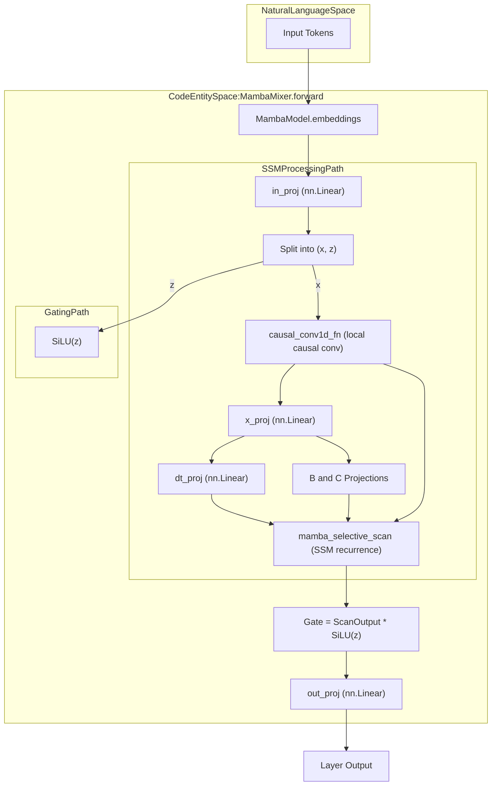
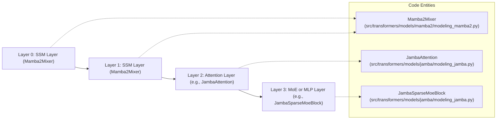

<!-- source: DeepWiki mcp.deepwiki.com · repo huggingface/transformers · page 3.3 State Space & Hybrid Models · fetched 2026-10-26 -->

# State Space & Hybrid Models

Relevant source files

The following files were used as context for generating this wiki page:

- [docs/source/en/model_doc/bamba.md](docs/source/en/model_doc/bamba.md)
- [docs/source/en/model_doc/bartpho.md](docs/source/en/model_doc/bartpho.md)
- [docs/source/en/model_doc/bigbird_pegasus.md](docs/source/en/model_doc/bigbird_pegasus.md)
- [docs/source/en/model_doc/byt5.md](docs/source/en/model_doc/byt5.md)
- [docs/source/en/model_doc/encoder-decoder.md](docs/source/en/model_doc/encoder-decoder.md)
- [docs/source/en/model_doc/falcon_mamba.md](docs/source/en/model_doc/falcon_mamba.md)
- [docs/source/en/model_doc/mamba.md](docs/source/en/model_doc/mamba.md)
- [docs/source/en/model_doc/mamba2.md](docs/source/en/model_doc/mamba2.md)
- [docs/source/en/model_doc/pegasus_x.md](docs/source/en/model_doc/pegasus_x.md)
- [docs/source/en/model_doc/zamba2.md](docs/source/en/model_doc/zamba2.md)
- [src/transformers/models/bamba/modeling_bamba.py](src/transformers/models/bamba/modeling_bamba.py)
- [src/transformers/models/bamba/modular_bamba.py](src/transformers/models/bamba/modular_bamba.py)
- [src/transformers/models/falcon_h1/modeling_falcon_h1.py](src/transformers/models/falcon_h1/modeling_falcon_h1.py)
- [src/transformers/models/falcon_h1/modular_falcon_h1.py](src/transformers/models/falcon_h1/modular_falcon_h1.py)
- [src/transformers/models/falcon_mamba/configuration_falcon_mamba.py](src/transformers/models/falcon_mamba/configuration_falcon_mamba.py)
- [src/transformers/models/falcon_mamba/modeling_falcon_mamba.py](src/transformers/models/falcon_mamba/modeling_falcon_mamba.py)
- [src/transformers/models/falcon_mamba/modular_falcon_mamba.py](src/transformers/models/falcon_mamba/modular_falcon_mamba.py)
- [src/transformers/models/granitemoehybrid/modeling_granitemoehybrid.py](src/transformers/models/granitemoehybrid/modeling_granitemoehybrid.py)
- [src/transformers/models/jamba/configuration_jamba.py](src/transformers/models/jamba/configuration_jamba.py)
- [src/transformers/models/jamba/modeling_jamba.py](src/transformers/models/jamba/modeling_jamba.py)
- [src/transformers/models/jamba/modular_jamba.py](src/transformers/models/jamba/modular_jamba.py)
- [src/transformers/models/lfm2/modeling_lfm2.py](src/transformers/models/lfm2/modeling_lfm2.py)
- [src/transformers/models/lfm2/modular_lfm2.py](src/transformers/models/lfm2/modular_lfm2.py)
- [src/transformers/models/lfm2_moe/configuration_lfm2_moe.py](src/transformers/models/lfm2_moe/configuration_lfm2_moe.py)
- [src/transformers/models/lfm2_moe/modeling_lfm2_moe.py](src/transformers/models/lfm2_moe/modeling_lfm2_moe.py)
- [src/transformers/models/lfm2_moe/modular_lfm2_moe.py](src/transformers/models/lfm2_moe/modular_lfm2_moe.py)
- [src/transformers/models/mamba/modeling_mamba.py](src/transformers/models/mamba/modeling_mamba.py)
- [src/transformers/models/mamba2/configuration_mamba2.py](src/transformers/models/mamba2/configuration_mamba2.py)
- [src/transformers/models/mamba2/modeling_mamba2.py](src/transformers/models/mamba2/modeling_mamba2.py)
- [src/transformers/models/minimax_m3_vl/modeling_minimax_m3_vl.py](src/transformers/models/minimax_m3_vl/modeling_minimax_m3_vl.py)
- [src/transformers/models/minimax_m3_vl/modular_minimax_m3_vl.py](src/transformers/models/minimax_m3_vl/modular_minimax_m3_vl.py)
- [src/transformers/models/nemotron_h/configuration_nemotron_h.py](src/transformers/models/nemotron_h/configuration_nemotron_h.py)
- [src/transformers/models/nemotron_h/modeling_nemotron_h.py](src/transformers/models/nemotron_h/modeling_nemotron_h.py)
- [src/transformers/models/nemotron_h/modular_nemotron_h.py](src/transformers/models/nemotron_h/modular_nemotron_h.py)
- [src/transformers/models/olmo_hybrid/__init__.py](src/transformers/models/olmo_hybrid/__init__.py)
- [src/transformers/models/olmo_hybrid/configuration_olmo_hybrid.py](src/transformers/models/olmo_hybrid/configuration_olmo_hybrid.py)
- [src/transformers/models/olmo_hybrid/convert_olmo_hybrid_weights_to_hf.py](src/transformers/models/olmo_hybrid/convert_olmo_hybrid_weights_to_hf.py)
- [src/transformers/models/olmo_hybrid/modeling_olmo_hybrid.py](src/transformers/models/olmo_hybrid/modeling_olmo_hybrid.py)
- [src/transformers/models/olmo_hybrid/modular_olmo_hybrid.py](src/transformers/models/olmo_hybrid/modular_olmo_hybrid.py)
- [src/transformers/models/qwen3_next/modeling_qwen3_next.py](src/transformers/models/qwen3_next/modeling_qwen3_next.py)
- [src/transformers/models/qwen3_next/modular_qwen3_next.py](src/transformers/models/qwen3_next/modular_qwen3_next.py)
- [src/transformers/models/zamba/configuration_zamba.py](src/transformers/models/zamba/configuration_zamba.py)
- [src/transformers/models/zamba/modeling_zamba.py](src/transformers/models/zamba/modeling_zamba.py)
- [src/transformers/models/zamba2/configuration_zamba2.py](src/transformers/models/zamba2/configuration_zamba2.py)
- [src/transformers/models/zamba2/modeling_zamba2.py](src/transformers/models/zamba2/modeling_zamba2.py)
- [src/transformers/models/zamba2/modular_zamba2.py](src/transformers/models/zamba2/modular_zamba2.py)
- [tests/models/aria/test_modeling_aria.py](tests/models/aria/test_modeling_aria.py)
- [tests/models/bamba/test_modeling_bamba.py](tests/models/bamba/test_modeling_bamba.py)
- [tests/models/ernie4_5_vl_moe/test_modeling_ernie4_5_vl_moe.py](tests/models/ernie4_5_vl_moe/test_modeling_ernie4_5_vl_moe.py)
- [tests/models/falcon_h1/test_modeling_falcon_h1.py](tests/models/falcon_h1/test_modeling_falcon_h1.py)
- [tests/models/falcon_mamba/test_modeling_falcon_mamba.py](tests/models/falcon_mamba/test_modeling_falcon_mamba.py)
- [tests/models/jamba/test_modeling_jamba.py](tests/models/jamba/test_modeling_jamba.py)
- [tests/models/lfm2/test_modeling_lfm2.py](tests/models/lfm2/test_modeling_lfm2.py)
- [tests/models/lfm2_moe/test_modeling_lfm2_moe.py](tests/models/lfm2_moe/test_modeling_lfm2_moe.py)
- [tests/models/mamba/test_modeling_mamba.py](tests/models/mamba/test_modeling_mamba.py)
- [tests/models/mamba2/test_modeling_mamba2.py](tests/models/mamba2/test_modeling_mamba2.py)
- [tests/models/minimax_m3_vl/test_modeling_minimax_m3_vl.py](tests/models/minimax_m3_vl/test_modeling_minimax_m3_vl.py)
- [tests/models/nemotron_h/test_modeling_nemotron_h.py](tests/models/nemotron_h/test_modeling_nemotron_h.py)
- [tests/models/nemotron_h_omni/test_modeling_nemotron_h_omni.py](tests/models/nemotron_h_omni/test_modeling_nemotron_h_omni.py)
- [tests/models/olmo_hybrid/test_modeling_olmo_hybrid.py](tests/models/olmo_hybrid/test_modeling_olmo_hybrid.py)
- [tests/models/qwen3_5/test_modeling_qwen3_5.py](tests/models/qwen3_5/test_modeling_qwen3_5.py)
- [tests/models/qwen3_5_moe/test_modeling_qwen3_5_moe.py](tests/models/qwen3_5_moe/test_modeling_qwen3_5_moe.py)
- [tests/models/qwen3_next/test_modeling_qwen3_next.py](tests/models/qwen3_next/test_modeling_qwen3_next.py)
- [tests/models/qwen3_vl/test_modeling_qwen3_vl.py](tests/models/qwen3_vl/test_modeling_qwen3_vl.py)
- [tests/models/qwen3_vl_moe/test_modeling_qwen3_vl_moe.py](tests/models/qwen3_vl_moe/test_modeling_qwen3_vl_moe.py)
- [tests/models/zamba/test_modeling_zamba.py](tests/models/zamba/test_modeling_zamba.py)
- [tests/models/zamba2/test_modeling_zamba2.py](tests/models/zamba2/test_modeling_zamba2.py)

State Space Models (SSMs) and hybrid variants provide non-attention sequence modeling mechanisms based on continuous-time linear dynamical systems for efficient and scalable sequence processing. This page covers the core implementations and design patterns of SSM and hybrid attention+SSM models in the `transformers` library, such as Mamba, Mamba2, Jamba, Bamba, FalconMamba/H1, Zamba, GraniteMoEHybrid, NemotronH, Qwen3-Next, LFM2, xLSTM, and RWKV. We emphasize SSM recurrence, selective state spaces, and the architectural interleaving of attention and SSM layers.

---

## SSM Recurrence and Selective State Spaces

State Space Models represent sequences by outputs of continuous-time linear time-invariant systems parameterized by matrices:

- \( A \): State transition matrix
- \( B \): Input matrix
- \( C \): Output matrix
- \( D \): Optional feedthrough matrix

The dynamics are defined as:

\[
\frac{d s(t)}{dt} = A s(t) + B x(t)
\]

\[
y(t) = C s(t) + D x(t)
\]

Discretization with a timestep \(\Delta t\) converts these equations into efficient recurrence relations:

\[
s_t = dA \cdot s_{t-1} + dB \cdot x_t
\]

where

\[
dA = e^{\Delta t A}, \quad dB = \Delta t B
\]

and the output:

\[
y_t = C \cdot s_t + D \cdot x_t
\]

Optionally, the output \(y_t\) may be gated, commonly with a SiLU activation.

### Selective State Space Computation

The library provides efficient implementations of SSM recurrence via:

- **Recurrent updates:** Step-wise progression using the discretized matrices directly, efficient for generation.
- **Associative scans:** Parallel prefix operations (available in PyTorch 2.9+) and custom CUDA kernels (e.g., mambapy) speed up sequence-wide state computations.

These methods rely on custom kernels loaded optionally from the Hugging Face Hub for acceleration, with PyTorch fallbacks when needed.

Sources: [src/transformers/models/mamba/modeling_mamba.py:148-170](), [src/transformers/models/mamba/modeling_mamba.py:173-213]()

---

## Mamba & Mamba2 Architectures

### Mamba

- Implements the selective SSM recurrence using the `MambaMixer` class.
- Input sequence tokens pass through embeddings, then a convolutional causal 1D operation (`causal_conv1d_fn`) capturing local context.
- The projection splits features into two: hidden state input \(x\) and gating input \(z\).
- The core recurrence on \(x\) uses `mamba_selective_scan` to apply the SSM dynamics across the sequence.
- The output is gated by \(\text{SiLU}(z)\) before final linear projection.
- Supports incremental state caching for autoregressive generation.

Sources: [src/transformers/models/mamba/modeling_mamba.py:80-100](), [src/transformers/models/mamba/modeling_mamba.py:173-213]()

### Mamba2

- An advanced variant enhancing stability and efficiency with:
  - Semiseparable matrix factorizations and chunking.
  - Numerically stable segment sum calculations implemented with cumulative sums and boolean masks (`segment_sum`).
  - A fused kernel `mamba2_split_conv1d_scan_combined` combining causal convolution and SSM updates in chunks.
- Handles padded chunks for long sequences ensuring stable and batched computations.

Sources: [src/transformers/models/mamba2/modeling_mamba2.py:73-90](), [src/transformers/models/mamba2/modeling_mamba2.py:166-176]()

---

### Core Data Flow in Mamba Mixer Layer

This illustrates the selective recurrence layer's forward pass, highlighting local convolution, projections, selective scan recurrence, output gating, and final projection.

Sources: [src/transformers/models/mamba/modeling_mamba.py:48-230]()

---

## Hybrid Attention-SSM Models

Hybrid models combine SSM-based recurrence with multi-headed self-attention or mixture-of-experts (MoE) layers, interleaved in transformer stacks to capture both local dynamics and global context.

### Jamba and Bamba

- **Jamba:** Integrates `JambaAttention` layers with the Mamba2-based SSM mixers (`Mamba2Mixer`), adding MoE experts for sparse routing within attention and feed-forward blocks.
- **Bamba:** Combines Llama-style multi-headed attention with `BambaRotaryEmbedding` RoPE positional encodings and Mamba2 SSM recurrence mixers, bridging transformer and SSM modules.

Sources: [src/transformers/models/jamba/modeling_jamba.py:154-156](), [src/transformers/models/bamba/modeling_bamba.py:49-96]()

### Zamba and NemotronH

- **Zamba2:** Uses gated RMS normalization (`Zamba2RMSNormGated`) combined with sliding window attention and SSM recurrence.
- **NemotronH:** NVIDIA's hybrid SSM design mixing Mamba2 recurrence, gated norms, and fused kernels for efficient large-scale sequence generation.

Sources: [src/transformers/models/zamba2/modeling_zamba2.py:50-68](), [src/transformers/models/nemotron_h/modeling_nemotron_h.py:45]()

### GraniteMoEHybrid

- IBM’s **GraniteMoEHybrid** model blends Mamba2 SSM recurrence with `GraniteMoeHybridAttention` layers featuring optional rotary embeddings and MoE routing.
- The model interleaves layers of attention, MoE, and selective state space recurrence.

Sources: [src/transformers/models/granitemoehybrid/modeling_granitemoehybrid.py:121-126]()

### FalconMamba/H1

- **FalconMamba/H1** integrates Mamba's SSM with Falcon's architecture, utilizing `FalconMambaWeightlessRMSNorm` and the core Mamba SSM functions.

Sources: [src/transformers/models/falcon_mamba/modeling_falcon_mamba.py:46-61]()

### Qwen3-Next

- **Qwen3-Next** incorporates `Qwen3NextRMSNormGated` and `Qwen3NextRotaryEmbedding` within its hybrid architecture, combining SSM and attention mechanisms.

Sources: [src/transformers/models/qwen3_next/modeling_qwen3_next.py:58-75](), [src/transformers/models/qwen3_next/modeling_qwen3_next.py:77-93]()

---

### Hybrid Transformer Layer Interleaving Pattern

This pattern highlights how SSM and attention/MoE modules are interleaved to capture complementary sequence dynamics.

Sources: [src/transformers/models/jamba/modeling_jamba.py:870-900](), [src/transformers/models/bamba/modular_bamba.py:122-136](), [src/transformers/models/granitemoehybrid/modeling_granitemoehybrid.py:978-1010]()

---

## Implementation Details

### Optimized Kernel Usage

Several key functions are decorated with `@use_kernel_func_from_hub_with_fallback` to dynamically load optimized CUDA kernels from the Hugging Face Hub, with PyTorch fallback:

- `causal_conv1d_fn` and `causal_conv1d_update`: Efficient causal grouped 1D convolution operations essential for local feature extraction and state updates.
- `mamba_selective_state_update` and `mamba_selective_scan`: Core SSM recurrence and sequence-wide scan implementations.
- `mamba2_split_conv1d_scan_combined`: A kernel fusing causal convolution and chunked SSM recurrence for Mamba2 models, enhancing efficiency and numerical stability.

Sources: [src/transformers/models/mamba/modeling_mamba.py:80-100](), [src/transformers/models/mamba/modeling_mamba.py:127-170](), [src/transformers/models/mamba/modeling_mamba.py:173-213](), [src/transformers/models/mamba2/modeling_mamba2.py:166-176]()

### Cache and State Management

- SSM recurrence layers maintain state tensors distinct from Transformer KV caches, storing convolutional states needed for autoregressive generation.
- Hybrid models combine SSM states with attention KV caches, managing them consistently for fast generation.

### Numerical Stability via Segment Sum (Mamba2)

Mamba2 achieves numerical stability by:

- Computing segment sums using a stable method involving cumulative sums and masking with lower-triangular boolean matrices to avoid unstable subtractions.
- Leveraging chunking and semiseparable matrix factorizations of \(A\) for stable and efficient recurrence computation.

Sources: [src/transformers/models/mamba2/modeling_mamba2.py:73-90]()

---

## Model-to-Code Mapping: Natural Language to Code Entities

```mermaid
graph TD
    Mamba["Mamba Model"]
    Mamba2["Mamba2 Model"]
    Jamba["Jamba Model"]
    Bamba["Bamba Model"]
    Zamba["Zamba / Zamba2 Model"]
    GraniteMoEHybrid["GraniteMoEHybrid Model"]
    NemotronH["NemotronH Model"]
    Qwen3Next["Qwen3-Next Model"]
    FalconMamba["FalconMamba/H1 Model"]

    Mamba -->|"SSM Layer"| MambaMixer["MambaMixer\n(src/transformers/models/mamba/modeling_mamba.py)"]
    Mamba2 -->|"SSM Layer"| Mamba2Mixer["Mamba2Mixer\n(src/transformers/models/mamba2/modeling_mamba2.py)"]
    Jamba -->|"Attention Layer"| JambaAttention["JambaAttention\n(src/transformers/models/jamba/modeling_jamba.py)"]
    Jamba -->|"SSM Layer"| Mamba2Mixer
    Bamba -->|"Attention Layer"| BambaAttention["BambaAttention\n(src/transformers/models/bamba/modeling_bamba.py)"]
    Bamba -->|"SSM Layer"| Mamba2Mixer
    Zamba -->|"Norm Layer"| Zamba2RMSNormGated["Zamba2RMSNormGated\n(src/transformers/models/zamba2/modeling_zamba2.py)"]
    GraniteMoEHybrid -->|"Attention Layer"| GraniteAttention["GraniteMoeHybridAttention\n(src/transformers/models/granitemoehybrid/modeling_granitemoehybrid.py)"]
    GraniteMoEHybrid -->|"SSM Layer"| Mamba2Mixer
    NemotronH -->|"SSM Layer"| Mamba2Mixer
    NemotronH -->|"Norm Layer"| Zamba2RMSNormGated
    Qwen3Next -->|"Norm Layer"| Qwen3NextRMSNormGated["Qwen3NextRMSNormGated\n(src/transformers/models/qwen3_next/modeling_qwen3_next.py)"]
    Qwen3Next -->|"SSM+Attention Layers"| Qwen3NextLayers["modular_qwen3_next.py"]
    FalconMamba -->|"Norm Layer"| FalconMambaWeightlessRMSNorm["FalconMambaWeightlessRMSNorm\n(src/transformers/models/falcon_mamba/modeling_falcon_mamba.py)"]
    FalconMamba -->|"SSM Layer"| MambaMixer

    subgraph "Libraries & Implementations"
        MambaMixer
        Mamba2Mixer
        JambaAttention
        BambaAttention
        GraniteAttention
        Zamba2RMSNormGated
        Qwen3NextRMSNormGated
        FalconMambaWeightlessRMSNorm
    end
```

This diagram links model names to their main implementation classes and source files, aiding navigation for contributors and engineers.

Sources: [src/transformers/models/mamba/modeling_mamba.py](), [src/transformers/models/mamba2/modeling_mamba2.py](), [src/transformers/models/jamba/modeling_jamba.py](), [src/transformers/models/bamba/modeling_bamba.py](), [src/transformers/models/zamba2/modeling_zamba2.py](), [src/transformers/models/granitemoehybrid/modeling_granitemoehybrid.py](), [src/transformers/models/nemotron_h/modeling_nemotron_h.py](), [src/transformers/models/qwen3_next/modeling_qwen3_next.py](), [src/transformers/models/falcon_mamba/modeling_falcon_mamba.py]()

---

## Summary Table of SSM and Hybrid Models in Transformers

| Model                | Main SSM Layer      | Attention Component              | Notable Features                            | Main Source File(s)                              |
|----------------------|---------------------|---------------------------------|---------------------------------------------|-------------------------------------------------|
| **Mamba**            | `MambaMixer`        | None                            | Selective SSM recurrence                     | `modeling_mamba.py`                              |
| **Mamba2**           | `Mamba2Mixer`       | None                            | Stable segment sums, chunked recurrence     | `modeling_mamba2.py`                             |
| **Jamba**            | `Mamba2Mixer`       | `JambaAttention` + MoE          | MoE-enhanced attention + SSM                 | `modeling_jamba.py`                              |
| **Bamba**            | `Mamba2Mixer`       | `BambaAttention`                | Llama-style attention + SSM + RoPE           | `modeling_bamba.py`                               |
| **FalconMamba/H1**   | `MambaMixer`        | None                            | Falcon architecture with Mamba SSM          | `modeling_falcon_mamba.py`, `modeling_falcon_h1.py` |
| **Zamba / Zamba2**   | `Mamba2Mixer`       | Shared attention                | Gated RMSNorm, SSM recurrence                | `modeling_zamba2.py`                             |
| **GraniteMoEHybrid** | `Mamba2Mixer`       | `GraniteMoeHybridAttention`    | IBM hybrid MoE + SSM                         | `modeling_granitemoehybrid.py`                   |
| **NemotronH**        | `Mamba2Mixer`       | Gated Norm layers               | NVIDIA hybrid with fused kernels              | `modeling_nemotron_h.py`, uses `zamba2` norms   |
| **Qwen3-Next**       | SSM + Attention     | RMSNorm gating + Rotary         | LFM2 selective state spaces                   | `modeling_qwen3_next.py` |

---

# References and Sources

- Mamba base: [src/transformers/models/mamba/modeling_mamba.py:48-230]()
- Mamba2 variant: [src/transformers/models/mamba2/modeling_mamba2.py:14-180]()
- Jamba hybrid: [src/transformers/models/jamba/modeling_jamba.py:1-156](), [src/transformers/models/jamba/modeling_jamba.py:870-900]()
- Bamba hybrid: [src/transformers/models/bamba/modeling_bamba.py:1-151]()
- FalconMamba/H1: [src/transformers/models/falcon_mamba/modeling_falcon_mamba.py:1-196]()
- Zamba models: [src/transformers/models/zamba/modeling_zamba.py:1-154](), [src/transformers/models/zamba2/modeling_zamba2.py:1-149]()
- GraniteMoEHybrid: [src/transformers/models/granitemoehybrid/modeling_granitemoehybrid.py:1-146](), [src/transformers/models/granitemoehybrid/modeling_granitemoehybrid.py:978-1010]()
- NemotronH: [src/transformers/models/nemotron_h/modeling_nemotron_h.py:1-166]()
- Qwen3-Next: [src/transformers/models/qwen3_next/modeling_qwen3_next.py:1-154]()

---

This completes the comprehensive technical overview of state space and hybrid models in the Hugging Face Transformers library, detailing their theoretical foundations, key implementations, data flow, and interactions of their core components.

---

