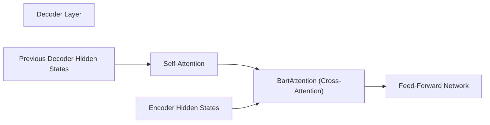

<!-- source: DeepWiki mcp.deepwiki.com · repo huggingface/transformers · page 3.4 Encoder-Decoder & Sequence-to-Sequence Models · fetched 2026-10-26 -->

# Encoder-Decoder & Sequence-to-Sequence Models

<details>
<summary>Relevant source files</summary>

The following files were used as context for generating this wiki page:

- [docs/source/en/model_doc/t5gemma.md](docs/source/en/model_doc/t5gemma.md)
- [src/transformers/models/autoformer/modeling_autoformer.py](src/transformers/models/autoformer/modeling_autoformer.py)
- [src/transformers/models/bark/modeling_bark.py](src/transformers/models/bark/modeling_bark.py)
- [src/transformers/models/bart/configuration_bart.py](src/transformers/models/bart/configuration_bart.py)
- [src/transformers/models/bart/modeling_bart.py](src/transformers/models/bart/modeling_bart.py)
- [src/transformers/models/bigbird_pegasus/modeling_bigbird_pegasus.py](src/transformers/models/bigbird_pegasus/modeling_bigbird_pegasus.py)
- [src/transformers/models/biogpt/modeling_biogpt.py](src/transformers/models/biogpt/modeling_biogpt.py)
- [src/transformers/models/biogpt/modular_biogpt.py](src/transformers/models/biogpt/modular_biogpt.py)
- [src/transformers/models/blenderbot/modeling_blenderbot.py](src/transformers/models/blenderbot/modeling_blenderbot.py)
- [src/transformers/models/blenderbot_small/modeling_blenderbot_small.py](src/transformers/models/blenderbot_small/modeling_blenderbot_small.py)
- [src/transformers/models/fuyu/modeling_fuyu.py](src/transformers/models/fuyu/modeling_fuyu.py)
- [src/transformers/models/hunyuan_vl/__init__.py](src/transformers/models/hunyuan_vl/__init__.py)
- [src/transformers/models/hunyuan_vl/configuration_hunyuan_vl.py](src/transformers/models/hunyuan_vl/configuration_hunyuan_vl.py)
- [src/transformers/models/informer/modeling_informer.py](src/transformers/models/informer/modeling_informer.py)
- [src/transformers/models/led/modeling_led.py](src/transformers/models/led/modeling_led.py)
- [src/transformers/models/longt5/configuration_longt5.py](src/transformers/models/longt5/configuration_longt5.py)
- [src/transformers/models/longt5/modeling_longt5.py](src/transformers/models/longt5/modeling_longt5.py)
- [src/transformers/models/m2m_100/modeling_m2m_100.py](src/transformers/models/m2m_100/modeling_m2m_100.py)
- [src/transformers/models/marian/modeling_marian.py](src/transformers/models/marian/modeling_marian.py)
- [src/transformers/models/mbart/modeling_mbart.py](src/transformers/models/mbart/modeling_mbart.py)
- [src/transformers/models/mt5/configuration_mt5.py](src/transformers/models/mt5/configuration_mt5.py)
- [src/transformers/models/mt5/modeling_mt5.py](src/transformers/models/mt5/modeling_mt5.py)
- [src/transformers/models/mvp/configuration_mvp.py](src/transformers/models/mvp/configuration_mvp.py)
- [src/transformers/models/mvp/modeling_mvp.py](src/transformers/models/mvp/modeling_mvp.py)
- [src/transformers/models/nllb_moe/modeling_nllb_moe.py](src/transformers/models/nllb_moe/modeling_nllb_moe.py)
- [src/transformers/models/pegasus/modeling_pegasus.py](src/transformers/models/pegasus/modeling_pegasus.py)
- [src/transformers/models/pegasus_x/modeling_pegasus_x.py](src/transformers/models/pegasus_x/modeling_pegasus_x.py)
- [src/transformers/models/pix2struct/modeling_pix2struct.py](src/transformers/models/pix2struct/modeling_pix2struct.py)
- [src/transformers/models/plbart/modeling_plbart.py](src/transformers/models/plbart/modeling_plbart.py)
- [src/transformers/models/pop2piano/configuration_pop2piano.py](src/transformers/models/pop2piano/configuration_pop2piano.py)
- [src/transformers/models/pop2piano/modeling_pop2piano.py](src/transformers/models/pop2piano/modeling_pop2piano.py)
- [src/transformers/models/switch_transformers/modeling_switch_transformers.py](src/transformers/models/switch_transformers/modeling_switch_transformers.py)
- [src/transformers/models/switch_transformers/modular_switch_transformers.py](src/transformers/models/switch_transformers/modular_switch_transformers.py)
- [src/transformers/models/t5/modeling_t5.py](src/transformers/models/t5/modeling_t5.py)
- [src/transformers/models/t5gemma/configuration_t5gemma.py](src/transformers/models/t5gemma/configuration_t5gemma.py)
- [src/transformers/models/t5gemma/modeling_t5gemma.py](src/transformers/models/t5gemma/modeling_t5gemma.py)
- [src/transformers/models/t5gemma/modular_t5gemma.py](src/transformers/models/t5gemma/modular_t5gemma.py)
- [src/transformers/models/time_series_transformer/modeling_time_series_transformer.py](src/transformers/models/time_series_transformer/modeling_time_series_transformer.py)
- [src/transformers/models/udop/modeling_udop.py](src/transformers/models/udop/modeling_udop.py)
- [src/transformers/models/umt5/configuration_umt5.py](src/transformers/models/umt5/configuration_umt5.py)
- [src/transformers/models/umt5/modeling_umt5.py](src/transformers/models/umt5/modeling_umt5.py)
- [tests/models/bark/test_modeling_bark.py](tests/models/bark/test_modeling_bark.py)
- [tests/models/bart/test_modeling_bart.py](tests/models/bart/test_modeling_bart.py)
- [tests/models/bigbird_pegasus/test_modeling_bigbird_pegasus.py](tests/models/bigbird_pegasus/test_modeling_bigbird_pegasus.py)
- [tests/models/biogpt/test_modeling_biogpt.py](tests/models/biogpt/test_modeling_biogpt.py)
- [tests/models/blenderbot/test_modeling_blenderbot.py](tests/models/blenderbot/test_modeling_blenderbot.py)
- [tests/models/blenderbot_small/test_modeling_blenderbot_small.py](tests/models/blenderbot_small/test_modeling_blenderbot_small.py)
- [tests/models/csm/test_modeling_csm.py](tests/models/csm/test_modeling_csm.py)
- [tests/models/dia/test_modeling_dia.py](tests/models/dia/test_modeling_dia.py)
- [tests/models/fsmt/test_modeling_fsmt.py](tests/models/fsmt/test_modeling_fsmt.py)
- [tests/models/fuyu/test_modeling_fuyu.py](tests/models/fuyu/test_modeling_fuyu.py)
- [tests/models/glm_ocr/test_modeling_glm_ocr.py](tests/models/glm_ocr/test_modeling_glm_ocr.py)
- [tests/models/hunyuan_vl/test_modeling_hunyuan_vl.py](tests/models/hunyuan_vl/test_modeling_hunyuan_vl.py)
- [tests/models/kosmos2/test_modeling_kosmos2.py](tests/models/kosmos2/test_modeling_kosmos2.py)
- [tests/models/kyutai_speech_to_text/test_modeling_kyutai_speech_to_text.py](tests/models/kyutai_speech_to_text/test_modeling_kyutai_speech_to_text.py)
- [tests/models/led/test_modeling_led.py](tests/models/led/test_modeling_led.py)
- [tests/models/longt5/test_modeling_longt5.py](tests/models/longt5/test_modeling_longt5.py)
- [tests/models/m2m_100/test_modeling_m2m_100.py](tests/models/m2m_100/test_modeling_m2m_100.py)
- [tests/models/marian/test_modeling_marian.py](tests/models/marian/test_modeling_marian.py)
- [tests/models/mbart/test_modeling_mbart.py](tests/models/mbart/test_modeling_mbart.py)
- [tests/models/mt5/test_modeling_mt5.py](tests/models/mt5/test_modeling_mt5.py)
- [tests/models/mvp/test_modeling_mvp.py](tests/models/mvp/test_modeling_mvp.py)
- [tests/models/pegasus/test_modeling_pegasus.py](tests/models/pegasus/test_modeling_pegasus.py)
- [tests/models/pegasus_x/test_modeling_pegasus_x.py](tests/models/pegasus_x/test_modeling_pegasus_x.py)
- [tests/models/plbart/test_modeling_plbart.py](tests/models/plbart/test_modeling_plbart.py)
- [tests/models/pop2piano/test_modeling_pop2piano.py](tests/models/pop2piano/test_modeling_pop2piano.py)
- [tests/models/prophetnet/test_modeling_prophetnet.py](tests/models/prophetnet/test_modeling_prophetnet.py)
- [tests/models/switch_transformers/test_modeling_switch_transformers.py](tests/models/switch_transformers/test_modeling_switch_transformers.py)
- [tests/models/t5/test_modeling_t5.py](tests/models/t5/test_modeling_t5.py)
- [tests/models/t5gemma/__init__.py](tests/models/t5gemma/__init__.py)
- [tests/models/t5gemma/test_modeling_t5gemma.py](tests/models/t5gemma/test_modeling_t5gemma.py)
- [tests/models/udop/test_modeling_udop.py](tests/models/udop/test_modeling_udop.py)
- [tests/models/umt5/test_modeling_umt5.py](tests/models/umt5/test_modeling_umt5.py)

</details>


Encoder-decoder architectures (or Sequence-to-Sequence models) are fundamental for transforming input sequences into output sequences, widely applied in machine translation, summarization, and multimodal generation. This page details their implementation within the `transformers` library focusing on key models such as T5, BART, mBART, Marian, Pegasus, M2M-100, NLLB, SwitchTransformers, LongT5, UDOP, and T5Gemma. It covers the cross-attention mechanism, encoder-decoder weight sharing, and seq2seq generation flow.

---

## Core Architecture Overview

### Encoder-Decoder Paradigm

Seq2Seq models consist of two principal components:

- **Encoder**: Processes input tokens and emits sequence representation (`encoder_hidden_states`).
- **Decoder**: Generates output tokens autoregressively, attending to encoder outputs through **cross-attention** layers. This conditioning allows the decoder to utilize contextual information from the input sequence.

### Data Flow Summary

1. **Encoding Input Tokens**: Input tokens (`input_ids`) pass through the encoder yielding `encoder_hidden_states`.  
2. **Preparing Decoder Inputs**: During training, labels are shifted right to create `decoder_input_ids` for teacher forcing, aligning decoder inputs to predict the next token.  
3. **Cross-Attention**: Decoder self-attention layers incorporate cross-attention that attends `encoder_hidden_states`.  
4. **Generating Outputs**: Decoder outputs feed into a linear output head projecting to vocabulary logits for token generation.

This high-level flow is implemented in models such as BART and T5 extensively [src/transformers/models/bart/modeling_bart.py:58-71,188-210,1218-1250](), [src/transformers/models/t5/modeling_t5.py:50-100,176-183]().

### Encoder-Decoder Weight Sharing

Many models tie the token embedding weights between encoder and decoder to reduce parameters and enhance model consistency. This is controlled in config classes through `tie_word_embeddings` flags.  
For example, T5 and T5Gemma expose this feature enabling a shared embedding layer between encoder and decoder [tests/models/t5/test_modeling_t5.py:184-188](), [src/transformers/models/t5gemma/modular_t5gemma.py:94-149]().

---

## Natural Language to Code Entity Mapping

The diagram below links core natural language concepts to the corresponding code entities facilitating model understanding and navigation:

```mermaid
graph TD
    subgraph "Natural Language Space"
        NLInput["Input Text Tokens"]
        NLOutput["Output Text Tokens"]
    end
    
    subgraph "Code Entity Space"
        Tokenizer["`PreTrainedTokenizer`"]
        Config["`PreTrainedConfig`"]
        
        subgraph "Model"
            Encoder["Encoder (`BaseModelOutput`)"]
            Decoder["Decoder (`BaseModelOutputWithPastAndCrossAttentions`)"]
            LMHead["Language Modeling Head (`nn.Linear`)"]
        end
        GenMixin["`GenerationMixin`"]
        CacheSystem["`EncoderDecoderCache` and KV Caches"]
    end

    NLInput --> Tokenizer
    Tokenizer -->|`input_ids`| Encoder
    Encoder -->|`encoder_hidden_states`| Decoder
    Decoder -->|`hidden_states`| LMHead
    LMHead -->|`logits`| NLOutput
    Config -.-> Encoder
    Config -.-> Decoder
    GenMixin -.-> LMHead
    GenMixin -.-> CacheSystem
```

- Tokenizers convert raw text input to token IDs for the encoder.  
- Encoder produces hidden states contextualizing input tokens.  
- Decoder attends encoder hidden states via cross-attention.  
- A linear LM head maps decoder hidden states to predicted token logits.  
- GenerationMixin manages autoregressive decoding with caching for efficiency.

Sources: [src/transformers/models/bart/modeling_bart.py:1218-1250](), [src/transformers/models/t5/modeling_t5.py:50-100](), [src/transformers/models/mbart/modeling_mbart.py:151-180]().

---

## Key Model Implementations

### T5 and MT5

- **Layer Normalization**: Uses T5-style RMS normalization via `T5LayerNorm` and `T5GemmaRMSNorm` without mean subtraction or bias, achieving stable normalization [src/transformers/models/t5/modeling_t5.py:50-72](), [src/transformers/models/t5gemma/modeling_t5gemma.py:61-75]().

- **Gated MLP**: Implements gated-activation feed-forward networks (`T5DenseGatedActDense` and variants) which provide capacity and expressivity improvements [src/transformers/models/t5/modeling_t5.py:87-124]().

- **Embedding Weight Sharing**: Controlled by `tie_word_embeddings` configuration flags, enabling encoder-decoder embedding sharing to reduce parameters and maintain consistency. Also seen in T5Gemma’s modular design [tests/models/t5/test_modeling_t5.py:184-188](), [src/transformers/models/t5gemma/modular_t5gemma.py:94-149]().

- **Generation Support**: Full integration with `GenerationMixin` providing beam search, caching, and dynamic decoding support, facilitating flexible seq2seq generation [src/transformers/models/t5/modeling_t5.py]().

### BART and mBART

- **Positional Embeddings**: `BartLearnedPositionalEmbedding` implements learned positional embeddings with an offset to adjust for padding tokens [src/transformers/models/bart/modeling_bart.py:74-83]().

- **Scaled Token Embeddings**: `BartScaledWordEmbedding` overrides feeding embeddings by scaling outputs, improving training stability [src/transformers/models/bart/modeling_bart.py:101-112]().

- **Decoder Input Shift**: Managed by utility `shift_tokens_right` which shifts the decoder input tokens, important for causal decoding. mBART adapts this logic to handle language tokens [src/transformers/models/mbart/modeling_mbart.py:59-76](), [src/transformers/models/bart/modeling_bart.py:58-71]().

- **Cross-Attention Handling**: The `BartAttention` class serves both self- and cross-attention depending on presence of `key_value_states`, facilitating efficient reuse across encoder and decoder attention layers [src/transformers/models/bart/modeling_bart.py:188-210]().

### SwitchTransformers (Mixture-of-Experts)

- **Token Routing to Experts**: `SwitchTransformersTop1Router` uses a top-1 expert assignment with optional jitter noise to balance load between experts during sparse mixture-of-experts execution [src/transformers/models/switch_transformers/modeling_switch_transformers.py:52-111]().

- **Capacity Masking**: Tokens are masked if routing exceeds expert capacity ensuring expert load is controlled [src/transformers/models/switch_transformers/modeling_switch_transformers.py:102-108]().

- **Custom LayerNorm and Sparse MLP**: Implements specialized layer norms (`SwitchTransformersLayerNorm`) and sparse feed-forward layers tailored for expert splitting and MoE scalability [src/transformers/models/switch_transformers/modeling_switch_transformers.py:113-140]().

### T5Gemma

- **Modular Encoder and Decoder Configs**: Uses distinct but coordinated `T5GemmaModuleConfig` for encoder and decoder. Configurations can customize dropout, attention, and positional embeddings separately [src/transformers/models/t5gemma/modular_t5gemma.py:69-149]().

- **RMSNorm and Gated MLPs**: Implements `T5GemmaRMSNorm` along with dropout-enhanced gated MLP blocks, combining the gating mechanism and normalization for stable training dynamics [src/transformers/models/t5gemma/modeling_t5gemma.py:61-161]().

- **Cross-Attention Specificities**: Cross-attention disables sliding window attention to ensure compatibility with encoder hidden sizes; it requires explicit hidden size for cross-attention keys and values [src/transformers/models/t5gemma/modular_t5gemma.py:179-188]().

---

## Cross-Attention Mechanism Deep Dive

Cross-attention integrates encoder context into decoder hidden states as follows:

- **Queries**: Derived from decoder hidden states at current timestep.  
- **Keys & Values**: Derived from encoder hidden states.  
- **Cache Utilization**: Uses caches (`EncoderDecoderCache`) for key and value tensors to accelerate autoregressive decoding by avoiding recomputation.  
- **Scaled Dot-Product**: Attention scores computed by dot product between queries and keys scaled by head dimension, followed by softmax and value weighting.

Example cross-attention usage from BART:



Cross-attention is vital for grounding the decoder output on encoder contexts. The cache system (`EncoderDecoderCache`) avoids recomputation for each decoder timestep.  
Sources: [src/transformers/models/bart/modeling_bart.py:188-210,450-480](), [src/transformers/models/t5/modeling_t5.py:176-183](), [src/transformers/models/mbart/modeling_mbart.py:151-180]().

---

## Sequence-to-Sequence Generation Flow

`GenerationMixin` offers a unified seq2seq generation interface:

- Supports multiple decoding strategies: greedy search, beam search, multinomial sampling, contrastive search, and speculative decoding.  
- Efficiently reuses encoder outputs and caches decoder hidden states and attention keys/values in `EncoderDecoderCache` for faster autoregressive decoding.  
- Manages decoder input shifting and preparation, e.g., shifting labels right for teacher forcing during training and handling `decoder_start_token_id` during generation.

Sources: [tests/models/t5/test_modeling_t5.py:47-135](), [src/transformers/models/switch_transformers/modeling_switch_transformers.py:20-60](), [src/transformers/models/t5gemma/modeling_t5gemma.py:30-80]().

---

## Specialized Encoder-Decoder Models and Features

| Model                | Notable Features                                                                         | Location in Code                         |
|----------------------|------------------------------------------------------------------------------------------|----------------------------------------|
| **Marian**           | Multilingual translation with specialized tokenization and handling                      | `src/transformers/models/marian/`      |
| **Pegasus / BigBirdPegasus** | Efficient summarization with block sparse attention, specialized positional embeddings   | `src/transformers/models/pegasus/`, `bigbird_pegasus/` |
| **M2M-100 / NLLB**   | Many-to-many translation with complex cross-attention and MoE expert layers              | `src/transformers/models/m2m_100/`, `nllb_moe/` |
| **LongT5**           | Local-global hybrid attention using sliding local window masks for long inputs          | `src/transformers/models/longt5/modeling_longt5.py` |
| **UDOP**             | Multimodal encoder-decoder incorporating visual bounding box inputs                     | `src/transformers/models/udop/modeling_udop.py`  |
| **T5Gemma**          | Modular T5 variant with advanced rotary embeddings, gating, and modular configs          | `src/transformers/models/t5gemma/`     |
| **SwitchTransformers**| Mixture-of-experts model with token routing, capacity control, and sparse expert layers | `src/transformers/models/switch_transformers/`   |

---

## Cross-Attention, Weight Sharing & Generation Summary Table

| Topic                                  | Description                                                                                  | Relevant Classes / Methods                                                   |
|---------------------------------------|----------------------------------------------------------------------------------------------|-----------------------------------------------------------------------------|
| **Cross-Attention**                   | Decoder’s scaled dot-product attention to encoder contexts during decoding                    | `BartAttention`, `T5Attention`, `MBartAttention`                            |
| **Encoder-Decoder Weight Sharing**   | Shared embedding layers to reduce parameters and encourage joint representations              | `tie_word_embeddings` config flag, shared embedding layers                  |
| **Sequence Generation**               | Use of `GenerationMixin` enabling diverse decoding strategies and KV-cache use                | `GenerationMixin.generate()`, `EncoderDecoderCache`                         |
| **Local Attention (LongT5)**          | Efficient sliding window masks for local attention on long sequences                         | `_split_into_blocks`, `_mask_local_attention_mask`                          |
| **Multimodal Extensions (UDOP)**     | Incorporation of visual bounding boxes and associated attention masks                        | `BaseModelOutputWithAttentionMask`, bounding box utilities                  |
| **Routing in MoE (SwitchTransformers)** | Token routing with top-1 expert choice, jitter noise, and capacity masking to balance load   | `SwitchTransformersTop1Router`, expert_capacity mechanisms                  |

---

## Additional Diagrams: Model Families & Code Entities

### Seq2Seq Model Family to Code Classes

```mermaid
graph TD
    subgraph "Model Families"
        T5["T5 / MT5"]
        BART["BART / mBART"]
        PEGASUS["Pegasus / BigBirdPegasus"]
        M2M100["M2M-100 / NLLB"]
        SWITCH["SwitchTransformers (MoE)"]
        LONGT5["LongT5"]
        UDOP["UDOP"]
        T5GEMMA["T5Gemma"]
    end
    
    subgraph "Code Classes & Files"
        T5Cls["`T5Model`, `T5PreTrainedModel` (src/transformers/models/t5/modeling_t5.py)"]
        BartCls["`BartModel` (src/transformers/models/bart/modeling_bart.py)"]
        PegasusCls["`PegasusModel`, `BigBirdPegasusModel` (src/transformers/models/pegasus/, bigbird_pegasus/)"]
        M2MCls["`M2M100Model` (src/transformers/models/m2m_100/modeling_m2m_100.py)"]
        SwitchCls["`SwitchTransformersModel` (src/transformers/models/switch_transformers/modeling_switch_transformers.py)"]
        LongT5Cls["`LongT5Model` (src/transformers/models/longt5/modeling_longt5.py)"]
        UdopCls["`UdopModel` (src/transformers/models/udop/modeling_udop.py)"]
        T5GemmaCls["`T5GemmaModel` (src/transformers/models/t5gemma/modeling_t5gemma.py)"]
    end

    T5 --> T5Cls
    BART --> BartCls
    PEGASUS --> PegasusCls
    M2M100 --> M2MCls
    SWITCH --> SwitchCls
    LONGT5 --> LongT5Cls
    UDOP --> UdopCls
    T5GEMMA --> T5GemmaCls
```

### Cross-Attention Components & Cache

```mermaid
graph TD
    Query["Decoder Hidden States (query)"]
    KeyValue["Encoder Hidden States (key, value)"]
    Cache["`EncoderDecoderCache` / `Cache` (cache_utils.py)"]
    CrossAttnLayer["Cross-Attention Layer (e.g. `BartAttention`, `T5Attention`)"]
    
    Query --> CrossAttnLayer
    KeyValue --> CrossAttnLayer
    CrossAttnLayer --> Cache
```

---

## Summary

- Encoder-decoder models encode input sequences into rich contextual embeddings and decode outputs conditioned on these representations.
- Cross-attention mechanism is essential for decoder to utilize encoder outputs dynamically.
- Weight sharing between encoder and decoder embeddings is a common parameter-saving approach.
- Variants and extensions tailor this paradigm for mixture-of-expert routing, longer input support, multimodal inputs, and modularized architectures.
- GenerationMixin provides a unified API for sequence generation with support for caching and diverse decoding strategies.

---

## Sources

- `src/transformers/models/bart/modeling_bart.py`
- `src/transformers/models/mbart/modeling_mbart.py`
- `src/transformers/models/t5/modeling_t5.py`
- `src/transformers/models/t5gemma/modeling_t5gemma.py`
- `src/transformers/models/t5gemma/modular_t5gemma.py`
- `src/transformers/models/switch_transformers/modeling_switch_transformers.py`
- `src/transformers/models/longt5/modeling_longt5.py`
- `src/transformers/models/udop/modeling_udop.py`
- `tests/models/t5/test_modeling_t5.py`
- `tests/models/t5gemma/test_modeling_t5gemma.py`

---

