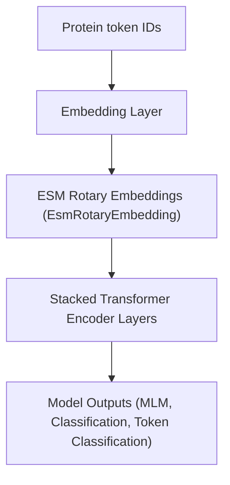
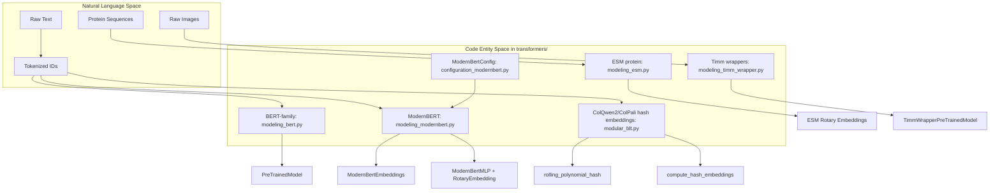
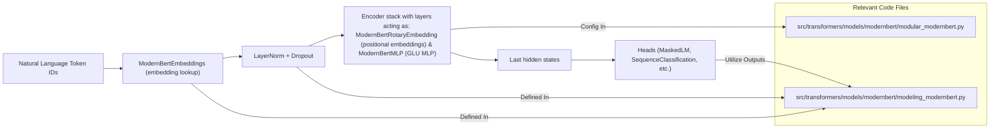
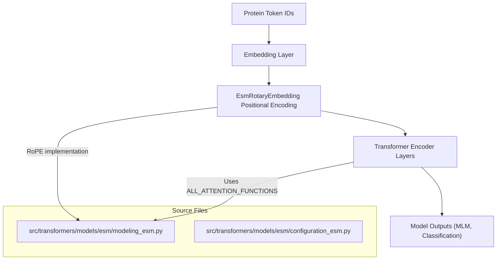

<!-- source: DeepWiki mcp.deepwiki.com · repo huggingface/transformers · page 3.5 Encoder-Only & Embedding Models · fetched 2026-10-26 -->

# Encoder-Only & Embedding Models

<details>
<summary>Relevant source files</summary>

The following files were used as context for generating this wiki page:

- [docs/source/en/model_doc/modernbert.md](docs/source/en/model_doc/modernbert.md)
- [src/transformers/backbone_utils.py](src/transformers/backbone_utils.py)
- [src/transformers/models/beit/modular_beit.py](src/transformers/models/beit/modular_beit.py)
- [src/transformers/models/bert/modeling_bert.py](src/transformers/models/bert/modeling_bert.py)
- [src/transformers/models/bert_generation/modeling_bert_generation.py](src/transformers/models/bert_generation/modeling_bert_generation.py)
- [src/transformers/models/big_bird/modeling_big_bird.py](src/transformers/models/big_bird/modeling_big_bird.py)
- [src/transformers/models/blip/modeling_blip.py](src/transformers/models/blip/modeling_blip.py)
- [src/transformers/models/blip/modeling_blip_text.py](src/transformers/models/blip/modeling_blip_text.py)
- [src/transformers/models/bridgetower/modeling_bridgetower.py](src/transformers/models/bridgetower/modeling_bridgetower.py)
- [src/transformers/models/camembert/modeling_camembert.py](src/transformers/models/camembert/modeling_camembert.py)
- [src/transformers/models/camembert/modular_camembert.py](src/transformers/models/camembert/modular_camembert.py)
- [src/transformers/models/convnext/modeling_convnext.py](src/transformers/models/convnext/modeling_convnext.py)
- [src/transformers/models/convnextv2/modeling_convnextv2.py](src/transformers/models/convnextv2/modeling_convnextv2.py)
- [src/transformers/models/data2vec/modeling_data2vec_text.py](src/transformers/models/data2vec/modeling_data2vec_text.py)
- [src/transformers/models/electra/modeling_electra.py](src/transformers/models/electra/modeling_electra.py)
- [src/transformers/models/ernie/modeling_ernie.py](src/transformers/models/ernie/modeling_ernie.py)
- [src/transformers/models/esm/modeling_esm.py](src/transformers/models/esm/modeling_esm.py)
- [src/transformers/models/esm/modeling_esmfold.py](src/transformers/models/esm/modeling_esmfold.py)
- [src/transformers/models/evolla/configuration_evolla.py](src/transformers/models/evolla/configuration_evolla.py)
- [src/transformers/models/evolla/modeling_evolla.py](src/transformers/models/evolla/modeling_evolla.py)
- [src/transformers/models/evolla/modular_evolla.py](src/transformers/models/evolla/modular_evolla.py)
- [src/transformers/models/megatron_bert/modeling_megatron_bert.py](src/transformers/models/megatron_bert/modeling_megatron_bert.py)
- [src/transformers/models/modernbert/configuration_modernbert.py](src/transformers/models/modernbert/configuration_modernbert.py)
- [src/transformers/models/modernbert/modeling_modernbert.py](src/transformers/models/modernbert/modeling_modernbert.py)
- [src/transformers/models/modernbert/modular_modernbert.py](src/transformers/models/modernbert/modular_modernbert.py)
- [src/transformers/models/modernbert_decoder/modeling_modernbert_decoder.py](src/transformers/models/modernbert_decoder/modeling_modernbert_decoder.py)
- [src/transformers/models/modernbert_decoder/modular_modernbert_decoder.py](src/transformers/models/modernbert_decoder/modular_modernbert_decoder.py)
- [src/transformers/models/pp_lcnet/modeling_pp_lcnet.py](src/transformers/models/pp_lcnet/modeling_pp_lcnet.py)
- [src/transformers/models/pp_lcnet/modular_pp_lcnet.py](src/transformers/models/pp_lcnet/modular_pp_lcnet.py)
- [src/transformers/models/pp_lcnet_v3/modeling_pp_lcnet_v3.py](src/transformers/models/pp_lcnet_v3/modeling_pp_lcnet_v3.py)
- [src/transformers/models/pp_lcnet_v4/modeling_pp_lcnet_v4.py](src/transformers/models/pp_lcnet_v4/modeling_pp_lcnet_v4.py)
- [src/transformers/models/prophetnet/modeling_prophetnet.py](src/transformers/models/prophetnet/modeling_prophetnet.py)
- [src/transformers/models/rembert/modeling_rembert.py](src/transformers/models/rembert/modeling_rembert.py)
- [src/transformers/models/roberta/modeling_roberta.py](src/transformers/models/roberta/modeling_roberta.py)
- [src/transformers/models/roberta_prelayernorm/modeling_roberta_prelayernorm.py](src/transformers/models/roberta_prelayernorm/modeling_roberta_prelayernorm.py)
- [src/transformers/models/roc_bert/modeling_roc_bert.py](src/transformers/models/roc_bert/modeling_roc_bert.py)
- [src/transformers/models/roformer/modeling_roformer.py](src/transformers/models/roformer/modeling_roformer.py)
- [src/transformers/models/segformer/modeling_segformer.py](src/transformers/models/segformer/modeling_segformer.py)
- [src/transformers/models/tapas/modeling_tapas.py](src/transformers/models/tapas/modeling_tapas.py)
- [src/transformers/models/timm_backbone/configuration_timm_backbone.py](src/transformers/models/timm_backbone/configuration_timm_backbone.py)
- [src/transformers/models/timm_backbone/modeling_timm_backbone.py](src/transformers/models/timm_backbone/modeling_timm_backbone.py)
- [src/transformers/models/timm_wrapper/configuration_timm_wrapper.py](src/transformers/models/timm_wrapper/configuration_timm_wrapper.py)
- [src/transformers/models/timm_wrapper/modeling_timm_wrapper.py](src/transformers/models/timm_wrapper/modeling_timm_wrapper.py)
- [src/transformers/models/xlm_roberta/modeling_xlm_roberta.py](src/transformers/models/xlm_roberta/modeling_xlm_roberta.py)
- [src/transformers/models/xlm_roberta/modular_xlm_roberta.py](src/transformers/models/xlm_roberta/modular_xlm_roberta.py)
- [src/transformers/models/xlm_roberta_xl/modeling_xlm_roberta_xl.py](src/transformers/models/xlm_roberta_xl/modeling_xlm_roberta_xl.py)
- [src/transformers/models/xmod/modeling_xmod.py](src/transformers/models/xmod/modeling_xmod.py)
- [src/transformers/utils/output_capturing.py](src/transformers/utils/output_capturing.py)
- [tests/models/bridgetower/test_modeling_bridgetower.py](tests/models/bridgetower/test_modeling_bridgetower.py)
- [tests/models/esm/test_modeling_esm.py](tests/models/esm/test_modeling_esm.py)
- [tests/models/esm/test_modeling_esmfold.py](tests/models/esm/test_modeling_esmfold.py)
- [tests/models/evolla/test_modeling_evolla.py](tests/models/evolla/test_modeling_evolla.py)
- [tests/models/falcon/test_modeling_falcon.py](tests/models/falcon/test_modeling_falcon.py)
- [tests/models/layoutlmv2/test_modeling_layoutlmv2.py](tests/models/layoutlmv2/test_modeling_layoutlmv2.py)
- [tests/models/modernbert/test_modeling_modernbert.py](tests/models/modernbert/test_modeling_modernbert.py)
- [tests/models/nllb_moe/test_modeling_nllb_moe.py](tests/models/nllb_moe/test_modeling_nllb_moe.py)
- [tests/models/persimmon/test_modeling_persimmon.py](tests/models/persimmon/test_modeling_persimmon.py)
- [tests/models/phi/test_modeling_phi.py](tests/models/phi/test_modeling_phi.py)
- [tests/models/stablelm/test_modeling_stablelm.py](tests/models/stablelm/test_modeling_stablelm.py)
- [tests/models/timm_wrapper/test_modeling_timm_wrapper.py](tests/models/timm_wrapper/test_modeling_timm_wrapper.py)

</details>


This section covers the implementation details of encoder-only transformer models and embedding wrappers supported by the Hugging Face Transformers library. It focuses on widely used BERT-family encoders (BERT, RoBERTa, XLM-R, ELECTRA, DeBERTa), ModernBERT with its decoder variant, ESM protein models, and retrieval/embedding models such as ColPali, ColQwen2, and timm wrappers for vision backbones.

These models serve as the backbone encoders for various NLP tasks such as classification, token tagging, question answering, and embeddings extraction, as well as specialized domains including protein sequences and visual embeddings.

---

## 1. BERT-Family Encoders

The BERT family includes models like BERT, RoBERTa, XLM-R, ELECTRA, and DeBERTa, which share the typical encoder-only transformer architecture with self-attention layers generating contextualized token embeddings.

### Key Concepts & Classes

- **Input Embeddings**: Token embeddings augmented by position and token type embeddings, implemented as `nn.Embedding` layers.
- **Transformer Encoder Layers**: Multiple layers of self-attention and feed-forward neural networks.
- **Output Heads**: Pretraining heads (e.g., masked language modeling) or task-specific heads (e.g., classification, token classification).
- **Attention Masking**: Masks are used to specify which tokens to attend to.

### Core Base Class

All these models derive from `PreTrainedModel`, which manages weight loading, saving, and configuration.

### Data Flow Overview


Sources: Common pattern based on [src/transformers/models/bert/modeling_bert.py:53-108]() and related Bert-family files.

---

## 2. ModernBERT and ModernBERT Decoder Variant

ModernBERT is a recent encoder-only model design with the following innovations:

- Rotary positional embeddings applied selectively per layer type.
- Gated Linear Unit (GLU) style MLP layers for enhanced expressiveness.
- Local and full attention layers alternating per configuration.
- Optional sparse prediction for masked language modeling.

### Configuration – `ModernBertConfig`

The configuration class defines hyperparameters such as vocabulary size, hidden size, intermediate size, layer count, attention head count, dropout rates, local attention window size, and options for rotary embeddings and classifier pooling [src/transformers/models/modernbert/modular_modernbert.py:54-158]().

Important attributes include:

- `layer_types`: Defines attention patterns, e.g., `"sliding_attention"` vs `"full_attention"`.
- `rope_parameters`: Rotary positional embedding parameters for each layer type.
- `classifier_pooling`: Pooling mode for classification (`"cls"` or `"mean"`).
- Sparse prediction flags for memory-efficient masked LM.

### Core Model Components

- **`ModernBertEmbeddings`**: Embedding layer for input tokens, applying LayerNorm and Dropout after token embedding lookup [src/transformers/models/modernbert/modeling_modernbert.py:52-72]().
- **`ModernBertMLP`**: Implements GLU-based feed-forward layers combining linear, nonlinear activation, gating, and dropout [src/transformers/models/modernbert/modeling_modernbert.py:74-92]().
- **`ModernBertRotaryEmbedding`**: Layer-type aware rotary embedding with buffers caching inverse frequency tensors, supporting dynamic positional scaling [src/transformers/models/modernbert/modeling_modernbert.py:93-145]().

### Data Flow

```mermaid
flowchart TD
    InputIDs["input_ids or inputs_embeds"] -->|embedding lookup| TokenEmbeddings[ModernBertEmbeddings]
    TokenEmbeddings --> NormAndDropout["LayerNorm + Dropout"]
    NormAndDropout --> Encoders["Transformer Encoder Stack with local & full attention layers"]
    Encoders --> RotaryEmbedding[Rotary Embeddings (ModernBertRotaryEmbedding)]
    Encoders --> MLP["GLU MLP layers (ModernBertMLP)"]
    Encoders --> Output["Last Hidden State"]
    Output --> Head["Optional MLM/Classification Heads"]
```

### Design Notes

- Rotary embeddings are computed per layer type and applied efficiently with dynamic updates.
- GLU MLP layers replace typical Bert intermediate and output modules for better gating.
- Local attention windows and full attention layers are configured via `layer_types`.

### Testing

Tests verify model instantiation, forward pass, MLM and classification heads behavior [tests/models/modernbert/test_modeling_modernbert.py:49-179]().

Sources:  
[src/transformers/models/modernbert/modular_modernbert.py:1-159](),  
[src/transformers/models/modernbert/modeling_modernbert.py:52-145](),  
[tests/models/modernbert/test_modeling_modernbert.py:49-179]()

---

## 3. ESM Protein Models

ESM ("Evolutionary Scale Modeling") models apply transformer-based encoding to protein sequence modeling and related biological tasks, leveraging similar architectures but adapting positional embeddings and activations for biological data.

### Implementation Highlights

- Uses transformer encoder backbone architecture analogous to BERT.
- Rotary positional embeddings tailored for protein sequences via `EsmRotaryEmbedding`, inspired by ModernBERT's rotary embeddings [src/transformers/models/esm/modeling_esm.py:105-153]().
- Specialized GELU variant activation function replicating original ESM behavior [src/transformers/models/esm/modeling_esm.py:81-85]().
- Includes domain-specific utilities for contact prediction like symmetry enforcement and average product correction [src/transformers/models/esm/modeling_esm.py:88-102]().
- Supports multitask output heads: masked language modeling, classification, and token classification.

### Data Flow



Sources:  
[src/transformers/models/esm/modeling_esm.py:105-153](),
[src/transformers/models/esm/modeling_esm.py:81-85](),
[src/transformers/models/esm/modeling_esm.py:88-102]()

---

## 4. Retrieval & Embedding Models: ColPali, ColQwen2, timm Wrappers

### timm Wrapper Models

- These models wrap external `timm` image backbones enabling seamless usage in Transformers.
- Use `TimmWrapperPreTrainedModel` to integrate `timm` models [src/transformers/models/timm_wrapper/modeling_timm_wrapper.py:82]().
- Robust model instantiation with error handling for unsupported architectures [src/transformers/models/timm_wrapper/modeling_timm_wrapper.py:59-78]().
- Overrides `load_state_dict` to adjust keys when loading weights outside standard `from_pretrained` [src/transformers/models/timm_wrapper/modeling_timm_wrapper.py:107-113]().
- Supports gradient checkpointing when available via the timm backend [src/transformers/models/timm_wrapper/modeling_timm_wrapper.py:96-105]().
- Input modality is fixed as `"image"`; these models do not expose token embeddings, as input is raw pixel tensors [src/transformers/models/timm_wrapper/modeling_timm_wrapper.py:85-86]().

### ColPali and ColQwen2 Models (Embedding Augmentation via Hashing)

- Use byte-level n-gram polynomial rolling hash functions to generate embeddings reflecting local token subsequence structure.
- Multiple hash functions using different primes create composite hash embeddings.
- Hash embeddings supplement standard token embeddings in retrieval and embedding tasks.
- Implemented mainly in modular files such as `modular_blt.py` (not fully shown here).

Sources:
[src/transformers/models/timm_wrapper/modeling_timm_wrapper.py:59-113](),
[src/transformers/models/timm_wrapper/modeling_timm_wrapper.py:82](),
[src/transformers/models/timm_wrapper/modeling_timm_wrapper.py:85-86]()

---

## 5. Architecture Overview Diagram: Encoder-Only Models and Embeddings



---

## 6. Detailed Component Description: ModernBERT Core Classes

This section dives deeper into key components of ModernBERT as a representative advanced encoder-only model.

### `ModernBertEmbeddings`

- Performs token embedding lookup.
- Applies LayerNorm and Dropout to embeddings as a standard preprocessing step before encoding layers.
- Accepts either `input_ids` or pre-computed `inputs_embeds`.

```python
class ModernBertEmbeddings(nn.Module):
    def __init__(self, config: ModernBertConfig):
        super().__init__()
        self.tok_embeddings = nn.Embedding(config.vocab_size, config.hidden_size, padding_idx=config.pad_token_id)
        self.norm = nn.LayerNorm(config.hidden_size, eps=config.norm_eps, bias=config.norm_bias)
        self.drop = nn.Dropout(config.embedding_dropout)

    def forward(self, input_ids=None, inputs_embeds=None):
        if inputs_embeds is not None:
            hidden_states = self.drop(self.norm(inputs_embeds))
        else:
            hidden_states = self.drop(self.norm(self.tok_embeddings(input_ids)))
        return hidden_states
```
Sources: [src/transformers/models/modernbert/modeling_modernbert.py:51-71]()

### `ModernBertMLP`

- Implements a GLU (Gated Linear Unit) feed-forward architecture replacing the conventional `Intermediate` + `Output` MLP layers in BERT.
- The input to the feed-forward is projected into twice the intermediate size, split into two halves.
- One half is activated with a nonlinear function (e.g., GeLU), the other half acts as a gate.
- The elementwise product of the activated input and gate is passed through a linear projection and dropout.

```python
class ModernBertMLP(nn.Module):
    def __init__(self, config: ModernBertConfig):
        super().__init__()
        self.Wi = nn.Linear(config.hidden_size, int(config.intermediate_size) * 2, bias=config.mlp_bias)
        self.act = ACT2FN[config.hidden_activation]
        self.drop = nn.Dropout(config.mlp_dropout)
        self.Wo = nn.Linear(config.intermediate_size, config.hidden_size, bias=config.mlp_bias)

    def forward(self, hidden_states):
        input, gate = self.Wi(hidden_states).chunk(2, dim=-1)
        return self.Wo(self.drop(self.act(input) * gate))
```
Sources: [src/transformers/models/modernbert/modeling_modernbert.py:73-91]()

### `ModernBertRotaryEmbedding`

- Manages rotary positional embeddings adapted per layer type ("full_attention" or "sliding_attention") [src/transformers/models/modernbert/modeling_modernbert.py:99]().
- At initialization, computes inverse frequency tensors and caches them as `nn.Buffer` to avoid repeated recomputation [src/transformers/models/modernbert/modeling_modernbert.py:111-112]().
- Supports alternative rotary embedding functions via `ROPE_INIT_FUNCTIONS` [src/transformers/models/modernbert/modeling_modernbert.py:109]().
- Includes mechanisms for dynamic rope update during model operation [src/transformers/models/modernbert/modeling_modernbert.py:142]().
- Allows handling of multiple layer types with distinct rotary parameters [src/transformers/models/modernbert/modeling_modernbert.py:101-113]().

Sources:
[src/transformers/models/modernbert/modeling_modernbert.py:93-145]()

---

## 7. ESM Protein Model Rotary Embeddings

- `EsmRotaryEmbedding` implements rotary positional embeddings specialized for protein sequences [src/transformers/models/esm/modeling_esm.py:105]().
- Inspired by ModernBERT’s implementation but adapted to protein tokenizer output statistics and sequence characteristics.
- This embedding is a key component in enabling efficient long-range protein context modeling.
- The model uses a customized GELU activation (`gelu`) matching the original ESM repo for consistency [src/transformers/models/esm/modeling_esm.py:81-85]().

Sources:
[src/transformers/models/esm/modeling_esm.py:105](),
[src/transformers/models/esm/modeling_esm.py:81-85]()

---

## 8. Embedding Augmentation: Hashing Functions in ColQwen2/ColPali

- Employs byte-level n-gram polynomial rolling hashes applied on input tokens.
- Uses multiple primes for different hash functions.
- Aggregates hash codes into embeddings, which are concatenated or combined with standard token embeddings.
- Improves retrieval and embedding model diversity by capturing fine-grained sequence substructure.
- Found primarily in modular files (e.g., `modular_blt.py`).

---

## 9. timm Model Wrapper

- `TimmWrapperPreTrainedModel` encapsulates models from the external `timm` library, widely used for image backbones [src/transformers/models/timm_wrapper/modeling_timm_wrapper.py:82]().
- Provides a standardized interface compatible with Hugging Face Transformers for training and inference.
- Ensures error clarity if a `timm` architecture is not supported or missing by catching `RuntimeError` [src/transformers/models/timm_wrapper/modeling_timm_wrapper.py:59-78]().
- Supports gradient checkpointing when the underlying `timm` model exposes the method [src/transformers/models/timm_wrapper/modeling_timm_wrapper.py:96-105]().
- Input to these models is images (pixel tensors), so no token embeddings are exposed [src/transformers/models/timm_wrapper/modeling_timm_wrapper.py:85-86]().
- Overrides loading functions to fix key naming discrepancies between `timm` and Transformers checkpoints [src/transformers/models/timm_wrapper/modeling_timm_wrapper.py:107-113]().

Sources:
[src/transformers/models/timm_wrapper/modeling_timm_wrapper.py:82](),
[src/transformers/models/timm_wrapper/modeling_timm_wrapper.py:59-78](),
[src/transformers/models/timm_wrapper/modeling_timm_wrapper.py:96-105](),
[src/transformers/models/timm_wrapper/modeling_timm_wrapper.py:85-86](),
[src/transformers/models/timm_wrapper/modeling_timm_wrapper.py:107-113]()

---

## Summary Table of Encoder-Only & Embedding Models

| Model Family / Type | Main Code File(s) | Key Concepts | Attention/Positional Embeddings | Unique Features |
|---|---|---|---|---|
| BERT & Variants | `modeling_bert.py` | Transformer encoder, MLM heads | Absolute position embeddings | Classic pretraining/head designs |
| ModernBERT & Decoder | `modeling_modernbert.py`, `modular_modernbert.py` | GLU MLP, local + full attention | Rotary embeddings with dynamic stack | Sparse prediction, classifier pooling options |
| ESM Protein Models | `modeling_esm.py` | Protein sequence modeling | Rotary embeddings | Protein-optimized activations & outputs |
| ColPali, ColQwen2 Hash Embeddings | `modular_blt.py` | Hash-based token augmentation | N/A | Polynomial Rolling Hash augmentation |
| timm Wrapper (Images) | `modeling_timm_wrapper.py` | Vision backbone wrappers | No token embeddings | Supports all timm models |

---

# Diagrams Bridging Conceptual and Code Entity Spaces

### Diagram 1: ModernBERT Natural Language to Code Mapping


Sources:
[src/transformers/models/modernbert/modular_modernbert.py]()
[src/transformers/models/modernbert/modeling_modernbert.py]()

### Diagram 2: ESM Protein Model Flow & Code


Sources:
[src/transformers/models/esm/modeling_esm.py]()
[src/transformers/models/esm/configuration_esm.py]()

---

# Conclusion

Encoder-only and embedding models in Hugging Face Transformers cover a wide spectrum — from foundational NLP BERT-family encoders to newer models such as ModernBERT with optimized rotary embeddings and GLU layers, specialized protein sequence models like ESM, and embedding/retrieval models enhanced by local hashing strategies. The library also integrates popular vision backbones via the `timm` wrapper.

Common patterns include embedding layers with LayerNorm and dropout, transformer encoder stacks with flexible attention mechanisms, rotary positional embeddings, and modular output heads for diverse downstream tasks.

This page provides a deep technical view bridging conceptual model architectures and code-level entities, aiding researchers and engineers in understanding and extending these models.

---

**Sources:**

- [src/transformers/models/modernbert/modular_modernbert.py:1-159]()
- [src/transformers/models/modernbert/modeling_modernbert.py:52-145]()
- [tests/models/modernbert/test_modeling_modernbert.py:49-179]()
- [src/transformers/models/esm/modeling_esm.py:15-159]()
- `src/transformers/models/blt/modular_blt.py`
- [src/transformers/models/timm_wrapper/modeling_timm_wrapper.py:15-159]()
- [src/transformers/models/bert/modeling_bert.py:53-108]()

---

