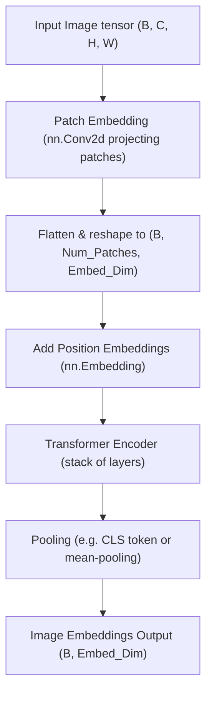
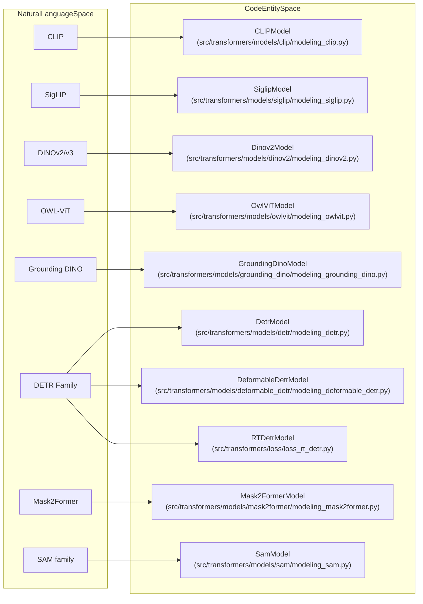
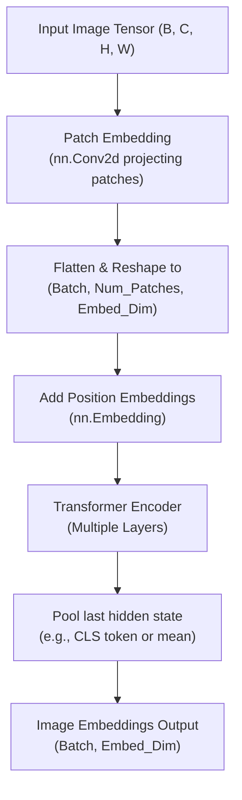

<!-- source: DeepWiki mcp.deepwiki.com · repo huggingface/transformers · page 3.6 Vision Backbones & Object Detection · fetched 2026-10-26 -->

# Vision Backbones & Object Detection

<details>
<summary>Relevant source files</summary>

The following files were used as context for generating this wiki page:

- [docs/source/en/model_doc/dinov2_with_registers.md](docs/source/en/model_doc/dinov2_with_registers.md)
- [docs/source/en/model_doc/metaclip_2.md](docs/source/en/model_doc/metaclip_2.md)
- [docs/source/en/model_doc/mm-grounding-dino.md](docs/source/en/model_doc/mm-grounding-dino.md)
- [docs/source/en/model_doc/phi4_multimodal.md](docs/source/en/model_doc/phi4_multimodal.md)
- [docs/source/en/model_doc/pixio.md](docs/source/en/model_doc/pixio.md)
- [docs/source/en/model_doc/sam_hq.md](docs/source/en/model_doc/sam_hq.md)
- [docs/source/en/model_doc/siglip.md](docs/source/en/model_doc/siglip.md)
- [docs/source/en/tasks/zero_shot_image_classification.md](docs/source/en/tasks/zero_shot_image_classification.md)
- [src/transformers/loss/loss_deformable_detr.py](src/transformers/loss/loss_deformable_detr.py)
- [src/transformers/loss/loss_for_object_detection.py](src/transformers/loss/loss_for_object_detection.py)
- [src/transformers/loss/loss_grounding_dino.py](src/transformers/loss/loss_grounding_dino.py)
- [src/transformers/loss/loss_lw_detr.py](src/transformers/loss/loss_lw_detr.py)
- [src/transformers/loss/loss_rf_detr.py](src/transformers/loss/loss_rf_detr.py)
- [src/transformers/loss/loss_rt_detr.py](src/transformers/loss/loss_rt_detr.py)
- [src/transformers/loss/loss_utils.py](src/transformers/loss/loss_utils.py)
- [src/transformers/models/aimv2/modeling_aimv2.py](src/transformers/models/aimv2/modeling_aimv2.py)
- [src/transformers/models/aimv2/modular_aimv2.py](src/transformers/models/aimv2/modular_aimv2.py)
- [src/transformers/models/align/modeling_align.py](src/transformers/models/align/modeling_align.py)
- [src/transformers/models/altclip/modeling_altclip.py](src/transformers/models/altclip/modeling_altclip.py)
- [src/transformers/models/audio_spectrogram_transformer/modeling_audio_spectrogram_transformer.py](src/transformers/models/audio_spectrogram_transformer/modeling_audio_spectrogram_transformer.py)
- [src/transformers/models/chinese_clip/modeling_chinese_clip.py](src/transformers/models/chinese_clip/modeling_chinese_clip.py)
- [src/transformers/models/clip/convert_clip_original_pytorch_to_hf.py](src/transformers/models/clip/convert_clip_original_pytorch_to_hf.py)
- [src/transformers/models/clip/modeling_clip.py](src/transformers/models/clip/modeling_clip.py)
- [src/transformers/models/clipseg/modeling_clipseg.py](src/transformers/models/clipseg/modeling_clipseg.py)
- [src/transformers/models/clipseg/modular_clipseg.py](src/transformers/models/clipseg/modular_clipseg.py)
- [src/transformers/models/conditional_detr/modeling_conditional_detr.py](src/transformers/models/conditional_detr/modeling_conditional_detr.py)
- [src/transformers/models/deformable_detr/modeling_deformable_detr.py](src/transformers/models/deformable_detr/modeling_deformable_detr.py)
- [src/transformers/models/deit/configuration_deit.py](src/transformers/models/deit/configuration_deit.py)
- [src/transformers/models/deit/modeling_deit.py](src/transformers/models/deit/modeling_deit.py)
- [src/transformers/models/detr/modeling_detr.py](src/transformers/models/detr/modeling_detr.py)
- [src/transformers/models/dinov2/modeling_dinov2.py](src/transformers/models/dinov2/modeling_dinov2.py)
- [src/transformers/models/dinov2_with_registers/__init__.py](src/transformers/models/dinov2_with_registers/__init__.py)
- [src/transformers/models/dinov2_with_registers/configuration_dinov2_with_registers.py](src/transformers/models/dinov2_with_registers/configuration_dinov2_with_registers.py)
- [src/transformers/models/dinov2_with_registers/convert_dinov2_with_registers_to_hf.py](src/transformers/models/dinov2_with_registers/convert_dinov2_with_registers_to_hf.py)
- [src/transformers/models/dinov2_with_registers/modeling_dinov2_with_registers.py](src/transformers/models/dinov2_with_registers/modeling_dinov2_with_registers.py)
- [src/transformers/models/dinov2_with_registers/modular_dinov2_with_registers.py](src/transformers/models/dinov2_with_registers/modular_dinov2_with_registers.py)
- [src/transformers/models/dpt/modeling_dpt.py](src/transformers/models/dpt/modeling_dpt.py)
- [src/transformers/models/edgetam/modeling_edgetam.py](src/transformers/models/edgetam/modeling_edgetam.py)
- [src/transformers/models/edgetam_video/modeling_edgetam_video.py](src/transformers/models/edgetam_video/modeling_edgetam_video.py)
- [src/transformers/models/eomt/modeling_eomt.py](src/transformers/models/eomt/modeling_eomt.py)
- [src/transformers/models/eomt_dinov3/modeling_eomt_dinov3.py](src/transformers/models/eomt_dinov3/modeling_eomt_dinov3.py)
- [src/transformers/models/flava/modeling_flava.py](src/transformers/models/flava/modeling_flava.py)
- [src/transformers/models/git/modeling_git.py](src/transformers/models/git/modeling_git.py)
- [src/transformers/models/grounding_dino/modeling_grounding_dino.py](src/transformers/models/grounding_dino/modeling_grounding_dino.py)
- [src/transformers/models/grounding_dino/processing_grounding_dino.py](src/transformers/models/grounding_dino/processing_grounding_dino.py)
- [src/transformers/models/groupvit/modeling_groupvit.py](src/transformers/models/groupvit/modeling_groupvit.py)
- [src/transformers/models/hiera/modeling_hiera.py](src/transformers/models/hiera/modeling_hiera.py)
- [src/transformers/models/idefics/vision.py](src/transformers/models/idefics/vision.py)
- [src/transformers/models/ijepa/configuration_ijepa.py](src/transformers/models/ijepa/configuration_ijepa.py)
- [src/transformers/models/ijepa/modeling_ijepa.py](src/transformers/models/ijepa/modeling_ijepa.py)
- [src/transformers/models/kosmos2/modeling_kosmos2.py](src/transformers/models/kosmos2/modeling_kosmos2.py)
- [src/transformers/models/mask2former/modeling_mask2former.py](src/transformers/models/mask2former/modeling_mask2former.py)
- [src/transformers/models/maskformer/modeling_maskformer.py](src/transformers/models/maskformer/modeling_maskformer.py)
- [src/transformers/models/maskformer/modular_maskformer.py](src/transformers/models/maskformer/modular_maskformer.py)
- [src/transformers/models/metaclip_2/configuration_metaclip_2.py](src/transformers/models/metaclip_2/configuration_metaclip_2.py)
- [src/transformers/models/metaclip_2/modeling_metaclip_2.py](src/transformers/models/metaclip_2/modeling_metaclip_2.py)
- [src/transformers/models/metaclip_2/modular_metaclip_2.py](src/transformers/models/metaclip_2/modular_metaclip_2.py)
- [src/transformers/models/mm_grounding_dino/__init__.py](src/transformers/models/mm_grounding_dino/__init__.py)
- [src/transformers/models/mm_grounding_dino/configuration_mm_grounding_dino.py](src/transformers/models/mm_grounding_dino/configuration_mm_grounding_dino.py)
- [src/transformers/models/mm_grounding_dino/convert_mm_grounding_dino_to_hf.py](src/transformers/models/mm_grounding_dino/convert_mm_grounding_dino_to_hf.py)
- [src/transformers/models/mm_grounding_dino/modeling_mm_grounding_dino.py](src/transformers/models/mm_grounding_dino/modeling_mm_grounding_dino.py)
- [src/transformers/models/mm_grounding_dino/modular_mm_grounding_dino.py](src/transformers/models/mm_grounding_dino/modular_mm_grounding_dino.py)
- [src/transformers/models/mra/modeling_mra.py](src/transformers/models/mra/modeling_mra.py)
- [src/transformers/models/oneformer/modeling_oneformer.py](src/transformers/models/oneformer/modeling_oneformer.py)
- [src/transformers/models/owlv2/modeling_owlv2.py](src/transformers/models/owlv2/modeling_owlv2.py)
- [src/transformers/models/owlvit/modeling_owlvit.py](src/transformers/models/owlvit/modeling_owlvit.py)
- [src/transformers/models/phi4_multimodal/convert_phi4_multimodal_weights_to_hf.py](src/transformers/models/phi4_multimodal/convert_phi4_multimodal_weights_to_hf.py)
- [src/transformers/models/phi4_multimodal/processing_phi4_multimodal.py](src/transformers/models/phi4_multimodal/processing_phi4_multimodal.py)
- [src/transformers/models/pixio/__init__.py](src/transformers/models/pixio/__init__.py)
- [src/transformers/models/pixio/configuration_pixio.py](src/transformers/models/pixio/configuration_pixio.py)
- [src/transformers/models/pixio/convert_pixio_to_pytorch.py](src/transformers/models/pixio/convert_pixio_to_pytorch.py)
- [src/transformers/models/pixio/modeling_pixio.py](src/transformers/models/pixio/modeling_pixio.py)
- [src/transformers/models/pixio/modular_pixio.py](src/transformers/models/pixio/modular_pixio.py)
- [src/transformers/models/rwkv/modeling_rwkv.py](src/transformers/models/rwkv/modeling_rwkv.py)
- [src/transformers/models/sam/configuration_sam.py](src/transformers/models/sam/configuration_sam.py)
- [src/transformers/models/sam/modeling_sam.py](src/transformers/models/sam/modeling_sam.py)
- [src/transformers/models/sam2/modeling_sam2.py](src/transformers/models/sam2/modeling_sam2.py)
- [src/transformers/models/sam2/modular_sam2.py](src/transformers/models/sam2/modular_sam2.py)
- [src/transformers/models/sam2_video/modeling_sam2_video.py](src/transformers/models/sam2_video/modeling_sam2_video.py)
- [src/transformers/models/sam2_video/modular_sam2_video.py](src/transformers/models/sam2_video/modular_sam2_video.py)
- [src/transformers/models/sam3/modeling_sam3.py](src/transformers/models/sam3/modeling_sam3.py)
- [src/transformers/models/sam3_tracker/modeling_sam3_tracker.py](src/transformers/models/sam3_tracker/modeling_sam3_tracker.py)
- [src/transformers/models/sam3_tracker_video/modeling_sam3_tracker_video.py](src/transformers/models/sam3_tracker_video/modeling_sam3_tracker_video.py)
- [src/transformers/models/sam_hq/configuration_sam_hq.py](src/transformers/models/sam_hq/configuration_sam_hq.py)
- [src/transformers/models/sam_hq/modeling_sam_hq.py](src/transformers/models/sam_hq/modeling_sam_hq.py)
- [src/transformers/models/sam_hq/modular_sam_hq.py](src/transformers/models/sam_hq/modular_sam_hq.py)
- [src/transformers/models/siglip/modeling_siglip.py](src/transformers/models/siglip/modeling_siglip.py)
- [src/transformers/models/siglip2/modeling_siglip2.py](src/transformers/models/siglip2/modeling_siglip2.py)
- [src/transformers/models/siglip2/modular_siglip2.py](src/transformers/models/siglip2/modular_siglip2.py)
- [src/transformers/models/swiftformer/modeling_swiftformer.py](src/transformers/models/swiftformer/modeling_swiftformer.py)
- [src/transformers/models/table_transformer/modeling_table_transformer.py](src/transformers/models/table_transformer/modeling_table_transformer.py)
- [src/transformers/models/tvp/modeling_tvp.py](src/transformers/models/tvp/modeling_tvp.py)
- [src/transformers/models/videomae/configuration_videomae.py](src/transformers/models/videomae/configuration_videomae.py)
- [src/transformers/models/videomae/modeling_videomae.py](src/transformers/models/videomae/modeling_videomae.py)
- [src/transformers/models/vit/configuration_vit.py](src/transformers/models/vit/configuration_vit.py)
- [src/transformers/models/vit/modeling_vit.py](src/transformers/models/vit/modeling_vit.py)
- [src/transformers/models/vit_mae/modeling_vit_mae.py](src/transformers/models/vit_mae/modeling_vit_mae.py)
- [src/transformers/models/vit_msn/modeling_vit_msn.py](src/transformers/models/vit_msn/modeling_vit_msn.py)
- [src/transformers/models/vivit/modeling_vivit.py](src/transformers/models/vivit/modeling_vivit.py)
- [src/transformers/models/x_clip/modeling_x_clip.py](src/transformers/models/x_clip/modeling_x_clip.py)
- [src/transformers/models/xlstm/modeling_xlstm.py](src/transformers/models/xlstm/modeling_xlstm.py)
- [src/transformers/models/yolos/modeling_yolos.py](src/transformers/models/yolos/modeling_yolos.py)
- [src/transformers/models/yoso/modeling_yoso.py](src/transformers/models/yoso/modeling_yoso.py)
- [src/transformers/utils/backbone_utils.py](src/transformers/utils/backbone_utils.py)
- [tests/models/clip/test_modeling_clip.py](tests/models/clip/test_modeling_clip.py)
- [tests/models/conditional_detr/test_modeling_conditional_detr.py](tests/models/conditional_detr/test_modeling_conditional_detr.py)
- [tests/models/dab_detr/test_modeling_dab_detr.py](tests/models/dab_detr/test_modeling_dab_detr.py)
- [tests/models/deformable_detr/test_modeling_deformable_detr.py](tests/models/deformable_detr/test_modeling_deformable_detr.py)
- [tests/models/depth_pro/test_modeling_depth_pro.py](tests/models/depth_pro/test_modeling_depth_pro.py)
- [tests/models/detr/test_modeling_detr.py](tests/models/detr/test_modeling_detr.py)
- [tests/models/dinov2_with_registers/test_modeling_dinov2_with_registers.py](tests/models/dinov2_with_registers/test_modeling_dinov2_with_registers.py)
- [tests/models/flava/test_modeling_flava.py](tests/models/flava/test_modeling_flava.py)
- [tests/models/fnet/test_modeling_fnet.py](tests/models/fnet/test_modeling_fnet.py)
- [tests/models/grounding_dino/test_modeling_grounding_dino.py](tests/models/grounding_dino/test_modeling_grounding_dino.py)
- [tests/models/hiera/test_modeling_hiera.py](tests/models/hiera/test_modeling_hiera.py)
- [tests/models/mask2former/test_modeling_mask2former.py](tests/models/mask2former/test_modeling_mask2former.py)
- [tests/models/maskformer/test_modeling_maskformer.py](tests/models/maskformer/test_modeling_maskformer.py)
- [tests/models/metaclip_2/test_modeling_metaclip_2.py](tests/models/metaclip_2/test_modeling_metaclip_2.py)
- [tests/models/mm_grounding_dino/test_modeling_mm_grounding_dino.py](tests/models/mm_grounding_dino/test_modeling_mm_grounding_dino.py)
- [tests/models/mobilenet_v1/test_modeling_mobilenet_v1.py](tests/models/mobilenet_v1/test_modeling_mobilenet_v1.py)
- [tests/models/mobilenet_v2/test_modeling_mobilenet_v2.py](tests/models/mobilenet_v2/test_modeling_mobilenet_v2.py)
- [tests/models/mobilevit/test_modeling_mobilevit.py](tests/models/mobilevit/test_modeling_mobilevit.py)
- [tests/models/mobilevitv2/test_modeling_mobilevitv2.py](tests/models/mobilevitv2/test_modeling_mobilevitv2.py)
- [tests/models/mpt/test_modeling_mpt.py](tests/models/mpt/test_modeling_mpt.py)
- [tests/models/nemotron/test_modeling_nemotron.py](tests/models/nemotron/test_modeling_nemotron.py)
- [tests/models/owlv2/test_modeling_owlv2.py](tests/models/owlv2/test_modeling_owlv2.py)
- [tests/models/owlvit/test_modeling_owlvit.py](tests/models/owlvit/test_modeling_owlvit.py)
- [tests/models/phi4_multimodal/test_processing_phi4_multimodal.py](tests/models/phi4_multimodal/test_processing_phi4_multimodal.py)
- [tests/models/pixio/test_modeling_pixio.py](tests/models/pixio/test_modeling_pixio.py)
- [tests/models/rwkv/test_modeling_rwkv.py](tests/models/rwkv/test_modeling_rwkv.py)
- [tests/models/sam/test_modeling_sam.py](tests/models/sam/test_modeling_sam.py)
- [tests/models/sam_hq/test_modeling_sam_hq.py](tests/models/sam_hq/test_modeling_sam_hq.py)
- [tests/models/segformer/test_modeling_segformer.py](tests/models/segformer/test_modeling_segformer.py)
- [tests/models/siglip/test_modeling_siglip.py](tests/models/siglip/test_modeling_siglip.py)
- [tests/models/siglip2/test_modeling_siglip2.py](tests/models/siglip2/test_modeling_siglip2.py)
- [tests/models/swiftformer/test_modeling_swiftformer.py](tests/models/swiftformer/test_modeling_swiftformer.py)
- [tests/models/table_transformer/test_modeling_table_transformer.py](tests/models/table_transformer/test_modeling_table_transformer.py)
- [tests/models/timesformer/test_modeling_timesformer.py](tests/models/timesformer/test_modeling_timesformer.py)
- [tests/models/timm_backbone/test_modeling_timm_backbone.py](tests/models/timm_backbone/test_modeling_timm_backbone.py)
- [tests/models/tvp/test_modeling_tvp.py](tests/models/tvp/test_modeling_tvp.py)
- [tests/models/vit_mae/test_modeling_vit_mae.py](tests/models/vit_mae/test_modeling_vit_mae.py)
- [tests/models/vivit/test_modeling_vivit.py](tests/models/vivit/test_modeling_vivit.py)
- [tests/models/xlstm/test_modeling_xlstm.py](tests/models/xlstm/test_modeling_xlstm.py)
- [tests/utils/test_backbone_utils.py](tests/utils/test_backbone_utils.py)

</details>


This section covers the vision backbone architectures based on Vision Transformers (ViT), including variants like DINOv2/v3, SigLIP, CLIP, as well as the infrastructure and utilities supporting vision tasks. It also details detection and segmentation models implementing state-of-the-art transformer-based object detectors such as DETR, Deformable DETR, RT-DETR, and segmentation frameworks including Mask2Former and the Segment Anything Model (SAM) family, as well as grounding and multimodal detection with Grounding DINO and OWL-ViT.

The following subsections delve into the technical implementations, output data flows, key model classes, and utility components internal to the Hugging Face Transformers codebase.

---

## 1. Vision Transformer Backbones

Vision transformer (ViT) backbones process input images by splitting them into patches, projecting these patches into embedding vectors, and applying a transformer encoder stack. This results in rich feature embeddings that serve as the foundation for various vision and vision-language applications.

### 1.1 Core Components

- **Patch Embeddings:**  
  Typically instantiated as a 2D convolution layer (`nn.Conv2d`) where kernel size and stride equal the patch size (e.g., 16x16). This projects image patches of shape `(batch, channels, patch_height, patch_width)` into embedding vectors of dimension `hidden_size`.

- **Position Embeddings:**  
  Learned embeddings add spatial positional information to patch embeddings. These include:
  - Position embeddings for each patch token.
  - Sometimes an additional class embedding (learned vector) prepended to patch tokens.
  Models provide interpolation logic to adapt the pretrained position embeddings for input images of resolutions differing from those used during training.

- **Pooling:**  
  After transformer layers, the model pools the last hidden states to produce a global image embedding vector. This could be the embedding of a class token or the mean of all patch token embeddings.

### 1.2 Notable Vision Backbone Classes and Configurations

| Model       | Vision Embeddings Class                  | Configuration Class              | File & Line Reference                        |
|-------------|-----------------------------------------|--------------------------------|----------------------------------------------|
| **CLIP**    | `CLIPVisionEmbeddings`                   | `CLIPVisionConfig`              | [src/transformers/models/clip/modeling_clip.py:138-160]()       |
| **SigLIP**  | `SiglipVisionEmbeddings`                  | `SiglipVisionConfig`            | [src/transformers/models/siglip/modeling_siglip.py:116-135]()   |
| **Git**     | `GitEmbeddings` (vision part)             | `GitVisionConfig`               | [src/transformers/models/git/modeling_git.py:73-113]()           |
| **OwlViT**  | `OwlViTVisionEmbeddings`                  | `OwlViTVisionConfig`            | [src/transformers/models/owlvit/modeling_owlvit.py:80-150]()     |

### 1.3 Position Embedding Interpolation

Pretrained position embeddings must be adapted when fine-tuning or inferring on images with different resolutions than training. The common strategy is bicubic interpolation of patch position embeddings in a 2D spatial grid, optionally concatenating any class token embedding.

Example (from `SiglipVisionEmbeddings`):

```python
def interpolate_pos_encoding(self, embeddings: torch.Tensor, height: int, width: int) -> torch.Tensor:
    num_patches = embeddings.shape[1]
    num_positions = self.position_embedding.weight.shape[0]

    if not torch.jit.is_tracing() and num_patches == num_positions and height == width:
        return self.position_embedding(self.position_ids)

    patch_pos_embed = self.position_embedding.weight.unsqueeze(0)
    patch_pos_embed = torch.nn.functional.interpolate(
        patch_pos_embed.reshape(1, int(math.sqrt(num_positions)), int(math.sqrt(num_positions)), -1).permute(0, 3, 1, 2),
        size=(height, width),
        mode="bicubic",
        align_corners=False,
    )
    patch_pos_embed = patch_pos_embed.permute(0, 2, 3, 1).reshape(1, height * width, -1)
    return patch_pos_embed
```
[src/transformers/models/siglip/modeling_siglip.py:137-155]()

This pattern is similarly used in the CLIP and DINOv2 model implementations, enabling flexible image input sizes.

### 1.4 Data Flow in Vision Backbones



Sources:  
[src/transformers/models/clip/modeling_clip.py:138-160]()  
[src/transformers/models/siglip/modeling_siglip.py:116-135]()  
[src/transformers/models/git/modeling_git.py:73-113]()  
[src/transformers/models/owlvit/modeling_owlvit.py:80-150]()  
[src/transformers/models/siglip/modeling_siglip.py:137-155]()

---

## 2. Object Detection & Segmentation Models

Transformer-based detection and segmentation models build on vision backbones and add task-specific heads to predict object classes, bounding boxes, and masks. Architectures typically use transformer encoder-decoder structures that leverage attention mechanisms for spatial and multi-scale reasoning.

### 2.1 DETR Family: DETR, Deformable DETR, RT-DETR

Detection Transformer (DETR) formulates object detection as a direct set prediction problem, doing away with traditional anchors and post-processing like NMS.

| Model               | Model Class                                   | Output Class                                   | Key Features                                   | File Reference                                     |
|---------------------|-----------------------------------------------|-----------------------------------------------|------------------------------------------------|----------------------------------------------------|
| **DETR**            | `DetrForObjectDetection` (modular)            | `DetrObjectDetectionOutput`                    | Transformer decoder with learned object queries| `src/transformers/models/detr/modeling_detr.py`                      |
| **Deformable DETR** | `DeformableDetrForObjectDetection`             | `DeformableDetrObjectDetectionOutput`         | Multi-scale deformable attention for efficiency | [src/transformers/models/deformable_detr/modeling_deformable_detr.py:50-130]() |
| **RT-DETR**         | `RTDetrForObjectDetection`                      | `RTDetrObjectDetectionOutput`                   | Real-time efficient transformer detector       | `src/transformers/loss/loss_rt_detr.py`          |

#### Deformable DETR Data Flow

1. **Multi-scale Backbone Features:**  
   Extracted via a convolutional backbone such as ResNet or a lightweight CNN, possibly using `load_backbone()` utility [src/transformers/backbone_utils.py]().

2. **Transformer Encoder:**  
   Encodes flattened multi-scale features using deformable attention, efficiently attending over spatial positions. The `MultiScaleDeformableAttention` class is a key component [src/transformers/models/grounding_dino/modeling_grounding_dino.py:75-128]().

3. **Transformer Decoder:**  
   Learns object queries that cross-attend to encoder outputs with deformable attention, producing object-level representations. The `DeformableDetrDecoderOutput` dataclass captures the intermediate states [src/transformers/models/deformable_detr/modeling_deformable_detr.py:57-70]().

4. **Prediction Heads:**  
   Outputs classification logits for object classes (including no-object) and bounding box coordinate predictions normalized relative to image size. These are encapsulated in `DeformableDetrObjectDetectionOutput` [src/transformers/models/deformable_detr/modeling_deformable_detr.py:116-130]().

### 2.2 Mask2Former: Unified Segmentation Framework

Mask2Former unifies panoptic, instance, and semantic segmentation using:

- **Pixel Decoder:**  
  Based on Multi-Scale Deformable Attention, producing multi-scale image features and mask embedding features. The output is represented by `Mask2FormerPixelDecoderOutput` [src/transformers/models/mask2former/modeling_mask2former.py:53-70]().

- **Transformer Decoder:**  
  Operates on mask queries to predict segmentation masks and class logits. The `Mask2FormerMaskedAttentionDecoderOutput` captures its outputs [src/transformers/models/mask2former/modeling_mask2former.py:80-102]().

Core outputs include:

- `Mask2FormerPixelDecoderOutput` — multi-scale features and pixel-level maps.
- `Mask2FormerMaskedAttentionDecoderOutput` — hidden states and attentions per decoder layer, mask query logits.

Typical data flow: Backbone → Pixel Decoder → Transformer Decoder → Mask & Class Predictions. The overall model output is `Mask2FormerModelOutput` [src/transformers/models/mask2former/modeling_mask2former.py:143-146]().

### 2.3 Segment Anything Model (SAM) Family

The SAM family provides foundation segmentation models that generate masks prompted by user inputs (e.g., points, boxes). Modular implementations like `src/transformers/models/sam2/modular_sam2.py` accommodate flexible inputs, including videos, and advanced prompt encodings. Examples include `SamModel` [src/transformers/models/sam/modeling_sam.py](), `Sam2Model` [src/transformers/models/sam2/modeling_sam2.py](), and `Sam2VideoModel` [src/transformers/models/sam2_video/modeling_sam2_video.py]().

Sources:  
[src/transformers/models/deformable_detr/modeling_deformable_detr.py:50-130]()  
[src/transformers/loss/loss_rt_detr.py]()  
[src/transformers/backbone_utils.py]()  
[src/transformers/models/grounding_dino/modeling_grounding_dino.py:75-128]()  
[src/transformers/models/deformable_detr/modeling_deformable_detr.py:57-70]()  
[src/transformers/models/deformable_detr/modeling_deformable_detr.py:116-130]()  
[src/transformers/models/mask2former/modeling_mask2former.py:53-70]()  
[src/transformers/models/mask2former/modeling_mask2former.py:80-102]()  
[src/transformers/models/mask2former/modeling_mask2former.py:143-146]()  
`src/transformers/models/sam2/modular_sam2.py`  
`src/transformers/models/sam/modeling_sam.py`  
`src/transformers/models/sam2/modeling_sam2.py`  
`src/transformers/models/sam2_video/modeling_sam2_video.py`

---

## 3. Grounding DINO & OWL-ViT: Grounded and Open-Vocabulary Detection

### Grounding DINO

Grounding DINO integrates vision and language by applying cross-attention between text and multi-scale deformable vision features. This supports referring expression grounding and general object detection.

- Uses sinusoidal positional encodings for anchors, implemented in `encode_sinusoidal_position_embedding` [src/transformers/models/grounding_dino/modeling_grounding_dino.py:39-73]().
- The `GroundingDinoDecoderOutput` carries intermediate hidden states and reference points over decoder layers [src/transformers/models/grounding_dino/modeling_grounding_dino.py:139-154]().
- Provides detailed bounding box classification outputs via `GroundingDinoForObjectDetectionOutput` [src/transformers/models/grounding_dino/modeling_grounding_dino.py:156-160]().

### OWL-ViT

OWL-ViT performs open-world and open-vocabulary object detection through contrastive learning.

- Computes similarity logits between text and patch-level image embeddings.
- Uses a contrastive loss to align projected text and image representations, defined by `contrastive_loss` and `image_text_contrastive_loss` [src/transformers/models/owlvit/modeling_owlvit.py:54-62]() (copied from CLIP).
- Outputs include classification logits, objectness scores, and normalized bounding box predictions, encapsulated in `Owlv2ObjectDetectionOutput` [src/transformers/models/owlv2/modeling_owlv2.py:103-146]().

Sources:  
[src/transformers/models/grounding_dino/modeling_grounding_dino.py:39-73]()  
[src/transformers/models/grounding_dino/modeling_grounding_dino.py:139-154]()  
[src/transformers/models/grounding_dino/modeling_grounding_dino.py:156-160]()  
[src/transformers/models/owlvit/modeling_owlvit.py:54-62]()  
[src/transformers/models/owlv2/modeling_owlv2.py:103-146]()

---

## 4. Vision-Language Contrastive Models: CLIP, SigLIP, DINOv2/v3

Vision-language contrastive models jointly train text and vision encoders to produce embeddings aligned in a shared space.

- **CLIP:**  
  Classic contrastive model using ViT-based vision and transformer text encoders. The `CLIPOutput` dataclass holds the contrastive loss and similarity scores [src/transformers/models/clip/modeling_clip.py:106-135]().

- **SigLIP:**  
  Variant improving vision-text alignment. Its `SiglipOutput` is similar to CLIP's [src/transformers/models/siglip/modeling_siglip.py:83-111]().

- **DINOv2/v3:**  
  Self-distilled vision transformers trained without text, usable as backbones. Implemented in `src/transformers/models/dinov2/modeling_dinov2.py` and `src/transformers/models/dinov2_with_registers/modeling_dinov2_with_registers.py`.

Contrastive loss utilities:

```python
def contrastive_loss(logits: torch.Tensor) -> torch.Tensor:
    return nn.functional.cross_entropy(logits, torch.arange(len(logits), device=logits.device))
```
[src/transformers/models/clip/modeling_clip.py:47-48]()

```python
def image_text_contrastive_loss(similarity: torch.Tensor) -> torch.Tensor:
    caption_loss = contrastive_loss(similarity)
    image_loss = contrastive_loss(similarity.T)
    return (caption_loss + image_loss) / 2.0
```
[src/transformers/models/clip/modeling_clip.py:51-54]()

Sources:  
[src/transformers/models/clip/modeling_clip.py:106-135]()  
[src/transformers/models/siglip/modeling_siglip.py:83-111]()  
`src/transformers/models/dinov2/modeling_dinov2.py`  
`src/transformers/models/dinov2_with_registers/modeling_dinov2_with_registers.py`  
[src/transformers/models/clip/modeling_clip.py:47-48]()  
[src/transformers/models/clip/modeling_clip.py:51-54]()

---

## 5. Model Outputs Overview and Data Flow

Output dataclasses standardize model interface:

| Model Type              | Output Class                                     | Key Attributes                                                                  |
|-------------------------|------------------------------------------------|---------------------------------------------------------------------------------|
| Vision Backbone         | e.g., `CLIPVisionModelOutput`                   | `last_hidden_state`, `image_embeds`, `hidden_states`, `attentions`              |
| Contrastive Models      | e.g., `CLIPOutput`, `SiglipOutput`, `OwlViTOutput` | `loss`, `logits_per_image`, `logits_per_text`, `text_embeds`, `image_embeds`    |
| DETR & Variants         | e.g., `DeformableDetrObjectDetectionOutput`    | `loss`, `logits`, `pred_boxes`, `intermediate_hidden_states`, `intermediate_reference_points` |
| Mask2Former             | `Mask2FormerModelOutput`                         | Multi-scale features, mask logits, intermediate decoder activations           |

Sources:  
[src/transformers/models/clip/modeling_clip.py:74-84]()  
[src/transformers/models/siglip/modeling_siglip.py:49-60]()  
[src/transformers/models/owlvit/modeling_owlvit.py:66-86]()  
[src/transformers/models/deformable_detr/modeling_deformable_detr.py:116-130]()  
[src/transformers/models/mask2former/modeling_mask2former.py:143-146]()

---

## 6. Backbone Utilities & Integration

- **Backbone Loading:**  
  `load_backbone` utility [src/transformers/backbone_utils.py]() to load pretrained CNN or transformer backbones with various configuration options. This is used in models like Deformable DETR [src/transformers/models/deformable_detr/modeling_deformable_detr.py:32]() and Grounding DINO [src/transformers/models/grounding_dino/modeling_grounding_dino.py:26]().

- **Position Embedding Interpolation:**  
  Functions to resize and interpolate position embeddings adapting to new input resolutions, as seen in `SiglipVisionEmbeddings.interpolate_pos_encoding` [src/transformers/models/siglip/modeling_siglip.py:137-155]().

- **Gradient Checkpointing Layer:**  
  `GradientCheckpointingLayer` [src/transformers/modeling_layers.py]() used to save memory during training by recomputing intermediate activations. This is integrated into various models, e.g., SigLIP [src/transformers/models/siglip/modeling_siglip.py:27](), Deformable DETR [src/transformers/models/deformable_detr/modeling_deformable_detr.py:34](), and CLIP [src/transformers/models/clip/modeling_clip.py:26]().

- **Contrastive Loss Functions:**  
  Shared contrastive loss implementations improve modularity and reuse across vision-language models, as detailed in Section 4. These are often found in `src/transformers/loss/loss_utils.py` or directly in model files.

Sources:  
[src/transformers/backbone_utils.py]()  
[src/transformers/models/deformable_detr/modeling_deformable_detr.py:32]()  
[src/transformers/models/grounding_dino/modeling_grounding_dino.py:26]()  
[src/transformers/models/siglip/modeling_siglip.py:137-155]()  
[src/transformers/modeling_layers.py]()  
[src/transformers/models/siglip/modeling_siglip.py:27]()  
[src/transformers/models/deformable_detr/modeling_deformable_detr.py:34]()  
[src/transformers/models/clip/modeling_clip.py:26]()  
`src/transformers/loss/loss_utils.py`

---

## 7. Example Mermaid Diagrams

### 7.1 Natural Language Space ↔ Vision Transformer Code Entity Mapping


Sources:  
`src/transformers/models/clip/modeling_clip.py`  
`src/transformers/models/siglip/modeling_siglip.py`  
`src/transformers/models/dinov2/modeling_dinov2.py`  
`src/transformers/models/owlvit/modeling_owlvit.py`  
`src/transformers/models/grounding_dino/modeling_grounding_dino.py`  
`src/transformers/models/detr/modeling_detr.py`  
`src/transformers/models/deformable_detr/modeling_deformable_detr.py`  
`src/transformers/loss/loss_rt_detr.py`  
`src/transformers/models/mask2former/modeling_mask2former.py`  
`src/transformers/models/sam/modeling_sam.py`

### 7.2 Vision Backbone Internal Data Flow (ViT-based example)


Sources:  
[src/transformers/models/siglip/modeling_siglip.py:116-135]()  
[src/transformers/models/clip/modeling_clip.py:138-160]()  
[src/transformers/models/git/modeling_git.py:73-113]()

---

## 8. Summary Table of Key Models and Core Files

| Model / Family       | Core Files                                                  | Description                                         |
|----------------------|-------------------------------------------------------------|----------------------------------------------------|
| CLIP                 | `src/transformers/models/clip/modeling_clip.py`                             | Vision-language contrastive model                    |
| SigLIP               | `src/transformers/models/siglip/modeling_siglip.py`                         | Variant of CLIP with vision+text contrastive learning |
| DINOv2/v3            | `src/transformers/models/dinov2/modeling_dinov2.py`                         | Self-distillation vision transformer                 |
| OWL-ViT              | `src/transformers/models/owlvit/modeling_owlvit.py`                         | Open-world language-vision detection model           |
| Grounding DINO       | `src/transformers/models/grounding_dino/modeling_grounding_dino.py`         | Grounded object detection                             |
| DETR                 | `src/transformers/models/detr/modeling_detr.py`                             | Transformer-based object detection                    |
| Deformable DETR      | `src/transformers/models/deformable_detr/modeling_deformable_detr.py`      | Multi-scale deformable attention object detector      |
| RT-DETR              | `src/transformers/loss/loss_rt_detr.py`                       | Efficient real-time transformer detector              |
| Mask2Former          | `src/transformers/models/mask2former/modeling_mask2former.py`               | Unified instance, panoptic, semantic segmentation    |
| SAM family           | `src/transformers/models/sam/modeling_sam.py`, `src/transformers/models/sam2/modular_sam2.py` | Foundation promptable segmentation models            |

---

## References & Sources

- [src/transformers/models/siglip/modeling_siglip.py:1-155]()  
- [src/transformers/models/deformable_detr/modeling_deformable_detr.py:1-130]()  
- [src/transformers/models/clip/modeling_clip.py:1-165]()  
- [src/transformers/models/grounding_dino/modeling_grounding_dino.py:30-150]()  
- [src/transformers/models/mask2former/modeling_mask2former.py:1-146]()  
- [src/transformers/models/git/modeling_git.py:70-165]()  
- [src/transformers/models/owlvit/modeling_owlvit.py:50-150]()  
- `src/transformers/loss/loss_rt_detr.py`  
- `src/transformers/models/dinov2/modeling_dinov2.py`  
- `src/transformers/models/detr/modeling_detr.py`  
- `src/transformers/backbone_utils.py`  
- `src/transformers/modeling_layers.py`  
- `src/transformers/models/sam2/modular_sam2.py`  
- `src/transformers/models/sam/modeling_sam.py`  
- `src/transformers/models/sam2/modeling_sam2.py`  
- `src/transformers/models/sam2_video/modeling_sam2_video.py`  
- `src/transformers/models/dinov2_with_registers/modeling_dinov2_with_registers.py`  
- `src/transformers/models/owlv2/modeling_owlv2.py`  

---

This page consolidates detailed architectural and implementation insights on vision backbones and detection/segmentation transformers maintained in the Hugging Face Transformers library, enabling technical users to explore, extend, and deploy these models effectively.

---

