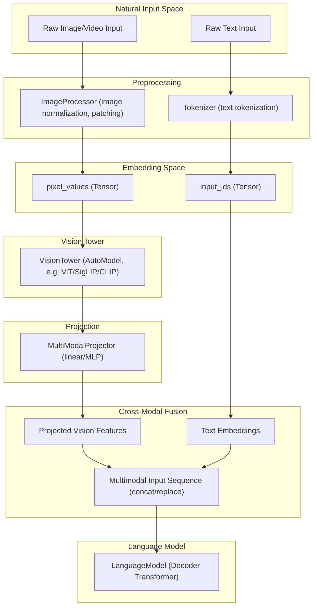
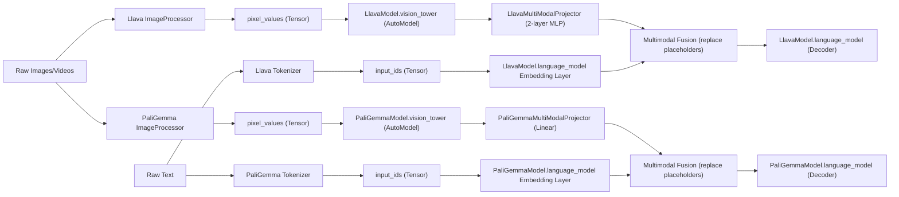
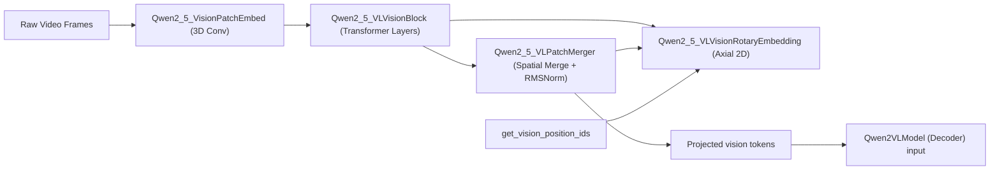

<!-- source: DeepWiki mcp.deepwiki.com · repo huggingface/transformers · page 3.7 Vision-Language Models · fetched 2026-10-26 -->

# Vision-Language Models

Relevant source files

The following files were used as context for generating this wiki page:

- [docs/source/en/model_doc/deepseek_vl.md](docs/source/en/model_doc/deepseek_vl.md)
- [docs/source/en/model_doc/deepseek_vl_hybrid.md](docs/source/en/model_doc/deepseek_vl_hybrid.md)
- [docs/source/en/model_doc/janus.md](docs/source/en/model_doc/janus.md)
- [src/transformers/models/aria/image_processing_aria.py](src/transformers/models/aria/image_processing_aria.py)
- [src/transformers/models/aria/image_processing_pil_aria.py](src/transformers/models/aria/image_processing_pil_aria.py)
- [src/transformers/models/aria/modeling_aria.py](src/transformers/models/aria/modeling_aria.py)
- [src/transformers/models/aria/modular_aria.py](src/transformers/models/aria/modular_aria.py)
- [src/transformers/models/aya_vision/modeling_aya_vision.py](src/transformers/models/aya_vision/modeling_aya_vision.py)
- [src/transformers/models/blip_2/modeling_blip_2.py](src/transformers/models/blip_2/modeling_blip_2.py)
- [src/transformers/models/blt/modeling_blt.py](src/transformers/models/blt/modeling_blt.py)
- [src/transformers/models/blt/modular_blt.py](src/transformers/models/blt/modular_blt.py)
- [src/transformers/models/chameleon/modeling_chameleon.py](src/transformers/models/chameleon/modeling_chameleon.py)
- [src/transformers/models/cohere2_vision/image_processing_cohere2_vision.py](src/transformers/models/cohere2_vision/image_processing_cohere2_vision.py)
- [src/transformers/models/deepseek_ocr2/image_processing_pil_deepseek_ocr2.py](src/transformers/models/deepseek_ocr2/image_processing_pil_deepseek_ocr2.py)
- [src/transformers/models/deepseek_vl/configuration_deepseek_vl.py](src/transformers/models/deepseek_vl/configuration_deepseek_vl.py)
- [src/transformers/models/deepseek_vl/image_processing_deepseek_vl.py](src/transformers/models/deepseek_vl/image_processing_deepseek_vl.py)
- [src/transformers/models/deepseek_vl/modeling_deepseek_vl.py](src/transformers/models/deepseek_vl/modeling_deepseek_vl.py)
- [src/transformers/models/deepseek_vl/modular_deepseek_vl.py](src/transformers/models/deepseek_vl/modular_deepseek_vl.py)
- [src/transformers/models/deepseek_vl_hybrid/__init__.py](src/transformers/models/deepseek_vl_hybrid/__init__.py)
- [src/transformers/models/deepseek_vl_hybrid/image_processing_deepseek_vl_hybrid.py](src/transformers/models/deepseek_vl_hybrid/image_processing_deepseek_vl_hybrid.py)
- [src/transformers/models/deepseek_vl_hybrid/modeling_deepseek_vl_hybrid.py](src/transformers/models/deepseek_vl_hybrid/modeling_deepseek_vl_hybrid.py)
- [src/transformers/models/deepseek_vl_hybrid/modular_deepseek_vl_hybrid.py](src/transformers/models/deepseek_vl_hybrid/modular_deepseek_vl_hybrid.py)
- [src/transformers/models/emu3/modeling_emu3.py](src/transformers/models/emu3/modeling_emu3.py)
- [src/transformers/models/emu3/modular_emu3.py](src/transformers/models/emu3/modular_emu3.py)
- [src/transformers/models/ernie4_5_vl_moe/modeling_ernie4_5_vl_moe.py](src/transformers/models/ernie4_5_vl_moe/modeling_ernie4_5_vl_moe.py)
- [src/transformers/models/fsmt/modeling_fsmt.py](src/transformers/models/fsmt/modeling_fsmt.py)
- [src/transformers/models/glm/modeling_glm.py](src/transformers/models/glm/modeling_glm.py)
- [src/transformers/models/glm46v/modeling_glm46v.py](src/transformers/models/glm46v/modeling_glm46v.py)
- [src/transformers/models/glm4v/modeling_glm4v.py](src/transformers/models/glm4v/modeling_glm4v.py)
- [src/transformers/models/glm4v/modular_glm4v.py](src/transformers/models/glm4v/modular_glm4v.py)
- [src/transformers/models/glm4v_moe/modeling_glm4v_moe.py](src/transformers/models/glm4v_moe/modeling_glm4v_moe.py)
- [src/transformers/models/glm_image/modeling_glm_image.py](src/transformers/models/glm_image/modeling_glm_image.py)
- [src/transformers/models/glm_ocr/modeling_glm_ocr.py](src/transformers/models/glm_ocr/modeling_glm_ocr.py)
- [src/transformers/models/got_ocr2/modeling_got_ocr2.py](src/transformers/models/got_ocr2/modeling_got_ocr2.py)
- [src/transformers/models/got_ocr2/modular_got_ocr2.py](src/transformers/models/got_ocr2/modular_got_ocr2.py)
- [src/transformers/models/granite/modeling_granite.py](src/transformers/models/granite/modeling_granite.py)
- [src/transformers/models/helium/modeling_helium.py](src/transformers/models/helium/modeling_helium.py)
- [src/transformers/models/idefics/modeling_idefics.py](src/transformers/models/idefics/modeling_idefics.py)
- [src/transformers/models/idefics/processing_idefics.py](src/transformers/models/idefics/processing_idefics.py)
- [src/transformers/models/idefics2/modeling_idefics2.py](src/transformers/models/idefics2/modeling_idefics2.py)
- [src/transformers/models/idefics3/modeling_idefics3.py](src/transformers/models/idefics3/modeling_idefics3.py)
- [src/transformers/models/instructblip/modeling_instructblip.py](src/transformers/models/instructblip/modeling_instructblip.py)
- [src/transformers/models/instructblipvideo/modeling_instructblipvideo.py](src/transformers/models/instructblipvideo/modeling_instructblipvideo.py)
- [src/transformers/models/instructblipvideo/modular_instructblipvideo.py](src/transformers/models/instructblipvideo/modular_instructblipvideo.py)
- [src/transformers/models/internvl/modeling_internvl.py](src/transformers/models/internvl/modeling_internvl.py)
- [src/transformers/models/internvl/modular_internvl.py](src/transformers/models/internvl/modular_internvl.py)
- [src/transformers/models/janus/__init__.py](src/transformers/models/janus/__init__.py)
- [src/transformers/models/janus/image_processing_janus.py](src/transformers/models/janus/image_processing_janus.py)
- [src/transformers/models/janus/modeling_janus.py](src/transformers/models/janus/modeling_janus.py)
- [src/transformers/models/janus/modular_janus.py](src/transformers/models/janus/modular_janus.py)
- [src/transformers/models/llava/modeling_llava.py](src/transformers/models/llava/modeling_llava.py)
- [src/transformers/models/llava_next/image_processing_llava_next.py](src/transformers/models/llava_next/image_processing_llava_next.py)
- [src/transformers/models/llava_next/modeling_llava_next.py](src/transformers/models/llava_next/modeling_llava_next.py)
- [src/transformers/models/llava_next_video/modeling_llava_next_video.py](src/transformers/models/llava_next_video/modeling_llava_next_video.py)
- [src/transformers/models/llava_next_video/modular_llava_next_video.py](src/transformers/models/llava_next_video/modular_llava_next_video.py)
- [src/transformers/models/llava_onevision/image_processing_llava_onevision.py](src/transformers/models/llava_onevision/image_processing_llava_onevision.py)
- [src/transformers/models/llava_onevision/image_processing_pil_llava_onevision.py](src/transformers/models/llava_onevision/image_processing_pil_llava_onevision.py)
- [src/transformers/models/llava_onevision/modeling_llava_onevision.py](src/transformers/models/llava_onevision/modeling_llava_onevision.py)
- [src/transformers/models/llava_onevision/modular_llava_onevision.py](src/transformers/models/llava_onevision/modular_llava_onevision.py)
- [src/transformers/models/mistral3/modeling_mistral3.py](src/transformers/models/mistral3/modeling_mistral3.py)
- [src/transformers/models/mistral3/modular_mistral3.py](src/transformers/models/mistral3/modular_mistral3.py)
- [src/transformers/models/mllama/modeling_mllama.py](src/transformers/models/mllama/modeling_mllama.py)
- [src/transformers/models/olmo2/modeling_olmo2.py](src/transformers/models/olmo2/modeling_olmo2.py)
- [src/transformers/models/paddleocr_vl/modeling_paddleocr_vl.py](src/transformers/models/paddleocr_vl/modeling_paddleocr_vl.py)
- [src/transformers/models/paligemma/modeling_paligemma.py](src/transformers/models/paligemma/modeling_paligemma.py)
- [src/transformers/models/qwen2_5_omni/modeling_qwen2_5_omni.py](src/transformers/models/qwen2_5_omni/modeling_qwen2_5_omni.py)
- [src/transformers/models/qwen2_5_omni/modular_qwen2_5_omni.py](src/transformers/models/qwen2_5_omni/modular_qwen2_5_omni.py)
- [src/transformers/models/qwen2_5_vl/modeling_qwen2_5_vl.py](src/transformers/models/qwen2_5_vl/modeling_qwen2_5_vl.py)
- [src/transformers/models/qwen2_5_vl/modular_qwen2_5_vl.py](src/transformers/models/qwen2_5_vl/modular_qwen2_5_vl.py)
- [src/transformers/models/qwen2_vl/modeling_qwen2_vl.py](src/transformers/models/qwen2_vl/modeling_qwen2_vl.py)
- [src/transformers/models/qwen3_5/modeling_qwen3_5.py](src/transformers/models/qwen3_5/modeling_qwen3_5.py)
- [src/transformers/models/qwen3_5/modular_qwen3_5.py](src/transformers/models/qwen3_5/modular_qwen3_5.py)
- [src/transformers/models/qwen3_5_moe/modeling_qwen3_5_moe.py](src/transformers/models/qwen3_5_moe/modeling_qwen3_5_moe.py)
- [src/transformers/models/qwen3_omni_moe/configuration_qwen3_omni_moe.py](src/transformers/models/qwen3_omni_moe/configuration_qwen3_omni_moe.py)
- [src/transformers/models/qwen3_omni_moe/modeling_qwen3_omni_moe.py](src/transformers/models/qwen3_omni_moe/modeling_qwen3_omni_moe.py)
- [src/transformers/models/qwen3_omni_moe/modular_qwen3_omni_moe.py](src/transformers/models/qwen3_omni_moe/modular_qwen3_omni_moe.py)
- [src/transformers/models/qwen3_vl/modeling_qwen3_vl.py](src/transformers/models/qwen3_vl/modeling_qwen3_vl.py)
- [src/transformers/models/qwen3_vl/modular_qwen3_vl.py](src/transformers/models/qwen3_vl/modular_qwen3_vl.py)
- [src/transformers/models/qwen3_vl_moe/modeling_qwen3_vl_moe.py](src/transformers/models/qwen3_vl_moe/modeling_qwen3_vl_moe.py)
- [src/transformers/models/smolvlm/modeling_smolvlm.py](src/transformers/models/smolvlm/modeling_smolvlm.py)
- [src/transformers/models/smolvlm/modular_smolvlm.py](src/transformers/models/smolvlm/modular_smolvlm.py)
- [src/transformers/models/video_llava/modeling_video_llava.py](src/transformers/models/video_llava/modeling_video_llava.py)
- [src/transformers/models/vipllava/modeling_vipllava.py](src/transformers/models/vipllava/modeling_vipllava.py)
- [tests/models/aria/test_image_processing_aria.py](tests/models/aria/test_image_processing_aria.py)
- [tests/models/blip/test_modeling_blip.py](tests/models/blip/test_modeling_blip.py)
- [tests/models/blip_2/test_modeling_blip_2.py](tests/models/blip_2/test_modeling_blip_2.py)
- [tests/models/blt/test_modeling_blt.py](tests/models/blt/test_modeling_blt.py)
- [tests/models/chameleon/test_modeling_chameleon.py](tests/models/chameleon/test_modeling_chameleon.py)
- [tests/models/deepseek_vl/test_image_processing_deepseek_vl.py](tests/models/deepseek_vl/test_image_processing_deepseek_vl.py)
- [tests/models/deepseek_vl/test_modeling_deepseek_vl.py](tests/models/deepseek_vl/test_modeling_deepseek_vl.py)
- [tests/models/deepseek_vl_hybrid/test_modeling_deepseek_vl_hybrid.py](tests/models/deepseek_vl_hybrid/test_modeling_deepseek_vl_hybrid.py)
- [tests/models/emu3/test_modeling_emu3.py](tests/models/emu3/test_modeling_emu3.py)
- [tests/models/exaone4_5/test_modeling_exaone4_5.py](tests/models/exaone4_5/test_modeling_exaone4_5.py)
- [tests/models/idefics/test_modeling_idefics.py](tests/models/idefics/test_modeling_idefics.py)
- [tests/models/idefics2/test_modeling_idefics2.py](tests/models/idefics2/test_modeling_idefics2.py)
- [tests/models/idefics3/test_modeling_idefics3.py](tests/models/idefics3/test_modeling_idefics3.py)
- [tests/models/instructblip/test_modeling_instructblip.py](tests/models/instructblip/test_modeling_instructblip.py)
- [tests/models/instructblipvideo/test_modeling_instructblipvideo.py](tests/models/instructblipvideo/test_modeling_instructblipvideo.py)
- [tests/models/janus/test_image_processing_janus.py](tests/models/janus/test_image_processing_janus.py)
- [tests/models/janus/test_modeling_janus.py](tests/models/janus/test_modeling_janus.py)
- [tests/models/lilt/test_modeling_lilt.py](tests/models/lilt/test_modeling_lilt.py)
- [tests/models/llava/test_modeling_llava.py](tests/models/llava/test_modeling_llava.py)
- [tests/models/llava_next/test_image_processing_llava_next.py](tests/models/llava_next/test_image_processing_llava_next.py)
- [tests/models/llava_next/test_modeling_llava_next.py](tests/models/llava_next/test_modeling_llava_next.py)
- [tests/models/llava_next_video/test_modeling_llava_next_video.py](tests/models/llava_next_video/test_modeling_llava_next_video.py)
- [tests/models/llava_onevision/test_image_processing_llava_onevision.py](tests/models/llava_onevision/test_image_processing_llava_onevision.py)
- [tests/models/llava_onevision/test_modeling_llava_onevision.py](tests/models/llava_onevision/test_modeling_llava_onevision.py)
- [tests/models/longformer/test_modeling_longformer.py](tests/models/longformer/test_modeling_longformer.py)
- [tests/models/luke/test_modeling_luke.py](tests/models/luke/test_modeling_luke.py)
- [tests/models/mllama/test_modeling_mllama.py](tests/models/mllama/test_modeling_mllama.py)
- [tests/models/moshi/test_modeling_moshi.py](tests/models/moshi/test_modeling_moshi.py)
- [tests/models/mra/test_modeling_mra.py](tests/models/mra/test_modeling_mra.py)
- [tests/models/paligemma/test_modeling_paligemma.py](tests/models/paligemma/test_modeling_paligemma.py)
- [tests/models/pix2struct/test_modeling_pix2struct.py](tests/models/pix2struct/test_modeling_pix2struct.py)
- [tests/models/qwen2_5_omni/test_modeling_qwen2_5_omni.py](tests/models/qwen2_5_omni/test_modeling_qwen2_5_omni.py)
- [tests/models/qwen2_5_vl/test_modeling_qwen2_5_vl.py](tests/models/qwen2_5_vl/test_modeling_qwen2_5_vl.py)
- [tests/models/qwen2_vl/test_modeling_qwen2_vl.py](tests/models/qwen2_vl/test_modeling_qwen2_vl.py)
- [tests/models/qwen3_omni_moe/test_modeling_qwen3_omni_moe.py](tests/models/qwen3_omni_moe/test_modeling_qwen3_omni_moe.py)
- [tests/models/smolvlm/test_modeling_smolvlm.py](tests/models/smolvlm/test_modeling_smolvlm.py)
- [tests/models/video_llava/test_modeling_video_llava.py](tests/models/video_llava/test_modeling_video_llava.py)
- [tests/models/vipllava/test_modeling_vipllava.py](tests/models/vipllava/test_modeling_vipllava.py)
- [tests/test_training_mixin.py](tests/test_training_mixin.py)

This page documents the technical implementation details of vision-language architectures in the Hugging Face Transformers library, specifically covering the LLaVA family, PaliGemma, BLIP/BLIP-2, InstructBLIP, Idefics2/3, SmolVLM, InternVL, Qwen2-VL/Qwen3-VL, GLM-4V, Janus, and Gemma3. The focus is on how image token expansion, projection modules, and cross-modal fusion are realized across these models.

---

## Purpose and Scope

Vision-language models (VLMs) integrate visual input (images or videos) with natural language processing using large multimodal transformer architectures. These models generally:

- Encode visual inputs into latent representations (visual embeddings)
- Project these embeddings into a joint or aligned semantic space with text embeddings
- Fuse projected visual features with language model embeddings to achieve cross-modal reasoning and generation

This page anchors the technical details around core patterns, key components such as projectors, image patch/token expansions, and cross-modal fusion approaches in major model implementations. It explicitly maps natural language components to code symbols and files for precise navigation.

---

## Core Architecture of Vision-Language Models in Transformers

### General High-Level Structure

Vision-language transformers typically comprise:

- **Vision Tower (Encoder):** A CNN, Vision Transformer (ViT), or other backbone extracting per-patch or frame embeddings from pixel-level inputs.
- **Projector / Feature Aligner:** A linear or MLP head that projects vision features into the dimensionality compatible with the language model embeddings.
- **Language Model (Decoder or Decoder-Only):** A large language model (like LLaMA, Qwen, Gemma, etc.) that performs cross-modal fusion via attention layers.

The fusion often involves inserting visual tokens into the language model input sequence, replacing or concatenating with text token embeddings.

---

### Multimodal Input and Feature Fusion Pipeline (Concept to Code)

**Mapping to Code Entities Example:**

- `ImageProcessor` → e.g. `AutoProcessor` (model dependent)
- `VisionTower` → e.g. `llava.modeling_llava.LlavaModel.vision_tower`, `paligemma.modeling_paligemma.PaliGemmaModel.vision_tower`
- `MultiModalProjector` → `LlavaMultiModalProjector`, `PaliGemmaMultiModalProjector`
- `LanguageModel` → e.g. `AutoModel` instances inside each VLM wrapper model

**Sources:**  
[src/transformers/models/llava/modeling_llava.py:130-137](),  
[src/transformers/models/paligemma/modeling_paligemma.py:122-133]()

---

## Key Components Detailed

### 1. Vision Tower and Patch Embedding

- Vision towers extract embedded representations from images or videos.
- Implementations vary from ViT-style patch embeddings, CNN backbones, or specialized video encoders.
- Qwen2.5-VL uses a 3D convolutional patch embedder `Qwen2_5_VisionPatchEmbed` supporting temporal and spatial patch extraction with configurable kernel sizes [src/transformers/models/qwen2_5_vl/modeling_qwen2_5_vl.py:94-118]().
- Idefics2 employs a variable input resolution approach by dynamically computing patch positions and uses a modified patch embedding strategy based on NaViT's "Patch n' Pack" allowing flexible aspect ratios in input images [src/transformers/models/idefics2/modeling_idefics2.py:101-149]().

### 2. Projectors: Aligning Vision Features to Language Space

Vision encoder outputs and text embeddings live in different latent spaces and may differ in dimension. Projectors adapt vision features to be compatible for subsequent fusion:

- **LLaVA** uses a 2-layer MLP projector (`LlavaMultiModalProjector`) with configurable activation for smooth mapping of concatenated multi-layer vision features to text embedding size [src/transformers/models/llava/modeling_llava.py:87-106]().
- **PaliGemma** uses a simple linear projector (`PaliGemmaMultiModalProjector`) transforming vision hidden states into the language model projection dimension [src/transformers/models/paligemma/modeling_paligemma.py:91-99]().
- In Qwen architectures, patch merging modules (`Qwen2_5_VLPatchMerger`) spatially merge vision tokens and perform normalization (`Qwen2_5_VLRMSNorm`), bridging patch tokens to the model embedding size [src/transformers/models/qwen2_5_vl/modular_qwen2_5_vl.py:151-155]().

### 3. Cross-Modal Fusion

- Fusion generally involves substituting placeholder tokens in the language model input sequence with projected vision features.
- **Placeholder tokens** are identified by `image_token_id` or `vision_start_token_id` in the text input token IDs.
- Masking mechanisms ensure correct attention patterns and prevent leakage across modalities.
- For example, **PaliGemma**'s `get_placeholder_mask` extracts mask positions matching placeholder tokens for alignment with project vision features during forward pass [src/transformers/models/paligemma/modeling_paligemma.py:149-164]().

---

## Rotary Embeddings and Positional Encoding for Vision Tokens

- Position encodings are critical to impose spatial (and temporal for video) structure on vision tokens.
- Qwen2VL family implements multidimensional rotary embeddings expanded to 3D grids (temporal + spatial) via `Qwen2VLRotaryEmbedding` [src/transformers/models/qwen2_vl/modeling_qwen2_vl.py:111-160]().
- Axial rotary embeddings are used in many vision modules to separately encode height and width positions within patches, for example in Qwen3 and Qwen3-MoE vision components. `Qwen2_5_VLVisionRotaryEmbedding` [src/transformers/models/qwen2_5_vl/modeling_qwen2_5_vl.py:120-152]() and `Qwen3_5MoeVisionRotaryEmbedding` [src/transformers/models/qwen3_5_moe/modeling_qwen3_5_moe.py:76-135]() are examples.
- The rotary embeddings apply cos/sin transformations adapted per spatial dimension and are integrated into the attention mechanisms for better structure-awareness.

**Sources:**  
[src/transformers/models/qwen2_vl/modeling_qwen2_vl.py:111-160](),  
[src/transformers/models/qwen2_5_vl/modeling_qwen2_5_vl.py:120-152](),  
[src/transformers/models/qwen3_5_moe/modeling_qwen3_5_moe.py:76-135]()

---

## Model Families and Their Vision-Language Architectures

### LLaVA Family

- Vision backbone: Pretrained vision encoder loaded via `AutoModel`.
- Projector: `LlavaMultiModalProjector`, a two-layer MLP for projective alignment.
- Fusion: Visual embeddings replace placeholder tokens indicated by `image_token_id` in input sequences.
- Language model: Generally a decoder-only LLaMA variant.
- Key classes: `LlavaModel` in `modeling_llava.py` encapsulates vision + projector + decoder LM [src/transformers/models/llava/modeling_llava.py:130-137]()

### PaliGemma

- Vision tower: SigLIP-based vision encoder.
- Projector: Single linear projection from vision hidden states to the language model projection dimension.
- Fusion: Placeholder mask manages visual token positions for language model input.
- Language model: Gemma decoder.
- Key classes: `PaliGemmaModel`, `PaliGemmaMultiModalProjector` [src/transformers/models/paligemma/modeling_paligemma.py:122-133]()

### Qwen2-VL / Qwen2.5-VL and Qwen3-VL

- Vision patch embedding using 3D convolution layers supporting temporal and spatial dimensions. `Qwen2_5_VisionPatchEmbed` [src/transformers/models/qwen2_5_vl/modeling_qwen2_5_vl.py:94-118]()
- Patch merging layers reduce the vision token sequence length and normalize features. `Qwen2_5_VLPatchMerger` [src/transformers/models/qwen2_5_vl/modular_qwen2_5_vl.py:151-155]()
- Advanced rotary embeddings incorporate axial and 3D encodings for spatiotemporal relation preservation. `Qwen2VLRotaryEmbedding` [src/transformers/models/qwen2_vl/modeling_qwen2_vl.py:111-160]()
- Vision tokens integrated seamlessly into the LM input stream with specialized cross-modal attention.
- Key classes: `Qwen2VLModel`, `Qwen2_5_VisionPatchEmbed`, `Qwen2_5_VLPatchMerger`, `Qwen2VLRotaryEmbedding` [src/transformers/models/qwen2_vl/modeling_qwen2_vl.py](), [src/transformers/models/qwen2_5_vl/modular_qwen2_5_vl.py]()

### Idefics2 and Idefics3

- Vision encoder supports variable-sized images and computes position embeddings dynamically. `Idefics2VisionEmbeddings` [src/transformers/models/idefics2/modeling_idefics2.py:101-149]()
- Perceiver Resampler modules reduce visual token counts before fusion to control input length.
- Uses a vision backbone based on SigLIP with additional patch embedding adaptations.
- Key classes: `Idefics2VisionEmbeddings`, `Idefics2Config`, main model [src/transformers/models/idefics2/modeling_idefics2.py:101-149]()

### Other Vision-Language Models (Summary)

- **SmolVLM:** Focused on efficient lightweight vision-language modeling (details not shown here).
- **InternVL:** Supports internVideo structures for video + language (details not shown here).
- **BLIP / BLIP-2 / InstructBLIP:** Encoder-decoder vision-language models, with projectors and fusion (not detailed in shown code but follow similar patterns).
- **Janus:** Multimodal architectures supporting complex fusion (refer to `modular_janus.py`).
- **GLM-4V** and **Gemma3:** Transformer-based large-scale multimodal models with advanced projection and fusion layers.

---

## Diagram: System to Codebridge for Vision-Language Fusion in LLaVA and PaliGemma

**Sources:**  
[src/transformers/models/llava/modeling_llava.py:130-137](),  
[src/transformers/models/paligemma/modeling_paligemma.py:122-133]()

---

## Image Token Expansion and Patch Merging in Qwen Models

- Vision inputs often produce many fine-grained tokens.
- To control input length and computational cost, Qwen models spatially merge patches post embedding.
- `Qwen2_5_VLPatchMerger` merges patches with a configurable spatial merge size, using linear projection and RMSNorm normalization [src/transformers/models/qwen2_5_vl/modular_qwen2_5_vl.py:151-155]().
- Rotary embeddings in Qwen2.5-VL are axial for spatial grids, capturing positional information distinctly for height and width dimensions [src/transformers/models/qwen2_5_vl/modular_qwen2_5_vl.py:128-150]().
- Vision tokens post merging are fed into the language model transformer layers with proper positional embeddings.

---

## Diagram: Vision Token Expansion and Position Encoding in Qwen2.5-VL

**Sources:**  
[src/transformers/models/qwen2_5_vl/modeling_qwen2_5_vl.py:94-118](),  
[src/transformers/models/qwen2_5_vl/modular_qwen2_5_vl.py:128-150](),  
[src/transformers/models/qwen2_5_vl/modular_qwen2_5_vl.py:151-155]()

---

## Advanced Vision Encoder Features: Idefics2 and Perceiver Resampler

- Idefics2 implements variable resolution support by computing patch position IDs adaptively using a patch attention mask. `Idefics2VisionEmbeddings` [src/transformers/models/idefics2/modeling_idefics2.py:101-149]()
- They incorporate a Perceiver Resampler module that reduces a large number of image patch tokens to a smaller fixed set for efficient fusion with language tokens.
- This design manages inputs with varying image sizes and aspect ratios while keeping the multimodal input manageable [src/transformers/models/idefics2/modeling_idefics2.py:101-149]().

---

## Omni-Modal Extensions and Mixture-of-Experts (MoE) Integration

- Qwen2.5-Omni extends VLMs to include image, video, audio, and text modalities.
- It processes audio features with chunking and padding utilities to fixed-size windows to handle variable length audio sequences. `chunk_and_pad_features` [src/transformers/models/qwen2_5_omni/modular_qwen2_5_omni.py:80-112]()
- MoE variants like Qwen3OmniMoe augment sparse expert routing layers, enabling multimodal mixture of expert attention and efficient scaling. `Qwen3OmniMoePreTrainedModel` [src/transformers/models/qwen3_omni_moe/modeling_qwen3_omni_moe.py:113-148]()

**Sources:**  
[src/transformers/models/qwen2_5_omni/modular_qwen2_5_omni.py:80-112](),  
[src/transformers/models/qwen3_omni_moe/modeling_qwen3_omni_moe.py:113-148]()

---

## Summary Table of Vision-Language Model Components and Files

| Model Family | Vision Tower | Visual Projection | Language Model Embedding & Fusion | Rotary Embeddings | Position Encoding & Patch Handling | Main Files (modeling) |
|---|---|---|---|---|---|---|
| LLaVA | `AutoModel` (`llava.modeling_llava.LlavaModel.vision_tower`) | `LlavaMultiModalProjector` (2-layer MLP) | `AutoModel` (`llava.modeling_llava.LlavaModel.language_model`) | Standard rotary / RoPE | Vision feature layer selection | `llava/modeling_llava.py` |
| PaliGemma | SigLIP-based vision encoder | `PaliGemmaMultiModalProjector` (Linear) | `AutoModel` (Gemma LM) | Standard rotary | Placeholder mask for vision tokens | `paligemma/modeling_paligemma.py` |
| Qwen2-VL / Qwen2.5-VL | Vision patch embedding via 3D conv | Patch merging (`Qwen2_5_VLPatchMerger`) | Qwen decoder models (`Qwen2VLModel`) | 3D axial rotary embedding (`Qwen2VLRotaryEmbedding`) | Spatial & temporal position ids via utility functions | `qwen2_vl/modeling_qwen2_vl.py`, `qwen2_5_vl/modular_qwen2_5_vl.py` |
| Idefics2 / Idefics3 | Variable resolution SigLIP adapted | Perceiver Resampler | Decoder (e.g., Gemma) | Standard or axial rotary | Position ids computed adaptively using masks | `idefics2/modeling_idefics2.py` |
| Qwen2.5-Omni / Qwen3-Omni-MoE | Multi-modal vision/audio/text | Multimodal sparse MoE routing | MoE language model blocks | Axial rotary embeddings | Audio chunking utilities for long sequences | `qwen2_5_omni/modular_qwen2_5_omni.py`, `qwen3_omni_moe/modeling_qwen3_omni_moe.py` |
| Gemma3 | Gemma3TextModel (Gemma3TextConfig) | MLP-based projection akin to Gemma2 | Gemma3TextModel (decoder) | Gemma3RotaryEmbedding (standard RoPE variant) | Fusion via multimodal input tokens | `gemma3/modular_gemma3.py`, `gemma3/modeling_gemma3.py` |

---

## Summary

Vision-Language Models in the Hugging Face Transformers ecosystem implement a wide range of architectures by combining vision towers, projection modules, and large language models with flexible fusion strategies:

- **Image token expansion:** Using patch embedding or 3D convolution for images/videos.
- **Projectors:** Linear or MLP layers bridging vision embeddings and language model embedding spaces.
- **Cross-modal fusion:** Insertion or replacement of multimodal tokens in the language model inputs, carefully handled with masking and position IDs.
- **Rotary embeddings:** Extended for spatial and temporal data to preserve encoding consistency.
- **Advanced features:** Variable resolution inputs, Resampler modules (Perceiver), multi-modal audio/video integration, and sparse Mixture-of-Experts scaling for multimodal reasoning.

This modular design allows the Transformers library to support diverse VLM families including LLaVA, PaliGemma, BLIP variants, Qwen families, Idefics2/3, SmolVLM, and others.

---

# End of Vision-Language Models

---

**Sources:**

- [src/transformers/models/llava/modeling_llava.py]()
- [src/transformers/models/paligemma/modeling_paligemma.py]()
- [src/transformers/models/qwen2_vl/modeling_qwen2_vl.py]()
- [src/transformers/models/qwen2_5_vl/modular_qwen2_5_vl.py]()
- [src/transformers/models/idefics2/modeling_idefics2.py]()
- [src/transformers/models/qwen2_5_omni/modular_qwen2_5_omni.py]()
- [src/transformers/models/qwen3_omni_moe/modeling_qwen3_omni_moe.py]()
- [src/transformers/models/qwen3_5_moe/modeling_qwen3_5_moe.py]()

---

