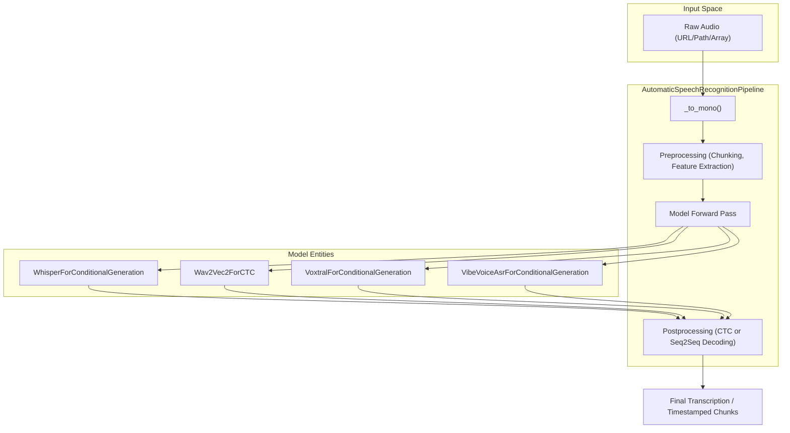
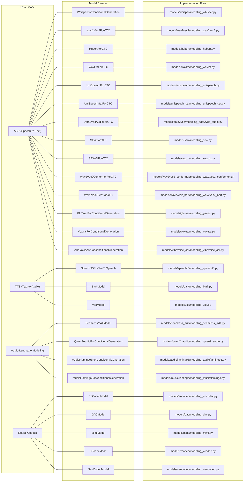

<!-- source: DeepWiki mcp.deepwiki.com · repo huggingface/transformers · page 3.8 Audio & Speech Models · fetched 2026-10-26 -->

# Audio & Speech Models

<details>
<summary>Relevant source files</summary>

The following files were used as context for generating this wiki page:

- [docs/source/en/model_doc/dac.md](docs/source/en/model_doc/dac.md)
- [docs/source/en/model_doc/encodec.md](docs/source/en/model_doc/encodec.md)
- [docs/source/en/model_doc/whisper.md](docs/source/en/model_doc/whisper.md)
- [docs/source/en/model_doc/xcodec.md](docs/source/en/model_doc/xcodec.md)
- [docs/source/ko/model_doc/whisper.md](docs/source/ko/model_doc/whisper.md)
- [src/transformers/audio_utils.py](src/transformers/audio_utils.py)
- [src/transformers/image_transforms.py](src/transformers/image_transforms.py)
- [src/transformers/models/audio_spectrogram_transformer/__init__.py](src/transformers/models/audio_spectrogram_transformer/__init__.py)
- [src/transformers/models/audio_spectrogram_transformer/feature_extraction_audio_spectrogram_transformer.py](src/transformers/models/audio_spectrogram_transformer/feature_extraction_audio_spectrogram_transformer.py)
- [src/transformers/models/audioflamingo3/configuration_audioflamingo3.py](src/transformers/models/audioflamingo3/configuration_audioflamingo3.py)
- [src/transformers/models/audioflamingo3/modeling_audioflamingo3.py](src/transformers/models/audioflamingo3/modeling_audioflamingo3.py)
- [src/transformers/models/audioflamingo3/modular_audioflamingo3.py](src/transformers/models/audioflamingo3/modular_audioflamingo3.py)
- [src/transformers/models/clap/feature_extraction_clap.py](src/transformers/models/clap/feature_extraction_clap.py)
- [src/transformers/models/clvp/feature_extraction_clvp.py](src/transformers/models/clvp/feature_extraction_clvp.py)
- [src/transformers/models/clvp/processing_clvp.py](src/transformers/models/clvp/processing_clvp.py)
- [src/transformers/models/dac/__init__.py](src/transformers/models/dac/__init__.py)
- [src/transformers/models/dac/configuration_dac.py](src/transformers/models/dac/configuration_dac.py)
- [src/transformers/models/dac/convert_dac_checkpoint.py](src/transformers/models/dac/convert_dac_checkpoint.py)
- [src/transformers/models/dac/feature_extraction_dac.py](src/transformers/models/dac/feature_extraction_dac.py)
- [src/transformers/models/dac/modeling_dac.py](src/transformers/models/dac/modeling_dac.py)
- [src/transformers/models/data2vec/modeling_data2vec_audio.py](src/transformers/models/data2vec/modeling_data2vec_audio.py)
- [src/transformers/models/dia/processing_dia.py](src/transformers/models/dia/processing_dia.py)
- [src/transformers/models/encodec/configuration_encodec.py](src/transformers/models/encodec/configuration_encodec.py)
- [src/transformers/models/encodec/feature_extraction_encodec.py](src/transformers/models/encodec/feature_extraction_encodec.py)
- [src/transformers/models/encodec/modeling_encodec.py](src/transformers/models/encodec/modeling_encodec.py)
- [src/transformers/models/glmasr/modeling_glmasr.py](src/transformers/models/glmasr/modeling_glmasr.py)
- [src/transformers/models/glmasr/modular_glmasr.py](src/transformers/models/glmasr/modular_glmasr.py)
- [src/transformers/models/hubert/modeling_hubert.py](src/transformers/models/hubert/modeling_hubert.py)
- [src/transformers/models/musicflamingo/configuration_musicflamingo.py](src/transformers/models/musicflamingo/configuration_musicflamingo.py)
- [src/transformers/models/musicflamingo/modeling_musicflamingo.py](src/transformers/models/musicflamingo/modeling_musicflamingo.py)
- [src/transformers/models/musicflamingo/modular_musicflamingo.py](src/transformers/models/musicflamingo/modular_musicflamingo.py)
- [src/transformers/models/musicgen_melody/feature_extraction_musicgen_melody.py](src/transformers/models/musicgen_melody/feature_extraction_musicgen_melody.py)
- [src/transformers/models/pop2piano/feature_extraction_pop2piano.py](src/transformers/models/pop2piano/feature_extraction_pop2piano.py)
- [src/transformers/models/pop2piano/processing_pop2piano.py](src/transformers/models/pop2piano/processing_pop2piano.py)
- [src/transformers/models/pop2piano/tokenization_pop2piano.py](src/transformers/models/pop2piano/tokenization_pop2piano.py)
- [src/transformers/models/seamless_m4t/feature_extraction_seamless_m4t.py](src/transformers/models/seamless_m4t/feature_extraction_seamless_m4t.py)
- [src/transformers/models/sew/modeling_sew.py](src/transformers/models/sew/modeling_sew.py)
- [src/transformers/models/sew_d/modeling_sew_d.py](src/transformers/models/sew_d/modeling_sew_d.py)
- [src/transformers/models/speech_to_text/__init__.py](src/transformers/models/speech_to_text/__init__.py)
- [src/transformers/models/speech_to_text/feature_extraction_speech_to_text.py](src/transformers/models/speech_to_text/feature_extraction_speech_to_text.py)
- [src/transformers/models/speecht5/feature_extraction_speecht5.py](src/transformers/models/speecht5/feature_extraction_speecht5.py)
- [src/transformers/models/speecht5/modeling_speecht5.py](src/transformers/models/speecht5/modeling_speecht5.py)
- [src/transformers/models/unispeech/modeling_unispeech.py](src/transformers/models/unispeech/modeling_unispeech.py)
- [src/transformers/models/unispeech_sat/modeling_unispeech_sat.py](src/transformers/models/unispeech_sat/modeling_unispeech_sat.py)
- [src/transformers/models/univnet/feature_extraction_univnet.py](src/transformers/models/univnet/feature_extraction_univnet.py)
- [src/transformers/models/vibevoice_asr/configuration_vibevoice_asr.py](src/transformers/models/vibevoice_asr/configuration_vibevoice_asr.py)
- [src/transformers/models/vibevoice_asr/modeling_vibevoice_asr.py](src/transformers/models/vibevoice_asr/modeling_vibevoice_asr.py)
- [src/transformers/models/vibevoice_asr/modular_vibevoice_asr.py](src/transformers/models/vibevoice_asr/modular_vibevoice_asr.py)
- [src/transformers/models/voxtral/modeling_voxtral.py](src/transformers/models/voxtral/modeling_voxtral.py)
- [src/transformers/models/voxtral/modular_voxtral.py](src/transformers/models/voxtral/modular_voxtral.py)
- [src/transformers/models/voxtral_realtime/configuration_voxtral_realtime.py](src/transformers/models/voxtral_realtime/configuration_voxtral_realtime.py)
- [src/transformers/models/wav2vec2/feature_extraction_wav2vec2.py](src/transformers/models/wav2vec2/feature_extraction_wav2vec2.py)
- [src/transformers/models/wav2vec2/modeling_wav2vec2.py](src/transformers/models/wav2vec2/modeling_wav2vec2.py)
- [src/transformers/models/wav2vec2_bert/modeling_wav2vec2_bert.py](src/transformers/models/wav2vec2_bert/modeling_wav2vec2_bert.py)
- [src/transformers/models/wav2vec2_conformer/modeling_wav2vec2_conformer.py](src/transformers/models/wav2vec2_conformer/modeling_wav2vec2_conformer.py)
- [src/transformers/models/wavlm/modeling_wavlm.py](src/transformers/models/wavlm/modeling_wavlm.py)
- [src/transformers/models/whisper/configuration_whisper.py](src/transformers/models/whisper/configuration_whisper.py)
- [src/transformers/models/whisper/convert_openai_to_hf.py](src/transformers/models/whisper/convert_openai_to_hf.py)
- [src/transformers/models/whisper/feature_extraction_whisper.py](src/transformers/models/whisper/feature_extraction_whisper.py)
- [src/transformers/models/whisper/processing_whisper.py](src/transformers/models/whisper/processing_whisper.py)
- [src/transformers/models/whisper/tokenization_whisper.py](src/transformers/models/whisper/tokenization_whisper.py)
- [src/transformers/models/xcodec/__init__.py](src/transformers/models/xcodec/__init__.py)
- [src/transformers/models/xcodec/configuration_xcodec.py](src/transformers/models/xcodec/configuration_xcodec.py)
- [src/transformers/models/xcodec/convert_xcodec_weights_to_hf.py](src/transformers/models/xcodec/convert_xcodec_weights_to_hf.py)
- [src/transformers/models/xcodec/modeling_xcodec.py](src/transformers/models/xcodec/modeling_xcodec.py)
- [tests/fixtures/xcodec/integration_tests.json](tests/fixtures/xcodec/integration_tests.json)
- [tests/models/audio_spectrogram_transformer/test_feature_extraction_audio_spectrogram_transformer.py](tests/models/audio_spectrogram_transformer/test_feature_extraction_audio_spectrogram_transformer.py)
- [tests/models/clap/test_feature_extraction_clap.py](tests/models/clap/test_feature_extraction_clap.py)
- [tests/models/clvp/test_feature_extraction_clvp.py](tests/models/clvp/test_feature_extraction_clvp.py)
- [tests/models/clvp/test_processing_clvp.py](tests/models/clvp/test_processing_clvp.py)
- [tests/models/dac/test_modeling_dac.py](tests/models/dac/test_modeling_dac.py)
- [tests/models/dia/test_feature_extraction_dia.py](tests/models/dia/test_feature_extraction_dia.py)
- [tests/models/encodec/test_feature_extraction_encodec.py](tests/models/encodec/test_feature_extraction_encodec.py)
- [tests/models/encodec/test_modeling_encodec.py](tests/models/encodec/test_modeling_encodec.py)
- [tests/models/got_ocr2/test_modeling_got_ocr2.py](tests/models/got_ocr2/test_modeling_got_ocr2.py)
- [tests/models/internvl/test_modeling_internvl.py](tests/models/internvl/test_modeling_internvl.py)
- [tests/models/mistral3/test_modeling_mistral3.py](tests/models/mistral3/test_modeling_mistral3.py)
- [tests/models/musicgen_melody/test_feature_extraction_musicgen_melody.py](tests/models/musicgen_melody/test_feature_extraction_musicgen_melody.py)
- [tests/models/seamless_m4t/test_feature_extraction_seamless_m4t.py](tests/models/seamless_m4t/test_feature_extraction_seamless_m4t.py)
- [tests/models/speech_to_text/test_feature_extraction_speech_to_text.py](tests/models/speech_to_text/test_feature_extraction_speech_to_text.py)
- [tests/models/speecht5/test_feature_extraction_speecht5.py](tests/models/speecht5/test_feature_extraction_speecht5.py)
- [tests/models/speecht5/test_modeling_speecht5.py](tests/models/speecht5/test_modeling_speecht5.py)
- [tests/models/univnet/test_feature_extraction_univnet.py](tests/models/univnet/test_feature_extraction_univnet.py)
- [tests/models/wav2vec2/test_feature_extraction_wav2vec2.py](tests/models/wav2vec2/test_feature_extraction_wav2vec2.py)
- [tests/models/whisper/test_feature_extraction_whisper.py](tests/models/whisper/test_feature_extraction_whisper.py)
- [tests/models/whisper/test_tokenization_whisper.py](tests/models/whisper/test_tokenization_whisper.py)
- [tests/models/xcodec/test_modeling_xcodec.py](tests/models/xcodec/test_modeling_xcodec.py)
- [tests/pipelines/test_pipelines_table_question_answering.py](tests/pipelines/test_pipelines_table_question_answering.py)
- [tests/test_image_transforms.py](tests/test_image_transforms.py)
- [tests/utils/test_audio_utils.py](tests/utils/test_audio_utils.py)
- [tests/utils/test_file_utils.py](tests/utils/test_file_utils.py)

</details>


The `transformers` library encompasses a wide range of audio and speech models designed for automatic speech recognition (ASR), text-to-speech (TTS), neural audio codecs, and audio-language multimodal understanding. Supported architectures include CTC-based models (e.g., Wav2Vec2, HuBERT, WavLM, UniSpeech, UniSpeechSat, Data2VecAudio, SEW, SEW-D, Wav2Vec2-Conformer, Wav2Vec2-BERT, GLM-ASR), encoder-decoder transformers (e.g., Whisper, SeamlessM4T, Voxtral, VibeVoice-ASR), autoregressive audio-language models (e.g., Bark, AudioFlamingo3, MusicFlamingo), and neural vocoders and codecs (e.g., SpeechT5 vocoder, EnCodec, DAC, Mimi, XCodec, NeuCodec).

This page provides a deep technical overview covering:

- Audio feature extraction and preprocessing  
- ASR decoding paradigms including CTC and encoder-decoder architectures  
- Specialized logits processors for audio generation  
- TTS model components and vocoders  
- Neural codec models  
- Integrated pipeline support for audio tasks  

---

## Audio Processing Fundamentals

Audio models require transforming raw audio waveforms into tensor inputs compatible with model architectures. This step involves audio loading, normalization, mono conversion, and feature extraction.

### Audio Loading and Mono Conversion

Audio inputs can be URLs, local file paths, or base64 encoded strings. The library handles fetching and decoding these formats robustly with retries and fallback [src/transformers/audio_utils.py:176-192](). The `_fetch_audio_bytes` function fetches audio from a URL with retries [src/transformers/audio_utils.py:66-69](). The `get_audio_filetype` function identifies the file type from magic bytes [src/transformers/audio_utils.py:113-173]().

Multichannel input audio is generally converted to mono for consistency and simplicity in ASR:

- `_to_mono` ensures audio tensors are either one-dimensional (mono) or have shape `(channels, samples)` where channels > 1. It averages over channels dimension 0 [src/transformers/pipelines/automatic_speech_recognition.py:41-72]().

- For shapes ambiguous between multichannel or multiple samples, it raises an error rather than silently proceeding with potentially incorrect averaging.

### Audio Feature Extraction

Feature extraction transforms raw waveforms into model inputs like log-Mel spectrograms or learned latent representations.

| Model       | Feature Extraction Type           | Key Class / Method                                         |
|-------------|---------------------------------|------------------------------------------------------------|
| Whisper     | Log-Mel Spectrogram              | `WhisperFeatureExtractor` [src/transformers/models/whisper/feature_extraction_whisper.py]() |
| Wav2Vec2    | CNN encoder latents + transformer| Encoded inside `Wav2Vec2Model` [src/transformers/models/wav2vec2/modeling_wav2vec2.py:596-618]() |
| SeamlessM4T | Multilingual feature extractor   | `SeamlessM4TFeatureExtractor` [src/transformers/models/seamless_m4t/feature_extraction_seamless_m4t.py]() |
| CLAP        | Audio feature extraction         | `ClapFeatureExtractor` [src/transformers/models/clap/feature_extraction_clap.py]() |
| Pop2Piano   | Audio feature extraction         | `Pop2PianoFeatureExtractor` [src/transformers/models/pop2piano/feature_extraction_pop2piano.py]() |

Sources:
- [src/transformers/audio_utils.py:66-69]()
- [src/transformers/audio_utils.py:113-173]()
- [src/transformers/pipelines/automatic_speech_recognition.py:41-72]()
- [src/transformers/models/whisper/feature_extraction_whisper.py]()
- [src/transformers/models/wav2vec2/modeling_wav2vec2.py:596-618]()
- [src/transformers/models/seamless_m4t/feature_extraction_seamless_m4t.py]()
- [src/transformers/models/clap/feature_extraction_clap.py]()
- [src/transformers/models/pop2piano/feature_extraction_pop2piano.py]()

---

## Automatic Speech Recognition (ASR)

The library supports multiple ASR paradigms distinguished by architectural and decoding approaches.

### CTC-Based Models (Wav2Vec2, HuBERT, WavLM, UniSpeech, UniSpeechSat, Data2VecAudio, SEW, SEW-D, Wav2Vec2-Conformer, Wav2Vec2-BERT, GLM-ASR)

These models employ Connectionist Temporal Classification (CTC):

- Pipeline:
  ```text
  Raw Audio waveform → Feature Encoder (CNN) → Transformer Encoder → lm_head → CTC decoding
  ```
- `lm_head` projects encoder outputs to vocabulary logits for CTC loss computation during training and inference decoding.
- Supports greedy and beam search decoding [src/transformers/models/wav2vec2/modeling_wav2vec2.py:1506-1510]().
- `_compute_mask_indices` is used for SpecAugment style masking during training [src/transformers/models/wav2vec2/modeling_wav2vec2.py:104-157]().

### Sequence-to-Sequence Encoder-Decoder ASR: Whisper, SeamlessM4T, Voxtral, VibeVoice-ASR

Whisper utilizes a Transformer encoder-decoder model:

- The encoder consumes the log-Mel spectrogram features.
- The decoder autoregressively generates tokens corresponding to text, language, and optionally timestamps.
- Custom `LogitsProcessor` classes enforce constraints such as paired timestamp emission and no-speech detection.
- The generation is managed by `WhisperGenerationMixin` extending the core `GenerationMixin` [src/transformers/models/whisper/generation_whisper.py]().

#### Core Classes and Functions:

- `WhisperForConditionalGeneration`: Implements the encoder-decoder with attention masks and token shifting for decoder input preparation [src/transformers/models/whisper/modeling_whisper.py]().
- `WhisperTimeStampLogitsProcessor`: Regulates timestamp token emission order ensuring logical segments [src/transformers/models/whisper/generation_whisper.py:27-33]().
- Tokenization is handled by `WhisperTokenizer` supporting language codes, tasks (translate, transcribe), and normalizers [src/transformers/models/whisper/tokenization_whisper.py]() and `WhisperProcessor` [docs/source/en/model_doc/whisper.md:115-123]().
- `_dynamic_time_warping`: Aligns generated tokens with audio frames producing token-level timestamp boundaries [src/transformers/models/whisper/generation_whisper.py:64-115]().

Voxtral is a modular encoder-decoder model for ASR, where `VoxtralForConditionalGeneration` uses a `VoxtralEncoder` and `VoxtralDecoder` [src/transformers/models/voxtral/modeling_voxtral.py](). The `VoxtralConfig` defines the sub-configurations for the encoder and decoder [src/transformers/models/voxtral/modular_voxtral.py:43-50]().

VibeVoice-ASR is another modular ASR model, with `VibeVoiceAsrForConditionalGeneration` using acoustic and semantic tokenizers and a text decoder [src/transformers/models/vibevoice_asr/modeling_vibevoice_asr.py](). The `VibeVoiceAsrConfig` defines the sub-configurations for these components [src/transformers/models/vibevoice_asr/modular_vibevoice_asr.py:43-99]().

Sources:
- [src/transformers/models/wav2vec2/modeling_wav2vec2.py:104-157]()
- [src/transformers/models/wav2vec2/modeling_wav2vec2.py:1506-1510]()
- [src/transformers/models/whisper/generation_whisper.py]()
- [src/transformers/models/whisper/generation_whisper.py:27-33]()
- [src/transformers/models/whisper/generation_whisper.py:64-115]()
- [src/transformers/models/whisper/modeling_whisper.py]()
- [src/transformers/models/whisper/tokenization_whisper.py]()
- [docs/source/en/model_doc/whisper.md:115-123]()
- [src/transformers/models/voxtral/modeling_voxtral.py]()
- [src/transformers/models/voxtral/modular_voxtral.py:43-50]()
- [src/transformers/models/vibevoice_asr/modeling_vibevoice_asr.py]()
- [src/transformers/models/vibevoice_asr/modular_vibevoice_asr.py:43-99]()

---

## Audio-Language Multimodal Models

Some models integrate speech with natural language understanding to enable cross-modal tasks.

- **Qwen2-Audio**: Couples a speech encoder with a large language model decoder for audio-conditioned text generation. See `Qwen2AudioForConditionalGeneration` in [src/transformers/models/qwen2_audio/modeling_qwen2_audio.py:871](). The `AudioFlamingo3` and `MusicFlamingo` models also follow a similar modular approach for audio-language tasks [src/transformers/models/audioflamingo3/modular_audioflamingo3.py](), [src/transformers/models/musicflamingo/modular_musicflamingo.py]().
- **SeamlessM4T**: Supports speech-to-text, text-to-speech, and speech-to-speech translation in one framework with integrated vocoder output for waveform generation [src/transformers/models/seamless_m4t/modeling_seamless_m4t.py:120-135]().
- **CLVP**: A Contrastive Language-Audio Pre-training model for multimodal processing [src/transformers/models/clvp/processing_clvp.py]().

Sources:
- [src/transformers/models/qwen2_audio/modeling_qwen2_audio.py:871]()
- [src/transformers/models/seamless_m4t/modeling_seamless_m4t.py:120-135]()
- [src/transformers/models/audioflamingo3/modular_audioflamingo3.py]()
- [src/transformers/models/musicflamingo/modular_musicflamingo.py]()
- [src/transformers/models/clvp/processing_clvp.py]()

---

## ASR Pipeline Data Flow

The `AutomaticSpeechRecognitionPipeline` abstracts audio ingestion, preprocessing, model inference, and output decoding.

### Data Flow Steps

1. **Mono Conversion**: Converts multi-channel audio to mono via `_to_mono()` [src/transformers/pipelines/automatic_speech_recognition.py:41-72]().

2. **Chunking & Feature Extraction**: Splits audio into chunks respecting stride parameters; each chunk is transformed to feature tensors using the model’s feature extractor [src/transformers/pipelines/automatic_speech_recognition.py:95-118]().

3. **Model Inference**: Forward pass to get logits or directly generate output sequences.

4. **Decoding & Postprocessing**: Applies CTC or autoregressive decoding. Supports timestamp extraction for alignment.

### ASR Pipeline Data Flow Diagram



Sources:
- [src/transformers/pipelines/automatic_speech_recognition.py:41-72]()
- [src/transformers/pipelines/automatic_speech_recognition.py:95-118]()

---

## Text-to-Speech (TTS) and Neural Audio Generation

TTS models generate audio from text or latent representations.

### SpeechT5

SpeechT5 is a multitask encoder-decoder Transformer designed for speech-to-speech, speech-to-text, and TTS:

- The encoder encodes text or speech inputs.
- The decoder produces Mel-spectrograms.
- The `SpeechT5HifiGan` vocoder converts spectrograms to waveforms using generative adversarial networks [src/transformers/models/speecht5/modeling_speecht5.py:2028](), [src/transformers/models/speecht5/modeling_speecht5.py:2237-2260]().
- `shift_spectrograms_right` is used to shift input spectrograms for the decoder [src/transformers/models/speecht5/modeling_speecht5.py:68-87]().
- `_compute_mask_indices` is also used in SpeechT5 for masking [src/transformers/models/speecht5/modeling_speecht5.py:90-140]().

### Bark: Multi-Codebook Audio Synthesis Model

Bark autoregressively generates audio tokens from multiple codebooks representing semantic, coarse, and fine details:

- It employs logits processors to manage alternating codebook emissions and EOS token prioritization during generation [src/transformers/models/bark/modeling_bark.py:26-30](), [src/transformers/models/bark/modeling_bark.py:43-49]().

### VITS: Variational Inference with Adversarial Learning for End-to-End Text-to-Speech

VITS is an end-to-end TTS model that directly synthesizes raw audio waveforms from text. It combines variational autoencoders with adversarial training.

Sources:
- [src/transformers/models/speecht5/modeling_speecht5.py:68-87]()
- [src/transformers/models/speecht5/modeling_speecht5.py:90-140]()
- [src/transformers/models/speecht5/modeling_speecht5.py:2028]()
- [src/transformers/models/speecht5/modeling_speecht5.py:2237-2260]()
- [src/transformers/models/bark/modeling_bark.py:26-30]()
- [src/transformers/models/bark/modeling_bark.py:43-49]()

---

## Neural Codecs

Neural codecs efficiently compress and reconstruct audio via discrete latent variables.

- **EnCodec, DAC, Mimi, XCodec, NeuCodec** implement Transformer-based encoders and decoders converting audio to/from compressed discrete codes.
- They support streaming via convolutional padding caches and dynamic positional encodings [src/transformers/models/encodec/modeling_encodec.py](), [src/transformers/models/dac/modeling_dac.py](), [src/transformers/models/mimi/modeling_mimi.py](), [src/transformers/models/xcodec/modeling_xcodec.py]().
- The `DacModelTester` and `DacModelTest` classes are used for testing the DAC model [tests/models/dac/test_modeling_dac.py:47-123](), [tests/models/dac/test_modeling_dac.py:126-174]().
- Similarly, `XCodecModelTester` and `XCodecModelTest` are used for XCodec [tests/models/xcodec/test_modeling_xcodec.py]().

Sources:
- [src/transformers/models/encodec/modeling_encodec.py]()
- [src/transformers/models/dac/modeling_dac.py]()
- [src/transformers/models/mimi/modeling_mimi.py]()
- [src/transformers/models/xcodec/modeling_xcodec.py]()
- [tests/models/dac/test_modeling_dac.py:47-123]()
- [tests/models/dac/test_modeling_dac.py:126-174]()
- [tests/models/xcodec/test_modeling_xcodec.py]()

---

## Specialized Architectures

### SeamlessM4T: Multilingual Speech and Text Processing

- Handles speech-to-text, text-to-speech, and speech-to-speech for over 100 languages.
- Produces waveform outputs and generates discrete audio units in a joint encoder-decoder framework with integrated vocoder support [src/transformers/models/seamless_m4t/modeling_seamless_m4t.py:120-135]().

### Pop2Piano: Pop Music Generation

- `Pop2PianoTokenizer` and `Pop2PianoFeatureExtractor` are used for processing musical inputs [src/transformers/models/pop2piano/tokenization_pop2piano.py](), [src/transformers/models/pop2piano/feature_extraction_pop2piano.py]().

Sources:
- [src/transformers/models/seamless_m4t/modeling_seamless_m4t.py:120-135]()
- [src/transformers/models/pop2piano/tokenization_pop2piano.py]()
- [src/transformers/models/pop2piano/feature_extraction_pop2piano.py]()

---

## Key Technical Components

### Logits Processors for Audio Generation

Specialized `LogitsProcessor` subclasses control token emission with audio-specific constraints:

| Processor                          | Purpose                                                | Model Example                 | Source File / Lines                       |
|----------------------------------|--------------------------------------------------------|------------------------------|-------------------------------------------|
| `WhisperTimeStampLogitsProcessor` | Enforces paired timestamp tokens in chronological order | Whisper                      | [src/transformers/models/whisper/generation_whisper.py:27-33]() |
| `DummyTimestampLogitProcessor`    | Simulated timestamp token pattern for testing          | Whisper                      | [tests/models/whisper/test_modeling_whisper.py:72-145]()      |
| `BarkEosPrioritizerLogitsProcessor` | Preferentially prioritizes EOS token in multi-codebook generation | Bark                          | [src/transformers/models/bark/modeling_bark.py:26-30]()       |
| `AlternatingCodebooksLogitsProcessor` | Controls alternation between codebooks during Bark generation | Bark                          | [src/transformers/models/bark/modeling_bark.py:26-30]()       |

Sources:
- [src/transformers/models/whisper/generation_whisper.py:27-33]()
- [tests/models/whisper/test_modeling_whisper.py:72-145]()
- [src/transformers/models/bark/modeling_bark.py:26-30]()
- [src/transformers/models/bark/modeling_bark.py:43-49]()

---

### Audio Masking Utilities for Training Augmentation

SpecAugment style masking is used during training to improve model robustness:

- `_compute_mask_indices` samples spans of time indices to mask in feature sequences, supporting Wav2Vec2 and SpeechT5 [src/transformers/models/wav2vec2/modeling_wav2vec2.py:104-157](), [src/transformers/models/speecht5/modeling_speecht5.py:90-140]().

Sources:
- [src/transformers/models/wav2vec2/modeling_wav2vec2.py:104-157]()
- [src/transformers/models/speecht5/modeling_speecht5.py:90-140]()

---

### Dynamic Time Warping for Timestamp Alignment

Whisper aligns its generated token sequence with audio frames using dynamic time warping (`_dynamic_time_warping`), enabling accurate token-level timestamps for transcription [src/transformers/models/whisper/generation_whisper.py:64-115]().

Sources:
- [src/transformers/models/whisper/generation_whisper.py:64-115]()

---

## Audio Model Architecture to Code Mapping

This diagram maps major audio/speech model families to their corresponding code entities and files:



---

# Summary

The `transformers` library provides a comprehensive ecosystem for speech and audio models across ASR, TTS, neural codecs, and audio-language multimodal understanding. The stack includes fine-grained audio loading, feature extraction, output decoding, and specialized logits processors addressing characteristics unique to speech and audio generation.

Core implementations include Whisper for seq2seq ASR, Wav2Vec2 and HuBERT for CTC ASR, SpeechT5 and Bark for text-to-speech generation, SeamlessM4T for multilingual speech understanding and generation, and neural codec models such as EnCodec, DAC, and Mimi.

This enables research, fine-tuning, and deployment for state-of-the-art audio and speech tasks with consistent APIs and integrated pipelines.

---

# Sources

- [src/transformers/audio_utils.py:66-69]()
- [src/transformers/audio_utils.py:113-173]()
- [src/transformers/audio_utils.py:176-192]()
- [src/transformers/pipelines/automatic_speech_recognition.py:41-72]()
- [src/transformers/pipelines/automatic_speech_recognition.py:95-118]()
- [src/transformers/models/whisper/modeling_whisper.py]()
- [src/transformers/models/whisper/generation_whisper.py]()
- [src/transformers/models/whisper/generation_whisper.py:27-33]()
- [src/transformers/models/whisper/generation_whisper.py:64-115]()
- [src/transformers/models/whisper/tokenization_whisper.py]()
- [src/transformers/models/whisper/feature_extraction_whisper.py]()
- [docs/source/en/model_doc/whisper.md:115-123]()
- [src/transformers/models/wav2vec2/modeling_wav2vec2.py:104-157]()
- [src/transformers/models/wav2vec2/modeling_wav2vec2.py:596-618]()
- [src/transformers/models/wav2vec2/modeling_wav2vec2.py:1506-1510]()
- [src/transformers/models/speecht5/modeling_speecht5.py:68-87]()
- [src/transformers/models/speecht5/modeling_speecht5.py:90-140]()
- [src/transformers/models/speecht5/modeling_speecht5.py:2028]()
- [src/transformers/models/speecht5/modeling_speecht5.py:2237-2260]()
- [src/transformers/models/bark/modeling_bark.py:26-30]()
- [src/transformers/models/bark/modeling_bark.py:43-49]()
- [src/transformers/models/seamless_m4t/feature_extraction_seamless_m4t.py]()
- [src/transformers/models/seamless_m4t/modeling_seamless_m4t.py:120-135]()
- [src/transformers/models/qwen2_audio/modeling_qwen2_audio.py:871]()
- [src/transformers/models/encodec/modeling_encodec.py]()
- [src/transformers/models/dac/modeling_dac.py]()
- [src/transformers/models/mimi/modeling_mimi.py]()
- [src/transformers/models/xcodec/modeling_xcodec.py]()
- [src/transformers/models/voxtral/modeling_voxtral.py]()
- [src/transformers/models/voxtral/modular_voxtral.py:43-50]()
- [src/transformers/models/vibevoice_asr/modeling_vibevoice_asr.py]()
- [src/transformers/models/vibevoice_asr/modular_vibevoice_asr.py:43-99]()
- [src/transformers/models/audioflamingo3/modular_audioflamingo3.py]()
- [src/transformers/models/musicflamingo/modular_musicflamingo.py]()
- [src/transformers/models/clap/feature_extraction_clap.py]()
- [src/transformers/models/pop2piano/tokenization_pop2piano.py]()
- [src/transformers/models/pop2piano/feature_extraction_pop2piano.py]()
- [src/transformers/models/clvp/processing_clvp.py]()
- [tests/models/whisper/test_modeling_whisper.py:72-145]()
- [tests/models/dac/test_modeling_dac.py:47-123]()
- [tests/models/dac/test_modeling_dac.py:126-174]()
- [tests/models/xcodec/test_modeling_xcodec.py]()

---

