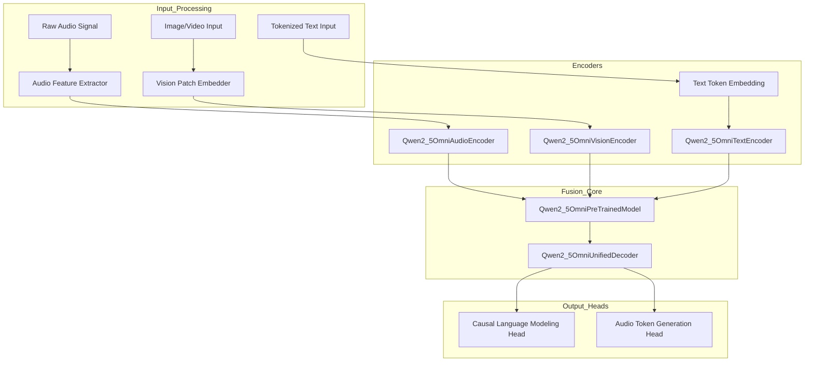
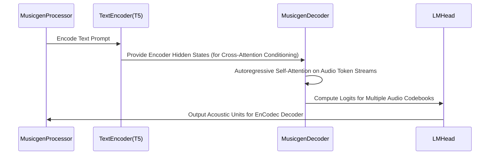
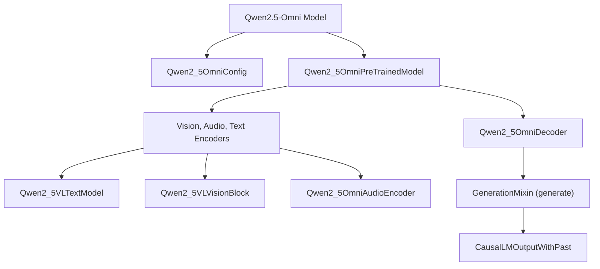
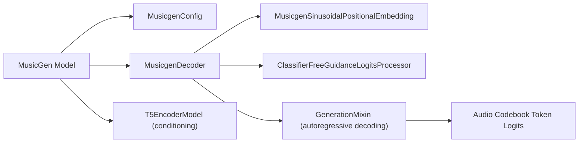

<!-- source: DeepWiki mcp.deepwiki.com · repo huggingface/transformers · page 3.9 Multimodal Omni & Specialized Models · fetched 2026-10-26 -->

# Multimodal Omni & Specialized Models

Relevant source files

The following files were used as context for generating this wiki page:

- [docs/source/en/model_doc/internvl.md](docs/source/en/model_doc/internvl.md)
- [docs/source/en/model_doc/qwen2_audio.md](docs/source/en/model_doc/qwen2_audio.md)
- [docs/source/en/model_doc/smolvlm.md](docs/source/en/model_doc/smolvlm.md)
- [src/transformers/models/chameleon/processing_chameleon.py](src/transformers/models/chameleon/processing_chameleon.py)
- [src/transformers/models/csm/generation_csm.py](src/transformers/models/csm/generation_csm.py)
- [src/transformers/models/d_fine/convert_d_fine_original_pytorch_checkpoint_to_hf.py](src/transformers/models/d_fine/convert_d_fine_original_pytorch_checkpoint_to_hf.py)
- [src/transformers/models/emu3/processing_emu3.py](src/transformers/models/emu3/processing_emu3.py)
- [src/transformers/models/glm4v/configuration_glm4v.py](src/transformers/models/glm4v/configuration_glm4v.py)
- [src/transformers/models/glm4v_moe/configuration_glm4v_moe.py](src/transformers/models/glm4v_moe/configuration_glm4v_moe.py)
- [src/transformers/models/glm4v_moe/modular_glm4v_moe.py](src/transformers/models/glm4v_moe/modular_glm4v_moe.py)
- [src/transformers/models/glm_image/configuration_glm_image.py](src/transformers/models/glm_image/configuration_glm_image.py)
- [src/transformers/models/glm_image/processing_glm_image.py](src/transformers/models/glm_image/processing_glm_image.py)
- [src/transformers/models/glm_ocr/configuration_glm_ocr.py](src/transformers/models/glm_ocr/configuration_glm_ocr.py)
- [src/transformers/models/glm_ocr/modular_glm_ocr.py](src/transformers/models/glm_ocr/modular_glm_ocr.py)
- [src/transformers/models/internvl/__init__.py](src/transformers/models/internvl/__init__.py)
- [src/transformers/models/internvl/convert_internvl_weights_to_hf.py](src/transformers/models/internvl/convert_internvl_weights_to_hf.py)
- [src/transformers/models/internvl/processing_internvl.py](src/transformers/models/internvl/processing_internvl.py)
- [src/transformers/models/janus/convert_janus_weights_to_hf.py](src/transformers/models/janus/convert_janus_weights_to_hf.py)
- [src/transformers/models/kosmos2_5/modeling_kosmos2_5.py](src/transformers/models/kosmos2_5/modeling_kosmos2_5.py)
- [src/transformers/models/musicgen/modeling_musicgen.py](src/transformers/models/musicgen/modeling_musicgen.py)
- [src/transformers/models/musicgen_melody/modeling_musicgen_melody.py](src/transformers/models/musicgen_melody/modeling_musicgen_melody.py)
- [src/transformers/models/qwen2_5_omni/configuration_qwen2_5_omni.py](src/transformers/models/qwen2_5_omni/configuration_qwen2_5_omni.py)
- [src/transformers/models/qwen2_5_vl/configuration_qwen2_5_vl.py](src/transformers/models/qwen2_5_vl/configuration_qwen2_5_vl.py)
- [src/transformers/models/qwen2_audio/modeling_qwen2_audio.py](src/transformers/models/qwen2_audio/modeling_qwen2_audio.py)
- [src/transformers/models/qwen2_audio/processing_qwen2_audio.py](src/transformers/models/qwen2_audio/processing_qwen2_audio.py)
- [src/transformers/models/qwen2_vl/configuration_qwen2_vl.py](src/transformers/models/qwen2_vl/configuration_qwen2_vl.py)
- [src/transformers/models/qwen3_vl_moe/configuration_qwen3_vl_moe.py](src/transformers/models/qwen3_vl_moe/configuration_qwen3_vl_moe.py)
- [src/transformers/models/qwen3_vl_moe/modular_qwen3_vl_moe.py](src/transformers/models/qwen3_vl_moe/modular_qwen3_vl_moe.py)
- [src/transformers/models/rag/modeling_rag.py](src/transformers/models/rag/modeling_rag.py)
- [src/transformers/models/seamless_m4t/modeling_seamless_m4t.py](src/transformers/models/seamless_m4t/modeling_seamless_m4t.py)
- [src/transformers/models/seamless_m4t_v2/modeling_seamless_m4t_v2.py](src/transformers/models/seamless_m4t_v2/modeling_seamless_m4t_v2.py)
- [src/transformers/models/speech_to_text/modeling_speech_to_text.py](src/transformers/models/speech_to_text/modeling_speech_to_text.py)
- [tests/models/imagegpt/test_modeling_imagegpt.py](tests/models/imagegpt/test_modeling_imagegpt.py)
- [tests/models/kosmos2_5/test_modeling_kosmos2_5.py](tests/models/kosmos2_5/test_modeling_kosmos2_5.py)
- [tests/models/mimi/test_modeling_mimi.py](tests/models/mimi/test_modeling_mimi.py)
- [tests/models/musicgen/test_modeling_musicgen.py](tests/models/musicgen/test_modeling_musicgen.py)
- [tests/models/musicgen_melody/test_modeling_musicgen_melody.py](tests/models/musicgen_melody/test_modeling_musicgen_melody.py)
- [tests/models/qwen2_audio/test_modeling_qwen2_audio.py](tests/models/qwen2_audio/test_modeling_qwen2_audio.py)
- [tests/models/reformer/test_modeling_reformer.py](tests/models/reformer/test_modeling_reformer.py)
- [tests/models/seamless_m4t/test_modeling_seamless_m4t.py](tests/models/seamless_m4t/test_modeling_seamless_m4t.py)
- [tests/models/seamless_m4t_v2/test_modeling_seamless_m4t_v2.py](tests/models/seamless_m4t_v2/test_modeling_seamless_m4t_v2.py)
- [tests/models/speech_to_text/test_modeling_speech_to_text.py](tests/models/speech_to_text/test_modeling_speech_to_text.py)
- [tests/models/videomae/test_modeling_videomae.py](tests/models/videomae/test_modeling_videomae.py)
- [tests/models/vit_msn/test_modeling_vit_msn.py](tests/models/vit_msn/test_modeling_vit_msn.py)
- [tests/models/xlnet/test_modeling_xlnet.py](tests/models/xlnet/test_modeling_xlnet.py)

Multimodal Omni models are advanced unified architectures designed to handle and generate across multiple data modalities—text, image, video, and audio—in a single integrated framework. These models typically combine specialized encoders for each modality with a powerful core model, usually an LLM, facilitating rich fusion and cross-modal reasoning. This page provides a detailed technical exposition of key multimodal omni architectures such as **Qwen2.5-Omni**, **Qwen3-Omni**, **MusicGen**, **RAG**, **Qwen2-Audio**, **Kosmos-2.5**, **recurrent Gemma**, and other specialized domain-specific models.

---

## 1. Unified Multimodal Architecture: Qwen & Omni Variants

The Qwen Omni family represents multimodal large language models with versatile input support including text, image, video, and audio. Their architecture revolves around integrating multiple encoders and modality-specific submodules into a unified transformer backbone that models fused modalities with specialized attention and embeddings.

### Architecture Overview

- **Input modality-specific encoders:** Separate encoders preprocess each modality before joint modeling:
  - Vision encoder(s) to process images and video frames.
  - Audio encoder(s) to extract features from raw audio signals.
  - Text encoder / tokenizer for language inputs.

- **Multimodal Rotary Positional Embeddings (mROPE):** An extension of classical RoPE that simultaneously encodes multiple axes like temporal (T), height (H), width (W) in an interleaved manner, preserving spatial-temporal continuity so the model can attend effectively over multiple dimensions.

- **Unified Transformer Fusion:** Encoded modality features are fused in the transformer layers. The decoder layers are autoregressive and generate token sequences (usually text tokens or possibly audio tokens).

### Multimodal Rotary Positional Embeddings (mROPE)

- Standard RoPE is extended for multiple modalities by defining per-axis frequencies.
- Frequencies of rotary embeddings for axes T, H, W are **interleaved** to form positions embeddings of pattern `[THWTHWTHW...]`.
- This interleaving, rather than concatenation, enables smooth geometric transitions beneficial for vision and video inputs.
- This design is implemented and configured within `Qwen2VLRotaryEmbedding` and related classes at [src/transformers/models/qwen2_vl/modeling_qwen2_vl.py:114-161]().

### Audio Feature Processing Pipeline in Qwen2.5-Omni

- Raw audio features (e.g., log-mel spectrograms) are processed in a multi-stage pipeline:

  1. **Chunking and Padding:** Audio input features are split into chunks of size `n_window * 2`. The last chunk is padded to match the longest chunk length using either zero padding or cached padded features passed in kwargs for efficiency.

  2. **Cumulative Lengths Calculation:** Cumulative sums of chunk lengths prepare indices for flash attention style packed processing.

  3. **Convolutional Reduction:** Several stride-2 convolutions reduce temporal dimension to manageable size while extracting salient features.

  4. **Transformer Encoder Layers:** Audio features are encoded via transformer blocks.

  5. **Pooling and Merging:** Optionally average pools the temporal dimension with stride 2 to further compress sequence length.

- This audio preprocessing and encoding logic enable modeling long audio contexts efficiently. The implementation is found at [src/transformers/models/qwen2_5_omni/modeling_qwen2_5_omni.py:70-153]().

---

### Omni Model Component Map and Data Flow

**Key classes & files:**
- `Qwen2_5OmniPreTrainedModel`: The core model coordinating encoders and decoder fusion.
- Modality encoders: `Qwen2_5OmniVisionEncoder`, `Qwen2_5OmniAudioEncoder`, and `Qwen2_5OmniTextEncoder`.
- Multimodal rotary embeddings integrated in encoder attention mechanisms.

Sources:  
`src/transformers/models/qwen2_5_omni/modeling_qwen2_5_omni.py`  
`src/transformers/models/qwen2_5_omni/modular_qwen2_5_omni.py`

---

## 2. MusicGen: Specialized Audio Generation Model

MusicGen is an autoregressive Transformer decoder targeting high-fidelity music generation conditioned on text or melody prompts.

### Core Components

- **Decoder-only transformer:** Generates discrete audio tokens representing quantized audio units from EnCodec model.

- **Conditioning:**
  - Textual conditioning via a T5 encoder providing cross-attention hidden states.
  - Optional melody conditioning enables interactive musical input influence.

- **Positional Embeddings:** Implements `MusicgenSinusoidalPositionalEmbedding` combining sequence positions and codebook embeddings across multiple quantization codebooks as inputs to the decoder. This embeds temporal and codebook axes jointly [src/transformers/models/musicgen/modeling_musicgen.py:106-147]().

- **Classifier-Free Guidance (CFG):** Supports CFG by interpolating conditional and unconditional logits at generation time, enhancing generation quality [src/transformers/models/musicgen/modeling_musicgen.py:32]().

### MusicGen Data Flow Diagram

Sources:  
`src/transformers/models/musicgen/modeling_musicgen.py`  
`src/transformers/models/musicgen_melody/modeling_musicgen_melody.py`

---

## 3. Recurrent Gemma

The recurrent Gemma models extend transformer architectures with integrated state-space models (SSMs):

- **SSM Integration:** Recurrence layers inside transformer blocks enable extended memory across very long sequences, overcoming standard transformer length limitations.

- **Use Cases:** Efficient long-context autoregressive modeling in domains needing sustained context retention.

- **Architecture:** Combines gating and scaling mechanisms for recurrent layers optimized for generative performance.

- **Implementation:** Found in `recurrent_gemma` model modules (not fully detailed here).

---

## 4. Retrieval-Augmented Generation (RAG)

RAG models merge pretrained transformers with an external non-parametric retrieval module for knowledge-enhanced text generation:

- **Retriever:** The `RagRetriever` fetches relevant documents or passages according to input query embeddings.

- **Encoding & Marginalization:** The question encoder and document encoder produce embeddings; decoder conditions on retrieved documents, marginalizing over them probabilistically.

- **Generation:** The autoregressive decoder generates output text conditioned on fused external knowledge.

- **Outputs:** Include logits, retrieved document scores, embeddings, and past key values for efficient decoding.

- **Key classes:** `RagModel`, `RagRetriever`, and output dataclasses in [src/transformers/models/rag/modeling_rag.py]().

---

## 5. Qwen2-Audio: Audio-Centric LLM

Qwen2Audio models build on the Qwen transformer backbone tailored exclusively for audio modalities:

- Specialized handling for audio input features like mel spectrograms.

- Layer designs including chunked stride-2 convolutions to reduce temporal dimensions efficiently.

- Positional encodings and attention masks distinctly adapt for audio segments.

- Support for caching mechanisms to accelerate autoregressive decoding.

- Core implementations are in [src/transformers/models/qwen2_audio/modeling_qwen2_audio.py]() and share utilities with Qwen2.5-Omni [src/transformers/models/qwen2_5_omni/modeling_qwen2_5_omni.py:80-153]().

---

## 6. Kosmos-2.5: Vision, Language & Reasoning

Kosmos-2.5 is a multimodal foundation model designed to integrate vision and language with reasoning capabilities:

- Vision encoder layers extract spatial features using advanced axial and interleaved rotary positional embeddings.

- Language model layers fuse visual contexts for multimodal understanding and reasoning.

- Primary implementation is located at [src/transformers/models/kosmos2_5/modeling_kosmos2_5.py].

- This architecture supports diverse tasks requiring language grounded in vision inputs.

---

## 7. OMNI-MoE: Qwen3 Omni with Mixture of Experts

Qwen3 Omni MoE is a modular sparse expert variant of the Qwen Omni architecture:

- Integrates Mixture-of-Experts (MoE) layers in transformer blocks for scale and specialization.

- Employs routing via `Qwen3MoeTopKRouter` for selective expert activation based on input tokens.

- Rotary embeddings are generalized for multimodal inputs.

- Core components are implemented in `src/transformers/models/qwen3_omni_moe/modeling_qwen3_omni_moe.py`.

---

## 8. Specialized Architectures

### Evolutionary Scale Modeling (ESM)

- Protein-focused models specialized for biological sequence modeling.

- Implement custom rotary embeddings suited for amino acid sequence geometry.

- Include heads like `EsmContactPredictionHead` for biological contact prediction.

- Implemented in [src/transformers/models/esm/modeling_esm.py].

### SAM (Segment Anything Model)

- Vision model for segmentation tasks.

- Uses ViT-based prompt and mask transformers to generate segmentation masks on images or videos.

- Supports temporal modeling for videos.

- Implementation under `src/transformers/models/sam2/modeling_sam2.py`.

### ModernBERT

- Encoder-only transformer variant optimized for natural language understanding.

- Uses GLU-based feedforward MLP blocks (`ModernBertMLP`).

- Supports both sliding window and full attention modes.

- Found in `src/transformers/models/modernbert/modeling_modernbert.py`.

---

## 9. Summary Table: Models & Primary Modalities

| Model Class                          | Modalities              | Key Code Entities / Features                                             |
|------------------------------------|------------------------|-------------------------------------------------------------------------|
| `Qwen2_5OmniPreTrainedModel`       | Text, Image, Video, Audio | Multi-encoder integration, multimodal rotary embeddings [qwen2_5_omni]    |
| `Qwen3OmniMoePreTrainedModel`      | Text, Image, Video, Audio | Mixture-of-experts (MoE) sparse routing, modular experts [qwen3_omni_moe] |
| `MusicgenForConditionalGeneration` | Text → Audio            | Multi-codebook autoregressive decoding, classifier-free guidance [musicgen]|
| `RagModel`                         | Text + Knowledge Base   | Retrieval and marginalization augmented generation [rag]                 |
| `Qwen2AudioEncoderLayer`           | Audio-only              | Audio chunking, stride-2 convolutions, specialized attention [qwen2_audio]|
| `Kosmos2_5Model`                   | Vision + Text           | Axial/interleaved RoPE, vision-language fusion [kosmos2_5]               |
| `RecurrentGemma`                   | Text (long-context)     | State-space model integration for long sequences [recurrent_gemma]       |
| `EsmModel`                        | Protein sequences       | Contact prediction, bio-specific RoPE [esm]                              |
| `ModernBertModel`                 | Text-only               | GLU MLP, sliding/full attention modes [modernbert]                       |
| `MimiModel`                      | Audio Codec             | Streaming neural codec, cached padding [mimi]                           |

---

## 10. Natural Language to Code Mapping: Omni Models

Sources:  
`src/transformers/models/qwen2_5_omni/modeling_qwen2_5_omni.py`  
`src/transformers/models/qwen2_5_vl/modeling_qwen2_5_vl.py`  
`src/transformers/models/qwen2_5_omni/modular_qwen2_5_omni.py`

---

## 11. Natural Language to Code Mapping: MusicGen

Sources:  
`src/transformers/models/musicgen/modeling_musicgen.py`  
`src/transformers/models/musicgen_melody/modeling_musicgen_melody.py`

---

## References and Sources

- `src/transformers/models/qwen2_5_omni/modeling_qwen2_5_omni.py`  
- `src/transformers/models/qwen2_5_omni/modular_qwen2_5_omni.py`  
- `src/transformers/models/qwen2_5_vl/modeling_qwen2_5_vl.py`  
- `src/transformers/models/qwen3_omni_moe/modeling_qwen3_omni_moe.py`  
- `src/transformers/models/musicgen/modeling_musicgen.py`  
- `src/transformers/models/musicgen_melody/modeling_musicgen_melody.py`  
- `src/transformers/models/rag/modeling_rag.py`  
- `src/transformers/models/recurrent_gemma/modeling_recurrent_gemma.py`  
- `src/transformers/models/kosmos2_5/modeling_kosmos2_5.py`  
- `src/transformers/models/esm/modeling_esm.py`  
- `src/transformers/models/modernbert/modeling_modernbert.py`  
- `src/transformers/models/t5gemma/modular_t5gemma.py`  
- `src/transformers/models/mimi/modeling_mimi.py`  

---

This technical overview captures the state-of-the-art multimodal omni and specialized models supported in the Transformers codebase, emphasizing implementation details, data flows, positional embedding innovations, and specialized architecture features.

---

