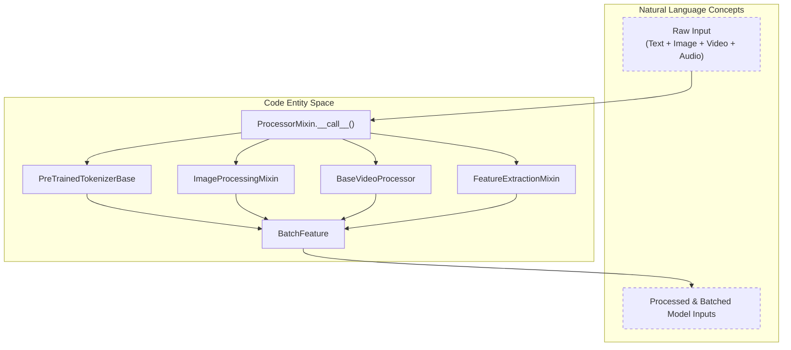
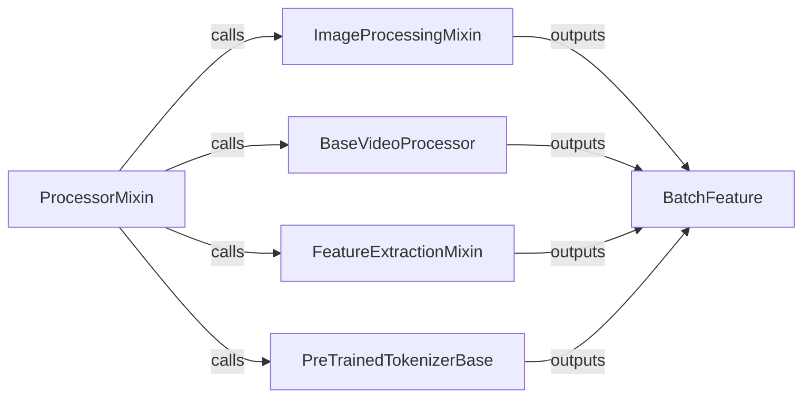

<!-- source: DeepWiki mcp.deepwiki.com · repo huggingface/transformers · page 4.2 Image, Video & Audio Processors · fetched 2026-10-26 -->

# Image, Video & Audio Processors

Relevant source files

The following files were used as context for generating this wiki page:

- [docs/source/en/main_classes/video_processor.md](docs/source/en/main_classes/video_processor.md)
- [docs/source/en/model_doc/pixtral.md](docs/source/en/model_doc/pixtral.md)
- [src/transformers/feature_extraction_utils.py](src/transformers/feature_extraction_utils.py)
- [src/transformers/hf_argparser.py](src/transformers/hf_argparser.py)
- [src/transformers/image_processing_base.py](src/transformers/image_processing_base.py)
- [src/transformers/image_utils.py](src/transformers/image_utils.py)
- [src/transformers/models/auto/auto_factory.py](src/transformers/models/auto/auto_factory.py)
- [src/transformers/models/auto/video_processing_auto.py](src/transformers/models/auto/video_processing_auto.py)
- [src/transformers/models/blip/processing_blip.py](src/transformers/models/blip/processing_blip.py)
- [src/transformers/models/blip_2/processing_blip_2.py](src/transformers/models/blip_2/processing_blip_2.py)
- [src/transformers/models/conditional_detr/image_processing_conditional_detr.py](src/transformers/models/conditional_detr/image_processing_conditional_detr.py)
- [src/transformers/models/cosmos3_edge/processing_cosmos3_edge.py](src/transformers/models/cosmos3_edge/processing_cosmos3_edge.py)
- [src/transformers/models/deformable_detr/image_processing_deformable_detr.py](src/transformers/models/deformable_detr/image_processing_deformable_detr.py)
- [src/transformers/models/detr/image_processing_detr.py](src/transformers/models/detr/image_processing_detr.py)
- [src/transformers/models/ernie4_5_vl_moe/image_processing_ernie4_5_vl_moe.py](src/transformers/models/ernie4_5_vl_moe/image_processing_ernie4_5_vl_moe.py)
- [src/transformers/models/ernie4_5_vl_moe/modular_ernie4_5_vl_moe.py](src/transformers/models/ernie4_5_vl_moe/modular_ernie4_5_vl_moe.py)
- [src/transformers/models/glm46v/image_processing_glm46v.py](src/transformers/models/glm46v/image_processing_glm46v.py)
- [src/transformers/models/glm4v/image_processing_glm4v.py](src/transformers/models/glm4v/image_processing_glm4v.py)
- [src/transformers/models/glm_image/image_processing_glm_image.py](src/transformers/models/glm_image/image_processing_glm_image.py)
- [src/transformers/models/glm_image/image_processing_pil_glm_image.py](src/transformers/models/glm_image/image_processing_pil_glm_image.py)
- [src/transformers/models/glmga/image_processing_glmga.py](src/transformers/models/glmga/image_processing_glmga.py)
- [src/transformers/models/grounding_dino/image_processing_grounding_dino.py](src/transformers/models/grounding_dino/image_processing_grounding_dino.py)
- [src/transformers/models/hunyuan_vl/image_processing_hunyuan_vl.py](src/transformers/models/hunyuan_vl/image_processing_hunyuan_vl.py)
- [src/transformers/models/hunyuan_vl/image_processing_pil_hunyuan_vl.py](src/transformers/models/hunyuan_vl/image_processing_pil_hunyuan_vl.py)
- [src/transformers/models/idefics2/processing_idefics2.py](src/transformers/models/idefics2/processing_idefics2.py)
- [src/transformers/models/idefics3/processing_idefics3.py](src/transformers/models/idefics3/processing_idefics3.py)
- [src/transformers/models/instructblip/processing_instructblip.py](src/transformers/models/instructblip/processing_instructblip.py)
- [src/transformers/models/instructblipvideo/processing_instructblipvideo.py](src/transformers/models/instructblipvideo/processing_instructblipvideo.py)
- [src/transformers/models/instructblipvideo/video_processing_instructblipvideo.py](src/transformers/models/instructblipvideo/video_processing_instructblipvideo.py)
- [src/transformers/models/internvl/video_processing_internvl.py](src/transformers/models/internvl/video_processing_internvl.py)
- [src/transformers/models/kimi_k25/image_processing_kimi_k25.py](src/transformers/models/kimi_k25/image_processing_kimi_k25.py)
- [src/transformers/models/kimi_k25/video_processing_kimi_k25.py](src/transformers/models/kimi_k25/video_processing_kimi_k25.py)
- [src/transformers/models/kosmos2/processing_kosmos2.py](src/transformers/models/kosmos2/processing_kosmos2.py)
- [src/transformers/models/llava/processing_llava.py](src/transformers/models/llava/processing_llava.py)
- [src/transformers/models/llava_next/processing_llava_next.py](src/transformers/models/llava_next/processing_llava_next.py)
- [src/transformers/models/llava_next_video/processing_llava_next_video.py](src/transformers/models/llava_next_video/processing_llava_next_video.py)
- [src/transformers/models/llava_onevision/processing_llava_onevision.py](src/transformers/models/llava_onevision/processing_llava_onevision.py)
- [src/transformers/models/minimax_m3_vl/image_processing_minimax_m3_vl.py](src/transformers/models/minimax_m3_vl/image_processing_minimax_m3_vl.py)
- [src/transformers/models/paddleocr_vl/image_processing_paddleocr_vl.py](src/transformers/models/paddleocr_vl/image_processing_paddleocr_vl.py)
- [src/transformers/models/paddleocr_vl/image_processing_pil_paddleocr_vl.py](src/transformers/models/paddleocr_vl/image_processing_pil_paddleocr_vl.py)
- [src/transformers/models/paddleocr_vl/modular_paddleocr_vl.py](src/transformers/models/paddleocr_vl/modular_paddleocr_vl.py)
- [src/transformers/models/paligemma/processing_paligemma.py](src/transformers/models/paligemma/processing_paligemma.py)
- [src/transformers/models/pixtral/__init__.py](src/transformers/models/pixtral/__init__.py)
- [src/transformers/models/pixtral/configuration_pixtral.py](src/transformers/models/pixtral/configuration_pixtral.py)
- [src/transformers/models/pixtral/modeling_pixtral.py](src/transformers/models/pixtral/modeling_pixtral.py)
- [src/transformers/models/pixtral/processing_pixtral.py](src/transformers/models/pixtral/processing_pixtral.py)
- [src/transformers/models/qwen2_vl/image_processing_pil_qwen2_vl.py](src/transformers/models/qwen2_vl/image_processing_pil_qwen2_vl.py)
- [src/transformers/models/qwen2_vl/image_processing_qwen2_vl.py](src/transformers/models/qwen2_vl/image_processing_qwen2_vl.py)
- [src/transformers/models/rt_detr/image_processing_rt_detr.py](src/transformers/models/rt_detr/image_processing_rt_detr.py)
- [src/transformers/models/smolvlm/video_processing_smolvlm.py](src/transformers/models/smolvlm/video_processing_smolvlm.py)
- [src/transformers/models/video_llama_3/image_processing_pil_video_llama_3.py](src/transformers/models/video_llama_3/image_processing_pil_video_llama_3.py)
- [src/transformers/models/video_llama_3/image_processing_video_llama_3.py](src/transformers/models/video_llama_3/image_processing_video_llama_3.py)
- [src/transformers/models/video_llava/processing_video_llava.py](src/transformers/models/video_llava/processing_video_llava.py)
- [src/transformers/models/yolos/image_processing_yolos.py](src/transformers/models/yolos/image_processing_yolos.py)
- [src/transformers/processing_utils.py](src/transformers/processing_utils.py)
- [src/transformers/video_processing_utils.py](src/transformers/video_processing_utils.py)
- [src/transformers/video_utils.py](src/transformers/video_utils.py)
- [tests/models/altclip/test_processing_altclip.py](tests/models/altclip/test_processing_altclip.py)
- [tests/models/aria/test_processing_aria.py](tests/models/aria/test_processing_aria.py)
- [tests/models/auto/test_image_processing_auto.py](tests/models/auto/test_image_processing_auto.py)
- [tests/models/auto/test_video_processing_auto.py](tests/models/auto/test_video_processing_auto.py)
- [tests/models/aya_vision/test_processing_aya_vision.py](tests/models/aya_vision/test_processing_aya_vision.py)
- [tests/models/cohere2_vision/test_processing_cohere2_vision.py](tests/models/cohere2_vision/test_processing_cohere2_vision.py)
- [tests/models/colmodernvbert/test_processing_colmodernvbert.py](tests/models/colmodernvbert/test_processing_colmodernvbert.py)
- [tests/models/colpali/test_processing_colpali.py](tests/models/colpali/test_processing_colpali.py)
- [tests/models/colqwen2/test_processing_colqwen2.py](tests/models/colqwen2/test_processing_colqwen2.py)
- [tests/models/conditional_detr/test_image_processing_conditional_detr.py](tests/models/conditional_detr/test_image_processing_conditional_detr.py)
- [tests/models/csm/test_processing_csm.py](tests/models/csm/test_processing_csm.py)
- [tests/models/deformable_detr/test_image_processing_deformable_detr.py](tests/models/deformable_detr/test_image_processing_deformable_detr.py)
- [tests/models/detr/test_image_processing_detr.py](tests/models/detr/test_image_processing_detr.py)
- [tests/models/dia/test_processing_dia.py](tests/models/dia/test_processing_dia.py)
- [tests/models/emu3/test_processing_emu3.py](tests/models/emu3/test_processing_emu3.py)
- [tests/models/grounding_dino/test_image_processing_grounding_dino.py](tests/models/grounding_dino/test_image_processing_grounding_dino.py)
- [tests/models/hunyuan_vl/test_processing_hunyuan_vl.py](tests/models/hunyuan_vl/test_processing_hunyuan_vl.py)
- [tests/models/internvl/test_processing_internvl.py](tests/models/internvl/test_processing_internvl.py)
- [tests/models/kimi_k25/test_image_processing_kimi_k25.py](tests/models/kimi_k25/test_image_processing_kimi_k25.py)
- [tests/models/mllama/test_processing_mllama.py](tests/models/mllama/test_processing_mllama.py)
- [tests/models/pixtral/test_modeling_pixtral.py](tests/models/pixtral/test_modeling_pixtral.py)
- [tests/models/pixtral/test_processing_pixtral.py](tests/models/pixtral/test_processing_pixtral.py)
- [tests/models/qwen2_5_omni/test_processing_qwen2_5_omni.py](tests/models/qwen2_5_omni/test_processing_qwen2_5_omni.py)
- [tests/models/qwen2_5_vl/test_processing_qwen2_5_vl.py](tests/models/qwen2_5_vl/test_processing_qwen2_5_vl.py)
- [tests/models/qwen2_vl/test_image_processing_qwen2_vl.py](tests/models/qwen2_vl/test_image_processing_qwen2_vl.py)
- [tests/models/qwen2_vl/test_processing_qwen2_vl.py](tests/models/qwen2_vl/test_processing_qwen2_vl.py)
- [tests/models/smolvlm/test_processing_smolvlm.py](tests/models/smolvlm/test_processing_smolvlm.py)
- [tests/models/smolvlm/test_video_processing_smolvlm.py](tests/models/smolvlm/test_video_processing_smolvlm.py)
- [tests/models/vivit/test_image_processing_vivit.py](tests/models/vivit/test_image_processing_vivit.py)
- [tests/models/yolos/test_image_processing_yolos.py](tests/models/yolos/test_image_processing_yolos.py)
- [tests/test_image_processing_common.py](tests/test_image_processing_common.py)
- [tests/test_processing_common.py](tests/test_processing_common.py)
- [tests/test_video_processing_common.py](tests/test_video_processing_common.py)
- [tests/utils/test_hf_argparser.py](tests/utils/test_hf_argparser.py)
- [tests/utils/test_image_utils.py](tests/utils/test_image_utils.py)
- [tests/utils/test_video_utils.py](tests/utils/test_video_utils.py)
- [utils/fetch_hub_objects_for_ci.py](utils/fetch_hub_objects_for_ci.py)

Processors in the `transformers` library handle the preparation of non-textual data—including images, videos, and audio—or multimodal combinations with text, transforming raw inputs into tensors suitable for model consumption. Unlike tokenizers that process text, these processors implement modality-specific logic such as image resizing and normalization, video frame sampling, and audio feature extraction, and they can be composed for multimodal inputs.

This page provides an in-depth technical explanation of the key processor classes and mixins: `ProcessorMixin`, `ImageProcessingMixin`, `BaseVideoProcessor`, `FeatureExtractionMixin`, and `BatchFeature`. It covers the data flow, key functions and classes, as well as multimodal processor composition.

---

## Core Abstractions and Class Hierarchy

The processing system in `transformers` is designed around modular components for each modality. The design employs mixin base classes offering standardized APIs for preprocessing operations and configurations. Composition of these enables seamless multimodal input management.

### Key Classes and Mixins

| Class / Mixin                  | Role / Description                                                                                  | Source Location                        |
|-------------------------------|---------------------------------------------------------------------------------------------------|--------------------------------------|
| `ProcessorMixin`              | Base class for multimodal processors that wrap tokenizer(s) and one or more modality-specific processors (image, video, audio, etc.). Manages loading, saving, and coordinated invocation of sub-processors. | [src/transformers/processing_utils.py:230-2430]() |
| `ImageProcessingMixin`        | Abstract base mixin for image processors implementing resizing, rescaling, normalization, and cropping logic, handling different image types and channel dimension conventions.                                  | [src/transformers/image_processing_base.py:100-109]() |
| `BaseVideoProcessor`          | Abstract video processor handling frame sampling (by number or FPS), spatial transforms on frames, and holds temporal metadata about videos.                 | [src/transformers/video_processing_utils.py:76-82]() |
| `FeatureExtractionMixin`      | Base mixin for audio processors and feature extractors specialized in loading audio data and extracting features such as Mel-spectrograms.                     | [src/transformers/feature_extraction_utils.py:58-84]() |
| `BatchFeature`                | Specialized dict subclass wrapping batched processor outputs (e.g., pixel values, input features, input ids). Supports unified conversion to tensors and device placement. | [src/transformers/feature_extraction_utils.py:58-84]() |

This modular architecture allows each processor mixin or class to focus on domain-specific transformations, while the `ProcessorMixin` orchestrates and composes them for practical, multimodal applications.

Sources:
- [src/transformers/processing_utils.py:230-2430]()
- [src/transformers/image_processing_base.py:100-109]()
- [src/transformers/video_processing_utils.py:76-82]()
- [src/transformers/feature_extraction_utils.py:58-84]()

---

## Data Flow and Processing Pipelines

### From Raw Input to Model-ready Tensors

Processor classes convert raw inputs into tensors suitable for model consumption, with modality-specific logic:

- **Images:** Inputs may be PIL `Image` objects, numpy arrays, or torch tensors. Images undergo resizing (to configurable sizes with maintained aspect ratios), center cropping (optional), and normalization through pixel rescaling or mean/std standardization. Channel dimension ordering is normalized internally.
  
- **Videos:** Inputs can be video files, URLs, or lists/arrays of frames. Temporal frame sampling is supported by specifying either frame count or FPS (mutually exclusive). Each sampled frame then undergoes spatial image transforms including resize and normalization.

- **Audio:** Audio input is loaded from local or remote files, or from base64 strings, using multiple backend options (e.g., librosa, torchaudio). Feature extraction (typically Mel-spectrograms) converts waveforms into spectral representations consistent across batches, wrapped into unified output containers.

Processors produce output wrapped in `BatchFeature` objects, which standardize multi-modal outputs for easy batching, framework conversion, and model feeding.

Sources:
- [src/transformers/image_utils.py:82-84]()
- [src/transformers/video_utils.py:61-76]()
- [src/transformers/feature_extraction_utils.py:58-84]()

---

## ProcessorMixin: Orchestration for Multimodal Processing

`ProcessorMixin` is the central abstraction for combined tokenization and non-text feature extraction. It coordinates sub-processor lifecycles and input dispatch:

- **Loading and Saving:** Overrides `from_pretrained()` and `save_pretrained()` to cascade operations to all sub-components (tokenizer, image processor, video processor, feature extractor).
- **Call (`__call__`) Implementation:** Dispatches processing based on input arguments, invoking tokenizer for text and the appropriate processor(s) for images, video, and audio.
- **Validation and Standardization:** Provides structured keyword argument handling per modality via typed dataclasses (`TextKwargs`, `ImagesKwargs`, `VideosKwargs`).
- **Agnostic Modality Mapping:** Uses `MODALITY_TO_AUTOPROCESSOR_MAPPING` registry for dynamic processor lookup and instantiation.

This unified interface enables easy processing of inputs with any combination of text, image, video, and audio.

Sources:
- [src/transformers/processing_utils.py:230-2430]()
- [src/transformers/processing_utils.py:166-225]()
- [src/transformers/processing_utils.py:99-127]()

---

## ImageProcessingMixin: Image Preprocessing

The `ImageProcessingMixin` abstracts image processing details and provides implementations for:

- **Input Handling:** Accepts various input types, including PIL Images, NumPy arrays, and Torch tensors, and normalizes them to a consistent internal format.
- **Resizing:** Implements configurable resizing with interpolation methods, typically via Pillow or Torchvision backends, respecting aspect ratio and size constraints.
- **Normalization:** Supports rescaling pixel values (e.g., from [0-255] to [0-1]) and applying mean/std normalization matching the expected training regime (e.g., ImageNet or CLIP stats).
- **Channel Dimension Management:** Converts images between `channels_first` and `channels_last` as models require.
- **Cropping and Padding:** Implements center cropping and padding strategies based on processor configuration.

Helper functions in `src/transformers/image_utils.py` augment this with utility routines like `make_list_of_images()` and `is_scaled_image()` to robustly handle input variants.

Sources:
- [src/transformers/image_processing_base.py:100-109]()
- [src/transformers/image_utils.py:166-198]()
- [src/transformers/image_utils.py:155-164]()

---

## Video Processing: BaseVideoProcessor and Frame Sampling

Video processing in `transformers` is centered on `BaseVideoProcessor`, which provides:

- **Frame Sampling (`sample_frames` method):** Uniformly samples video frames from raw input by specifying either:
  - `num_frames`: total number of frames to sample,
  - or `frames_per_second` (FPS) for temporal sampling rate.
  
  These options are mutually exclusive and result in frame indices selected from the video duration. The method returns two outputs: the selected frame indices and a `VideoMetadata` instance that records video details such as total frame count and timestamp information.

- **Spatial Processing:** Applies spatial image transforms (resize, crop, normalize) on sampled frames leveraging image processing utilities.

- **Metadata Management:** `VideoMetadata` data class captures properties like total frames count, frame timestamps, and effective FPS.

- **Sub-class Specializations:** Model-specific video processors extend `BaseVideoProcessor` with custom resizing and patchification logic matching vision transformer architecture's needs, e.g., `Qwen2VLVideoProcessor`.

Sources:
- [src/transformers/video_processing_utils.py:76-82]()
- [src/transformers/video_processing_utils.py:90-91]()
- [src/transformers/video_utils.py:80-120]()
- [src/transformers/models/qwen2_vl/image_processing_qwen2_vl.py:100-101]()

---

## Audio Feature Extraction: FeatureExtractionMixin

For audio modalities, `FeatureExtractionMixin` supports:

- **Loading:** Audio is loaded from files or streams, supporting local paths, HTTP URLs, or base64-encoded data.
- **Backends:** Multiple audio decoding backends are supported, including `torchaudio` and `librosa`, selected according to availability.
- **Feature Extraction:** Mel Spectrograms, STFT, or other spectral features are extracted into NumPy arrays or framework tensors.
- **Batch Creation:** Outputs are wrapped into unified `BatchFeature` containers, facilitating batch tensor conversion and device movement.
- **Parameterization:** Sampling rate, normalization, and padding are configurable per audio processor.

This abstraction provides seamless audio data preparation for speech and audio models.

Sources:
- [src/transformers/feature_extraction_utils.py:58-84]()
- [src/transformers/audio_utils.py:100-102]()

---

## Multimodal Processor Composition

Several multimodal models integrate text, image, video, and sometimes audio via composed processors. These inherit from `ProcessorMixin`. Examples include:

- **LLaVA, LlavaNext, LlavaOnevision** processors — Combine tokenizer with image and/or video processors, implementing custom logic for replacement of special tokens denoting images/videos within text.
- **Qwen2-VL and Qwen2VLVideoProcessor** — Specialized video and image processors managing resizing, patchification, and token merging suited for their vision-language models.
- **PaliGemmaProcessor** — Example that wraps an image processor and tokenizer while automatically adding special tokens (`<image>`, `<loc0000>`, `<seg000>`) for fine-grained control over multimodal inputs. Handles suffix labels for training.

These processors implement methods like `replace_image_token` and `replace_video_token` that compute placeholders in textual prompts, allowing models to align text and visual features.

Sources:
- [src/transformers/models/llava/processing_llava.py:40-42]()
- [src/transformers/models/llava_next/processing_llava_next.py:40-42]()
- [src/transformers/models/llava_onevision/processing_llava_onevision.py:39-83]()
- [src/transformers/models/qwen2_vl/image_processing_qwen2_vl.py:100-101]()
- [src/transformers/models/paligemma/processing_paligemma.py:63-92]()
- [src/transformers/models/llava_onevision/processing_llava_onevision.py:85-107]()
- [src/transformers/models/llava_onevision/processing_llava_onevision.py:109-115]()

---

## BatchFeature: Unified Container for Outputs

`BatchFeature` is a specialized container subclassing `dict` that holds all processed features from any modality:

- Contains keys such as `pixel_values`, `input_features`, `input_ids`, `attention_mask`, `labels`, etc.
- Supports conversion between frameworks (PyTorch, TensorFlow, NumPy) via `.to_tensor()` methods.
- Provides easy `.to(device)` functionality for device placement.
- Facilitates combined batching of multimodal tensors with consistent naming and metadata.
- Used as the common output datatype from all processor calls.

This container simplifies downstream handling by models and pipelines regardless of input modality.

Sources:
- [src/transformers/feature_extraction_utils.py:58-84]()
- [src/transformers/feature_extraction_utils.py:158-175]()

---

## Integration Example: PaliGemmaProcessor

`PaliGemmaProcessor` demonstrates multimodal processor composition:

- **Initialization:** Wraps a dedicated image processor and tokenizer. Ensures the tokenizer has special tokens for images and locations, adding them if missing.
- **Call:** Combines image and text inputs into a single `BatchFeature`, supports suffix prompts for finetuning.
- **Labeling:** Masks non-target tokens during training using token type ids for proper loss computation.
- **Padding/Layout:** Implements methods to infer image-token alignment and to prepare layout for batch processing.

This processor highlights advanced multimodal coordination required for vision-language understanding.

Sources:
- [src/transformers/models/paligemma/processing_paligemma.py:63-92]()
- [src/transformers/models/paligemma/processing_paligemma.py:95-135]()
- [src/transformers/models/paligemma/processing_paligemma.py:128-134]()
- [src/transformers/models/paligemma/processing_paligemma.py:137-157]()

---

## Testing Infrastructure

The library provides testing utilities and mixins like `ProcessorTesterMixin` to:

- Validate correct loading and saving of processors.
- Verify processing behavior with diverse inputs (images, videos, audio).
- Test modality-specific edge cases.
- Use real HuggingFace Hub assets to verify reproducibility.

Test suites in `tests/test_processing_common.py` and `tests/test_image_processing_common.py` cover these systematically.

Sources:
- [tests/test_processing_common.py:129-180]()
- [tests/test_image_processing_common.py:185-193]()
- [tests/test_processing_common.py:56-69]()

---

## Diagrams

### Multimodal Processing Flow: Natural Language Concepts to Code Entities

Diagram Title: Multimodal Processing Flow: Natural Language Concepts to Code Entities
Sources:
- [src/transformers/processing_utils.py:230-2430]()
- [src/transformers/tokenization_utils_base.py:100-109]()
- [src/transformers/image_processing_base.py:100-109]()
- [src/transformers/video_processing_utils.py:76-82]()
- [src/transformers/feature_extraction_utils.py:58-84]()

### Image, Video, and Audio Processing Call Hierarchy

Diagram Title: Image, Video, and Audio Processing Call Hierarchy
Sources:
- [src/transformers/processing_utils.py:230-2430]()
- [src/transformers/tokenization_utils_base.py:100-109]()
- [src/transformers/image_processing_base.py:100-109]()
- [src/transformers/video_processing_utils.py:76-82]()
- [src/transformers/feature_extraction_utils.py:58-84]()

---

## Summary Table of Modality Processing Responsibilities

| Modality | Processor Class / Mixin         | Key Responsibilities                              | Output Field(s) in BatchFeature   |
|----------|--------------------------------|---------------------------------------------------|----------------------------------|
| Text     | Tokenizer (e.g., `PreTrainedTokenizerBase`) | Tokenization, padding, attention mask creation      | `input_ids`, `attention_mask`    |
| Image    | `ImageProcessingMixin`          | Conversion from PIL/ndarray/tensor, resizing, rescaling, normalization, channel format conversion | `pixel_values`                   |
| Video    | `BaseVideoProcessor`            | Frame sampling, resize/crop frames, temporal metadata extraction    | `pixel_values_videos`            |
| Audio    | `FeatureExtractionMixin`        | Loading waveform, resampling, Mel-spectrogram extraction          | `input_values`, `input_features`|

Sources:
- [src/transformers/tokenization_utils_base.py:100-109]()
- [src/transformers/image_processing_base.py:100-109]()
- [src/transformers/video_processing_utils.py:76-82]()
- [src/transformers/feature_extraction_utils.py:58-84]()

---

## References and Sources

- `ProcessorMixin`, `ProcessingKwargs`, `TextKwargs`, `ImagesKwargs`, `VideosKwargs`  
  [src/transformers/processing_utils.py:230-2430](), [src/transformers/processing_utils.py:166-225]()

- `ImageProcessingMixin` and image utility functions  
  [src/transformers/image_processing_base.py:100-109](), [src/transformers/image_utils.py:82-210]()

- `BaseVideoProcessor`, video frame sampling, and metadata extraction  
  [src/transformers/video_processing_utils.py:76-82]()

- `FeatureExtractionMixin` and audio loading  
  [src/transformers/feature_extraction_utils.py:58-84]()

- `BatchFeature` container and tensor conversions  
  [src/transformers/feature_extraction_utils.py:58-84]()

- `PaliGemmaProcessor` as an example multimodal processor  
  [src/transformers/models/paligemma/processing_paligemma.py:63-136]()

- Testing infrastructure for processors  
  [tests/test_processing_common.py:129-180](), [tests/test_image_processing_common.py:185-193]()

---

This composable and extensible processing system in `transformers` provides a consistent interface and infrastructure for handling diverse data modalities, enabling the efficient development and deployment of multimodal machine learning models.

---

