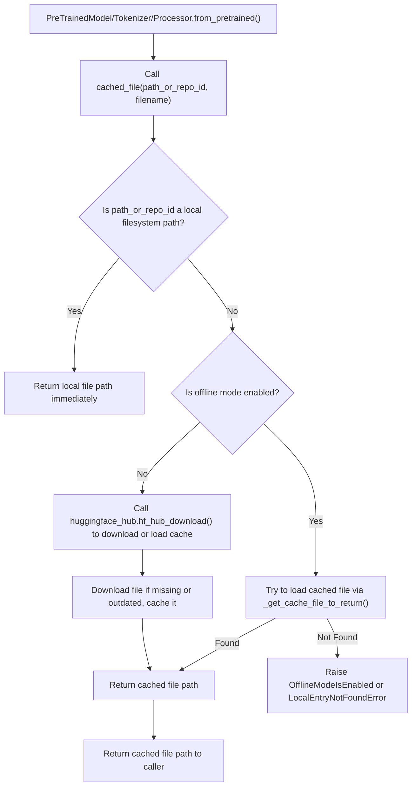
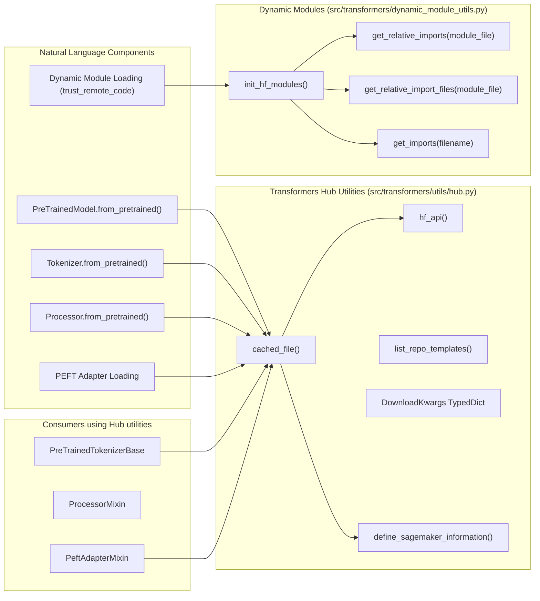

<!-- source: DeepWiki mcp.deepwiki.com · repo huggingface/transformers · page 4.3 Hub Integration & File Caching · fetched 2026-10-26 -->

# Hub Integration & File Caching

Relevant source files

The following files were used as context for generating this wiki page:

- [.ai/AGENTS.md](.ai/AGENTS.md)
- [.ai/skills/add-or-fix-type-checking/SKILL.md](.ai/skills/add-or-fix-type-checking/SKILL.md)
- [.github/ISSUE_TEMPLATE/bug-report.yml](.github/ISSUE_TEMPLATE/bug-report.yml)
- [.github/ISSUE_TEMPLATE/migration.yml](.github/ISSUE_TEMPLATE/migration.yml)
- [.github/PULL_REQUEST_TEMPLATE.md](.github/PULL_REQUEST_TEMPLATE.md)
- [.github/scripts/codeowners_for_review_action](.github/scripts/codeowners_for_review_action)
- [.github/workflows/assign-reviewers.yml](.github/workflows/assign-reviewers.yml)
- [.github/workflows/check-workflow-permissions.yml](.github/workflows/check-workflow-permissions.yml)
- [.github/workflows/codeql.yml](.github/workflows/codeql.yml)
- [.github/workflows/trufflehog.yml](.github/workflows/trufflehog.yml)
- [.gitignore](.gitignore)
- [AGENTS.md](AGENTS.md)
- [CLAUDE.md](CLAUDE.md)
- [CONTRIBUTING.md](CONTRIBUTING.md)
- [Makefile](Makefile)
- [docs/source/en/modular_transformers.md](docs/source/en/modular_transformers.md)
- [docs/source/en/pr_checks.md](docs/source/en/pr_checks.md)
- [docs/source/en/testing.md](docs/source/en/testing.md)
- [docs/source/es/pr_checks.md](docs/source/es/pr_checks.md)
- [docs/source/it/pr_checks.md](docs/source/it/pr_checks.md)
- [docs/source/ja/pr_checks.md](docs/source/ja/pr_checks.md)
- [docs/source/ko/pr_checks.md](docs/source/ko/pr_checks.md)
- [src/transformers/_typing.py](src/transformers/_typing.py)
- [src/transformers/dynamic_module_utils.py](src/transformers/dynamic_module_utils.py)
- [src/transformers/file_utils.py](src/transformers/file_utils.py)
- [src/transformers/modelcard.py](src/transformers/modelcard.py)
- [src/transformers/safetensors_conversion.py](src/transformers/safetensors_conversion.py)
- [src/transformers/tokenization_utils_tokenizers.py](src/transformers/tokenization_utils_tokenizers.py)
- [src/transformers/utils/hub.py](src/transformers/utils/hub.py)
- [tests/models/auto/test_configuration_auto.py](tests/models/auto/test_configuration_auto.py)
- [tests/models/auto/test_feature_extraction_auto.py](tests/models/auto/test_feature_extraction_auto.py)
- [tests/models/auto/test_modeling_auto.py](tests/models/auto/test_modeling_auto.py)
- [tests/models/auto/test_tokenization_auto.py](tests/models/auto/test_tokenization_auto.py)
- [tests/repo_utils/test_checkers.py](tests/repo_utils/test_checkers.py)
- [tests/tokenization/test_tokenization_fast.py](tests/tokenization/test_tokenization_fast.py)
- [tests/utils/test_dynamic_module_utils.py](tests/utils/test_dynamic_module_utils.py)
- [utils/check_inits.py](utils/check_inits.py)
- [utils/check_reviewers.py](utils/check_reviewers.py)
- [utils/check_types.py](utils/check_types.py)
- [utils/checkers-requirements.txt](utils/checkers-requirements.txt)
- [utils/checkers.py](utils/checkers.py)
- [utils/get_test_reports.py](utils/get_test_reports.py)

The Hugging Face Transformers library implements a comprehensive system for downloading, caching, and validating model-related files from the Hugging Face Hub. This system ensures efficient reuse of downloaded assets, supports offline mode environments, and provides robust validation of files through metadata and commit hash verification. It also supports auxiliary assets like adapters and dynamic modules necessary for custom model code execution with `trust_remote_code`.

The core of this functionality is implemented in `utils/hub.py` and is tightly integrated with components such as tokenizers, processors, and PEFT adapters. Additional support for managing dynamic modules resides in `dynamic_module_utils.py`. This page details these mechanisms in full technical depth.

---

## Core Caching Mechanism

The primary utilities for downloading and caching files from the Hub are the functions `cached_file` and `cached_files` located in `src/transformers/utils/hub.py`. They handle fetching files by model repository identifier or local path, ensuring minimal redundant downloads and proper cache use.

### Key Components

- **`hf_api()`**:  
  Returns a singleton instance of `huggingface_hub.HfApi` configured with the Transformers library's name and version to maintain consistent user agent reporting and telemetry. This instance is reused for all Hub interactions inside the library.  
  Defined at: [src/transformers/utils/hub.py:77-89]()

- **`cached_file(path_or_repo_id, filename, ...)`**:  
  Main function to fetch a single file, supporting:
  - Local filesystem paths (return immediately).
  - Remote Hub repositories with revision specifiers (branches, tags, commits).
  - Parameters for cache directory override (`cache_dir`), forced re-download (`force_download`), local-only mode (`local_files_only`), authentication tokens, and subfolder access.

  The method first tries to locate the file in the local cache using the helper `_get_cache_file_to_return`. If not cached or forced download is requested, it uses `huggingface_hub.hf_hub_download()` to download with cache management and checksum verification.

  It handles errors gracefully such as offline mode, repository or revision not found, or network issues by propagating exceptions or fallback behaviors.  
  See main logic inferred from: [src/transformers/utils/hub.py:49]() and helper snippet [src/transformers/utils/hub.py:116-129]()

- **`_get_cache_file_to_return(path_or_repo_id, full_filename, cache_dir, revision, repo_type)`**:  
  Helper that attempts to load a cached file path synchronously without downloading or verifying freshness — useful for offline mode fallback. Returns `None` if no cached file is available.  
  Defined at: [src/transformers/utils/hub.py:116-129]()

- **`list_repo_templates(repo_id, *, local_files_only, revision, cache_dir, token)`**:  
  Lists available chat Jinja template files from the Hub or local cache under the `additional_chat_templates/` directory for a given repo revision, supporting offline fallback.  
  Defined at: [src/transformers/utils/hub.py:132-175]()

### Operational Data Flow

Below is a detailed data flow from a user's request to load a model file via `from_pretrained` to obtaining a cached file:

This flexible flow supports multiple deployment scenarios, including offline environments and updates from Hub revisions.

Sources: [src/transformers/utils/hub.py:49-129]()

---

## Offline Mode & Environment Management

### Offline Mode

Transformers respects offline mode flags from the environment that restrict Hub network activity:

- The function `huggingface_hub.is_offline_mode()` checks environment variables such as `HF_HUB_OFFLINE` or `TRANSFORMERS_OFFLINE` to determine if network calls to the Hub should be disabled.
- When offline mode is active, the caching utilities behave strictly by attempting to load files from the local cache only and raising `OfflineModeIsEnabled` exceptions if files are missing.
- This mode enables deployment in air-gapped or secured environments.

Sources: [src/transformers/utils/hub.py:39]()

### Cache Directory and Module Cache

- The environment variable `HF_MODULES_CACHE` defines the directory used to cache dynamically loaded Python modules (used by `trust_remote_code`).
- Default location: `${HF_HOME}/modules`.
- This supports dynamically downloading and caching remote code safely for custom architectures.

Source: [src/transformers/utils/hub.py:108]()

### User-Agent for HTTP Requests

- Hub API requests include detailed user-agent headers reporting:
  - Transformers version (from `__version__`).
  - Torch version if available.
  - Unique session ID for telemetry.
- This information is set via `build_hf_headers()` in `huggingface_hub` and augmented internally.
- Ensures consistent client tracking and debugging capabilities.

Source snippet references: [src/transformers/utils/hub.py:52]()

---

## Safetensors Conversion Utility

The Transformers library supports integration with the `safetensors` format for model weights:

- `safetensors` provides a pickle-free, secure, and efficient serialization format.
- Transformers includes utilities (in e.g., `safetensors_conversion.py`) to convert PyTorch weights to the safetensors format and vice versa.
- This conversion utility ties into the Hub caching workflow to load `.safetensors` files seamlessly.
- Use of safetensors enhances security during model loading by preventing arbitrary code execution vulnerabilities inherent to pickle.

(Note: The actual safetensors implementation details are in separate files not fully shown here.)

Sources: [src/transformers/safetensors_conversion.py]()

---

## Dynamic Module Loading for `trust_remote_code=True`

When loading models with `trust_remote_code=True`, Transformers dynamically downloads and imports custom Python code defining architectures or utilities hosted remotely on the Hub. This process requires safe and robust handling of:

- Downloading dynamic modules into a local cache directory (`HF_MODULES_CACHE`).
- Creating necessary `__init__.py` files in the cache path to make it a proper Python package.
- Patching `sys.path` to prioritize the cache location so Python can import the dynamic modules.
- Recursively resolving relative imports inside the dynamic module tree by parsing source files.
- Extracting import statements outside of `try/except` blocks to list external dependencies (though installing external packages is left to the user).

### Key Utilities and Functions

- **`init_hf_modules()`**:  
  Creates the cache directory for dynamic modules and writes `__init__.py` files recursively along subpaths to form valid namespace packages. This enables proper importing of remote code at runtime.  
  Located at: [src/transformers/dynamic_module_utils.py:85-99]()

- **`get_relative_imports(module_file)`**:  
  Uses regex-based parsing to extract module names from relative `from .` imports in a module source file. This allows recursive downloading of all required modules.  
  Located at: [src/transformers/dynamic_module_utils.py:123-141]()

- **`get_relative_import_files(module_file)`**:
  Recursively finds all files needed for a given module by following relative imports.
  Located at: [src/transformers/dynamic_module_utils.py:144-173]()

- **`get_imports(filename)`**:  
  Parses the source code AST to extract import statements (both `import X` and `from Y import Z`) selectively, excluding those guarded by `try/except` clauses to avoid forcing optional dependencies.  
  Located at: [src/transformers/dynamic_module_utils.py:176-186]()

This system ensures that high-trust remote code is safely and consistently imported with version control and caching.

Sources: [src/transformers/dynamic_module_utils.py:85-186]()

---

## Integration with Specialized Components: PEFT Adapters

Parameter-Efficient Fine-Tuning (PEFT) adapters leverage and integrate the Hub caching mechanisms:

- The `PeftAdapterMixin` loads adapter configuration (`adapter_config.json`) and weights (e.g., `.safetensors`) using `cached_file`.
- It supports loading adapters from local paths or Hub repos with versioning.
- This integration ensures adapters are efficiently cached and loaded offline if available.
  
Sources: [tests/models/auto/test_modeling_auto.py:36]()

---

## Entity Mapping: Natural Language to Code Entities

The following diagram associates common natural language system components with their corresponding Transformers code entities for Hub integration and caching, bridging user concepts to implementation:

This visualization clarifies the central role of the `cached_file` utility and the `hf_api()` client in orchestrating all Hub interactions from high-level consumers in the library.

Sources:  
[src/transformers/utils/hub.py:77-98, 132-175, 177-201]()
[src/transformers/dynamic_module_utils.py:85-186]()
[tests/models/auto/test_modeling_auto.py:36]()

---

## Hub Utility Reference Table

| Utility                     | Description                                                                                     | Location                                      |
|-----------------------------|-------------------------------------------------------------------------------------------------|-----------------------------------------------|
| `cached_file`               | Downloads and caches files from Hub or local path; supports revision, offline and force options | [src/transformers/utils/hub.py:49]()         |
| `hf_api`                    | Singleton `HfApi` instance with transformers-specific metadata                                   | [src/transformers/utils/hub.py:77-89]()      |
| `list_repo_templates`       | Lists Jinja chat templates from a repository                                                   | [src/transformers/utils/hub.py:132-175]()    |
| `define_sagemaker_information` | Detects SageMaker environment metadata for telemetry                                       | [src/transformers/utils/hub.py:177-201]()    |
| `DownloadKwargs`            | Typed dict for parameters to download functions                                                 | [src/transformers/utils/hub.py:92-101]()     |
| `init_hf_modules`            | Initializes the dynamic modules cache directory and creates `__init__.py` files                 | [src/transformers/dynamic_module_utils.py:85-99]() |
| `get_relative_imports`      | Extracts relative import module names from Python source using regex                            | [src/transformers/dynamic_module_utils.py:123-141]() |
| `get_relative_import_files` | Recursively finds all files needed for a given module by following relative imports             | [src/transformers/dynamic_module_utils.py:144-173]() |
| `get_imports`                | Extracts top-level import statements excluding those in try/except blocks                      | [src/transformers/dynamic_module_utils.py:176-186]() |

---

# Summary

The Transformers library provides a robust and extensible system for interfacing with the Hugging Face Hub, centered around efficient file caching, metadata validation, and offline mode operation. The `cached_file()` function is the core utility providing consistent access to model files, tokenizers, processors, adapters, and dynamic modules.

Advanced features include dynamic Python module loading under `trust_remote_code`, safetensors format conversion for secure model weighting, and tight integration with PEFT for adapter loading. The system's telemetry-aware API client and flexible caching paths support diverse runtime scenarios, from local development to scaled production deployments without internet access.

---

**Sources:**  
[src/transformers/utils/hub.py:1-201]()
[src/transformers/dynamic_module_utils.py:85-186]()
[src/transformers/safetensors_conversion.py]()
[tests/models/auto/test_modeling_auto.py:36]()

---

