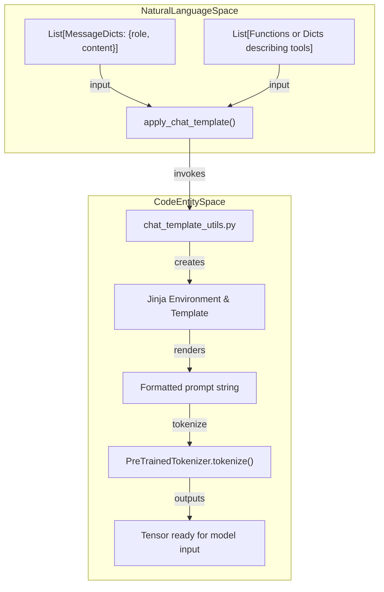
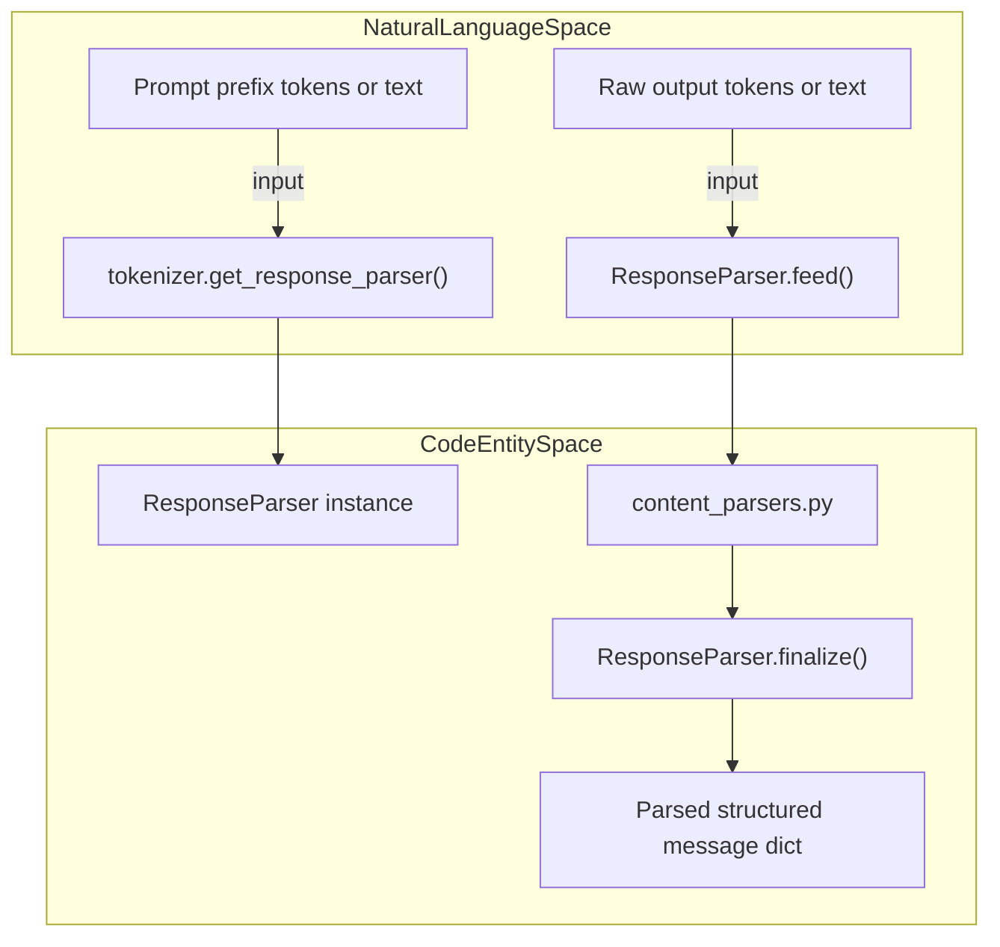

<!-- source: DeepWiki mcp.deepwiki.com · repo huggingface/transformers · page 4.4 Chat Templates & Response Parsing · fetched 2026-10-26 -->

# Chat Templates & Response Parsing

<details>
<summary>Relevant source files</summary>

The following files were used as context for generating this wiki page:

- [docs/source/en/chat_extras.md](docs/source/en/chat_extras.md)
- [docs/source/en/chat_response_parsing.md](docs/source/en/chat_response_parsing.md)
- [docs/source/en/chat_templating.md](docs/source/en/chat_templating.md)
- [docs/source/en/chat_templating_writing.md](docs/source/en/chat_templating_writing.md)
- [docs/source/en/conversations.md](docs/source/en/conversations.md)
- [docs/source/en/generation_strategies.md](docs/source/en/generation_strategies.md)
- [docs/source/en/llm_tutorial.md](docs/source/en/llm_tutorial.md)
- [docs/source/en/model_doc/pix2struct.md](docs/source/en/model_doc/pix2struct.md)
- [docs/source/en/quicktour.md](docs/source/en/quicktour.md)
- [docs/source/en/tasks/keypoint_matching.md](docs/source/en/tasks/keypoint_matching.md)
- [docs/source/en/tasks/language_modeling.md](docs/source/en/tasks/language_modeling.md)
- [docs/source/en/tasks/masked_language_modeling.md](docs/source/en/tasks/masked_language_modeling.md)
- [docs/source/es/chat_templating.md](docs/source/es/chat_templating.md)
- [docs/source/es/tasks/language_modeling.md](docs/source/es/tasks/language_modeling.md)
- [docs/source/ja/chat_templating.md](docs/source/ja/chat_templating.md)
- [docs/source/ja/tasks/masked_language_modeling.md](docs/source/ja/tasks/masked_language_modeling.md)
- [docs/source/ko/tasks/masked_language_modeling.md](docs/source/ko/tasks/masked_language_modeling.md)
- [docs/source/zh/chat_templating.md](docs/source/zh/chat_templating.md)
- [src/transformers/models/ernie4_5_vl_moe/processing_ernie4_5_vl_moe.py](src/transformers/models/ernie4_5_vl_moe/processing_ernie4_5_vl_moe.py)
- [src/transformers/models/pix2struct/__init__.py](src/transformers/models/pix2struct/__init__.py)
- [src/transformers/models/qwen2_5_omni/processing_qwen2_5_omni.py](src/transformers/models/qwen2_5_omni/processing_qwen2_5_omni.py)
- [src/transformers/models/qwen3_omni_moe/processing_qwen3_omni_moe.py](src/transformers/models/qwen3_omni_moe/processing_qwen3_omni_moe.py)
- [src/transformers/models/smolvlm/processing_smolvlm.py](src/transformers/models/smolvlm/processing_smolvlm.py)
- [src/transformers/utils/chat_parsing/content_parsers.py](src/transformers/utils/chat_parsing/content_parsers.py)
- [src/transformers/utils/chat_parsing/response_parser.py](src/transformers/utils/chat_parsing/response_parser.py)
- [src/transformers/utils/chat_parsing/response_templates.py](src/transformers/utils/chat_parsing/response_templates.py)
- [src/transformers/utils/chat_template_utils.py](src/transformers/utils/chat_template_utils.py)
- [tests/models/ernie4_5_vl_moe/test_processing_ernie4_5_vl_moe.py](tests/models/ernie4_5_vl_moe/test_processing_ernie4_5_vl_moe.py)
- [tests/models/pix2struct/test_image_processing_pix2struct.py](tests/models/pix2struct/test_image_processing_pix2struct.py)
- [tests/models/qwen3_omni_moe/test_processing_qwen3_omni_moe.py](tests/models/qwen3_omni_moe/test_processing_qwen3_omni_moe.py)
- [tests/models/qwen3_vl/test_processing_qwen3_vl.py](tests/models/qwen3_vl/test_processing_qwen3_vl.py)
- [tests/utils/test_chat_parsing.py](tests/utils/test_chat_parsing.py)
- [tests/utils/test_chat_template_utils.py](tests/utils/test_chat_template_utils.py)

</details>


## Purpose and Scope

This page details core mechanisms enabling advanced conversational workflows in Hugging Face Transformers. Chat models generate raw token sequences, but users interact with structured messages (dictionaries with roles, contents, tool calls, etc.). Transformers implements a bidirectional glue layer:

1.  **Chat Templates (Ingress):** Jinja-based templates configured on tokenizers or processors format chat message lists and tools into a single tokenizable prompt string using `apply_chat_template` [docs/source/en/chat_templating.md:1-132]().

2.  **Tool & JSON Schema Helpers:** Utilities in `src/transformers/utils/chat_template_utils.py` parse Python functions with annotations and docstrings to generate JSON schemas that describe tool signatures for use in templates [src/transformers/utils/chat_template_utils.py:1-169]().

3.  **Response Parsing (Egress):** Declarative, often streaming parsing of model output tokens back into structured dicts is implemented in the `chat_parsing` package, supporting complex field extraction and tool-call argument decoding [docs/source/en/chat_response_parsing.md:1-109](), [src/transformers/utils/chat_parsing/response_parser.py:66-147]().

Sources:
[docs/source/en/chat_templating.md:1-132]()
[src/transformers/utils/chat_template_utils.py:1-169]()
[docs/source/en/chat_response_parsing.md:1-109]()
[src/transformers/utils/chat_parsing/response_parser.py:66-147]()

---

## 1. Jinja Chat Templates & `apply_chat_template`

Transformer causal LMs generate text tokens sequentially. When fine-tuned for chat, they rely on specific control tokens (e.g., `[INST]`, `<|user|>`, `<|im_start|>`) to delimit user, system, and assistant turns. To handle the variety of model-specific prompt formats without rigid hardcoding, Transformers stores a **Jinja template string** in the tokenizer's `chat_template` attribute.

### Data Flow of Chat Template Application

-   **Input:** a list of chat messages (`List[Dict]`), each having:
    -   `role`: "user", "assistant", or "system"
    -   `content`: text string or (for multimodal models) lists of content dicts (e.g., images or video placeholders)
-   **Optional:** `tools` as Python functions or JSON schema dicts describing callable external tools, enabling function-calling support.
-   The template is executed with Jinja, receiving messages, tools, and special tokens as variables.
-   **Output:** a formatted string that encodes the entire chat history in the model's expected prompt format.
-   Finally, the result is optionally tokenized by the tokenizer.

### Diagram: Chat Template Application Flow


Sources:
[docs/source/en/chat_templating.md:1-132]()
[src/transformers/utils/chat_template_utils.py:1-169]()

### Multimodal Chat Templates

For models supporting multimodal input (e.g., images, videos), templates are typically set on the **processor** instead of the tokenizer since the content may be a list of heterogeneous items ([text, image, video] dictionaries). The template emits special tokens like `<|image|>` or `<|video|>`, which are expanded by the processor into model-specific token sequences after templating [src/transformers/models/smolvlm/processing_smolvlm.py:43-76](). This design decouples textual prompt formatting from media tokenization.

Sources:
[src/transformers/models/smolvlm/processing_smolvlm.py:43-76]()

### Whitespace Control in Jinja

Templates use Jinja's whitespace control syntax (``) to avoid unwanted spaces or line breaks that could degrade model performance. Proper whitespace management is crucial to matching training-time prompt formats exactly [docs/source/en/chat_templating_writing.md:88-106]().

Sources:
[docs/source/en/chat_templating_writing.md:88-106]()

---

## 2. Tool & JSON Schema Helpers (`chat_template_utils.py`)

When external callable tools are passed to `apply_chat_template`, their Python function signatures and docstrings are parsed to generate JSON schema descriptions. These schemas inform the chat prompt about the shape, type, and purpose of tool arguments, enabling the model to generate valid tool calls.

### Core Responsibilities

-   Parse Python function signatures and type annotations (PEP 484 style).
-   Extract Google-style docstring sections (`Args:` and `Returns:`) for argument descriptions.
-   Map Python types (`int`, `str`, `Union`, `Literal`, `list`, `Optional`, etc.) into corresponding JSON schema fields.
-   Handle unions and nullable types by JSON Schema’s `anyOf`, `type` arrays, and `nullable` flags.
-   Raise informative exceptions (`DocstringParsingException`, `TypeHintParsingException`) on parsing failures.

### Diagram: JSON Schema Generation Flow

```mermaid
graph TD
    subgraph "NaturalLanguageSpace"
        PythonFunction["Python Function with Annotations & Docstring"]
        PythonFunction --> ParseTypeHints["parse_type_hint() and docstring extraction"]
        ParseTypeHints --> ExtractDocstring["Parse `Args:` & `Returns:` sections using regex"]
    end
    subgraph "CodeEntitySpace"
        ExtractDocstring --> GetJsonSchema["get_json_schema()"]
        GetJsonSchema --> JsonSchemaDict["JSON Schema Parameter Object"]
        JsonSchemaDict --> ToolsListForTemplate["`tools` variable for Jinja context"]
    end
```
Sources:
[src/transformers/utils/chat_template_utils.py:1-169]()

### Notable Components

-   **`get_json_schema(fn)`**:
    Takes a Python function, extracts its name, argument information, and argument descriptions, then returns a standardized JSON schema dict usable by chat templates. It makes use of helper regexes to parse docstrings and recursive parsing of type hints [src/transformers/utils/chat_template_utils.py:54-69]().

-   **`_parse_type_hint(hint)`**:
    Recursively converts Python type hints — including complex nested generics and `Union` types — into JSON schema-compatible types, utilizing JSON Schema constructs such as `anyOf`, `nullable`, and handling Python built-in types with mappings [src/transformers/utils/chat_template_utils.py:98-169]().

-   **Custom Exceptions**:
    -   `DocstringParsingException` indicates missing or malformed argument documentation.
    -   `TypeHintParsingException` indicates unsupported or custom types that cannot be parsed into JSON schema [src/transformers/utils/chat_template_utils.py:72-78]().

Sources:
[src/transformers/utils/chat_template_utils.py:54-69]()
[src/transformers/utils/chat_template_utils.py:98-169]()
[src/transformers/utils/chat_template_utils.py:72-78]()

### Testing & Validation

Extensive testing of JSON schema generation covers typical usage scenarios: simple and nested types, union and optional types, default arguments, and malformed or missing docstrings. The test suite in `tests/utils/test_chat_template_utils.py` ensures robustness [tests/utils/test_chat_template_utils.py:1-211]().

Sources:
[tests/utils/test_chat_template_utils.py:1-211]()

---

## 3. Response Parsing Architecture (`chat_parsing/`)

Response parsing is the reverse operation of chat templating: it converts raw token stream output from a model into structured message dictionaries (`role`, `content`, `thinking`, `tool_calls`, etc.).

### Overview

-   The main public API is the tokenizer's `parse_response()` method, which accepts the generated text output and the original prompt prefix.
-   Parsing uses a declarative **response template** (`ResponseTemplate`), which defines the fields by tag delimiters, regex patterns, or JSON blocks.
-   The parser extracts fields such as natural text content, "thinking" traces, and nested tool-call requests encoded in JSON or XML-like formats.
-   To support user interfaces with streaming generation, the `ResponseParser` class parses output incrementally and emits parsing events.

### Diagram: Response Parsing Flow


Sources:
[src/transformers/utils/chat_parsing/response_parser.py:66-147]()

### Synchronous and Streaming Methods

-   **Synchronous Parsing:**
    The function `parse_response(text, response_template, prefix=...)` parses the entire generated output at once and returns the structured message dictionary [docs/source/en/chat_response_parsing.md:36-52](), [src/transformers/utils/chat_parsing/response_parser.py:66-83]().

-   **Streaming Parsing:**
    The `ResponseParser` instance can be fed partial text chunks, emits parsing events (`region_open`, `region_chunk`, `region_close`), and supports incremental and real-time updates for UI renderers and advanced pipelines [docs/source/en/chat_response_parsing.md:75-90](), [src/transformers/utils/chat_parsing/response_parser.py:86-147]().

Sources:
[docs/source/en/chat_response_parsing.md:36-52]()
[src/transformers/utils/chat_parsing/response_parser.py:66-83]()
[docs/source/en/chat_response_parsing.md:75-90]()
[src/transformers/utils/chat_parsing/response_parser.py:86-147]()

---

## 4. Streaming Events & Tool-Call Extraction

The streaming `ResponseParser` emits structured events for each parsed region (field) during model generation:

| Event Type     | Meaning                                   | Content                                                              |
| :------------- | :---------------------------------------- | :------------------------------------------------------------------- |
| `region_open`  | Start of a region (e.g., `<think>` tag)   | Field name, metadata                                                 |
| `region_chunk` | Content appended inside the region        | String chunk                                                         |
| `region_close` | End of the region (e.g., closing tag)     | Final parsed value (e.g., typed JSON object for tool calls)          |

For tool calls, after extraction of the tool name and argument JSON strings, argument values are cast from strings into appropriate Python types guided by the supplied tool JSON schema. The coercion utilizes the `_coerce()` function which attempts parsing of integer, float, boolean, null, object, and array types, falling back to the raw string if parsing fails [src/transformers/utils/chat_parsing/response_parser.py:42-63]().

This architecture enables robust conversation flows in which the model's request to invoke tools can be immediately understood and acted upon, facilitating flexible function-calling and tool integration.

Sources:
[src/transformers/utils/chat_parsing/response_parser.py:42-63]()

---

## Summary Diagram: Chat System End-to-End Flow

```mermaid
flowchart LR
    subgraph NL_SPACE["Natural Language Space"]
        UserMessages["User & System Messages\nList[Dict{role, content}]"]
        ToolFunctions["User-supplied Python Functions"]
        UserMessages -->|input| ApplyChatTemplate["apply_chat_template()"]
        ToolFunctions -->|generate JSON schema| ApplyChatTemplate
    end

    subgraph CODE_SPACE["Code Entity Space"]
        ApplyChatTemplate --> JinjaUtils["chat_template_utils.py\n(Jinja templates,\nfunction-to-JSON-schema)"]
        JinjaUtils --> FormattedPrompt["Formatted prompt string"]
        FormattedPrompt --> Tokenizer["Tokenizer.tokenize()"]
        Tokenizer --> ModelInput["Model Input Tensors"]
        ModelInput --> Model["Causal LM Model"]
        Model --> RawOutputTokens["Raw Output Tokens/Text"]
        RawOutputTokens -->|input| ResponseParserInit["tokenizer.get_response_parser() or parse_response()"]
        ResponseParserInit --> ResponseParser["ResponseParser"]
        ResponseParser --> ParsedMessage["Structured Message Dict\n{role, content, tool_calls, ...}"]
    end

    UserMessages -.- ParsedMessage
```


Sources:
[src/transformers/utils/chat_template_utils.py:1-169]()
[src/transformers/utils/chat_parsing/response_parser.py:66-147]()

---

## References

-   Chat templating and `apply_chat_template`:
    [docs/source/en/chat_templating.md:1-132](), [docs/source/en/chat_templating_writing.md:1-119]()

-   Tool argument parsing, JSON schemas, and exceptions:
    [src/transformers/utils/chat_template_utils.py:1-169](), [tests/utils/test_chat_template_utils.py:1-211]()

-   Response parsing, streaming events, and parsing internals:
    [docs/source/en/chat_response_parsing.md:1-109](), [src/transformers/utils/chat_parsing/response_parser.py:66-147](), [tests/utils/test_chat_parsing.py:1-195]()

-   Multimodal chat templates and processor expansions:
    [src/transformers/models/smolvlm/processing_smolvlm.py:43-76]()

---

*This page documents the bidirectional glue layer enabling flexible, model-specific chat prompt formatting and robust parsing of generated token streams into structured message dictionaries, supporting advanced chat features like tool use and multimodality.*

---

