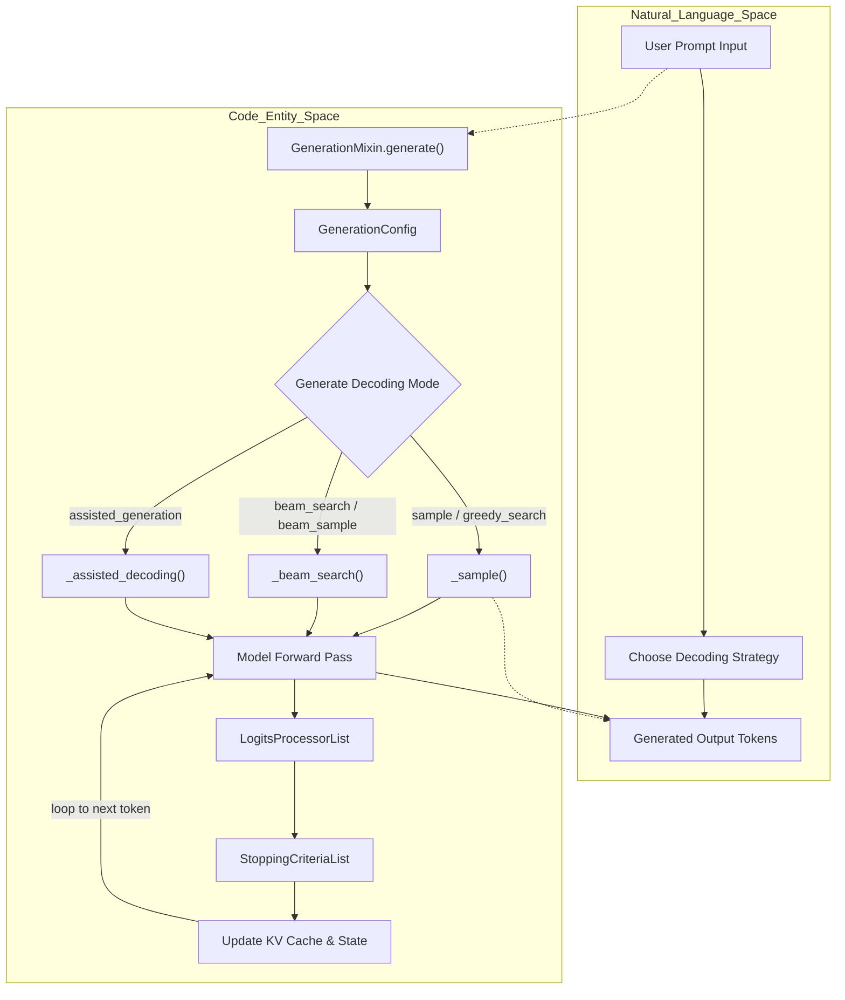
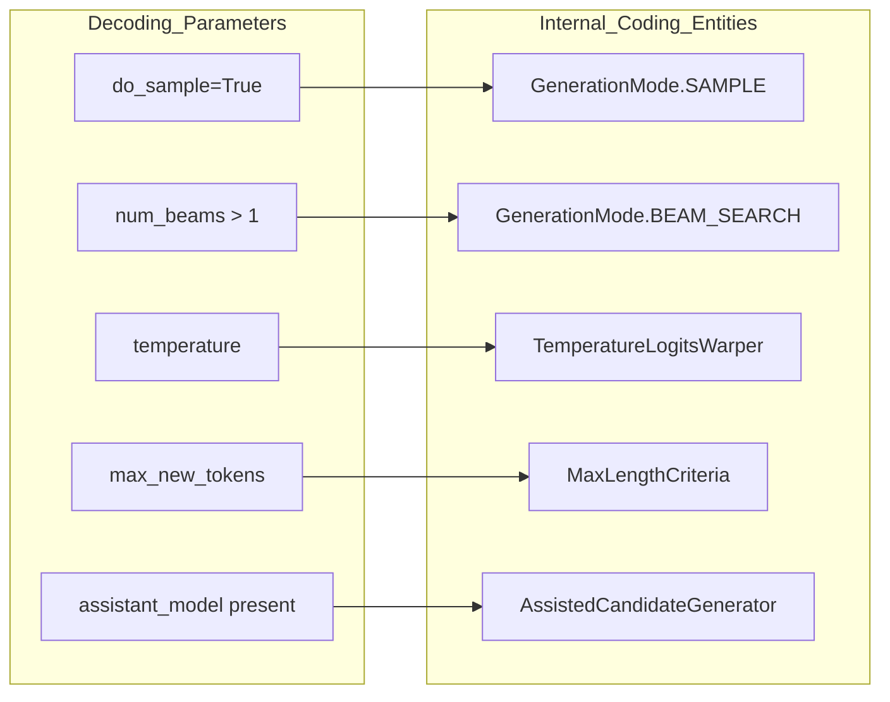

<!-- source: DeepWiki mcp.deepwiki.com · repo huggingface/transformers · page 5 Text Generation · fetched 2026-10-26 -->

# Text Generation

Relevant source files

The following files were used as context for generating this wiki page:

- [src/transformers/cache_utils.py](src/transformers/cache_utils.py)
- [src/transformers/configuration_utils.py](src/transformers/configuration_utils.py)
- [src/transformers/generation/candidate_generator.py](src/transformers/generation/candidate_generator.py)
- [src/transformers/generation/configuration_utils.py](src/transformers/generation/configuration_utils.py)
- [src/transformers/generation/utils.py](src/transformers/generation/utils.py)
- [src/transformers/integrations/executorch.py](src/transformers/integrations/executorch.py)
- [src/transformers/masking_utils.py](src/transformers/masking_utils.py)
- [tests/generation/test_candidate_generator.py](tests/generation/test_candidate_generator.py)
- [tests/generation/test_configuration_utils.py](tests/generation/test_configuration_utils.py)
- [tests/generation/test_utils.py](tests/generation/test_utils.py)
- [tests/utils/test_cache_utils.py](tests/utils/test_cache_utils.py)
- [tests/utils/test_configuration_utils.py](tests/utils/test_configuration_utils.py)
- [tests/utils/test_feature_extraction_utils.py](tests/utils/test_feature_extraction_utils.py)
- [tests/utils/test_image_processing_utils.py](tests/utils/test_image_processing_utils.py)
- [tests/utils/test_masking_utils.py](tests/utils/test_masking_utils.py)
- [tests/utils/test_tokenization_utils.py](tests/utils/test_tokenization_utils.py)

The text generation subsystem in the `transformers` library provides a flexible, extensible, and efficient framework for autoregressive decoding across multiple modalities such as text-decoder, text-to-text, speech-to-text, and vision-to-text. It unifies various decoding strategies within a common infrastructure, leveraging key-value (KV) caching for performance and modular components for logit processing, stopping criteria, and candidate generation.

---

## System Overview

At its core, text generation is driven by the method `GenerationMixin.generate()` [src/transformers/generation/utils.py:196-4431](). This method takes generation parameters encapsulated in a `GenerationConfig` instance [src/transformers/generation/configuration_utils.py:100-152]() and selects the decoding strategy accordingly. Supported strategies include greedy search, multinomial sampling, beam search, and assisted/speculative decoding.

The generation process proceeds iteratively by:
- Performing a model forward pass to produce logits for the next token(s).
- Efficiently managing and updating KV caches to reuse past attention key and value states.
- Applying a sequence of logit processors to adjust token probability distributions with techniques such as temperature scaling, top-k/top-p filtering, repetition penalty, and no-repeat n-gram blocking [src/transformers/generation/utils.py:90-108]().
- Evaluating stopping criteria to decide when to terminate the generation loop [src/transformers/generation/utils.py:109-116]().
- Optionally leveraging candidate generators (e.g., assistant models) to propose token candidates for speculative or assisted decoding [src/transformers/generation/utils.py:58-72]().

This design supports low-level optimizations like lazy initialization of caches, beam search cache reordering, and advanced batching APIs for high-throughput inference with request scheduling and paged cache memory management. The subsystem also integrates watermarking and streaming generation utilities.

---

## Text Generation Execution Flow

This diagram maps the natural language generation workflow to the underlying code logic. The entry is through `GenerationMixin.generate()` which uses `GenerationConfig` settings to dispatch to the corresponding generation algorithm method. Each generation step involves model inference, logit post-processing, cache management, and termination checks, producing output tokens iteratively.

Sources: [src/transformers/generation/utils.py:141-152]()

---

## Core Components Overview

### 1. GenerationMixin & Decoding Strategies

- **Role:** Provides the main `generate()` interface for autoregressive text (and multimodal) generation.
- **Functionality:**  
  - Inspects `GenerationConfig` to select an internal generation method [src/transformers/generation/utils.py:141-152]().  
  - Supports key modes like greedy search, multinomial sampling (`_sample()`), beam search (`_beam_search()`), and assisted decoding (`_assisted_decoding()`) [src/transformers/generation/utils.py:141-152]().  
  - Supports speculative and assisted generation via `CandidateGenerator` subclasses that provide token candidates from a smaller assistant model which are verified by the main model [src/transformers/generation/candidate_generator.py:39-141]().  
  - Allows custom or community-contributed generation methods through `custom_generate`.

- **Key Classes / Enums:**  
  - `GenerationMixin` (class with `.generate()` method) [src/transformers/generation/utils.py:196-4431]()  
  - `GenerationConfig` (configuration options and flags) [src/transformers/generation/configuration_utils.py:100-152]()  
  - `GenerationMode` (enum of generation modes) [src/transformers/generation/configuration_utils.py:82-98]()  
  - `CandidateGenerator` (abstract base and implementations for assisted generation) [src/transformers/generation/candidate_generator.py:39-141]()

- **Further Reading:**  
  See [GenerationMixin & Decoding Strategies](#5.1) for details on how `.generate()` coordinates different decoding algorithms and assisted generation.

Sources: [src/transformers/generation/utils.py:130-150](), [src/transformers/generation/candidate_generator.py:39-141](), [src/transformers/generation/configuration_utils.py:82-112]()

---

### 2. KV Cache Implementations

- **Role:** Manage caching of attention key and value tensors during autoregressive decoding to avoid recomputing attention over all generated tokens from scratch.

- **Implementations:**  
  - `DynamicCache`: Default cache type that dynamically grows cached KV states as new tokens are generated [src/transformers/cache_utils.py:113-172](). Allows cropping, reordering, and lazy initialization of cached states.  
  - `StaticCache`: Fixed-size pre-allocated cache with a maximum sequence length, facilitating compiler optimizations and accommodating different attention head layouts (multi-head, multi-query, grouped-query) [tests/utils/test_cache_utils.py:100-135]().  
  - `QuantizedCache`: Compresses KV tensors to reduce memory footprint using quantization backends [src/transformers/generation/utils.py:35]().  
  - `EncoderDecoderCache`: Specialized cache handling separate encoder and decoder caches for encoder-decoder models [src/transformers/generation/utils.py:34]().

- **APIs Provided:**  
  - Update the cache with new key/value tensors [src/transformers/cache_utils.py:56-58]().  
  - Reorder cache entries for beam search pruning [src/transformers/cache_utils.py:100-104]().  
  - Crop stale tokens from cache for sliding window attention [src/transformers/cache_utils.py:173-174]().  
  - Offload and prefetch cache data between devices for memory efficiency [src/transformers/cache_utils.py:75-85]().

- **Further Reading:**  
  Refer to [KV Cache Implementations](#5.2) for comprehensive details on each cache class and their memory management strategies.

Sources: [src/transformers/cache_utils.py:27-172](), [src/transformers/generation/utils.py:30-36](), [tests/utils/test_cache_utils.py:80-121]()

---

### 3. Logits Processors, Stopping Criteria & Watermarking

- **Role:** Modularize probability manipulations and termination logic for generation, enabling rich control over how tokens are sampled or pruned.

- **Components:**  
  - `LogitsProcessorList`: A composable list of `LogitsProcessor` objects that adjust logits each generation step [src/transformers/generation/utils.py:91](). Common processors include: temperature scaling, top-k/top-p filtering, repetition penalty (to avoid repetitions), no-repeat n-gram blocking, and bad-words filtering [src/transformers/generation/utils.py:92-108]().  
  - `StoppingCriteriaList`: Holds various stopping criteria like maximum length, maximum generation time, EOS token generated, or occurrence of certain strings to decide when to stop generating [src/transformers/generation/utils.py:115]().  
  - Watermarking processors inject subtle patterns for watermark detection in generated text [src/transformers/generation/configuration_utils.py:62-63]().  
  - Streamers support token-by-token output streaming, integrating seamlessly with logits processing.

- **Further Reading:**  
  See [Logits Processors, Stopping Criteria & Watermarking](#5.3) for an in-depth view of processors, criteria, and watermark detection.

Sources: [src/transformers/generation/utils.py:90-108](), [src/transformers/generation/utils.py:109-116](), [src/transformers/generation/configuration_utils.py:62-63]()

---

### 4. Continuous Batching

- **Role:** Support asynchronous, high-throughput generation serving multiple requests concurrently by dynamically batching inputs in-flight.

- **Features:**  
  - `ContinuousMixin` API to integrate continuous batching and scheduling of requests [src/transformers/generation/utils.py:80]().  
  - Request schedulers (e.g., FIFO, prefill-first) to manage request priorities and batching.  
  - Paged KV cache management to balance memory usage over large generation contexts.  
  - Model runners abstract model invocation with dynamic batch resizing.  
  - Integration with optimized attention backends such as flash-paged and SDPA-paged to accelerate computation.

- **Further Reading:**  
  For technical details, see [Continuous Batching](#5.4).

Sources: [src/transformers/generation/utils.py:80]()

---

## Component Relationships: Decoding Parameters to Internal Logic

This mapping relates common generation parameters set by users to internal code entities and components: decoding mode enums, logits processors enforcing temperature, stopping criteria for maximum length, and candidate generators for assisted decoding.

Sources: [src/transformers/generation/configuration_utils.py:82-110](), [src/transformers/generation/utils.py:130-150](), [src/transformers/generation/candidate_generator.py:80-100]()

---

## Summary Table of Components

| Component                      | Code Entity                                     | Role                                                                                       |
|-------------------------------|------------------------------------------------|--------------------------------------------------------------------------------------------|
| **Orchestrator**              | `GenerationMixin`                               | Coordinates generation loop, decoding mode dispatching, managing KV cache and outputs.     |
| **Generation Configuration**  | `GenerationConfig`                              | Encapsulates hyperparameters and flags controlling generation and decoding strategies.     |
| **KV Cache Manager**           | `Cache`, `DynamicCache`, `StaticCache`, etc.  | Implements efficient key-value caching for attention states to accelerate autoregressive generation. |
| **Speculative/Assisted Decoding** | `CandidateGenerator` and subclasses           | Generate token candidates from assistant models for enhanced or faster decoding.           |
| **Logits Modifiers**           | `LogitsProcessorList`                           | Apply filters and transformations on logits such as temperature and repetition penalties.  |
| **Stopping Criteria**          | `StoppingCriteriaList`                          | Implements when to stop generating based on length, time, EOS token, or special strings.   |
| **Continuous Batching**        | `ContinuousBatchingManager`, `ContinuousMixin`| Enables asynchronous high-throughput generation with batched request scheduling and paged cache support. |

---

For comprehensive technical details on each major subsystem, please refer to the following child pages:

- [GenerationMixin & Decoding Strategies](#5.1)  
- [KV Cache Implementations](#5.2)  
- [Logits Processors, Stopping Criteria & Watermarking](#5.3)  
- [Continuous Batching](#5.4)  

---

**Sources:**  
[src/transformers/generation/utils.py:1-192,130-150](),  
[src/transformers/generation/configuration_utils.py:1-152](),  
[src/transformers/cache_utils.py:1-174](),  
[src/transformers/generation/candidate_generator.py:1-141](),  
[src/transformers/generation/logits_process.py:1-108](),  
[tests/utils/test_cache_utils.py:80-121]()

---

