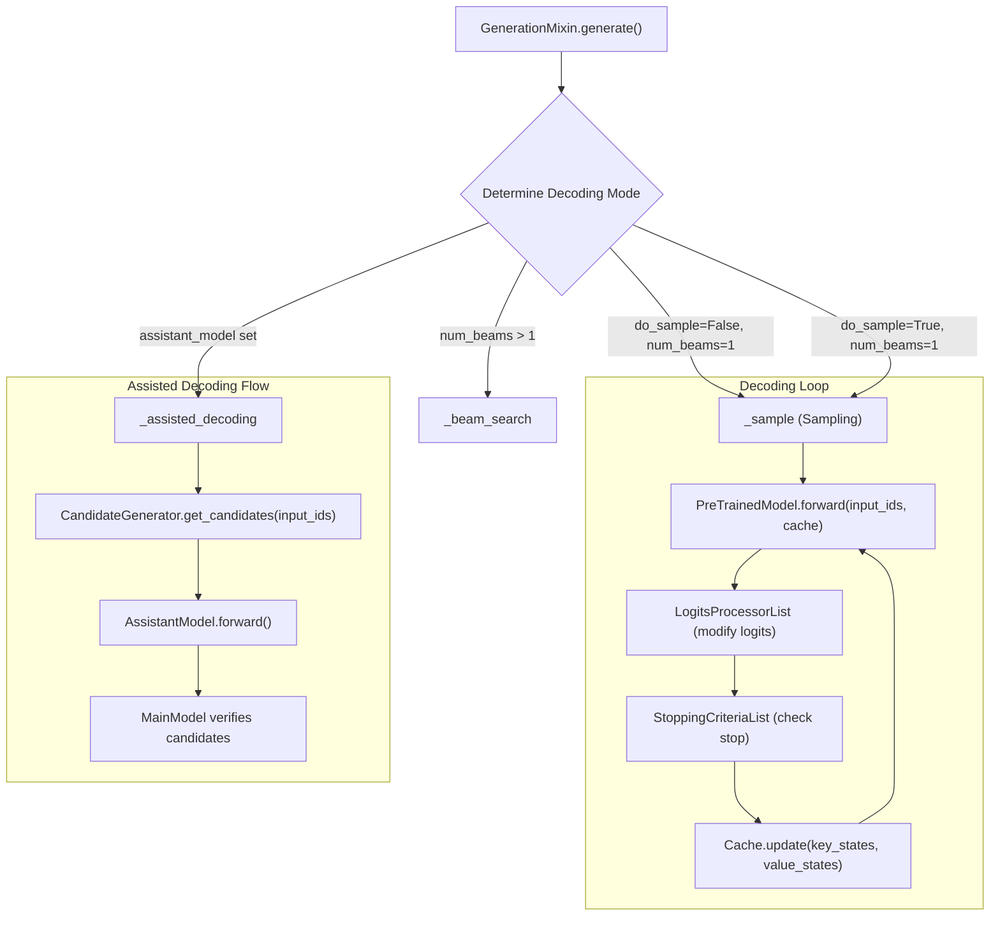
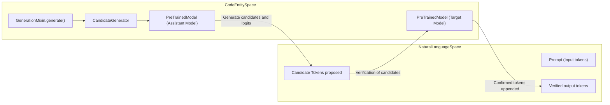
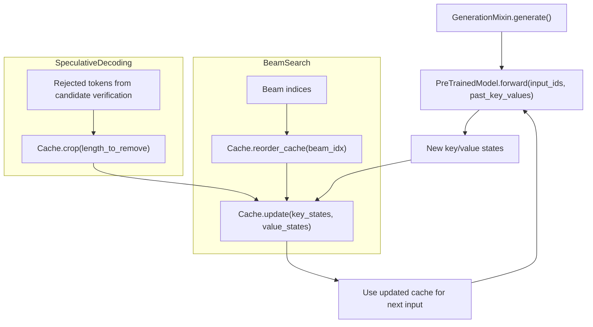

<!-- source: DeepWiki mcp.deepwiki.com · repo huggingface/transformers · page 5.1 GenerationMixin & Decoding Strategies · fetched 2026-10-26 -->

# GenerationMixin & Decoding Strategies

<details>
<summary>Relevant source files</summary>

The following files were used as context for generating this wiki page:

- [docs/source/en/internal/generation_utils.md](docs/source/en/internal/generation_utils.md)
- [docs/source/en/main_classes/text_generation.md](docs/source/en/main_classes/text_generation.md)
- [docs/source/ko/internal/generation_utils.md](docs/source/ko/internal/generation_utils.md)
- [src/transformers/cache_utils.py](src/transformers/cache_utils.py)
- [src/transformers/configuration_utils.py](src/transformers/configuration_utils.py)
- [src/transformers/generation/__init__.py](src/transformers/generation/__init__.py)
- [src/transformers/generation/candidate_generator.py](src/transformers/generation/candidate_generator.py)
- [src/transformers/generation/configuration_utils.py](src/transformers/generation/configuration_utils.py)
- [src/transformers/generation/logits_process.py](src/transformers/generation/logits_process.py)
- [src/transformers/generation/utils.py](src/transformers/generation/utils.py)
- [src/transformers/generation/watermarking.py](src/transformers/generation/watermarking.py)
- [src/transformers/integrations/executorch.py](src/transformers/integrations/executorch.py)
- [src/transformers/masking_utils.py](src/transformers/masking_utils.py)
- [src/transformers/models/whisper/generation_whisper.py](src/transformers/models/whisper/generation_whisper.py)
- [src/transformers/models/whisper/modeling_whisper.py](src/transformers/models/whisper/modeling_whisper.py)
- [tests/generation/test_candidate_generator.py](tests/generation/test_candidate_generator.py)
- [tests/generation/test_configuration_utils.py](tests/generation/test_configuration_utils.py)
- [tests/generation/test_logits_process.py](tests/generation/test_logits_process.py)
- [tests/generation/test_utils.py](tests/generation/test_utils.py)
- [tests/generation/test_watermarking.py](tests/generation/test_watermarking.py)
- [tests/models/whisper/test_modeling_whisper.py](tests/models/whisper/test_modeling_whisper.py)
- [tests/utils/test_cache_utils.py](tests/utils/test_cache_utils.py)
- [tests/utils/test_configuration_utils.py](tests/utils/test_configuration_utils.py)
- [tests/utils/test_feature_extraction_utils.py](tests/utils/test_feature_extraction_utils.py)
- [tests/utils/test_image_processing_utils.py](tests/utils/test_image_processing_utils.py)
- [tests/utils/test_masking_utils.py](tests/utils/test_masking_utils.py)
- [tests/utils/test_tokenization_utils.py](tests/utils/test_tokenization_utils.py)

</details>


The `GenerationMixin` class is the core abstraction in the Hugging Face Transformers library that enables autoregressive text generation for diverse model architectures. At its heart is the `generate()` method, which orchestrates a variety of decoding strategies like greedy search, multinomial sampling, beam search, contrastive search, assisted/speculative decoding, and supports custom generation methods.

This page delves into the technical implementation details of `generate()`, how it dispatches decoding modes via `GenerationConfig` and `GenerationMode`, the role of candidate generators in assisted decoding, and the integration with logits processors, stopping criteria, and KV cache management. Modularity is emphasized for extensibility, including support for user-provided custom generation routines.

---

## Overview of `generate()` and Decoding Mode Dispatch

### Entry point: `GenerationMixin.generate()`

Located in `src/transformers/generation/utils.py` [src/transformers/generation/utils.py:1-4431](), the `generate()` method is the façade for text generation calls. Its responsibilities include:

- Parsing and normalizing generation parameters, often aggregated in a `GenerationConfig` instance.
- Determining the appropriate decoding mode based on parameters like `do_sample`, `num_beams`, and flags such as presence of an `assistant_model`.
- Dispatching to a corresponding private method that implements the selected decoding algorithm.
- Managing the autoregressive generation loop, including forward passes with KV cache reuse, logits post-processing, and stopping checks.

### Decoding Mode Dispatch Table

The dispatch from `generate()` to specific decoding implementations is governed by a mapping called `GENERATION_MODES_MAPPING` [src/transformers/generation/utils.py:141-152](). This maps members of the `GenerationMode` enum to method names of `GenerationMixin`.

```python
GENERATION_MODES_MAPPING = {
    GenerationMode.SAMPLE: "_sample",
    GenerationMode.GREEDY_SEARCH: "_sample",  # Greedy search treated similarly to sampling but without randomness
    GenerationMode.BEAM_SEARCH: "_beam_search",
    GenerationMode.BEAM_SAMPLE: "_beam_search",  # Beam search with sampling
    GenerationMode.ASSISTED_GENERATION: "_assisted_decoding",
    # Deprecated methods
    GenerationMode.DOLA_GENERATION: "transformers-community/dola",
    GenerationMode.CONTRASTIVE_SEARCH: "transformers-community/contrastive-search",
    GenerationMode.GROUP_BEAM_SEARCH: "transformers-community/group-beam-search",
    GenerationMode.CONSTRAINED_BEAM_SEARCH: "transformers-community/constrained-beam-search",
}
```

The typical flow:

- If `do_sample` is `False` and `num_beams` is 1, it uses greedy decoding (`_sample` method).
- If `do_sample` is `True` with `num_beams` 1, multinomial sampling is used (same `_sample` method).
- If `num_beams` > 1, beam search methods (`_beam_search`) are chosen.
- If an `assistant_model` or assisted decoding parameters are provided, assisted decoding (`_assisted_decoding`) is invoked.

### Internal Autoregressive Generation Loop

Each decoding strategy internally executes a token-by-token generation loop structured as:

1. **Forward pass:** The underlying pre-trained model is called with current input tokens and cached key/value states to produce output logits.

2. **Logits processing:** These raw logits are passed through a list of `LogitsProcessor` instances (packaged as `LogitsProcessorList`) that apply transformations like temperature scaling, top-k/top-p filtering, repetition penalties, bad word suppression, etc.

3. **Stopping criteria checks:** A `StoppingCriteriaList` evaluates whether generation should halt early based on factors such as maximum length, presence of EOS tokens, or stop string matches.

4. **Cache update:** The KV cache, which stores past key and value attention states, is updated with new states from the current forward pass, enabling efficient incremental decoding.

5. **Next token selection:** Depending on strategy, tokens are selected via argmax (greedy), probabilistic sampling, beam pruning, or candidate verification (assisted decoding).

6. **Iteration:** The process repeats until all sequences meet stopping conditions.

---

### Mermaid Diagram: Generation Execution Flow Mapping



Sources: [src/transformers/generation/utils.py:139-152](), [src/transformers/generation/configuration_utils.py:82-98]()

---

## GenerationConfig & GenerationMode Explained

### `GenerationConfig`

Defined in `src/transformers/generation/configuration_utils.py` [src/transformers/generation/configuration_utils.py:100-1920](), `GenerationConfig` is a rich dataclass that bundles all configurable parameters controlling text generation. It supports length limits, sampling parameters, beam setup, assisted decoding flags, logits processor options, and stopping criteria.

Key parameter groups include:

| Parameter Category              | Examples                                                | Purpose                                                  |
|-------------------------------|---------------------------------------------------------|----------------------------------------------------------|
| Length control                 | `max_new_tokens`, `min_length`, `early_stopping`, `max_time` | Control generated sequence length and stop timing.       |
| Sampling options               | `do_sample`, `temperature`, `top_k`, `top_p`, `typical_p`  | Control randomness and diversity of sampling.            |
| Beam search configuration     | `num_beams`, `num_beam_groups`, `beam_group_size`      | Govern beam search width and groups.                      |
| Assisted decoding parameters  | `assistant_model`, `num_assistant_tokens`, `assistant_confidence_threshold` | Enable and tune assisted/speculative decoding.           |
| Logits processing and stopping| Lists and dicts controlling logits processors, penalties, stop strings | Fine-grained token scoring and generation stopping.      |

When `generate()` is called, `GenerationConfig` merges official model defaults with user overrides and global defaults to form a comprehensive control config.

### `GenerationMode`

An `ExplicitEnum` [src/transformers/generation/configuration_utils.py:82-98]() that enumerates all supported generation modes, acting as the anchor for decode dispatch.

| Mode                        | Description                                      |
|-----------------------------|------------------------------------------------|
| `GREEDY_SEARCH`             | Deterministic argmax decoding (`do_sample=False, num_beams=1`) |
| `SAMPLE`                    | Multinomial sampling decoding (`do_sample=True, num_beams=1`)  |
| `BEAM_SEARCH`               | Beam search decoding with pruning (`num_beams > 1, do_sample=False`) |
| `BEAM_SAMPLE`               | Beam search with sampling (`num_beams > 1, do_sample=True`)    |
| `ASSISTED_GENERATION`       | Assisted/speculative decoding using assistant models          |
| `DOLA_GENERATION`           | Dynamic Optimized Lookahead generation                         |
| `CONTRASTIVE_SEARCH`        | Contrastive search decoding                                    |
| `GROUP_BEAM_SEARCH`         | Group beam search decoding                                     |
| `CONSTRAINED_BEAM_SEARCH`   | Constrained beam search decoding                               |

---

### Table: Dispatch Conditions for GenerationMode

| Generation Mode         | Typical Parameter Setup                                       |
|------------------------|--------------------------------------------------------------|
| Greedy Search          | `do_sample=False`, `num_beams=1`                             |
| Multinomial Sampling   | `do_sample=True`, `num_beams=1`                              |
| Beam Search            | `num_beams > 1`, `do_sample=False`                           |
| Beam Sampling          | `num_beams > 1`, `do_sample=True`                            |
| Assisted Generation    | Presence of `assistant_model` or `prompt_lookup_num_tokens`  |
| DOLA Generation        | `dola_model` is set                                          |
| Contrastive Search     | `penalty_alpha` and `top_k` are set                          |
| Group Beam Search      | `num_beam_groups > 1`                                        |
| Constrained Beam Search| `constraints` are provided                                   |

Sources: [src/transformers/generation/configuration_utils.py:82-155](), [src/transformers/generation/utils.py:139-152]()

---

## Custom Generation Methods (`custom_generate`)

Some models support fully custom generation code by implementing a `custom_generate()` method, overriding the default `generate` dispatch. This is especially common in community or vendor models providing advanced decoding algorithms such as:

- DOLA (Dynamic Optimized Lookahead)
- Contrastive search
- Group beam search
- Constrained beam search

Such methods allow specialized heuristics on cache management, beam pruning, or multi-pass generation best suited to specific model architectures or tasks.

Enabling `trust_remote_code=True` on model load triggers automatic detection and delegation to these custom generate implementations.

Sources: [src/transformers/generation/utils.py:41-46]()

---

## Assisted and Speculative Decoding: Candidate Generators

### Concept

Assisted decoding accelerates generation by predicting multiple future candidate tokens ahead of time using a smaller "assistant" model. The main model verifies these candidates in parallel. This speculative approach reduces the sequential forward passes needed, speeding up generation while maintaining quality.

### `CandidateGenerator` Abstract Base Class

Defined in `src/transformers/generation/candidate_generator.py` [src/transformers/generation/candidate_generator.py:39-75](), this class establishes the interface for all candidate generators:

- **`get_candidates(input_ids)`**
  Returns candidate tokens sequences (and optionally logits) to try for the current input.

- **`update_candidate_strategy(input_ids, scores, num_matches)`**
  Optional method to update the candidate generation policy dynamically based on model verification results.

### Concrete Implementations

| Candidate Generator Class                   | Description                                                  |
|--------------------------------------------|--------------------------------------------------------------|
| `AssistedCandidateGenerator` [src/transformers/generation/candidate_generator.py:78-141]()                | Uses a smaller assistant model to generate token candidates. |
| `PromptLookupCandidateGenerator` [src/transformers/generation/utils.py:63]()            | Looks up candidate tokens from prompts or n-gram heuristics without a model. |
| `EarlyExitCandidateGenerator` [src/transformers/generation/utils.py:62]()               | Leverages early exit outputs from models supporting multi-exit drafts. |
| `MTPCandidateGenerator` [src/transformers/generation/utils.py:65]()                      | Supports multi-token prediction architectures.              |
| `AssistedCandidateGeneratorDifferentTokenizers` [src/transformers/generation/utils.py:61]() | Variant handling assistant and main models with different tokenizers. |
| `DFlashTokenCandidateGenerator` [src/transformers/generation/utils.py:62]() | Generates candidates for DFlash (Dynamic Flash) decoding. |
| `SinglePositionMultiTokenCandidateGenerator` [src/transformers/generation/utils.py:67]() | Generates multiple tokens at a single position. |
| `UniversalSpeculativeDecodingGenerator` [src/transformers/generation/utils.py:68]() | A general-purpose speculative decoding generator. |

### Assisted Decoding Flow

1. The `CandidateGenerator` proposes next tokens or sequences.
2. The assistant model predicts logits/scores for these candidates.
3. The main model verifies some or all candidates, confirming or rejecting them.
4. Accepted tokens are appended; rejected tokens cause fallbacks to standard generation.

---

### Mermaid Diagram: Assisted Decoding Entity Mapping



Sources: [src/transformers/generation/candidate_generator.py:39-141](), [src/transformers/generation/utils.py:58-68]()

---

## Logits Processing & Stopping Criteria

### Logits Processing with `LogitsProcessorList`

Before selecting the next token, output logits pass through a chain of transformations formulated as `LogitsProcessor` instances aggregated in a `LogitsProcessorList` [src/transformers/generation/logits_process.py:63-98](). These processors include:

- **`TemperatureLogitsWarper`** [src/transformers/generation/logits_process.py:103-105](): Adjust softmax temperature.
- **`TopKLogitsWarper` / `TopPLogitsWarper`** [src/transformers/generation/logits_process.py:104-105](): Restrict token candidates to top-k or nucleus top-p sets.
- **`NoRepeatNGramLogitsProcessor`** [src/transformers/generation/logits_process.py:95]() : Penalize repeated n-grams to avoid repetition.
- **`MinLengthLogitsProcessor`** [src/transformers/generation/logits_process.py:101-159](): Enforce minimum output length by suppressing EOS tokens.
- **`NoBadWordsLogitsProcessor`** [src/transformers/generation/logits_process.py:95](): Filter undesirable tokens or token sequences.
- **`ForcedBOSTokenLogitsProcessor` / `ForcedEOSTokenLogitsProcessor`** [src/transformers/generation/logits_process.py:87-88](): Force the generation of BOS/EOS tokens.
- **`RepetitionPenaltyLogitsProcessor`** [src/transformers/generation/logits_process.py:98](): Apply a penalty to repeated tokens.
- **`SequenceBiasLogitsProcessor`** [src/transformers/generation/logits_process.py:99](): Bias token probabilities towards or against specific sequences.
- **`SuppressTokensLogitsProcessor` / `SuppressTokensAtBeginLogitsProcessor`** [src/transformers/generation/logits_process.py:100-101](): Suppress specific tokens.
- **`LogitNormalization`** [src/transformers/generation/logits_process.py:90](): Normalize logits.
- **`MinNewTokensLengthLogitsProcessor`** [src/transformers/generation/logits_process.py:93](): Enforce a minimum number of new tokens.
- **`ExponentialDecayLengthPenalty`** [src/transformers/generation/logits_process.py:86](): Apply a length penalty that decays exponentially.
- **`InfNanRemoveLogitsProcessor`** [src/transformers/generation/logits_process.py:89](): Remove infinite or NaN values from logits.
- **`PrefixConstrainedLogitsProcessor`** [src/transformers/generation/logits_process.py:97](): Constrain generation to follow a given prefix.
- **`UnbatchedClassifierFreeGuidanceLogitsProcessor`** [src/transformers/generation/logits_process.py:107](): Apply classifier-free guidance for unbatched inputs.
- **`EpsilonLogitsWarper` / `EtaLogitsWarper`** [src/transformers/generation/logits_process.py:84-85](): Apply epsilon/eta warping.
- **`MinPLogitsWarper`** [src/transformers/generation/logits_process.py:94](): Apply min-p sampling.
- **`TopHLogitsWarper`** [src/transformers/generation/logits_process.py:103](): Apply top-h sampling.
- **`TypicalLogitsWarper`** [src/transformers/generation/logits_process.py:106](): Apply typical sampling.

Each processor takes the current logits and modifies them, enabling modular, composable heuristics.

### Stopping Criteria via `StoppingCriteriaList`

Defines conditions under which generation should stop. Built-in criteria include:

- **`MaxLengthCriteria`** [src/transformers/generation/stopping_criteria.py:112](): Stop when maximum length reached.
- **`MaxTimeCriteria`** [src/transformers/generation/stopping_criteria.py:113](): Stop after a maximum time budget.
- **`EosTokenCriteria`** [src/transformers/generation/stopping_criteria.py:111](): Detect EOS tokens.
- **`StopStringCriteria`** [src/transformers/generation/stopping_criteria.py:114](): Stop if specific stop strings appear in output.
- **`ConfidenceCriteria`** [src/transformers/generation/stopping_criteria.py:110](): Stop based on model confidence thresholds.

The generation loop consults this list at every step, allowing user-defined, flexible stopping rules.

Sources: [src/transformers/generation/logits_process.py:49-159](), [src/transformers/generation/stopping_criteria.py:107-114]()

---

## Efficient Key-Value Cache Management

Text generation often requires attending over all past tokens, which can be costly. The library manages this efficiently via KV caches holding past attention key and value tensors, abstracted by classes in `src/transformers/cache_utils.py` [src/transformers/cache_utils.py:1-2210]().

### Cache Class Hierarchy and Types

- **`CacheLayerMixin` (abstract base)** [src/transformers/cache_utils.py:27-112](): Interface for cache layers per attention block.
- **`DynamicCache` and `DynamicLayer`** [src/transformers/cache_utils.py:113-174](): Grow cache dynamically with generated tokens.
- **`StaticCache` and `StaticLayer`** [src/transformers/cache_utils.py:39-40](): Pre-allocate fixed-size cache buffers for optimized speed and compilation.
- **`QuantizedCache`** [src/transformers/cache_utils.py:35](): Specialized cache for quantized models storing keys/values in low-bit formats.
- **`EncoderDecoderCache`** [src/transformers/cache_utils.py:34](): Cache specifically designed for encoder-decoder models.
- Specialized cache handling for multi-query, linear, and sliding window attentions.

### Cache in the Generation Loop

- After each forward pass, cache layers update their stored key-value states to include new tokens.
- During beam search, caches reorder via `reorder_cache()` [src/transformers/cache_utils.py:100-105]() to follow selected beams.
- In assisted decoding, cache cropping or rollback supports rejected speculative tokens.
- Cache updates minimize recomputation by keeping incremental hidden states readily accessible.

---

### Mermaid Diagram: KV Cache Integration in Generation



Sources: [src/transformers/cache_utils.py:27-44](), [src/transformers/generation/utils.py:30-36]()

---

## Model-Specific Generation Mixins

While `GenerationMixin` provides a general framework, some models require specialized generation logic due to their unique architectures or task requirements. These models often implement their own generation mixins that inherit from `GenerationMixin` and override specific methods or introduce new ones.

### Whisper Generation Mixin

The `WhisperGenerationMixin` [src/transformers/models/whisper/generation_whisper.py:26]() (found in `src/transformers/models/whisper/generation_whisper.py`) extends `GenerationMixin` to handle the specific needs of the Whisper model for speech-to-text generation. This includes:

- **Timestamp generation:** Whisper models can generate timestamps for transcribed speech. The mixin integrates `WhisperTimeStampLogitsProcessor` [src/transformers/models/whisper/generation_whisper.py:32]() to manage the generation of these special tokens.
- **No-speech detection:** It incorporates `WhisperNoSpeechDetection` [src/transformers/models/whisper/generation_whisper.py:31]() to identify segments without speech, allowing for more robust transcription.
- **Dynamic Time Warping (DTW):** The `_dynamic_time_warping` function [src/transformers/models/whisper/generation_whisper.py:64-115]() is used to align generated tokens with the input audio, enabling accurate token-level timestamps.
- **Median filtering:** The `_median_filter` function [src/transformers/models/whisper/generation_whisper.py:43-61]() is applied to smooth timestamp predictions.
- **Padding logic:** The `_pad_to_max_length` function [src/transformers/models/whisper/generation_whisper.py:126-181]() handles padding of sequences, especially considering the unique requirements of timestamp tokens.

These specialized functionalities ensure that Whisper models can leverage their full capabilities during generation.

Sources: [src/transformers/models/whisper/generation_whisper.py:1-2086](), [src/transformers/models/whisper/modeling_whisper.py:48]()

---

# Summary

- The `GenerationMixin.generate()` method is the pivotal orchestrator of text generation, dynamically dispatching among greedy, sampling, beam search, contrastive search, and assisted decoding strategies.

- `GenerationConfig` consolidates an exhaustive set of parameters controlling generation behavior; `GenerationMode` enumerates supported decoding strategies guiding dispatch.

- Assisted/speculative decoding leverages a well-defined `CandidateGenerator` interface and implementations that exploit smaller assistant models or prompt lookup heuristics for faster token prediction.

- Logits processors and stopping criteria enable fine control over token probability manipulation and conditions to end generation.

- KV cache management is critical to performance in autoregressive decoding; the system supports a variety of cache implementations optimized for different model architectures and hardware.

- The modular design facilitates extensibility, including custom generation methods in user or vendor repositories under `trust_remote_code=True`, and model-specific mixins like `WhisperGenerationMixin` for specialized generation logic.

---

# References

- `GenerationMixin`, `generate()`, `_sample()`, `_beam_search()`, `_assisted_decoding()`: `src/transformers/generation/utils.py:139-152`
- `GenerationConfig`, `GenerationMode`: `src/transformers/generation/configuration_utils.py:82-155`
- `CandidateGenerator`, `AssistedCandidateGenerator`: `src/transformers/generation/candidate_generator.py:39-141`
- `LogitsProcessorList`: `src/transformers/generation/logits_process.py:63-98`
- `StoppingCriteriaList`: `src/transformers/generation/stopping_criteria.py:107-114`
- KV Cache classes and utilities: `src/transformers/cache_utils.py:27-44`
- `WhisperGenerationMixin`: `src/transformers/models/whisper/generation_whisper.py:26`
- Decoding strategies guide: `docs/source/en/main_classes/text_generation.md`

---

