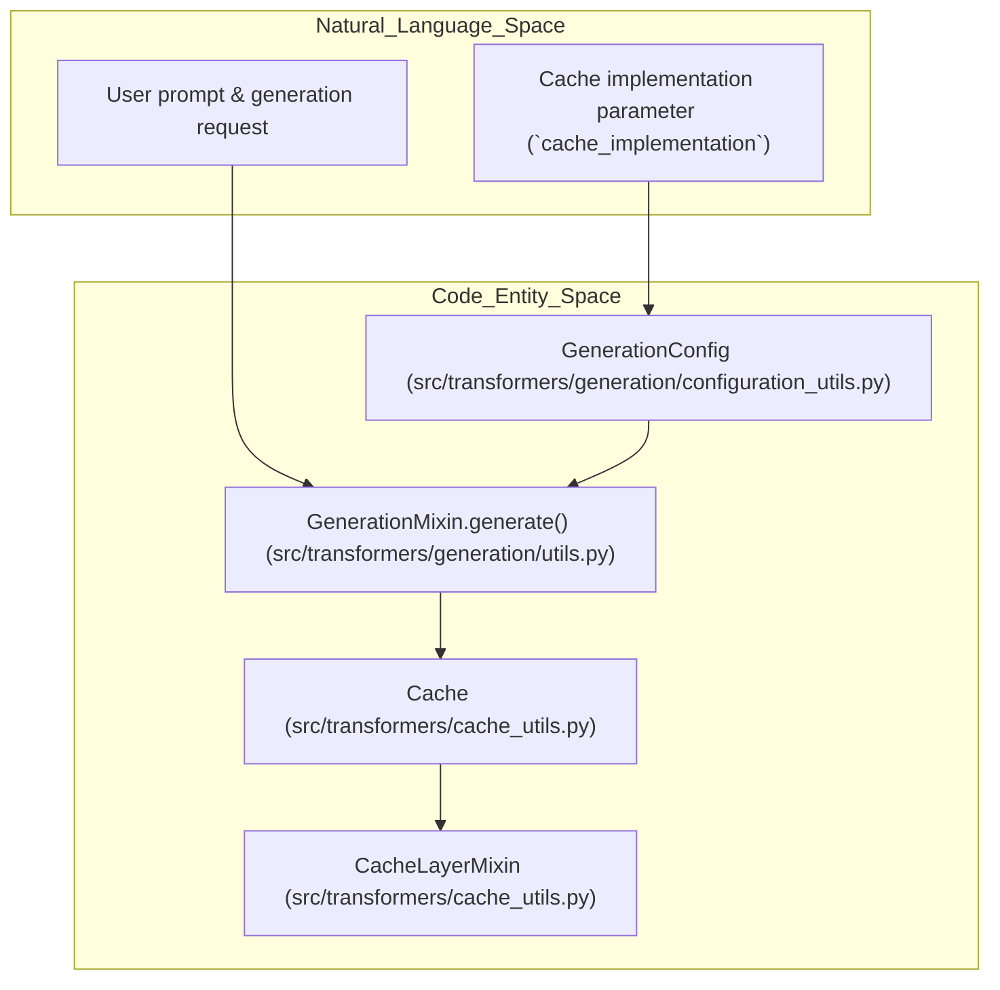
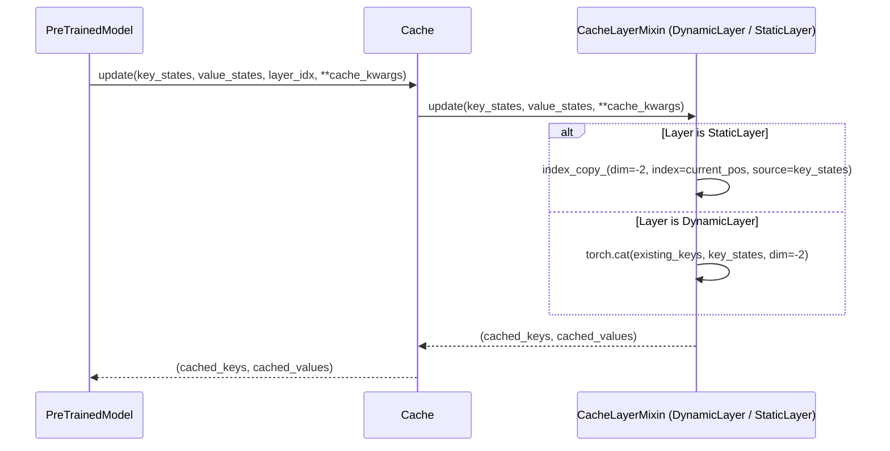
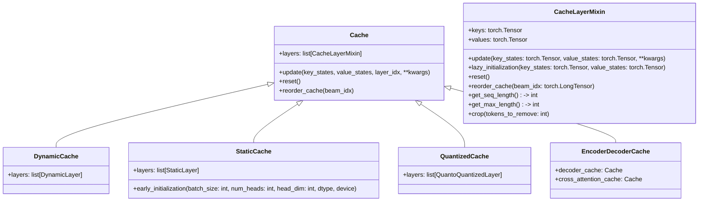

<!-- source: DeepWiki mcp.deepwiki.com · repo huggingface/transformers · page 5.2 KV Cache Implementations · fetched 2026-10-26 -->

# KV Cache Implementations

<details>
<summary>Relevant source files</summary>

The following files were used as context for generating this wiki page:

- [docs/source/en/kv_cache.md](docs/source/en/kv_cache.md)
- [docs/source/en/tasks/any_to_any.md](docs/source/en/tasks/any_to_any.md)
- [docs/source/en/tasks/audio_classification.md](docs/source/en/tasks/audio_classification.md)
- [docs/source/en/tasks/image_captioning.md](docs/source/en/tasks/image_captioning.md)
- [docs/source/en/tasks/image_classification.md](docs/source/en/tasks/image_classification.md)
- [docs/source/en/tasks/image_feature_extraction.md](docs/source/en/tasks/image_feature_extraction.md)
- [docs/source/en/tasks/image_text_to_text.md](docs/source/en/tasks/image_text_to_text.md)
- [docs/source/en/tasks/knowledge_distillation_for_image_classification.md](docs/source/en/tasks/knowledge_distillation_for_image_classification.md)
- [docs/source/en/tasks/mask_generation.md](docs/source/en/tasks/mask_generation.md)
- [docs/source/en/tasks/monocular_depth_estimation.md](docs/source/en/tasks/monocular_depth_estimation.md)
- [docs/source/en/tasks/object_detection.md](docs/source/en/tasks/object_detection.md)
- [docs/source/en/tasks/semantic_segmentation.md](docs/source/en/tasks/semantic_segmentation.md)
- [docs/source/en/tasks/text-to-speech.md](docs/source/en/tasks/text-to-speech.md)
- [docs/source/en/tasks/video_classification.md](docs/source/en/tasks/video_classification.md)
- [docs/source/en/tasks/video_text_to_text.md](docs/source/en/tasks/video_text_to_text.md)
- [docs/source/en/tasks/visual_document_retrieval.md](docs/source/en/tasks/visual_document_retrieval.md)
- [docs/source/en/tasks/visual_question_answering.md](docs/source/en/tasks/visual_question_answering.md)
- [docs/source/ja/tasks/audio_classification.md](docs/source/ja/tasks/audio_classification.md)
- [docs/source/ja/tasks/image_classification.md](docs/source/ja/tasks/image_classification.md)
- [docs/source/ja/tasks/object_detection.md](docs/source/ja/tasks/object_detection.md)
- [docs/source/ja/tasks/video_classification.md](docs/source/ja/tasks/video_classification.md)
- [docs/source/ko/tasks/audio_classification.md](docs/source/ko/tasks/audio_classification.md)
- [docs/source/ko/tasks/image_classification.md](docs/source/ko/tasks/image_classification.md)
- [docs/source/ko/tasks/object_detection.md](docs/source/ko/tasks/object_detection.md)
- [docs/source/ko/tasks/video_classification.md](docs/source/ko/tasks/video_classification.md)
- [src/transformers/cache_utils.py](src/transformers/cache_utils.py)
- [src/transformers/configuration_utils.py](src/transformers/configuration_utils.py)
- [src/transformers/generation/candidate_generator.py](src/transformers/generation/candidate_generator.py)
- [src/transformers/generation/configuration_utils.py](src/transformers/generation/configuration_utils.py)
- [src/transformers/generation/utils.py](src/transformers/generation/utils.py)
- [src/transformers/integrations/executorch.py](src/transformers/integrations/executorch.py)
- [src/transformers/masking_utils.py](src/transformers/masking_utils.py)
- [tests/generation/test_candidate_generator.py](tests/generation/test_candidate_generator.py)
- [tests/generation/test_configuration_utils.py](tests/generation/test_configuration_utils.py)
- [tests/generation/test_utils.py](tests/generation/test_utils.py)
- [tests/utils/test_cache_utils.py](tests/utils/test_cache_utils.py)
- [tests/utils/test_configuration_utils.py](tests/utils/test_configuration_utils.py)
- [tests/utils/test_feature_extraction_utils.py](tests/utils/test_feature_extraction_utils.py)
- [tests/utils/test_image_processing_utils.py](tests/utils/test_image_processing_utils.py)
- [tests/utils/test_masking_utils.py](tests/utils/test_masking_utils.py)
- [tests/utils/test_tokenization_utils.py](tests/utils/test_tokenization_utils.py)

</details>


Key-Value (KV) caching is a fundamental optimization for autoregressive generation in the Hugging Face Transformers library. It stores the key (`K`) and value (`V`) tensors computed by the attention mechanism for previously generated tokens to avoid redundant recalculations in subsequent decoding steps. This significantly reduces computation and improves generation speed and latency [docs/source/en/kv_cache.md:19-21]().

The cache design is modular and extensible. At the heart is the abstract base class **`Cache`**, which manages the cache for all model layers. Cache behavior per layer is abstracted by the **`CacheLayerMixin`** base class. Various concrete cache implementations exist, balancing trade-offs between memory usage, performance, JIT compilation support, and special attention patterns (e.g., sliding window, quantization, encoder-decoder caching) [src/transformers/cache_utils.py:1-174](), [docs/source/en/kv_cache.md:25-37]().

---

## Core Abstractions

### Cache & CacheLayerMixin Overview

- **`Cache`**: Abstract base class representing the full multi-layer cache for a model during generation. Holds a list of layer-specific cache objects (instances of `CacheLayerMixin` subclasses).
- **`CacheLayerMixin`**: Abstract base for a single layer’s KV cache that stores keys and values and provides APIs for:
  - **Lazy initialization** of key/value tensors upon the first update.
  - **Update semantics** to add new tokens’ KV states to the cache.
  - **Querying** sequence lengths and max lengths.
  - **Cropping support** to remove tokens from cache tail (useful in rollback strategies).
  - **Reordering** cache entries to support beam search.
  - **Offloading and prefetching** cache tensors between devices (e.g., CPU/GPU).

This design supports a range of cache behaviors from dynamically growing caches to fixed-size preallocated buffers and quantized storage. Cache layers encapsulate attention-specific state management [src/transformers/cache_utils.py:26-112]().

Sources:
[src/transformers/cache_utils.py:26-112]()

---

### Mapping Natural Language Cache Concepts to Code Entities



- The user submits a text prompt or generation request.
- The `cache_implementation` configuration parameter is parsed and stored in `GenerationConfig`.
- `GenerationMixin.generate()` examines this configuration and instantiates the appropriate concrete `Cache` subclass.
- The `Cache` contains multiple `CacheLayerMixin` instances corresponding to model layers.
- These layers hold and update the key-value states used in attention computations during generation.

This flow underpins how cache strategies are selected and integrated into the generation pipeline [src/transformers/generation/utils.py:31-37](), [src/transformers/cache_utils.py:26-112](), [src/transformers/generation/configuration_utils.py:47-59]().

Sources:
[src/transformers/generation/utils.py:31-37]()
[src/transformers/cache_utils.py:26-112]()
[src/transformers/generation/configuration_utils.py:47-59]()

---

## Concrete Cache Implementations

### DynamicCache

- **Description:** The default cache type. Implements a dynamically growing cache that concatenates new key/value tensors along the sequence length dimension.
- **Key Features:**
  - Uses a list of `DynamicLayer` instances (subclass of `CacheLayerMixin`).
  - Supports sliding window attention layers by stopping growth at max window size.
  - Supports cache cropping to remove tokens from the tail.
  - No fixed maximum length limit (returns -1).
- **Suitable for:** General autoregressive generation with variable-length inputs.
- **Implementation Details:** Each layer initializes empty tensors and grows the cache by concatenation on every update [src/transformers/cache_utils.py:113-174]().

Sources:
[src/transformers/cache_utils.py:113-174]()

---

### StaticCache

- **Description:** Pre-allocates fixed-size memory buffers for keys and values with a defined maximum cache length.
- **Key Features:**
  - Uses `StaticLayer` per attention layer which copies key/values into fixed buffers via indexed copy.
  - Supports sliding/chunked attentions by never exceeding predefined max length.
  - Supports early initialization where cache tensors are pre-allocated given batch size, head count, and dimension — improving compatibility with JIT compilation (`torch.compile`).
  - Does not grow dynamically; instead, overwrites positions in pre-allocated buffers.
- **Suitable for:** Latency-critical applications that can benefit from static memory layouts and compiler optimizations.
- **Implementation Details:** Relies on `index_copy_` operations instead of concatenation to update keys/values in place [docs/source/en/kv_cache.md:70-76](), [tests/utils/test_cache_utils.py:122-152]().

Sources:
[docs/source/en/kv_cache.md:70-76]()
[tests/utils/test_cache_utils.py:122-152]()

---

### QuantizedCache

- **Description:** Stores keys and values using quantized precision to reduce memory footprint.
- **Key Features:**
  - Leverages third-party quantization libraries (Optimum Quanto, HQQ).
  - No support for sliding window or cache offloading.
  - Lower memory usage on large caches at the expense of compute overhead.
- **Suitable for:** Very long context generations where memory is the dominant constraint.
- **Implementation Details:** Wraps quantizer backends and manages quantized update methods on cache update [src/transformers/cache_utils.py:17-20](), [docs/source/en/kv_cache.md:25-30]().

Sources:
[src/transformers/cache_utils.py:17-20]()
[docs/source/en/kv_cache.md:25-30]()

---

### SlidingWindowCache

- **Description:** Supports sliding or chunked attention by evicting "oldest" keys/values when cache grows beyond a window size.
- **Key Features:**
  - Implements circular buffer semantics to keep a fixed cache window during generation.
  - Maintains fixed memory size while keeping newest tokens cached.
  - Mostly integrated as specialized sliding window layers within `DynamicCache` or `StaticCache`.
- **Suitable for:** Models implementing sliding window or chunked attention like Mistral, Gemma2.
- **Implementation Details:** Specialized `DynamicSlidingWindowLayer` and `StaticSlidingWindowLayer` implement eviction logic [docs/source/en/kv_cache.md:37]().

Sources:
[docs/source/en/kv_cache.md:37]()
[src/transformers/cache_utils.py:70-71]()

---

### EncoderDecoderCache

- **Description:** Designed for encoder-decoder models supporting separate caches for decoder self-attention and encoder-decoder cross-attention.
- **Key Features:**
  - Composes two internal caches: `decoder_cache` and `cross_attention_cache`.
  - Each independently manages its layers, updates, and reordering.
- **Suitable for:** Seq2seq models like T5 or BART requiring separate cache maintenance.
- **Implementation Details:** Delegates layer updates and cache manipulation to two underlying `Cache` instances [src/transformers/generation/utils.py:31-37]().

Sources:
[src/transformers/generation/utils.py:31-37]()

---

## Cache API Operations & Lifecycle

### Cache Update

During each generation step, the model passes newly computed key and value states to the cache for incorporation.

Sequence diagram showing interactions during cache update:



- `Cache.update()` forwards new KV states to the `CacheLayerMixin` of the specified layer.
- **StaticLayer** copies new keys and values into pre-allocated buffers by indexed in-place operations.
- **DynamicLayer** concatenates new keys and values to existing cached tensors, growing dynamically.
- The updated cached tensors are returned for use in subsequent computations [src/transformers/cache_utils.py:129-148]().

Sources:
[src/transformers/cache_utils.py:129-148]()

---

### Cache Reordering in Beam Search

Beam search requires reordering the cache based on the selected beam indices across beams.

```python
def reorder_cache(self, beam_idx: torch.LongTensor) -> None:
    if self.get_seq_length() > 0:
        self.keys = self.keys.index_select(0, beam_idx.to(self.keys.device))
        self.values = self.values.index_select(0, beam_idx.to(self.values.device))
```

- This operation re-indexes cache entries along the batch dimension to keep them aligned with current beams.
- Called by the generation loop after beam selection to maintain cache correctness [src/transformers/cache_utils.py:100-105]().

Sources:
[src/transformers/cache_utils.py:100-105]()

---

### Cache Cropping (Rollback)

Some decoding strategies (e.g., speculative decoding) require removing tokens from the end of the cache when generation rolls back.

Example cropping method in `DynamicLayer`:

```python
def crop(self, tokens_to_remove: int) -> None:
    if not self.is_initialized:
        return
    self.keys = self.keys[:, :, :-tokens_to_remove, :]
    self.values = self.values[:, :, :-tokens_to_remove, :]
```

- Drops the last `tokens_to_remove` tokens from the cache tensors by slicing.
- Not all cache implementations support cropping [src/transformers/cache_utils.py:167-172]().

Sources:
[src/transformers/cache_utils.py:167-172]()

---

### Early Initialization

To optimize generation latency and enable JIT compilation, caches may be initialized early with fixed shapes.

- `StaticCache` supports `early_initialization()` by allocating KV tensors based on known batch size, heads, and head dimension.
- Avoids dynamic memory allocations during generation.
- Skips initialization for linear attention layers that have specialized state shapes [tests/utils/test_cache_utils.py:122-152]().

Sources:
[tests/utils/test_cache_utils.py:122-152]()

---

## Cache Implementation Selection

The cache backend is configurable via the `cache_implementation` parameter in `GenerationConfig` or direct generate() calls.

Supported values and mapping to cache classes:

| `cache_implementation`     | Concrete Cache Class         | Notes                                                                            |
|----------------------------|-----------------------------|----------------------------------------------------------------------------------|
| `"dynamic"`                | `DynamicCache`               | Default cache; dynamic growth; sliding support                                  |
| `"static"`                 | `StaticCache`                | Fixed max cache length; suitable for torch.compile; sliding support             |
| `"quantized"`              | `QuantizedCache`             | Memory-efficient quantized storage; no sliding/offload support                  |
| `"sliding_window"` (deprecated) | `DynamicCache` with sliding layers | Deprecated alias for sliding window dynamic cache                              |
| `"encoder_decoder"`        | `EncoderDecoderCache`        | Special handling for encoder-decoder models with decoder and cross-attention   |

These options provide flexibility to suit different generation scenarios, hardware targets, and performance needs [src/transformers/generation/configuration_utils.py:47-59](), [docs/source/en/kv_cache.md:25-37]().

Sources:
[src/transformers/generation/configuration_utils.py:47-59]()
[docs/source/en/kv_cache.md:25-37]()

---

## Feature Summary Table

| Cache Type          | Sliding Support | Offload Support | torch.compile Support | Memory Usage  | Use Case                                       |
|---------------------|-----------------|-----------------|-----------------------|---------------|------------------------------------------------|
| DynamicCache        | Yes             | Yes             | No                    | Medium        | Default, variable-length generation             |
| StaticCache         | Yes             | Yes             | Yes                   | High          | Latency-sensitive, JIT-compiled decoding        |
| QuantizedCache      | No              | No              | No                    | Low           | Long context generation with memory constraints |
| SlidingWindowCache* | Yes             | Partially       | No                    | Medium        | Sliding window/chunked attention models          |
| EncoderDecoderCache | N/A             | Yes             | Partial               | Medium        | Seq2seq models needing separate cross caches     |

_*Note: Sliding window caching is mostly integrated within dynamic or static cache implementations rather than as a standalone cache._

---

## Cache Class Relationships



This diagram illustrates the inheritance and composition hierarchy of cache classes and the cache layer base class, highlighting their role in managing KV states for generation [src/transformers/cache_utils.py:1-174]().

Sources:
[src/transformers/cache_utils.py:1-174]()

---

# Summary

The KV cache system in Hugging Face Transformers is a sophisticated modular framework balancing flexibility, performance, and compatibility with modern hardware and generation strategies. By selecting appropriate cache implementations (`DynamicCache`, `StaticCache`, `QuantizedCache`, or `EncoderDecoderCache`) via the `cache_implementation` parameter, users and developers can optimize key/value caching for their model and task, enabling efficient autoregressive text generation with minimal overhead.

---

## References

- `src/transformers/cache_utils.py`: Base classes, cache layers, and concrete cache implementations.  
- `src/transformers/generation/configuration_utils.py`: Cache implementation options in generation config.  
- `src/transformers/generation/utils.py`: Integration of cache with generation pipeline.  
- `tests/utils/test_cache_utils.py`: Tests validating cache operation and early initialization.  
- `docs/source/en/kv_cache.md`: User-level explanations and cache type comparisons.

**Sources:**  
[src/transformers/cache_utils.py:1-174]()  
[src/transformers/generation/configuration_utils.py:47-59]()  
[src/transformers/generation/utils.py:30-37]()  
[tests/utils/test_cache_utils.py:93-153]()  
[docs/source/en/kv_cache.md:19-37, 70-76]()

---

