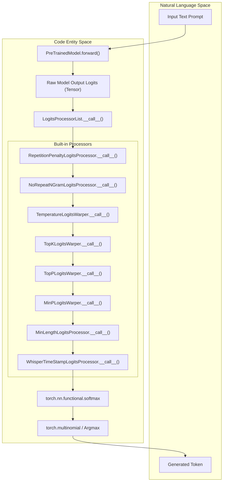
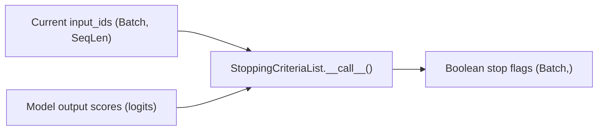
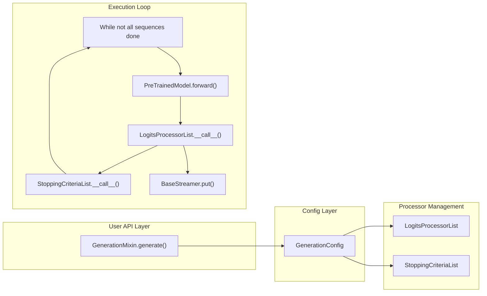

<!-- source: DeepWiki mcp.deepwiki.com · repo huggingface/transformers · page 5.3 Logits Processors, Stopping Criteria & Watermarking · fetched 2026-10-26 -->

# Logits Processors, Stopping Criteria & Watermarking

Relevant source files

The following files were used as context for generating this wiki page:

- [docs/source/en/internal/generation_utils.md](docs/source/en/internal/generation_utils.md)
- [docs/source/en/main_classes/text_generation.md](docs/source/en/main_classes/text_generation.md)
- [docs/source/ko/internal/generation_utils.md](docs/source/ko/internal/generation_utils.md)
- [src/transformers/generation/__init__.py](src/transformers/generation/__init__.py)
- [src/transformers/generation/logits_process.py](src/transformers/generation/logits_process.py)
- [src/transformers/generation/stopping_criteria.py](src/transformers/generation/stopping_criteria.py)
- [src/transformers/generation/watermarking.py](src/transformers/generation/watermarking.py)
- [src/transformers/loss/loss_d_fine.py](src/transformers/loss/loss_d_fine.py)
- [src/transformers/models/d_fine/configuration_d_fine.py](src/transformers/models/d_fine/configuration_d_fine.py)
- [src/transformers/models/d_fine/modeling_d_fine.py](src/transformers/models/d_fine/modeling_d_fine.py)
- [src/transformers/models/d_fine/modular_d_fine.py](src/transformers/models/d_fine/modular_d_fine.py)
- [src/transformers/models/deimv2/configuration_deimv2.py](src/transformers/models/deimv2/configuration_deimv2.py)
- [src/transformers/models/deimv2/modeling_deimv2.py](src/transformers/models/deimv2/modeling_deimv2.py)
- [src/transformers/models/deimv2/modular_deimv2.py](src/transformers/models/deimv2/modular_deimv2.py)
- [src/transformers/models/pp_doclayout_v2/modeling_pp_doclayout_v2.py](src/transformers/models/pp_doclayout_v2/modeling_pp_doclayout_v2.py)
- [src/transformers/models/pp_doclayout_v2/modular_pp_doclayout_v2.py](src/transformers/models/pp_doclayout_v2/modular_pp_doclayout_v2.py)
- [src/transformers/models/pp_doclayout_v3/image_processing_pp_doclayout_v3.py](src/transformers/models/pp_doclayout_v3/image_processing_pp_doclayout_v3.py)
- [src/transformers/models/pp_doclayout_v3/modeling_pp_doclayout_v3.py](src/transformers/models/pp_doclayout_v3/modeling_pp_doclayout_v3.py)
- [src/transformers/models/pp_doclayout_v3/modular_pp_doclayout_v3.py](src/transformers/models/pp_doclayout_v3/modular_pp_doclayout_v3.py)
- [src/transformers/models/rt_detr/configuration_rt_detr.py](src/transformers/models/rt_detr/configuration_rt_detr.py)
- [src/transformers/models/rt_detr/modeling_rt_detr.py](src/transformers/models/rt_detr/modeling_rt_detr.py)
- [src/transformers/models/rt_detr/modular_rt_detr.py](src/transformers/models/rt_detr/modular_rt_detr.py)
- [src/transformers/models/rt_detr_v2/configuration_rt_detr_v2.py](src/transformers/models/rt_detr_v2/configuration_rt_detr_v2.py)
- [src/transformers/models/rt_detr_v2/modeling_rt_detr_v2.py](src/transformers/models/rt_detr_v2/modeling_rt_detr_v2.py)
- [src/transformers/models/rt_detr_v2/modular_rt_detr_v2.py](src/transformers/models/rt_detr_v2/modular_rt_detr_v2.py)
- [src/transformers/models/whisper/generation_whisper.py](src/transformers/models/whisper/generation_whisper.py)
- [src/transformers/models/whisper/modeling_whisper.py](src/transformers/models/whisper/modeling_whisper.py)
- [src/transformers/pytorch_utils.py](src/transformers/pytorch_utils.py)
- [tests/generation/test_logits_process.py](tests/generation/test_logits_process.py)
- [tests/generation/test_stopping_criteria.py](tests/generation/test_stopping_criteria.py)
- [tests/generation/test_watermarking.py](tests/generation/test_watermarking.py)
- [tests/models/d_fine/test_modeling_d_fine.py](tests/models/d_fine/test_modeling_d_fine.py)
- [tests/models/deimv2/test_modeling_deimv2.py](tests/models/deimv2/test_modeling_deimv2.py)
- [tests/models/pp_doclayout_v2/test_modeling_pp_doclayout_v2.py](tests/models/pp_doclayout_v2/test_modeling_pp_doclayout_v2.py)
- [tests/models/pp_doclayout_v3/test_image_processing_pp_doclayout_v3.py](tests/models/pp_doclayout_v3/test_image_processing_pp_doclayout_v3.py)
- [tests/models/pp_doclayout_v3/test_modeling_pp_doclayout_v3.py](tests/models/pp_doclayout_v3/test_modeling_pp_doclayout_v3.py)
- [tests/models/rt_detr/test_modeling_rt_detr.py](tests/models/rt_detr/test_modeling_rt_detr.py)
- [tests/models/rt_detr_v2/test_modeling_rt_detr_v2.py](tests/models/rt_detr_v2/test_modeling_rt_detr_v2.py)
- [tests/models/whisper/test_modeling_whisper.py](tests/models/whisper/test_modeling_whisper.py)

This section details the components in the Transformers generation framework responsible for controlling token scores during generation (`LogitsProcessor` and warpers), halting conditions (`StoppingCriteria`), and embedding/detecting watermarks in generated sequences. These utilities contribute critical fine-grained control for decoding strategies such as temperature sampling, top-k/top-p filtering, repetition penalty, and controlling stopping behavior. They also enable advanced functionality like watermarking machine-generated text and streaming outputs token-by-token.

---

## Logits Processors and Warpers

Logits processors are modular, composable classes that manipulate the prediction scores (logits) produced by the model's language modeling head before the next generation step. This allows dynamic adjustment of token probabilities, for instance to implement temperature scaling, top-k/top-p filtering, or enforce repetition penalties.

These processors are collected and managed inside a `LogitsProcessorList`, which applies each processor sequentially on life-cycle tensors at every generation step.

### Core Abstractions

- **`LogitsProcessor`**  
  The abstract base class for all logits processors defines the interface and expected behavior. It implements a `__call__()` method that takes the current sequence `input_ids` and a `scores` tensor representing prediction logits for the next token. It returns the processed logits tensor.  
  It also includes a `supports_continuous_batching` boolean attribute indicating whether the processor supports continuous batching inference optimizations.  
  [src/transformers/generation/logits_process.py:49-61]()

- **`LogitsProcessorList`**  
  Inherits from Python's `list` but adds a callable interface via `__call__()`. Each time it is called, it iterates through each `LogitsProcessor` in order on the `scores` tensor, verifying and passing along additional keyword arguments if required by individual processors.  
  [src/transformers/generation/logits_process.py:63-98]()

- **`LogitsWarper`**  
  A special subset of logits processors that modify logits in a probabilistic sampling manner, such as scaling logits by temperature or filtering via top-k/top-p. Internally managed alongside processors in generation routines. These warpers are subclasses such as `TemperatureLogitsWarper`, `TopKLogitsWarper`, and `TopPLogitsWarper` defined in the codebase.  
  [src/transformers/generation/__init__.py:70-75]()

### Important Built-in Logits Processors

The framework includes a wide range of built-in logits processors that control generation behaviors through manipulating logits:

| Processor Class                       | Purpose                                                                                      | Key Parameters                                      | Location                                     |
|-------------------------------------|----------------------------------------------------------------------------------------------|----------------------------------------------------|----------------------------------------------|
| `TemperatureLogitsWarper`            | Scales logits by `1/temperature` to control sampling randomness.                            | `temperature` (float)                               | [src/transformers/generation/logits_process.py:1776]() |
| `TopKLogitsWarper`                   | Keeps only top-k highest logits, sets others to `-inf`, implementing top-k sampling.         | `top_k` (int)                                       | [src/transformers/generation/logits_process.py:1776]() |
| `TopPLogitsWarper`                   | Keeps smallest set of tokens cumulatively covering top-p probability mass (nucleus sampling).| `top_p` (float)                                     | [src/transformers/generation/logits_process.py:1776]() |
| `MinPLogitsWarper`                   | Keeps tokens with probability at least `min_p`.                                              | `min_p` (float)                                     | [src/transformers/generation/logits_process.py:1776]() |
| `RepetitionPenaltyLogitsProcessor`  | Applies a penalty to logits of tokens already generated to reduce repetition.                | `penalty` (float)                                   | [src/transformers/generation/logits_process.py:1776]() |
| `NoRepeatNGramLogitsProcessor`      | Prevents generation of repeated n-grams by masking tokens that would complete such n-grams.  | `ngram_size` (int)                                  | [src/transformers/generation/logits_process.py:1776]() |
| `MinLengthLogitsProcessor`           | Sets EOS token logit to `-inf` until minimum length is reached, preventing early stop.       | `min_length` (int), `eos_token_id`                  | [src/transformers/generation/logits_process.py:101-161]() |
| `MinNewTokensLengthLogitsProcessor` | Like `MinLength` but counts newly generated tokens after prompt separately.                   | `min_new_tokens` (int)                              | [src/transformers/generation/logits_process.py:1776]() |
| `LogitNormalization`                 | Applies log softmax normalizing logits distribution.                                         | None                                               | [src/transformers/generation/logits_process.py:1776]() |
| `WhisperTimeStampLogitsProcessor`    | Specific to Whisper models, handles timestamp token generation logic.                        | `timestamp_begin`, `vocab_size`, etc.               | [src/transformers/models/whisper/generation_whisper.py:33](), [tests/models/whisper/test_modeling_whisper.py:72-145]() |

Many other processors exist, such as `ForcedBOSTokenLogitsProcessor`, `NoBadWordsLogitsProcessor`, and more, enabling advanced control over generation.

### Logits Processing Data Flow

The following diagram outlines the flow from model output logits through various processors until final token sampling:

Sources: [src/transformers/generation/logits_process.py:49-104](), [src/transformers/generation/__init__.py:70-75](), [src/transformers/models/whisper/generation_whisper.py:33](), [tests/models/whisper/test_modeling_whisper.py:72-145]()

---

## Stopping Criteria

Stopping criteria are mechanisms to halt the generation loop based on dynamic conditions beyond just generating an end-of-sequence token. They are managed as a `StoppingCriteriaList` which is queried each generation step to decide which batch sequences should stop.

### Key Classes & Implementation

- **`StoppingCriteria`**: Abstract base class defining the `__call__(input_ids, scores, **kwargs)` interface returning a boolean tensor indicating which sequences should stop.  
  [src/transformers/generation/stopping_criteria.py:48-60]()

- **`StoppingCriteriaList`**: Container managing multiple `StoppingCriteria` instances; calling it returns the elementwise logical OR of each criterion's results.  
  [src/transformers/generation/__init__.py:192]()

- **Implemented Examples:**
  - `MaxLengthCriteria`: Stops generation when the total generated tokens (including prompt tokens for decoder-only models) reach a given max length.  
    [src/transformers/generation/stopping_criteria.py:62-90]()

  - `MaxTimeCriteria`: Stops generation if the elapsed wall time exceeds a user-defined maximum duration.  
    [src/transformers/generation/stopping_criteria.py:93-115]()

  - `StopStringCriteria`: Stops generation if the output ends with any of the user-defined strings. It efficiently handles partial matches over token boundaries using cached embeddings.  
    [src/transformers/generation/stopping_criteria.py:118-151]()

These stopping conditions integrate directly with the generation loop to support early termination or runtime limits beyond EOS tokens.

### Stopping Data Flow

During generation, after processing model output logits and sampling a token, the stopping criteria are checked:

Sources: [src/transformers/generation/stopping_criteria.py:1-160]()

---

## Watermarking

The Transformers library supports statistical watermarking schemes that bias the logits during generation to embed imperceptible signals allowing later detection of machine-generated text.

### Components

- **`WatermarkLogitsProcessor`**: Implements a green-list/red-list token partition based on hashing of previous output tokens, adding a small bias to favor green-list tokens at each step, thus embedding a watermark.  
  [src/transformers/generation/__init__.py:78]()
- **`SynthIDTextWatermarkLogitsProcessor`**: Inspired by Google’s SynthID method, uses pseudo-randomized perturbations on logits to watermark generated text more robustly.  
  [src/transformers/generation/__init__.py:70]()
- **`WatermarkDetector`**: Detects embedded watermarks by statistically analyzing token sequences, for example using Z-score metrics. Configurable via `WatermarkingConfig` or `SynthIDTextWatermarkingConfig`.  
  [src/transformers/generation/__init__.py:105]()
  [src/transformers/generation/watermarking.py]()

These classes enable practical watermarking for generated outputs, serving transparency and detection in language generation systems.

Sources: [src/transformers/generation/configuration_utils.py:27-28](), [src/transformers/generation/watermarking.py](), [src/transformers/generation/__init__.py:70](), [src/transformers/generation/__init__.py:78](), [src/transformers/generation/__init__.py:105]()

---

## Streamers for Token-by-Token Output

Streamers are callback-like utilities supporting streaming text generation for interactive UI applications or asynchronous workers.

- **`BaseStreamer`**: Abstract base class defining `put(token_id: int)` for processing new tokens and `end()` for signaling generation completion.  
  [src/transformers/generation/__init__.py:30]()
- **`TextStreamer`**: Concrete streamer that prints generated tokens to standard output immediately.  
  [src/transformers/generation/__init__.py:30]()
- **`TextIteratorStreamer`**: Stores token IDs in an internal thread-safe queue accessible via iteration.  
  [src/transformers/generation/__init__.py:30]()
- **`AsyncTextIteratorStreamer`**: Asynchronous variant for integration with `asyncio` applications.  
  [src/transformers/generation/__init__.py:30]()

Streamers integrate directly with the token generation loop, enabling token-by-token callbacks, which is crucial for real-time or interactive applications.

Sources: [src/transformers/generation/__init__.py:30]()

---

## System Architecture: Generation Control Overview

The below diagram bridges the high-level `generate()` method execution to the internal components for logits processing, stopping criteria, and streaming:

This high-level control architecture outlines how the `GenerationMixin.generate()` method orchestrates modular logits processing for token scores, applies stopping criteria based on various conditions, and optionally streams token outputs via streamer callbacks.

Sources:  
- [docs/source/en/main_classes/text_generation.md]()
- [src/transformers/generation/logits_process.py:49-104]()  
- [src/transformers/generation/stopping_criteria.py:1-160]()  
- [src/transformers/generation/configuration_utils.py:27-28]()  
- [src/transformers/generation/watermarking.py]()  
- [src/transformers/generation/__init__.py:30]()

---

# Summary

- **Logits processors/warpers** offer composable and extendable transformations of token logits to implement sampling filters, temperature scaling, and repetition avoidance.
- **Stopping criteria** allow stopping generation based on length, timing, or user-defined stop sequences.
- **Watermarking tools** manipulate logits to encode invisible signatures for machine-generated text detection.
- **Streamers** allow incremental token output for real-time applications, facilitating responsive generation APIs.

Together, these components form the backbone of controlled, efficient, and flexible text generation in Hugging Face Transformers.

---

# Sources

- [src/transformers/generation/logits_process.py:49-104]()  
- [src/transformers/generation/__init__.py:70-78]()  
- [src/transformers/generation/stopping_criteria.py:1-160]()  
- [src/transformers/generation/configuration_utils.py:27-28]()  
- [src/transformers/generation/watermarking.py]()  
- [src/transformers/generation/__init__.py:30]()
- [src/transformers/generation/__init__.py:105]()
- [src/transformers/models/whisper/generation_whisper.py:33]()
- [tests/models/whisper/test_modeling_whisper.py:72-145]()

---

