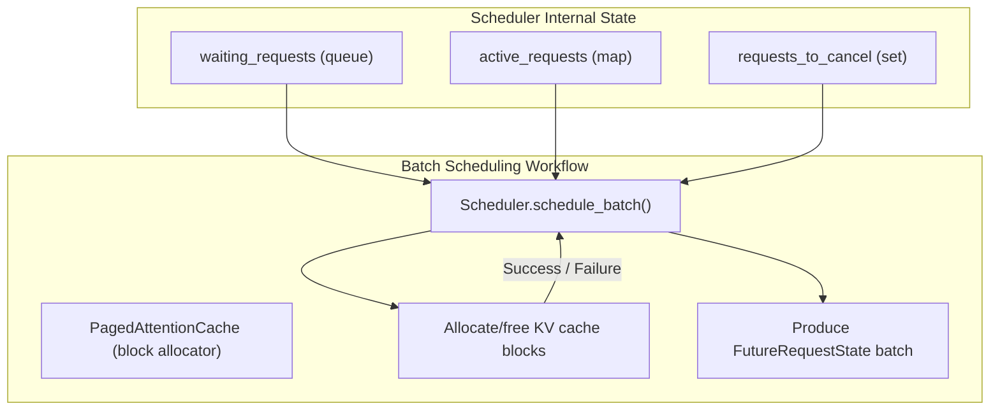
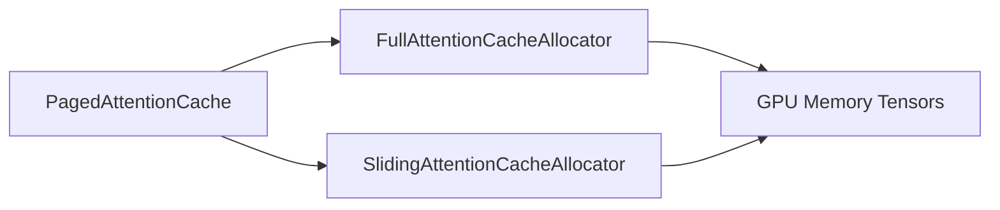
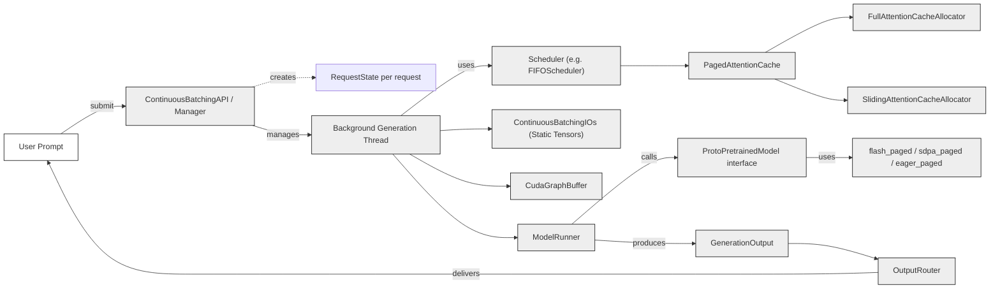

<!-- source: DeepWiki mcp.deepwiki.com · repo huggingface/transformers · page 5.4 Continuous Batching · fetched 2026-10-26 -->

# Continuous Batching

<details>
<summary>Relevant source files</summary>

The following files were used as context for generating this wiki page:

- [benchmark_v2/benchmark_scripts/continuous_batching_overall.py](benchmark_v2/benchmark_scripts/continuous_batching_overall.py)
- [docs/source/en/continuous_batching.md](docs/source/en/continuous_batching.md)
- [docs/source/en/continuous_batching_architecture.md](docs/source/en/continuous_batching_architecture.md)
- [docs/source/en/main_classes/continuous_batching.md](docs/source/en/main_classes/continuous_batching.md)
- [docs/source/en/paged_attention.md](docs/source/en/paged_attention.md)
- [examples/pytorch/continuous_batching.py](examples/pytorch/continuous_batching.py)
- [src/transformers/generation/continuous_batching/cache.py](src/transformers/generation/continuous_batching/cache.py)
- [src/transformers/generation/continuous_batching/continuous_api.py](src/transformers/generation/continuous_batching/continuous_api.py)
- [src/transformers/generation/continuous_batching/distributed.py](src/transformers/generation/continuous_batching/distributed.py)
- [src/transformers/generation/continuous_batching/initialization.py](src/transformers/generation/continuous_batching/initialization.py)
- [src/transformers/generation/continuous_batching/input_outputs.py](src/transformers/generation/continuous_batching/input_outputs.py)
- [src/transformers/generation/continuous_batching/model_runner.py](src/transformers/generation/continuous_batching/model_runner.py)
- [src/transformers/generation/continuous_batching/offloading_manager.py](src/transformers/generation/continuous_batching/offloading_manager.py)
- [src/transformers/generation/continuous_batching/requests.py](src/transformers/generation/continuous_batching/requests.py)
- [src/transformers/generation/continuous_batching/scheduler.py](src/transformers/generation/continuous_batching/scheduler.py)
- [src/transformers/generation/continuous_batching/utils.py](src/transformers/generation/continuous_batching/utils.py)
- [src/transformers/integrations/eager_paged.py](src/transformers/integrations/eager_paged.py)
- [src/transformers/integrations/flash_paged.py](src/transformers/integrations/flash_paged.py)
- [src/transformers/integrations/sdpa_paged.py](src/transformers/integrations/sdpa_paged.py)
- [tests/generation/test_continuous_batching.py](tests/generation/test_continuous_batching.py)

</details>


Continuous batching maximizes GPU utilization by dynamically rescheduling the batch at every generation step. As requests finish, new ones join immediately instead of waiting for the entire batch to complete. This approach keeps the GPU fully utilized and achieves high throughput. This wiki page presents a comprehensive technical analysis of the continuous batching subsystem in Hugging Face Transformers, covering the continuous batching API, request scheduling, paged KV cache management, model execution, async management, and the specialized flash_paged and sdpa_paged attention backends.

---

## 1. Purpose and Scope

Continuous batching is an advanced generation API designed for high-throughput inference workloads. It handles many simultaneous requests asynchronously and schedules them efficiently with fine-grained control over batching, cache allocation, and device utilization.

Key features include:
- Dynamic request scheduling with prefix sharing optimizations.
- Paged KV cache management tailored for stacked attention layers with different cache behaviors.
- Static tensor management and CUDA graph support for accelerated execution.
- Integration with flash attention and scaled dot-product attention kernels adapted for paged caching.
- Support for asynchronous streaming APIs enabling real-time token delivery.
- Distributed conditioning for tensor parallel and multi-device setups.

This page covers the full technical detail of these components, focusing on the core classes and data flow driving continuous batching within the `src/transformers/generation/continuous_batching/` folder and related attention backends.

---

## 2. Continuous Batching API Overview

The main continuous batching API is implemented primarily in `continuous_api.py`. The entry point is the class `ContinuousBatchingManager`, which manages a background generation thread and accepts requests either synchronously (blocking) or asynchronously (event-loop driven).

### Core Data Types

- **`ProtoPretrainedModel`** (abstract base class): Defines the expected interface for models compatible with continuous batching, such as methods to set attention implementation and get logits processors [src/transformers/generation/continuous_batching/continuous_api.py:73-85]().
- **`RequestState`**: Tracks the lifecycle of each generation request, including prompt tokens, generated tokens, current status (`PENDING`, `PREFILLING`, `DECODING`, etc.), errors, and more [src/transformers/generation/continuous_batching/requests.py:83-152]().
- **`GenerationOutput`**: Represents the output for a generation request, including generated tokens, prompt tokens, status, errors, and time metrics [src/transformers/generation/continuous_batching/requests.py:94-121]().
- **`OutputRouter`**: Routes generation outputs either to async callbacks registered per request or to a thread-safe output queue otherwise [src/transformers/generation/continuous_batching/continuous_api.py:87-139]().

### Data Flow for Request to Output

```mermaid
graph TD
    subgraph "Natural Language Space"
        UserPrompt["User Prompt Submission"]
    end

    subgraph "Code Entity Space"
        Manager["ContinuousBatchingManager"]
        API["ContinuousBatchingAPI"]
        ReqState["RequestState"]
        Router["OutputRouter"]
        BackgroundLoop["Background Generation Thread"]
    end

    UserPrompt -->|"`generate_batch()` or `add_request()`"| Manager
    Manager -->|Manages| BackgroundLoop
    Manager -->|Instantiates| ReqState
    BackgroundLoop -->|Forwards outputs| Router
    Router -->|Dispatches outputs| UserPrompt
```

Sources: [src/transformers/generation/continuous_batching/continuous_api.py:1-160](), [src/transformers/generation/continuous_batching/requests.py:83-152]()

---

## 3. Request Scheduling Subsystem

Managing thousands of simultaneous generation requests requires an efficient scheduling strategy to allocate tokens and KV cache memory safely.

### Scheduler Base Class

The abstract `Scheduler` base class tracks:
- Active requests currently being decoded.
- Waiting requests pending scheduling.
- Requests marked for cancellation.
- Cache block freeing upon request completion.
- A safety margin parameter controlling how aggressively new requests are admitted based on cache occupancy [src/transformers/generation/continuous_batching/scheduler.py:29-42]().

It offers APIs for adding/removing requests, checking pending workload, and preparing batches.

### FIFO Scheduler Implementation

`FIFOScheduler` is a straightforward first-in-first-out scheduling scheme honoring token budgets and cache limits. It:
- Prioritizes requests based on arrival order.
- Balances prefill and decoding tokens within batch token budgets.
- Attempts cache block allocation per request; marks requests as starved if allocation fails.
- Splits requests when prefix sharing allows partial reuse of KV cache states [src/transformers/generation/continuous_batching/scheduler.py:118-128]().

### Scheduling Data Flow



Sources: [src/transformers/generation/continuous_batching/scheduler.py:22-128]()

---

## 4. Paged KV Cache Management

KV cache management is critical for continuous batching since many request caches must coexist efficiently.

### Paged Attention Cache Hierarchy

The KV cache is organized hierarchically:

- **Pages:** Layer-level memory units.
- **Blocks:** Request-level units subdividing pages.
- **Sectors:** Attention-type-specific contiguous cache regions for different cache semantics.

### `PagedAttentionCache` Class

`PagedAttentionCache` manages:
- Multiple cache allocators specialized for attention types (full attention vs sliding window attention), each responsible for their sector.
- Coordinated allocation of cache sectors and blocks, including free/block lists and pinning blocks to requests.
- Handling prefix sharing to detect and reuse common prompt prefixes across requests.

This mechanism ensures cache storage is balanced against layer attention types by aligning sector sizes through LCM computation of block sizes [src/transformers/generation/continuous_batching/cache.py:70-134]().

### Cache Allocation Types

- `FullAttentionCacheAllocator`: For classic full attention layers [src/transformers/generation/continuous_batching/cache.py:29]().
- `SlidingAttentionCacheAllocator`: For sliding window attention layers, commonly used in long-context models [src/transformers/generation/continuous_batching/cache.py:30]().



Sources: [src/transformers/generation/continuous_batching/cache.py:70-134]()

---

## 5. Model Execution, I/O & Static Tensor Management

### `ContinuousBatchingIOs`

This class holds large pre-allocated static tensors for input/output storage, enabling efficient reuse and CUDA graphs:

- Buffers for input IDs, position IDs, cumulative sequence lengths (`cu_seq_lens_q` / `cu_seq_lens_k`) per attention type.
- Tensors for read/write indices managing cache access.
- Logits indices for token position extraction.
- Block tables supporting kernel-accelerated paged attention fused with cache updates.
- The padding of query and KV cache dimensions to fixed intervals avoids dynamic tensor sizing, enabling CUDA graph capture and reuse [src/transformers/generation/continuous_batching/input_outputs.py:80-135]().

### CUDA Graph Management

`CudaGraphBuffer` manages captured CUDA graphs keyed by static dimension tuples, ensuring safe reset and reuse [src/transformers/generation/continuous_batching/utils.py:30-48]().

### Specialized Attention Backends

Continuous batching integrates with specialized attention kernels for performance and kernel fusion capabilities. The main backends are:

| Backend | Description | Code Reference |
|:--------|:------------|:---------------|
| Flash Paged | Uses FlashAttention kernels with paged cache via `flash_attn_with_kvcache` or varlen variants. Supports efficient fused cache update using block tables and sliding window attention [src/transformers/integrations/flash_paged.py:9-45](). | `flash_attention_forward` from `flash_attention.py` |
| SDPA Paged | Uses scaled dot-product attention with paged cache adapted for hybrid attention types. Deprecated variants serve as compatibility layers [src/transformers/integrations/sdpa_paged.py:19-45](). | `sdpa_attention_forward` from `sdpa_attention.py` |
| Eager Paged | Baseline PyTorch implementation for paged cache without kernel fusion, used for correctness and fallback [src/transformers/integrations/eager_paged.py](). | `eager_paged_attention_forward` from `eager_paged.py` |

These backends replace the attention computation inside the model, enabling direct integration with continuous batching's paged KV cache management.

Sources: [src/transformers/generation/continuous_batching/input_outputs.py:80-135](), [src/transformers/generation/continuous_batching/utils.py:30-48](), [src/transformers/integrations/flash_paged.py:9-45](), [src/transformers/integrations/sdpa_paged.py:19-45]()

---

## 6. Distributed Coordination & Async Management

Continuous batching runs reliably in distributed or tensor-parallel setups.

- **`BackgroundThreadStatus`** maintains thread stop/pause status flags locally and across the tensor parallel group to coordinate graceful shutdowns and pauses [src/transformers/generation/continuous_batching/continuous_api.py:141-160]().
- **`DistributedHelper`** manages tensor-parallel rank awareness and orchestrates distributed resource sharing [src/transformers/generation/continuous_batching/distributed.py]().

This coordination ensures model runners and schedulers act consistently across devices.

Sources: [src/transformers/generation/continuous_batching/continuous_api.py:141-160]()

---

## 7. Usage Examples

### 7.1 Synchronous Batched Generation

Using `model.generate_batch()` enables batched continuous generation synchronously:

```python
import torch
from transformers import AutoModelForCausalLM, AutoTokenizer, ContinuousBatchingConfig, GenerationConfig

model = AutoModelForCausalLM.from_pretrained(
    "Qwen/Qwen3-4B",
    attn_implementation="flash_attention_2",
    device_map="auto",
    dtype=torch.bfloat16,
)
tokenizer = AutoTokenizer.from_pretrained("Qwen/Qwen3-4B")

prompts = [
    "What's up?",
    "Name a cat breed.",
    "Write a detailed history of quantum mechanics.",
]
inputs = [tokenizer.encode(p) for p in prompts]

generation_config = GenerationConfig(max_new_tokens=64, eos_token_id=tokenizer.eos_token_id)

outputs = model.generate_batch(inputs=inputs, generation_config=generation_config)

for request_id, output in outputs.items():
    text = tokenizer.decode(output.generated_tokens, skip_special_tokens=True)
    print(f"[{request_id}] {text}")
```

Sources: Example adapted from [docs/source/en/continuous_batching.md:31-60]() and `examples/pytorch/continuous_batching.py`.

### 7.2 Asynchronous Streaming Generation

Using a context manager, requests can be streamed asynchronously:

```python
with model.continuous_batching_context_manager(generation_config=generation_config) as manager:
    manager.add_request(
        input_ids=tokenizer.encode("Write a detailed history of quantum mechanics."),
        request_id="long",
        max_new_tokens=512,
    )
    manager.add_request(
        input_ids=tokenizer.encode("What's up?"),
        request_id="short_0",
        max_new_tokens=32,
    )

    for result in manager:
        text = tokenizer.decode(result.generated_tokens, skip_special_tokens=True)
        print(f"[{result.request_id}] {text}")
```

Sources: Example adapted from [docs/source/en/continuous_batching.md:70-90]().

---

# Summary Mermaid Diagram: Continuous Batching Components & Workflows



This diagram bridges user requests to internal code entities, illustrating component roles and interactions to maximize continuous batching throughput and GPU efficiency.

---

# References

- `src/transformers/generation/continuous_batching/continuous_api.py`
- `src/transformers/generation/continuous_batching/requests.py`
- `src/transformers/generation/continuous_batching/scheduler.py`
- `src/transformers/generation/continuous_batching/cache.py`
- `src/transformers/generation/continuous_batching/input_outputs.py`
- `src/transformers/generation/continuous_batching/utils.py`
- `src/transformers/integrations/flash_paged.py`
- `src/transformers/integrations/sdpa_paged.py`
- `src/transformers/integrations/eager_paged.py`
- `examples/pytorch/continuous_batching.py`
- Tests and benchmarks under `tests/generation/test_continuous_batching.py` and `benchmark_v2/benchmark_scripts/continuous_batching_overall.py`

Sources: All files listed above in the user-provided content.

---

