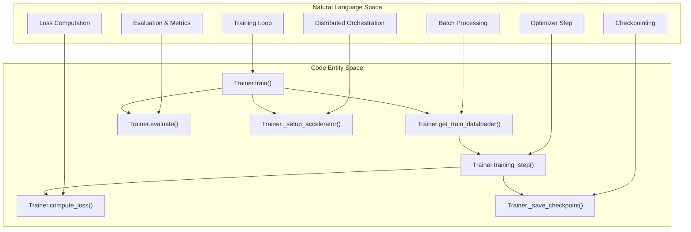
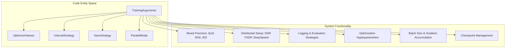
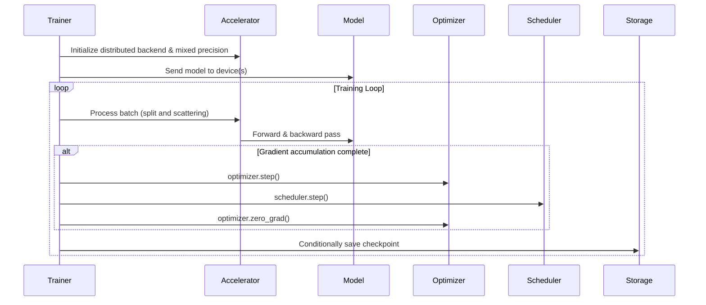
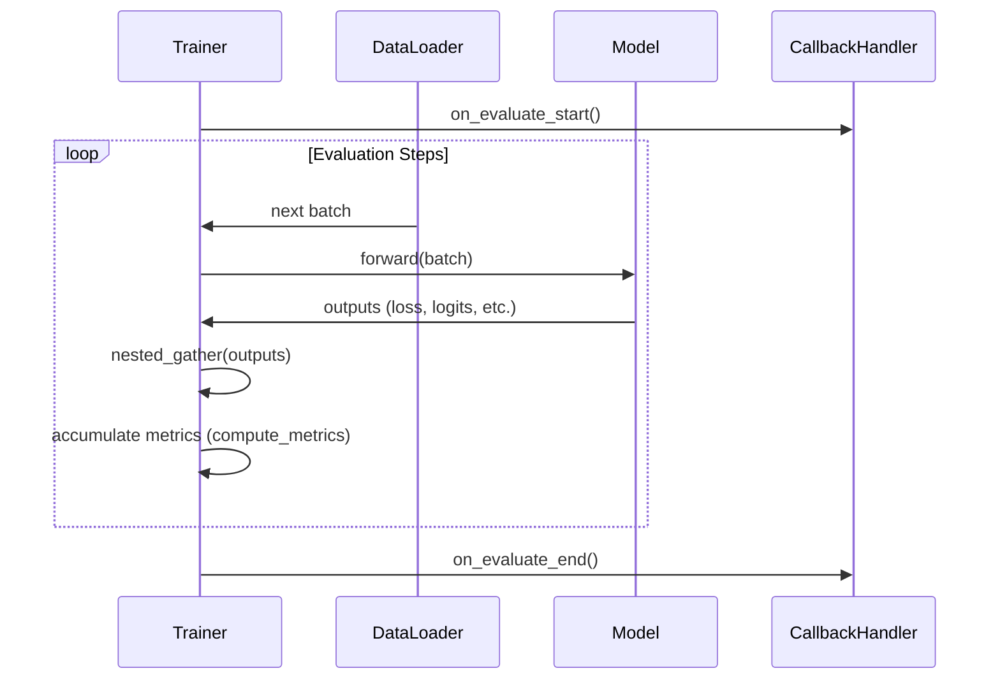
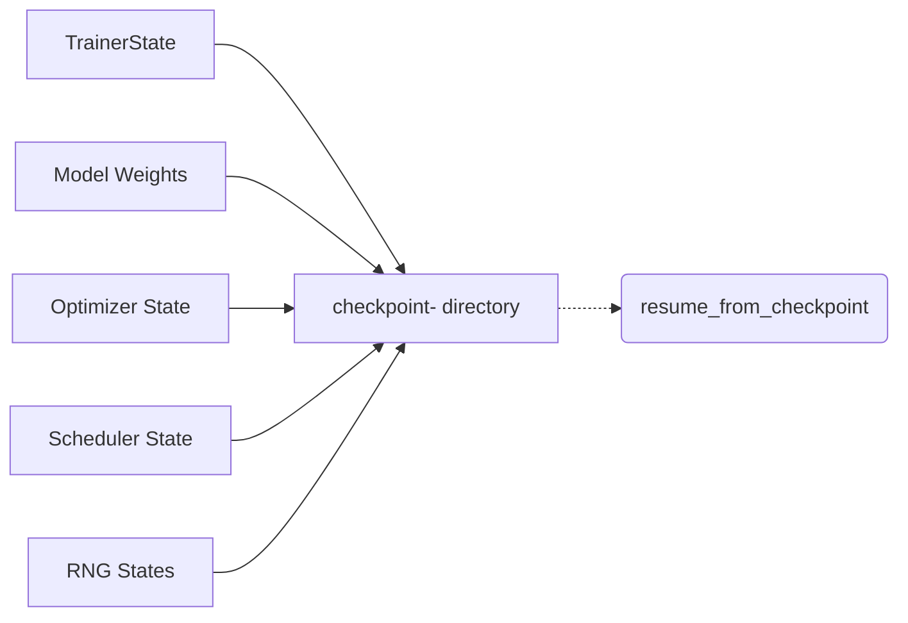

<!-- source: DeepWiki mcp.deepwiki.com · repo huggingface/transformers · page 6.1 Trainer & TrainingArguments · fetched 2026-10-26 -->

# Trainer & TrainingArguments

Relevant source files

The following files were used as context for generating this wiki page:

- [awesome-transformers.md](awesome-transformers.md)
- [docs/source/ar/llm_tutorial_optimization.md](docs/source/ar/llm_tutorial_optimization.md)
- [docs/source/ar/sagemaker.md](docs/source/ar/sagemaker.md)
- [docs/source/ar/serialization.md](docs/source/ar/serialization.md)
- [docs/source/ar/trainer.md](docs/source/ar/trainer.md)
- [docs/source/en/llm_tutorial_optimization.md](docs/source/en/llm_tutorial_optimization.md)
- [docs/source/en/main_classes/optimizer_schedules.md](docs/source/en/main_classes/optimizer_schedules.md)
- [docs/source/en/main_classes/quantization.md](docs/source/en/main_classes/quantization.md)
- [docs/source/en/model_doc/prophetnet.md](docs/source/en/model_doc/prophetnet.md)
- [docs/source/en/quantization/overview.md](docs/source/en/quantization/overview.md)
- [docs/source/en/trainer.md](docs/source/en/trainer.md)
- [docs/source/es/trainer.md](docs/source/es/trainer.md)
- [docs/source/ja/serialization.md](docs/source/ja/serialization.md)
- [docs/source/ko/llm_tutorial_optimization.md](docs/source/ko/llm_tutorial_optimization.md)
- [docs/source/ko/model_doc/mamba.md](docs/source/ko/model_doc/mamba.md)
- [docs/source/ko/model_doc/mamba2.md](docs/source/ko/model_doc/mamba2.md)
- [docs/source/ko/serialization.md](docs/source/ko/serialization.md)
- [docs/source/ko/trainer.md](docs/source/ko/trainer.md)
- [docs/source/zh/serialization.md](docs/source/zh/serialization.md)
- [examples/scheduler/README.md](examples/scheduler/README.md)
- [examples/scheduler/run_greedy.py](examples/scheduler/run_greedy.py)
- [src/transformers/integrations/__init__.py](src/transformers/integrations/__init__.py)
- [src/transformers/models/layoutlmv2/configuration_layoutlmv2.py](src/transformers/models/layoutlmv2/configuration_layoutlmv2.py)
- [src/transformers/optimization.py](src/transformers/optimization.py)
- [src/transformers/quantizers/auto.py](src/transformers/quantizers/auto.py)
- [src/transformers/testing_utils.py](src/transformers/testing_utils.py)
- [src/transformers/trainer.py](src/transformers/trainer.py)
- [src/transformers/trainer_pt_utils.py](src/transformers/trainer_pt_utils.py)
- [src/transformers/trainer_utils.py](src/transformers/trainer_utils.py)
- [src/transformers/training_args.py](src/transformers/training_args.py)
- [src/transformers/utils/__init__.py](src/transformers/utils/__init__.py)
- [src/transformers/utils/import_utils.py](src/transformers/utils/import_utils.py)
- [src/transformers/utils/quantization_config.py](src/transformers/utils/quantization_config.py)
- [tests/optimization/test_greedy_lr.py](tests/optimization/test_greedy_lr.py)
- [tests/optimization/test_optimization.py](tests/optimization/test_optimization.py)
- [tests/trainer/test_trainer.py](tests/trainer/test_trainer.py)
- [tests/trainer/test_trainer_optimizers.py](tests/trainer/test_trainer_optimizers.py)

## Purpose and Scope
This page covers the core training infrastructure in Hugging Face Transformers, focusing on the `Trainer` class [src/transformers/trainer.py:15-16]() and the `TrainingArguments` dataclass [src/transformers/training_args.py:180-183](). It explains the implementation of the training loop, evaluation, prediction, checkpointing, and how distributed training orchestration is handled across several backends. Further, it details how `TrainingArguments` encapsulates training hyperparameters, mixed precision, gradient accumulation, logging, and evaluation strategies.

Sources: [src/transformers/trainer.py:15-16](), [src/transformers/training_args.py:180-183]()

---

## Trainer Core Architecture

The `Trainer` class is a comprehensive, high-level PyTorch training loop implementation tailored for Transformer models. It abstracts complexities of distributed training (e.g., Distributed Data Parallel (DDP), Fully Sharded Data Parallel (FSDP), DeepSpeed), mixed precision training, gradient accumulation, evaluation, prediction, and checkpointing. `Trainer` integrates with the Accelerate library to manage device placement and multi-GPU orchestration automatically and safely.

### Training Loop Overview

The central method `Trainer.train()` manages the lifecycle of training, including:

- Resuming from checkpoints if specified,
- Iterating over training epochs and steps,
- Performing forward and backward propagation steps with optional gradient accumulation,
- Applying optimization and learning rate scheduling,
- Logging metrics and invoking callbacks,
- Conditional checkpoint saving based on configured saving strategies,
- Conducting evaluation at intervals during training.

The `Trainer` class abstracts device placement, mixed precision scaling, and distributed synchronization details, exposing a simple API for training/model fine-tuning.

### Code Entity Association Diagram: Trainer Components for Training Loop

Sources: [src/transformers/trainer.py:1754-1800]()

---

### Detailed Trainer Lifecycle Functions

| Method | Role | Implementation Details |
|---|---|---|
| `train()` | Main training loop | Orchestrates checkpoint loading, epoch and step iteration, applies gradient accumulation, logging, calls evaluation and callback systems. Tools distributed training orchestration seamlessly. [src/transformers/trainer.py:1754-1800]() |
| `compute_loss()` | Loss calculation | Computes loss between model outputs and labels, supports flexibility for custom loss functions or label mappings. [src/transformers/trainer.py:3450-3500]() |
| `training_step()` | Single optimization step | Runs forward pass, applies mixed precision loss scaling as needed, executes backward pass and gradient clipping if configured. [src/transformers/trainer.py:3430-3445]() |
| `evaluate()` | Evaluation loop | Performs inference on validation dataset, aggregates outputs across distributed devices, computes and logs metrics. [src/transformers/trainer.py:3650-3800]() |
| `predict()` | Prediction on a dataset | Silently runs model in eval mode on arbitrary datasets, aggregates predictions, and computes metrics without mutating trainer state. [src/transformers/trainer.py:3850-3900]() |
| `_save_checkpoint()` | Checkpoint saving | Saves model, optimizer, scheduler, RNG states, and training state to disk checkpoint folder with optional rotation/pruning. [src/transformers/trainer.py:3100-3250]() |
| `_setup_accelerator()` | Distributed & mixed precision setup | Initializes the accelerate `Accelerator` to manage distributed backend (DDP, FSDP, DeepSpeed), mixed precision, and device placement. [src/transformers/trainer.py:216-231]() |

`Trainer` integrates a rich callback system (`TrainerCallback` and related classes) to allow extensibility at steps such as training start, end, steps, evaluation start/end, and checkpoint save/load.

Sources: [src/transformers/trainer.py:1754-3900](), [src/transformers/trainer.py:216-231](), [src/transformers/trainer.py:3100-3250]()

---

## TrainingArguments

`TrainingArguments` is a structured configuration dataclass that encapsulates all the parameters controlling the behavior of the training run when using `Trainer`. It centralizes hyperparameters, logging/evaluation strategies, mixed precision configurations, distributed training flags, checkpoint/save policies, and other training options.

Configurations can be supplied directly when instantiating the dataclass or parsed from command-line input using the `HfArgumentParser`.

### Categories of Parameters

| Category | Key Parameters & Behavior | Source Lines |
|---|---|---|
| **Output & Checkpointing**| `output_dir`, `save_strategy`, `save_steps`, `save_total_limit`, `load_best_model_at_end` | [src/transformers/training_args.py:320-350]() |
| **Batching** | `per_device_train_batch_size`, `per_device_eval_batch_size`, `gradient_accumulation_steps` | [src/transformers/training_args.py:190-210]() |
| **Optimization** | `learning_rate`, `weight_decay`, `adam_beta1`, `adam_beta2`, `max_grad_norm`, `optim` | [src/transformers/training_args.py:240-280]() |
| **Precision** | `fp16`, `bf16`, `tf32`, `half_precision_backend` | [src/transformers/training_args.py:650-680]() |
| **Logging & Evaluation** | `logging_strategy`, `logging_steps`, `eval_strategy`, `eval_steps`, `evaluation_strategy` | [src/transformers/training_args.py:350-380]() |
| **Distributed Training** | `local_rank`, `deepspeed`, `fsdp`, `ddp_find_unused_parameters` | [src/transformers/training_args.py:750-850]() |
| **Miscellaneous** | `seed`, `disable_tqdm`, `report_to`, `run_name`, `overwrite_output_dir` | Various lines |

This dataclass also handles environment-adaptive defaults such as device detection, distributed backend inference, and mixed precision availability.

### TrainingArguments Dataclass Association Diagram

Sources: [src/transformers/training_args.py:180-350](), [src/transformers/training_args.py:650-680](), [src/transformers/training_args.py:750-850]()

---

## Distributed Training Orchestration

The `Trainer` utilizes the `accelerate.Accelerator` abstraction to manage distributed training complexities. Supported orchestration backends include:

- **Distributed Data Parallel (DDP):** Standard PyTorch DDP for multi-GPU across nodes or single-node multi-GPU.
- **Fully Sharded Data Parallel (FSDP):** Shards model parameters and optimizer states for memory efficiency; integrated with FSDP plugins.
- **DeepSpeed:** Integration for zero-optimization, offloading, and large model training accelerated by DeepSpeed.

`Trainer` also supports gradient accumulation by accumulating gradients over multiple steps before performing optimizer updates. This allows effective training with large effective batch sizes while respecting hardware memory constraints.

Checkpointing strategies (`save_strategy`) allow training state saving on steps, epochs, or disabling saving. Checkpoints are named with the prefix `checkpoint-` followed by the global training step. Checkpoint rotation is enabled with `save_total_limit` to keep disk usage bounded.

### Distributed Training Orchestration Flow Diagram

Sources: [src/transformers/trainer.py:216-250](), [src/transformers/training_args.py:750-850](), [src/transformers/trainer_utils.py:120-150]()

---

## Evaluation and Prediction Pipelines

Evaluation and prediction are handled internally by a shared evaluation loop `_evaluation_loop`. This loop:

- Iterates over the evaluation or prediction dataset DataLoader,
- Performs forward passes with `torch.no_grad()` to disable gradient computation,
- Collects outputs across possible distributed replicas using utilities like `nested_detach` [src/transformers/trainer_pt_utils.py:174-180]() and `nested_gather`,
- Aggregates outputs and computes evaluation metrics via the user-supplied `compute_metrics` function,
- Efficiently manages memory by using containers such as `EvalLoopContainer`.

The evaluation can be triggered during training (`Trainer.evaluate()`) or run independently for inference (`Trainer.predict()`).

### Evaluation Flow Sequence

Sources: [src/transformers/trainer.py:3650-3800](), [src/transformers/trainer_pt_utils.py:174-180]()

---

## Checkpointing Mechanism

Checkpoints preserve the training state including:

- Model parameters,
- Optimizer state,
- Learning rate scheduler state,
- RNG (random number generator) states for Python, NumPy, and PyTorch to ensure reproducibility,
- Trainer state like global step and epoch.

These are saved into a `checkpoint-<step>` directory within the configured `output_dir`.

- Checkpoint saving frequency is configurable by `save_strategy` and `save_steps`.
- Old checkpoints can be pruned automatically using `save_total_limit`.
- Checkpoints allow training resumption seamlessly preserving optimizer/scheduler state.

### Checkpoint Persistence Data Flow

Sources: [src/transformers/trainer_utils.py:119-150](), [src/transformers/trainer.py:3075-3150]()

---

# Summary

The `Trainer` class along with the `TrainingArguments` dataclass form the backbone of the training ecosystem in Hugging Face Transformers. They provide a unified, extensible, and hardware-agnostic training experience that covers:

- Complete training and evaluation lifecycle management,
- Mixed precision and gradient accumulation support,
- Distributed training orchestration across various backends (DDP, FSDP, DeepSpeed),
- Flexible checkpointing and robust checkpoint resuming,
- User-configurable hyperparameters governing optimization, logging, evaluation, and batch handling,
- Integration of callbacks for extensibility and custom behavior injection.

These components enable users to train, fine-tune, validate, and predict with Transformer models effectively and efficiently, minimizing boilerplate and addressing modern neural network training complexities.

---

# References

- Trainer implementation: [src/transformers/trainer.py:1-4620]()
- TrainingArguments: [src/transformers/training_args.py:1-2920]()
- Trainer Utilities (checkpoint, distributed, utils): [src/transformers/trainer_utils.py:1-1262](), [src/transformers/trainer_pt_utils.py:1-1659]()
- Trainer Callbacks: [src/transformers/trainer_callback.py:1-784]()

Sources: [src/transformers/trainer.py](), [src/transformers/training_args.py](), [src/transformers/trainer_utils.py](), [src/transformers/trainer_pt_utils.py](), [src/transformers/trainer_callback.py]()

---

