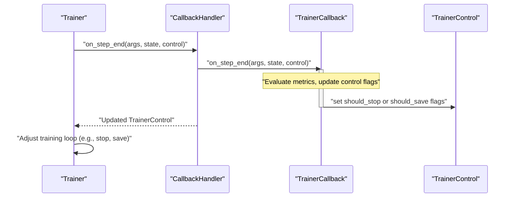
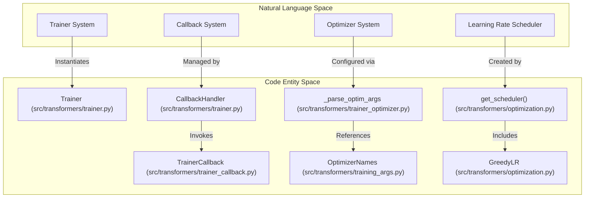

<!-- source: DeepWiki mcp.deepwiki.com · repo huggingface/transformers · page 6.2 Callbacks, Optimizers & Schedulers · fetched 2026-10-26 -->

# Callbacks, Optimizers & Schedulers

Relevant source files

The following files were used as context for generating this wiki page:

- [docs/source/en/main_classes/callback.md](docs/source/en/main_classes/callback.md)
- [docs/source/en/main_classes/optimizer_schedules.md](docs/source/en/main_classes/optimizer_schedules.md)
- [docs/source/en/main_classes/quantization.md](docs/source/en/main_classes/quantization.md)
- [docs/source/en/quantization/overview.md](docs/source/en/quantization/overview.md)
- [docs/source/ja/main_classes/callback.md](docs/source/ja/main_classes/callback.md)
- [docs/source/ko/main_classes/callback.md](docs/source/ko/main_classes/callback.md)
- [docs/source/zh/main_classes/callback.md](docs/source/zh/main_classes/callback.md)
- [examples/scheduler/README.md](examples/scheduler/README.md)
- [examples/scheduler/run_greedy.py](examples/scheduler/run_greedy.py)
- [src/transformers/data/data_collator.py](src/transformers/data/data_collator.py)
- [src/transformers/integrations/__init__.py](src/transformers/integrations/__init__.py)
- [src/transformers/integrations/fsdp.py](src/transformers/integrations/fsdp.py)
- [src/transformers/integrations/integration_utils.py](src/transformers/integrations/integration_utils.py)
- [src/transformers/integrations/tpu.py](src/transformers/integrations/tpu.py)
- [src/transformers/models/layoutlmv2/configuration_layoutlmv2.py](src/transformers/models/layoutlmv2/configuration_layoutlmv2.py)
- [src/transformers/optimization.py](src/transformers/optimization.py)
- [src/transformers/quantizers/auto.py](src/transformers/quantizers/auto.py)
- [src/transformers/testing_utils.py](src/transformers/testing_utils.py)
- [src/transformers/trainer.py](src/transformers/trainer.py)
- [src/transformers/trainer_callback.py](src/transformers/trainer_callback.py)
- [src/transformers/trainer_pt_utils.py](src/transformers/trainer_pt_utils.py)
- [src/transformers/trainer_seq2seq.py](src/transformers/trainer_seq2seq.py)
- [src/transformers/trainer_utils.py](src/transformers/trainer_utils.py)
- [src/transformers/training_args.py](src/transformers/training_args.py)
- [src/transformers/utils/__init__.py](src/transformers/utils/__init__.py)
- [src/transformers/utils/import_utils.py](src/transformers/utils/import_utils.py)
- [src/transformers/utils/quantization_config.py](src/transformers/utils/quantization_config.py)
- [tests/optimization/test_greedy_lr.py](tests/optimization/test_greedy_lr.py)
- [tests/optimization/test_optimization.py](tests/optimization/test_optimization.py)
- [tests/trainer/test_data_collator.py](tests/trainer/test_data_collator.py)
- [tests/trainer/test_trainer.py](tests/trainer/test_trainer.py)
- [tests/trainer/test_trainer_accelerator.py](tests/trainer/test_trainer_accelerator.py)
- [tests/trainer/test_trainer_callback.py](tests/trainer/test_trainer_callback.py)
- [tests/trainer/test_trainer_checkpointing.py](tests/trainer/test_trainer_checkpointing.py)
- [tests/trainer/test_trainer_evaluation.py](tests/trainer/test_trainer_evaluation.py)
- [tests/trainer/test_trainer_optimizers.py](tests/trainer/test_trainer_optimizers.py)
- [tests/trainer/test_trainer_seq2seq.py](tests/trainer/test_trainer_seq2seq.py)
- [tests/trainer/test_training_args.py](tests/trainer/test_training_args.py)
- [tests/trainer/trainer_test_utils.py](tests/trainer/trainer_test_utils.py)

This page provides an in-depth technical overview of the extensible components that regulate and augment training within the Hugging Face Transformers library. It covers the:

- **`TrainerCallback` system**, enabling customized training behavior by hooking into the Trainer lifecycle.
- Built-in **callbacks** such as early stopping, TensorBoard, and Weights & Biases (Wandb) integrations.
- **Optimization utilities**, including supported optimizers (`AdamW`, `Adafactor`, etc.), the optimizer factory in `trainer_optimizer.py`.
- Learning rate **schedulers**, including standard types and the library's custom GreedyLR scheduler.

Implementation details, data flow diagrams, and references to core classes and functions are included to guide understanding and usage.

---

## Callback System

The callback system in the `transformers` library is designed for extensibility, allowing users and integrations to plug into the core training loop without modifying it. Callbacks respond to specific lifecycle events during training, evaluation, and prediction, enabling side effects such as logging, early stopping, checkpointing, or custom metrics collection.

### Core Classes & Data Flow

- **`TrainerCallback`** [src/transformers/trainer_callback.py:34-143]():

  An abstract base class defining a rich set of hook methods triggered by the `Trainer` throughout training. Implementations override desired hooks such as:

  - `on_train_begin`, `on_train_end`
  - `on_epoch_begin`, `on_epoch_end`
  - `on_step_begin`, `on_step_end`
  - `on_evaluate_begin`, `on_evaluate_end`
  - `on_save`, `on_log`

  All hooks receive:

  1. `TrainingArguments` — current training configuration containing hyperparameters and logging settings [src/transformers/training_args.py:179-203]().
  2. `TrainerState` — dataclass storing dynamic state, including steps completed, best metrics, and log history [src/transformers/trainer_callback.py:34-149]().
  3. `TrainerControl` — mutable object that callbacks use to request changes to training behavior (e.g., halt training or trigger saving) [src/transformers/trainer_callback.py:46-73]().

- **`CallbackHandler`** [src/transformers/trainer.py:88-95]():

  The orchestrating entity which holds a list of registered `TrainerCallback` instances. When the Trainer invokes lifecycle events, the `CallbackHandler` forwards these calls sequentially to all active callbacks. It also collects and consolidates flags in `TrainerControl` reflecting decisions like stopping early or saving checkpoints.

- **`TrainerState`** and **`TrainerControl`**:

  These classes encapsulate shared state and control decisions across callbacks and the Trainer core loop, enabling decoupling of callback logic from the training internals.

### Callback Execution Flow

The Trainer emits lifecycle events by invoking corresponding methods on `CallbackHandler`. Each callback is then run in sequence for that event, receiving the current training context. Modifications to `TrainerControl` by any callback propagate back to the Trainer, which adapts loop behavior accordingly.

**Diagram: Callback Execution Sequence**

Sources: [src/transformers/trainer.py:88-95](), [src/transformers/trainer_callback.py:34-149]()

### Built-in Callbacks

The library includes several standard callback implementations catering to common training needs:

| Callback Class | Purpose | Source Reference |
|---|---|---|
| `DefaultFlowCallback` | Default control flow: logs, evaluation, checkpointing at intervals | [src/transformers/trainer_callback.py:530-560]() |
| `EarlyStoppingCallback`| Stops training when monitored metric plateaus beyond patience | [src/transformers/trainer/test_trainer.py:41]() |
| `TensorBoardCallback` | Logs metrics to TensorBoard during training | [src/transformers/integrations/integration_utils.py:149-154]() |
| `WandbCallback` | Integrates with Weights & Biases for logging | [src/transformers/integrations/integration_utils.py:104-112]() |
| `ProgressCallback` | Manages progress bars with `tqdm` during training and eval | [src/transformers/trainer_callback.py:480-500]() |

Users can pass these callbacks to the `Trainer` constructor or enable integrations via utilities that automatically attach appropriate callbacks.
Sources: [src/transformers/trainer/test_trainer.py:41](), [src/transformers/trainer_callback.py:480-560](), [src/transformers/integrations/integration_utils.py:104-154]()

---

## Optimizers

The `Trainer` class supports a variety of optimizers, selected via the `OptimizerNames` enumeration in `training_args.py` [src/transformers/training_args.py:113-160](). The actual construction and configuration of optimizer instances is abstracted through functions in `trainer_optimizer.py`, allowing centralized management and extensibility [src/transformers/trainer.py:96-102]().

### Optimizer Factory & Management

- Optimizer choice is controlled by the user via `TrainingArguments` which specifies the optimizer name (e.g., `"adamw_torch"`, `"adafactor"`, `"adamw_bnb_8bit"`).
- During initialization, the Trainer delegates to internal helper functions (`_parse_optim_args` and others) in `trainer_optimizer.py` that instantiate the correct optimizer class with proper hyperparameters.
- This separation enables support for advanced or experimental optimizers without cluttering the Trainer's core logic.
Sources: [src/transformers/trainer.py:96-102](), [src/transformers/training_args.py:113-160]()

### Supported Optimizers

The notable optimizer options include but are not limited to:

| Optimizer Enum Name | Description | Source Reference |
|---|---|---|
| `adamw_torch` | Standard PyTorch AdamW optimizer | [src/transformers/training_args.py:118-121]() |
| `adafactor` | Memory-efficient Adafactor optimizer | [src/transformers/training_args.py:122-124]() |
| `adamw_bnb_8bit` | 8-bit AdamW optimizer from bitsandbytes backend | [src/transformers/training_args.py:129-133]() |
| `galore_adamw` | Gradient Low-Rank Projection AdamW optimizer | [src/transformers/training_args.py:144-148]() |
| `lomo` | Local Memory Optimization optimizer | [src/transformers/training_args.py:150-153]() |
| `schedule_free_adamw` | Schedule-Free AdamW optimizer | [src/transformers/training_args.py:154-158]() |

### Adafactor Optimizer

- Implements an approximate second-moment estimator with factored statistics, reducing memory costs.
- Ideal for very large models where Adam's memory overhead is prohibitive.
- Implemented in `optimization.py` with integration to Trainer's optimizer setup pipeline [src/transformers/trainer.py:96-102]().
Sources: [src/transformers/trainer.py:96-102]()

---

## Learning Rate Schedulers

Learning rate schedulers modulate the optimizer's learning rate during training to improve convergence and generalization. The Transformers library provides:

- The `get_scheduler` utility function in `optimization.py` for creating schedulers from string types in a unified way [src/transformers/trainer.py:82]().
- Support for various common schedulers including linear decay, cosine decay, polynomial, constant, and inverse square root decay [src/transformers/training_args.py:33-34]().

### Scheduler Types Supported

| Scheduler Type | Description |
|---|---|
| `linear` | Linear decay from initial LR to zero over total training steps |
| `cosine` | Cosine-shaped decay schedule for smooth decreases |
| `polynomial` | Polynomial decay with power hyperparameter |
| `constant` | Keeps LR fixed throughout training |
| `inverse_sqrt` | LR decreases proportional to inverse sqrt of step count |
| `greedy` | Custom scheduler reducing LR on validation plateau |

### Greedy Learning Rate Scheduler

- The `GreedyLR` scheduler, defined in `optimization.py` and imported into `trainer.py`, reduces LR dynamically based on validation loss trends rather than fixed step schedules [src/transformers/trainer.py:82]().
- It monitors validation metrics and reduces LR when no improvement is seen for some patience, allowing adaptive fine-tuning of LR.
Sources: [src/transformers/trainer.py:82]()

---

## Integration & Data Flow

The key training subsystems involved in callbacks, optimizers, and schedulers interact under the control of the `Trainer`. The flow below illustrates how these components relate in the context of natural language training concepts mapped to concrete code entities.

### Diagram: Training Subsystems Architecture and Code Entities

Sources: [src/transformers/trainer.py:82, 88-95, 96-102](), [src/transformers/trainer_callback.py:34-143](), [src/transformers/training_args.py:113-160]()

### Optimizer Step and Scheduler Update in Training Loop

During the training process within the `Trainer`:

1. After each backward pass and gradient accumulation, the Trainer executes callback event `on_substep_end`, allowing callbacks to respond to intermediate updates [src/transformers/trainer.py:2300-2350]().

2. Once the accumulation count reaches the defined threshold, the optimizer performs a parameter update via `optimizer.step()` [src/transformers/trainer.py:2300-2350]().

3. Simultaneously, `lr_scheduler.step()` updates the learning rate according to the chosen schedule.

4. Callbacks receive these events and may log metrics, save checkpoints, or stop training early by manipulating `TrainerControl`.
Sources: [src/transformers/trainer.py:2300-2350]()

---

## Summary Table of Important Classes/Functions

| Name | File Path | Description |
|---|---|---|
| `Trainer` | `src/transformers/trainer.py` | Main training loop orchestrating training and callbacks |
| `TrainerCallback` | `src/transformers/trainer_callback.py` | Base class for training lifecycle callbacks |
| `CallbackHandler` | `src/transformers/trainer.py` | Holds and calls all registered callbacks |
| `TrainerState` | `src/transformers/trainer_callback.py` | Trainer internal state container |
| `TrainerControl` | `src/transformers/trainer_callback.py` | Mutable control flags from callbacks to Trainer |
| `_parse_optim_args` | `src/transformers/trainer_optimizer.py` | Parses and creates optimizers based on TrainingArguments |
| `OptimizerNames` | `src/transformers/training_args.py` | Enum of supported optimizer names |
| `get_scheduler` | `src/transformers/optimization.py` | Creates learning rate schedulers |
| `GreedyLR` | `src/transformers/optimization.py` | Adaptive LR scheduler reducing LR on validation plateau |
| `EarlyStoppingCallback` | `src/transformers/trainer/test_trainer.py` | Callback for early stopping during training |
| `TensorBoardCallback` | `src/transformers/integrations/integration_utils.py` | Logs metrics to TensorBoard |
| `WandbCallback` | `src/transformers/integrations/integration_utils.py` | Integration with Wandb experiment tracker |

---

**Sources:**

- Callback system, callbacks, and Trainer interaction: [src/transformers/trainer.py:14-16, 86-95](), [src/transformers/trainer_callback.py:30-149,480-700](), [src/transformers/integrations/integration_utils.py:100-154](), [src/transformers/trainer/test_trainer.py:41]()
- Optimizer enums and factory: [src/transformers/training_args.py:113-160](), [src/transformers/trainer_optimizer.py:90-102](), [src/transformers/optimization.py:60-110, 300-350]()
- Learning rate schedulers: [src/transformers/optimization.py:70-110, 300-350](), [src/transformers/trainer.py:82](), [src/transformers/training_args.py:33-34]()
- Trainer callback event flow: [src/transformers/trainer.py:2300-2350]()

---

