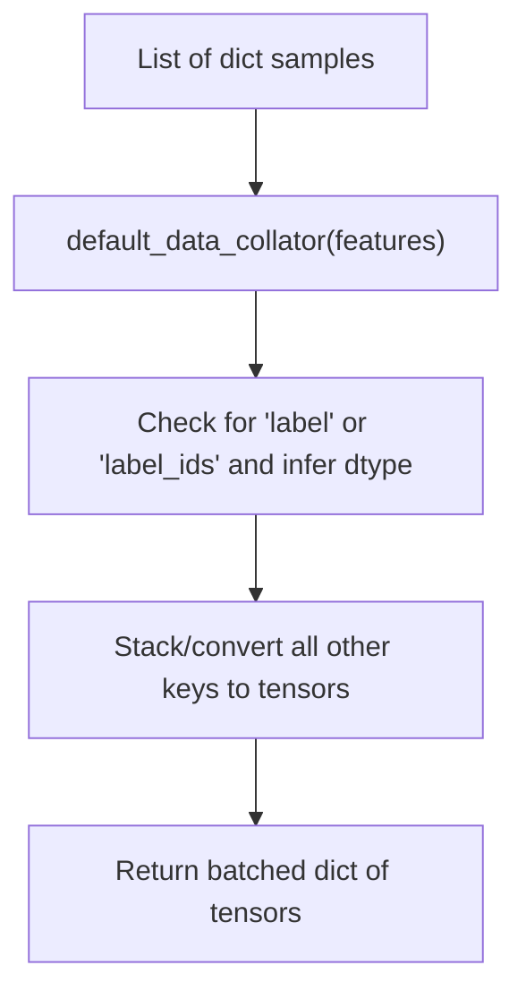
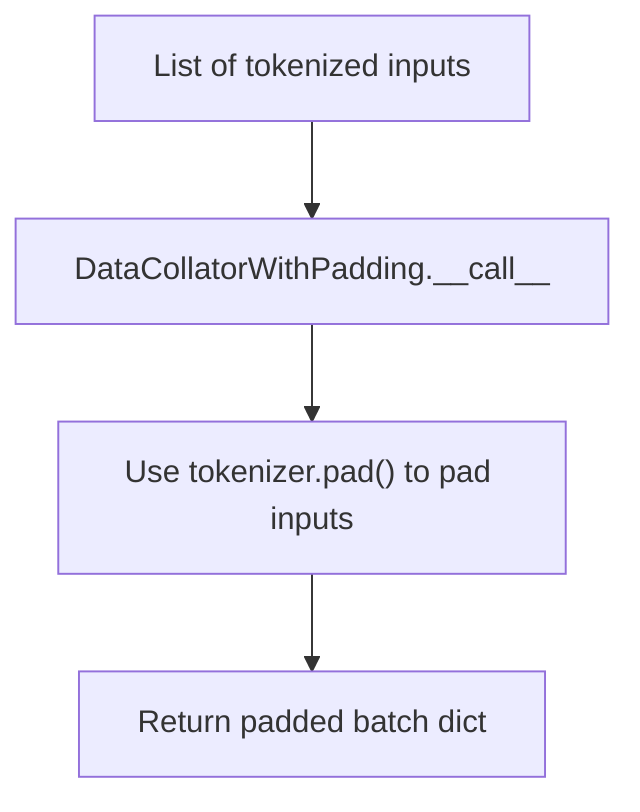
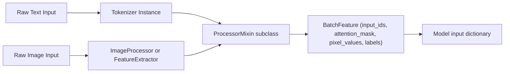
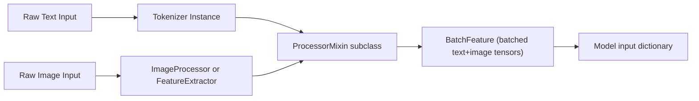

<!-- source: DeepWiki mcp.deepwiki.com · repo huggingface/transformers · page 6.3 Data Collators & Datasets · fetched 2026-10-26 -->

# Data Collators & Datasets

<details>
<summary>Relevant source files</summary>

The following files were used as context for generating this wiki page:

- [docs/source/en/main_classes/callback.md](docs/source/en/main_classes/callback.md)
- [docs/source/en/model_doc/pixtral.md](docs/source/en/model_doc/pixtral.md)
- [docs/source/ja/main_classes/callback.md](docs/source/ja/main_classes/callback.md)
- [docs/source/ko/main_classes/callback.md](docs/source/ko/main_classes/callback.md)
- [docs/source/zh/main_classes/callback.md](docs/source/zh/main_classes/callback.md)
- [src/transformers/data/data_collator.py](src/transformers/data/data_collator.py)
- [src/transformers/hf_argparser.py](src/transformers/hf_argparser.py)
- [src/transformers/integrations/fsdp.py](src/transformers/integrations/fsdp.py)
- [src/transformers/integrations/integration_utils.py](src/transformers/integrations/integration_utils.py)
- [src/transformers/integrations/tpu.py](src/transformers/integrations/tpu.py)
- [src/transformers/models/blip/processing_blip.py](src/transformers/models/blip/processing_blip.py)
- [src/transformers/models/blip_2/processing_blip_2.py](src/transformers/models/blip_2/processing_blip_2.py)
- [src/transformers/models/idefics2/processing_idefics2.py](src/transformers/models/idefics2/processing_idefics2.py)
- [src/transformers/models/idefics3/processing_idefics3.py](src/transformers/models/idefics3/processing_idefics3.py)
- [src/transformers/models/instructblip/processing_instructblip.py](src/transformers/models/instructblip/processing_instructblip.py)
- [src/transformers/models/instructblipvideo/processing_instructblipvideo.py](src/transformers/models/instructblipvideo/processing_instructblipvideo.py)
- [src/transformers/models/kosmos2/processing_kosmos2.py](src/transformers/models/kosmos2/processing_kosmos2.py)
- [src/transformers/models/paligemma/processing_paligemma.py](src/transformers/models/paligemma/processing_paligemma.py)
- [src/transformers/models/pixtral/__init__.py](src/transformers/models/pixtral/__init__.py)
- [src/transformers/models/pixtral/configuration_pixtral.py](src/transformers/models/pixtral/configuration_pixtral.py)
- [src/transformers/models/pixtral/modeling_pixtral.py](src/transformers/models/pixtral/modeling_pixtral.py)
- [src/transformers/models/pixtral/processing_pixtral.py](src/transformers/models/pixtral/processing_pixtral.py)
- [src/transformers/trainer_callback.py](src/transformers/trainer_callback.py)
- [src/transformers/trainer_seq2seq.py](src/transformers/trainer_seq2seq.py)
- [tests/models/pixtral/test_modeling_pixtral.py](tests/models/pixtral/test_modeling_pixtral.py)
- [tests/trainer/test_data_collator.py](tests/trainer/test_data_collator.py)
- [tests/trainer/test_trainer_accelerator.py](tests/trainer/test_trainer_accelerator.py)
- [tests/trainer/test_trainer_callback.py](tests/trainer/test_trainer_callback.py)
- [tests/trainer/test_trainer_checkpointing.py](tests/trainer/test_trainer_checkpointing.py)
- [tests/trainer/test_trainer_evaluation.py](tests/trainer/test_trainer_evaluation.py)
- [tests/trainer/test_trainer_seq2seq.py](tests/trainer/test_trainer_seq2seq.py)
- [tests/trainer/test_training_args.py](tests/trainer/test_training_args.py)
- [tests/trainer/trainer_test_utils.py](tests/trainer/trainer_test_utils.py)
- [tests/utils/test_hf_argparser.py](tests/utils/test_hf_argparser.py)

</details>


Data Collators are specialized callable objects designed to assemble batches from lists of dataset samples by applying padding, batching, and transformations tailored to specific tasks. They output batches as dictionaries of tensors compatible with PyTorch or NumPy frameworks. This page covers key DataCollator classes—`DataCollatorWithPadding`, `DataCollatorForSeq2Seq`, `DataCollatorForLanguageModeling`, `DataCollatorForTokenClassification`—their design, implementation, and usage. It also details processor classes for task- and modality-specific preprocessing and the `HfArgumentParser` utility for dataclass argument parsing.

---

## Data Collator Architecture

A **DataCollator** is defined as a callable with the signature:

```python
Callable[[list[InputDataClass]], dict[str, Any]]
```

where it receives a list of dataset entries (samples) and returns a batch dictionary comprised of tensors. The base handling is via `DataCollatorMixin`, which dispatches calls to framework-specific batching methods depending on the `return_tensors` argument or instance default. It supports `"pt"` for PyTorch tensors and `"np"` for NumPy arrays.

```python
class DataCollatorMixin:
    def __call__(self, features, return_tensors: str | None = None):
        if return_tensors is None:
            return_tensors = self.return_tensors
        if return_tensors == "pt":
            return self.torch_call(features)
        elif return_tensors == "np":
            return self.numpy_call(features)
        else:
            raise ValueError(f"Framework '{return_tensors}' not recognized!")
```

This structure ensures uniform handling regardless of tensor backend [src/transformers/data/data_collator.py:37-47]().

Sources:
- [src/transformers/data/data_collator.py:37-47]()

---

### Default Data Collator

The simplest collator is the function `default_data_collator` and its object wrapper `DefaultDataCollator`. They collate batches of dictionary-like samples by stacking or converting lists and arrays into tensors, with special care to infer tensor dtypes for labels:

- `"label"` key (single value per sample): converted to `torch.long` for int labels and `torch.float` for floats.
- `"label_ids"` key (list per sample): similarly processed.

Other keys are stacked or tensorized directly, except string-like values which are ignored. The returned dict maps string keys to batched tensors.

**Example Call Flow:**



This collator forms the backbone for simple classification and regression dataset collation [src/transformers/data/data_collator.py:71-120](), [src/transformers/data/data_collator.py:122-155]().

Sources:
- [src/transformers/data/data_collator.py:71-120]()
- [src/transformers/data/data_collator.py:122-155]()
- [tests/trainer/test_data_collator.py:88-173]()

---

### Specialized Task Collators

Several collators inherit from `DataCollatorMixin` and add task-relevant features, mainly around padding and input/label preprocessing:

#### 1. DataCollatorWithPadding

- Pads sequences dynamically to the batch's longest length.
- Uses the tokenizer’s `pad()` method with a custom wrapper to suppress fast tokenizer warnings.
- Useful for sequence classification and token classification tasks.



This component enables dynamic per-batch padding and is agnostic to the input framework [src/transformers/data/data_collator.py:49-68]().

#### 2. DataCollatorForLanguageModeling

- Supports Masked Language Modeling (MLM) and Causal Language Modeling (CLM).
- Applies random masking with a probability (default 15%).
- Optionally performs whole-word masking via specialized subclasses.
- Returns masked inputs and label tensors indicating prediction targets.

#### 3. DataCollatorForSeq2Seq

- Targeted for encoder-decoder models like T5, BART.
- Pads source inputs and target labels separately.
- Replaces padding tokens in labels with `-100` to ignore them during loss computation.

#### 4. DataCollatorForTokenClassification

- Used for token-level supervised tasks (e.g., NER).
- Pads label sequences to align with padded input tokens, ensuring proper label lengths for loss calculation.

These collators provide specialized data transformation pipelines built atop the tokenizer and base collator machinery, tailored for specific downstream tasks. They all implement the `DataCollatorMixin` interface [tests/trainer/test_data_collator.py:33-38]().

Sources:
- [src/transformers/data/data_collator.py:49-68]()
- [tests/trainer/test_data_collator.py:33-38]()
- [src/transformers/trainer_seq2seq.py:60-61]()

---

## Dataset Preprocessing & Processor Utilities

Processor classes encapsulate logic for multimodal and task-specific preprocessing that integrates text tokenization, image processing, and additional modalities in a single interface.

### ProcessorMixin and Implementations

`ProcessorMixin` is a base class implementing a unified `__call__()` method that processes text and images according to predefined kwargs, returning a `BatchFeature` object containing tensors or arrays bundling all model inputs.

#### Notable Processor Classes

- **PaliGemmaProcessor**  
  Handles multimodal inputs with special image tokens `<image>`, adds special tokens, and supports suffix text for multitask finetuning. It merges text and image preprocessing pipelines and emits labels aligned to token types [src/transformers/models/paligemma/processing_paligemma.py:39-135]().

- **Idefics3Processor**  
  Manages fake and real image tokens, synchronizes token replacements in text, and uses regex cleanup on special tokens. It processes images and text inputs with coherent token type ids and sequence lengths [src/transformers/models/idefics3/processing_idefics3.py:36-148]().

- **PixtralProcessor**  
  Introduces special image patch tokens for the Pixtral vision model. It computes the number of multimodal tokens, uses spatial merge factors for image patches, and controls image token replacement in text sequences [src/transformers/models/pixtral/processing_pixtral.py:36-149]().

- **LlavaProcessor** (not fully shown, similar modality fusion)  
  Combines text and images with truncation and size parameters, merging modality tokens and returning composite BatchFeature objects.

**Multimodal Input Preprocessing Flow:**



These processors orchestrate coherent batching for multimodal datasets by combining tokenizers and image processors, streamlining model input preparation [src/transformers/models/paligemma/processing_paligemma.py:39-135](), [src/transformers/models/idefics3/processing_idefics3.py:36-148](), [src/transformers/models/pixtral/processing_pixtral.py:36-149]().

Sources:
- [src/transformers/models/paligemma/processing_paligemma.py:39-135]()
- [src/transformers/models/idefics3/processing_idefics3.py:36-148]()
- [src/transformers/models/pixtral/processing_pixtral.py:36-149]()
- [src/transformers/models/instructblip/processing_instructblip.py]()
- [src/transformers/models/instructblipvideo/processing_instructblipvideo.py]()
- [src/transformers/models/blip_2/processing_blip_2.py]()
- [src/transformers/models/kosmos2/processing_kosmos2.py]()
- [src/transformers/models/blip/processing_blip.py]()

---

## Argument Parsing with `HfArgumentParser`

`HfArgumentParser` extends Python's standard `argparse.ArgumentParser` by leveraging dataclass type hints to generate CLI arguments automatically and parse them into dataclass instances.

- Supports nested dataclasses and iterable dataclass lists.
- Handles boolean parsing gracefully with `string_to_bool`.
- Supports enums and choice types through custom mapping.
- Improves usability for command-line tools, reducing boilerplate parser definition.

Example usage:

```python
@dataclass
class TrainingArgs:
    learning_rate: float = 5e-5
    output_dir: str = "./models"
    do_train: bool = False

parser = HfArgumentParser(TrainingArgs)
args = parser.parse_args_into_dataclasses()
```

This system enables seamless integration of complex configs with CLI interfaces for training and evaluation scripts [src/transformers/hf_argparser.py:30-124]().

Sources:
- [src/transformers/hf_argparser.py:30-124]()
- [tests/utils/test_hf_argparser.py]()

---

## Immutability and Testing of Data Collators

Robust testing ensures that data collators do not mutate input features in-place, preserving dataset integrity.

- Tests check that inputs before and after collator calls remain equal by value.
- Covers PyTorch and NumPy tensor variants, verifying batch correctness.
- Provides test mixins for common verification patterns.

| Collator Class                  | Purpose                 | Key Features                          |
| ------------------------------ | ----------------------- | ----------------------------------- |
| `DefaultDataCollator`           | Generic batch collation | Label dtype inference, tensor stacking |
| `DataCollatorWithPadding`       | Dynamic padding         | Uses tokenizer to pad sequences     |
| `DataCollatorForLanguageModeling` | Masked/causal LM     | Random token masking, whole-word mask support |
| `DataCollatorForSeq2Seq`        | Encoder-decoder training| Pads inputs & labels, label padding to `-100` |
| `DataCollatorForTokenClassification` | Token-level labeling | Pads labels aligning with inputs    |

These tests validate correctness and immutability, vital for stable training pipelines [tests/trainer/test_data_collator.py:54-81]().

Sources:
- [tests/trainer/test_data_collator.py:54-81]()

---

## Summary Diagrams

### Natural Language Dataset through DataCollator to Model Input

```mermaid
graph TD
  DS["Raw Dataset Samples (list of dicts)"] --> DC[DataCollator (Default or Specialized)]
  DC --> Batch["Batched Tensors (input_ids, labels, attention_mask, ...)"]
  Batch --> Model["Model Input Dict"]
```

### Multimodal Input Processing Chain



---

# References and Sources

- Core data collators and batching infrastructure: [src/transformers/data/data_collator.py:30-155]()
- Data collator test suite with functionality and immutability verification: [tests/trainer/test_data_collator.py:33-81]()
- Multimodal processor classes and detailed preprocessing logic:
  - PaliGemmaProcessor: [src/transformers/models/paligemma/processing_paligemma.py:39-135]()
  - Idefics3Processor: [src/transformers/models/idefics3/processing_idefics3.py:36-148]()
  - PixtralProcessor: [src/transformers/models/pixtral/processing_pixtral.py:36-149]()
  - LlavaProcessor (similar structure): [src/transformers/models/llava/processing_llava.py:30-107]()
- Dataclass argument parsing utilities with `HfArgumentParser`: [src/transformers/hf_argparser.py:30-124]()

---

